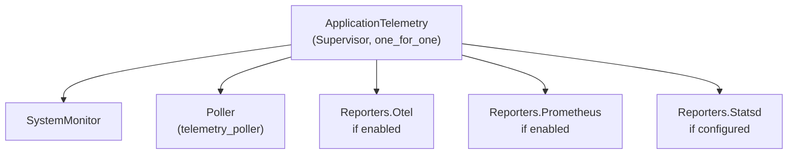
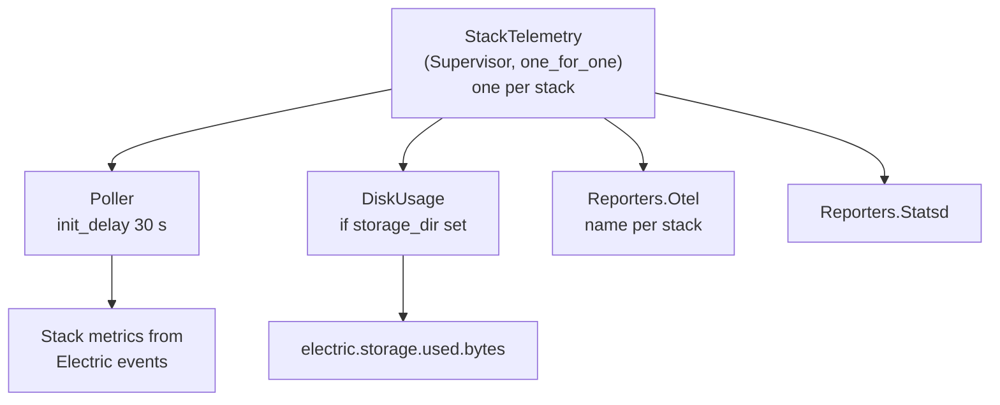
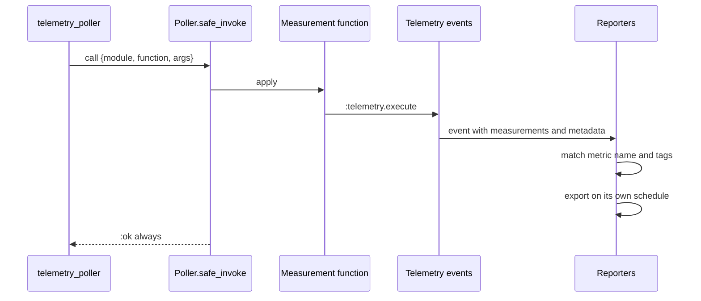

# Overview

`electric_telemetry` is the shared telemetry library for Electric. It collects measurements from the Bogdan/Björn's Erlang Abstract Machine (BEAM) virtual machine, from the operating system, and from an Electric stack. It turns each measurement into a Telemetry event. Reporter processes then export the events as metrics to OpenTelemetry, Prometheus, or StatsD.

The library has one central rule. **Collection is the same for every deployment, and export is optional.** A supervisor starts only when at least one exporter is enabled. When it starts, its collectors emit standard events. A deployment chooses zero or more reporters. If it chooses none, both `ApplicationTelemetry.start_link/1` and `StackTelemetry.start_link/1` return `:ignore`, and no poller, monitor, or reporter starts (`lib/electric/telemetry/application_telemetry.ex:17-27`, `lib/electric/telemetry/stack_telemetry.ex:17-27`).

The document uses four levels of data:

- A **measurement** is one named value at one instant, for example `length: 42`. A collection function produces it.
- A **periodic measurement** is a function that the poller calls on a schedule. The function emits zero or more events.
- An **event** is one Telemetry dispatch. It has a name, a measurement map, and a metadata map. `:telemetry.execute([:vm, :memory], %{total: 1}, %{})` is one event.
- A **metric** is a rule that turns matching events into one exported time series. It has a name, a type such as counter or last value, optional tags, and optional filters. A **tag** is a metadata key that becomes a label on the series.
- A **reporter** or **exporter** is a process that subscribes to events through its metric list. It sends the resulting series to an external system.

A **threshold** is a limit that starts or stops a monitor. The system monitor thresholds are examples. A **poller** is the `telemetry_poller` process that calls the periodic measurement functions.

## Package facts

| Fact | Value |
|------|-------|
| Application name | `:electric_telemetry` |
| Version | `0.4.0` |
| Licence | Apache-2.0 |
| Elixir requirement | `~> 1.17` (`mix.exs:8`) |
| Application callback | No supervision module. The caller starts the supervisors. |
| Extra applications | `:logger`, `:os_mon`, `:runtime_tools` (`mix.exs:15-17`) |
| Test coverage tool | `ExCoveralls` (`mix.exs:11`) |

The version comes from `package.json:1-5`. `mix.exs:43-54` reads it at build time and falls back to `"0.0.0"` when the file is absent.

## The two supervisors

The library has two top-level supervisors. A caller starts one or both.

### ApplicationTelemetry

`ElectricTelemetry.ApplicationTelemetry` is a `Supervisor` (`lib/electric/telemetry/application_telemetry.ex:7`). Its `start_link/1` validates the options and starts the supervisor only when at least one reporter is enabled (`lib/electric/telemetry/application_telemetry.ex:17-27`). Its children are:

1. `ElectricTelemetry.SystemMonitor` — one process for the whole application.
2. `ElectricTelemetry.Poller` — the periodic measurement loop.
3. The enabled reporter children (`lib/electric/telemetry/application_telemetry.ex:30-40`).

The supervisor starts the children in this order. The system monitor is first; it registers with the Erlang system monitor in its `init/1`. The poller is second. The reporters are last, so their event subscriptions exist before the poller's first tick. The poller has an initial delay of 5 seconds by default (`lib/electric/telemetry/poller.ex:14-22`). The strategy is `:one_for_one` (`lib/electric/telemetry/application_telemetry.ex:39`).



### StackTelemetry

`ElectricTelemetry.StackTelemetry` is also a `Supervisor` (`lib/electric/telemetry/stack_telemetry.ex:9`). A **stack** is one Electric instance with one PostgreSQL database. The caller starts one `StackTelemetry` per stack. The supervisor name is not registered, so several instances can run at the same time (`lib/electric/telemetry/stack_telemetry.ex:17-21`).

`start_link/1` has the same export gate as `ApplicationTelemetry`. It validates the options, calls `export_enabled?/1`, and returns `:ignore` when no exporter is enabled (`lib/electric/telemetry/stack_telemetry.ex:17-27`). It also requires `:stack_id` at run time. The option is optional in the shared schema, but `init/1` pattern-matches `%{stack_id: stack_id}`, so a missing value raises `FunctionClauseError` (`lib/electric/telemetry/stack_telemetry.ex:30`, `lib/electric/telemetry/opts.ex:5`).

When the supervisor starts, its children are:

1. A poller with a delayed start (`lib/electric/telemetry/stack_telemetry.ex:37-40`).
2. `ElectricTelemetry.DiskUsage` when a `storage_dir` is present (`lib/electric/telemetry/stack_telemetry.ex:64-70`).
3. An OpenTelemetry reporter child and a StatsD reporter child (`lib/electric/telemetry/stack_telemetry.ex:50-62`). Each child specification returns `nil` when its exporter is disabled, and the supervisor removes the `nil` entries (`lib/electric/telemetry/stack_telemetry.ex:45`, `lib/electric/telemetry/reporters/otel.ex:2-8`, `lib/electric/telemetry/reporters/statsd.ex:4-18`).

Prometheus is not a stack child. ApplicationTelemetry owns the single Prometheus endpoint. The stack supervisor never adds its metrics to that endpoint by itself. The caller must pass the stack metric definitions in the ApplicationTelemetry option `additional_prometheus_metrics` (`lib/electric/telemetry/application_telemetry.ex:42-53`). Without this step, the stack metrics reach OpenTelemetry and StatsD but not Prometheus.



### The stack label

The stack supervisor sets a process label and Logger metadata in `init/1` (`lib/electric/telemetry/stack_telemetry.ex:30-33`):

```elixir
Process.set_label({:stack_telemetry_supervisor, stack_id})
Logger.metadata(stack_id: stack_id)
```

The label is low-cardinality and stable. `Processes.proc_type/1` uses it to group the supervisor under the correct process type. The Logger metadata adds the stack identifier to every log line from the stack processes.

## Configuration

All options pass as one keyword list to either supervisor. `ElectricTelemetry.Opts.schema/0` defines the complete schema (`lib/electric/telemetry/opts.ex:2-108`). `ElectricTelemetry.validate_options/1` applies it (`lib/electric/telemetry.ex:21-33`).

### Top-level options

| Option | Type | Required | Default | Meaning |
|--------|------|----------|---------|---------|
| `instance_id` | string | yes | none | Identifier for this Electric instance. |
| `stack_id` | string | no | none | Identifier for one stack. |
| `storage_dir` | string | no | none | Directory to measure. Enables `DiskUsage`. |
| `version` | string | yes | none | Electric version string. |
| `reporters` | keyword list | no | `[]` | Export destinations. |
| `intervals_and_thresholds` | keyword list | no | `[]` | Collection timing and limits. |
| `periodic_measurements` | list | no | none | Extra periodic measurements. |
| `additional_metrics` | list of metric structs | no | none | Extra metrics for all reporters. |
| `additional_prometheus_metrics` | list of metric structs | no | `[]` | Extra metrics for Prometheus only. |
| `otel_opts` | keyword list | no | `[]` | OpenTelemetry exporter settings. |

### Reporter options

The `reporters` keyword list has four keys (`lib/electric/telemetry/opts.ex:8-17`):

| Option | Type | Default | Meaning |
|--------|------|---------|---------|
| `statsd_host` | string or `nil` | `nil` | StatsD host. A `nil` value disables StatsD. |
| `otel_metrics?` | boolean | `false` | Enable the OpenTelemetry exporter. |
| `prometheus?` | boolean | `false` | Enable the Prometheus exporter. |
| `otel_resource_attributes` | map | `%{}` | Resource attributes for OpenTelemetry. |

`ElectricTelemetry.export_enabled?/1` returns true when any of the first three options is truthy (`lib/electric/telemetry.ex:35-45`).

### Interval and threshold options

| Option | Type | Default | Meaning |
|--------|------|---------|---------|
| `system_metrics_poll_interval` | integer | `5_000` milliseconds | Poll interval for periodic measurements (`lib/electric/telemetry/opts.ex:22`). |
| `stack_telemetry_init_delay` | integer | `30_000` milliseconds | Delay before the stack poller starts (`lib/electric/telemetry/opts.ex:23`). |
| `top_process_limit` | tuple | `{:count, 5}` | Process grouping limit (`lib/electric/telemetry/opts.ex:24-37`). |
| `top_ets_table_count` | integer | `10` | Number of ETS table types to report (`lib/electric/telemetry/opts.ex:38`). |
| `long_gc_threshold` | integer | `50` milliseconds | Long garbage collection threshold (`lib/electric/telemetry/opts.ex:41`). |
| `long_schedule_threshold` | integer | `150` milliseconds | Long scheduler threshold (`lib/electric/telemetry/opts.ex:44`). |
| `long_message_queue_enable_threshold` | integer | `20` messages | Queue length that starts monitoring (`lib/electric/telemetry/opts.ex:49`). |
| `long_message_queue_disable_threshold` | integer | `0` messages | Queue length that stops monitoring (`lib/electric/telemetry/opts.ex:50`). |

The `top_process_limit` tuple has three forms. `{:count, n}` reports the top `n` process groups. `{:mem_percent, p}` reports groups until they cover `p` percent of process memory, with a minimum group size of 1,048,576 bytes (`lib/electric/telemetry/processes.ex:18-19`). `{:at_least_bytes, b}` reports every group above `b` bytes, plus the first group below `b` as a marker that the cutoff stopped the list (`lib/electric/telemetry/processes.ex:104-107`).

### OpenTelemetry options

`otel_opts` has these keys (`lib/electric/telemetry/opts.ex:93-106`):

| Option | Default | Meaning |
|--------|---------|---------|
| `otlp_protocol` | `:http_protobuf` | OpenTelemetry Protocol (OTLP) transport. Only this value is allowed. |
| `otlp_compression` | `:gzip` | Compression for the export. Only this value is allowed. |
| `otlp_endpoint` | no schema default | Collector endpoint. The schema does not require it; when it is absent, `OtelMetricExporter` reads the endpoint from the application environment (`lib/electric/telemetry/opts.ex:98-100`). |
| `otlp_headers` | `%{}` | Extra request headers. |
| `export_period` | `30_000` milliseconds | Time between exports. |
| `resource` | `%{}` | OpenTelemetry resource map. |

### A complete configuration

This example enables all three exporters for one application and one stack. The values are illustrative.

```elixir
opts = [
  instance_id: "electric-prod-1",
  stack_id: "stack_primary",
  storage_dir: "/var/lib/electric/stack_primary",
  version: "1.4.0",
  reporters: [
    statsd_host: "127.0.0.1",
    otel_metrics?: true,
    prometheus?: true,
    otel_resource_attributes: %{"service.name" => "electric"}
  ],
  intervals_and_thresholds: [
    system_metrics_poll_interval: 5_000,
    stack_telemetry_init_delay: 30_000,
    top_process_limit: {:count, 5},
    top_ets_table_count: 10,
    long_gc_threshold: 50,
    long_schedule_threshold: 150,
    long_message_queue_enable_threshold: 20,
    long_message_queue_disable_threshold: 0
  ],
  periodic_measurements: [:builtin],
  additional_metrics: [],
  additional_prometheus_metrics: [],
  otel_opts: [
    otlp_endpoint: "http://localhost:4318",
    otlp_headers: %{},
    export_period: 30_000
  ]
]

{:ok, app_pid} = ElectricTelemetry.ApplicationTelemetry.start_link(opts)
{:ok, stack_pid} = ElectricTelemetry.StackTelemetry.start_link(opts)
```

Several details are easy to miss:

- **`periodic_measurements` has no schema default.** It is optional in the schema, but the poller code pattern-matches on it. A missing key raises `FunctionClauseError` (`lib/electric/telemetry/opts.ex:53-64`, `lib/electric/telemetry/poller.ex:28-31`). Always pass at least `[:builtin]` or an explicit list.
- **`stack_id` is required for the stack supervisor.** The shared schema marks it optional, but `StackTelemetry.init/1` requires it (`lib/electric/telemetry/stack_telemetry.ex:30`).
- **Only the StatsD reporter uses `instance_id`**, as a global tag and as a tag on every metric (`lib/electric/telemetry/reporters/statsd.ex:8-22`).
- **`version` is required and validated. No module in this library reads it.** The consuming application supplies it for its own configuration (`lib/electric/telemetry/opts.ex:7`).
- **`additional_prometheus_metrics` must contain the stack metrics if you want them in Prometheus.** The stack supervisor does not add them to that endpoint (`lib/electric/telemetry/application_telemetry.ex:45-47`). The example leaves the list empty, so its Prometheus endpoint shows only application metrics.
- **A call with every exporter disabled returns `:ignore`.** The pattern match on `{:ok, pid}` in this example would then fail. A caller that allows zero exporters must handle `:ignore`.

## The collection loop



The poller calls `safe_invoke/3` for every measurement (`lib/electric/telemetry/poller.ex:60-98`). `safe_invoke` absorbs errors. This is a critical design point. The `telemetry_poller` library removes a measurement from its list after the first failure. The wrapper prevents that removal. Without the wrapper, one transient error would disable a metric until the next node start. One example is an Erlang Term Storage (ETS) table that does not yet exist during a restart.

**Aha:** the error handling is deliberately at the poller boundary, not inside each measurement. Each measurement function can then use direct calls such as `:ets.info` or `:erlang.statistics` without defensive code. The wrapper converts every exception and exit into a log message and an `:ok` return (`lib/electric/telemetry/poller.ex:69-98`).

## What the library measures

The library has five measurement families:

1. **BEAM memory and counts.** Atom, binary, code, ETS, process, and system memory. Process, port, and atom counts. Persistent term and run queue lengths.
2. **Scheduler use.** Normal scheduler use, dirty CPU scheduler use, weighted use, and total use.
3. **Garbage collection and reductions.**
4. **Operating system.** CPU use per core, load average, memory use, and swap use.
5. **Process, ETS, and disk detail.** It covers top process groups by memory or binary memory, ETS table groups by type, and storage directory size.

Document [01-events-and-handlers.md](01-events-and-handlers.md) lists every event name and every measurement key.

## Key insight

**Key insight:** the library has no database and no shared mutable state outside the disk cache. Every measurement is a read of the runtime or the file system. Every event is fire-and-forget. This is why a measurement failure is safe to swallow, and why a reporter can restart without a stored buffer to recover. The cost is that metrics are snapshots, not history: an event that occurs while no reporter is subscribed is gone.

The one piece of stored state is the disk usage cache. `DiskUsage` writes the last measured size to `<storage_dir>/.disk-usage` (`lib/electric/telemetry/disk_usage.ex:113-150`). On restart it reads the cache and avoids a full directory walk until the next scheduled update. The cache is versioned with `"1"` and is invalid if the format does not match (`lib/electric/telemetry/disk_usage.ex:115-128`).

## Limits of this document

This overview names the supervisors, the options, and the measurement families. It does not prove each event or each metric definition. Document [01-events-and-handlers.md](01-events-and-handlers.md) gives the full event table and the function-by-function detail.

## Related documents

- [README.md](README.md) is the package index.
- [01-events-and-handlers.md](01-events-and-handlers.md) is the event and reporter reference.
- [../sync-service/06-telemetry-and-observability.md](../sync-service/06-telemetry-and-observability.md) shows the main consumer of this library.
- [../agents-server/README.md](../agents-server/README.md) is another server in the same platform.
