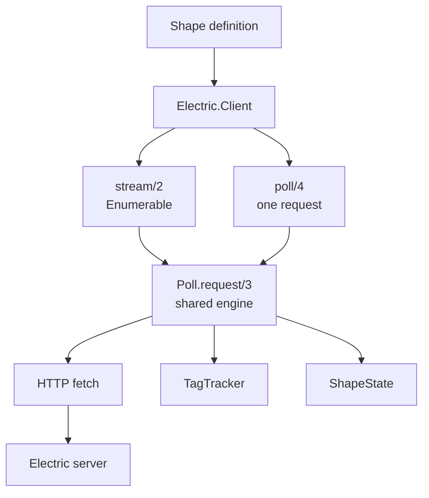
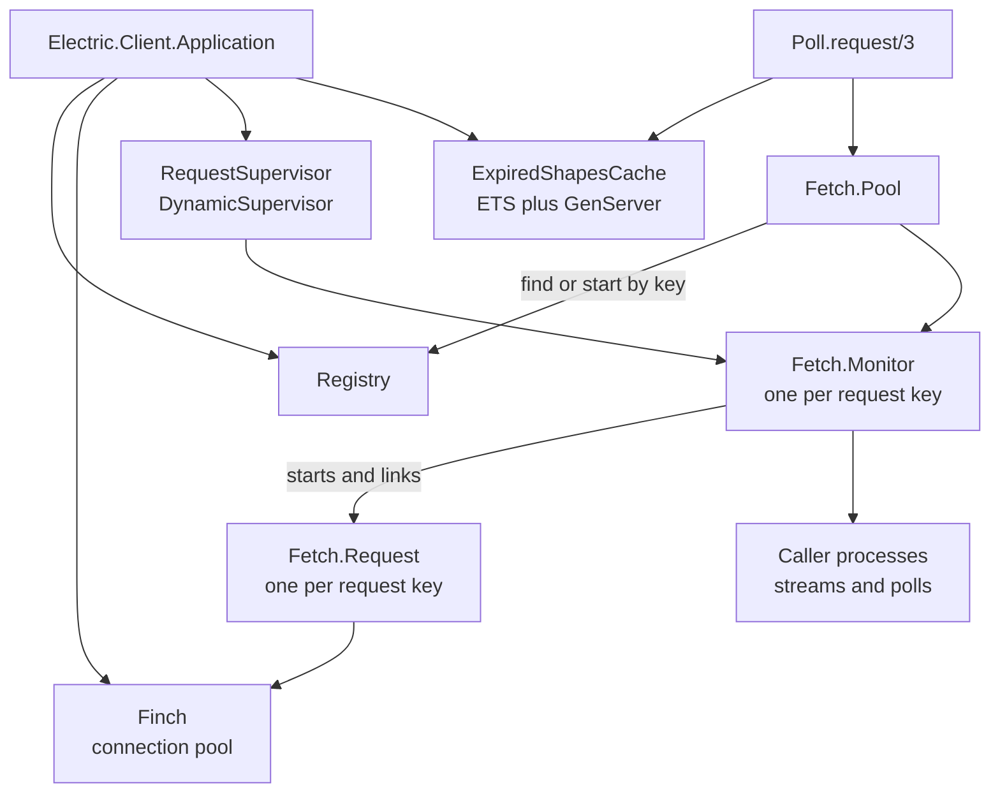

# Overview

`electric_client` connects an Elixir application to an Electric server. **Electric** is a sync engine that streams a filtered subset of a PostgreSQL database over the Hypertext Transfer Protocol (HTTP). The application defines a shape. The client fetches the current rows of that shape, then follows live changes forever or stops at a chosen point. The client returns plain Elixir structs. The caller decides what to do with them.

A **shape** is a filtered subset of one PostgreSQL table. A **change message** describes one insert, update, or delete of one row. A **control message** describes protocol state. The values are `up-to-date` (the stream caught up) and `must-refetch` (the handle is invalid). An **offset** is a position in the stream that the client sends to resume. A **long poll** is one HTTP request that the server holds open until a change arrives or a timeout expires. A **409** is the HTTP status code Conflict; in this protocol it means that the server no longer holds the shape handle. A **cache buster** is a random query parameter that changes the URL so an HTTP cache cannot reuse an old response.

The package has one central rule: **the protocol is the same for every consumer, and only the driving loop differs**. The streaming interface and the polling interface call the same `Electric.Client.Poll.request/3` function (`lib/electric/client/stream.ex:163`, `lib/electric/client.ex:606-625`). The streaming interface adds a buffer, an `Enumerable` implementation, and **fast-loop recovery**. Fast-loop recovery is detection of a server or cache that returns the same offset before the first `up-to-date`, with a reset and a backoff. It does not add a second protocol.

## Package facts

| Fact | Value |
|------|-------|
| Open Telecom Platform application | `:electric_client` (`mix.exs:8`) |
| Version | `0.10.3` (`package.json:4`) |
| Licence | Apache-2.0 (`mix.exs:86-95`) |
| Elixir requirement | `~> 1.17` (`mix.exs:10`) |
| Application callback | `Electric.Client.Application` (`mix.exs:32-37`) |
| Extra applications | `:logger` (`mix.exs:34`) |
| Required dependencies | `jason`, `nimble_options`, `req` (`mix.exs:59-61`) |
| Optional dependencies | `electric`, `ecto_sql`, `gen_stage` (`mix.exs:55-58`) |
| Published Hex package name | `electric_client` (the package `README.md:10-18`) |
| Documentation entry point | `Electric.Client` (`mix.exs:74-84`) |

A Mix **optional dependency** is a package that the client does not force on its users. The user adds the package to their own project. When the package is present at compile time, the client compiles extra modules; when it is absent, those modules are skipped. This is not an `import` and it does not load code at run time by itself.

When the main `electric` application is present, the client compiles `Electric.Client.Embedded` and the `embedded/1` constructor (`lib/electric/client.ex:322-336`, `lib/electric/client/embedded.ex:1-2`). When `ecto_sql` is present, it compiles the Ecto adapter (`lib/electric/client/ecto_adapter.ex:1-2`). The `gen_stage` dependency is declared but no module in `lib/` uses it (`mix.exs:58`).

## The two problems

### Problem 1: follow a shape

An application needs the current rows of a filtered table, and then every change to those rows. A raw Hypertext Transfer Protocol (HTTP) client would need to handle offsets, long polls, control messages, schema decoding, and cache invalidation. `Electric.Client.stream/2` packages all of that into an `Enumerable` (`lib/electric/client.ex:489-494`).

### Problem 2: drive the request loop

An application may already own a scheduler, a supervision tree, or a batch loop. It does not want to hand its loop to an `Enumerable`. An `Enumerable` does not block by itself; the process that enumerates it blocks. The polling interface avoids that transfer of control. `Electric.Client.poll/4` makes one request and returns the messages plus the next state (`lib/electric/client.ex:602-625`). The caller decides when to call again.

An arrow means "the left box calls the right box". The shape definition feeds the client. The client builds either a stream or a direct poll call. Both use the same poll engine. The engine uses the HTTP fetch, the tag tracker, and the shape state, but the diagram omits the message parser and the expired-shape cache for space. Both are part of the engine path.

The shared engine is the key design choice. A correction to offset handling, cache busting, or move-out logic reaches both interfaces at the same time.

## The layers

The state layer uses several terms. A **cursor** is an integer that the server sends on a live response; the client sends it back so the server can resume the live stream. A **mapper** is the `ValueMapper` that converts a wire string into an Elixir value. A **tag index** maps row keys to the filter tags that currently match them. A **disjunct** is one branch of a filter that is written as an OR of AND groups; **disjunctive normal form** is that OR-of-ANDs shape. **Visibility** is the test that at least one disjunct has all of its positions active. A **retry counter** counts failed attempts. A **self-heal flag** records that the client already tried to recover from a stale cached response.

| Layer | Module | Role | Citation |
|-------|--------|------|----------|
| Client | `Electric.Client` | Validates options. Holds the endpoint, parser, authenticator, fetch implementation, and pool. | `lib/electric/client.ex:156-219` |
| Shape | `Electric.Client.ShapeDefinition` | Holds the table, filter, columns, parameters, and replica mode. Serialises to query parameters. | `lib/electric/client/shape_definition.ex:15-66` |
| Driving loop | `Electric.Client.Stream` | Implements `Enumerable`. Buffers messages. Handles resume and fast-loop recovery. | `lib/electric/client/stream.ex:9-121` |
| Engine | `Electric.Client.Poll` | Makes one request. Handles success, 409, stale cache responses, and errors. | `lib/electric/client/poll.ex:78-99` |
| State | `Electric.Client.ShapeState` | Carries the handle, offset, cursor, schema, mapper, tag index, and retry counters between polls. | `lib/electric/client/shape_state.ex:38-53` |
| Transport | `Electric.Client.Fetch` | Behaviour with `fetch/2` and `validate_opts/1`. | `lib/electric/client/fetch.ex:5-6` |
| Default transport | `Electric.Client.Fetch.HTTP` | Req request with a custom retry policy. | `lib/electric/client/fetch/http.ex:79-84` |
| Coalescing | `Electric.Client.Fetch.Pool` | One backend request per identical URL. | `lib/electric/client/fetch/pool.ex:18-40` |
| Decoding | `Electric.Client.Message` | Wire map to Elixir struct. | `lib/electric/client/message.ex:318-373` |
| Move-out | `Electric.Client.TagTracker` | Tag index, disjunctive normal form visibility, synthetic deletes. | `lib/electric/client/tag_tracker.ex:49-135` |

## Runtime processes

The application starts four children (`lib/electric/client/application.ex:7-16`):

1. A `Registry` named `Electric.Client.Registry`. It gives one name per request key, so the pool can find an existing monitor.
2. A `Finch` connection pool named `Electric.Client.Finch`. It holds reusable HTTP connections.
3. A `DynamicSupervisor` named `Electric.Client.RequestSupervisor`. It starts and owns one short-lived `Fetch.Monitor` per request key.
4. `Electric.Client.ExpiredShapesCache`. It is an Erlang Term Storage (ETS) table with a GenServer for eviction. It remembers shape handles that a 409 response invalidated.

An arrow means "the left box starts, owns, or calls the right box". The application supervises the registry, the connection pool, the monitor supervisor, and the cache. The dynamic supervisor starts monitors, not requests. Each monitor starts one linked request. The pool finds a monitor through the registry.

A stream or a poll does not own a process. The calling process runs the loop. The dynamic supervisor owns the monitor. The monitor starts the request process as a **linked** process (`lib/electric/client/fetch/monitor.ex:86`) and traps exits. If the request crashes, the monitor keeps the subscriber list. The monitor holds that list so that a slow or crashed caller cannot block another caller. The request process runs the HTTP call and replies to the monitor. The monitor broadcasts the one response to every subscriber.

## What a caller sees

The client defines five message structs (`lib/electric/client/message.ex:7-314`). `ControlMessage` is one struct with two control values, so the table has five rows for five structs.

| Struct | Meaning | Emitted to caller |
|--------|---------|-------------------|
| `ChangeMessage` | One insert, update, or delete. | Yes |
| `ControlMessage` with `:up_to_date` | The snapshot or catch-up is complete. | Yes |
| `ControlMessage` with `:must_refetch` | The shape handle is invalid. | Yes. The client already reset its own state; the caller must clear any state that it derived from earlier messages. |
| `ResumeMessage` | A checkpoint for a finite stream. | Yes, at the end of a finite stream |
| `MoveOutMessage` | Tags that left the filter. | No. It becomes synthetic deletes. |
| `MoveInMessage` | Tags that entered the filter. | No. It updates the tag index. |

The table lists six rows because the two control values share one struct. The client also defines a `MoveInMessage` and a `MoveOutMessage` that the parser consumes internally.

A `ChangeMessage` holds a `key`, a `value`, an optional `old_value`, a `headers` struct, and a request timestamp (`lib/electric/client/message.ex:117-147`). The `key` is the row identity string. The `value` is a map of column name to value, mapped by the configured `ValueMapper`. `old_value` holds the previous row for an update when the replica mode sends it (`lib/electric/client/message.ex:144`, `:149-153`).

The `headers` struct carries `operation`, `relation`, `handle`, `lsn`, `txids`, `op_position`, `tags`, `removed_tags`, and `active_conditions` (`lib/electric/client/message.ex:39-50`). `lsn` is the PostgreSQL Log Sequence Number of the change. `txids` is the list of transaction identifiers that the change belongs to. `op_position` is the position inside the transaction. The three tag fields support the move-out algorithm.

## Key insight

**Key insight:** the client treats every response as untrusted with respect to cache and proxy behaviour. A success response can be stale. A 409 body can be missing or mangled. The engine therefore validates headers, compares the returned handle with a cached expired handle, plants a random cache buster, and retries with a bounded policy (`lib/electric/client/poll.ex:138-204`, `lib/electric/client/poll.ex:336-376`). The protocol state is protected even when an HTTP intermediary is wrong.

The mechanisms have these meanings:

- **Header validation** checks that a response has the fields that the protocol requires for its status and phase. A missing required field raises an error before the stream sees a message.
- **A stale response** is a success response that carries a handle that the client already invalidated. The client compares the returned handle with the cached expired handle.
- **Self-heal** is the first recovery attempt for a stale response. The client clears the cached handle and retries with a reset count. A correct server then returns a fresh handle, because a server never reuses a handle.
- **A cache buster** is a random query parameter. It changes the URL, so a cache key that ignores the `expired_handle` parameter still misses.
- **A bounded policy** is a retry limit, not an infinite loop. The fast-loop detector has its own limit and then reports the likely proxy cause.

The cost is extra state. `ShapeState` carries a retry counter, a self-heal flag, a cache buster, a recent-request window, and a fast-loop counter (`lib/electric/client/shape_state.ex:38-53`). A **recent-request window** is the short list of recent request offsets that the fast-loop detector compares. The benefit is that a stale proxy produces a short delay instead of an endless loop.

**Aha:** the client cannot fix a wrong intermediary, so it does not try. It makes the wrong response detectable: a handle comparison detects staleness, and an offset comparison detects a loop. Detection is local, cheap, and independent of the proxy implementation.

## Limits of this document

This overview names the layers and the runtime processes. It does not prove the stream state machine, the tag algorithm, the retry policy, or each option. Document [01-shape-stream-consumer.md](01-shape-stream-consumer.md) covers the consumer flow and its recovery paths. Document [02-http-and-configuration.md](02-http-and-configuration.md) covers configuration and the transport.

## Related documents

- [README.md](README.md) is the package index.
- [01-shape-stream-consumer.md](01-shape-stream-consumer.md) follows one shape from definition to message.
- [02-http-and-configuration.md](02-http-and-configuration.md) lists every option and backend.
- [../typescript-client/00-overview.md](../typescript-client/00-overview.md) is the reference implementation of the same protocol.
- [../sync-service/02-http-api-and-shapes.md](../sync-service/02-http-api-and-shapes.md) defines the server-side shape interface.
