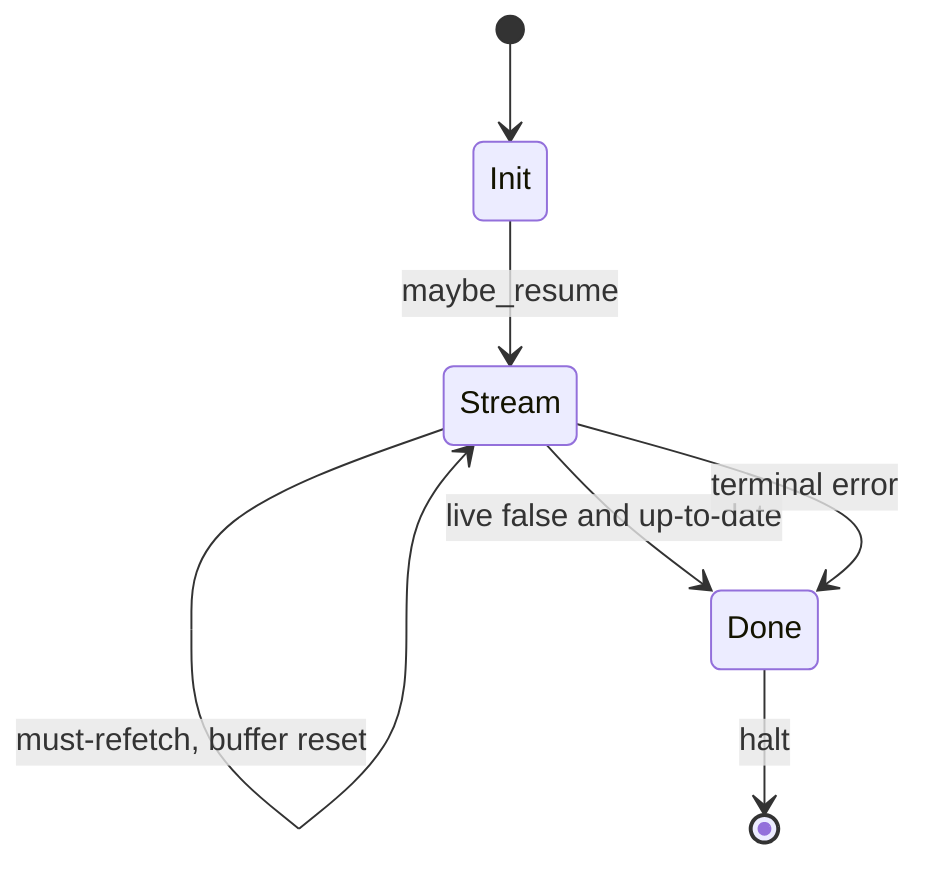
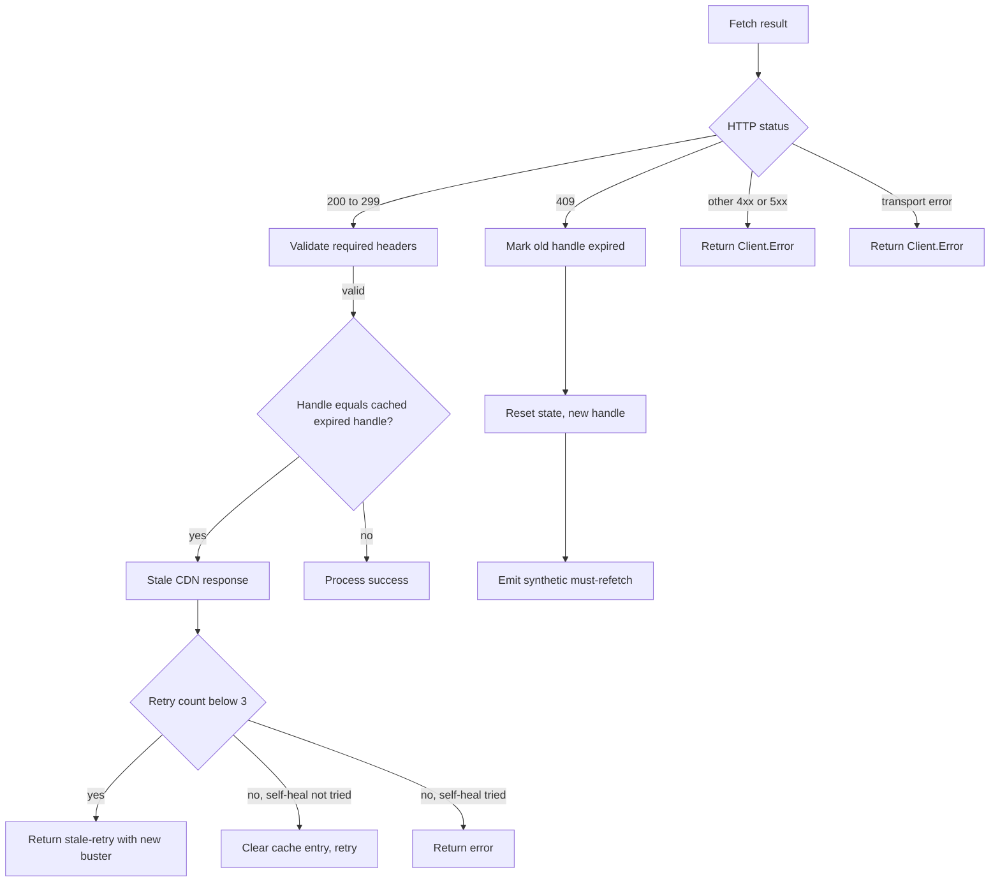
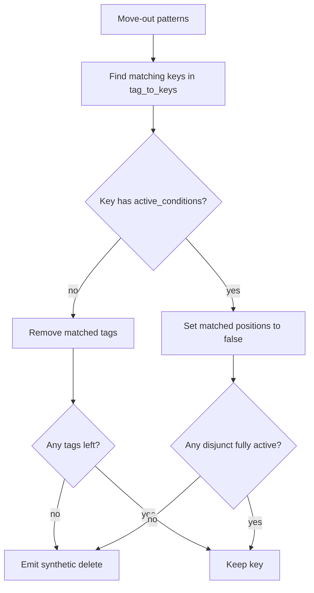
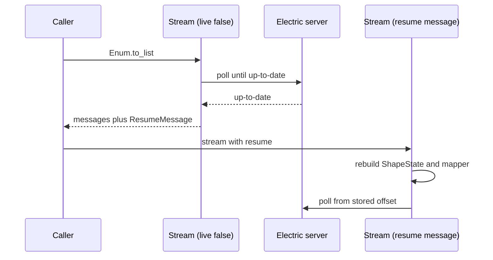

# Shape Stream Consumer

This document follows one shape from a table name to a list of Elixir messages. It explains the state that survives between requests, the exact request that the client sends, the order in which it processes a response, and every recovery path. Every claim cites a path relative to the package root.

The central sequence is short. The caller defines a shape, creates a client, and iterates the stream. Under the surface, each iteration runs one poll. A poll builds a request from `ShapeState`, sends it through the fetch layer, validates the response headers, parses the body into messages, and folds the messages into a new state.

## Step 1: define the shape

`Electric.Client.ShapeDefinition` is a struct with six public keys and one internal key (`lib/electric/client/shape_definition.ex:11-15`):

```elixir
@public_keys [:namespace, :table, :columns, :where, :params, :replica]
defstruct @public_keys ++ [parser: {Electric.Client.ValueMapper, []}]
```

| Field | Meaning | Citation |
|-------|---------|----------|
| `table` | The PostgreSQL table name. Required. | `lib/electric/client/shape_definition.ex:13` |
| `namespace` | The PostgreSQL schema. `nil` means the default. | `lib/electric/client/shape_definition.ex:33-39` |
| `columns` | The column list. `nil` means all columns. Must include every primary key, because the client uses the key to match an update or delete to an existing row. | `lib/electric/client/shape_definition.ex:27-32` |
| `where` | A Structured Query Language (SQL) predicate fragment. For example, `"priority = $1"`. | `lib/electric/client/shape_definition.ex:21-26` |
| `params` | Values for `$1`, `$2`, and later placeholders. For the example above, `["high"]`. | `lib/electric/client/shape_definition.ex:40-45` |
| `replica` | `:default` sends changed columns. `:full` sends the whole row. | `lib/electric/client/shape_definition.ex:46-55` |
| `parser` | A `{module, arguments}` tuple for value mapping. "Parser" in this package means the `ValueMapper` that converts a wire string to an Elixir value. It is not the wire-message parser. | `lib/electric/client/shape_definition.ex:56-64` |

`ShapeDefinition.new/2` validates the options with NimbleOptions (`lib/electric/client/shape_definition.ex:99-113`). `new!/2` raises on failure (`lib/electric/client/shape_definition.ex:125-138`).

### Serialisation

`ShapeDefinition.params/2` converts the struct into query parameters (`lib/electric/client/shape_definition.ex:208-223`). It supports three formats:

| Format | Use | Result shape |
|--------|-----|--------------|
| `:query` | Hypertext Transfer Protocol (HTTP) query string. This is the default and the only format that the request builder uses. | String keys, columns joined with commas, parameters as `params[1]` |
| `:json` | A JavaScript Object Notation (JSON) body for a caller that builds one directly. The client does not send a JSON body on its normal path. | Atom keys, columns as a list |
| `:keyword` | Internal merge of shape parameters into client parameters. | Keyword list with `table` and `namespace` separate |

The table name is quoted when it is not a simple identifier (`lib/electric/client/shape_definition.ex:155-182`). For example, a table named `my table` in a schema named `my app` becomes `"my app"."my table"` (`lib/electric/client/shape_definition.ex:151-153`).

The `replica` parameter is omitted when the value is `:default` (`lib/electric/client/shape_definition.ex:243-245`). This is deliberate. An omitted parameter lets a shape-level `:full` win over a stream-level `:default` during the map merge.

**Aha:** the shape's parameters enter the client as ordinary client parameters. **Client parameters** are the `:params` map that the client adds to every request. `Electric.Client.for_shape/2` merges the shape parameters into `client.params` and replaces the client parser (`lib/electric/client.ex:627-634`). There is no separate "shape request" object. This is why `Electric.Client.stream/3` and `Electric.Client.poll/4` share one request builder, and why a hand-written `:params` client option and a shape parameter merge cleanly.

## Step 2: construct the stream

`Electric.Client.stream/2` and `stream/3` have several clauses. The arity depends on whether the caller passes stream options. A client plus a keyword list calls `Stream.new/2` (`lib/electric/client.ex:492-494`). A client plus a `%ShapeDefinition{}` calls `for_shape/2` and then `stream/2` (`lib/electric/client.ex:547-551`). A client, a table name, and an options list call `stream/3` (`lib/electric/client.ex:543-545`). A table name is converted to a shape first. A URL string becomes a client with that endpoint (`lib/electric/client.ex:511-520`).

`Stream.new/1` and `Stream.new/2` are both public. `new/2` takes a client and a keyword list, adds the client to the list, and calls `new/1` (`lib/electric/client/stream.ex:99-103`). `new/1` then does five things (`lib/electric/client/stream.ex:109-121`):

1. It validates the options against the external schema.
2. It splits the core fields `:client`, `:parser`, and `:replica` from the runtime options.
3. It validates the runtime options `:live`, `:resume`, and `:errors`.
4. It generates a monotonic identifier and a fresh `ShapeState`.
5. It builds the struct.

The stream struct is pure data (`lib/electric/client/stream.ex:9-18`):

```text
%Electric.Client.Stream{
  id:             unique integer,
  client:         %Electric.Client{},
  poll_state:     %Electric.Client.ShapeState{},
  parser:         nil or {module, args},
  buffer:         :queue of messages,
  replica:        :default or :full,
  state:          :init | :stream | :done,
  opts:           %{live: boolean, resume: ResumeMessage | nil, errors: :raise | :stream}
}
```

No process is started. The caller's process runs the loop when it enumerates the struct.

## Step 3: iterate the stream

`Enumerable.reduce/3` calls `Electric.Client.Stream.next/1` repeatedly (`lib/electric/client/stream.ex:294-306`). `next/1` pops one buffered message. If the buffer is empty, it calls the private `fetch/1` (`lib/electric/client/stream.ex:127-132`).

The private `fetch/1` is a small state machine:

- In state `:done`, it halts (`lib/electric/client/stream.ex:139-141`).
- In state `:init`, it applies a resume checkpoint if one exists, moves to `:stream`, and calls itself (`lib/electric/client/stream.ex:143-148`).
- In state `:stream`, it checks for a fast loop, then calls `do_fetch/1` (`lib/electric/client/stream.ex:150-156`).



`do_fetch/1` chooses the parser, calls `Poll.request/3`, and dispatches on the result (`lib/electric/client/stream.ex:158-185`):

| Poll result | Stream action | Citation |
|-------------|---------------|----------|
| `{:ok, messages, state}` | Store the new state, buffer the messages, dispatch one. | `lib/electric/client/stream.ex:164-168` |
| `{:must_refetch, messages, state}` | Clear the old buffer first, then buffer the messages. The list holds exactly one synthetic `:must_refetch` control message. | `lib/electric/client/stream.ex:170-175` |
| `{:stale_retry, state}` | Retry immediately with the cache buster. | `lib/electric/client/stream.ex:177-180` |
| `{:error, error}` | Raise or buffer the error, depending on `:errors`. | `lib/electric/client/stream.ex:182-184` |

The buffer reset on `must_refetch` is important. Messages that were buffered before the reset belong to the old shape handle. They are dropped, not delivered before the reset signal (`lib/electric/client/stream.ex:172-173`). The reset signal is therefore the first message that the caller sees from the new handle. The row messages in the 409 body are also discarded. Only the synthetic control message is buffered (`lib/electric/client/poll.ex:220-235`).

## Step 4: build the poll request

`Poll.request/3` has five steps (`lib/electric/client/poll.ex:78-99`):

1. It reads the `:replica` option. The default is `:default` (`lib/electric/client/poll.ex:80`).
2. It computes the canonical shape key from the client endpoint and client parameters (`lib/electric/client/poll.ex:81`).
3. It adds an `expired_handle` parameter if the cache holds one (`lib/electric/client/poll.ex:128-133`).
4. It adds a `cache-buster` parameter if the state holds one (`lib/electric/client/poll.ex:135-136`).
5. It builds a `%Fetch.Request{}` with the offset, handle, replica, live flag, and cursor (`lib/electric/client/poll.ex:119-125`).

### The canonical shape key

`ShapeKey.canonical/2` removes all protocol parameters before it sorts and encodes the rest (`lib/electric/client/shape_key.ex:62-80`). The removed parameters are (`lib/electric/client/shape_key.ex:14-29`):

```text
cursor handle live offset cache-buster expired_handle log
subset__where subset__limit subset__offset subset__order_by subset__params
subset__where_expr subset__order_by_expr
```

The result identifies the underlying shape. It does not identify one request. The expired-handle cache uses it as the key (`lib/electric/client/expired_shapes_cache.ex:26-37`).

### The query parameters

`Fetch.Request.params/1` maps the request struct to wire parameters (`lib/electric/client/fetch/request.ex:101-117`):

| Parameter | Added when | Citation |
|-----------|------------|----------|
| `offset` | Always | `lib/electric/client/fetch/request.ex:112` |
| `replica` | The value is not `:default` | `lib/electric/client/fetch/request.ex:113` |
| `handle` | The shape handle is a string | `lib/electric/client/fetch/request.ex:114` |
| `live` | The value is true | `lib/electric/client/fetch/request.ex:115` |
| `cursor` | The cursor is not `nil` | `lib/electric/client/fetch/request.ex:116` |

The parameters are sorted before encoding (`lib/electric/client/fetch/request.ex:83-93`). Sorting makes the Uniform Resource Locator (URL) stable, which makes cache coalescing and proxy caches predictable.

A complete request looks like this. The values are illustrative, and the client percent-encodes them.

```http
GET /v1/shape?table=issues&where=priority%20%3D%20%241&params%5B1%5D=high&offset=0_0&handle=1234-5678&live=true HTTP/1.1
Host: localhost:3000
```

The endpoint comes from `base_url` plus `/v1/shape`, or from the full `:endpoint` option. The `table`, `where`, and `params[1]` entries come from the shape definition. The `offset` and `handle` entries come from `ShapeState`. The `live` entry is true only after the first `up-to-date` message. The client adds `replica=full` only when the effective replica mode is `:full`.

The canonical key removes the protocol parameters in this list (`lib/electric/client/shape_key.ex:14-29`): `cursor`, `handle`, `live`, `offset`, `cache-buster`, `expired_handle`, `log`, and the `subset__*` family. The `subset__*` names are legacy server parameters for a subquery shape. This client does not send them; they are removed so that an older client and a newer client compute the same key for the same shape.

**Aha:** the word `live` names two different controls, and they are not the same. The **stream option** `live: true | false` says whether the caller wants an infinite stream or a finite stream (`lib/electric/client/stream.ex:30-34`). The **wire parameter** `live=true` says whether the server should hold the request open for new changes. The stream engine derives the wire parameter from `state.up_to_date?`, not from the stream option (`lib/electric/client/poll.ex:122-124`).

The first request is always non-live because the state starts with `up_to_date?: false` (`lib/electric/client/shape_state.ex:38-53`). The `up-to-date` control message flips the flag (`lib/electric/client/poll.ex:260-262`). For an infinite stream (`live: true`), every later request is a live long-poll. A finite stream (`live: false`) sends no live long-poll: it halts when it receives the first `up-to-date` control message (`lib/electric/client/stream.ex:221-224`). A caller cannot accidentally request a live response before the snapshot is complete.

## Step 5: handle the response

`Poll.request/3` branches on the transport result (`lib/electric/client/poll.ex:85-98`):



### Header validation

`validate_headers!/2` raises `Electric.Client.Error` when a required field is missing (`lib/electric/client/poll.ex:336-376`). The rules match the TypeScript client middleware (`lib/electric/client/poll.ex:337-347`):

| Response kind | Required fields |
|---------------|-----------------|
| Every response | `electric-handle`, `electric-offset` |
| First non-live response | `electric-schema` |
| Live response | `electric-cursor` |

The check runs before the success handler (`lib/electric/client/poll.ex:86-88`). It therefore raises even when the stream option is `errors: :stream`. State this behaviour clearly in an application: a broken proxy produces an exception, not a stream element.

### Success

`process_success_response/4` does five things (`lib/electric/client/poll.ex:155-172`):

1. Sets the offset to the response offset, or keeps the old offset when the response has none (`lib/electric/client/poll.ex:156`, `lib/electric/client/poll.ex:382-383`).
2. Stores the shape handle and cursor in the state. The **cursor** is a cache-busting interval token. The server computes it from the current time and the previous cursor, and sends it on a live response. The client sends it back so that a cache cannot serve an old response. It is not the offset; the offset selects stored changes, and the cursor selects a cache interval.
3. Builds a value mapper when the response carries a schema and the state has no mapper (`lib/electric/client/poll.ex:316-326`).
4. Clears the stale-retry counters (`lib/electric/client/poll.ex:161`).
5. Parses every body element with `Message.parse/4` (`lib/electric/client/poll.ex:165-169`).

The body can be a list or any other enumerable. `ensure_enum/1` wraps a map or an unknown value with `List.wrap/1` (`lib/electric/client/poll.ex:328-334`). This supports both the HTTP decoder and the embedded backend.

### The offset chain

Offsets are strings. The sentinel `"-1"` means "before all" (`lib/electric/client/offset.ex:8-9`). The first real offset is `"0_0"` (`lib/electric/client/offset.ex:9`). `Offset.new/2` builds a `"transaction_offset_operation_offset"` string (`lib/electric/client/offset.ex:24-36`). The first number is the PostgreSQL transaction offset, which is an LSN-like position. The second number is the operation offset inside that transaction. For example, `"2349_3"` means the fourth operation at transaction offset 2349. The initial state uses `Offset.before_all()` (`lib/electric/client/shape_state.ex:44`).

The chain is simple:

```text
initial state       offset = "-1"
first response      offset = electric-offset header, e.g. "0_0"
next request        offset = "0_0"
next response       offset = "0_1"
...
```

A `must-refetch` resets the offset to `"-1"` (`lib/electric/client/shape_state.ex:113-127`). The schema and the value mapper are preserved, because the table definition has not changed.

## Step 6: parse the messages

`Message.parse/4` is a set of pattern matches (`lib/electric/client/message.ex:318-373`):

"Input shape" means the pattern that the parser matches. A nested key such as `headers.control` is a map field `headers` whose value is a map with a field `control`. It is not a literal key with a dot in its name.

| Input shape | Output | Citation |
|-------------|--------|----------|
| Map with a `"value"` field | One `ChangeMessage` | `lib/electric/client/message.ex:318-320` |
| Map with `headers.control` | One `ControlMessage` | `lib/electric/client/message.ex:322-333` |
| Map with atom `headers.control` | One `ControlMessage` | `lib/electric/client/message.ex:331-333` |
| Map with `headers.event` equal to `"move-out"` | One `MoveOutMessage` | `lib/electric/client/message.ex:335-351` |
| Map with `headers.event` equal to `"move-in"` | One `MoveInMessage` | `lib/electric/client/message.ex:353-369` |
| Empty string | No message | `lib/electric/client/message.ex:371-373` |

Control values map to `:must_refetch`, `:up_to_date`, and `:snapshot_end` (`lib/electric/client/message.ex:100-103`). `snapshot-end` marks the end of the initial snapshot. The poll fold drops it, so a caller does not see it. It is a protocol marker, not caller data.

`Message.parse/4` does not create a `ResumeMessage`. The stream creates it from the final `ShapeState` when a finite stream ends (`lib/electric/client/stream.ex:222-223`, `lib/electric/client/shape_state.ex:133-142`). A resume message is therefore a client checkpoint, not a server message.

A `ChangeMessage` is built from five parts (`lib/electric/client/message.ex:132-147`):

- `key` is the row identity.
- `value` is the mapped row.
- `old_value` is the previous mapped row, or `nil`.
- `headers` carries `operation`, `relation`, `handle`, `lsn`, `txids`, `op_position`, `tags`, `removed_tags`, and `active_conditions` (`lib/electric/client/message.ex:39-50`).
- `request_timestamp` is the time of the request that produced the message.

The value mapper is called inside a `try` that logs and re-raises (`lib/electric/client/message.ex:157-168`). A cast failure is not silent.

### Schema and value mapping

The server sends the schema in the `electric-schema` header (`lib/electric/client/fetch/response.ex:68-72`). The response decoder turns the JSON text into a map with atom keys (`lib/electric/client/fetch/response.ex:68-72`). The poll engine stores the schema and builds the mapper once (`lib/electric/client/poll.ex:316-322`).

The default mapper converts only `int2`, `int4`, `int8`, `float4`, and `float8` (`lib/electric/client/value_mapper.ex:88-124`). These are PostgreSQL internal type names for 16-bit, 32-bit, and 64-bit integers and 32-bit and 64-bit floating-point numbers. Every other column stays an Elixir string. The comment in the source states the reason: full type support is available through the Ecto adapter, which is a different parser that the caller selects at configuration time (`lib/electric/client/value_mapper.ex:92-100`). The default mapper does not call Ecto at run time.

## Step 7: fold the messages into the state

`process_messages/2` reduces the parsed messages and builds a new `ShapeState` (`lib/electric/client/poll.ex:242-258`). Each message type has one rule:

| Message | State change | Output | Citation |
|---------|--------------|--------|----------|
| `up-to-date` | Set `up_to_date?` to true. | The message. | `lib/electric/client/poll.ex:260-262` |
| `snapshot-end` | None. | Drop the message. | `lib/electric/client/poll.ex:264-266` |
| `ChangeMessage` | Update the tag index. | The message. | `lib/electric/client/poll.ex:268-284` |
| `MoveOutMessage` | Generate synthetic deletes and update the index. | The deletes. | `lib/electric/client/poll.ex:286-300` |
| `MoveInMessage` | Reactivate tagged positions. | Nothing. | `lib/electric/client/poll.ex:302-314` |

## Move-out and synthetic deletes

A move-out event means that rows left the shape's filter. A row leaves when its data changes so that it no longer matches the filter, when the filter's parameters change, or when a new shape handle changes the visible set. The server does not send a delete for each row. It sends tag patterns, because the server does not know which rows the client has already received. The client must find the affected rows and synthesise deletes.

A filter is converted to **disjunctive normal form**: an OR of AND groups. For example, `(priority = 'high' AND status = 'open') OR (assignee = 'me')` has two disjuncts. The first disjunct has two conditions at positions 0 and 1; the second has one condition at position 2. A tag string has one segment per position, in order. A row is visible when every position in at least one disjunct is active. This is why the tracker stores `disjunct_positions` and why one move-out can remove a row from one disjunct but leave it visible in another.

`TagTracker` keeps three structures (`lib/electric/client/tag_tracker.ex:9-21`):

```text
tag_to_keys:        %{{position, hash} => MapSet of row keys}
key_data:           %{row key => %{tags: MapSet, active_conditions: list | nil, msg: message}}
disjunct_positions: [[position]] or nil, shared by all keys
```

Tags arrive as slash-delimited strings, one string per disjunct. `"hash_a//hash_b"` means position 0 has `hash_a`, position 1 is not relevant, and position 2 has `hash_b`. `normalize_tags/1` converts each string into a list and replaces empty segments with `nil` (`lib/electric/client/tag_tracker.ex:298-327`).

`update_tag_index/4` removes the removed tags, adds the new tags, and stores the latest message for the key (`lib/electric/client/tag_tracker.ex:49-135`). A delete message removes the key from the index (`lib/electric/client/tag_tracker.ex:96-104`).

`generate_synthetic_deletes/5` handles two cases (`lib/electric/client/tag_tracker.ex:155-245`):

1. **No active conditions.** The client removes the matched tags. If the key has no tags left, it emits a delete (`lib/electric/client/tag_tracker.ex:190-201`).
2. **Active conditions.** The client sets the matched positions to false and evaluates disjunctive normal form visibility (`lib/electric/client/tag_tracker.ex:203-223`).

`row_visible?/2` returns true when at least one disjunct has every position active (`lib/electric/client/tag_tracker.ex:253-260`). A row is deleted only when no disjunct is satisfied.

The synthetic delete reuses the last known value and builds a delete header (`lib/electric/client/tag_tracker.ex:228-244`). The caller receives a normal `ChangeMessage` with `operation: :delete`. The caller does not need to know that the server never sent it.



**Aha:** `disjunct_positions` is derived once, from the first tagged message, and reused for every later message (`lib/electric/client/tag_tracker.ex:83-94`). The shape of the filter cannot change during the life of a shape handle. Recomputing the positions from every message would be wasted work, and could give an inconsistent map when a message has an empty tag list.

## The 409 path

A 409 means the server no longer holds the shape. `handle_must_refetch/4` does six things (`lib/electric/client/poll.ex:206-240`):

1. It marks the old handle as expired in the cache (`lib/electric/client/poll.ex:208-210`).
2. It chooses the new handle from the response, or appends `-next` to the old handle (`lib/electric/client/poll.ex:212-214`).
3. It resets the state to offset `"-1"` and clears the tags and cursor while keeping the schema (`lib/electric/client/shape_state.ex:113-127`).
4. It rebuilds the value mapper if the response carries a schema (`lib/electric/client/poll.ex:217`).
5. It plants a fresh random cache buster (`lib/electric/client/poll.ex:218-223`).
6. It emits exactly one synthetic `:must_refetch` control message and discards the body (`lib/electric/client/poll.ex:225-239`).

The body is discarded on purpose. The comment names the reason: a proxy can strip the body, and any rows in it belong to the expired handle (`lib/electric/client/poll.ex:225-230`).

The `-next` suffix is a client fallback for a 409 response that carries no handle. The shape handle is opaque to the client. The client appends `-next` to the old handle and uses the result as a placeholder. A correct server does not know that handle, so the next request receives another 409 with a real handle. If the response does carry a handle, the client uses that handle and does not append the suffix. The suffix is trimmed before it is appended (`lib/electric/client/poll.ex:213-214`). This prevents `shape-next-next-next` from accumulating across repeated resets (`CHANGELOG.md:47`).

## Stale cache responses

A content delivery network can serve a cached success response for a URL that the client has already invalidated. The client detects this by comparing the returned handle with the cached expired handle (`lib/electric/client/poll.ex:138-153`).

`handle_stale_response/2` has three branches (`lib/electric/client/poll.ex:174-204`):

| Condition | Action | Citation |
|-----------|--------|----------|
| Retry count below 3 | Add a new cache buster and retry. | `lib/electric/client/poll.ex:176-177` |
| Self-heal not attempted | Clear the cached handle and retry with a reset count. | `lib/electric/client/poll.ex:187-202` |
| Self-heal already attempted | Return a `Client.Error`. | `lib/electric/client/poll.ex:179-185` |

The self-heal branch exists because the server never reuses a shape handle. If the client stops sending `expired_handle`, a correct server must return a fresh handle. Only a broken intermediary can keep the loop alive.

**Aha:** every 409 plants both an expired handle and a random cache buster. The expired handle tells a correct proxy "do not serve this cached object". The cache buster changes the URL so that a cache key that ignores the expired handle still misses. The two mechanisms cover two different proxy errors with almost no extra code (`lib/electric/client/poll.ex:218-223`).

## Fast-loop detection

A request can return the same offset again and again. After the first `up-to-date`, that is normal: the stream is in live mode, and the same offset can be the current end of the log. Before the first `up-to-date`, it is a fault: the snapshot has not completed, so the offset must advance. The detector runs only in the second case (`lib/electric/client/stream.ex:242`).

`ShapeState.check_fast_loop/1` tracks a sliding window (`lib/electric/client/shape_state.ex:195-264`):

| Constant | Value | Meaning |
|----------|-------|---------|
| Window | 500 milliseconds | Requests inside this window count together. |
| Threshold | 5 requests | Five requests at the same offset are one detection. |
| Maximum detections | 5 | Five detections in a row produce an error. |
| Backoff base | 100 milliseconds | First backoff. |
| Backoff cap | 5,000 milliseconds | Maximum backoff. |

On the first detection the client clears the shape handle and resets the offset to `"-1"` (`lib/electric/client/shape_state.ex:247-250`). This forces a fresh URL that cannot alias the stale cache entry. Later detections sleep with exponential backoff and random jitter (`lib/electric/client/shape_state.ex:252-261`). The sleep runs in the caller's process, because the caller runs the enumeration loop. An application that must not block should use the polling interface or run the enumeration in its own process. After five detections the client produces an error whose message names the likely proxy causes (`lib/electric/client/shape_state.ex:217-228`). The `:errors` option then decides whether that error is raised or delivered as a stream element.

The stream skips the check once `up_to_date?` is true (`lib/electric/client/stream.ex:242`). The `up-to-date` handler also clears the tracking data (`lib/electric/client/stream.ex:216-219`). This avoids false positives during normal live polling.

## Resume

A finite stream ends with a `ResumeMessage` (`lib/electric/client/message.ex:171-209`). The message carries the handle, offset, schema, tag index, key data, and disjunct positions.

The resume path does three things (`lib/electric/client/stream.ex:258-273`):

1. It builds a `ShapeState` from the message (`lib/electric/client/shape_state.ex:94-105`).
2. If the message has a schema and the state has no mapper, it rebuilds the mapper (`lib/electric/client/stream.ex:263-270`).
3. It continues from the stored offset.



The tag index is part of the checkpoint. Without it, a move-out after a resume could not produce the correct synthetic deletes for rows that the first stream had already seen.

A caller captures the checkpoint from the end of a finite stream and passes it to the next stream:

```elixir
messages = Electric.Client.stream(client, "issues", live: false) |> Enum.to_list()
%Electric.Client.Message.ResumeMessage{} = checkpoint = List.last(messages)

continued = Electric.Client.stream(client, "issues", resume: checkpoint)
```

The checkpoint is the same shape. A different shape needs a different checkpoint, because the handle, offset, schema, and tag index all belong to one shape.

## Request coalescing

The fetch pool computes an identifier from four values (`lib/electric/client/fetch/pool.ex:54-61`):

```elixir
{
  fetch_impl,
  URI.to_string(request.endpoint),
  request.headers,
  Fetch.Request.params(request)
}
```

The pool starts a `Fetch.Monitor` for that identifier, or reuses the existing one (`lib/electric/client/fetch/pool.ex:42-52`). The monitor registers the caller and starts the request only when the first subscriber arrives (`lib/electric/client/fetch/monitor.ex:92-102`).

The result is one HTTP request for N callers. The monitor broadcasts the same response to every subscriber (`lib/electric/client/fetch/monitor.ex:131-135`). A caller that exits is removed from the list without disturbing the others (`lib/electric/client/fetch/monitor.ex:139-154`).

A caller that arrives after the request has started joins the subscriber list and receives the same broadcast (`lib/electric/client/fetch/monitor.ex:98-102`). It does not start a second request. Two callers with different authentication headers do not coalesce, because the headers are part of the request key. That is deliberate: one caller must not receive a response fetched with another caller's credentials.

## Errors

The stream option `:errors` controls the final behaviour (`lib/electric/client/stream.ex:51-61`):

- `:raise` re-raises the error (`lib/electric/client/stream.ex:231-233`).
- `:stream` buffers the error, sets the state to `:done`, and dispatches the error to the caller (`lib/electric/client/stream.ex:226-229`).

A `%Electric.Client.Error{}` that arrives inside the message list also terminates the stream (`lib/electric/client/stream.ex:207-210`). The embedded and mock backends can return an error in a message list instead of raising. Header validation is the exception: it raises before the stream sees a message, even when `errors: :stream` (`lib/electric/client/poll.ex:86-88`).

With `errors: :stream`, a buffered error is delivered after any messages that were already in the queue. The stream then halts. The error is the last element, not an interruption in the middle of the batch.

## Related documents

- [README.md](README.md) is the package index.
- [00-overview.md](00-overview.md) gives the package facts and the layers.
- [02-http-and-configuration.md](02-http-and-configuration.md) lists every option, the retry policy, and the optional backends.
- [../typescript-client/00-overview.md](../typescript-client/00-overview.md) is the reference client for the same wire protocol.
- [../sync-service/02-http-api-and-shapes.md](../sync-service/02-http-api-and-shapes.md) defines the shape endpoint and its headers.
