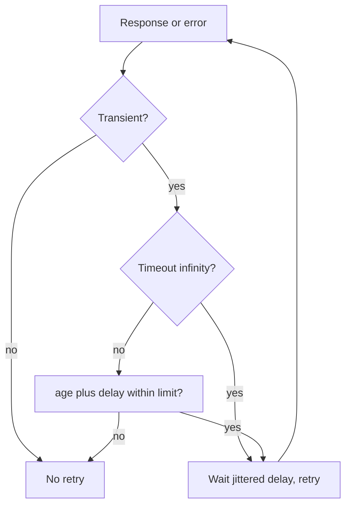
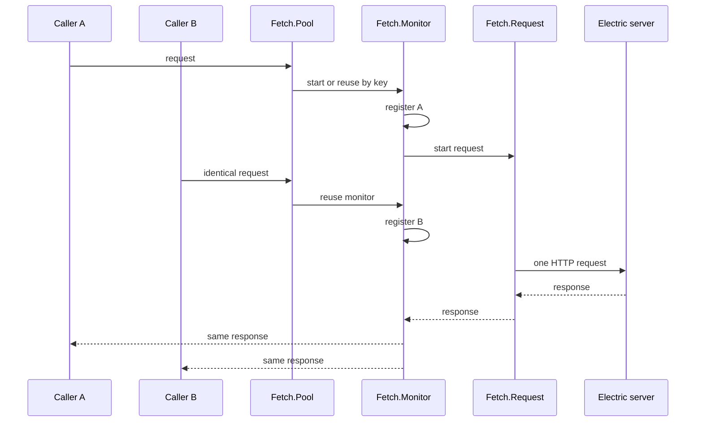
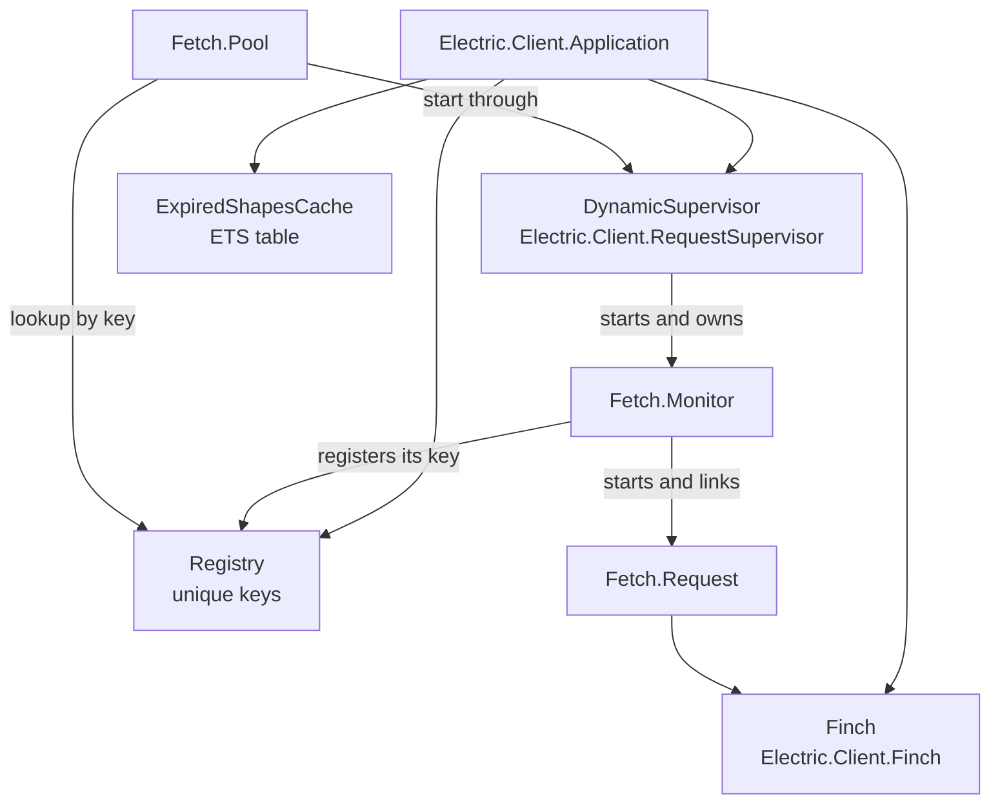

# HTTP and Configuration

This document lists every configuration option of `electric_client`, the path a request takes through the HTTP layer, the retry policy, and the authentication hooks. It also lists the optional Ecto, embedded, and mock backends. Every claim cites a path relative to the package root.

The client has one required decision: give it a `:base_url` or a full `:endpoint`. Every other option has a default. The default configuration creates an unauthenticated Hypertext Transfer Protocol (HTTP) client that retries transient failures and maps integers and floats.

## The client options

`Electric.Client.new/1` validates a keyword list against the schema at `lib/electric/client.ex:166-219`.

| Option | Type | Default | Meaning | Citation |
|--------|------|---------|---------|----------|
| `:base_url` | string or `URI` | none | Server address without the path. The client appends `/v1/shape`. | `lib/electric/client.ex:167-171` |
| `:endpoint` | string or `URI` | none | Full shape endpoint. Used as given. | `lib/electric/client.ex:172-176` |
| `:params` | map with atom keys | `%{}` | Extra query parameters for every request. | `lib/electric/client.ex:177-182` |
| `:parser` | `{module, arguments}` | `{ValueMapper, []}` | Value mapper implementation. | `lib/electric/client.ex:183-191` |
| `:authenticator` | `{module, arguments}` | `{Unauthenticated, []}` | Authentication behaviour. | `lib/electric/client.ex:192-196` |
| `:fetch` | `{module, options}` | `{Fetch.HTTP, []}` | Transport implementation. | `lib/electric/client.ex:197-217` |
| `:pool` | `{module, options}` | `{Fetch.Pool, []}` | Request coalescing implementation. | `lib/electric/client.ex:218` |

`new/1` validates the fetch options through the fetch module's own `validate_opts/1` (`lib/electric/client.ex:279-288`). It does not validate the authenticator or the pool. A malformed authenticator fails later, at request time.

### Endpoint resolution

```mermaid
flowchart TD
    A[new opts] --> B{endpoint given?}
    B -->|yes| C["URI.new(endpoint)<br/>used as is"]
    B -->|no| D{base_url given?}
    D -->|yes| E["URI.append_path<br/>/v1/shape"]
    D -->|no| F["error: needs base_url or endpoint"]
    C --> G[%Client{endpoint: uri}]
    E --> G
```

The path constant is `"/v1/shape"` (`lib/electric/client.ex:165`). The resolution code is at `lib/electric/client.ex:292-308`. `new!/1` raises `ArgumentError` on failure (`lib/electric/client.ex:314-320`).

The two forms serve different deployments. `base_url` is the normal case. `endpoint` is for an authentication proxy or a pre-mounted shape route. The documentation gives the example `https://my-server.my-domain.com/electric/shape/proxy` (`lib/electric/client.ex:270-275`).

## The stream options

`Electric.Client.stream/3` accepts the options at `lib/electric/client/stream.ex:20-63`.

| Option | Type | Default | Meaning | Citation |
|--------|------|---------|---------|----------|
| `:parser` | `nil` or `{module, arguments}` | `nil` | Overrides the client parser. `nil` falls back to the client. | `lib/electric/client/stream.ex:21-29` |
| `:live` | boolean | `true` | `true` reads forever. `false` stops at `up-to-date`. This is the **stream option**, not the wire parameter. The wire `live` parameter comes from the poll state's `up_to_date?` flag. | `lib/electric/client/stream.ex:30-34` |
| `:replica` | `:default` or `:full` | `:default` | Changed columns or full rows for updates and deletes. | `lib/electric/client/stream.ex:35-41` |
| `:resume` | `ResumeMessage` or `nil` | `nil` | Start from a checkpoint. | `lib/electric/client/stream.ex:42-50` |
| `:errors` | `:raise` or `:stream` | `:raise` | Raise an error or put it in the stream. | `lib/electric/client/stream.ex:51-61` |

The internal schema at `lib/electric/client/stream.ex:71-78` repeats the runtime options with `errors: :stream`. The first validation has already substituted the public default `:raise`, so the second schema is only a safety net for internal callers (`lib/electric/client/stream.ex:109-121`).

### Replica precedence

The shape and the stream can both set `replica`. The effective value follows a merge rule with no branching code.

1. A shape with `replica: :full` serialises a `replica=full` parameter into the client parameters (`lib/electric/client/shape_definition.ex:243-253`). `for_shape/2` merges those parameters into `client.params` (`lib/electric/client.ex:627-634`).
2. A stream with `replica: :default` adds no request-level parameter. The shape's `replica=full` entry stays in the client parameter map (`lib/electric/client/fetch/request.ex:113`).
3. A stream with `replica: :full` adds a request-level `replica=full` entry. The request map is merged over the client parameter map, so the request entry replaces the shape entry (`lib/electric/client/poll.ex:80`, `lib/electric/client/fetch/request.ex:101-117`).

**Aha:** the two writes happen in different maps at different times. The shape writes into the client parameter map at shape-construction time. The stream writes into the request map at request-build time. `Fetch.Request.params/1` merges the request map over the client parameter map (`lib/electric/client/fetch/request.ex:101-117`). The request map wins only when it contains the key. This is why `ShapeDefinition.params/2` must omit `:default`: an omitted key lets the lower layer supply a value (`lib/electric/client/shape_definition.ex:243-245`).

## The default HTTP transport

`Electric.Client.Fetch.HTTP` implements the fetch behaviour with Req (`lib/electric/client/fetch/http.ex:79-84`). Its options are at `lib/electric/client/fetch/http.ex:3-42`.

| Option | Type | Default | Meaning | Citation |
|--------|------|---------|---------|----------|
| `:timeout` | positive integer seconds or `:infinity` | `300` seconds | Total retry window. | `lib/electric/client/fetch/http.ex:4-14` |
| `:is_transient_fun` | one-argument function | transient status check | Decides whether a response is retryable. | `lib/electric/client/fetch/http.ex:15-24` |
| `:headers` | map or list of string tuples | `[]` | Headers added to every request. | `lib/electric/client/fetch/http.ex:25-34` |
| `:request` | keyword list | `[]` | Options merged into `Req.new/1`. | `lib/electric/client/fetch/http.ex:35-41` |

Within `:request`, two keys have special handling:

- `:retry_delay` can be an integer number of milliseconds or a one-argument function (`lib/electric/client/fetch/http.ex:89-95`). The function receives the retry attempt count and returns a delay in milliseconds (`lib/electric/client/fetch/http.ex:235-247`).
- `:finch` selects a named connection pool. Without it, the client offers HTTP version 2 then version 1 (`lib/electric/client/fetch/http.ex:101-108`).

### The Req request

`build_request/2` builds the Req request at `lib/electric/client/fetch/http.ex:110-127`:

| Req option | Value | Reason |
|------------|-------|--------|
| `method` | From the request struct | Usually `:get`. |
| `url` | Sorted and encoded request URL | Stable cache keys. |
| `headers` | Request headers then option headers | Later headers win. |
| `retry` | Custom callback | Age-based retry window. |
| `retry_log_level` | `false` | The client logs retries itself. |
| `max_retries` | `10_512_000` | A practical "forever". |
| `receive_timeout` | `60_000` milliseconds | Longer than the server's 20-second long poll. |

The comment at `lib/electric/client/fetch/http.ex:117-121` explains the two unusual values. The source comment describes `10_512_000` retries as "~10 years"; at a one-second delay the count spans about 122 days, so the retry counter is not the practical limit. The `:timeout` option is the real limit: the callback stops when the request age plus the next delay exceeds `300` seconds. The large `max_retries` value exists so that Req itself never stops a retry sequence before the age policy does. With `timeout: :infinity`, the ten-year figure becomes the effective ceiling. The receive timeout must exceed the server long-poll time, or Req would abort a valid long poll.

### The retry policy

`retry/5` has two clauses (`lib/electric/client/fetch/http.ex:165-206`):

- With `:infinity`, it retries every transient failure and never stops (`lib/electric/client/fetch/http.ex:165-178`).
- With a number of seconds, it retries only while the request age plus the next delay stays within the limit (`lib/electric/client/fetch/http.ex:180-206`).

The default delay is full-jitter exponential backoff (`lib/electric/client/fetch/http.ex:241-247`):

```text
delay = random(1, min(32_000, 2 ^ attempt * 1000)) milliseconds
```

The cap is 32 seconds. The jitter is full jitter, so many clients do not retry at the same instant.



### Transient conditions

The retry predicate has four cases (`lib/electric/client/fetch/http.ex:251-287`):

| Condition | Retry | Citation |
|-----------|-------|----------|
| HTTP status 408, 429, 500, 502, 503, 504 | Yes | `lib/electric/client/fetch/http.ex:251-270` |
| Transport timeout, connection refused, closed connection | Yes | `lib/electric/client/fetch/http.ex:276-279` |
| HTTP version 2 error `:unprocessed` | Yes | `lib/electric/client/fetch/http.ex:281-283` |
| Any other exception | No | `lib/electric/client/fetch/http.ex:285-287` |

This client builds GET requests for shape reads and DELETE requests for shape deletion on the HTTP path (`lib/electric/client.ex:684-687`); the embedded backend also handles DELETE (`lib/electric/client/embedded.ex:20-38`). The retry predicate does not restrict the method, so it would also retry a POST if a custom backend supplied one. The comment at `lib/electric/client/fetch/http.ex:192-194` gives the reason: the server endpoints are idempotent by design. This document does not describe a POST path, because the package has none.

## Response decoding

`Fetch.Response.decode!/4` turns raw headers and a body into a struct (`lib/electric/client/fetch/response.ex:36-50`). It reads four Electric headers (`lib/electric/client/fetch/response.ex:56-82`):

| Header | Field | Decoding |
|--------|-------|----------|
| `electric-handle` | `shape_handle` | First list element. |
| `electric-offset` | `last_offset` | First list element. |
| `electric-schema` | `schema` | JavaScript Object Notation (JSON) parsed with atom keys. |
| `electric-cursor` | `next_cursor` | Integer parsed from text. |

The raw header values are wrapped in lists first (`lib/electric/client/fetch/response.ex:52-54`). A header can arrive more than once, so the decoder keeps the first value (`lib/electric/client/fetch/response.ex:74-76`).

`Fetch.Request.uri/2` sorts the query parameters before encoding (`lib/electric/client/fetch/request.ex:83-93`). This is what makes two callers with the same shape produce the same Uniform Resource Locator (URL), and therefore the same coalesced request.

## Request coalescing

`Fetch.Pool.request/3` computes an identifier and starts or reuses a monitor (`lib/electric/client/fetch/pool.ex:18-40`). The identifier has four parts (`lib/electric/client/fetch/pool.ex:54-61`):

```text
{fetch module, endpoint string, headers, request parameters}
```

The monitor holds the subscriber list and starts the request only for the first subscriber (`lib/electric/client/fetch/monitor.ex:92-102`). The monitor starts the request as a linked process (`lib/electric/client/fetch/monitor.ex:86`). The request has a `:temporary` child specification for supervisor use, but this path starts it directly (`lib/electric/client/fetch/request.ex:118-132`). A crash does not restart it and replay a long poll.



The request process authenticates the request before it fetches (`lib/electric/client/fetch/request.ex:153-158`). It turns any non-2xx response into `{:error, response}` (`lib/electric/client/fetch/request.ex:159-168`). This gives the poll engine one error shape for HTTP errors.

The 409 path survives this uniform error shape. `Poll.request/3` inspects the status inside the error tuple before it builds a generic error: `{:error, %Fetch.Response{status: 409}}` goes to `handle_must_refetch/4`, and every other error response goes to `%Client.Error{}` (`lib/electric/client/poll.ex:85-98`). The transport does not raise on 409; the poll engine classifies it.

## Authentication

`Electric.Client.Authenticator` has two callbacks (`lib/electric/client/authenticator.ex:20-23`):

```elixir
@callback authenticate_request(Request.t(), config :: term()) :: Request.authenticated()
@callback authenticate_shape(ShapeDefinition.t(), config :: term()) :: headers()
```

The contract requires every implementation to set `authenticated: true` on the request (`lib/electric/client/authenticator.ex:14-19`). The fetch behaviour pattern-matches on that flag (`lib/electric/client/fetch/http.ex:80`).

| Mode | Configuration | Citation |
|------|---------------|----------|
| None | Default `{Unauthenticated, []}`. Sets the flag, adds nothing. | `lib/electric/client/authenticator/unauthenticated.ex:9-15` |
| Bearer token | `fetch: {Fetch.HTTP, headers: [{"authorization", "Bearer ..."}]}` | `lib/electric/client.ex:207-215` |
| Custom | Implement the behaviour and set `authenticated: true`. | `lib/electric/client/authenticator.ex:14-23` |
| Test pseudo-auth | `{MockAuthenticator, salt: ...}`. Hashes table, columns, and where. | `lib/electric/client/authenticator/mock_authenticator.ex:24-44` |

The header name needs care. The `Electric.Client.new/1` documentation example uses `{"authorize", "Bearer ..."}` (`lib/electric/client.ex:207-215`). The standard HTTP header name is `authorization`. The client does not treat either name specially; it passes every header through unchanged. Use the name that your Electric deployment expects. This document uses `authorization` because it is the standard name.

The Bearer row uses the HTTP `:headers` option, not the `:authenticator` option. A static token therefore bypasses the authenticator behaviour. The `:authenticator` option is for credentials that change per shape or per request. Both mechanisms can be present; the authenticator runs before the static headers are applied (`lib/electric/client/fetch/request.ex:155-158`, `lib/electric/client/fetch/http.ex:113`).

There is no built-in Basic authentication module. A caller can build the `authorization` header and pass it through the HTTP `:headers` option.

### Authentication happens per shape

The behaviour documentation states an assumption: authentication is per shape definition, not per request (`lib/electric/client/authenticator.ex:4-7`). "Per shape" means that the credential is derived from the shape identity, so every request for that shape carries the same credential. It does not mean that the callback runs only once.

The client calls `authenticate_request/2` in two places:

1. The request process calls it before the fetch (`lib/electric/client/fetch/request.ex:155`).
2. `Client.url/2` calls it before building a URL (`lib/electric/client.ex:644-650`).

Both calls happen per request, but they use the same shape-derived configuration. That is how the assumption is met in practice.

`authenticate_shape/2` is a second callback that returns extra headers for a shape definition (`lib/electric/client/authenticator.ex:23`, `lib/electric/client.ex:674-677`). The behaviour defines it, but no module in `lib/` calls it. `Client.authenticate_shape/2` is a public wrapper with no internal caller. A caller can call it directly and pass the result as HTTP headers. Do not assume that the client applies it automatically.

## The Ecto adapter

The Ecto modules compile only when Ecto is loaded (`lib/electric/client/ecto_adapter.ex:1-2`). `Electric.Client.shape!/1` accepts four input forms (`lib/electric/client.ex:246-254`, `lib/electric/client/ecto_adapter.ex:10-17`):

| Input | Conversion | Citation |
|-------|------------|----------|
| Schema module | Treat the module as a queryable that selects all fields. | `lib/electric/client/ecto_adapter.ex:12` |
| `%Ecto.Query{}` | Extract table, columns, and WHERE clause. | `lib/electric/client/ecto_adapter.ex:13` |
| `%Ecto.Changeset{}` | Extract table, namespace, and a column subset. | `lib/electric/client/ecto_adapter.ex:14` |
| One-argument function | Call it with `%{}` to obtain a changeset. | `lib/electric/client/ecto_adapter.ex:16-17`, `lib/electric/client/ecto_adapter.ex:60-70` |

The query path validates the query, extracts the table and namespace, computes the column list, renders the WHERE clause, and sets the parser to the Ecto adapter (`lib/electric/client/ecto_adapter.ex:21-40`).

The three constructors have different jobs:

- `Electric.Client.shape!/1` and `shape!/2` are the public entry points. With an Ecto value they call the adapter; with a table name they call `ShapeDefinition.new!/2`; with a `%ShapeDefinition{}` they return it unchanged (`lib/electric/client.ex:430-450`).
- `Electric.Client.ShapeDefinition.new!/2` builds a shape without Ecto. Use it when the caller builds the table, filter, and columns directly (`lib/electric/client/shape_definition.ex:119-135`).
- `Electric.Client.for_shape/2` is a hidden helper (`@doc false`). It copies the shape parameters and the shape parser onto the client and returns a new client (`lib/electric/client.ex:628-635`). It does not create a shape. `stream/3` and `poll/4` call it for the caller.

A changeset is not a query. It carries no WHERE clause. The adapter therefore builds a shape over every row of the table. The column list is the primary keys, then the fields marked as required, then the fields named by validations. It removes duplicates and keeps this order (`lib/electric/client/ecto_adapter.ex:80-97`). This is why the documentation says that a changeset "filters the table columns": it selects a column subset, not a row subset (`lib/electric/client.ex:394-404`). A caller that needs a row filter must use a query or `ShapeDefinition.new!/2`.

The one-argument form exists for the common Phoenix pattern `&MyApp.Todo.changeset/1`. The adapter calls the function with an empty map to obtain a changeset, then applies the same column rule. It raises `ArgumentError` if the function returns something else (`lib/electric/client/ecto_adapter.ex:60-70`). A schema-less changeset also raises, with a message that points to `ShapeDefinition.new/2` (`lib/electric/client/ecto_adapter.ex:73-78`).

### Supported queries

The adapter raises `ArgumentError` for six clause families (`lib/electric/client/ecto_adapter.ex:305-322`):

```text
JOIN, UPDATE, ORDER BY, HAVING, GROUP BY, DISTINCT
```

These clauses change the row shape or the row order in a way that a shape cannot represent. A caller must simplify the query.

The WHERE renderer is a copy of part of `Ecto.Adapters.Postgres.Connection` (`lib/electric/client/ecto_adapter/postgres.ex:5-18`). The source comment calls it a "horrendously hacked-at version" and gives the reason: Ecto makes only the whole-query generator public, and the adapter needs only the WHERE fragment. The copy therefore keeps the operator table, the literal quoting, and the parameter placeholders, and drops the rest. It supports the common comparison, arithmetic, boolean, pattern, null, and membership expressions.

The copy has a consequence. It follows the Ecto version that it was copied from, and it does not receive later Ecto fixes. The source comment states this risk directly: "Assuming, that is, that the original doesn't change much" (`lib/electric/client/ecto_adapter/postgres.ex:14`). A caller with an unusual expression should test the generated WHERE string.

### Value mapping

The adapter maps every Ecto type to a loader (`lib/electric/client/ecto_adapter.ex:165-303`):

| Ecto type | Mapping | Citation |
|-----------|---------|----------|
| `:boolean` | `"t"` and `"f"` to `true` and `false`. | `lib/electric/client/ecto_adapter.ex:186-193` |
| `{:parameterized, {module, params}}` | JSON decode, then `module.load/3`. UUID types are dumped first. | `lib/electric/client/ecto_adapter.ex:195-226` |
| `{:array, type}` | Recursive array decoder. | `lib/electric/client/ecto_adapter.ex:228-233` |
| `:map` | JSON decode. | `lib/electric/client/ecto_adapter.ex:250-252` |
| `:bitstring` | Text of binary digits to bitstring. | `lib/electric/client/ecto_adapter.ex:254-256` |
| `:binary` | `\x` hexadecimal text to bytes. | `lib/electric/client/ecto_adapter.ex:258-260` |
| Other | `Ecto.Type.cast!/2`. | `lib/electric/client/ecto_adapter.ex:262-264` |

A **parameterized type** is an Ecto type that carries configuration with it, as a module and a parameter list. `Ecto.Enum` is one example. The adapter first tries to decode the wire text as JSON, because an enum value can arrive as a JSON string. If the decode fails, it keeps the text. It then calls `module.load(value, &Ecto.Type.embedded_load(&1, &2, :json), params)` (`lib/electric/client/ecto_adapter.ex:195-220`). The second argument is the loader that the module must use for nested values.

The UUID path needs care. PostgreSQL sends UUID values as text. `Ecto.ULID` expects a base32 value in `cast/1`. The adapter therefore converts the text to a 16-byte binary and calls `load/1` (`lib/electric/client/ecto_adapter.ex:266-290`). The adapter reads the `:uuid` type from `module.type(params)` and chooses the dump-and-load path only for that type (`lib/electric/client/ecto_adapter.ex:214-225`). A plain UUID column uses the atom branch instead, which calls the same text-to-binary conversion through `cast_uuid/2` (`lib/electric/client/ecto_adapter.ex:235-246`, `lib/electric/client/ecto_adapter.ex:273-289`).

A `:bitstring` arrives as text such as `"1010"`. The adapter reads the text as a base-2 integer and builds a bitstring of the same length (`lib/electric/client/ecto_adapter.ex:254-256`). A `:binary` arrives as `\x` followed by hexadecimal digits, and the adapter decodes it (`lib/electric/client/ecto_adapter.ex:258-260`).

The array decoder parses nested braces, quoted elements, escaped quotes, and `NULL` (`lib/electric/client/ecto_adapter/array_decoder.ex:5-86`). It raises `Ecto.CastError` on unterminated input (`lib/electric/client/ecto_adapter/array_decoder.ex:58-75`).

## Embedded mode

Embedded mode runs the Electric shape application programming interface in the same virtual machine. It compiles only when `Electric.Shapes.Api` is present (`lib/electric/client/embedded.ex:1-2`). A **virtual machine** here is the Erlang virtual machine that runs both the client and the server. No socket, no Hypertext Transfer Protocol request, and no network address take part.

`Electric.Client.embedded/1` builds the API object and passes it to a normal client (`lib/electric/client.ex:323-336`). Two settings make this work:

- **The term encoder.** The API is asked for `Electric.Shapes.Api.Encoder.Term` (`lib/electric/client.ex:329-330`). The normal server encodes change messages as JSON text. The term encoder produces Elixir terms directly, so the client does not decode JSON in this mode.
- **The `elixir://` scheme.** The client base URL is `elixir://Electric.Client.Embedded` (`lib/electric/client.ex:332-333`). The client always parses a URL and builds request keys from it. A scheme that no transport reads gives a stable, unique endpoint string without a host name. The fetch implementation receives the request object, so the string never becomes a real connection.

The fetch implementation calls the API directly:

- A GET request calls `Api.validate/2`, then `Api.serve_shape_log/1` (`lib/electric/client/embedded.ex:31-44`).
- A DELETE request calls `Api.validate_for_delete/2`, then `Api.delete_shape/1` (`lib/electric/client/embedded.ex:19-29`).

The response sets a dummy cursor of `0`. Embedded mode has no content delivery network, so a cursor has no cache-busting job. Header validation still requires the field, so the adapter supplies a constant (`lib/electric/client/embedded.ex:52-54`). The body is materialised in the requesting process with `Enum.to_list/1` before the response returns (`lib/electric/client/embedded.ex:54-58`). The source comment gives the reason: the shape process must be enumerated in the same process that made the API request, so that its cleanup runs correctly (`lib/electric/client/embedded.ex:55-57`).

Embedded mode has one visible difference from the HTTP mode. A delete (`Api.delete_shape/1`) reaches the shape store directly, because there is no separate server to receive an HTTP DELETE. The caller already has in-process access to the database, so the network authentication layer of a separate server is absent by design. Use embedded mode only inside a trusted application process.

## Mock mode

`Electric.Client.Mock` is a scripted backend for tests (`lib/electric/client/mock.ex:1-28`). It starts an `Endpoint` GenServer and a client that points to `http://mock.electric` (`lib/electric/client/mock.ex:117-125`).

The endpoint pairs requests with responses. Whichever side arrives first waits for the other (`lib/electric/client/mock.ex:60-78`). This gives a test exact control over the sequence. The test can decide the response first and then read the request, or read the request first and then decide the response.

A test uses the module in three steps:

```elixir
{:ok, client} = Electric.Client.Mock.new()

task =
  Task.async(fn ->
    Electric.Client.poll(client, "issues", Electric.Client.ShapeState.new())
  end)

{:ok, request} = Electric.Client.Mock.response(client, body: Electric.Client.Mock.transaction([%{id: 1}]))
{:ok, messages, _state} = Task.await(task)
```

The response is a keyword list of response options. The request goes to the task, so the test can assert on the URL, the offset, or the headers.

| Function | Input | Effect | Citation |
|----------|-------|--------|----------|
| `new/1` | Parent process identifier, default `self()`. | Start the endpoint and build a client. | `lib/electric/client/mock.ex:115-125` |
| `response/2` | Client and response options. | Register one response, block until the next request, and return `{:ok, request}`. | `lib/electric/client/mock.ex:127-131`, `lib/electric/client/mock.ex:56-58` |
| `async_response/2` | Client and response options. | Do the same in a linked task and return a reference immediately. | `lib/electric/client/mock.ex:133-144` |
| `async_await/2` | Reference and optional timeout, default 5,000 milliseconds. | Receive the request that the linked task obtained. | `lib/electric/client/mock.ex:146-154` |
| `up_to_date/1` | Options with an optional `:lsn`. | Build one `up-to-date` control message map with `global_last_seen_lsn` from `:lsn` (`nil` when absent). | `lib/electric/client/mock.ex:156-160` |
| `transaction/2` | Values and options. | Build one change message per value, then append an `up-to-date` message from the same options unless `up_to_date: false`. | `lib/electric/client/mock.ex:162-185` |
| `change/1` | `:value` and `:operation`. | Build one change message map. | `lib/electric/client/mock.ex:187-194` |

The function names need care. `change/1` and `transaction/2` build request **bodies**; they do not send anything. `response/2` is the only function that registers a body. `async_response/2` does not return the request; it returns a reference, and `async_await/2` turns that reference into the request.

The helper types are wider than the helpers. The `change_opt` type lists `:offset`, and the `transaction_opt` type lists `:lsn`, but `change/1` reads only `:value` and `:operation` (`lib/electric/client/mock.ex:90-94`, `lib/electric/client/mock.ex:187-194`). `transaction/2` passes `:lsn` to `up_to_date/1` only (`lib/electric/client/mock.ex:171-184`). A test that needs an `lsn` or an `offset` in a change header must build the map directly and pass it as the `:body` option of `response/2`. This document states the observed behaviour, not the intent of the type specification.

The mock builds the response headers that the real client validates (`lib/electric/client/mock.ex:214-226`). A mock response therefore follows the same validation path as a real response. The builder sets a header only when the option has a value (`lib/electric/client/mock.ex:228-236`). It sets `next_cursor` to a new positive integer unless the caller supplies `:next_cursor` (`lib/electric/client/mock.ex:200-201`).

The response options control the headers. `:shape_handle` sets `electric-handle`, `:last_offset` sets `electric-offset`, `:schema` is encoded as JSON into `electric-schema`, and `:status` sets the status code (`lib/electric/client/mock.ex:203-210`). A test can therefore give a different handle or offset for each response. The `:headers` option is not read by the builder; use the named options instead.

## The application

`Electric.Client.Application` starts four children (`lib/electric/client/application.ex:7-16`):



An arrow means "the left box starts, owns, or calls the right box". The application starts the registry, the connection pool, the request supervisor, and the cache. The dynamic supervisor starts monitors, not requests. Each monitor starts one linked request and registers its request key in the registry. The pool reads the registry to find a monitor, and asks the supervisor to start a monitor when no key exists. The request process calls Finch. The registry holds names; it does not start or own the monitor. The supervisor owns the monitor.

The registry is `keys: :unique` (`lib/electric/client/application.ex:9`). One name therefore maps to at most one monitor, which is the unit of request coalescing. The request process is not a registry member; a pool lookup always returns a monitor.

The expired-shape cache is an ETS table with a limit of 250 entries (`lib/electric/client/expired_shapes_cache.ex:14-17`). A write that makes the size exceed 250 removes one entry. ETS is Erlang Term Storage, a table in the virtual machine. Reads are concurrent and do not take the GenServer. A read sends a cast that updates the `last_used` timestamp (`lib/electric/client/expired_shapes_cache.ex:26-37`, `lib/electric/client/expired_shapes_cache.ex:117-130`). A write takes the GenServer and, when the table is full, removes the entry with the smallest `last_used` value (`lib/electric/client/expired_shapes_cache.ex:96-105`, `lib/electric/client/expired_shapes_cache.ex:134-160`). The policy is least-recently-used. It is not first-in-first-out, because a read moves the entry to the end of the use order.

## Configuration files

No module under `lib/` reads an application environment at run time, with one exception. The copied Ecto WHERE renderer reads `:ecto_sql, :postgres_map_type` (`lib/electric/client/ecto_adapter/postgres.ex:436-437`). That value belongs to Ecto, not to this client. All client settings go through `new/1` and `stream/3`. The files under `config/` configure the test harness, not the library:

| File | Setting | Purpose | Citation |
|------|---------|---------|----------|
| `config/config.exs` | `:junit_formatter` | Write a JUnit Extensible Markup Language (XML) report when the environment is `:test`. | `config/config.exs:3-8` |
| `config/config.exs` | `:plug, :statuses` | Define two custom status messages, 530 and 599. | `config/config.exs:10-13` |
| `config/config.exs` | `:electric, :start_in_library_mode` | Start Electric in library mode by default. The test runtime overrides this to `false`. | `config/config.exs:15-16` |
| `config/runtime.exs` | `:logger, :level` | Set the log level to `:warning`. | `config/runtime.exs:3` |
| `config/runtime.exs` | environment variables | Read `ELECTRIC_PORT` (default `3333`), `DATABASE_URL` (a PostgreSQL Uniform Resource Identifier), and `ELECTRIC_URL` (default `http://localhost:<port>`). | `config/runtime.exs:5-17` |
| `config/runtime.exs` | `:electric_client`, `:electric` | Set the test repository, the replication connection, the HTTP server port, a separate replication stream identifier, and a temporary storage directory. | `config/runtime.exs:19-32` |

The test support code and the integration tests read the `:electric_client` environment. The support code reads `:database_config` to build the test repository (`test/support/db_setup.ex:22`), and the integration tests read `:electric_url` (`test/electric/client_test.exs:133`). A library user does not need any of these settings. The `mix test` command supplies them when the environment is `:test`.

## Key insight

**Key insight:** the transport is replaceable at three separate points. The `:fetch` option replaces the HTTP call. The `:pool` option replaces the coalescing layer. The `:authenticator` option replaces the credential hook. The poll engine depends only on the `Fetch` behaviour and the `Response` struct (`lib/electric/client/poll.ex:85-98`). The engine branches on the response shape and the status code, never on which transport module ran. This is why one shape engine serves real HTTP, an in-process API, and a scripted test backend without a branch on the transport implementation.

## Related documents

- [README.md](README.md) is the package index.
- [00-overview.md](00-overview.md) gives the layers and the runtime processes.
- [01-shape-stream-consumer.md](01-shape-stream-consumer.md) follows one shape from definition to message.
- [../typescript-client/00-overview.md](../typescript-client/00-overview.md) is the reference client for the same protocol.
- [../sync-service/02-http-api-and-shapes.md](../sync-service/02-http-api-and-shapes.md) explains server-side authentication, including the API secret check and the `OPTIONS` exemption.
