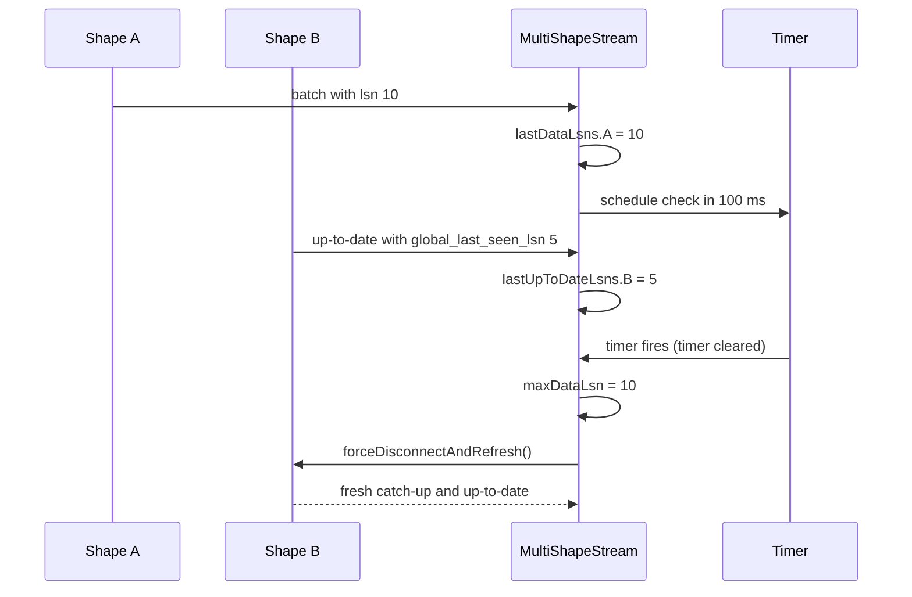
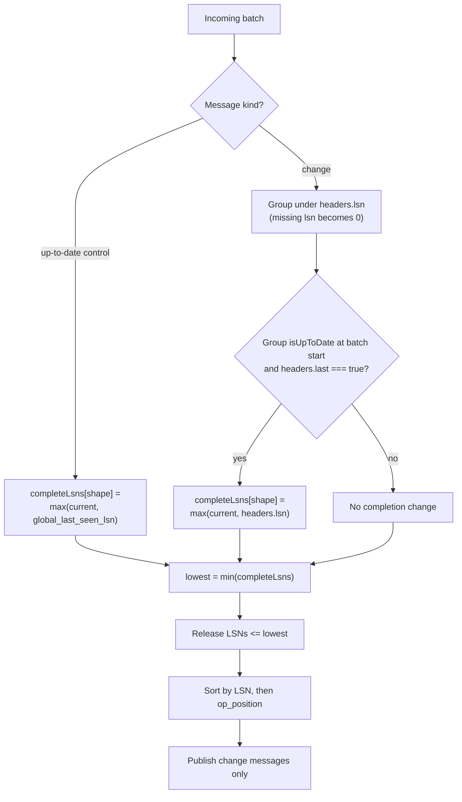

# Experimental Modules

This document is the full reference for the three source modules in `@electric-sql/experimental`. It explains every exported type and function, every option and default, the transaction merge algorithm, and the test coverage. Every source citation is relative to the package root. Document links are relative to this directory.

## Terms and the message model

**Electric** is a sync engine. It streams a filtered subset of a PostgreSQL database to clients over the Hypertext Transfer Protocol (HTTP). A **shape** is one filtered subset of one PostgreSQL table. A **shape stream** (`ShapeStream`) is the client object that follows one shape. It first catches up to the current rows, then follows live changes.

A shape stream delivers a **batch**: the array of messages that one child stream passes to its subscriber in one callback. A batch is not one database transaction. A batch can hold change messages, control messages, or both. An **offset** is the position inside one shape stream that a client sends to resume. Each child stream keeps its own offset.

A **change message** describes one insert, update, or delete of one row. A **control message** describes protocol state. The package acts on the control value `up-to-date`, which says that the stream has caught up. The message interfaces are at `src/multi-shape-stream.ts:32-42`.

```jsonc
// A change message
{
  "headers": {
    "operation": "insert",     // "insert", "update", or "delete"
    "lsn": "2745",             // PostgreSQL Log Sequence Number
    "op_position": 1,          // position inside the transaction
    "last": true               // last change at this LSN
  },
  "value": { "id": 1, "priority": "high" }
}

// An up-to-date control message
{
  "headers": {
    "control": "up-to-date",
    "global_last_seen_lsn": "2745"
  }
}
```

The package reads six header fields. Each line number points to a place in this package that reads the field.

| Header | Type | Meaning | Read at |
|--------|------|---------|---------|
| `operation` | string | `insert`, `update`, or `delete` | `src/match.ts:26` |
| `lsn` | string of digits | Log Sequence Number of the change | `src/multi-shape-stream.ts:197`, `440` |
| `global_last_seen_lsn` | string of digits | Highest LSN that Electric had seen when it sent `up-to-date` | `src/multi-shape-stream.ts:182`, `462` |
| `control` | string | Control value; the code acts on `up-to-date` | `src/multi-shape-stream.ts:456` |
| `last` | boolean | True on the last change at one LSN | `src/multi-shape-stream.ts:447-448` |
| `op_position` | number | Position of the change inside one transaction | `src/multi-shape-stream.ts:415-420` |

A **Log Sequence Number (LSN)** is PostgreSQL's position in its write-ahead log. A higher LSN is a later database state. This package uses two LSNs, and they are not the same:

- **The data LSN** is `headers.lsn` on a change message. It is local to one shape. It covers only the rows that the shape selected. Two shapes can report different data LSNs for the same PostgreSQL transaction.
- **The global LSN** is `headers.global_last_seen_lsn` on an `up-to-date` control message. It is the same server-wide position for every shape at that moment. It does not depend on the shape filter.

The base class tracks both per child (`src/multi-shape-stream.ts:129-130`). The transactional class uses both to infer a transaction boundary.

Two type names are easy to confuse:

- `MultiShapeMessage` (singular) is the internal union of one shape's change message and that shape's control message (`src/multi-shape-stream.ts:44-46`). It is not exported.
- `MultiShapeMessages` (plural) is the exported union across all configured shapes (`src/multi-shape-stream.ts:48-54`). It maps each shape name to `MultiShapeMessage<row type, shape name>` and takes the union of the results.

## `MultiShapeStream`

### Options

`MultiShapeStreamOptions` is at `src/multi-shape-stream.ts:16-30`. It has three fields:

```ts
interface MultiShapeStreamOptions<
  TShapeRows extends { [K: string]: Row<unknown> } = { [K: string]: Row<unknown> },
> {
  shapes: {
    [K in keyof TShapeRows]:
      | ShapeStreamOptions<TShapeRows[K]>
      | ShapeStream<TShapeRows[K]>
  }
  start?: boolean
  checkForUpdatesAfterMs?: number // milliseconds
}
```

| Option | Type | Default | Meaning |
|--------|------|---------|---------|
| `shapes` | map of name to options or stream | required | The child shapes. Each value is either a `ShapeStreamOptions` object or an existing `ShapeStream` object. |
| `start` | `boolean` | `true` | Start the child streams in the constructor. When false, the first `subscribe` call starts them. |
| `checkForUpdatesAfterMs` | `number` | `100` | Delay in milliseconds before the class forces a refresh of a lagging shape. |

The defaults are set by destructuring at `src/multi-shape-stream.ts:141-145`. The comment on the same lines states the reason for each default.

### Construction

The constructor at `src/multi-shape-stream.ts:140-165` does four things:

1. It separates the three options and applies the defaults.
2. It converts each option object into a `ShapeStream` object. It passes `start: false` to every stream that it creates (`src/multi-shape-stream.ts:147-157`).
3. It initialises two `bigint` maps, `#lastDataLsns` and `#lastUpToDateLsns`, to `-1n` for every shape (`src/multi-shape-stream.ts:158-163`).
4. It calls `#start()` when `start` is true (`src/multi-shape-stream.ts:164`).

The `-1n` value is a sentinel, not a real LSN. It means "this child has not reported a data LSN or an up-to-date LSN yet". A real PostgreSQL LSN is zero or greater, so `-1n` is always lower than any real value. The first real value therefore replaces the sentinel without a special case.

A caller can pass an existing `ShapeStream` object. The class uses it directly and does not wrap it. An existing stream must not have started. The class checks this in `#start()` at `src/multi-shape-stream.ts:167-174`:

```ts
#start() {
  if (this.#started) throw new Error(`Cannot start multi-shape stream twice`)
  for (const [key, shape] of this.#shapeEntries()) {
    if (shape.hasStarted()) {
      // The multi-shape stream needs to be started together as a whole, and so we
      // have to check that a shape is not already started.
      throw new Error(`Shape ${key} already started`)
    }
```

This all-or-nothing rule is important. A group start is what makes the freshness guarantee meaningful. If one child had already started, the group would have no common start time.

### Starting and forwarding

`#start()` subscribes to every child stream (`src/multi-shape-stream.ts:175-221`). For each batch of messages it does three jobs.

**Job 1: record the newest up-to-date LSN.** The code filters control messages, reads `headers.global_last_seen_lsn`, converts it to `bigint`, and keeps the maximum (`src/multi-shape-stream.ts:177-191`). A missing header becomes `0n`.

**Job 2: record the newest data LSN.** The code filters change messages, reads `headers.lsn`, and keeps the maximum (`src/multi-shape-stream.ts:193-204`). A missing header becomes `0n`. If the batch contains data, the code also schedules a check of the other shapes (`src/multi-shape-stream.ts:205-208`).

**Job 3: forward the messages.** The code maps every message to a new object with the same fields plus `shape: key`, then publishes the new array (`src/multi-shape-stream.ts:210-218`). It does not mutate the child message. A subscriber can keep the array without changing child state.

### The freshness guarantee

The class description states the guarantee: every shape receives at least one `up-to-date` message within `checkForUpdatesAfterMs` of new data from any shape (`src/multi-shape-stream.ts:80-83`). The code implements the guarantee with a refresh heuristic.

Shapes are independent HTTP streams. One shape can receive a change before another shape receives the same transaction. A shape can also need a new long poll after a server restart. `MultiShapeStream` uses a timer to close the gap.

`#scheduleCheckForUpdates()` sets one timer if no timer is active (`src/multi-shape-stream.ts:226-231`). The class holds one timer for the whole group, not one timer per shape. The `??=` operator keeps the first timer. New data does not extend a pending timer. When the timer fires, it calls `#checkForUpdates()` and clears the timer field. A later data batch arms a new timer. If no new data arrives, no further check runs.

When the timer fires, `#checkForUpdates()` does this:

1. It finds the maximum data LSN across all shapes (`src/multi-shape-stream.ts:234`).
2. It keeps only the shapes whose last up-to-date LSN is lower than that maximum (`src/multi-shape-stream.ts:235-241`).
3. It calls `forceDisconnectAndRefresh()` on each kept shape and waits for all calls (`src/multi-shape-stream.ts:242-245`).

`forceDisconnectAndRefresh()` is a method inherited from `ShapeStream`. It drops the child's current HTTP connection and starts a fresh request from the child's current offset. It does not reset the offset, so no data is lost. The fresh request makes the server send a new `up-to-date` message. This is why a lagging child catches up without a new database change.



The heuristic avoids a refresh storm. A shape that has already seen an up-to-date LSN at or above the newest data is skipped. A shape that lags is refreshed. The check runs asynchronously. The timer callback does not wait for the result and does not catch a rejection from `forceDisconnectAndRefresh()`.

**Aha:** the class does not compare shapes directly. It compares each shape's last up-to-date LSN with the group's maximum data LSN. This single scalar test answers "could this shape have missed something?" without tracking per-shape dependency graphs. It also works when the shapes overlap or when one shape has more traffic than another.

### Subscription and status methods

| Member | Kind | Lines | Behaviour |
|--------|------|-------|-----------|
| `subscribe(callback, onError?)` | method | `src/multi-shape-stream.ts:290-304` | Adds a subscriber, starts the group if it has not started, and returns an unsubscribe function. |
| `unsubscribeAll()` | method | `src/multi-shape-stream.ts:306-308` | Removes every subscriber. It does not stop the child streams. |
| `lastSyncedAt()` | method | `src/multi-shape-stream.ts:310-318` | Returns the minimum `lastSyncedAt()` of all children. |
| `lastSynced()` | method | `src/multi-shape-stream.ts:320-325` | Returns the elapsed time in milliseconds since `lastSyncedAt()`. |
| `isConnected()` | method | `src/multi-shape-stream.ts:327-330` | True only when every child is connected. |
| `isLoading()` | method | `src/multi-shape-stream.ts:332-335` | True when any child is loading. |
| `isUpToDate` | getter | `src/multi-shape-stream.ts:337-339` | True only when every child is up to date. Read it as a property. |
| `shapes` | getter | `src/multi-shape-stream.ts:286-288` | Returns the internal map of child streams. |

The constructor starts the group when `start` is true. When `start` is false, `subscribe` starts the group on the first call (`src/multi-shape-stream.ts:299`). A second `subscribe` call does not restart it. A direct call to `#start()` after it has run throws (`src/multi-shape-stream.ts:168`).

The aggregate methods use "every" for healthy states and "some" for loading. A group is connected only when all members are connected. A group is loading when at least one member is loading. This choice reports the worst member.

`lastSyncedAt()` uses the minimum value, because the group is only as fresh as its oldest child. The code has two edge cases:

- With zero shapes, it returns `undefined` (`src/multi-shape-stream.ts:313-314`).
- When every child returns `undefined`, the minimum is `Infinity`, not `undefined`. `lastSynced()` then returns `Date.now() - Infinity`, which is `-Infinity`.

The second case can occur before the first child syncs. A caller that tests `lastSynced() > limit` should first test `isLoading()`.

### Error handling

The child error callback calls `#onError` (`src/multi-shape-stream.ts:220`, `src/multi-shape-stream.ts:248-253`). `#onError` sends the error to every subscriber that supplied an error function. A comment on line 249 records an open design question: the code does not yet disconnect all shapes on the first error.

`_publish` at `src/multi-shape-stream.ts:255-269` calls every subscriber in parallel with `Promise.all`. If one callback throws, the method does not reject the whole publish. It schedules a microtask that rethrows the error (`src/multi-shape-stream.ts:260-267`). This keeps a broken subscriber from blocking the others. The cost is that the error is not a rejected Promise that the caller can await. It becomes an uncaught exception in a later microtask, and the child stream continues.

## `TransactionalMultiShapeStream`

`TransactionalMultiShapeStream` extends `MultiShapeStream` (`src/multi-shape-stream.ts:379-383`). It delays publication until it can prove that every shape has passed the same transaction boundary. The result is one callback per inferred transaction, with change messages from all shapes.

A **transaction boundary** is the point at which every shape has reported an `up-to-date` position at or above one LSN. The class cannot see a PostgreSQL transaction identifier. It infers the boundary from the LSN headers.

### Why a subclass

The base class publishes each child batch as soon as it arrives. That behaviour is correct for a user interface that only needs eventual consistency. It is wrong for a consumer that must apply a database transaction as one unit.

The subclass does more than override `_publish`. It has its own constructor (`src/multi-shape-stream.ts:389-394`), its own private state (`src/multi-shape-stream.ts:384-387`), its own `_publish` (`src/multi-shape-stream.ts:400-431`), and its own `#accumulate` method (`src/multi-shape-stream.ts:433-467`). It inherits construction of the child streams, starting, refresh, and status methods from the base class.

The base class calls `this._publish(...)` (`src/multi-shape-stream.ts:218`). JavaScript resolves that call to the subclass method. This is how the subclass receives every child batch without a second subscription.

### State

Two private fields hold the transaction state:

```ts
#changeMessages = new Map<bigint, MultiShapeMessage<Row<unknown>, string>[]>()
#completeLsns: { [K in keyof TShapeRows]: bigint }
```

The citation is `src/multi-shape-stream.ts:384-387`. `#changeMessages` groups change messages by LSN. The LSN is the transaction key. `#completeLsns` records the highest LSN that each shape has fully observed. Because the code uses a maximum, the value can only rise.

The constructor calls the parent constructor and sets every entry in `#completeLsns` to `-1n` (`src/multi-shape-stream.ts:389-394`). The sentinel has the same meaning as in the base class: no shape has reported completion.

### The merge algorithm

`_publish` runs two steps (`src/multi-shape-stream.ts:400-431`):

1. **Accumulate.** `#accumulate` sorts the new messages into `#changeMessages` and `#completeLsns` (`src/multi-shape-stream.ts:433-467`).
2. **Release.** Compute the lowest complete LSN across all shapes (`src/multi-shape-stream.ts:396-398`). Collect every LSN at or below that value. Sort those LSN values in ascending order. For each LSN, sort its messages by `op_position`. Remove the released entries from the map. Publish one flat change-message array (`src/multi-shape-stream.ts:404-430`).



### How a shape declares a transaction complete

A shape marks a transaction complete in two ways. The two paths use different LSNs, and the difference is deliberate.

**Path 1: the last change message**. When the whole group is up to date at the start of the batch and a change message has `headers.last === true`, the shape records that message's own `headers.lsn` (`src/multi-shape-stream.ts:445-454`). The code sets the entry to `max(current, lsn)`.

The `isUpToDate` test is evaluated once at the start of `#accumulate`, before the method processes any message in the batch (`src/multi-shape-stream.ts:434`). This gives a strict rule: the batch that first makes the group up to date cannot also mark itself complete. That batch only proves that all shapes are now current. A later batch with `last === true` supplies the proof that the data was already current at the start. The cost is one extra batch of delay in some cases.

**Path 2: an up-to-date control message.** When a control message has `headers.control === 'up-to-date'`, the shape records `headers.global_last_seen_lsn` (`src/multi-shape-stream.ts:455-464`). The code throws an error if that header is not a string.

The minimum of all `#completeLsns` values is the **lowest complete LSN**. Every LSN at or below that value is safe to publish, because every shape has passed it.

**Aha:** the two paths form a two-part proof, not one rule. Path 1 says "this shape has no more changes at this LSN, and every shape was already current when the batch began". Path 2 says "the server has seen every change up to this global position, for every shape". The first proof is local and exact; the second proof is global and conservative. Together they infer transaction boundaries without a transaction identifier in the protocol.

The global value also covers data that a child has not received yet. That is why one shape's `up-to-date` message can release another shape's changes. The server has seen the position, so the missing change either does not touch that other shape or will arrive before the position advances.

### A worked transaction

Two shapes, `issues` and `comments`, start at `-1n`. Both children are up to date after their snapshot. The server then commits one transaction at LSN 10 with two changes, one per shape, and a second transaction at LSN 11 that touches only `comments`.

| Step | Incoming batch | `isUpToDate` at start | Change stored | Completion after batch | Lowest complete | Published |
|------|----------------|-----------------------|---------------|------------------------|-----------------|-----------|
| 1 | `issues`: change LSN 10, `last: true`; then up-to-date global 10 | true | 10 | `issues = 10` (Path 2) | -1 | none |
| 2 | `comments`: change LSN 10, `last: true`; then up-to-date global 10 | true | 10 | `comments = 10` (Path 2) | 10 | LSN 10, both changes |
| 3 | `comments`: change LSN 11, `last: true` | true | 11 | `comments = 11` (Path 1) | 10 | none |
| 4 | `issues`: up-to-date global 11 | true | none | `issues = 11` (Path 2) | 11 | LSN 11 |

In step 1, the `issues` change is buffered but not published. The `comments` entry is still `-1n`, so the lowest complete LSN is `-1`. In step 2, the `comments` control message raises its entry to 10. The lowest value is now 10. The release collects LSNs at or below 10, finds the buffered LSN 10, sorts its two messages by `op_position`, and publishes them together.

In step 3, `comments` advances to 11, but `issues` is still at 10. The lowest value stays 10, so the LSN 11 message stays in the buffer. In step 4, `issues` reports global 11. The lowest value becomes 11, and the LSN 11 change is published.

This example shows the cost of the design. One slow shape holds back every later change from every shape. The buffer has no size limit and no backpressure. A stalled shape can therefore keep messages in memory for as long as the stall lasts.

### Ordering inside a transaction

PostgreSQL assigns `op_position` to each operation inside a transaction. The code sorts messages by `op_position` before publication (`src/multi-shape-stream.ts:409-421`). A snapshot message has no `op_position`. The comparator returns `0` when either value is not a number, and a stable sort then keeps the insertion order. JavaScript sorts are stable by specification, so messages with the same position keep the order in which the child streams delivered them.

The test at `test/multi-shape-stream.test.ts:416-420` asserts that the published `op_position` values are in ascending order. The test at `test/multi-shape-stream.test.ts:370-414` checks the exact delete-and-insert sequence for two rows that move between two shapes in one transaction.

### Control messages are not republished

`#accumulate` reads control messages to update `#completeLsns`, but it never adds them to `#changeMessages` (`src/multi-shape-stream.ts:455-464`). The release step publishes only the stored change messages (`src/multi-shape-stream.ts:428-430`). A subscriber to `TransactionalMultiShapeStream` therefore receives no control messages at all.

This differs from the base class, which forwards control messages. A transactional subscriber that waits for an `up-to-date` message will wait forever. It must use the `isUpToDate` property or the `lastSynced` methods instead.

### Other edge cases

- **Snapshot messages.** A change message with no `lsn` is stored under `0n` (`src/multi-shape-stream.ts:438-440`). Snapshot rows are therefore released together at LSN 0, after every shape reports a completed position of 0 or higher.
- **Unbounded buffer.** `#changeMessages` holds every LSN above the lowest complete value. There is no cap and no eviction policy.
- **Errors do not clear the buffer.** A child error goes to `#onError` in the base class. The buffered messages stay in `#changeMessages`. A later successful batch can still release them. There is no rollback.
- **Subscriber errors.** A subscriber callback error becomes an uncaught microtask error, as in the base class. The release has already removed the messages from the map, so the messages are lost to that subscriber.
- **Empty shapes.** With zero shapes, `#completeLsns` is empty and `isUpToDate` is true (an "every" test on an empty list). No child can call `_publish`, so the empty list never reaches `bigIntMin`. `lastSyncedAt()` returns `undefined`.

## `matchStream` and `matchBy`

`matchStream` has this signature:

```ts
export function matchStream<T extends Row<unknown>>(
  stream: ShapeStreamInterface<T>,
  operations: Array<Operation>,
  matchFn: (message: ChangeMessage<T>) => boolean,
  timeout = 60000 // ms
): Promise<ChangeMessage<T>>
```

The citation is `src/match.ts:12-17`. The function subscribes to the stream (`src/match.ts:19-35`). For each batch it filters for change messages, then searches for a message whose `headers.operation` is in the `operations` array and whose `matchFn` returns true (`src/match.ts:21-30`). On a match, `finish` clears the timer, unsubscribes, and resolves the Promise (`src/match.ts:45-52`).

The `operations` array is an inclusive list. A message matches when its operation equals any entry. The list can hold `'insert'`, `'update'`, and `'delete'` in any combination. The predicate runs only after the operation test passes, so one call does not evaluate a predicate for an operation that the caller did not request.

`matchStream` accepts change messages only. A snapshot message is a change message with operation `'insert'`, so a row that already exists in the snapshot can match before any live change arrives. The caller must decide whether that is the wanted behaviour.

The default timeout is `60000` milliseconds. On timeout the function writes a message to `console.error` and rejects the Promise with a string, not an `Error` object (`src/match.ts:37-43`). The timeout path does not unsubscribe. The subscription stays active after the Promise settles, and a later match calls `finish` on an already settled Promise. The caller cannot see that later call, and the subscription remains until the stream ends.

`matchStream` passes no error callback to `subscribe` (`src/match.ts:19-35`). A stream error therefore does not reject the Promise directly. The Promise settles by a match or by the timeout.

`matchBy` is a helper that builds a predicate. It compares one column with one value:

```ts
export function matchBy<T extends Row<unknown>>(
  column: string,
  value: Value<GetExtensions<T>>
): (message: ChangeMessage<T>) => boolean {
  return (message: ChangeMessage<T>) => message.value[column] === value
}
```

The citation is `src/match.ts:55-60`. The `GetExtensions` type parameter lets a caller name the type of a custom column. The comparison is strict equality. The helper does not support nested paths, ranges, or type coercion. A numeric `1` does not match a string `"1"`.

```mermaid
sequenceDiagram
    participant C as Caller
    participant M as matchStream
    participant S as ShapeStream
    C->>M: subscribe, operations, predicate, timeout
    M->>S: subscribe (no error callback)
    S-->>M: initial snapshot messages
    S-->>M: change messages
    M->>M: filter operation and predicate
    M->>S: unsubscribe on match
    M-->>C: resolve ChangeMessage
    Note over M: on timeout, log and reject a string;<br/>subscription stays active
```

The test at `test/match.test.ts:10-35` inserts a row after 10 milliseconds and waits for the insert message with a 200 millisecond timeout. The test proves both the predicate path and the unsubscribe path.

## The `bigint` helpers

`src/bigint-utils.ts:1-11` defines three functions:

| Function | Lines | Behaviour |
|----------|-------|-----------|
| `bigIntMax(nums)` | 1-3 | Reduces an array of `bigint` or `number` to the largest value, as a `bigint`. |
| `bigIntMin(nums)` | 5-7 | Reduces an array to the smallest value, as a `bigint`. |
| `bigIntCompare(a, b)` | 9-11 | Returns `1`, `-1`, or `0`. |

The reduce form is deliberate. The common alternative is `Math.max(...nums)`, which spreads the array into function arguments. A very large array can overflow the call stack with that form. The test creates an array of `150000` values (`test/bigint-utils.test.ts:4-5`, `test/bigint-utils.test.ts:24-33`). The comment on line 4 names the reason: destructuring that many arguments would cause a stack overflow.

Both functions call `reduce` without an initial value, so an empty array throws a `TypeError`. The callers always pass a non-empty array. `#checkForUpdates` runs only after at least one data message; `#getLowestCompleteLsn` runs only from a child callback, which requires at least one shape.

**Aha:** `bigIntMax` calls `BigInt` on the reduce result even when every input is already a `bigint`. This small extra call gives one return type for mixed `bigint` and `number` arrays. JavaScript compares `number` and `bigint` without error, so the reduce works across both types. The `BigInt` wrapper removes the ambiguity at the API boundary.

## Package metadata and build

`package.json:1-84` defines the package. `package.json:37-49` maps one export path to two artifacts:

| Condition | File | Types |
|-----------|------|-------|
| `import` | `dist/index.mjs` | `dist/index.d.ts` |
| `require` | `dist/cjs/index.cjs` | `dist/cjs/index.d.cts` |

The `main` field points to the CommonJS artifact and the `module` field points to `dist/index.legacy-esm.js`. `tsup.config.ts:4-62` builds four outputs in one pass:

| Output | Format | Target | Purpose |
|--------|--------|--------|---------|
| `dist/index.mjs` | ECMAScript Module (ESM) | default | Main import for modern bundlers |
| `dist/cjs/index.cjs` | CommonJS (CJS) | default | `require()` consumers |
| `dist/index.legacy-esm.js` | ECMAScript Module (ESM) | ES2017 | Webpack 4 compatibility (`tsup.config.ts:39-47`) |
| `dist/index.browser.mjs` | ECMAScript Module (ESM) | default, minified | Direct browser use (`tsup.config.ts:48-60`) |

Only the first two outputs appear in the export map. The legacy and browser files are fallbacks for tools that read `module` or a browser field, not separate entry points that a caller selects. The build names `@electric-sql/client` as external (`tsup.config.ts:11`). This keeps the peer dependency out of the bundle.

The build script runs `tsup` and then `tsc -p tsconfig.build.json` (`package.json:65-73`). The second step writes the declaration files that the export map names.

## Test coverage

| Test file | Lines | What it covers |
|-----------|-------|----------------|
| `test/multi-shape-stream.test.ts` | 544 | Empty shapes, initial sync, continuous sync, unsubscribe, transaction grouping, transaction boundaries |
| `test/match.test.ts` | 36 | One matching insert with a short timeout |
| `test/bigint-utils.test.ts` | 77 | Maximum, minimum, comparison, negative values, 150,000-element arrays |
| `test/multi-shape-stream.test-d.ts` | 51 | Type inference for stream objects, option objects, and mixed inputs |
| `test/support/test-context.ts` | 243 | Fixtures that create the `issues` table and shape helpers |
| `test/support/test-helpers.ts` | 103 | Insert, update, wait, and transaction helpers |
| `test/support/global-setup.ts` | 74 | Starts the test environment |

The test files are not all the same kind. `test/bigint-utils.test.ts` and `test/multi-shape-stream.test-d.ts` do not contact a server. The integration tests in `test/multi-shape-stream.test.ts` and `test/match.test.ts` run against a live Electric service and a PostgreSQL database. `test/support/global-setup.ts:3-5` reads `ELECTRIC_URL` with the default `http://localhost:3000`, waits for `/v1/health` to report `active` (`test/support/global-setup.ts:30-55`), and creates a dedicated `electric_test` schema (`test/support/global-setup.ts:57-69`). The fixtures in `test/support/test-context.ts` create the `issues` table in that schema and give the tests shape helpers.

The type test runs under `vitest` with `expectTypeOf`. It does not prove run-time behaviour.

## Related documents

- [00-overview.md](00-overview.md) explains the problem, the three behaviors, and the package position.
- [README.md](README.md) is the package index, the reading order, and the build instructions.
- [../typescript-client/00-overview.md](../typescript-client/00-overview.md) defines `ShapeStream` and its options.
- [../sync-service/02-http-api-and-shapes.md](../sync-service/02-http-api-and-shapes.md) defines the shape HTTP interface and headers.
- [../durable-streams/03-live-reads-and-subscriptions.md](../durable-streams/03-live-reads-and-subscriptions.md) explains live delivery and control messages.
