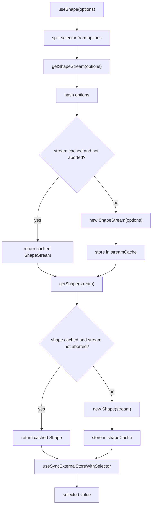
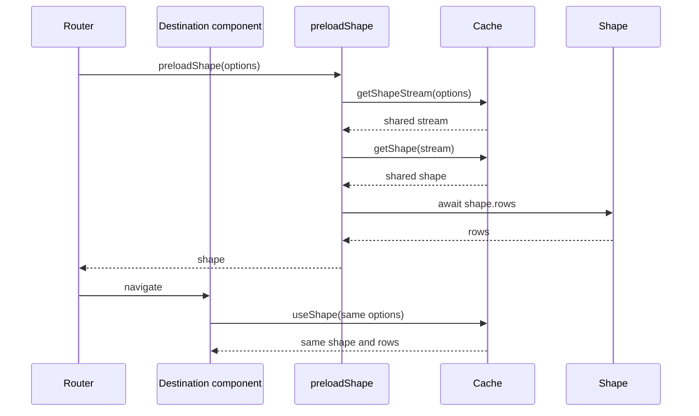

# useShape and the Cache Provider

`useShape` connects one React component to one Electric shape. An Electric shape is a filtered, column-projected view of one PostgreSQL table. A `ShapeStream` is the live Hypertext Transfer Protocol (HTTP) connection that receives the shape's messages. A `Shape` is the in-memory row map that the stream fills. `useShape` uses two module-level caches to share the network stream and the row projection. The caches are the "provider" in this package. They are not a React context provider.

The hook is in `src/react-hooks.tsx:164-211`. The caches are in `src/react-hooks.tsx:14-15`.

## The hook call

```tsx
const { data, isLoading, error } = useShape({
  url: 'http://localhost:3000/v1/shape',
  params: { table: 'todos' },
})
```

The hook accepts every `ShapeStreamOptions` field plus an optional `selector`. The citation is `src/react-hooks.tsx:159-170`.

`ShapeStreamOptions` has one required field, `url` (string). Its optional fields are `offset`, `handle`, `headers`, `params`, `subscribe`, `liveSse`, `log`, `signal`, `fetchClient`, `runtimeVisibility`, `backoffOptions`, `liveRequestTimeoutMs`, `parser`, `transformer`, `columnMapper`, `onError`, `subsetMethod`, and `warnOnHttp`. The defaults are `subscribe: true`, `liveSse: false`, `log: full`, and `liveRequestTimeoutMs: 45000`. The full types and defaults are in the [TypeScript client API reference](../typescript-client/04-api-reference.md#shapestreamoptions).

The default selector is the module-level `identity` function. It returns the full `UseShapeResult`. The function is defined once for the module, so it is stable across renders. A custom selector receives the full result and returns any value. The citation is `src/react-hooks.tsx:155-170`.



## Stable option hashing

The cache key is `sortedOptionsHash(options)`. The function calls `sortObjectKeys` and then `JSON.stringify`. `JSON` means JavaScript Object Notation. The citation is `src/react-hooks.tsx:43-45`.

`sortObjectKeys` handles three special cases:

1. A function becomes its source text.
2. An array is mapped element by element.
3. An object has its keys sorted before recursion.

The citation is `src/react-hooks.tsx:26-41`.

Every other value returns unchanged. This covers primitives and `null`. An `undefined` value returns `undefined`, and `JSON.stringify` drops an object property whose value is `undefined`, so that property does not appear in the key. A `Date`, `Map`, `Set`, or `AbortSignal` has no enumerable own properties, so it becomes `{}`. A class instance is copied through its enumerable own properties. The function copies objects and arrays. It does not mutate the input.

The function case is important. `ShapeStreamOptions` accepts header functions and parameter functions. Two different function instances with the same source text produce the same hash. The captured values of a closure are not in that text. A header function that closes over a user token can produce the same hash as another function. That other function has the same body but a different token. The two functions would share one stream and one set of rows. The citation is `src/react-hooks.tsx:26-27`.

The sort is recursive. A nested object also receives a stable key order. The citation is `src/react-hooks.tsx:34-40`.

The hash includes every option key, but some values are lossy. A function is represented by its source text without captured values. An object with no enumerable own properties is represented by `{}`. An `undefined` value is dropped from the serialized object. These rules permit deliberate sharing and also create the collision risks described above.

The hook builds `options` by removing `selector`. A custom selector is not part of the stream identity.

**Aha:** the cache key is a serialized option object, not a uniform resource locator (URL). This choice makes cache sharing correct for authentication headers, user-specific parameters, and protocol flags. A URL-only key would merge two users into one stream and leak data. The cost is that functions are compared by source text, not by captured values. So a function that closes over user-specific data needs an explicit option that also changes the hash.

## `getShapeStream`

`getShapeStream` performs the stream cache lookup. It accepts a `ShapeStreamOptions` object. It returns a `ShapeStream`. The citation is `src/react-hooks.tsx:47-69`.

The lookup logic is:

| Condition | Action | Source |
|-----------|--------|--------|
| Hash exists and signal is not aborted | Return the cached stream | `src/react-hooks.tsx:53-57` |
| Hash exists but signal is aborted | Delete the stream and its shape | `src/react-hooks.tsx:59-61` |
| Hash does not exist | Create a stream and store it | `src/react-hooks.tsx:64-65` |

The stream is created with `new ShapeStream(options)`. The constructor applies the defaults and validates the options. The citation is `src/react-hooks.tsx:64`.

The constructor adds only one default key to `stream.options`: `subscribe: true`. The citation is `../typescript-client/src/client.ts:730`. Other defaults, such as offset `-1` and log mode `full`, live in the state machine or separate fields and do not add top-level option keys. That single added key is the reason the recomputed hash in `getShape` can differ from the stored key.

The signal test reads the signal stored on the cached stream, not the signal in the caller's options. The cached stream owns the first signal that created it. A later caller whose options produce the same hash receives that stream and does not replace its signal. The citation is `src/react-hooks.tsx:54-56` and `../typescript-client/src/client.ts:730`.

The cache is global to the module instance. It lives for the lifetime of the JavaScript bundle. The citation is `src/react-hooks.tsx:14`.

## `getShape`

`getShape` performs the shape cache lookup. The key is the stream object itself, because a `Shape` belongs to one `ShapeStream`. The citation is `src/react-hooks.tsx:71-90`.

The lookup logic mirrors the stream cache:

| Condition | Action | Source |
|-----------|--------|--------|
| Stream key exists and signal is not aborted | Return the cached shape | `src/react-hooks.tsx:75-78` |
| Stream key exists but signal is aborted | Delete the stream by hash and delete the shape | `src/react-hooks.tsx:80-82` |
| Stream key does not exist | Create a shape and store it | `src/react-hooks.tsx:85-86` |

The aborted branch also deletes the stream from `streamCache`. It computes the hash again from `shapeStream.options`. The citation is `src/react-hooks.tsx:81`.

That second hash can differ from the key that stored the stream. The `ShapeStream` constructor copies the caller options and adds the default `subscribe: true`. The citation is `../typescript-client/src/client.ts:730`. If the caller omitted `subscribe`, the stored key has no `subscribe` field, but the recomputed hash has `subscribe: true`. The delete then misses the cache entry. The entry is not lost forever. A later `getShapeStream` call that hashes to the original key finds the aborted stream, deletes it, and creates a new stream. The shape from the aborted stream is removed by object key in this branch. The citation is `src/react-hooks.tsx:53-62` and `src/react-hooks.tsx:81-82`. A later call that passes an explicit `subscribe` value hashes to the other key, so it does not find or remove the stale entry.

## `preloadShape`

`preloadShape` creates or reuses the stream and the shape. It awaits `shape.rows`. It returns the shape. The citation is `src/react-hooks.tsx:17-24`.

The `rows` promise resolves at the first up-to-date boundary. If the shape stores an error before that boundary, the promise rejects with the error. `preloadShape` awaits that promise, so its own returned promise rejects with the same error. A caller must catch it. The citation is `../typescript-client/src/shape.ts:109-128`.

The function is useful before navigation. A route can preload a shape, and the destination component's `useShape` call finds the same cached shape. The data is then ready at the first render.



## Sharing across components

Two components that call `useShape` with options that produce the same cache key share one stream and one shape. Sharing follows the hash, not object identity. Each component adds a subscriber to the shape. The shape keeps one row map. The citation is `src/react-hooks.tsx:180-188`.

The `Shape` object tracks its own subscribers. It calls every callback when it notifies. The subscription cleanup removes only that component's callback. The citation is `../typescript-client/src/shape.ts:180-192` and `../typescript-client/src/shape.ts:355-359`.

A component that uses a different `selector` still shares the shape. The selector runs after the shared snapshot. The citation is `src/react-hooks.tsx:159-162`.

## Cache lifetime and abort signals

The cache does not remove an entry when the last subscriber unsubscribes. It removes an entry only when a later lookup sees that the cached stream's signal is aborted. The citation is `src/react-hooks.tsx:55-61`.

This behavior keeps a shape warm across route changes. It also means that a component must abort the signal that created the stream to free the network connection. A component does not own the signal of a stream that it only shares. The cleanup of `useShape` removes the subscriber callback and does not abort. The citation is `src/react-hooks.tsx:116-124` and `src/react-hooks.tsx:55-61`.

An application can call `getShapeStream` once with a shared `AbortController.signal` before it renders components. The components then call `useShape` with the same options and share that stream. When the session ends, the application aborts the controller. The next lookup removes the dead entries and creates fresh streams. The citation is `src/react-hooks.tsx:47-69`.

The package exports no public function that clears the caches. An application can remove a stream only by aborting its signal and then causing a new lookup. The caches are module-level constants with no export. The citation is `src/react-hooks.tsx:14-15`.

When `options.signal` is absent, the cache test passes, because `undefined` is not aborted. Nothing can then close that stream through the cache. The entry lives until the module unloads. Pass a signal if the stream must be released.

The `ShapeStream` has a request loop: the repeated long-poll or Server-Sent Events (SSE) request cycle. A pause lock is a set of reason strings. The stream pauses while the set is not empty. "Pause" means that the lock stops the next loop iteration and aborts the active request with the reason string `PAUSE_STREAM`. It does not abort the stream signal. A hidden browser tab adds the `visibility` reason. A visible tab removes it. The hook does not expose pause state. A pause does not change `isLoading` or `lastSyncedAt`. Those values reflect the last completed sync. The citation is `../typescript-client/src/client.ts:737-754`, `../typescript-client/src/client.ts:2010-2016`, and `../typescript-client/src/client.ts:985-1029`.

## Options that affect sharing

| Option | Sharing effect | Reason |
|--------|----------------|--------|
| `url` | Different URL means a different stream | It is part of the hash |
| `params` | Different params mean a different stream | It is part of the hash |
| `headers` | Different header values mean a different stream | It is part of the hash |
| `log` | Different mode means a different stream | It is part of the hash |
| `liveSse` | Different transport means a different stream | It is part of the hash |
| `signal` | Two different signal objects hash the same, but adding the key or omitting it changes the hash | A signal serializes to `{}`; the key itself remains |
| `selector` | No effect on sharing | The selector is removed before hashing |

The hash covers the options object. The hook removes `selector` from the options before it calls `getShapeStream`. The citation is `src/react-hooks.tsx:167-173`.

`log` selects `full` (snapshot plus changes) or `changes_only` (changes only). The default is `full`. `liveSse` selects SSE instead of the default long polling. Both values change the protocol conversation, so they change stream identity.

An `AbortSignal` object has no enumerable data. It serializes to `{}`. Two components with different signals can therefore share a cached stream if every other option is equal, including whether they both supply a signal. A component that supplies a signal and a component that omits the option do not share, because their serialized objects have different keys. The cache checks the cached stream signal, not the caller signal. The first stream owns the signal that created it. A caller that needs an isolated stream must change another option, such as a parameter or a header. A caller that shares a stream must not abort the owner's signal, because the abort closes the stream for every component that shares it.

Read [02-lifecycle-and-state.md](02-lifecycle-and-state.md) for the external store and subscription race handling. Read the [TypeScript client API reference](../typescript-client/04-api-reference.md) for the full option list.
