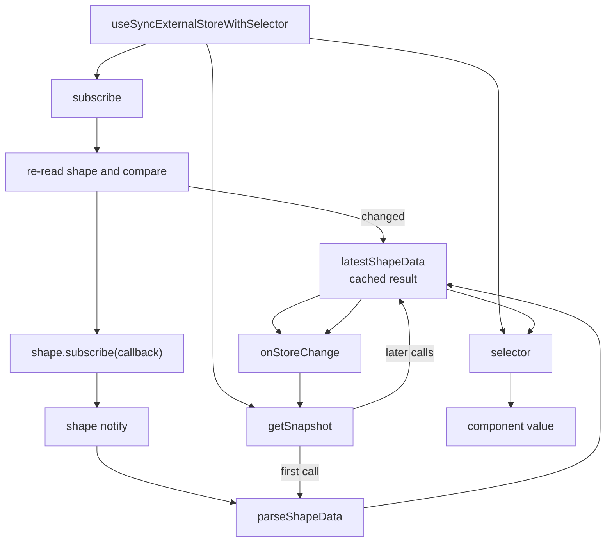
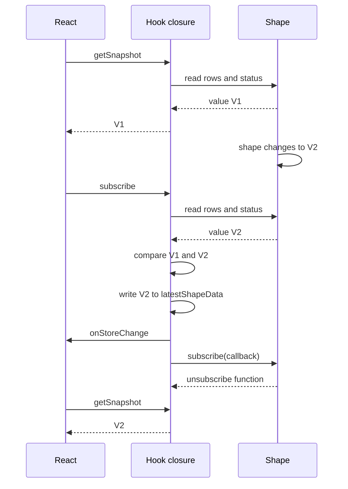

# Lifecycle and State

`useShape` must keep React state in step with an external `Shape` object. A `Shape` is the in-memory row map that one `ShapeStream` fills. The shape changes outside React. The change can arrive from a long poll, a Server-Sent Events (SSE) event, a snapshot, or an error. A snapshot here is a one-shot subset request. The stream injects its rows into the normal message batch between a `snapshot-end` message and a `subset-end` message. It is not the initial full-shape sync. A re-executed snapshot is one of those requests that the shape repeats after a `must-refetch` message. The hook uses `useSyncExternalStoreWithSelector` to bridge the two worlds.

The bridge is in `src/react-hooks.tsx:176-210`. The snapshot path is in `../typescript-client/src/client.ts:2152-2235` and `../typescript-client/src/shape.ts:274-307`.

## The result object

`parseShapeData` builds the value that React renders. It reads seven fields from the shape. The citation is `src/react-hooks.tsx:126-138`.

| Field | Source | Meaning |
|-------|--------|---------|
| `data` | `shape.currentRows` | Current rows |
| `isLoading` | `shape.isLoading()` | True before the first up-to-date |
| `lastSyncedAt` | `shape.lastSyncedAt()` | Unix time of the last sync |
| `isError` | `shape.error !== false` | True when an error is stored |
| `shape` | the shape object | The projection instance |
| `stream` | `shape.stream` | The stream instance |
| `error` | `shape.error` | The stored error |

The type is `UseShapeResult<T>`. The citation is `src/react-hooks.tsx:92-114`.

`shape.currentRows` builds a new array on each read. It copies the values of the internal row map. The citation is `../typescript-client/src/shape.ts:113-115`. The hook reads it only when it rebuilds the snapshot, so the array identity stays stable between notifications. A custom selector that returns `result.data` therefore returns the same array until the next snapshot.

## The external store adapter

The adapter receives four arguments:

1. `subscribe` registers a listener. It also checks for a change in the race window.
2. `getSnapshot` returns the current value. Its first call builds the value. Later calls return the cached object.
3. The same `getSnapshot` function is also passed as the server snapshot.
4. `selector` extracts the value that the component consumes.

The citation is `src/react-hooks.tsx:200-207`.

The third argument is the `getServerSnapshot` parameter of `useSyncExternalStoreWithSelector`. This code passes the same function for both snapshots, so it has no separate server value. During server rendering, the function reads the current shape object. That object usually has no rows yet, because no subscription has started, so the rendered server snapshot is typically the loading state. The hook does not supply a static server fallback outside this snapshot. The module cache is shared for the life of the module instance. In a long-lived server process, that instance can serve more than one request. After hydration, React uses the client snapshot.

The adapter is created inside `React.useMemo`. The dependency list is `[shape, selector]`. A new shape or a new selector recreates the adapter. The citation is `src/react-hooks.tsx:176-208`.

## The snapshot cache

The hook keeps `latestShapeData` in a closure variable inside `React.useMemo`. The first `getSnapshot` call builds the value with `parseShapeData`. Later calls return the same object. Two functions write the variable: the subscribe race check and the shape notification callback. The shape notification callback always writes and calls `onStoreChange`. The citation is `src/react-hooks.tsx:177-198`.

This cache is necessary. `useSyncExternalStoreWithSelector` first needs the raw snapshot from `getSnapshot` to be stable by identity. That raw snapshot is `latestShapeData`. A fresh object on every call would cause an infinite render loop. After that check, the selector computes the selected value, and the package compares that value with `Object.is` by default. The hook passes four arguments and does not expose the optional fifth `isEqual` argument. The citation is `src/react-hooks.tsx:200-207`.

The citation is `src/react-hooks.tsx:179-182`.

**Aha:** after the first build, the snapshot is rebuilt only when the shape notifies or when the subscribe race check finds a change. The hook does not poll the shape on every render. The closure variable is the single source of identity for React. This design keeps the render path free of work and avoids a render loop.

## The subscription race

React can call `getSnapshot` before it calls `subscribe`. The shape can change between those two calls. If the hook ignored that change, the component would miss an update until the next shape event.

The hook handles the race. Inside `subscribe`, it calls `parseShapeData` again. It compares the new value with `latestShapeData`. If the value changed, it updates the cache and calls `onStoreChange`. It registers the shape subscriber after that check. The citation is `src/react-hooks.tsx:184-198`.

## Change detection

`shapeResultChanged` compares the old result and the new result. It returns true when any of these fields differs:

- The whole old result is missing.
- `isLoading` differs.
- `lastSyncedAt` differs.
- `isError` differs.
- `error` differs.
- `shape.lastOffset` differs.
- `shape.handle` differs.

The citation is `src/react-hooks.tsx:140-153`.

The comparison does not inspect `data`, and it does not compare the `shape` or `stream` objects. Both results carry the same shape and stream. When the old result is missing, the function returns true immediately and skips the field checks. `lastOffset` is the stream's position in the shape log, in the form `<transaction>_<operation>`. `handle` is the server's identifier for the current build of the shape's backing log. The `Shape` getters delegate both values to the stream. The citation is `../typescript-client/src/shape.ts:101-107`.

The compared fields describe status and position, not row content. They do not prove that the row map is unchanged. A row-only change can pass undetected by this check if none of the compared fields changes. In the normal case, a change batch advances `lastOffset`, so the check sees the difference. The check is a heuristic, not a full row diff. If a row change left every compared field equal, the race window could keep the old snapshot until the next notification. The normal notification path does not use this check: the shape notification callback always replaces `latestShapeData` and always calls `onStoreChange`. The citation is `src/react-hooks.tsx:184-198`.

A row change can also arrive before the next up-to-date boundary. The `Shape` notifies on that change only when the previous status was `up-to-date`. The hook then renders the new row while `isLoading` can stay false, because loading comes from the stream, not from the shape status. The citation is `../typescript-client/src/shape.ts:201-249` and `../typescript-client/src/shape.ts:149-152`.

## Shape status transitions

The `Shape` object has two statuses: `syncing` and `up-to-date`. The citation is `../typescript-client/src/shape.ts:16`.

The status controls notification:

| Current status | Message type | Row map change | Notify subscribers | Source |
|----------------|--------------|----------------|--------------------|--------|
| `syncing` | change | yes | no | `../typescript-client/src/shape.ts:201-249` |
| `syncing` | `up-to-date` | no | yes, once | `../typescript-client/src/shape.ts:251-259` |
| `up-to-date` | change | yes | yes | `../typescript-client/src/shape.ts:201-249` |
| any | `must-refetch` | clear | no | `../typescript-client/src/shape.ts:260-266` |

The first `up-to-date` transition calls `#notify` once. The status becomes `up-to-date`. The citation is `../typescript-client/src/shape.ts:251-259` and `../typescript-client/src/shape.ts:342-346`.

`shouldNotify` is a local Boolean variable in `Shape.#process`. A change message sets it only when the previous status was `up-to-date`. An `up-to-date` message sets it when the status actually changes to `up-to-date`. At the end of the batch, the shape calls `#notify` once if the variable is true. The citation is `../typescript-client/src/shape.ts:198-272`.

A `must-refetch` message does not notify. It clears the row map, clears the error, and sets the status to `syncing`. The hook keeps its previous snapshot until the next notification, normally the next `up-to-date` message. During that window, React can still show the old rows and the old `isError` value. The citation is `../typescript-client/src/shape.ts:260-266` and `../typescript-client/src/shape.ts:251-259`.

A change message while `up-to-date` sets the status back to `syncing`. The row map changes. The hook notifies on that change because `shouldNotify` becomes true. The status returns to `up-to-date` at the next boundary. The citation is `../typescript-client/src/shape.ts:203-204` and `../typescript-client/src/shape.ts:209-220`.

This rule has a visible effect. The hook can render a new row before the next up-to-date. The `isLoading` value can stay false during that window because `Shape.isLoading()` delegates to the stream, not to the shape status. The citation is `../typescript-client/src/shape.ts:149-152`.

## Error state

`Shape` stores a `FetchError` in `#error`. A `FetchError` is the client error class. It carries a status, text, an optional JavaScript Object Notation (JSON) body, headers, and a Uniform Resource Locator (URL). It represents a Hypertext Transfer Protocol (HTTP) error or a response-body error in the client. The citation is `../typescript-client/src/error.ts:1-46`. The shape notifies subscribers when it receives an error from the stream. The citation is `../typescript-client/src/shape.ts:348-353`.

The hook reports `isError` as `shape.error !== false`. The `error` field carries the error object or `false`. The citation is `src/react-hooks.tsx:133-136`.

A `must-refetch` message clears the error. The citation is `../typescript-client/src/shape.ts:260-265`.

The shape can also surface an error from a re-executed snapshot. A re-executed snapshot is a snapshot request that the shape repeats after `must-refetch`. If the failure is not already a `FetchError`, the shape wraps it in a `FetchError` with status 0. Status 0 means that no HTTP response produced the error. The citation is `../typescript-client/src/shape.ts:298-307`.

## Loading and sync time

`isLoading` is true until the stream reaches its first up-to-date state. The value comes from the stream, not from the shape. The citation is `src/react-hooks.tsx:131` and `../typescript-client/src/client.ts:1889-1892`.

`lastSyncedAt` is a Unix time in milliseconds. It is `undefined` before the first up-to-date. The citation is `src/react-hooks.tsx:132` and `../typescript-client/src/client.ts:1873-1876`.

`lastSynced()` returns the elapsed time in milliseconds. It returns `Infinity` before the first sync. It is a stream method, and the `Shape` forwards it. The hook does not expose this value. A component that needs it calls `result.shape.lastSynced()`, or it calls `result.stream.lastSynced()` directly. The citation is `../typescript-client/src/shape.ts:144-147` and `../typescript-client/src/client.ts:1878-1882`.

## The selector contract

The selector must be pure. It runs during render and during store comparison. A selector that creates a new object on every call defeats the equality check. The `useSyncExternalStoreWithSelector` package compares the selector output with `Object.is` by default. The citation is `src/react-hooks.tsx:200-207`.

A selector can return a primitive, a memoized object, or a value from a state management library. The hook does not memoize the selector itself. The `useMemo` dependency list includes the selector. The default selector is the stable module-level `identity` function, so a caller that omits `selector` does not recreate the adapter. A new inline selector on every render recreates the adapter. That resets the `latestShapeData` closure and gives React a new `subscribe` function, so React unsubscribes the old listener and subscribes again. Define the selector at module level or wrap it in `React.useCallback` when it depends on props. The citation is `src/react-hooks.tsx:155-157` and `src/react-hooks.tsx:176-208`.

## Cleanup

The `shapeSubscribe` helper wraps `shape.subscribe`. It returns a function that removes the callback. The citation is `src/react-hooks.tsx:116-124`.

The cleanup does not abort the stream. The stream remains in the module cache. A later component can reuse it. The signal belongs to the call that created the cached stream, not to every component that subscribes. A component that shares a stream must not abort that signal, because the abort closes the stream for all subscribers. The package treats a stream as closed when its own signal is aborted. A later cache lookup removes that entry. The citation is `src/react-hooks.tsx:55-62` and `src/react-hooks.tsx:116-124`.

Read [01-use-shape-and-provider.md](01-use-shape-and-provider.md) for the cache model. Read the [TypeScript client Shape documentation](../typescript-client/04-api-reference.md) for the full `Shape` API.
