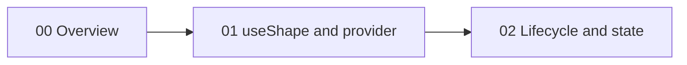
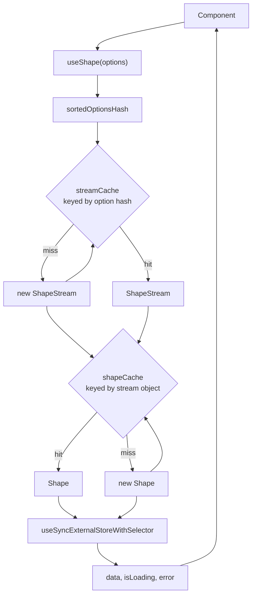

# React Hooks

The `@electric-sql/react` package binds Electric shapes to React components. An Electric shape is a filtered, column-projected view of one PostgreSQL table. The server identifies it by the shape uniform resource locator (URL) and its parameters. A `ShapeStream` is the live Hypertext Transfer Protocol (HTTP) connection to that shape. A `Shape` is the in-memory row map that the stream fills.

The package exports one main hook, `useShape`, plus the cache helpers `getShapeStream`, `getShape`, `preloadShape`, and `sortedOptionsHash`. The hook returns rows and lifecycle state. It does not create a new network stream for each component.

The package is published as `@electric-sql/react` at version `1.0.57`. The license is Apache-2.0. It depends on `@electric-sql/client` and `use-sync-external-store`. The citation is `package.json:2-11`.

## Reading order

| Order | Document | What you learn |
|-------|----------|----------------|
| 1 | [00-overview.md](00-overview.md) | The purpose, package facts, exports, and cache model |
| 2 | [01-use-shape-and-provider.md](01-use-shape-and-provider.md) | `useShape`, the cache helpers, option hashing, and shared streams |
| 3 | [02-lifecycle-and-state.md](02-lifecycle-and-state.md) | The external store, subscription race handling, render states, and cleanup |

## Package map

All paths are relative to `packages/react-hooks`.

| Area | File | Lines | Purpose |
|------|------|-------|---------|
| Public export | `src/index.ts` | 1 | Re-export the hook module |
| Hook and caches | `src/react-hooks.tsx` | 1-211 | `useShape`, cache helpers, hashing, store wiring |
| Tests | `test/react-hooks.test.tsx` | full file | Hook behavior and lifecycle tests |
| Type tests | `test/react-hooks.test-d.ts` | full file | Type inference checks |

## The data path

`useShape` derives a string hash from the options. It looks up a shared `ShapeStream` by that hash. It looks up a shared `Shape` by the stream object. It then subscribes the component to the shape. The citation is `src/react-hooks.tsx:164-211`.

**Aha:** the cache key is the full options object, not the shape URL. Two components that pass the same URL but different headers or parameters receive different streams. Two components that pass equal options in a different key order receive the same stream. The hash sorts every object key recursively. It also converts a function value to its source text. The citation is `src/react-hooks.tsx:26-45`.

The function rule has a cost. Two functions with the same source text but different captured values produce the same hash. A header function can close over a user token. Such a function can then collide with another function that has the same body. Use a function whose behavior depends only on its arguments. Or, pass per-user values in a separate option that changes the hash.

## What the hook returns

`UseShapeResult` has seven fields: `data`, `shape`, `stream`, `isLoading`, `lastSyncedAt`, `error`, and `isError`. The citation is `src/react-hooks.tsx:92-114`.

The default return value is the full result object. A caller can pass a `selector` to return a smaller value. The selector runs through `use-sync-external-store`. The citation is `src/react-hooks.tsx:196-209`.

## Related studies

- [TypeScript client](../typescript-client/README.md) supplies `ShapeStream` and `Shape`.
- [TypeScript client API reference](../typescript-client/04-api-reference.md) lists every stream option.
- [Start](../start/README.md) creates a TanStack Start application that uses these hooks.
- [Electric and Durable Streams](../README.md) is the parent study.

## Source of truth

Every claim in this directory comes from the source files under `packages/react-hooks`. Some claims about `Shape` and `ShapeStream` cite the client package as `../typescript-client/src/...`, because the client package defines those classes there. A citation has the form `src/react-hooks.tsx:120-145`. The line range is inclusive.

Return to the platform index: [../README.md](../README.md).
