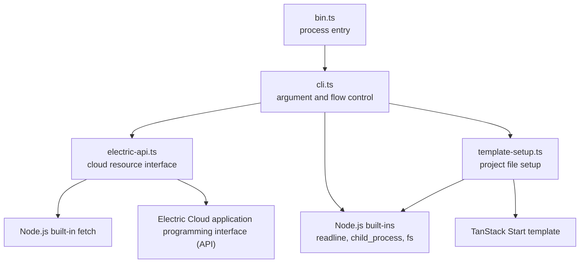
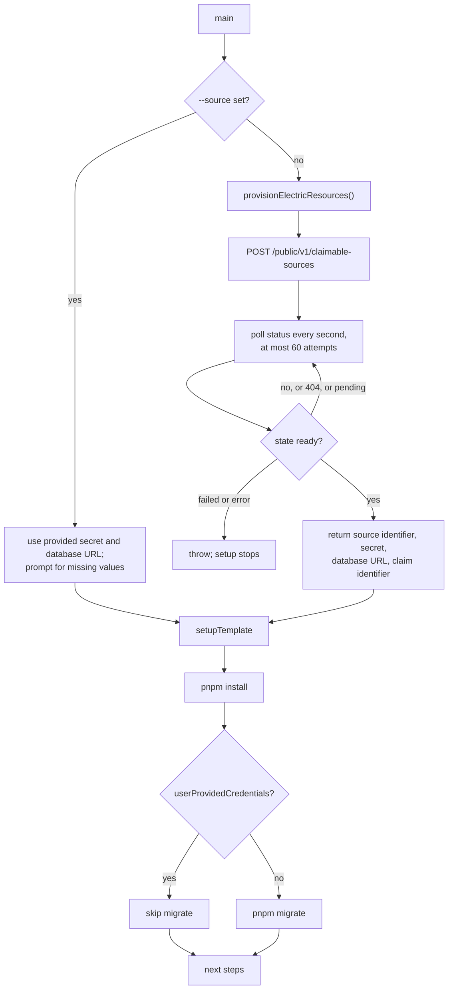

# Overview

`@electric-sql/start` is a scaffold command. One command creates a working Electric application with a database, a source, a front end, and a set of package scripts.

The package is published as `@electric-sql/start` at version `1.0.3`. The license is Apache-2.0. It has no runtime dependencies. The citation is `package.json:2-9`, `package.json:29`, and `package.json:58`.

## Package facts

| Fact | Value | Source |
|------|-------|--------|
| Package name | `@electric-sql/start` | `package.json:2` |
| Version | `1.0.3` | `package.json:3` |
| License | Apache-2.0 | `package.json:58` |
| Module type | ECMAScript module (ESM) | `package.json:5` |
| Command name | `start` | `package.json:7-9` |
| Runtime dependencies | none | `package.json:29` |
| Main export | `./dist/index.js` | `package.json:6` |
| Build tool | `tsup` | `package.json:20` |
| Test tool | `vitest` | `package.json:25` |

## The four layers



The command entry calls `main` and reports an unexpected error with exit code 1. The citation is `src/bin.ts:1-6`.

The command layer reads arguments, prompts, and decides the flow. The cloud layer creates and polls resources. The template layer writes the project files. The command layer uses `readline` for its prompts. The cloud layer uses `fetch`. The template layer uses `child_process` and `fs`. The citations are `src/cli.ts:3-7`, `src/electric-api.ts:49-57`, and `src/template-setup.ts:1-6`.

## The command surface

```text
npx @electric-sql/start <app-name> [--source <source-id>] [--secret <secret>] [--database-url <url>]
npx @electric-sql/start .
```

The citation is `src/cli.ts:49-56`.

| Argument | Required | Meaning |
|----------|----------|---------|
| `app-name` | yes | Directory to create, or `.` for the current directory. The command does not check whether the directory exists or is empty |
| `--source` | no | An existing Electric source identifier |
| `--secret` | no | The secret for `--source` |
| `--database-url` | no | The database uniform resource locator (URL) for `--source` |

The parser rejects a flag without a value and exits with code 1. The citation is `src/cli.ts:23-43`.

The parser rejects zero positional arguments and more than one positional argument. The citation is `src/cli.ts:49-67`.

The command validates the application name against the pattern `^[a-zA-Z0-9-_]+$`. It skips validation for `.`. The citation is `src/cli.ts:173-180`.

## The two credential modes



The mode changes three parts of the run:

1. **Provisioning.** A supplied source identifier skips the cloud call. The command asks for a secret and a database URL when they are absent. The citation is `src/cli.ts:197-225`.
2. **Migration.** The command runs `pnpm migrate` only when it provisioned the resources. A caller with an existing database controls its own schema. The citation is `src/cli.ts:250-266`.
3. **Claim command.** The template adds a `claim` package script only when the cloud response contains a `claimId`. The citation is `src/template-setup.ts:88-91`.

Claiming transfers a provisioned source to a user account. The command-line interface (CLI) creates a claimable source that belongs to no account. The claim URL opens the Electric dashboard, where the signed-in user takes ownership of the source. Without the claim, the source exists but is not attached to the user's account.

**Aha:** the package treats "provisioned by the tool" and "supplied by the caller" as two different ownership models, not as two input formats. The ownership model controls whether the tool may create database tables and whether it may offer a cloud claim. So the same command can serve a first-time user and a team with existing infrastructure without a separate mode flag.

## What the command produces

The generated project contains:

| Output | Written by | Source |
|--------|------------|--------|
| Application files | `gitpick` from the Electric repository | `src/template-setup.ts:32-37` |
| `.env` | Direct file write | `src/template-setup.ts:44-60` |
| `.gitignore` entries | Append three patterns when the file text does not contain `.env`. Create the file if absent | `src/template-setup.ts:63-74` |
| `deploy:netlify` script | Package file patch | `src/template-setup.ts:83-86` |
| `claim` script | Package file patch when a `claimId` exists | `src/template-setup.ts:88-91` |
| Installed dependencies | `pnpm install` | `src/cli.ts:234-239` |
| Database schema | `pnpm migrate` in the provisioned mode | `src/cli.ts:252-257` |

The `.env` file contains five values:

| Name | Source |
|------|--------|
| `DATABASE_URL` | The cloud response or the caller |
| `ELECTRIC_URL` | The environment or the default service URL |
| `ELECTRIC_SOURCE_ID` | The cloud response or the caller |
| `ELECTRIC_SECRET` | The cloud response or the caller |
| `BETTER_AUTH_SECRET` | 32 random bytes, hex encoded |

The citation is `src/template-setup.ts:42-58` and `src/template-setup.ts:20-22`.

The `.env` file starts with a warning not to commit it. The citation is `src/template-setup.ts:44-46`.

## The provisioning protocol

The cloud interface uses three endpoints. The citation is `src/electric-api.ts:93-189`.

| Step | Method and path | Purpose |
|------|-----------------|---------|
| Create | `POST /public/v1/claimable-sources` | Return a `claimId` |
| Poll | `GET /public/v1/claimable-sources/{claimId}` | Return the state and credentials |
| Claim | `POST /v1/claim` | Return a claim URL for a source; exported helper only, not called by the quickstart |

The create call sends an empty JavaScript Object Notation (JSON) object and a user agent. The citation is `src/electric-api.ts:99-109`.

The poll loop waits one second between requests and stops after 60 attempts. The citation is `src/electric-api.ts:41-42` and `src/electric-api.ts:44-91`.

A 404 response means the service is still creating the resource. The loop continues. The citation is `src/electric-api.ts:59-63`.

A `ready` state returns the result. A `failed` state or an error field throws. Every other state, including `pending` and `creating`, continues the loop. The citation is `src/electric-api.ts:74-86`.

The provisioned connection uniform resource identifier (URI) points at a Neon PostgreSQL database. The package does not create the database itself. The Electric Cloud service creates it as part of the claimable source.

## What the package does not do

The package does not run the application. It installs dependencies and prints `pnpm dev` as a next step. The citation is `src/cli.ts:157`.

The package does not own the template. The template lives in the Electric repository. The command copies it with `gitpick`. The citation is `src/template-setup.ts:35`.

The package does not persist credentials outside the generated project. It writes them only to `.env` in that project.

The package does not call `claimResources` from the command. The codebase exports and tests the function, but `main` never imports it. The citation is `src/electric-api.ts:153-189` and `src/cli.ts:5-6`.

The package does not remove or update a generated project.

Read [01-quickstart-cli.md](01-quickstart-cli.md) for the full command flow and the file-level behavior. Read [../sync-service/00-overview.md](../sync-service/00-overview.md) for the service that the generated application syncs from.
