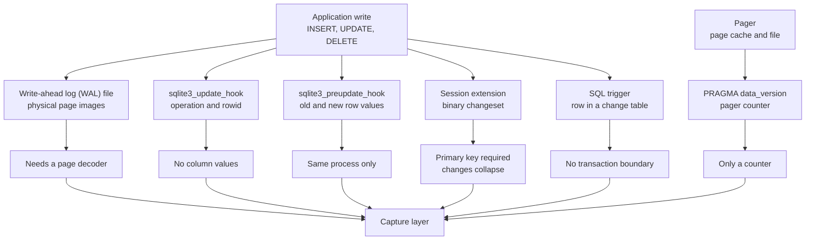
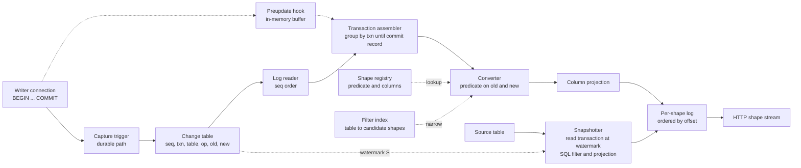
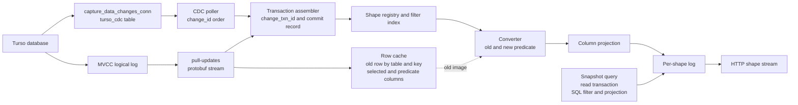

# SQLite, libSQL, and Turso

This document answers one question. Can the Electric shape-sync design work on SQLite, and specifically on libSQL and Turso? The short answer is yes, but not with the same source database. The Electric design needs three things from its source database. It needs committed row images: the old row and the new row. It needs transaction boundaries in commit order. It needs a total order that a reader can resume from. PostgreSQL logical replication supplies all three. A plain SQLite file has no single mechanism that supplies all three directly. libSQL supplies a physical page stream, not rows. The new Turso database supplies a genuine logical change stream. It is the only member of the family that can feed the design without a new capture component.

The rest of the document proves that answer from the source code, then proposes the design that closes the gaps.

## How to read this document

Each section answers one of the eight questions that this document set out to answer. The table below maps the question to the section and to the short answer.

| Question | Section | Short answer |
|----------|---------|--------------|
| 1. What can SQLite change capture report? | [Part 1](#part-1-what-sqlite-can-and-cannot-report) | Six mechanisms exist. Each one loses either row images, transaction boundaries, durability, or the process boundary. |
| 2. What do libSQL and Turso add? | [Part 2](#part-2-what-libsql-and-turso-add) | libSQL adds physical page replication. Turso adds logical change capture and a multi-version concurrency control (MVCC) logical log. |
| 3. Why is PostgreSQL logical replication a better source? | [Part 3](#part-3-why-postgresql-logical-replication-is-a-better-source) | It delivers old and new tuples, transaction boundaries, a total order, and a consistent snapshot. |
| 4. What is a concrete Electric-style design on SQLite? | [Part 4](#part-4-a-proposed-electric-style-design-on-sqlite) | Capture into a durable change log, sequence it, filter it by shape, project it, snapshot it, stream it. |
| 5. What changes on Turso and libSQL? | [Part 5](#part-5-the-same-design-on-turso-and-libsql) | The capture layer is replaced by the engine. The shape engine stays. |
| 6. How does the design learn and limit columns? | [Part 6](#part-6-column-projection) | The shape request names the columns. The design adds the primary key, evaluates on the full row, and projects before it appends to the shape log. |
| 7. What memory does it hold, and what is bounded? | [Part 7](#part-7-memory-and-large-shapes) | A filter index, a snapshot, and a per-shape log. Chunk size, batch size, and transaction size are bounded. Shape count and change-log retention are not bounded by default. |
| 8. What is the verdict? | [Part 8](#part-8-feasibility-verdict) | Plain SQLite needs a new capture component. Turso can work today if you build the shape engine, a poller or logical-log reader and cache, and a retention policy. libSQL embedded replicas cannot, without a page decoder or primary-side capture. |

The labels below mark the epistemic status of the important claims that could be mistaken for source facts:

> **Exists in the source.** The claim is visible in the named file at the named line. "The source" means the repository named in the surrounding text.
>
> **This document proposes.** The design is not in the source. It is a construction from the primitives that the source provides.
>
> **Inference.** The claim follows from the source but the source does not state it.

## Terms and product lineage

A **shape** is a named, filtered, column-projected view of one database table. A client subscribes to a shape. The shape has a `where` clause, a column list, and its own append-only log. The **shape engine** captures source changes, decides which shapes each change affects, projects the columns, and appends the result to each shape log. The **shape log** is the ordered record stream that a client reads. The **shape cache** stores each shape's snapshot and log. The **shape protocol** is the Hypertext Transfer Protocol (HTTP) interface that serves a snapshot and then a live stream. Document [02-http-api-and-shapes.md](../sync-service/02-http-api-and-shapes.md) gives the wire details.

The `where` clause is a boolean SQL expression over the table's columns. The Electric shape language accepts a restricted subset: comparisons, `AND`, `OR`, `NOT`, `IS NULL`, `IN`, and `LIKE`. A shape has one root table. Joins and subqueries are outside the scope of this document. The phrase "the Electric design" means the six invariants below, not the full HTTP protocol.

The word **source** has two meanings in this document. A **source database** is the database that the shape engine reads. The **source code** is one of the four repositories that the document cites. The label "Exists in the source" always means the source code, and every table names the repository for its claims.

**Product lineage.** Turso is the company. libSQL is its fork of SQLite. The libSQL server and embedded replicas run that fork. The **new Turso database** is a separate rewrite in Rust. It has an engine-level change-capture system and an MVCC log. "Turso server" in Part 5 means the server endpoint of that new database, which the cited sync protocol shows. The older libSQL-based Turso service, meaning the hosted product built on libSQL, uses libSQL replication; this document discusses it only through the shared libSQL code.

## What "the Electric design" means here

Before we compare databases, we must state the design in database-neutral terms. The Electric sync service has a specific implementation, but its structure is general. It has six invariants.

1. **Committed row changes in commit order.** The source reports one record for each row that a committed transaction inserted, updated, or deleted. PostgreSQL logical replication and SQLite triggers follow this rule: a statement that changes many rows produces many records. The session extension does not; it reports one record per primary key and collapses repeated touches. The design must state which rule it uses, because the shape log sees the difference.
2. **Both row images.** An update carries the old row and the new row. A delete carries the old row. An insert carries the new row.
3. **Predicate evaluation on both images.** A shape has a `where` clause. The design evaluates that clause on the old image and on the new image. This evaluation detects when a row enters or leaves the shape.
4. **A resumable total order.** Every change gets a position. A client can request "everything after position X" and receive a complete, ordered suffix.
5. **A snapshot plus a tail.** A new shape starts from a consistent snapshot of the table at position S. It then receives every change after S. Snapshot and tail must join without a gap and without a duplicate.
6. **Per-shape column projection.** Each shape requests a subset of columns. The design sends only those columns, plus the primary key.

The three properties in the introduction map onto these six invariants. Committed row images supply invariants 1 and 2. Transaction boundaries supply the boundary between those records, and their commit order supplies the order. A resumable total order supplies invariant 4. Invariant 5 joins the snapshot to that order; it is part of the design, not a fourth property of the source. The shape engine itself supplies invariant 3, predicate evaluation, and invariant 6, projection. PostgreSQL supplies invariants 1, 2, 4, and 5. Electric supplies invariants 3 and 6. No SQLite-family source supplies all six alone.

The remaining sections test each SQLite-family source against these six invariants.

## Part 1: What SQLite can and cannot report

SQLite has six practical change-capture mechanisms. Five observe the write path. The sixth, `PRAGMA data_version`, observes the pager. They are not variations on one design. Each one observes a different layer of the engine, so each one reports a different thing.

The diagram below shows all six mechanisms. Five observe a write. The sixth observes the pager, which is the component that moves pages between the file and the page cache.



Read the edges as follows. The application write reaches the five write-path observers. The write-ahead log (WAL) edge leaves the engine as page images, so a separate decoder must turn pages into rows. The update-hook edge leaves the engine as an operation code, a table name, and a rowid, so no column values arrive. The preupdate-hook edge leaves the engine with full values, but the callback lives in the writer process. The session edge leaves the engine as a binary change set, but the session module requires a declared primary key and records each key only once. The trigger edge leaves the engine as ordinary structured query language (SQL) rows, which any process can read, but a trigger cannot see the commit boundary. The pager edge is separate: a commit changes the pager counter, and a connection can read that counter through `PRAGMA data_version`. The counter says that a page changed, not what changed. The capture layer at the bottom is the component that this document proposes. No single edge reaches it without a loss.

### 1.1 The WAL records pages, not rows

SQLite in WAL mode writes changed database pages to a separate file. The file is a physical log. It is not a logical log.

The format is in `libsql-sqlite3/src/wal.c:20-60`. A WAL file has a 32-byte header and zero or more frames. The header contains eight big-endian 32-bit values: magic number, format version, page size, checkpoint sequence, two salts, and two checksum words. Each frame has a 24-byte frame header followed by one page image. The frame header contains six big-endian 32-bit values: page number, the database size in pages after commit (zero for a non-commit frame), two salts, and two checksum words. The comment states the commit rule directly: "Transactions commit when a frame is written that contains a commit marker." The marker is the nonzero `size_after` field.

The checksum rule is in `wal.c:61-79`. A frame is valid only if both salts match the header and the checksum matches the running checksum over all previous frames. The checksum is a rolling pair of 32-bit words. `walChecksumBytes` updates the pair over the header bytes and then over each frame. A decoder must verify the pair before it trusts a frame. A checkpoint increments salt-1 and randomizes salt-2. Old frames then fail the validity test.

The reader algorithm is in `wal.c:99-120`. A reader records `mxFrame`, the index of the last valid frame, and uses that value for the whole read transaction. A reader does not find `mxFrame` by scanning the file. It reads the WAL index in the shared-memory `-shm` file, which records the valid frames and the read marks. The index is why a live WAL read is safe.

What the WAL reports:

- The page number that changed.
- The full new content of that page.
- A commit boundary, encoded as `size_after`.
- A physical order of pages.

What the WAL cannot report:

- A table name.
- A row identity.
- An operation type.
- An old row image.
- Column values as columns.

To turn WAL frames into rows, a reader must decode the b-tree pages and compare the new page image with the previous image. That decoder is a full b-tree reader. It must understand cell formats, overflow pages, free blocks, indexes, and the schema. The WAL does not carry the schema either; the reader must read `sqlite_schema` to interpret the pages.

The WAL does cross the process boundary, because it is a file. A separate process opens the same database through SQLite, so it shares the WAL index and the read marks. It must validate the salts and checksums. A reader that holds a read transaction also holds the read marks that protect the frames it needs, so a checkpoint cannot overwrite them. A reader that drops its read transaction and then falls behind the oldest checkpoint loses the frames it still needed and must start again from a new snapshot.

> **Inference.** The WAL is the only SQLite mechanism that is durable, ordered, and usable across processes without a schema change and without cooperation from the writer. Its cost is a page decoder. Triggers are the other durable cross-process path, but they require a schema change: the capture triggers and the change table. This document does not find a row-level WAL decoder in libSQL or Turso. Both projects read frames to move a whole database, not to derive row changes.

### 1.2 `sqlite3_update_hook` reports a rowid, not a row

`sqlite3_update_hook` registers a callback for row changes on one connection. The implementation is at `libsql-sqlite3/src/main.c:2317-2336`. It stores the callback pointer and the argument pointer in the connection object. The public contract is at `ext/crr/rs/sqlite-rs-embedded/sqlite3_capi/deps/sqlite3.h:6857-6881`.

The callback signature is:

```c
void (*)(void *, int op, char const *zDb, char const *zName, sqlite3_int64 rowid)
```

The `op` value is one of `SQLITE_INSERT` (18), `SQLITE_DELETE` (9), or `SQLITE_UPDATE` (23). The numeric values are at `sqlite3.h:3288-3302`. A callback should compare against the constants, not the numbers. The callback receives the database name, the table name, and the rowid.

For an update, the rowid is the value after the update. The contract says so at `sqlite3.h:6873-6874`. If the statement changes the rowid itself, the hook reports only the new rowid. The old rowid appears nowhere in this callback.

The invocation limits are at `sqlite3.h:6876-6885`, and the callback rule is at `:6887-6892`:

- The hook does not fire for internal system tables, such as `sqlite_sequence`. The engine changes those tables itself, outside the row-change path.
- The hook does not fire for `WITHOUT ROWID` tables, because the callback reports a rowid and those tables have none.
- The hook does not fire when `ON CONFLICT REPLACE` deletes a conflicting row, because the delete is an internal side effect of the insert.
- The hook does not fire when the truncate optimization deletes rows. The truncate optimization is the engine's shortcut for a `DELETE` without a `WHERE` clause: it drops whole pages instead of visiting rows. A capture layer that needs those deletes must disable the optimization for the connection or use triggers.
- The callback must not modify the connection that invoked it, because the connection is inside a write operation.

The hook reports no column values and no old row. It also reports no transaction boundary; it fires during statement execution, before the commit.

The hook is per connection. It fires in the process that runs the statement. A second process that writes to the same database file does not invoke the first process's callback. This is the decisive limit: the hook cannot see writes from other processes.

### 1.3 `sqlite3_preupdate_hook` reports full row images

`sqlite3_preupdate_hook` is the stronger hook. The implementation is at `libsql-sqlite3/src/main.c:2368-2387`. The public contract is at `sqlite3.h:10372-10469`.

The header states four facts that matter for this design.

1. The hook is available only when SQLite is compiled with `SQLITE_ENABLE_PREUPDATE_HOOK`. The availability statement is at `sqlite3.h:10372-10376`, and the `#if defined(SQLITE_ENABLE_PREUPDATE_HOOK)` guard is at `sqlite3.h:10467`.
2. At most one preupdate hook may be registered on a connection. A second registration overrides the first. The rule is at `sqlite3.h:10378-10386`.
3. The hook fires before each `INSERT`, `UPDATE`, and `DELETE` on a real table. It does not fire for virtual tables or for system tables. The rule is at `sqlite3.h:10388-10394`.
4. Inside the callback, four accessor functions read the row. `sqlite3_preupdate_count` returns the column count. `sqlite3_preupdate_old` returns a column value before the change. `sqlite3_preupdate_new` returns a column value after the change. `sqlite3_preupdate_depth` returns zero for a direct statement and one for a statement inside a top-level trigger. Each nested trigger adds one to the depth. The rules are at `sqlite3.h:10416-10467`.

The callback signature is:

```c
void (*)(void *pCtx, sqlite3 *db, int op,
         char const *zDb, char const *zName,
         sqlite3_int64 iKey1, sqlite3_int64 iKey2)
```

`iKey1` is the old rowid for an update or delete. `iKey2` is the new rowid for an insert or update. The values are undefined for a `WITHOUT ROWID` table. The rule is at `sqlite3.h:10406-10414`.

The hook also has a subtle blob case. A blob write is an in-place edit of a large binary value through the incremental blob interface, not a SQL statement. When code calls `sqlite3_blob_write`, the hook fires with `SQLITE_DELETE`, because the new value is not available at that point. `sqlite3_preupdate_blobwrite` returns the column index in that case. The rule is at `sqlite3.h:10456-10463`. A capture layer that ignores this case records a delete for an in-place blob write.

What the preupdate hook reports:

- The operation type.
- The database and table name.
- The old row values and the new row values, by column index.
- The old and new rowid.
- The trigger depth.

What it cannot report:

- A transaction boundary. It fires per row, before the statement or transaction commits.
- Rows changed by another process.
- Changes to virtual tables.
- The commit order, unless the caller adds it.

The hook is also same-process only. A library that opens the writer connection can use it. A separate sync process cannot.

The transaction boundary is recoverable with two more hooks. `sqlite3_commit_hook` fires when a transaction commits, and `sqlite3_rollback_hook` fires when a transaction rolls back. The contract is at `sqlite3.h:6738-6785`. Both hooks are per connection. A capture layer can buffer preupdate records in memory and flush them on commit. A rollback discards the buffer.

This combination gives complete row images and exact transaction boundaries. It gives them only inside the writer process, and it gives them only in memory until the commit hook runs. The commit hook must not modify the invoking connection. A write during commit can recurse into the commit path or deadlock against the write lock that the connection already holds. The callback can enqueue a batch to another thread. This document proposes that the durable write then happens after the commit, outside the write lock. A crash between the commit and that write loses the batch. The ordering is an implementation choice, not a guarantee from the header.

> **Inference.** The preupdate hook plus the commit hook is the best capture path for a library that owns the writer connection. It is not a crash-safe path by itself. Durability needs a second copy of the change that commits with the data. Only a trigger, or another write in the same transaction, can make that copy. A hook cannot, because its callback runs before the commit and must not write.

### 1.4 The session extension records a change set

The session extension turns row changes into a binary change set. Its documentation is in `ext/session/sqlite3session.h`, and its implementation is in `ext/session/sqlite3session.c`. The source file begins with a compile guard that requires both `SQLITE_ENABLE_SESSION` and `SQLITE_ENABLE_PREUPDATE_HOOK` (`sqlite3session.c:2`). The session module uses the preupdate hook internally. The header says so at `sqlite3session.h:49-54`.

The caller drives the module through a small application programming interface (API). `sqlite3session_create` opens a session on one connection and database. `sqlite3session_attach` adds a table. `sqlite3session_changeset` returns the buffer. `sqlite3changeset_start` opens a read iterator, and `sqlite3changeset_next`, `sqlite3changeset_op`, `sqlite3changeset_old`, and `sqlite3changeset_new` walk it. `sqlite3session_delete` frees the session.

```c
sqlite3_session *session;
sqlite3_changeset_iter *iter;
void *buf;
int n, ncol, op, indirect, i;
const char *table;
sqlite3_value *old_value, *new_value;

sqlite3session_create(db, "main", &session);
sqlite3session_attach(session, "todo");
sqlite3session_changeset(session, &n, &buf);
sqlite3changeset_start(&iter, n, buf);
while (sqlite3changeset_next(iter) == SQLITE_ROW) {
  sqlite3changeset_op(iter, &table, &ncol, &op, &indirect);
  for (i = 0; i < ncol; i++) {
    sqlite3changeset_old(iter, i, &old_value);
    sqlite3changeset_new(iter, i, &new_value);
  }
}
sqlite3changeset_finalize(iter);
sqlite3session_delete(session);
```

The session design has four rules that shape any use of it.

1. **A primary key is required**. "Changes can only be recorded for tables that have a PRIMARY KEY explicitly defined as part of their CREATE TABLE statement." The rule is at `sqlite3session.h:192-200`. A table without a primary key is ignored, unless the caller enables the rowid mode. The rowid mode treats the table as if it had an `INTEGER PRIMARY KEY` column named `_rowid_`. The option is `SQLITE_SESSION_OBJCONFIG_ROWID`, documented at `sqlite3session.h:113-123` and defined at `:126`.
2. **Each primary key is recorded once**. The rule is at `sqlite3session.h:310-318`. "For each unique primary key value, data is only recorded once - the first time a row with said primary key is inserted, updated or deleted in the lifetime of the session."
3. **Changes can cancel.** An insert followed by a delete of the same key produces no change in the change set. The generation rules at `sqlite3session.h:320-345` describe how the module compares the accumulated records with the current table content. If a row returns to its original values, the record is discarded. If a key is inserted and then deleted, the pair cancels.
4. **A primary key update becomes a delete plus an insert.** "It is not possible for an UPDATE change to represent a change that modifies the values of primary key columns. If such a change is made, it is represented in a changeset as a DELETE followed by an INSERT." The rule is at `sqlite3session.h:277-281`.

The binary format is documented in `sqlite3session.c:155-236`. Each field starts with a one-byte type code: `0x00` undefined, `0x01` integer, `0x02` real, `0x03` text, `0x04` blob, `0x05` null. Integer and real values are eight bytes in big-endian order. Text and blob values start with a varint length. A varint is a base-128 big-endian number of one to nine bytes; the high bit of each byte marks continuation.

A change set starts with a table header. The header has the byte `0x54` (capital `T`), a varint column count, one byte per column, and a null-terminated table name. A primary-key column has the value `0x01` in its header byte. A non-key column has `0x00`. Each change then has one byte for the operation (`0x12` insert, `0x17` update, `0x09` delete), one byte for the indirect flag, and the old and new records. The indirect flag is `0x01` when a trigger or foreign-key action caused the change, and `0x00` for a direct statement. The patchset format at `sqlite3session.c:238-260` starts with `0x50` (capital `P`).

The records are positional arrays with one entry per table column. An entry of `0x00` means that the column is undefined in that record. It is a placeholder, not an omission. For an update, the old record contains the primary key and the changed non-key columns. Unchanged non-key columns are `0x00`. The new record contains the changed non-key columns, and every other column is `0x00`. The rule is at `sqlite3session.c:222-236`.

A patchset is a variant of the change set with less information. It is not a smaller changeset in the same shape. A patchset DELETE record contains the primary-key fields only, and an UPDATE record omits the old values of the modified fields. A patchset cannot be inverted, because the original values are gone. The rules are at `sqlite3session.h:453-480`.

What the session extension reports:

- A compact binary diff.
- Full old rows for deletes.
- Full new rows for inserts.
- Key plus changed values for updates.
- A primary-key identity.

What it cannot report:

- A change stream. It accumulates changes and produces a change set when the caller asks.
- More than one change per primary key.
- Rows in tables without a declared primary key, unless the caller opts into rowid mode.
- Changes from another process.
- A commit boundary that is visible to a reader.

The primary key may be composite, and a `WITHOUT ROWID` table with a primary key works. The module requires the key declaration; it does not require an integer key.

The session module installs its own preupdate hook. A capture layer must not also register its own preupdate hook on the same connection. The header states that the two cannot coexist. An application cannot register a preupdate hook on a handle with sessions attached, nor create a session on a handle with a preupdate hook. The result of either attempt is undefined. The implementation keeps the previous hook as a chain pointer, so the outcome is not a clean replacement.

The session extension is a diff engine, not a replication source. It is designed to synchronize two copies of a database that both apply the same change set. It is not designed to feed an append-only shape log.

### 1.5 `PRAGMA data_version` is a coarse flag

`PRAGMA data_version` returns a 32-bit counter. The pragma entry is at `libsql-sqlite3/src/pragma.h:245-249`, which maps the name to `BTREE_DATA_VERSION`. The constant is defined at `src/btree.h:163` with the value 15.

The value is not stored in the database file. `src/btree.c:10346-10363` explains that the value comes from the pager and adds a B-tree-local offset. The pager increments the counter at `src/pager.c:1809` (on a pager reset) and at `src/pager.c:6748` (on commit phase two). A pager reset is the point at which a connection drops its page cache and re-reads the database header, for example after another connection commits. Commit phase two is the point at which the commit becomes durable. The value 15 is the internal opcode that `PRAGMA data_version` maps to; a client never sees it.

The counter is per connection, but the events that move it are shared. Each connection's pager holds its own counter. When another connection commits, the first connection notices the changed file header at its next read and bumps its counter. The public comment at `libsql-sqlite3/src/sqlite.h.in:1179-1182` states the contract. The pragma "provides a mechanism to detect changes to a single attached database that occur due to other database connections, but omits changes implemented by the database connection on which it is called."

The client must compare the current value with the value it stored earlier. The pragma does not send an event, and it does not say how many transactions passed. The design must treat any difference as "something changed," not as a count.

What `data_version` reports:

- That something changed since the last read.

What it cannot report:

- What changed.
- Which table changed.
- Which row changed.
- The order of changes.
- A position that a reader can resume from.

A sync engine can use `data_version` as a cheap wake-up check. It cannot use it as a change log. The counter also changes when the schema changes and when a pager resets, so a change in the counter does not always mean a row change.

### 1.6 Triggers cross the process boundary

A SQL trigger runs inside the database engine when a row changes. It can write a row to a change table in the same transaction. The change table is ordinary data, so any process can read it, and it survives a crash.

A trigger can read `OLD` and `NEW` row values. It can therefore write a full old row, a full new row, or both. It can call built-in functions such as `json_object` to encode those rows as text. JavaScript Object Notation (JSON) functions are part of the default SQLite build in modern versions; a deployment must confirm that the build includes them.

Three costs come with the trigger approach.

1. **Write amplification.** Each changed row writes at least one extra row. An update writes two images if the design stores both.
2. **No commit boundary.** SQLite has no statement-level or transaction-level trigger. A trigger fires per row. The change table can record that rows changed, but it cannot mark where one transaction ends and the next begins. The design needs a separate convention for that boundary.
3. **Trigger interaction.** Recursive triggers are off by default (`sqliteInt.h:710-711`). `INSERT OR REPLACE` deletes conflicting rows. Delete triggers fire for that internal delete only when recursive triggers are enabled and a delete trigger exists (`insert.c:2500-2507`). A capture trigger must not fire on the change table itself. With recursive triggers off, the change-table write does not fire it. With recursive triggers on, it recurses. The design in Part 4 therefore installs no capture trigger on `electric_change`.

What triggers report:

- The operation type, because the trigger is separate per operation.
- The table name, through the trigger definition.
- Full old and new row values, through `OLD` and `NEW`.
- A durable row in a table, inside the writer's transaction.

What they cannot report:

- The transaction boundary.
- The commit order, without a convention.
- The database name, unless the trigger encodes it. A trigger program accepts only `INSERT`, `UPDATE`, `DELETE`, and `SELECT` statements (`src/parse.y:1752-1769`), so it cannot run `PRAGMA database_list`. The author must write the database name into the trigger text. A schema-wide trigger pattern must generate one trigger set per attached database.

The trigger path is the only path that is durable with the data, crosses the process boundary, and needs no page decoder. The two "only" claims measure different sets: the WAL requires no schema change but supplies no rows, and triggers supply rows but require a schema change. The trigger's weakness is the commit boundary. Part 4 shows three ways to supply that boundary.

Write amplification is at least one extra row per changed row, and two when the trigger stores both images. The extra rows also enter the WAL, so the cost appears twice: once in the data pages and once in the log pages. A deployment should measure the write rate before it enables capture on a busy table.

### 1.7 Comparison

| Mechanism | Row values | Old row | Transaction boundary | Crosses process | Durable with the data | Cost |
|-----------|-----------|---------|----------------------|-----------------|-----------------------|------|
| WAL file | No, pages only | No | Yes, `size_after` | Yes | Yes | Full b-tree page decoder |
| `sqlite3_update_hook` | No, rowid only | No | No | No | No | Very low |
| `sqlite3_preupdate_hook` | Yes | Yes | No, needs commit hook | No | No, buffer only | Low |
| Session extension | Yes, as a diff | Yes | No | No | No | Medium; primary key required |
| `PRAGMA data_version` | No | No | No | Yes | Not applicable | Very low, no detail |
| SQL triggers | Yes | Yes | No, needs a convention | Yes | Yes | One extra write per row |

"Crosses process" for `PRAGMA data_version` means that a connection in another process observes its own counter change after a commit. The counter carries no data from the writer; the reader only learns that some page changed.

"Durable with the data" means that the change record commits or rolls back in the same transaction as the data change. The WAL, triggers, libSQL frames, Turso change data capture (CDC), and the Turso logical log meet this test. The hooks and the session extension do not; they buffer in memory. `PRAGMA data_version` is marked "Not applicable" because it produces no change record at all.

The table is the core result for question 1. No single mechanism supplies all three of row values, transaction boundaries, and durability across processes.

> **Inference.** The absence is structural. SQLite's public change interfaces were designed for in-process change notification and for diff-based synchronization. They were not designed for a durable, ordered replication stream. A component must add what is missing.

## Part 2: What libSQL and Turso add

libSQL is a fork of SQLite. The new Turso database is a separate rewrite in Rust. They solve different parts of the problem. This section separates what exists in each source from what the code marks as provisional. Section 2.4 states that distinction in one table.

### 2.1 libSQL adds a pluggable WAL and physical replication

libSQL replaces the built-in WAL with an interface that a host can implement. The interface is `libsql_wal_methods` at `libsql-sqlite3/src/wal.h:40-146`. It has function pointers for read transactions, frame lookup, frame read, database size, write transactions, savepoints, frame count, frame write (`xFrames`), checkpoint, callback, and snapshot operations.

The replication crates use that interface to move pages between a primary and a replica. The wire format is defined in `libsql-replication/src/frame.rs:17-29`:

```rust
#[repr(C)]
pub struct FrameHeader {
    pub frame_no: lu64,
    pub checksum: lu64,
    pub page_no: lu32,
    pub size_after: lu32,
}
```

The `lu64` and `lu32` types are little-endian wrappers from the `zerocopy` crate: `U64 as lu64` and `U32 as lu32` (`frame.rs:7`). Every frame field is little-endian. The page itself is a fixed 4096-byte buffer. The constant is at `libsql-replication/src/lib.rs:12`: `pub const LIBSQL_PAGE_SIZE: usize = 4096;`.

An **embedded replica** is a local database file that applies frames from a primary. The application reads it through a normal libSQL connection. The primary is the only writer; replicas are readers. The replication logger on the primary keeps the frame stream, and a replica that falls behind the retained range must resnapshot. The topology is one writer and many readers, not multi-primary.

The server keeps the same structure in its own log. `libsql-server/src/replication/primary/logger.rs:52-56` defines:

```rust
pub struct WalPage {
    pub page_no: u32,
    pub size_after: u32,
    pub data: Bytes,
}
```

`LogFile::FRAME_SIZE` is the frame header size plus 4096 (`logger.rs:101`). The primary writes a **shadow WAL**: a second log of page images, separate from the SQLite WAL file, that the replication logger can serve to replicas. It is not a renamed copy of the local WAL, and it is not a logical log. It is a page-image log with the same frame structure. `libsql-server/src/replication/primary/replication_logger_wal.rs:36-62` inserts frames, asserts a page size of 4096 at line 45, and flushes the buffered pages with `size_after` at line 50. The flush writes pages; it does not commit. The commit runs only when `is_commit` is true, at lines 59-60. The comment at lines 61-62 warns that a failed shadow-WAL commit leaves an inconsistent state, so the code aborts.

On the client side, `libsql-replication/src/replicator.rs:65-82` defines the `ReplicatorClient` trait. It has `handshake`, `next_frames`, `snapshot`, `commit_frame_no`, `committed_frame_no`, and `rollback`. `commit_frame_no(frame_no)` tells the client that the replica durably applied frames up to the given number. `committed_frame_no()` returns the highest number that the client has already committed. The first is a command, and the second is a query. The sqlite injector buffers frames and flushes when it sees a commit frame or reaches capacity (`libsql-replication/src/injector/sqlite_injector/mod.rs:132-135`). The comment at line 132 is exact: `let frame_close_txn = frame.header().size_after.get() != 0;`.

What libSQL replication reports:

- A numbered frame.
- A page number.
- A fixed-size page image.
- A commit boundary through `size_after`.
- A total order through `frame_no`.

What it cannot report:

- A table name.
- A row identity.
- An operation type.
- Column values.
- An old row image.

This is physical replication. It is excellent for keeping a byte-identical copy of a database. It is not change data capture (CDC) at the row level. It is also the mechanism behind embedded replicas. An embedded replica applies pages; it does not receive a row stream that a shape engine can filter.

> **Inference.** A shape engine placed on an embedded replica sees only a page stream. To use it, the engine would have to run the same b-tree page decoder that Part 1.1 describes. The libSQL source does not contain a row-level decoder for the replication stream.

### 2.2 The new Turso database adds logical change capture

The new Turso database is a Rust rewrite. It has an engine-level CDC facility called `PRAGMA capture_data_changes_conn`. The name ends in `conn`, and the module comment says the pragma is "the `PRAGMA capture_data_changes_conn` setting on a connection" (`turso/core/cdc.rs:1-6`). Capture is opt-in per connection. Other connections do not capture unless they set the pragma.

The configuration types are in `turso/core/cdc.rs`. The constants are at lines 10-11:

```rust
pub const TURSO_CDC_DEFAULT_TABLE_NAME: &str = "turso_cdc";
pub const TURSO_CDC_VERSION_TABLE_NAME: &str = "turso_cdc_version";
```

The capture modes are `Id`, `Before`, `After`, and `Full`, at lines 14-20. The parser accepts `off` to disable capture, plus `id`, `before`, `after`, and `full`, with an optional comma and table name (`cdc.rs:71-95`). The default mode is `full` (`turso/sync/engine/src/database_tape.rs:31`).

The mode selects which fields the engine fills. `id` writes only the row identity. `before` writes the old row. `after` writes the new row. `full` writes the old row, the new row, and the `updates` patch. The accessors are `has_updates`, `has_after`, and `has_before` at `cdc.rs:88-104`. Only `full` has both images, so only `full` can feed a filtered shape without a second source.

There are two schema versions. `CdcVersion::V1` has eight columns: `change_id`, `change_time`, `change_type`, `table_name`, `id`, `before`, `after`, `updates`. `CdcVersion::V2` has nine columns and adds `change_txn_id` as the third column. Version 2 is also the first version that emits commit records with `change_type = 2`. The definitions and comments are at `cdc.rs:24-32`. The current version is `CDC_VERSION_CURRENT = CdcVersion::V2` at line 32, and `has_commit_record` returns true for version 2 and later at lines 36-38.

The emitter builds the rows. The bytecode for the CDC row is in `turso/core/translate/emitter/mod.rs`. The v1 emitter is at lines 1395-1502, and its register layout starts at line 1405. The v2 emitter is at lines 1505-1630, and its layout starts at line 1516. The commit-record emitter is at lines 1634-1713. The v2 tuple is:

```text
(change_id, change_time, change_txn_id, change_type, table_name, id, before, after, updates)
```

`change_type` is 1 for insert, 0 for update, and -1 for delete (`emitter/mod.rs:1555-1560`). A commit record has `change_type = 2` and all data fields null (`emitter/mod.rs:1632-1713`). `change_time` is `unixepoch()`, in whole seconds (`emitter/mod.rs:1524`, `:1648`).

The `before` and `after` fields are SQLite record blobs, not JSON. A record blob is the on-disk row format: a header with one serial-type varint per value, followed by the value bodies. It is not the session changeset format from section 1.4. A reader must use the record decoder, not the changeset decoder.

A full record is built by `emit_cdc_full_record` at `emitter/mod.rs:1250-1295`. It writes the stored columns in declared order and fills a **rowid-alias** column from the rowid. A rowid-alias column is an `INTEGER PRIMARY KEY` column that stores the rowid; the emitter detects it at `emitter/mod.rs:1196-1201` and `:1264`. A full `after` image for an insert is built by `emit_cdc_patch_record` at `emitter/mod.rs:1187-1222` and is passed at `turso/core/translate/insert.rs:1006-1025`. The name "patch record" refers to the bytecode layout, not to a partial value: the writer produces the full record for the field. An update builds three records. It builds the old image before the change (`turso/core/translate/emitter/update.rs:2411-2421`). It builds the new image after the change (`update.rs:2468-2478`). It builds the `updates` record (`update.rs:2480-2495`). A delete builds the old image (`turso/core/translate/emitter/delete.rs:816-830`).

The `updates` record has a specific encoding. A comment at `update.rs:1292-1299` states it: 2×C registers, where C is the number of non-virtual columns. A non-virtual column is a column that stores data. A generated column is virtual and has no storage slot. A rowid-alias column counts as one of the C columns. The first C values are booleans that mark changed columns. The second C values are the new values, with null for columns that did not change. The register layout is a virtual-machine layout; the emitter then packs the registers into the record blob.

The commit boundary is the `change_txn_id` plus the commit record. Every row of one transaction carries the same `change_txn_id`, which comes from the `conn_txn_id` function. The emitter calls that function at `emitter/mod.rs:1537-1553`. The function is registered at `turso/core/function.rs:1414` and `turso/core/dialect/engine.rs:507`. A commit record closes the transaction with `change_type = 2`.

Version 1 has the eight columns listed above. It has no transaction column and no commit record, so it cannot supply a transaction boundary. A reader that needs one must use version 2. `has_commit_record` returns true only for version 2 and later (`cdc.rs:36-38`).

What the Turso CDC table reports:

- A monotonic `change_id` in multi-version concurrency control (MVCC) mode. The source does not state whether the CDC table requires MVCC mode. The emitter uses the same `conn_txn_id` path in both modes, but this document could not verify a monotonic guarantee outside MVCC.
- A change timestamp.
- A transaction identifier.
- The operation type.
- The table name.
- The rowid.
- The old row, the new row, and a changed-column patch for updates.
- A durable row inside the writer's transaction.

What it cannot report:

- Changes from a connection that did not set the pragma.
- A change stream by itself. The table is ordinary data; a reader must poll it or watch it.
- Changes to the change table itself. The self-exclusion check compares the changed table name with the CDC table name and the CDC version table name (`emitter/mod.rs:1162-1172`). The source does not show a view or virtual-table exclusion in this check.
- Automatic retention. The table grows until the application deletes rows.

The CDC table is durable and transactional. It avoids the limits of the SQLite hooks. It adds two operational requirements: each writer connection must set the pragma, and the reader must discover new rows. A polling reader adds latency. A trigger on the CDC table is a poor wake-up mechanism: it runs inside every writer's transaction, so it adds a second write. The emitter excludes the change table from capture (`turso/core/translate/emitter/mod.rs:1162-1172`). The trigger cannot use the change table itself as the notification channel; it needs a separate table, which is another write. The design must poll or use an external notification.

A poller runs a range query such as `SELECT * FROM turso_cdc WHERE change_id > :last ORDER BY change_id LIMIT :n`. The `change_id` column is `INTEGER PRIMARY KEY AUTOINCREMENT` in the created table (`turso/core/vdbe/execute.rs:16304-16307`), so the primary-key index makes this a range scan, not a table scan. The change rows and their commit record commit in one transaction, so a visible commit record means that the whole transaction is visible. The poller must not publish a transaction before it sees that record.

### 2.3 The new Turso database adds an MVCC logical log

The new Turso database stores transactions in a logical log for its MVCC layer. The design is described in `turso/docs/internals/mvcc/DESIGN.md:1-19` and `turso/docs/internals/mvcc/PORTABLE_FORMAT.md`.

Each row version has a begin timestamp, which is the transaction that created it, and an end timestamp. The end timestamp is infinity while the version is visible. A version is visible to a reader at timestamp T when `begin <= T < end`. A delete does not remove the record. It sets the end timestamp of the older version to the deleting transaction. An update writes a new version and closes the old one. A checkpoint drops versions that are no longer visible after the latest transaction and writes a snapshot. The log is append-only between checkpoints. `DESIGN.md:3-19` gives the three-transaction example.

The sync engine exposes this log over a protobuf remote procedure call (RPC). The client body is in `turso/sync/engine/src/client_proto.rs`. The operation types are at lines 6-16:

```rust
pub enum LogicalOpType {
    Unspecified = 0,
    UpsertRow = 1,
    DeleteRow = 2,
    Schema = 3,
    UpdateHeader = 4,
}
```

A `LogicalOp` at lines 54-92 carries `op_type`, `table_name`, `rowid`, `record`, `sql`, `user_version`, `application_id`, `schema_action`, `schema_kind`, `schema_name`, and `stable_table_id`. Only the fields that the operation type needs are populated. Row operations use `table_name`, `rowid`, and optionally `record`. Schema operations use the schema fields. Header updates use `user_version` or `application_id`. `stable_table_id` is a stable table identifier from the portable MVCC format. A row operation may omit `table_name` when it is set, and the sync engine keeps the identifier-to-name map from schema operations (`client_proto.rs:54-89`).

A `LogicalTxnData` at lines 96-112 carries `end_offset`, `commit_ts`, `ops`, and `origin_client_id`. The comment on `ops` says "Logical operations in commit order." `origin_client_id` names the client that originated the transaction, when the source knows it. The comment on `commit_ts` carries a warning: "TODO: confirm the long-term replay-time semantics before relying on this as user-visible change time."

The server protocol is in `turso/sync/engine/src/server_proto.rs`. The request body has a `stream_kind` field (`PullUpdatesStreamKind`) at lines 16-45. The kinds are `Pages = 0` and `MvccLogicalLog = 1` at lines 61-64. The apply modes are `Incremental = 0` and `ReplaceBase = 1` at lines 70-73. `Incremental` applies the response to the current database. `ReplaceBase` replaces the database with a bootstrap image. The response has `stream_kind`, `apply_mode`, `mvcc_log` metadata, and `protocol` at lines 125-143.

The log metadata has a format string, a checkpoint transition flag, and ranges at lines 101-122. A **generation** identifies one incarnation of the log; a new generation follows a rebuild or a checkpoint that resets the stream. `start_offset` and `end_offset` bound the range. `starts_with_header` says whether the first bytes are a logical-log header. `crc_seed` seeds the checksum for the range. The **checkpoint transition flag** tells the client that the log crossed a checkpoint, so the client must not splice the old and new ranges as if they were continuous. The source declares the field but does not document the client action; the action above is an inference from the name and from the range boundary check at `database_sync_operations.rs:1600`.

The sync engine's conversion of a logical operation to a tape operation is at `turso/sync/engine/src/database_sync_operations.rs:168-323`. This code states the limits precisely.

- `UpsertRow` requires a table name and a record. It converts to a `DatabaseTapeRowChangeType::Insert` with the full `after` record. The code is at lines 179-201. An upsert is replayed as an insert; the transport does not say whether the row existed before.
- `DeleteRow` requires a table name. It converts to a `Delete` with `before: turso_core::alloc::vec![]` and an optional `key` record from `op.record`. The code is at lines 202-224. The delete carries no old row image.
- `Schema` and `UpdateHeader` operations do not carry row data.

The client function is `pull_updates_v1` at `database_sync_operations.rs:1909`. It sends a POST to `/pull-updates`. The push path is `push_logical_changes` at line 2915. Push is an alternative for a sync client that has changes to send; the pull path is the one that this design uses.

The code has guards that reject a logical stream in contexts that need pages. `ensure_page_stream` at line 147 returns an error for `MvccLogicalLog`. `ensure_incremental_page_stream` at line 158 rejects `ReplaceBase`, which is an apply mode, not a stream kind. The error text is "does not support raw MVCC logical-log pull-updates streams yet" at line 153.

The **sync engine** is the Turso module that synchronizes a local database with a server. It owns `pull_updates_v1`, the tape, and the logical-to-tape conversion. The **tape** is the engine's ordered stream of replayable operations; `DatabaseTape` reads the CDC table and yields row changes, schema operations, and commit boundaries (`turso/sync/engine/src/database_tape.rs:21-25`, `:224-230`, `:478-505`). It is part of the new Turso database, not a separate service.

What the MVCC logical log reports:

- Transaction boundaries, because one `LogicalTxnData` is one commit.
- Commit order within one generation, because `ops` are in commit order and `end_offset` increases within the generation. A new generation resets the range, as section 5.1 explains.
- Row identity through `rowid`.
- The new row record for an upsert.
- Schema changes and header changes.

What it cannot report:

- The old row image for an update.
- The old row image for a delete, beyond an optional key record.
- Whether an upsert is an insert or an update.

The missing old image is the important gap for the Electric design. A shape with a `where` clause needs the old row to detect when a row leaves the shape. The design can recover the old row from its own state. It can do so only if the shape engine keeps a copy of every row that it has emitted, including the columns that the predicate reads. Part 5 explains the consequence.

### 2.4 What exists and what is planned

The distinction matters. The repositories contain working code for the mechanisms below. They do not contain a shape engine.

| Capability | Status in the source | Evidence |
|-----------|----------------------|----------|
| libSQL physical frame replication | Exists | `libsql-replication/src/frame.rs:17-29`, `libsql-server/src/replication/primary/replication_logger_wal.rs:36-62` |
| libSQL pluggable WAL | Exists | `libsql-sqlite3/src/wal.h:40-146` |
| Turso CDC v1 | Exists | `turso/core/cdc.rs:24-32`, `turso/core/translate/emitter/mod.rs:1395-1502` |
| Turso CDC v2 with transaction ids and commit records | Exists | `turso/core/cdc.rs:24-37`, `turso/core/translate/emitter/mod.rs:1505-1713`, `turso/CHANGELOG.md:1594` |
| Turso MVCC logical log | Exists | `turso/docs/internals/mvcc/DESIGN.md`, `turso/sync/engine/src/client_proto.rs:54-112` |
| Turso `/pull-updates` logical stream | Exists, with guards | `turso/sync/engine/src/database_sync_operations.rs:147-166`, `:1909` |
| Shape definition and filter index | Not found in libSQL or Turso | Electric only: `sync-service/lib/electric/shapes/filter.ex` |
| Per-shape snapshot and log | Not found in libSQL or Turso | Electric only: `sync-service/lib/electric/shape_cache/in_memory_storage.ex` |
| Old row image on Turso `DeleteRow` | Not found | `database_sync_operations.rs:205-224` |
| Stable public guarantee for the logical stream | Not found | `commit_ts` carries a TODO (`client_proto.rs:99-104`); `stable_table_id` is accepted for compatibility with older logical paths (`client_proto.rs:86-89`); no stability note exists |

> **Exists in the source.** Turso has the capture primitives. libSQL has the transport primitives. Neither has the shape engine.
>
> **This document proposes.** The shape engine in Part 4. It is a new component in every case.

## Part 3: Why PostgreSQL logical replication is a better source

Electric uses PostgreSQL logical replication with the `pgoutput` plugin. The source shows exactly how. This section explains why that source is easier than any SQLite-family source. The comparison is not a criticism of SQLite. It is a list of the properties that the Electric design consumes.

`pgoutput` is the output plugin that ships with PostgreSQL. It decodes the write-ahead log into logical messages and sends them over the replication protocol. A **logical slot** is a server-side cursor that retains write-ahead log data until the client confirms it. A **publication** is the named set of tables that the slot sends. `NOEXPORT_SNAPSHOT` tells the server not to export a snapshot with the slot, because Electric takes its own snapshot on a separate connection.

### 3.1 The protocol delivers row-level messages

The client creates a logical slot with:

```sql
CREATE_REPLICATION_SLOT <slot> LOGICAL pgoutput NOEXPORT_SNAPSHOT
```

The slot options are at `sync-service/lib/electric/postgres/replication_client/connection_setup.ex:250-260`. Streaming starts with:

```sql
START_REPLICATION SLOT <slot> LOGICAL 0/0 (proto_version '1', publication_names '<publication>')
```

The query is at `connection_setup.ex:348-357`. The start position `0/0` means that the server uses the slot's confirmed position. A non-zero position would ask the server to start later, which is only allowed when the slot still retains that position.

The decoder in `sync-service/lib/electric/postgres/logical_replication/decoder.ex:63-222` reads these message types:

- `B` (Begin), with a final log sequence number (LSN), a commit timestamp, and a transaction identifier (xid).
- `C` (Commit), with an LSN, an end LSN, and a timestamp.
- `R` (Relation), with a relation identifier, a schema name, a table name, a replica identity mode, and a column list.
- `I` (Insert), with a relation identifier and a tuple.
- `U` (Update), with a relation identifier, an optional old tuple, an optional changed-key tuple, and a new tuple.
- `D` (Delete), with a relation identifier, an optional old tuple, and an optional changed-key tuple.
- `T` (Truncate), with a list of truncated relations.
- `M` (Message), `O` (Origin), and `Y` (Type). `M` is a logical decoding message that an extension can emit. `O` names the origin of a transaction. `Y` declares a data type. Electric decodes them for completeness; the shape path does not use them.

The structs are in `sync-service/lib/electric/postgres/logical_replication/messages.ex:7-117`. `Insert` has `tuple_data`. `Update` has `old_tuple_data`, `changed_key_tuple_data`, and `tuple_data`. `Delete` has `old_tuple_data` and `changed_key_tuple_data`.

The old tuple is the full old row when the replica identity is FULL. The changed-key tuple is the key columns only. PostgreSQL sends the changed-key tuple when the key changed and the identity is not FULL. The two fields are alternatives, not a pair.

The conversion is in `message_converter.ex:119-200`. A `NewRecord` gets the full new row. An `UpdatedRecord` gets both the old row and the new row. A `DeletedRecord` gets the old row, or the changed key tuple when the old row is absent. The fallback is a protocol option, not the mode Electric runs. Electric sets `REPLICA IDENTITY FULL` on every published table, so the old row is present for both updates and deletes. This is invariant 2 of the Electric design, supplied by the protocol.

### 3.2 `REPLICA IDENTITY FULL` guarantees the old tuple

A PostgreSQL table with a primary key logs only the key columns in the old tuple by default. A table with no primary key and the default identity logs no old tuple columns. Electric refuses to run in that mode. When an update arrives with `old_tuple_data: nil`, the converter returns the error tuple `{:error, {:replica_not_full, message}}` and the message tells the operator to run:

```sql
ALTER TABLE <table> REPLICA IDENTITY FULL
```

The error is at `message_converter.ex:136-146`. The configuration code runs that statement at `sync-service/lib/electric/postgres/configuration.ex:263`. The publication is altered at `configuration.ex:231`.

`REPLICA IDENTITY FULL` makes PostgreSQL write the whole old row to the WAL. It also expands columns stored by TOAST (The Oversized-Attribute Storage Technique), so the old tuple has real values rather than an "unchanged TOAST" marker. TOAST is PostgreSQL's mechanism for storing large values outside the main row; an unchanged TOASTed value may appear as a marker instead of the value. The converter replaces `:unchanged_toast` in the new tuple with the corresponding old value, which the FULL old tuple supplies (`message_converter.ex:152-171`).

A delete under the default identity still carries the key columns, because PostgreSQL must identify the row. The FULL requirement matters for updates, where the old row decides whether the row left the shape. Electric sets FULL on every published table, so it does not depend on the default-identity delete form.

This is the property that SQLite lacks. SQLite has no publication and no replica identity. A trigger can read `OLD`, but only inside the writer process that executes the trigger. The row that the trigger writes to the change table is durable, and any process can read it. The contrast is between reading `OLD` directly and reading the durable row that the trigger wrote. The WAL carries pages, not old tuples. The Turso logical log carries no old row.

### 3.3 Begin and Commit delimit transactions

The `Begin` message carries the transaction identifier. The `Commit` message carries the end LSN. The transaction builder at `sync-service/lib/electric/replication/transaction_builder.ex:30-36` accumulates fragments and returns complete `Transaction` structs when it sees a commit.

A `Transaction` has `xid`, `changes`, `num_changes`, `commit_timestamp`, `lsn`, and `last_log_offset` (`changes.ex:141-184`). A `TransactionFragment` has `has_begin?`, `commit`, `changes`, `affected_relations`, and `change_count` (`changes.ex:99-139`). `commit` is a `Changes.Commit` struct, not a boolean; it carries the commit LSN and timestamp. The fragment form allows the service to stream part of a large transaction before the commit.

A fragment is safe under protocol version 1, which this document uses (`connection_setup.ex:348-357`), because the server sends a transaction only after it commits. A later protocol version can stream an in-progress transaction, so this guarantee is version-dependent. A rollback never reaches the output plugin, so a fragment that the service has already streamed belongs to a transaction that did commit. The commit message is the last fragment.

The transaction boundary is explicit in the protocol. It is not inferred from row data. This is the property that SQLite triggers cannot supply. The Turso CDC table supplies it with `change_txn_id` and a commit record. The Turso MVCC log supplies it with `LogicalTxnData`.

### 3.4 The LSN gives a total order

A PostgreSQL LSN is a byte position in the WAL. It advances with every WAL write, not only with commits. Electric uses the commit LSN, which is the position of the commit record, so the commit LSNs are monotonic and unique. Electric combines the commit LSN with an operation counter inside the transaction. The result is `LogOffset`:

```elixir
defstruct tx_offset: 0, op_offset: 0
```

The struct is at `sync-service/lib/electric/replication/log_offset.ex:13-20`. The functions are at lines 229-255:

- `before_all()` is `{-1, 0}`. It is smaller than every offset in the log and serves as an exclusive lower bound.
- `first()` is `{0, 0}`. It is the first possible offset in the log. Snapshot chunks use virtual offsets with `tx_offset = 0`, so `first()` lies in the snapshot range, not in the real-change range.
- `last()` is the maximum 64-bit value with `:infinity`. It is an exclusive upper bound.
- `last_before_real_offsets()` is `{0, :infinity}`. It is the largest virtual offset and the last offset before any real change. Real changes have `tx_offset >= 1`, because a real transaction offset is a commit LSN.

The four names therefore divide the log into two ranges. Virtual offsets describe snapshot chunks. Real offsets describe committed transactions. The shape's current offset is at the end of the snapshot range while the snapshot runs, and it moves into the real range with the first transaction.

The operation offset advances for every change that the replication stream delivers in the transaction, including changes for other tables. A shape that filters out those changes sees gaps in its operation offsets. That is intentional: the offset identifies a position in the source stream, not a count of records in the shape log.

The ordering rule is simple. Compare `tx_offset` first. If it is equal, compare `op_offset`. The comparison is at `log_offset.ex:112-118`.

SQLite has no LSN. The design must manufacture one. Part 4 shows that the single-writer model makes a monotonic integer possible, but only if the design allocates the integer under the write lock.

### 3.5 Snapshot and tail join without a gap

The snapshot query is at `sync-service/lib/electric/postgres/snapshot_query.ex:1-90`, and the isolation and snapshot statements are at lines 67-76. It starts a transaction with:

```sql
SET TRANSACTION ISOLATION LEVEL REPEATABLE READ READ ONLY
```

Then it reads the snapshot and the LSN in one statement:

```sql
SELECT pg_current_snapshot(), pg_current_wal_lsn()
```

The `snapshot_info_fn` is a callback that the snapshot query invokes before it runs. It receives three values: the shape handle, the PostgreSQL snapshot, and the current LSN. The **shape handle** is the identifier of the live shape instance. The snapshot is a tuple `{xmin, xmax, xip_list}`. `xmin` is the oldest transaction that was still in progress. `xmax` is the first transaction id that had not yet started. `xip_list` is the list of transaction ids that were in progress at snapshot time. The consumer buffers changes until it knows this tuple. `Consumer.InitialSnapshot` stores the tuple and the filtering flag at `sync-service/lib/electric/shapes/consumer/initial_snapshot.ex:1-60`. A transaction is visible in the snapshot when its xid is below `xmin`, or when it is below `xmax` and not in `xip_list`. The rule is at `changes.ex:174-184`.

The shape is created at the virtual offset `last_before_real_offsets()` (`sync-service/lib/electric/shape_cache.ex:390-392`). The snapshot boundary markers use `before_all()` as the lower bound and `last_before_real_offsets()` as the upper bound (`sync-service/lib/electric/shape_cache/in_memory_storage.ex:150-156`). The lower bound is an exclusive bound, not the offset of a chunk; the first actual chunk is at `{0, 0}`. A virtual offset has `tx_offset = 0` and a finite `op_offset`. Real changes have `tx_offset >= 1`.

The stream is not replayed from the snapshot LSN. Electric starts the replication stream first, buffers changes, takes the snapshot at a known LSN, and uses the snapshot tuple to drop transactions that the snapshot already contains. The first retained change has a commit LSN after the snapshot boundary. The shape's current offset is the end of the snapshot range while the snapshot runs. It moves into the real range when the first transaction arrives.

SQLite can give a consistent read snapshot with `BEGIN` and a read transaction in WAL mode. It can also give a reusable snapshot object with `sqlite3_snapshot_get`, but that application programming interface (API) is compile-gated and marked experimental (`libsql-sqlite3/src/sqlite.h.in:10720-10890`). The libSQL build emits `SQLITE_ENABLE_PREUPDATE_HOOK` and `SQLITE_ENABLE_SESSION` only when the `preupdate_hook` and `session` features are enabled (`libsql-ffi/build.rs:384-389`). Those features are declared at `libsql-ffi/Cargo.toml:26-35`, and the crate enables neither by default. The build has no `SQLITE_ENABLE_SNAPSHOT` flag. A prototype that needs the snapshot API must change the build.

### 3.6 PostgreSQL always sends the whole row on update

The `Changes` module states the assumption at `sync-service/lib/electric/replication/changes.ex:2-11`:

> "PG replication protocol is expected to always send the *whole* row when dealing with UPDATE changes, and optionally old row if REPLICA identity is set to FULL."

The whole-row rule simplifies the design. The shape engine never has to reconstruct a row from a patch. It receives the complete new row and evaluates the predicate on it. SQLite triggers can also produce a whole row, but the session extension produces a diff. The Turso CDC table in `full` mode produces whole rows. The Turso logical log produces a whole new row for an upsert, because `UpsertRow` carries the decoded `record`; it does not produce the old row. Section 2.3 states the same limit.

### 3.7 Comparison

| Property | PostgreSQL logical replication | SQLite WAL | SQLite hooks | SQLite triggers | libSQL frames | Turso CDC | Turso MVCC log |
|----------|-------------------------------|------------|--------------|-----------------|---------------|-----------|----------------|
| Table name | Yes | No | Yes | Yes | No | Yes | Yes |
| Row identity | Yes | No | Rowid | Yes, if encoded | No | Rowid | Rowid |
| New row | Yes | No, pages | Yes; preupdate hook only | Yes | No | Yes | Yes |
| Old row | Yes, with `REPLICA IDENTITY FULL` | No | Yes; preupdate hook only | Yes | No | Yes | No |
| Transaction boundary | Yes, Begin and Commit | Yes, commit frame | No | No, needs convention | Yes, commit frame | Yes, `change_txn_id` and commit record | Yes, `LogicalTxnData` |
| Total order | Yes, LSN | Frame number | No | No, needs convention | Frame number | `change_id`, in MVCC mode; unverified outside MVCC | `end_offset`, within one generation |
| Crosses process | Yes | Yes | No | Yes | Yes | Yes | Yes |
| Durable with the data | Yes | Yes | No | Yes | Yes | Yes | Yes |
| Ready for shapes | Yes | No | Partly | Partly | No | Yes | Partly |

The table is the answer to question 3. PostgreSQL is not better because it is faster. It is better because it supplies invariants 1, 2, 4, and 5 at once. It gives committed row changes in commit order and both row images (1 and 2), a resumable total order (4), and a snapshot plus a tail (5). The shape engine still supplies invariants 3 and 6, predicate evaluation and projection. "Partly" in the last row has a specific meaning for each source. For SQLite hooks, the row images exist only inside the writer process and are not durable. For the Turso MVCC log, the new row and the boundary exist, but the old row does not. In both cases the shape engine must still evaluate the predicate, keep the index, and project the columns.

## Part 4: A proposed Electric-style design on SQLite

This part is a construction. Nothing in this part exists in the Electric, libSQL, or Turso sources unless a paragraph says so. The goal is a design that keeps the Electric shape semantics on a plain SQLite file.

### 4.1 The design rules

The design follows six rules.

1. **One durable change log per database.** The log is a table in the same SQLite database. The writer inserts into it in the same transaction as the data change. This rule makes capture crash-safe.
2. **A monotonic sequence under the write lock.** The log assigns a strictly increasing integer to each change while the writer holds the write lock. SQLite serializes writers, so this integer is also the commit order. This rule supplies the total order.
3. **A transaction identifier and a commit record.** Each change carries a transaction identifier. A commit record closes the transaction. This rule supplies the transaction boundary that triggers cannot see.
4. **Full row images in the log.** Each change stores the old row, the new row, or both. This rule supplies the predicate evaluation.
5. **A shape engine above the log.** The engine reads the log in sequence order. It routes each change to the shapes that the predicate affects. It projects the columns. It appends to a per-shape log. This rule supplies the shape semantics.
6. **A snapshot watermark.** A new shape records the highest committed sequence at snapshot time. It reads the table in one read transaction that includes exactly the commits through that sequence. It then tails the log from the next sequence. This rule supplies the gap-free join.

### 4.2 Components

| Component | Responsibility | State |
|-----------|----------------|-------|
| Capture writer | Writes the change row inside the data transaction | The change table |
| Sequencer | Assigns the transaction identifier and the commit record | A counter table and a per-connection cache |
| Log reader | Reads new change rows in sequence order | One source cursor plus one applied offset per shape |
| Transaction assembler | Groups rows by transaction identifier until the commit record | A small in-memory buffer per open transaction, or a staging file for a large one |
| Shape registry | Holds each shape's predicate and column list | In memory, rebuilt from the `electric_shape` table |
| Filter index | Maps a table and a predicate to candidate shapes | In memory, with equality and range indexes |
| Converter | Evaluates the predicate on the old and new rows, converts to insert, update, or delete, and projects columns | Stateless |
| Per-shape log | Holds the snapshot chunks and the ordered change records | In memory, in a file, or in a table |
| Snapshotter | Reads a consistent table image at the watermark | A read transaction |
| Stream server | Serves the shape log over Hypertext Transfer Protocol (HTTP) | The per-shape log |

### 4.3 The pipeline



Read the edges as follows. The writer connection opens a transaction and commits it. The capture-trigger edge writes one change row per changed row, inside that transaction. The preupdate-hook edge is dashed because it is the alternative path: it buffers rows in memory and enters at the assembler, without a durable change row. The change-table edge is durable for the trigger path: if the transaction commits, the change rows commit with it; if it rolls back, they vanish. The log-reader edge reads rows in ascending sequence order. The assembler edge groups rows by transaction identifier and waits for the commit record, so a downstream shape never sees half a transaction. The registry and filter-index edges are dashed because they are lookup structures, not stages. The converter consults them; a change does not flow through them. The filter index narrows the candidate set before the expensive predicate evaluation. The converter edge evaluates the predicate on the old row and on the new row. It produces at most one insert, update, or delete. It drops the change when neither image matches. The projection edge removes columns that the shape did not request. The per-shape-log edge assigns an offset and appends. The snapshot edge reads the source table and reads the watermark `S` from the change table in one read transaction. It writes the initial chunks at virtual offsets before the first real change. The snapshot query applies the shape filter and projection in SQL, so the chunks it writes are already shape-shaped. The HTTP edge serves both parts as one ordered stream.

The component table separates the sequencer from the capture writer, and folds projection into the converter row. The diagram merges the sequencer into the capture-trigger node and draws projection as its own node. The sequencer runs inside the trigger, so it has no separate stage. Projection is a distinct step in the flow, even though one converter implementation can perform both.

### 4.4 The algorithm

The algorithm has eight steps. Steps 1 to 4 run once for the database. Steps 5 to 8 run for each shape.

**Step 1. Create the change table.** The table has one row per changed row.

```sql
CREATE TABLE IF NOT EXISTS electric_change (
  seq      INTEGER PRIMARY KEY AUTOINCREMENT,
  txn      INTEGER NOT NULL,
  tbl      TEXT    NOT NULL,
  op       TEXT    NOT NULL CHECK (op IN ('insert', 'update', 'delete', 'commit')),
  row_key  TEXT,
  old_row  BLOB,
  new_row  BLOB
);
CREATE INDEX IF NOT EXISTS electric_change_txn ON electric_change (txn, seq);
CREATE INDEX IF NOT EXISTS electric_change_commit ON electric_change (seq) WHERE op = 'commit';
```

`seq` is the total order. `AUTOINCREMENT` guarantees that a deleted row's sequence number is never reused; a plain `INTEGER PRIMARY KEY` can reuse the highest number after a delete. The counter is 64-bit, so wrap is not a practical concern. `txn` is the transaction identifier. `tbl` is the table name; a commit record has `tbl = ''`. `op` is one of the four values, and the check constraint includes `commit`.

`row_key` is the encoded primary key. For a one-column key, it is the column value as text. For a composite key, it is a JSON array of the values. The design does not use the database's internal rowid as the source identity. The source table may have a non-integer key, a composite key, or no key at all; only in the last case is the rowid the identity.

`old_row` and `new_row` are serialized rows. The prototype can use JSON text through `json_object`, as the next step shows. JSON cannot represent every SQLite value: a binary large object (BLOB) has no JSON type, and a REAL can lose precision if it passes through text. A production design should store a SQLite record blob, built with the record writer, or encode BLOBs as `hex()` and tag the encoding. The examples below use JSON for readability, and the document says so where it matters.

> **This document proposes.** This schema. It is not in the source.

**Step 2. Create the capture triggers.** One trigger per operation per table. The trigger writes the row image.

```sql
CREATE TRIGGER IF NOT EXISTS todo_ai AFTER INSERT ON todo
BEGIN
  INSERT INTO electric_change (txn, tbl, op, row_key, new_row)
  VALUES (electric_txn_id(), 'todo', 'insert', CAST(NEW.id AS TEXT),
          json_object('id', NEW.id, 'title', NEW.title,
                      'done', NEW.done, 'owner', NEW.owner));
END;

CREATE TRIGGER IF NOT EXISTS todo_au AFTER UPDATE ON todo
WHEN OLD.id IS NEW.id
BEGIN
  INSERT INTO electric_change (txn, tbl, op, row_key, old_row, new_row)
  VALUES (electric_txn_id(), 'todo', 'update', CAST(NEW.id AS TEXT),
          json_object('id', OLD.id, 'title', OLD.title,
                      'done', OLD.done, 'owner', OLD.owner),
          json_object('id', NEW.id, 'title', NEW.title,
                      'done', NEW.done, 'owner', NEW.owner));
END;

CREATE TRIGGER IF NOT EXISTS todo_ad AFTER DELETE ON todo
BEGIN
  INSERT INTO electric_change (txn, tbl, op, row_key, old_row)
  VALUES (electric_txn_id(), 'todo', 'delete', CAST(OLD.id AS TEXT),
          json_object('id', OLD.id, 'title', OLD.title,
                      'done', OLD.done, 'owner', OLD.owner));
END;
```

`WHEN OLD.id IS NEW.id` prevents the update trigger from handling a primary-key change as one update. A second trigger with `WHEN OLD.id IS NOT NEW.id` must write two rows: a delete with the old key and an insert with the new key. This matches the session-extension rule in section 1.4. Without it, the shape log would address the row by the new key and never remove the old key.

`electric_txn_id()` is an application-defined SQL function. It returns the same integer for every call inside one transaction and a new integer after a commit. The writer must register it on every connection that writes. The function needs one counter table:

```sql
CREATE TABLE IF NOT EXISTS electric_txn_counter (
  id      INTEGER PRIMARY KEY CHECK (id = 1),
  value   INTEGER NOT NULL,
  current INTEGER
);
INSERT OR IGNORE INTO electric_txn_counter (id, value) VALUES (1, 0);
```

The `current` column is unused by Option A. Section 4.6 Option B uses it.

The implementation below allocates lazily on the first call in a transaction, caches the value, and clears the cache in the commit and rollback hooks. The allocation is an `UPDATE ... RETURNING`, which takes the write lock. The writing statement already holds that lock, so allocation happens inside the lock. A rollback also rolls back the counter increment, so the identifier can be reused. The order remains correct because the rolled-back change rows vanish with it; only committed transactions receive a position in the log.

```c
typedef struct { sqlite3_int64 active; int has_active; } ElectricTxn;

static int electric_commit(void *p) {
  ((ElectricTxn *)p)->has_active = 0;
  return 0;
}
static void electric_rollback(void *p) {
  ((ElectricTxn *)p)->has_active = 0;
}
static void electric_txn_id(sqlite3_context *ctx, int argc, sqlite3_value **argv) {
  ElectricTxn *s = (ElectricTxn *)sqlite3_user_data(ctx);
  sqlite3 *db;
  sqlite3_stmt *st = NULL;
  int rc;
  if (s->has_active) {
    sqlite3_result_int64(ctx, s->active);
    return;
  }
  db = sqlite3_context_db_handle(ctx);
  rc = sqlite3_prepare_v2(db,
    "UPDATE electric_txn_counter SET value = value + 1 RETURNING value",
    -1, &st, NULL);
  if (rc != SQLITE_OK) {
    sqlite3_result_error(ctx, sqlite3_errmsg(db), -1);
    return;
  }
  rc = sqlite3_step(st);
  if (rc == SQLITE_ROW) {
    s->active = sqlite3_column_int64(st, 0);
    s->has_active = 1;
  } else {
    sqlite3_result_error(ctx, sqlite3_errmsg(db), -1);
  }
  sqlite3_finalize(st);
  if (s->has_active) sqlite3_result_int64(ctx, s->active);
}
```

The connection setup registers the function with `sqlite3_create_function_v2`, then registers `electric_commit` and `electric_rollback` with `sqlite3_commit_hook` and `sqlite3_rollback_hook`. The function is not deterministic, because its value changes between transactions.

> **Inference.** The function runs a nested statement on the connection while the outer trigger statement is active. SQLite permits this reentrant use of one connection: the outer statement is suspended, and the nested statement shares the transaction and the write lock. The function must check every return code and report a failure with `sqlite3_result_error`, as the code does. A build that rejects nested writes reports the error to the writer instead of losing the change silently.

> **This document proposes.** The function and the trigger pattern. SQLite has no built-in per-transaction counter.

**Step 3. Write the commit record.** The writer calls a small wrapper before it commits. The wrapper writes one row with `op = 'commit'` and the same `txn`. This row is the boundary marker.

```sql
INSERT INTO electric_change (txn, tbl, op)
VALUES (electric_txn_id(), '', 'commit');
```

The wrapper must run inside the same transaction, immediately before `COMMIT`. The wrapper can be a library function `electric_commit_txn(db)` that issues the insert and then `COMMIT`, or an explicit statement in the application's transaction helper. A connection pool must use the same helper for every checkout; a raw `COMMIT` bypasses it. The commit record is the only row with `op = 'commit'`, and it has no row images.

> **This document proposes.** The wrapper. A trigger cannot write this row, because SQLite has no commit trigger.

**Step 4. Prune the log.** Each active shape records the last sequence that it has fully consumed. Each snapshotting shape records its snapshot watermark `S` when the snapshot starts. Let `M` be the minimum across all shapes of the consumed sequence for an active shape and `S` for a snapshotting shape. Delete change rows with `seq < M`, but never delete a commit record that a shape still needs. A snapshotting shape needs every row with `seq > S`, so its `S` is a floor even before the snapshot finishes. If a shape is far behind, keep the rows. If no shape needs a row, delete it after a retention window.

The change log and the per-shape logs are the two unbounded structures in the design. A shape with several clients at different offsets needs only its own applied offset, because all clients read the same shape log. The shape log's retention is separate from the change log's retention. A client that falls behind the shape log's retained range must resnapshot.

**Step 5. Register a shape.** A shape request is a JSON object such as `{"table":"todo","where":"owner = 'ana'","columns":["id","title","done"]}`. The HTTP interface may also accept the same fields as query parameters. The `where` clause uses the restricted SQL expression language from the terms section.

Read `PRAGMA table_xinfo('todo')` to get the columns, their declared types, the `notnull` flag, the primary-key flag, and the `hidden` flag. Validate the requested columns. Add the primary-key columns if the request omitted them. Compile the `where` clause twice: once into a predicate over a decoded row, for the change path, and once into a SQL `WHERE` fragment, for the snapshot query. Both compilations must come from one parse tree, or the snapshot and the tail can disagree.

Store the shape in the `electric_shape` table and in the in-memory registry. Add it to the filter index.

```sql
CREATE TABLE IF NOT EXISTS electric_shape (
  handle       TEXT PRIMARY KEY,
  tbl          TEXT NOT NULL,
  where_sql    TEXT NOT NULL,
  columns_json TEXT NOT NULL,
  status       TEXT NOT NULL CHECK (status IN ('snapshotting', 'active')),
  snapshot_seq INTEGER,
  applied_seq  INTEGER
);
```

The registry is a map from handle to the parsed predicate and column list. The table is the durable copy that survives a restart. `status` tells the pruner whether to use `snapshot_seq` or `applied_seq`; each value is null until its phase records it.

**Step 6. Snapshot the shape.** Open a read transaction with `BEGIN DEFERRED`. Read the current maximum committed `seq`:

```sql
SELECT COALESCE(MAX(seq), 0) FROM electric_change WHERE op = 'commit';
```

Call that value `S`. The query is correct because SQLite has one writer. Suppose a change row had `seq <= S` but its transaction had not committed. That row would belong to an open write transaction. The writer that wrote the commit record `S` held the write lock, so no other write transaction could exist at that moment. The open transaction would have to start after `S` committed, and its rows would have a larger `seq`. The contradiction shows that every row with `seq <= S` is committed.

Read the table rows in primary-key order. Use keyset pagination, not `OFFSET`, so the cost does not grow with the page number:

```sql
SELECT id, title, done FROM todo
WHERE owner = 'ana' AND id > :last_id
ORDER BY id
LIMIT :chunk_size;
-- Start with :last_id at the minimum value of the key, or -1 for a non-negative integer key.
-- For a composite key, order by every key column in declared order and compare the tuple.
```

Write each chunk into the shape log at a virtual offset. The first chunk gets offset `{0, 0}`, the next `{0, 1}`, and so on; these offsets sort before every real change. Record `S` in the shape's in-memory state when the watermark is read, so retention can use it during the snapshot. Commit the read transaction, then write `S` to `electric_shape.snapshot_seq`, set `applied_seq` to `S`, and set `status` to `active`. The shape now needs every change with `seq > S`.

The snapshot query applies the shape filter and projection in SQL. The change table stores the full row, so the change path can evaluate the same filter on every row. The two paths must use the same column types. If the change path decodes a JSON row and the snapshot path reads SQLite values, the converter must normalize both to the same representation.

> **This document proposes.** The normalization rule. Apply one SQLite-to-text conversion on both paths. The rule is: integer to decimal text, real to a fixed canonical text form, text unchanged, null as null, and blob as lowercase hexadecimal with a `blob:` prefix. Do not let an arbitrary JSON encoder choose the format for one path and the query encoder choose it for the other.

**Step 7. Tail the log.** One reader per source polls `electric_change` for rows with `seq` greater than the minimum shape watermark, in ascending order. It routes each transaction to the shapes that may be affected. Each shape keeps its own applied sequence.

The reader never starts in the middle of a transaction. The watermark `S` is a commit record, so the next row after `S` is the first row of a transaction that committed after it. All rows of that transaction are present, and its commit record is present. For each row, the reader appends to the open transaction buffer for that `txn`. A shape ignores rows with `seq <= its snapshot_seq`; the shared reader may see rows that are too old for a later shape. When it sees the commit record, it hands the complete transaction to the converter.

For a transaction that produces at least one record, a shape advances its applied sequence only after it appends all of that transaction's records. It records the applied sequence in the same durable step as the last append. A crash before that step replays the whole transaction. The append must therefore be idempotent: the shape log key is `(tx_offset, op_offset)`, so a replay overwrites the same position instead of duplicating it.

**Step 8. Convert and append.** For each change in the transaction, the filter index returns candidate shapes. For each candidate, the converter does this:

1. Decode `old_row` and `new_row`. An absent image is `NULL`.
2. Evaluate the shape predicate on both. An absent image yields false. An insert has no old image, and a delete has no new image.
3. If the new row matches and the old row did not, emit a `NewRecord`.
4. If the old row matches and the new row did not, emit a `DeletedRecord`.
5. If both images exist and both match, emit an `UpdatedRecord` with both images.
6. Project the selected columns.
7. Drop the record if the projected old and new rows are equal and the predicate's truth value did not change. "The predicate's truth value changed" means that the `where` clause was true on one image and false on the other. If the predicate reads a column that the projection removes, its truth value can still change, and the record must be kept.
8. Append the record to the shape log at the next offset.

The last record that a transaction produces for a shape carries `last?: true`. Electric uses the same flag at `sync-service/lib/electric/shapes/consumer/transaction_converter.ex:66`. The design does not need a separate commit record downstream; the flag is the transaction boundary for the client. A shape that receives no record for a transaction gets no marker, so its log offset does not move. Its consumed source sequence still advances to the commit record and is persisted in the shape metadata, so retention can move past the transaction.

The converter produces three record types. Their fields match the Electric structs at `changes.ex:185-290`:

| Record | Fields |
|--------|--------|
| `NewRecord` | `relation`, `record`, `log_offset`, `key`, `last?` |
| `UpdatedRecord` | `relation`, `record`, `old_record`, `log_offset`, `key`, `old_key`, `changed_columns`, `last?` |
| `DeletedRecord` | `relation`, `old_record`, `log_offset`, `key`, `last?` |

`relation` is the `[schema, table]` pair. `record` is the new row, and `old_record` is the old row. `key` is the encoded primary key, and `old_key` is the key before an update that changed it. `log_offset` is the `{tx_offset, op_offset}` pair defined in section 4.8.

`changed_columns` is a set of the columns whose values differ between the old and new images. The projection removes the unselected columns from it, as section 6.4 shows.

### 4.5 Choosing the capture path

The design has two capture paths. Each path has a different failure mode.

| Path | Row images | Transaction boundary | Durable | Crosses process | Cost |
|------|-----------|----------------------|---------|-----------------|------|
| Triggers plus `electric_txn_id()` | Yes | Via the commit record | Yes | Yes | One extra insert per row |
| `preupdate_hook` plus `commit_hook` | Yes | Exact in memory; lost on a crash | No | No | Low central processing unit (CPU) cost, no extra writes |

The trigger path is the correct default. Within this design, it is the only path that is durable with the data, crosses the process boundary, and needs no page decoder. Its cost is the extra insert and the requirement that every writer registers `electric_txn_id()`, uses the commit wrapper, and therefore writes the commit record. The trigger calls the function; the writer supplies the registration and the wrapper. Triggers fire for any writer, but the transaction function and the commit record need cooperation. A writer that forgets the commit record leaves an open transaction; the reader must time it out or treat the next transaction as the boundary. That is a correctness risk.

The hook path is viable for an embedded library that owns the writer connection. The preupdate hook buffers the row images in memory. The commit hook cannot write them: it runs while the connection holds the write lock, and it must not modify the invoking connection. The hook can enqueue the buffer to a background thread. The thread writes the buffer after the commit releases the lock.

The flush target must be a separate durable log, not the same database through a second connection. While the commit runs, the second connection cannot take the write lock; it would block until after the commit. Even after the lock is released, the write is a separate transaction, so a crash between the two transactions loses the batch.

The design closes the gap with startup reconciliation, but reconciliation cannot rebuild the lost detail. The current table reveals a net difference, not the old rows for deletes, the intermediate updates, or the transaction boundaries. The correct recovery is to record the last sequence written before the crash and discard the shape logs after that point. It must also resnapshot every shape whose watermark is older than the gap. That is correct, but it is expensive.

> **Inference.** The hook path is faster and simpler while the process runs, but it needs a reconciliation pass after a crash. The trigger path is slower and needs writer cooperation, but it has no reconciliation gap. A production design should pick the trigger path and treat the hook path as an optimisation for known writers.

### 4.6 The commit boundary problem in detail

The trigger path needs a transaction identifier. SQLite does not supply one. The design has three options.

**Option A. An application-defined function.** The writer registers `electric_txn_id()` on every connection. The function allocates an identifier on the first call in a transaction and caches it in the connection object. The commit hook clears the cache after the commit, and the rollback hook clears it after a rollback. Step 2 gives the implementation. Allocation is an `UPDATE` on the counter table, so it takes the write lock. This is the cleanest option. It matches what Turso does internally with `conn_txn_id` (`turso/core/translate/emitter/mod.rs:1537-1553`, `turso/core/function.rs:1414`).

**Option B. A counter table without a custom function**. The wrapper runs `UPDATE electric_txn_counter SET value = value + 1, current = value + 1 RETURNING current` at the start of each transaction. The right-hand sides read the old row, so `current = value + 1` stores the new value. By contrast, `current = value` would store the previous value and leave the triggers one transaction behind. The capture triggers read `(SELECT current FROM electric_txn_counter)`. This option needs no custom function and no connection state. It needs the wrapper at the start of the transaction, and the counter table needs a `current` column. A writer that starts a transaction without the wrapper makes the triggers read a stale value. Under Option B, replace `electric_txn_id()` with `(SELECT current FROM electric_txn_counter)` in every trigger from Step 2.

**Option C. Infer from sequence gaps.** The reader treats the end of a run of rows as a transaction boundary. This option is wrong. Two transactions can commit back to back with no observable gap, so the reader sees one run. A transaction that changes one row and commits is indistinguishable from the middle of another transaction. The design loses the boundary.

> **This document proposes.** Option A as the default, and Option B for a design that wants no custom function. Option C is not safe.

A writer that uses the hook path has a different sequencing problem. It must assign the sequence in the commit hook, while the write lock is still held, and hand that sequence to the background thread with the buffer. If it assigns the sequence later, after the lock is released, a second writer can commit in between, and the sequence order no longer matches commit order. A crash can also lose the buffer and leave a gap. The recovery pass must reset the shape watermark to the last sequence that reached disk.

### 4.7 Snapshot consistency

SQLite in WAL mode gives a stable read snapshot for the duration of a read transaction. A `BEGIN DEFERRED` followed by the first `SELECT` starts the read transaction. Later writes do not change what the reader sees. The snapshotter can therefore read chunks across many statements and still see one consistent image.

The design must take the watermark inside the same read transaction. The two failure modes are opposite:

- If it reads the watermark in a separate transaction before the read transaction, a commit can land between the watermark read and the first table read. The table snapshot includes that commit, but `S` does not. The tail from `S + 1` delivers the same change again. The result is a duplicate.
- If it reads the watermark in a separate transaction after the read transaction commits, a commit can land between the last chunk and the watermark read. The table snapshot excludes that commit, but `S` includes it. The tail from `S + 1` skips it. The result is a gap.

The correct order is:

1. `BEGIN DEFERRED`.
2. Read the watermark `S` first. This statement establishes the read snapshot. Read the first chunk in the same transaction.
3. Read the remaining chunks.
4. `COMMIT`.
5. Tail from `S + 1`.

The watermark query must run inside the same read transaction as the chunks. Its position within the transaction does not change visibility: the first read establishes the snapshot, and the watermark and the chunks then see that same snapshot. Read the watermark first so that `S` is fixed before any chunk work and the rule is easy to audit.

The WAL read transaction is the mechanism. `sqlite3_snapshot_get` would allow a snapshot to be reused across connections, but the libSQL build has no flag for that API (`libsql-ffi/build.rs:384-389`).

> **Inference.** The snapshot is correct without `sqlite3_snapshot_get` as long as the snapshotter holds one read transaction for the whole snapshot. The snapshot object is needed only when the reader must release the transaction and resume the same image later.

### 4.8 Ordering and offsets

The design uses an offset with two parts, like Electric.

- `tx_offset` is the transaction identifier.
- `op_offset` is the position of the record inside the transaction, starting at 0.

The transaction identifier must be monotonically increasing in commit order. The trigger path gets this property from SQLite's single-writer rule, but only if the identifier is allocated after the write lock is held. A writer holds the write lock from its first write until it commits or rolls back. Option A allocates on the first trigger call, which is inside the write statement, so the lock is already held. Option B allocates in the wrapper, which issues an `UPDATE`; that statement takes the lock. A per-connection counter that increments before the first write would not have this property.

> **Inference.** This is the key property that makes a plain SQLite file viable. The single-writer model is usually described as a scalability limit. For this design it is a correctness gift: it supplies a total commit order without a separate sequencer.

The operation offset is the index of the record in the source stream. Electric increments a source-wide counter for every change that the replication stream delivers, before per-shape filtering (`sync-service/lib/electric/postgres/replication_client/message_converter.ex:272-279`; the increment is at line 278). The SQLite design should do the same. `tx_offset` is the `txn` value from the change table, and `op_offset` counts every data change row in that transaction in source order, before filtering. The commit row consumes no `op_offset`. A shape that filters out a row sees a gap. That is correct: the offset identifies a source position, not a count of records in the shape log.

> **This document proposes.** Source-wide offsets. They let the reader resume the source at the minimum shape offset without a mapping. A shape-local counter would save nothing and would add a translation layer.

### 4.9 Projection and no-op suppression

The converter projects the row to the shape's selected columns after it evaluates the predicate. The projection must keep the primary key even when the client did not request it, because the key addresses the record in the shape log and matches later updates.

The converter also compares the projected old and new rows. If they are equal and the predicate's truth value did not change, it drops the update. Electric does the same at `sync-service/lib/electric/shapes/shape.ex:964-977`. This rule is valuable for a table with a large column that no shape selects: an update to that column produces no records at all.

A predicate can read a column that the shape does not select. In that case the projected rows can be equal while the predicate changes from true to false, or the reverse. The change then matters: the row entered or left the shape. The converter must compare the truth value before it drops the record.

### 4.10 Worked example

This example is the concrete answer to the "exact change record" requirement. It shows one table, one insert, one update, and one delete, and it gives the record that each mechanism produces.

The table:

```sql
CREATE TABLE todo (
  id    INTEGER PRIMARY KEY,
  title TEXT    NOT NULL,
  done  INTEGER NOT NULL DEFAULT 0,
  owner TEXT    NOT NULL
);
```

The starting rows:

| id | title | done | owner |
|----|-------|------|-------|
| 1 | Buy milk | 0 | ana |
| 2 | Ship build | 1 | bo |

The statements run in three explicit transactions, in this order. A wrapper runs `BEGIN` before each statement and writes the commit record immediately before `COMMIT`; section 4.4 Step 3 gives the rule.

```sql
INSERT INTO todo (id, title, done, owner) VALUES (3, 'Call Sam', 0, 'ana');
UPDATE todo SET done = 0 WHERE id = 2;
DELETE FROM todo WHERE id = 1;
```

#### Record from the WAL

The WAL reports page images. The exact page numbers depend on the b-tree layout, so the table below shows the shape of the records, not literal page numbers.

| Statement | Frames | Commit frame |
|-----------|--------|--------------|
| INSERT | One or more frames for the `todo` table's b-tree leaf page | A frame with a nonzero `size_after`, equal to the database size in pages after the commit |
| UPDATE | One or more frames for the same page | A frame with a nonzero `size_after` |
| DELETE | One or more frames for the same page | A frame with a nonzero `size_after` |

`id INTEGER PRIMARY KEY` is the rowid, so the table has no secondary index and the example writes no index page. A table with a secondary index would write the index leaf page as well.

A frame header is `(page_no, size_after, salt1, salt2, checksum1, checksum2)`. The frame body is one database page of content. The page size is in the WAL header. The example assumes 4096 bytes, which is the SQLite default. libSQL's replication protocol also fixes 4096 (`libsql-replication/src/lib.rs:12`), but this example does not depend on libSQL. The WAL has no labeled table, rowid, or operation fields. The page image does contain the rowid as a b-tree cell key and the row bytes as a record, but nothing in the frame labels them as such. The WAL record also does not contain the string `todo` or the word `insert`. The decoder must read the page, find the cell, decode the record, and compare it with the previous page image.

#### Record from `sqlite3_update_hook`

| Statement | Callback arguments |
|-----------|--------------------|
| INSERT | `(SQLITE_INSERT, "main", "todo", 3)` |
| UPDATE | `(SQLITE_UPDATE, "main", "todo", 2)` |
| DELETE | `(SQLITE_DELETE, "main", "todo", 1)` |

The callback has no column values and no transaction boundary.

#### Record from `sqlite3_preupdate_hook`

| Statement | `op` | `iKey1` | `iKey2` | old values | new values |
|-----------|------|---------|---------|------------|------------|
| INSERT | `SQLITE_INSERT` (18) | undefined | 3 | none | `[3, 'Call Sam', 0, 'ana']` |
| UPDATE | `SQLITE_UPDATE` (23) | 2 | 2 | `[2, 'Ship build', 1, 'bo']` | `[2, 'Ship build', 0, 'bo']` |
| DELETE | `SQLITE_DELETE` (9) | 1 | undefined | `[1, 'Buy milk', 0, 'ana']` | none |

The values are in declared column order. The callback has full row images. It still has no transaction boundary; the commit hook supplies that.

#### Record from `PRAGMA data_version`

The pragma has no per-change record. A second connection that reads the pragma sees a new counter value after the commit of each transaction that it did not make. The pragma does not promise exactly one increment per transaction; it promises a change. The table shows the typical sequence, not a guarantee.

| Statement | Counter seen by a second connection |
|-----------|-------------------------------------|
| Before any write | `v` |
| After the INSERT commits | a value different from `v` |
| After the UPDATE commits | a value different from the previous value |
| After the DELETE commits | a value different from the previous value |

The counter says only that something changed. It does not say which table, which row, or which operation. A design that uses the pragma must still find the row changes by another mechanism.

#### Record from the session extension

The change set is a byte stream. The table below gives the logical content of the three changes.

| Statement | Operation byte | Indirect flag | Old record | New record |
|-----------|----------------|---------------|------------|------------|
| INSERT | `0x12` | `0x00` | none | `[0x01 3, 0x03 'Call Sam', 0x01 0, 0x03 'ana']` |
| UPDATE | `0x17` | `0x00` | `[0x01 2, 0x00, 0x01 1, 0x00]` | `[0x00, 0x00, 0x01 0, 0x00]` |
| DELETE | `0x09` | `0x00` | `[0x01 1, 0x03 'Buy milk', 0x01 0, 0x03 'ana']` | none |

The `0x00` entries in the update's new record are "undefined": the column did not change. The update's old record keeps the primary key and the changed column, and leaves the unchanged non-key columns undefined. The exact rules are at `ext/session/sqlite3session.c:222-236`.

If the three statements run in one explicit transaction, the session produces one change set with three changes, because each row is touched once. If a row is touched twice, the session records only the first touch. The rule is at `sqlite3session.h:310-318`.

#### Record from a trigger change table

The trigger inserts ordinary rows. The JSON text is shown for readability; the stored value is text.

| seq | txn | tbl | op | row_key | old_row | new_row |
|-----|-----|-----|----|---------|---------|---------|
| 1 | 1 | todo | insert | `3` | null | `{"id":3,"title":"Call Sam","done":0,"owner":"ana"}` |
| 2 | 1 | `''` | commit | null | null | null |
| 3 | 2 | todo | update | `2` | `{"id":2,"title":"Ship build","done":1,"owner":"bo"}` | `{"id":2,"title":"Ship build","done":0,"owner":"bo"}` |
| 4 | 2 | `''` | commit | null | null | null |
| 5 | 3 | todo | delete | `1` | `{"id":1,"title":"Buy milk","done":0,"owner":"ana"}` | null |
| 6 | 3 | `''` | commit | null | null | null |

This is the only plain-SQLite record that has row images, a total order, a transaction boundary, and durability together.

#### Record from Turso CDC version 2

The CDC table has nine columns. The record blobs are shown as arrays of values in declared column order. `change_time` is in Unix seconds; the example uses 100, 101, and 102.

| change_id | change_time | change_txn_id | change_type | table_name | id | before | after | updates |
|-----------|-------------|---------------|-------------|------------|----|--------|-------|---------|
| 1 | 100 | 1 | 1 | todo | 3 | null | `[3, 'Call Sam', 0, 'ana']` | null |
| 2 | 100 | 1 | 2 | null | null | null | null | null |
| 3 | 101 | 2 | 0 | todo | 2 | `[2, 'Ship build', 1, 'bo']` | `[2, 'Ship build', 0, 'bo']` | `[0,0,1,0, null,null,0,null]` |
| 4 | 101 | 2 | 2 | null | null | null | null | null |
| 5 | 102 | 3 | -1 | todo | 1 | `[1, 'Buy milk', 0, 'ana']` | null | null |
| 6 | 102 | 3 | 2 | null | null | null | null | null |

The `updates` array has four change flags followed by four new values. Only `done` changed, so only the third flag is 1 and only the seventh position has a value.

#### Record from the Turso MVCC logical log

The log delivers one `LogicalTxnData` per transaction.

| Transaction | `LogicalOp` |
|-------------|-------------|
| 1 | `UpsertRow { table_name: "todo", rowid: 3, record: [3, 'Call Sam', 0, 'ana'] }` |
| 2 | `UpsertRow { table_name: "todo", rowid: 2, record: [2, 'Ship build', 0, 'bo'] }` |
| 3 | `DeleteRow { table_name: "todo", rowid: 1 }` |

The logical log has the transaction boundary and the total order. It lacks the old row for transaction 2 and the full row for transaction 3. `DeleteRow` can carry an optional key record from `op.record`; the example omits it because the key is also the rowid. The absence is illustrative, not a claim that the field is always empty.

#### Resulting shape log

Take a shape with `columns=id,title,done` and `where=owner = 'ana'`.

Offsets in the shape log are written `tx_offset_op_offset`. `1_0` means transaction offset 1, operation offset 0. The snapshot is one chunk at virtual offset `0_0`. The chunk contains row 1 with key `"main"."todo"/"1"` and value `{"id":1,"title":"Buy milk","done":0}`.

| Transaction | Change | Shape record |
|-------------|--------|--------------|
| 1 | insert id 3, owner ana | `NewRecord` with `key = "main"."todo"/"3"` and value `{"id":3,"title":"Call Sam","done":0}` at offset `1_0`, `last? = true` |
| 2 | update id 2, owner bo | none; the old row and the new row both fail the predicate |
| 3 | delete id 1, owner ana | `DeletedRecord` with `key = "main"."todo"/"1"` at offset `3_0`, `last? = true` |

The projection removes `owner` from both records. The key format follows `sync-service/lib/electric/replication/changes.ex:375-377` and `sync-service/lib/electric/shapes/querying.ex:162-164`. Electric uses the PostgreSQL schema name `public`. The SQLite design uses the database name `main`, because that is the name in the hook callback and in the engine's own `PRAGMA database_list`. The trigger cannot read the pragma at run time, so the name is written into the trigger text.

The values in this table are typed, because they are internal change records. The HTTP wire format converts every value to text (section 6.5), so a client receives `"id": "3"`, not `"id": 3`.

### 4.11 What breaks

The design has six failure modes. Each one must be handled before the design is production-ready.

1. **A writer that does not set up the triggers.** The change is invisible. The design must fail closed: check the schema at startup and refuse to serve shapes if a table has no capture trigger.
2. **A writer that forgets the commit record.** The transaction stays open. The reader can time it out, but a timeout can split a long transaction. The design needs a maximum transaction age and a clear error.
3. **A schema change.** A trigger refers to column names. `ALTER TABLE` can break the trigger or change the JSON shape. SQLite increments `PRAGMA schema_version` on every schema change. The design must compare the value at startup, after every data definition language (DDL) statement that it executes, and on every new writer connection. It must then rebuild the registry and the triggers when it moves. `PRAGMA data_version` also moves on a schema change, but it does not identify the schema, so `schema_version` is the right signal.
4. **A large transaction.** The change table grows by one row per changed row. A bulk insert of one million rows writes one million change rows in one transaction. The assembler must spill the transaction to a staging table or a file and publish it only at the commit record. Downstream still sees the whole transaction, but memory stays bounded. Electric bounds a transaction at 250 mebibytes (MiB) of buffered changes (`sync-service/lib/electric/config.ex:56`; the replication client passes the value as `max_tx_size`). The SQLite design should apply the same bound to the decoded change bytes.
5. **A checkpoint against a slow reader.** The design reads the change table, not the WAL, so a checkpoint does not delete its data. The retention rule is the only limit. The risk moves from the WAL to the change table.
6. **An `INSERT OR REPLACE` that deletes a different key.** Recursive triggers are off by default. When a `REPLACE` deletes a conflicting row to satisfy a `UNIQUE` constraint, the delete trigger does not fire (`insert.c:2500-2507`). The change table then has the new row but no delete for the old key. A downstream shape keeps a row that the database removed. The design must enable recursive triggers, reject `REPLACE`, or capture the delete by another path.

> **Inference.** Failure mode 1 is the most serious. It converts a visible error into silent data loss. A production design must verify capture coverage for every table at startup and on every schema change.

The schema check is cheap. `PRAGMA schema_version` reads a 32-bit counter from the database header. The design stores the last seen value in its metadata, re-reads it on every connection that opens for writing, and also compares it on each reader poll. A DDL statement that runs outside the design's own migration path still moves the counter, so the next connection open or poll detects it.

## Part 5: The same design on Turso and libSQL

This part keeps the shape engine from Part 4 and replaces the capture layer. It answers question 5.

### 5.1 Three transports

| Transport | What it carries | What the shape engine must add |
|-----------|-----------------|-------------------------------|
| libSQL physical frames | Page number and 4096-byte page image | A page decoder, or primary-side capture |
| Turso CDC table | In `full` mode: old and new rows, transaction id, commit record | A poller and a retention policy |
| Turso MVCC logical log | Transaction-framed rowid and a full new record; no old record | A row cache for old images, or a hybrid with CDC |

### 5.2 The Turso variant



Read the edges as follows. The Turso database exposes two independent change surfaces. The upper surface is the CDC table, which the database fills when a connection sets the pragma. The lower surface is the MVCC logical log, which the sync engine reads over `/pull-updates`. Either surface reaches the transaction assembler. The CDC path needs an assembler because the table is a flat list of rows; the assembler groups by `change_txn_id` and closes on `change_type = 2`. The logical path already arrives as `LogicalTxnData`, so the assembler is a pass-through. Both paths converge on the shape engine from Part 4. The row cache is new: it consumes the logical stream, keeps the last row for each key, and supplies the old image that the logical stream omits. The snapshot query writes the initial chunks into the per-shape log. The HTTP edge is unchanged.

### 5.3 Using the CDC table

The CDC path is the closest match to Part 4. The engine reads `turso_cdc` in `change_id` order, groups rows by `change_txn_id`, and treats `change_type = 2` as the commit. In `full` mode, each row change has the full old row, the full new row, and the `updates` patch. The converter therefore works without a row cache.

The costs are the same as the trigger path:

- Capture is opt-in per connection. A connection that does not set the pragma writes no change rows.
- The writer pays the insert cost.
- The table grows until the application deletes rows.
- The reader must poll. A trigger on `turso_cdc` is a poor wake-up mechanism: it runs inside every writer's transaction, so it adds a second write to the writer. The emitter excludes the CDC table from capture (`turso/core/translate/emitter/mod.rs:1162-1172`). The trigger cannot use the CDC table itself as the notification channel; it needs a separate table, which is another write.

The last point is a design constraint, not a bug. It means the sync engine cannot be woken cheaply by a SQL trigger on the change table. It must poll on a timer, or the application must send an external notification.

> **Inference.** A poll interval of 100 milliseconds gives acceptable latency for many applications and negligible load on a local database. A remote Turso database adds network latency, so the reader should poll with a long-lived request if the server offers one. The repository does not show a long-poll endpoint for the CDC table.

The source does not state whether `change_txn_id` is monotonic across restarts, unique across a restore, or reused after a rollback. The design must not assume any of these. It groups rows by the identifier only within the range that it has read, and it treats a change of the identifier as a new transaction. This is an unverified property, not a guarantee. For the same reason, the design must not use `change_txn_id` directly as `tx_offset`. It uses `change_id` for order in MVCC mode and lets the assembler allocate its own commit-ordered `tx_offset`, then persists the last allocated value with the shape watermark. Outside MVCC mode, the `change_id` order is unverified and must be tested before it is used.

### 5.4 Using the MVCC logical log

The logical path is the closest match to PostgreSQL logical replication. `pull_updates_v1` sends the request and receives a protobuf response. `stream_kind = MvccLogicalLog` selects the logical stream (`server_proto.rs:61-64`). The response metadata gives ranges of the log (`server_proto.rs:101-122`). The client decodes each transaction into `LogicalTxnData` (`client_proto.rs:96-112`).

The transaction boundary and the total order are present. The conversion at `database_sync_operations.rs:168-323` shows the gaps:

- An `UpsertRow` becomes an `Insert` with the new row. The transport does not say whether the row existed.
- A `DeleteRow` becomes a `Delete` with an empty `before` vector and an optional key from `op.record`.

The shape engine has three ways to close the gap.

**Option 1. Keep a row cache**. For each table that a shape watches, keep a map from rowid to the last row, with the union of the selected columns and the predicate columns. On an update, look up the old row in the cache. On a delete, look up the old row in the cache. This works, but the cache duplicates the table. The memory cost is proportional to the rows that the shape has seen, not only to the rows that it emits.

**Option 2. Use both surfaces.** Use the logical log for the total order and the transaction boundary, and read the CDC table for the old image. The two surfaces must agree on the transaction. That requires a mapping from `LogicalTxnData` to `change_txn_id`. The source does not show such a mapping. This option is therefore speculative. It needs a test that proves that both surfaces name the same commit before it can be trusted.

**Option 3. Treat an upsert as an insert and a delete as a key-only tombstone.** A tombstone is a delete record that carries only the key. This option works only for shapes without a `where` clause. A shape without a predicate does not need the old row to decide membership: every row is in the shape. An upsert can become a `NewRecord` even when the row already existed, provided that the client applies a `NewRecord` as an upsert by key. A delete becomes a key-only `DeletedRecord`. For a filtered shape, Option 3 cannot detect that a row left the shape, so it must not be used there.

> **This document proposes.** Option 1 for filtered shapes and Option 3 for unfiltered shapes. Option 1 is correct but costs memory. Option 3 is cheap and preserves semantics for unfiltered shapes, but it requires the client to apply a `NewRecord` idempotently. Option 2 is unproven. The shape mix decides which option to run.

The guards at `database_sync_operations.rs:147-166` add a practical limit. A logical stream is rejected in any context that calls `ensure_page_stream`. The client must use the logical kind only for the incremental pull path, and must keep the page path for a bootstrap or a replace-base snapshot.

### 5.5 libSQL embedded replicas

An embedded replica applies physical frames. The frame has a page number and a page image (`libsql-replication/src/frame.rs:17-29`). The replica's WAL is updated by the injector (`libsql-replication/src/injector/sqlite_injector/mod.rs:132-135`). The application can then open a normal SQLite connection and read the data.

The shape engine on the replica has four choices.

1. **Run the trigger capture on the replica.** The replica applies page images, so triggers do not fire for those pages. SQLite triggers fire on SQL statements, not on page writes. This option does not work.
2. **Run the preupdate hook on the replica.** The same problem applies. The hook fires during statement execution, and the injector writes frames, not statements. This option does not work either.
3. **Decode the page stream.** The engine must compare the old page image with the new page image and derive the row changes. The frame stream has no old image. The engine would need the previous copy of every page and a b-tree decoder. libSQL does not provide this decoder for replication.
4. **Capture at the primary.** Run the trigger capture or the CDC capture on the primary and ship the change log to the replica. This option moves the problem to the primary but keeps the shape engine unchanged. The primary must be the same engine as the capture: a libSQL server has no Turso CDC table, and the new Turso database has no libSQL frame protocol. The design must pick one engine for both ends.

> **Inference.** Option 4 is the only practical path for an embedded replica. The replica is a read copy; the capture must happen where the writes happen. This is the same conclusion that Electric reaches with PostgreSQL: the source database must run the capture, not the client.

### 5.6 What the server provides that a local file cannot

A Turso server, meaning the server endpoint of the new Turso database's sync engine, adds four things that a local SQLite file does not have.

1. **A durable stream with an offset.** The logical log has `end_offset` and ranges (`server_proto.rs:101-122`). A client can resume from an offset after a disconnect.
2. **Transaction framing on the wire.** `LogicalTxnData` is one commit. The client does not group rows by a local convention.
3. **Multiple consumers.** Several sync engines can pull the same log. A local file can also have several readers, but the server can isolate them and retain the log for a defined window.
4. **A checkpoint boundary.** The pull protocol can advertise a checkpoint transition (`MvccLogicalLogMetadataProto.checkpoint_transition`). A checkpoint transition means that the log crossed a checkpoint: older records may have been dropped and the range boundary may have moved. The client must treat the ranges on the two sides as separate and must not splice them. A local file can give a read snapshot, and `sqlite3_snapshot_get` can name it, but the libSQL build does not enable that API (`libsql-ffi/build.rs:384-389`). Without the build flag, the snapshot cannot be reopened on another connection.

The server does not add the shape engine. The filter index, the converter, the projection, and the per-shape log are still new work.

### 5.7 What still must be built on Turso

- A shape registry and a filter index, modelled on `sync-service/lib/electric/shapes/filter.ex`.
- A converter that maps a `LogicalTxnData` or a CDC transaction to `NewRecord`, `UpdatedRecord`, and `DeletedRecord`.
- A row cache for the logical path, or a hybrid path that uses CDC for old images.
- A per-shape snapshot query and a per-shape log.
- A retention policy for `turso_cdc`, if the CDC path is used.
- A bootstrapping path that uses the page stream and then switches to the logical stream, because the logical stream is guarded out of some contexts.

## Part 6: Column projection

This part answers question 6. The design learns the columns from the shape request, adds the primary key, evaluates the predicate on the full row, and projects before it writes to the shape log.

### 6.1 The shape's column contract

Electric stores three column lists on a shape.

- `selected_columns` is the list that the shape will emit.
- `explicitly_selected_columns` is the list that the client asked for.
- `queryable_columns` is an allow-list of columns that the client may ask for; `nil` means every column.

The struct definition is at `sync-service/lib/electric/shapes/shape.ex:32-48`; the three column fields are at `shape.ex:38-40`. The type is at lines 64-79.

The constructor validates the request. The relevant function is `validate_selected_columns` at `shape.ex:457-524`. The rules are:

- Every requested column must exist on the table and be inside `queryable_columns` when that list is set.
- The requested list must include every primary-key column when `autofill_pk_select?` is false. When it is true, the validator adds the missing key columns.
- A generated column is rejected unless the source reports `supports_generated_column_replication`.
- The list must not be empty.
- `selected_columns` is the sorted union of the requested columns and the primary-key columns; `explicitly_selected_columns` is the sorted requested list.

`autofill_pk_select?` is a constructor option with a default of false (`shape.ex:171`). The SQLite design always sets it to true, so a client may omit the key. The SQLite design sets `queryable_columns` from a deployment configuration; `nil` exposes every non-hidden column.

The union rule is visible at `shape.ex:492-495`:

```elixir
all_columns = Enum.uniq(columns_to_select ++ pk_cols)

if is_nil(err_msg) do
  {:ok, Enum.sort(all_columns), Enum.sort(columns_to_select)}
```

> **Aha.** The primary key is always added to `selected_columns` even when the client does not ask for it. The key is not for the user; it is the address of the row in the shape log and the join key for later updates. Without it, the client could not apply a delete.

### 6.2 Where the columns come from

The client sends a `columns` query parameter on the shape request. If the parameter is absent, the design uses every column that the table exposes. The `selects_all_columns` flag records that choice; the flag is set at `shape.ex:250-252`.

The `where` clause can refer to columns that are not selected. The design must read those columns to evaluate the predicate, but it must not emit them. Electric handles this by parsing the `where` clause against a reference set built from every column of the root table (`sync-service/lib/electric/shapes/shape.ex:245`, `:246-247`). The selected columns and the predicate columns are therefore separate lists.

The **root table** is the one table that a shape reads directly. Electric shapes have one root table. A `where` clause can contain `AND`, `OR`, `NOT`, comparisons, `IS NULL`, `IN`, and `LIKE`, and Electric can reference other tables through subqueries in that clause (`shape.ex:297-299`, `:327-340`). This document excludes joins and subqueries from its scope, as the terms section states. The term "root" comes from the parser, not from a join tree.

### 6.3 What the source must send

The source must send the union of four sets:

1. Every primary-key column.
2. Every selected column.
3. Every column that the `where` clause reads.
4. Every column that the design needs for its own metadata. For PostgreSQL, those are the table's key columns; `REPLICA IDENTITY FULL` makes the whole old row available as well. For SQLite, the identity is either the primary key or the rowid. The trigger must send the primary-key columns, and it must send the rowid when the table has no primary key.

Electric gets the whole row from PostgreSQL, so the union is automatic. SQLite triggers must write the whole row to the change table, because a trigger is static and cannot know which shapes exist. The hook path can project early, because the callback runs in the process that owns the shape registry. The Turso CDC table stores the whole row in `full` mode. The Turso logical log stores the whole new row for an upsert, but it stores only the key for a delete.

### 6.4 Projection at conversion time

The converter projects after the predicate evaluation. The function is `filter_change_columns` at `shape.ex:792-795`, which delegates to `Changes.filter_columns/2`. The implementation is at `changes.ex:473-492`:

```elixir
def filter_columns(%NewRecord{} = change, columns_to_keep) do
  %{change | record: change.record |> Map.take(columns_to_keep)}
end

def filter_columns(%UpdatedRecord{} = change, columns_to_keep) do
  %{
    change
    | old_record: change.old_record |> Map.take(columns_to_keep),
      record: change.record |> Map.take(columns_to_keep),
      changed_columns:
        change.changed_columns
        |> MapSet.reject(fn col -> col not in columns_to_keep end)
  }
end

def filter_columns(%DeletedRecord{} = change, columns_to_keep) do
  %{change | old_record: change.old_record |> Map.take(columns_to_keep)}
end

def filter_columns(change, _), do: change
```

The projection also removes the unselected columns from `changed_columns`. A later check drops an update whose projected old and new rows are equal (`shape.ex:964-977`). The two operations together mean that an update to an unselected column costs nothing in the shape log.

### 6.5 The JSON output

The snapshot query builds a JSON object from `selected_columns`. The function is `json_like_select` at `sync-service/lib/electric/shapes/querying.ex:189-219`. It builds a key part from the primary key, a value part from `build_value_part(columns)`, and a headers part with the operation and the relation. The comment at `querying.ex:205-214` gives this shape:

```json
{
  "key": "\"public\".\"test_table\"/\"1\"",
  "value": {
    "id": "1",
    "name": "John Doe",
    "email": "john.doe@example.com",
    "nullable": null
  },
  "headers": { "operation": "insert", "relation": ["public", "test_table"] }
}
```

Electric's wire format converts every value to text, so a number appears as a string. The internal change records keep typed values; the wire JSON does not. The SQLite design must use the same conversion on the snapshot path and on the change path, or a client sees `3` for one and `"3"` for the other.

The key derivation is at `querying.ex:162-164`. The escaping rule for the relation is at `changes.ex:396-412`. The separator between the schema and the table is a literal dot, and it is not escaped. Inside a component, a slash becomes two slashes and a dot becomes two dots. The parser reads each quoted component up to its closing quote, so it does not split on characters inside the quotes. Thus `"main"."todo"/"3"` is schema `main`, table `todo`, key `3`. A name that contains a dot, such as `my.table`, becomes `"my..table"` inside the quotes; the two dots are literal, not a separator.

A composite primary key extends the key with one section per key column, in the declared key order. The key becomes `"main"."todo"/"v1"/"v2"`. The SQLite design must sort the key columns in the same order on the snapshot and change paths.

### 6.6 The SQLite implementation

The SQLite design uses `PRAGMA table_xinfo(<table>)` to read the column list. `table_xinfo` includes generated and hidden columns; `table_info` does not. The result has `cid`, `name`, `type`, `notnull`, `dflt_value`, `pk`, and `hidden` fields.

The shape request names columns. The validator applies the same rules as Electric, with the SQLite design's settings:

- The list is not empty.
- Every name exists in `table_xinfo`, is not hidden, and is inside `queryable_columns` when that list is set.
- The primary-key columns are added when absent, because `autofill_pk_select?` is true.
- A generated column is rejected unless the build can reproduce it. The SQLite design reports `supports_generated_column_replication` as false unless the change table stores the generated value and the snapshot query computes the same expression.

The snapshot query selects the union of `selected_columns` and the `where` columns. The change table stores the full row. The converter projects to `selected_columns`. The snapshot and the change path must normalize values to the same representation before the client sees them. Section 6.5 explains the text conversion at the wire; the normalization rule is in Step 6 of section 4.4.

The trigger path cannot project early, because the trigger is static. The hook path can project early, because the callback sees the current registry. Early projection saves memory in the change buffer, but it creates a correctness trap: a shape added later needs a column that an earlier change dropped. A new shape starts from its own snapshot, so it does not need older changes. The trap is avoided only if the capture layer tracks the snapshot watermark per shape and never asks for older changes. The simpler and safer rule is to project per shape at conversion time, as Electric does.

> **Inference.** Early projection is a valid optimisation for a single-shape deployment. It is a correctness risk for a multi-shape deployment. The safe default is late projection.

### 6.7 The answer to question 6

The design learns the columns from the shape request. It adds the primary key. It evaluates the predicate on the full row. It projects to the selected columns after the evaluation and before the append. It drops an update when the projected row and the predicate's truth value did not change. The source must send the union of the primary key, the selected columns, the predicate columns, and the identity columns. In a full-row source, the union is automatic. In a partial source, the capture layer must send all four sets.

## Part 7: Memory and large shapes

This part answers question 7. It describes what Electric holds, what is bounded, and what the SQLite design must hold.

### 7.1 The four memories

Electric has four distinct memory areas.

1. **The filter index.** It maps a table and a predicate to the shapes that may be affected. It is shared by all shapes on one stack, meaning one sync-service instance and its node-local state.
2. **The per-shape snapshot and log.** Each shape has a snapshot and an ordered log. In memory storage, these live in Erlang Term Storage (ETS) tables. In production, they live in files.
3. **The transaction buffer.** Each consumer buffers a transaction until it is complete. The buffer size is bounded by the maximum transaction size.
4. **The chunk buffer.** The service splits a large shape into chunks. The default chunk threshold is 10 mebibytes (MiB). The buffer is a write buffer for the snapshot: the snapshotter accumulates rows until the chunk reaches the threshold, then writes the chunk to storage. It is not a separate read cache.

### 7.2 The filter index

The filter index has seven ETS tables. Six are created directly in `sync-service/lib/electric/shapes/filter.ex:54-66`:

| Table | Purpose |
|-------|---------|
| `filter_counters` | Allocates condition identifiers |
| `filter_shapes` | Shape identifier to shape |
| `filter_tables` | Table name to condition root |
| `filter_where` | Condition tree per table |
| `filter_eq` | Equality index |
| `filter_incl` | Inclusion index |

The seventh table is the subquery index. `SubqueryIndex.new/1` creates it at `filter/indexes/subquery_index.ex:53` when a stack identifier is present. The design in this document has no subqueries, so a SQLite implementation can omit that table.

A **condition tree** is the parsed boolean predicate for a table; its **root** is the top-level `AND` or `OR` node. The filter index uses the root to choose the index tables.

The index stores condition identifiers as small integers, not references. The comment at `filter.ex:42-49` gives the reason. It says: "a boxed reference costs ~3 words on every ETS row that embeds one". And "small ints are immediates stored inline in the key tuple." This is a real memory optimisation.

The `other_shapes` map holds the shapes that cannot use an index. `WhereCondition.add_shape` falls back to this map when `optimise_where` returns `:not_optimised` (`filter/where_condition.ex:41-64`; the fallback is at line 55). The optimiser recognises equality, containment (`@>`), and inclusion (`<@`) on a constant. It also handles `any` comparisons and subquery membership. The clauses are at `where_condition.ex:88-169`. A shape with an arbitrary predicate lands in `other_shapes` and is evaluated for every change to its table. The map has no fixed size limit; its cost grows with the number of unindexed shapes, and every change to their table pays a predicate evaluation.

Containment and inclusion are PostgreSQL operators for arrays and ranges. They belong to Electric's PostgreSQL filter index, not to the SQLite design. The SQLite filter index supports equality, range, `IN`, and `IS NULL`. It does not implement `@>` or `<@`; a SQLite shape that needs those semantics falls into the unindexed set.

The `affected_shapes` function returns the candidate set. For an update, it unions the candidates from the new row and the old row (`filter.ex:218-224`). The union is essential: a row can leave one shape and enter another in the same update.

### 7.3 The per-shape memory

In memory storage, each shape has three ordered-set tables: snapshot, log, and chunk checkpoint. The **chunk checkpoint** table records the offset of each written snapshot chunk, so the storage layer can tell which chunks exist without reading their contents. The code is at `sync-service/lib/electric/shape_cache/in_memory_storage.ex:55-93`. The snapshot table also stores the PostgreSQL snapshot and the latest offset. The log is indexed by offset; `get_offset_indexed_stream` walks it with `:ets.next_lookup` (`in_memory_storage.ex:158-174`).

The production backend is `PureFileStorage`. It writes chunks to files and keeps only the metadata in memory. The runtime selects `memory` or `fast_file` with `ELECTRIC_STORAGE` (`sync-service/config/runtime.exs:122-139`). `fast_file` is the configuration name that selects `PureFileStorage`. `memory` selects `InMemoryStorage`. A `file` or `legacy_file` value is rejected as deprecated.

### 7.4 Bounded values

The defaults are in `sync-service/lib/electric/config.ex:42-160`:

| Setting | Default | What it bounds |
|---------|---------|----------------|
| `max_txn_size` | 250 mebibytes | The largest transaction that the service accepts |
| `max_batch_size` | 100 | The number of changes per batch |
| `cache_max_age` | 60 seconds | How long a cached shape stays fresh |
| `cache_stale_age` | 300 seconds | How long a stale shape is served |
| `chunk_bytes_threshold` | 10 mebibytes | The maximum size of one chunk |
| `max_shapes` | `nil` | The number of shapes; `nil` means no limit |
| `shape_hibernate_after` | 30 seconds | When an idle consumer hibernates |
| `shape_enable_suspend?` | `false` | Whether idle shapes can be suspended |
| `shape_suspend_after` | 10 minutes | The wait after hibernation before the consumer process is suspended (terminated) |
| `snapshot_timeout_to_first_data` | 30 seconds | The maximum wait for the first snapshot data |
| `subquery_buffer_max_transactions` | 1000 | The buffer for subquery shapes |

The chunk threshold is also defined at `sync-service/lib/electric/shape_cache/log_chunker.ex:1-5`. The comment is "Default chunk size of 10 MB to ensure caches accept them." The comment uses `MB` loosely; the configured value is a binary size, 10 mebibytes (MiB).

The less obvious settings mean the following. `cache_max_age` is how long a cached shape stays fresh. `cache_stale_age` is how long a stale shape is still served before it is rebuilt. `shape_hibernate_after` is the idle time after which the consumer process hibernates, which frees its heap. `shape_enable_suspend?` enables suspension of idle shapes; when it is false, `shape_suspend_after` has no effect. `snapshot_timeout_to_first_data` bounds the wait for the first snapshot chunk. A subquery shape is a shape whose predicate contains a subquery; `subquery_buffer_max_transactions` bounds its buffer. This document's design has no subqueries, so that buffer does not apply.

### 7.5 What is bounded and what is not

Bounded:

- One transaction, by `max_txn_size`.
- One batch, by `max_batch_size`.
- One chunk, by `chunk_bytes_threshold`.
- One idle consumer, by hibernation and optional suspension.
- The subquery buffer, by `subquery_buffer_max_transactions`.

Not bounded by default:

- The number of shapes, because `max_shapes` is `nil`.
- The total size of all shape logs, because compaction is disabled by default. The struct fields include `storage: %{compaction: :disabled}` at `shape.ex:47`.
- The total memory of the filter index. It grows with the number of shapes and the number of distinct indexed conditions.
- The source change log in the SQLite design. Section 7.7 adds it.
- The Turso row cache in the logical-log variant. Section 7.7 adds it.

> **Aha.** The service bounds each item and leaves the total unbounded. This is a deliberate choice for a shared-nothing service that can be scaled horizontally: each shape is owned by one node, and the nodes do not share storage. It is a trap for a single-process SQLite deployment, where there is no second machine to absorb the growth.

### 7.6 Large shapes

A large shape has two costs. The snapshot cost is the work to read the table and write the chunks. The storage cost is the size of the snapshot plus the log.

The snapshot is chunked at 10 MiB. A client reads chunks in order. The service can start serving the first chunk before the last chunk is written. While the snapshot is in progress, the shape's current offset is `last_before_real_offsets()` (`shape_cache.ex:390-392`). That value is the end boundary of the virtual range, not the start. The chunks occupy offsets from `first()` up to that boundary. The consumer buffers changes until the snapshot is complete, then joins them at the boundary.

A shape with no `where` clause and no column projection is a full table copy. A shape with a selective `where` clause and a small column list is much smaller. The projection is therefore the main tool for controlling shape size.

### 7.7 The SQLite consequences

The SQLite design must hold five things in memory or on disk.

1. **The change table.** It grows with the write rate. It needs a retention policy and an index on `(seq)` and `(txn, seq)`.
2. **The filter index.** It is the same structure as Electric's. On a single process it can be a hash map plus an equality index. On a multi-process deployment it must be rebuilt in each process from `electric_shape`. A shared index would need a synchronization protocol that this design does not define.
3. **The per-shape snapshot and log.** They must be on disk for a large shape. A file per shape is the simplest option. A table in a separate SQLite database is another option.
4. **The transaction buffer.** It must be bounded. A bulk load of one million rows must spill to a staging file, not grow memory. The assembler may hand each change to a staging writer as it arrives. It must not publish to the shape log until the commit record, so downstream still never sees half a transaction.
5. **The row cache for the Turso logical path.** It duplicates the rows that the shapes have seen. It is the largest new memory cost in the Turso variant. The cache must evict a row when the row leaves the shape, when the shape is dropped, or when a memory bound is reached. Eviction forces the shape to resnapshot, or to accept a delete without an old row. The cache must apply each upsert and delete in log order.

The design should set explicit limits:

- A maximum change-table size and a retention window.
- A maximum shape count.
- A maximum snapshot size, or a snapshot spilled to disk.
- A maximum open transaction age.
- A maximum batch size.

> **Inference.** The SQLite design has a harder memory problem than Electric, because it has no horizontal scale-out and no separate storage service. The design must bound the total, not only each item.

## Part 8: Feasibility verdict

This part answers question 8.

### 8.1 What works today

**Plain SQLite, with a new capture component.** The trigger path supplies the durability: a table in the same transaction. It supplies the total order through the single-writer rule. It supplies the read snapshot through `BEGIN` plus a read transaction. It supplies the row values through the triggers. The hook path supplies row values and in-memory boundaries, but it is not durable with the data. The design must add the change table, the transaction identifier, the commit record, the shape registry, the filter index, the converter, the projection, the per-shape log, and the retention policy.

Each component is small on its own. The total surface is large: the capture layer, the shape engine, the HTTP shape protocol, and a recovery path. All of them are missing from SQLite.

**Turso CDC.** The engine supplies full old and new rows, a transaction identifier, a commit record, a durable change table, and a monotonic change identifier in MVCC mode. The design must add the shape engine, the poller, and the retention policy.

**Turso MVCC logical log.** The engine supplies transaction framing, a total order, row identity, and the new row. It does not supply the old row for an update or a delete. The design must add the shape engine and either a row cache or a hybrid with the CDC table.

**libSQL embedded replica.** The engine supplies a physical page stream. It does not supply row changes. The design must either decode pages or capture at the primary. A shape engine on the replica alone cannot work.

### 8.2 What needs a new component

| Component | Plain SQLite | Turso CDC | Turso logical | libSQL replica |
|-----------|--------------|-----------|---------------|----------------|
| Durable change log | Build | Exists | Exists | Exists for pages |
| Transaction boundary | Build | Exists | Exists | Exists at page level; no row boundary |
| Old row image | Build, or hook | Exists | **Build** | Build, from a page diff |
| Total order | Build | Exists in MVCC mode | Exists within one generation | Exists for frames |
| Shape registry | Build | Build | Build | Build |
| Filter index | Build | Build | Build | Build |
| Converter | Build | Build | Build | Build, after decoding |
| Projection | Build | Build | Build | Build |
| Per-shape snapshot and log | Build | Build | Build | Build |
| Retention | Build | Build | Exists for the log | Exists on the primary; a lagging replica resnapshots |
| Page decoder | Not needed | Not needed | Not needed | **Build** |

The bold entries are the hard gaps. The old row image on the Turso logical path is a semantic gap. The page decoder on the libSQL replica is an engine-sized gap.

### 8.3 The smallest correct prototype

The smallest correct prototype is a single process, one SQLite database in WAL mode, and two HTTP endpoints. It has these parts.

1. A `todo` table and the three capture triggers from Part 4.4.
2. An `electric_txn_id()` function registered on the writer connection. Section 4.4 Step 2 gives the implementation and the counter table.
3. A commit wrapper that writes the commit record.
4. A log reader that polls `electric_change` every 100 milliseconds.
5. A transaction assembler that groups by `txn` and closes on `op = 'commit'`.
6. A shape registry with one shape: `columns=id,title,done`, `where=owner = 'ana'`.
7. A converter that evaluates the predicate on the old and new rows and projects the columns.
8. A per-shape log in a JSON file or a second SQLite table, keyed by `(tx_offset, op_offset)`.
9. A snapshot query that reads the watermark and the rows in one read transaction.
10. Two endpoints: one for the snapshot plus the log stream, and one for a long-poll read from an offset.

The prototype should prove four things:

- The snapshot and the tail join without a gap.
- A transaction with two changes arrives as one transaction downstream.
- A row that leaves the shape produces a delete, not a silent disappearance.
- A restart resumes from the last offset without duplicates.

The prototype should not try to solve multi-process writers, schema changes, or a page decoder. Those are later steps.

> **This document proposes.** This scope. It is a construction, not a description of existing code.

### 8.4 Honest risks

1. **Writer cooperation.** The trigger path needs every writer to set the transaction identifier and write the commit record. A writer that does not cooperate causes silent data loss. The design must validate coverage at startup.
2. **Trigger cost.** Each changed row writes at least one extra row. A write-heavy application can see a large increase in WAL size and disk writes. The design should measure this before it ships.
3. **Schema changes.** A trigger refers to columns by name. `ALTER TABLE` can break it. The design must rebuild triggers on schema change and must reject a shape that refers to a dropped column.
4. **Change-table growth.** The table grows without bound unless the design prunes it. A prune that is too aggressive breaks a slow shape. The design needs a minimum-offset watermark across all shapes.
5. **Transaction identification.** The `electric_txn_id()` function is per connection. A connection pool must register it, the commit hook, and the rollback hook on every connection. The hooks clear the cached identifier, so a pooled connection cannot carry a value into its next transaction. A connection that uses a different function or a different counter breaks the grouping.
6. **Turso old-row gap.** The logical path has no old row. A row cache fixes it but costs memory proportional to the observed rows. A large shape with a selective predicate still needs the old row for every update to decide whether the row left.
7. **Turso stability.** The logical protocol has guards that reject it in some contexts (`database_sync_operations.rs:147-166`). It has a compatibility path that still accepts older named row operations (`client_proto.rs:86-89`), and a provisional comment on the replay change time (`client_proto.rs:99-104`). A production design cannot depend on it as a stable contract yet.
8. **libSQL replica gap.** A replica cannot derive row changes from page frames without a decoder. The practical answer is to capture at the primary. That answer changes the deployment topology.
9. **Snapshot cost.** A large shape takes a long read transaction. In WAL mode a long read transaction prevents a checkpoint from reclaiming WAL space. A large snapshot can therefore grow the WAL and the disk. The design should bound the snapshot duration or spill it.

### 8.5 Scorecard

| Question | Plain SQLite | Turso CDC | Turso logical | libSQL replica |
|----------|--------------|-----------|---------------|----------------|
| Can it supply row changes? | Yes, with triggers or hooks | Yes | Partly | No |
| Can it supply old rows? | Yes, with triggers or hooks | Yes | No | No |
| Can it supply transaction boundaries? | Yes, with a convention | Yes | Yes | Yes, at page level; no row boundary |
| Can it supply a total order? | Yes, with a sequence under the write lock | Yes, in MVCC mode; unverified outside MVCC | Yes, within one generation | Frame order only |
| Can it supply a consistent snapshot? | Yes, with a read transaction | Yes, by one read transaction over the source and CDC tables; the CDC table has no snapshot mechanism of its own | Yes, by the design's read transaction; the logical log has no snapshot of its own | Yes, page snapshot |
| Can it be crash-safe? | Yes, with triggers | Yes | Yes | Yes |
| Does it work across processes? | Yes, with triggers | Yes | Yes | Yes |
| Is a new component needed? | Yes, a capture layer plus the shape engine | Yes, the shape engine | Yes, the shape engine plus a row cache | Yes, a page decoder or primary capture |
| Verdict | Feasible, not small | Feasible | Feasible with a cache | Not feasible on the replica alone |

### 8.6 The final answer

The Electric shape-sync design can run on SQLite-family databases. The design is not tied to PostgreSQL. It is tied to three source properties: committed row images, transaction boundaries, and a resumable total order.

- **Plain SQLite** can supply all three, but only after a new capture component adds a durable change table, a transaction identifier, and a commit record. The single-writer model supplies the total order for free. This is the design's best kept secret.
- **libSQL** supplies the transport and the durability, but it replicates pages. A page stream is not a row stream. A shape engine on a replica needs a page decoder or primary-side capture.
- **Turso** is the strongest member of the family. The CDC table supplies the old and new rows, the transaction identifier, the commit record, and durability. Its monotonic order is verified only in MVCC mode, and its transaction identifier has no documented restart guarantee. The MVCC logical log supplies transaction framing, order within one generation, and the new row; it lacks the old row and a stable public guarantee. The remaining work is the shape engine, which is the same work in every case.

The smallest correct prototype is a trigger-based capture, a transaction-framed change log, one shape, one snapshot, and one offset. It is a focused prototype, not a production system. It is small enough to prove or disprove the design in one iteration. The schedule depends on the team; this document does not estimate it.

## Design insights

The document surfaces five non-obvious points.

1. **SQLite's single writer is a correctness feature.** The design gets a total commit order from the same lock that limits write throughput. Allocate the sequence under the lock and the order is free (`Part 4.8`).
2. **The commit boundary is the real missing piece.** SQLite has six change-capture mechanisms. The WAL sees pages, the update hook sees rowids, and the other four see rows, row images, or a counter. None of the mechanisms that see rows also marks the transaction boundary durably across processes. The WAL marks commits, but it reports pages, not rows. Turso added `conn_txn_id` and a commit record for exactly this reason (`turso/core/translate/emitter/mod.rs:1537-1553`, `:1632-1713`).
3. **The primary key is always in the output.** Electric adds it even when the client does not ask. The key is the address of the row and the join key for later changes (`shape.ex:492-495`).
4. **Projection can erase a change.** If an update changes only unselected columns, the projected old and new rows are equal, and the design drops the update entirely (`shape.ex:964-977`). This is a correctness-preserving optimisation with a large memory payoff.
5. **Page replication is not change data capture.** A frame has a page number and a page image. It has no table name, no rowid, and no operation type (`libsql-replication/src/frame.rs:17-29`). A design that needs row changes cannot start from frames.

## Related documents

- [01-electric-postgres-pglite.md](01-electric-postgres-pglite.md) explains the Electric design on PostgreSQL and PGlite, including logical replication, the shape engine, and the in-process Postgres comparison.
- [README.md](README.md) indexes the sync-engine documents and gives the reading order.
- [../sync-service/04-replication-and-consumers.md](../sync-service/04-replication-and-consumers.md) describes the Electric replication client and the consumer pipeline in detail.
- [../sync-service/03-shape-log-and-storage.md](../sync-service/03-shape-log-and-storage.md) describes the shape log, log offsets, and storage backends.
- [../sync-service/02-http-api-and-shapes.md](../sync-service/02-http-api-and-shapes.md) describes the shape definition and the HTTP protocol.

## Source index

The table below lists every source directory and the files that this document cites under it. Braces abbreviate a set of files in one directory. Each body citation gives the line range; this table is the map from a short path to its repository root.

| Repository root | Files |
|-----------------|-------|
| `/Users/darkvoid/GitSources/src.turso/libsql/libsql-sqlite3` | `src/wal.c`, `src/wal.h`, `src/main.c`, `src/insert.c`, `src/sqliteInt.h`, `src/parse.y`, `src/pragma.h`, `src/btree.h`, `src/btree.c`, `src/pager.c`, `src/sqlite.h.in`, `ext/session/sqlite3session.h`, `ext/session/sqlite3session.c`, `ext/crr/rs/sqlite-rs-embedded/sqlite3_capi/deps/sqlite3.h` |
| `/Users/darkvoid/GitSources/src.turso/libsql` | `libsql-replication/src/{lib.rs,frame.rs,replicator.rs}`, `libsql-replication/src/injector/sqlite_injector/mod.rs`, `libsql-server/src/replication/primary/{logger.rs,replication_logger_wal.rs}`, `libsql-ffi/{build.rs,Cargo.toml}` |
| `/Users/darkvoid/GitSources/src.turso/turso` | `core/cdc.rs`, `core/function.rs`, `core/dialect/engine.rs`, `core/vdbe/execute.rs`, `core/translate/emitter/mod.rs`, `core/translate/insert.rs`, `core/translate/emitter/{update.rs,delete.rs}`, `sync/engine/src/{client_proto.rs,server_proto.rs,database_tape.rs,database_sync_operations.rs}`, `docs/internals/mvcc/{DESIGN.md,PORTABLE_FORMAT.md}`, `CHANGELOG.md` |
| `/Users/darkvoid/GitSources/src.Electric/electric/packages/sync-service` | `lib/electric/postgres/logical_replication/{decoder.ex,messages.ex}`, `lib/electric/postgres/replication_client/{connection_setup.ex,message_converter.ex}`, `lib/electric/postgres/configuration.ex`, `lib/electric/postgres/snapshot_query.ex`, `lib/electric/replication/{changes.ex,log_offset.ex,transaction_builder.ex}`, `lib/electric/shapes/{shape.ex,filter.ex}`, `lib/electric/shapes/consumer/{initial_snapshot.ex,transaction_converter.ex}`, `lib/electric/shapes/filter/where_condition.ex`, `lib/electric/shapes/querying.ex`, `lib/electric/shape_cache.ex`, `lib/electric/shape_cache/{in_memory_storage.ex,log_chunker.ex}`, `lib/electric/config.ex`, `config/runtime.exs` |
