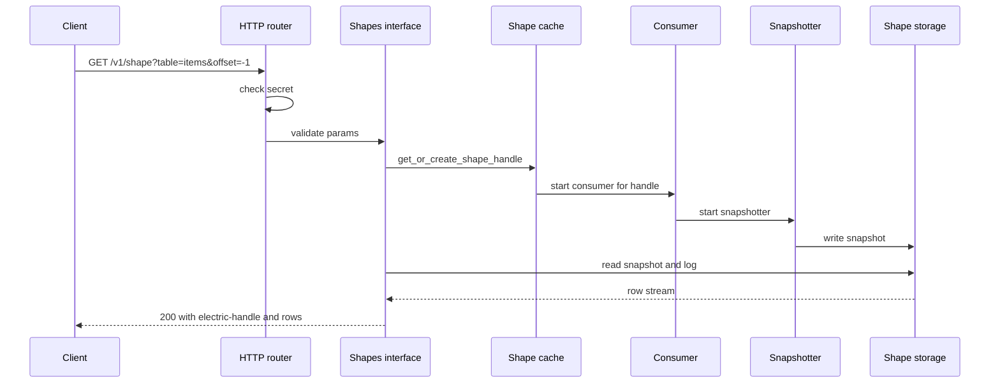
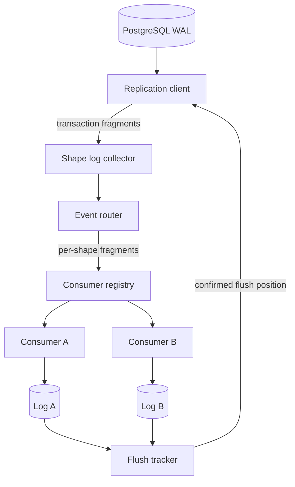

# Overview of the Electric Sync Service

Electric Sync is an Elixir service. It reads the PostgreSQL write-ahead log (WAL) through logical replication. It turns the changes into per-query change streams. It serves those streams over the Hypertext Transfer Protocol (HTTP). The service is read-path only for table data. It does not accept write mutations.

The service is the engine behind ElectricSQL. A client asks for a subset of a table. The subset is called a shape. The service keeps that subset materialized as a log. The client can read the log from any valid offset in that shape and can stay connected for live updates. A first read uses offset `-1` and a table definition. Later reads repeat the table definition and add the shape handle. The handle identifies the shape log, and the table definition lets the service validate the request.

## The problem the service solves

A web or mobile application usually fetches data with repeated queries. Each query returns the current state. The client cannot tell what changed between two queries. The service changes the model. The client subscribes to a shape once. The service sends an initial snapshot and then a stream of changes. The client applies the changes to a local store.

This model has three hard parts:

1. A query result must be reproducible at a stable point in the PostgreSQL timeline.
2. Changes from other tables must not enter the shape.
3. The client must be able to resume from an exact position after a disconnect.

The service solves these parts with a shape definition, a shape handle, and a log offset. The shape definition makes the query result reproducible. The service saves the result and replays it as a stored snapshot plus a change log. The shape definition also holds the filter that keeps other tables out. The log offset gives the exact resume position after a disconnect.

## Core concepts

### Shape

A shape is one saved, declarative query over one root table, together with the data that the service materializes from it. The document uses the word for both parts. The context says which part it means. The definition has these parts:

- The root table, written as `schema.table`. The table is required.
- A primary key. The primary key is required, because the service uses it to identify each row.
- An optional `where` clause.
- An optional column list.
- An optional replica mode, which controls how much of each row a change carries: `default` or `full`. In `full` mode an insert or update carries the complete new row, and a delete carries the complete old row. An update also carries an `old_value` object with the columns that changed. In `default` mode an update carries the primary key and the changed columns, and a delete carries only the primary key.
- An optional log mode, which is `changes_only` or `full`. `full` includes the initial snapshot. `changes_only` omits the snapshot rows, so the shape starts empty and the log holds later changes. The shape still has a snapshot area, but the area holds no rows. The service writes an empty snapshot chunk and ends it with the `snapshot-end` control message. This message is a JavaScript Object Notation (JSON) control row that tells the client the snapshot is complete. Both modes use the same change conversion.

The definition lives in `packages/sync-service/lib/electric/shapes/shape.ex`. The `new/2` function normalises the input and inspects the relation. It records flags such as `selects_all_columns` and `non_primitive_columns_in_where`. The first flag says that the shape selects every column. The second says that the `where` clause uses a column type that cannot be compared with a simple equality or range rule. A third flag, `selects_generated_columns`, is true when any selected column is a generated column. A generated column is a column that PostgreSQL computes from other columns. The flag is set at `packages/sync-service/lib/electric/shapes/shape.ex:252-256`. These flags affect change conversion later.

### Shape handle

A shape handle is a stable identifier for a shape. It is built from the shape hash and a microsecond timestamp. The function `generate_id/1` returns the hash and the handle:

```elixir
# packages/sync-service/lib/electric/shapes/shape.ex:139-145
def generate_id(%__MODULE__{} = shape) do
  hash = hash(shape)

  # Use microseconds to essentially avoid collisions within the same
  # millisecond when we have a hash collision
  {hash, "#{hash}-#{DateTime.utc_now() |> DateTime.to_unix(:microsecond)}"}
end
```

The handle is stable for the life of the shape data. It is not built from the definition alone. The timestamp makes a new handle when a shape is deleted and created again, so a client cannot reuse local data from the old shape. A hash collision between two different definitions normally gets a different handle, because the creation timestamp is part of the handle. Two colliding definitions created in the same microsecond would get the same handle. The source comment calls the collision "essentially" avoided, not impossible (`packages/sync-service/lib/electric/shapes/shape.ex:142-143`). The shape database keys a shape by its handle. A second shape with the same handle therefore cannot be stored. The insert returns a duplicate-handle error (`packages/sync-service/lib/electric/shape_cache/shape_status/shape_db/write_buffer.ex:213-228`, `packages/sync-service/lib/electric/shape_cache/shape_status.ex:124-136`). The client gets an error, not the wrong shape. The client sends the handle on later requests. The service compares the handle with a cheap hash of the request definition. When the hash matches, the handle confirms the stored shape. The service then does not need a definition-to-handle database lookup. When the hash does not match, the service runs the more expensive lookup by definition (`packages/sync-service/lib/electric/shape_cache.ex:83-100`).

### Log offset

Every change in a shape log has an offset. The offset has two parts: a transaction offset and an operation offset. The transaction offset is an integer or `-1`. The operation offset is a non-negative integer or the sentinel `:infinity`. The module is `Electric.Replication.LogOffset`.

The service defines four special offsets:

| Name | Value | Meaning |
|------|-------|---------|
| `before_all` | `(-1, 0)` | Before the first change. It prints as `-1` |
| `first` | `0_0` | Boundary after the first snapshot chunk |
| `last_before_real_offsets` | `0_inf` | The virtual position after the snapshot and before real data |
| `last` | `max_inf` | The end of the log |

Real operation offsets count changes inside a transaction. The first is 0, and each later change adds 2. The step leaves one slot for a split record. An update that changes the primary key writes a delete at offset N and an insert at offset N+1. When a change does not split, the odd slot stays unused, so a shape can see operation offsets with gaps.

`:infinity` sorts after every integer operation offset. A transaction offset of `0` marks a virtual offset. A virtual offset describes a snapshot chunk, not a WAL change. Its operation part is the chunk number, not the operation counter. `0_0` is the end of the first chunk, `0_1` is the end of the second, and `0_inf` is the position after the last chunk. Real operation offsets step by 2, as the previous paragraph explains. But the snapshot uses a separate numbering range. An odd operation offset with a transaction part of `0`, such as `0_1`, is valid only as a virtual offset. In a real transaction, an odd operation offset occurs only as the insert half of a split update. A transaction offset greater than `0` marks a real change from the write-ahead log. A transaction offset of `-1` is not a position in the log. It is a request marker that means "give me the shape from the beginning". This is why `before_all` can hold the negative value. `last()` uses the maximum unsigned 64-bit value so that it sorts after every real transaction offset. It is an upper bound, not an observed position.

The string form is `<tx_offset>_<op_offset>`, with one exception: `before_all()` prints as `-1` with no operation part. The forms are therefore `-1`, `0_0`, `0_inf`, and, for `last`, `18446744073709551615_inf`. The serializer clause is at `packages/sync-service/lib/electric/replication/log_offset.ex:320-322`. Clients use the string form in the `offset` query parameter. The parameter also accepts `now`, which asks for the current position with no log rows.

### Snapshot and log

A new shape has no data. The service starts a snapshotter process, `Electric.Shapes.Consumer.Snapshotter`. The snapshotter runs a snapshot query against PostgreSQL in a repeatable-read, read-only transaction. One statement reads `pg_current_snapshot()` and `pg_current_wal_lsn()`. The snapshot identifier is the three-value tuple `{xmin, xmax, xip_list}` from `pg_current_snapshot()`. The WAL position is read in the same statement. The initial-snapshot callbacks discard that position: their parameters are `_lsn`, and nothing stores it. The snapshot query helper is shared with the move-in path. A **move-in** copies the current state of rows that enter a subquery result, so a dependent shape can start without a second full query. A **subquery result** is the row set of the inner query. A **dependent shape** is the outer shape whose `where` clause reads that result ([03-shape-log-and-storage.md](03-shape-log-and-storage.md#snapshots-and-move-in) explains it). That path keeps the position and uses it to set a transaction boundary, so the helper always reads it. The snapshotter sends the tuple to the consumer before it streams the query rows (`packages/sync-service/lib/electric/shapes/consumer/snapshotter.ex:230-237`, `packages/sync-service/lib/electric/shapes/consumer/effects.ex:254-281`, `packages/sync-service/lib/electric/shapes/consumer/subqueries/active_move.ex:203-207`, `packages/sync-service/lib/electric/postgres/snapshot_query.ex:67-76`).

The consumer buffers incoming transactions until the tuple arrives (`packages/sync-service/lib/electric/shapes/consumer.ex:619-629`). It then tests each transaction identifier (xid). The test has four cases, and the source checks them in this order (`packages/sync-service/lib/electric/replication/changes.ex:169-183`):

1. `xid < xmin`: the transaction committed before the snapshot started, so it is visible in the snapshot.
2. `xid >= xmax`: the transaction started after the snapshot, so it is not visible in the snapshot.
3. The snapshot has an empty `xip_list`: every transaction in the range that remains is visible.
4. `xid` is in `xip_list`: the transaction was in progress when the snapshot ran, so it is not visible. Any other `xid` in the range `xmin <= xid < xmax` is visible.

A visible transaction is already in the snapshot data. The consumer writes nothing for it and reports it as already flushed, so the acknowledged position can move past it. A transaction that is not visible is not in the snapshot, so the consumer writes it to the log. The test is `Electric.Shapes.Consumer.InitialSnapshot.filter/3` at `packages/sync-service/lib/electric/shapes/consumer/initial_snapshot.ex:97-108`. [04-replication-and-consumers.md](04-replication-and-consumers.md) gives the snapshot and log handover in full.

The tuple is saved with the shape. The saved record also holds a `filter_txns?` flag. A restarted consumer loads the tuple with `Storage.fetch_pg_snapshot/1` (`packages/sync-service/lib/electric/shapes/consumer/state.ex:172`). The flag starts as true. The consumer sets it to false when the first transaction arrives with an identifier at or after `xmax` (`packages/sync-service/lib/electric/shapes/consumer/initial_snapshot.ex:50-66`). At that point the stream has passed the snapshot: every later transaction is newer than the snapshot, so the test is unnecessary. The consumer writes the tuple again with `filter_txns?: false`, and a restarted consumer reads that value and skips the test. The snapshot and the log therefore meet without a gap. The result is written to the shape storage as a snapshot. After the snapshot, the service appends live changes to the shape log.

The snapshot and the log are separate storage areas. The HTTP response streams the snapshot first and the log second. This order gives the client a consistent base and then incremental changes.

### Consumer

A consumer is one Elixir process per active shape. A **stack** is one PostgreSQL connection set with its pools, replication client, shape cache, and consumers. All consumers in a stack share one replication stream: one logical replication connection and slot. The collector fans out the changes from that stream to every consumer. The consumer filters changes through the shape definition. It writes matching changes to the shape log. It also notifies the waiting HTTP request when new data exists.

The consumer is started on demand. A dynamic supervisor starts and stops children while it runs. It starts the consumer when a request first needs the shape. It also starts one when a transaction change must reach a shape that has no live consumer, for example after suspension (`packages/sync-service/lib/electric/shapes/consumer_registry.ex:126-133`). The consumer stops when the shape expires or when the stack shuts down. It can also stop by suspension. When `shape_enable_suspend?` is true, the consumer hibernates after an idle period and then terminates after a further delay. Suspension is off by default (`packages/sync-service/lib/electric/config.ex:100-109`). A later transaction change starts a new consumer, which reads the stored state. A request for an existing suspended shape does not start the consumer. It reads the stored data and subscribes to shape events.

## How a shape is found

The shape cache has two lookup paths. The first path takes no GenServer call. It checks two stores in order. The first store is the shape-database write buffer. It is an Erlang Term Storage (ETS) table that holds shapes created since the last flush to SQLite (`packages/sync-service/lib/electric/shape_cache/shape_status/shape_db/write_buffer.ex:117-128`). A **flush** here is a write from the shape-database write buffer to SQLite. It is not the shape-log flush that the rest of the documents describe. The second store is the **shape index** in SQLite, which holds older shapes (`packages/sync-service/lib/electric/shape_cache/shape_status/shape_db.ex:97-117`). SQLite is the embedded relational database that stores the shape metadata. GenServer is an Elixir server process that handles calls in order. The shape index maps a shape definition to a handle, so the lookup succeeds when the shape already exists.

The map key is not the request parameters. The service builds a comparable tuple from the identifying fields. The fields are the root table identifier and name, the primary key, the `where` expression, the selected and explicitly selected columns, and the replica mode. It also includes the flags that are true among `selects_all_columns`, `selects_generated_columns`, and `non_primitive_columns_in_where`, and the log mode (`packages/sync-service/lib/electric/shapes/shape.ex:112-121`). It encodes the tuple with deterministic Erlang term encoding and hashes the bytes with SHA-256. The digest is the `comparable` key (`packages/sync-service/lib/electric/shape_cache/shape_status/shape_db/query.ex:298-303`). A separate `hash` column holds `:erlang.phash2` of the same tuple for a cheap handle check (`packages/sync-service/lib/electric/shapes/shape.ex:134-137`). `:erlang.phash2/1` returns a non-negative integer below 2^27 by default. It is a fast hash and can collide. The handle is the decimal form of that integer, a hyphen, and the creation time in microseconds. Two requests that produce the same tuple find the same stored shape and the same handle while that shape exists. The lookup compares the full digest, so a `phash2` collision does not merge two shapes. The handle adds the creation time in microseconds to the hash. A new creation therefore gets a new handle even when the definition is unchanged, as happens after deletion. The lookup finds no stored shape, so the service builds a new handle. The timestamp makes a same-hash collision within one microsecond unlikely, not impossible (`packages/sync-service/lib/electric/shapes/shape.ex:139-144`). The HTTP layer also uses a separate ETS table for admission control. [02-http-api-and-shapes.md](02-http-api-and-shapes.md) explains that check.

```elixir
# packages/sync-service/lib/electric/shape_cache.ex:66
def get_or_create_shape_handle(shape, stack_id, opts \\ []) when is_stack_id(stack_id) do
  # Get or create the shape handle and fire a snapshot if necessary
  with {:ok, handle} <- fetch_handle_by_shape(shape, stack_id),
       {:ok, offset} <- fetch_latest_offset(stack_id, handle) do
    {handle, offset}
  else
    :error ->
      GenServer.call(
        name(stack_id),
        {:create_or_wait_shape_handle, shape, opts[:otel_ctx]},
        @call_timeout
      )
  end
end
```

The second path runs when the shape is new. The `:error` arm of the function above calls the cache GenServer. The server creates the handle and starts the snapshot. Two simultaneous first requests do not create two shapes. The GenServer handles the calls in order. The first call creates the shape. The second call repeats the lookup on the write connection and finds the new shape (`packages/sync-service/lib/electric/shape_cache.ex:314-331`, `:369-392`). The second request waits for the GenServer reply and receives the same handle and offset.

A read uses a different module. `Electric.Shapes.get_merged_log_stream/3` handles the case where the handle is known but the stored shape is gone. It returns a must-refetch error:

```elixir
# packages/sync-service/lib/electric/shapes.ex:32
def get_merged_log_stream(stack_id, shape_handle, opts)
    when is_shape_handle(shape_handle) and is_stack_id(stack_id) do
  offset = Access.get(opts, :since, LogOffset.before_all())
  max_offset = Access.get(opts, :up_to, LogOffset.last())

  case Access.get(opts, :snapshot_status) do
    {:error, _} = error ->
      error

    :started ->
      {:ok, build_log_stream(stack_id, shape_handle, offset, max_offset, opts)}

    nil ->
      if ShapeCache.has_shape?(shape_handle, stack_id) do
        with :started <- ShapeCache.await_snapshot_start(shape_handle, stack_id) do
          {:ok, build_log_stream(stack_id, shape_handle, offset, max_offset, opts)}
        end
      else
        # If we have a shape handle, but no shape, it means the shape was deleted. Send a 409
        # and expect the client to retry - if the state of the world allows, it'll get a new handle.
        {:error, Electric.Shapes.Api.Error.must_refetch()}
      end
  end
end
```

The three branches have these meanings. `{:error, _}` means the caller already tried to read the snapshot status and that read failed. The function returns the error unchanged. `:started` means the snapshot is already complete, so the function builds the log stream immediately. `nil` means the caller did not supply a status, so the function checks the shape cache. If the shape exists, it waits for the snapshot to start, then builds the stream. If the shape does not exist, it returns the must-refetch error.

The two paths explain the shape handle rule in the HTTP interface. A handle is a claim about stored data. The service always checks that claim before it serves a row.

## The request path

The following diagram shows the path of one `GET /v1/shape` request.



The router authenticates the request. The application programming interface (API) validates the parameters. The shape cache allocates the handle. The consumer creates the snapshot. The response streams the stored data.

## The replication path

The replication path runs in parallel with the request path.



The replication client reads WAL messages. It converts them into **transaction fragments**: decoded pieces of one transaction, with the transaction identifier, the commit log sequence number, and the list of changes. The shape log collector is the single producer for all consumers. The event router decides which shapes are affected. The consumer registry broadcasts each fragment to the matching consumers. Each consumer appends the fragment to its log. The **flush tracker** computes a safe flush position: the position up to which every tracked shape has written its changes to disk. The replication client sends that position back to PostgreSQL.

## Two run modes

The application has two run modes. The mode is selected by the `:start_in_library_mode` application setting. The code default is `true` (`packages/sync-service/lib/electric/application.ex:9`). The package configuration overrides the default at `packages/sync-service/config/config.exs:26` with `Mix.env() == :test`. The value is therefore true in the test environment and false in a development build and in a production release.

- In library mode, the application starts only a registry and the admission controller. The host application starts one or more stacks itself.
- In single-stack mode, the application starts the full tree. That tree has the HTTP server, telemetry, and one stack. The official Docker image builds with `MIX_ENV=prod`, so the setting is false. The `if` in `application.ex` then takes the `else` branch, which starts the full tree.

The branch is in `packages/sync-service/lib/electric/application.ex:9-19`.

## What the service does not do

- It does not handle `TRUNCATE` messages correctly. A relevant truncate causes the affected shape to be removed. The service does not rebuild it. A request that still carries the old handle receives 409 must-refetch. The client then requests the same shape with offset `-1`, which creates a new shape. The Electric repository root file `LIMITATIONS.md` records this limit.
- It does not put transaction boundaries in the shape log. A client sees individual changes, not transaction commits.
- It does not accept writes to PostgreSQL tables. It is not a database proxy. The one destructive operation is shape deletion with `DELETE /v1/shape`, which removes stored shape data, not table rows. Shape deletion is off by default.
- It does not support a multi-node cluster in this package. The default deployment runs one stack per service process, and the package has no coordination between service processes. Library mode can start more than one stack in one Erlang virtual machine (the BEAM). But each stack needs its own stack identifier, storage root, slot name, and publication name. [05-configuration-and-deployment.md](05-configuration-and-deployment.md) gives the rule.

## Key insight

The service is not a cache of query results. It is a log of changes that happen to match a query. This distinction explains the design. The service cannot recompute an arbitrary past state of a shape on demand. It can run the query again for a new snapshot. But it cannot rebuild the exact log at an older offset from the current table. It must keep the snapshot plus the later changes. Without compaction, that log grows without bound. When a shape has compaction enabled with the `experimental_compaction` request parameter, the service rewrites the chunks before the boundary into one compacted file. It keeps the last complete chunks in the live part. The compacted file keeps the remaining operations for every key, so update churn is reduced. But the file still grows with the number of distinct keys. When a reader asks for an offset below the compaction boundary, the service reads the compacted file from its first retained chunk. The intermediate changes that compaction dropped are therefore absent, and the service does not return an error. The storage format, the flush tracker, and the offset model all follow from that requirement.

## Related documents

- [01-architecture.md](01-architecture.md) explains the process tree.
- [02-http-api-and-shapes.md](02-http-api-and-shapes.md) explains the shape parameters.
- [03-shape-log-and-storage.md](03-shape-log-and-storage.md) explains the log format.
- [04-replication-and-consumers.md](04-replication-and-consumers.md) explains the replication path.
- [07-testing-and-limitations.md](07-testing-and-limitations.md) lists the limits.
