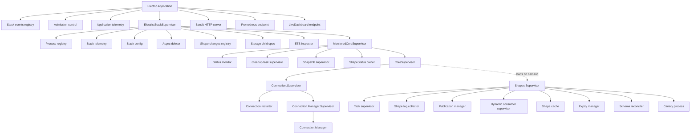
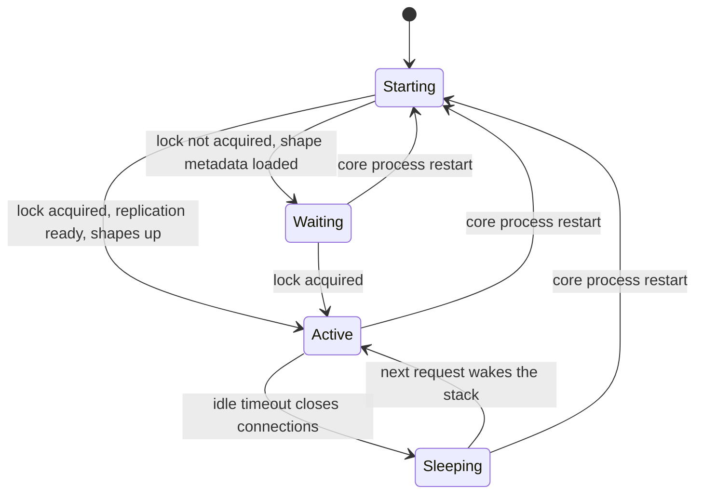

# Architecture and Supervision

The service is an Erlang/Open Telecom Platform (OTP) application. It starts one supervision tree. The tree has three main levels: the root application, the stack supervisor, and the per-stack subsystems. Each level contains more supervisors, so the diagram in this document shows the full nesting. This document follows the boot path from the `Application.start/2` callback down to the shape consumer processes.

## Terms used in this document

This document uses five terms from the service domain. [00-overview.md](00-overview.md) defines them in full.

- A **shape** is a query over one root table, with an optional filter and column list.
- A **shape handle** is a stable identifier for one shape and its stored data.
- A **shape log** is the durable, ordered stream for one shape: a snapshot part and a change-log part.
- An **offset** is a position in that log. The string form is `<transaction>_<operation>`.
- A **consumer** is the process that writes one shape log.

The document also uses three database terms. A **replication slot** is a named position in the PostgreSQL write-ahead log (WAL) that the server keeps for one Electric instance. In this document, "consumer" always means a shape consumer process. A replication slot is not a consumer in that sense. A **publication** is the named set of tables whose changes the slot sends. **SQLite** is an embedded relational database that stores its data in one file.

## Start modes

The `Electric.Application` module starts one of two child lists. The choice depends on the `:start_in_library_mode` setting. The default is `true`.

```elixir
# packages/sync-service/lib/electric/application.ex:9-18
if Application.get_env(:electric, :start_in_library_mode, true) do
  Supervisor.start_link(children_library(), supervisor_opts)
else
  app_vsn = Application.spec(:electric, :vsn)
  Logger.notice("Starting ElectricSQL #{app_vsn}")

  Supervisor.start_link(
    children_application(),
    [auto_shutdown: :any_significant] ++ supervisor_opts
  )
end
```

In library mode the application starts only two children:

- `Electric.StackEventsRegistry`, a `Registry` with `keys: :duplicate`. A `Registry` is an Elixir process table that maps a key to the processes that registered under it. The name says "registry", not "duplicate registry": the option lets several processes subscribe to the same stack event.
- The `Electric.AdmissionControl` process.

The host application then builds its own stacks. In single-stack mode the application starts the full tree. The full tree starts the same two library children first. The stack and the application programming interface (API) need the event registry and the admission controller. It then adds telemetry, one stack supervisor, and the endpoints for Hypertext Transfer Protocol (HTTP). Test runs use library mode, because `packages/sync-service/config/config.exs:26` sets the mode to `Mix.env() == :test`.

The root supervisor uses the `:one_for_one` strategy (`packages/sync-service/lib/electric/application.ex:7`). The single-stack mode also sets `auto_shutdown: :any_significant`. A **significant child** is a child marked `significant: true`. Its exit is a stop condition for the parent, not just a restart. With this setting, the whole application stops when a significant child stops.

## Single-stack boot sequence

The `children_application/0` function does the following work in order:

1. It sets the maximum crash backtrace depth to 50 frames. A crash backtrace is the list of function calls that led to an error. The limit keeps a report short.
2. It adds the Electric logger handlers.
3. It calls the Sentry logger-handler installer. The call adds a handler only when the build includes telemetry. That means the Mix target is `application` (the Mix target is the build variant that `mix` selects). Otherwise it returns `:ok` with no handler. Sentry is an external error-tracking service. The handler sends error events to it (`packages/sync-service/lib/electric/telemetry/sentry.ex:20-29`; [06-telemetry-and-observability.md](06-telemetry-and-observability.md) explains the target).
4. It builds the stack configuration keyword list from the environment.
5. It starts the library children.
6. It starts application telemetry.
7. It starts one `Electric.StackSupervisor`.
8. It starts the HTTP interface.
9. It starts the Prometheus endpoint, if a port is set.
10. It starts the Phoenix LiveDashboard, if a port is set.

The Sentry handler has a bounded queue. The discard threshold is 2000 events. The synchronous mode is disabled:

```elixir
# packages/sync-service/lib/electric/application.ex:50
Electric.Telemetry.Sentry.add_logger_handler(
  Electric.Telemetry.Sentry.default_handler_id(),
  discard_threshold: 2000,
  sync_threshold: nil
)
```

The value `sync_threshold: nil` is deliberate. The design does not apply backpressure. **Backpressure** is the action that slows a producer when a consumer cannot keep up. A full Sentry queue discards events instead, and the logger never waits for Sentry. The source comment states the goal: shed load rather than let the queued events grow without a limit (`packages/sync-service/lib/electric/application.ex:47-53`).

## Full supervision tree

The following diagram shows the complete tree in single-stack mode.



In the diagram, ETS means Erlang Term Storage. It is an in-memory key-value store built into the Erlang virtual machine. **Bandit** is the Elixir HTTP server that accepts requests. It uses Thousand Island (ThousandIsland) for socket handling. **Prometheus** is a metrics system. Its endpoint publishes measurements in a text format. **LiveDashboard** is the Phoenix web page that shows runtime statistics.

The order of the nodes in this diagram does not show start order. The excerpt below gives the start order. The diagram also abbreviates the collector subtree: the single `Coll` node stands for the collector supervisor and its `ShapeLogCollector.RequestBatcher` child.

The tree has a deliberate split. The connection subtree handles database connections. The shape subsystem handles the log. The shape subsystem is a child of `CoreSupervisor` and it starts on demand from the connection manager (`packages/sync-service/lib/electric/core_supervisor.ex:40-96`). A restart of the connection manager leaves the shape processes running. A fatal database error stops `Electric.Connection.Supervisor`. That supervisor is the significant child of `CoreSupervisor`. The significant-child chain then stops the core and the shape subsystem with it. Stored shape data on disk survives a process restart, and the restarted processes read it from disk. A shape can still disappear from storage for other reasons. The expiry manager removes the shape used least recently. A table truncate marks the affected shape for removal. A schema change removes the shapes for the changed relations. A collector restore removes subquery shapes. [03-shape-log-and-storage.md](03-shape-log-and-storage.md) gives the storage rules, and [04-replication-and-consumers.md](04-replication-and-consumers.md) gives the restore steps. The `CoreSupervisor` documentation states the intent of the split at `packages/sync-service/lib/electric/core_supervisor.ex:2-7`.

Several children exist to support the main path:

| Child | Purpose |
|-------|---------|
| Async deleter | Removes shape files and directories without blocking the caller |
| Shape changes registry | A Registry with `keys: :duplicate`, so one shape can have several waiting subscribers |
| Storage child spec | Starts the stack-wide storage process and its ETS table |
| ETS inspector | Caches relation and column metadata from PostgreSQL |
| Cleanup task supervisor | Runs shape cleanup tasks |
| Shape database supervisor | Starts the SQLite connection pool that holds shape metadata |
| ShapeStatus owner | Loads shape metadata from SQLite before the connection manager acquires the replication lock; it is an earlier sibling in the `rest_for_one` chain of `Electric.MonitoredCoreSupervisor` (`packages/sync-service/lib/electric/monitored_core_supervisor.ex:23-37`), not of the stack supervisor |
| Expiry manager | Removes the least recently used shape when the shape count is greater than `max_shapes`; "use" means the `last_read_time` value in the shape status, which the service sets when it confirms the snapshot start or starts the consumer (`packages/sync-service/lib/electric/shape_cache/shape_status.ex:379-394`); the selection itself is `least_recently_used/2` at `:396-442` |
| Schema reconciler | Every 60 seconds, finds relations whose cached schema is stale and removes the shapes that read them; the next request with an old handle gets 409 must-refetch (the period is at `packages/sync-service/lib/electric/replication/schema_reconciler.ex:22`; the reconciliation logic is at `:69-105`) |
| Task supervisor | Runs short shape tasks, including snapshot work |
| Canary process | Marks the supervisor processes ready when it starts |

## The stack supervisor

`Electric.StackSupervisor` is the root of one stack. A stack is one database connection set plus one shape cache. The module validates its options with NimbleOptions, an Elixir library for declarative option schemas. The schema has 20 top-level options at `packages/sync-service/lib/electric/stack_supervisor.ex:56-246`. The required options are:

- `stack_id`
- `persistent_kv`: the small key-value store for values that must survive a restart, such as the installation identifier (the random value that identifies one installation). The default backend writes files under `storage_dir/state`.
- `stack_events_registry`
- `connection_opts`
- `replication_opts`
- `storage`
- `storage_dir`
- `shape_db_opts`: the options for the SQLite shape database, such as its directory, synchronous mode, and cache size.

The `start_link/1` function obfuscates database passwords before validation. The code is at `packages/sync-service/lib/electric/stack_supervisor.ex:252-266`. The obfuscation wraps each password in a zero-argument function (a closure). The real value is restored only when the connection options go to Postgrex. Postgrex is the Elixir driver for PostgreSQL. This prevents a password from appearing in a crash report or an inspection of the supervisor state.

The `init/1` callback starts children in this order:

```elixir
# Condensed excerpt from packages/sync-service/lib/electric/stack_supervisor.ex:421-457
children =
  [
    telemetry_spec,
    {Electric.ProcessRegistry, partitions: registry_partitions, stack_id: stack_id},
    {Electric.StackConfig, stack_id: stack_id, seed_config: [...]},
    {Electric.AsyncDeleter, stack_id: stack_id, storage_dir: config.storage_dir, ...},
    {Registry, name: shape_changes_registry_name, keys: :duplicate, ...},
    Electric.ShapeCache.Storage.stack_child_spec(storage),
    {Electric.Postgres.Inspector.EtsInspector, stack_id: stack_id, ...},
    {Electric.MonitoredCoreSupervisor, stack_id: stack_id, ...}
  ]
  |> Enum.reject(&is_nil/1)

Supervisor.init(children, strategy: :one_for_one, auto_shutdown: :any_significant)
```

The telemetry child is first. The comment explains the reason: telemetry must be torn down last so it can report during shutdown. A supervisor stops its children in reverse start order, so the child started first is stopped last. The `MonitoredCoreSupervisor` is last because it needs the `Electric.ProcessRegistry`, the storage, and the inspector.

### Stack configuration

The boot step in the previous section builds the option list that the stack supervisor receives. `Electric.StackConfig` is a different thing. It is a small process wrapper around an ETS table that stores values which the stack reads at runtime. The values are fixed when the stack starts. The table holds:

- The snapshot timeout to the first data: the maximum wait for the first row of a snapshot query.
- The shape hibernate period: the idle time before a consumer releases its heap.
- The suspend settings: whether and when an idle consumer is stopped.
- The flush stall grace period: the time before the collector challenges a consumer that has not flushed.
- The chunk byte threshold: the size at which a log chunk closes.
- The feature flags: internal switches that enable optional behaviour.
- The process spawn options: Erlang spawn settings for consumer processes.
- The consumer garbage-collection heap threshold: the heap size that triggers a garbage collection.

Consumers read these values through `StackConfig.lookup/3`. The table is public and uses `read_concurrency: true`.

## Connection startup

The `Electric.Connection.Supervisor` is significant and transient. In a child specification, `significant: true` marks a child whose exit can stop the parent. Also, `restart: :transient` restarts the child after an abnormal exit but not after a normal shutdown. The supervisor sets both flags on itself with `use Supervisor, restart: :transient, significant: true` at `packages/sync-service/lib/electric/connection/supervisor.ex:25`. It starts two children in `:rest_for_one` order:

1. `Electric.Connection.Restarter`.
2. `Electric.Connection.Manager.Supervisor`.

The second child is a small supervisor. Its main child is `Electric.Connection.Manager`. This document calls that process the connection manager.

A database failure stops the supervisor. The stop signal moves up the significant-child chain: `CoreSupervisor` treats `Connection.Supervisor` as significant, `MonitoredCoreSupervisor` treats `CoreSupervisor` as significant, and `StackSupervisor` treats `MonitoredCoreSupervisor` as significant. The whole stack therefore stops. In single-stack mode the root application also treats `StackSupervisor` as significant, so the service stops. In library mode `StackSupervisor` is not significant, so the host application continues and decides whether to start the stack again. The call that stops the connection supervisor is `Electric.Connection.Supervisor.shutdown/2`. It logs a warning in library mode and an emergency message in single-stack mode (`packages/sync-service/lib/electric/connection/supervisor.ex:37-51`).

The connection manager runs a state machine. The state values show the sequence. The type is at `packages/sync-service/lib/electric/connection/manager.ex:50-66`:

```elixir
# packages/sync-service/lib/electric/connection/manager.ex:52-65
@type step ::
  {:start_admin_pool, nil}
| {:start_admin_pool, :connecting}
| {:start_replication_client, nil}
| {:start_replication_client, :acquiring_lock}
| {:start_replication_client, :connecting}
| {:start_replication_client, :configuring_connection}
| {:start_snapshot_pool, nil}
| {:start_snapshot_pool, :connecting}
| :start_shapes_supervisor
| {:start_replication_client, :start_streaming}
# Steps of the :running phase:
| :waiting_for_streaming_confirmation
| :streaming
```

Each value is a step in one of two phases. The `:connection_setup` phase contains the first ten steps. The `:running` phase contains `:waiting_for_streaming_confirmation` and `:streaming`. The second element in a tuple names the current sub-step. For example, `{:start_admin_pool, :connecting}` means that the pool start request is in progress. A failure returns the manager to `:connection_setup` and the first step, so the startup sequence runs again. The phases are at `packages/sync-service/lib/electric/connection/manager.ex:50-51`.

The manager performs these steps:

1. It starts the admin pool with the replication connection options. The pool is small. It has one quarter of the configured total pool size (`db_pool_size`, default 20). It has a minimum of 1 and a maximum of 4 connections (`packages/sync-service/lib/electric/connection/manager.ex:243-263`). It is used for lock breaking, shutdown cleanup, and inspector cache population. A lock break ends an advisory lock left by a previous instance that stopped without releasing it. A PostgreSQL advisory lock is a lock that belongs to a database session and disappears when the session ends. The two statements agree only when PostgreSQL ends the session. A client can lose its network link or crash without a clean close. PostgreSQL can then keep the session and its lock, even when the replication slot is already inactive. The lock breaker searches `pg_locks` for the advisory lock that matches this slot. It requires an inactive slot and excludes its own backend. It then calls `pg_terminate_backend` on the result (`packages/sync-service/lib/electric/connection/manager.ex:1272-1298`). The termination ends the stale session, and the lock then disappears.
2. It starts the replication client. The client acquires the advisory lock and creates or verifies the publication and the slot. It does not start streaming.
3. It starts the snapshot pool with the ordinary connection options. The source comment at `packages/sync-service/lib/electric/connection/manager.ex:419-422` says these credentials can belong to a lower-privilege user. The pool runs the initial snapshot queries and metadata queries.
4. It asks `CoreSupervisor.start_shapes_supervisor/1` to start the shape subtree.
5. It tells the replication client to start streaming.

This order is important. The shape subtree is not started until the database slot and publication are valid. A replication position is the slot position from which streaming starts. A shape snapshot cannot start against an invalid replication position.

## The shape subtree

`Electric.Shapes.Supervisor` starts its children with the `:one_for_all` strategy. The children are:

- A task supervisor.
- The shape log collector supervisor.
- The publication manager.
- The dynamic consumer supervisor.
- The shape cache.
- The expiry manager.
- The schema reconciler.
- A canary process.

The `:one_for_all` strategy means a crash in any child restarts the whole group. The group shares runtime state. The shape log collector owns three of the pieces of that state that a partial restart would break. The list is not complete. [04-replication-and-consumers.md](04-replication-and-consumers.md) lists the other parts. The partition map maps each PostgreSQL table partition to its root table, and records which shapes own each root. Here "partition" means a table partition, not a consumer partition (the partition supervisors that run consumers). The event router decides which shapes receive each change. The registry view is the set of consumers that the router knows. A consumer entry is only valid with that state. A partial restart would leave consumers registered in a router that no longer knows them.

The canary process is an `Agent` that marks the supervisor processes ready. An `Agent` is a small Elixir process that holds one value and lets other processes read or update it. The call is `Electric.StatusMonitor.mark_supervisor_processes_ready/2`. The canary is the last child. Its start proves that the supervisor reached the end of its child list.

### Shape log collector supervisor

The shape log collector has its own supervisor with `:one_for_all` and `max_restarts: 0`. The two children are the collector and `ShapeLogCollector.RequestBatcher`. The batcher groups shape registration and deregistration calls, so a burst of new shapes does not send one message per shape to the collector. A zero restart limit means the collector supervisor does not restart its own children. Instead, it exits, and the parent `Electric.Shapes.Supervisor` uses `:one_for_all`, so the whole shape subtree stops and starts again with a fresh collector (`packages/sync-service/lib/electric/shapes/supervisor.ex:61`; `packages/sync-service/lib/electric/replication/shape_log_collector/supervisor.ex:35`). The connection manager calls `CoreSupervisor.start_shapes_supervisor/1` once during its start sequence (`packages/sync-service/lib/electric/connection/manager.ex:514`). The parent supervisor does the restart. The new collector restores its routing from the shape metadata in SQLite. It lists the stored shapes, rebuilds the partition map and the event router, and orders the shapes into dependency layers. A **dependency shape** is the inner shape of a subquery. A **subquery shape** has a `where` clause that reads that inner result. The restore skips a shape whose dependency shape is missing. It removes every subquery shape together with its stored metadata and data, because their restore is not yet implemented (`packages/sync-service/lib/electric/shape_cache/shape_status.ex:183-206`). A subquery shape is supported while the stack runs. The removal applies only to a collector restart. A client must request such a shape again from scratch. The restore is at `packages/sync-service/lib/electric/replication/shape_log_collector.ex:291-334`. [04-replication-and-consumers.md](04-replication-and-consumers.md) gives the steps. The design avoids an inconsistent in-memory router.

### Dynamic consumer supervisor

The dynamic consumer supervisor uses two levels:

- A parent `DynamicSupervisor` holds a fixed number of partition supervisors. A `DynamicSupervisor` is a supervisor that starts and stops children while it runs, rather than starting a fixed list at boot.
- Each partition is a `DynamicSupervisor` for shape consumers.

The partition count is fixed at start. The default is `System.schedulers_online()`. The `max_shapes` option defaults to `nil`, which means no fixed shape limit. If `max_shapes` is set, the count is the larger of the scheduler count and `ceil(max_shapes / 4000)`. The environment variable `ELECTRIC_MAX_SHAPES` sets this option. The constant is `@target_per_partition 4_000` in `packages/sync-service/lib/electric/shapes/dynamic_consumer_supervisor.ex:45`.

A shape handle maps to a partition with `:erlang.phash2(shape_handle, partitions)`. The two-level design makes shutdown parallel. The parent supervisor stops all partition supervisors at the same time. Each partition supervisor stops its own consumers at the same time. The source comment states that the 4,000 target balances memory use against shutdown speed.

## Restart strategies

The tree uses different strategies for different failure modes.

| Supervisor | Strategy | Reason |
|------------|----------|--------|
| Application root | `one_for_one` | Children are independent |
| StackSupervisor | `one_for_one` | Telemetry and storage are independent of the core |
| MonitoredCoreSupervisor | `rest_for_one` | Status monitor must restart with its monitored children |
| CoreSupervisor | `one_for_one` | Starts the connection subtree; adds the shape subtree later |
| Connection.Supervisor | `rest_for_one` | Restarter must start before the manager |
| Shapes.Supervisor | `one_for_all` | Shared in-memory replication state |
| ShapeLogCollector.Supervisor | `one_for_all`, zero restarts | Force a clean rebuild |

The `MonitoredCoreSupervisor` comment gives the reason for its strategy. The status monitor keeps a table of conditions. If the monitor dies, its table is empty. The processes it monitors must restart and report their conditions again. A `:rest_for_one` restart gives that outcome.

## Supervision vocabulary

Four concepts appear throughout the tree. They are standard OTP terms.

- **Child.** A process or a supervisor that a parent starts and owns.
- **Restart strategy.** The rule a supervisor uses when a child exits.
- **Significant child.** A child with `significant: true` in its child specification. When the parent sets `auto_shutdown: :any_significant`, the exit of that child stops the parent.
- **Transient restart.** The `restart: :transient` value in a child specification. The child restarts after an abnormal exit, but not after a normal shutdown.

The restart strategies mean:

| Strategy | Behavior |
|----------|----------|
| `one_for_one` | Restart only the child that stopped |
| `rest_for_one` | Restart the stopped child and every child started after it |
| `one_for_all` | Restart every child |

The service uses `rest_for_one` where start order creates a dependency. The connection supervisor needs the restarter process before the manager. The monitored core needs the status monitor before the processes that report to it.

The service uses `one_for_all` where children share mutable in-memory state. The shape log collector owns the router, the partition map, and the consumer registry view. A new collector cannot adopt the old consumers. A full group restart is the only consistent option.

`auto_shutdown: :any_significant` appears at four levels: the application root, the stack supervisor, the monitored core supervisor, and the core supervisor. At each level one child is significant:

| Supervisor | Significant child |
|------------|-------------------|
| Application root | `Electric.StackSupervisor`, in single-stack mode only |
| `Electric.StackSupervisor` | `Electric.MonitoredCoreSupervisor` |
| `Electric.MonitoredCoreSupervisor` | `Electric.CoreSupervisor` |
| `Electric.CoreSupervisor` | `Electric.Connection.Supervisor` |

The connection supervisor marks itself `significant: true` and `restart: :transient` at `packages/sync-service/lib/electric/connection/supervisor.ex:25`. It does not set `auto_shutdown`. The flags are at `packages/sync-service/lib/electric/monitored_core_supervisor.ex:8`, `packages/sync-service/lib/electric/core_supervisor.ex:9`, and `packages/sync-service/lib/electric/stack_supervisor.ex:35-48`.

The stack supervisor sets `restart: :transient` in both modes. It adds `significant: true` only in single-stack mode, which is the `:application` Mix target (`packages/sync-service/lib/electric/stack_supervisor.ex:35-48`). A fatal database error stops the connection supervisor. The stop signal moves up the chain because each parent treats its core child as significant. In single-stack mode the stack supervisor is significant to the application root, so the whole service stops. The stop signal from a significant child is a `:shutdown` exit. The stopping is the end state. The service does not restart itself. A new process needs an external supervisor, such as the container runtime or the process manager. In library mode the stack supervisor is transient but not significant. A stack failure therefore does not stop the host application. The host must start a new stack. A `:shutdown` exit never triggers a transient restart. A stack that the host placed under its own supervisor is restarted only after an abnormal exit. A significant-child stop is not an abnormal exit, so it still ends the stack.

## Stack readiness states

The status monitor combines the connection state and the shape state into one public state. The connection state has four values: `waiting_on_lock`, `starting`, `up`, and `sleeping`. The shape state has three: `starting`, `read_only`, and `up`. The function `service_status/1` matches the pair in this order:

| Connection state | Shape state | Public state |
|------------------|-------------|--------------|
| `up` | `up` | `active` |
| `waiting_on_lock` | `read_only` | `waiting` |
| `sleeping` | any value | `sleeping` |
| any other connection state | any value | `starting` |

The mapping is at `packages/sync-service/lib/electric/status_monitor.ex:50-58`. The `sleeping` clause matches on the connection value only, so a sleeping stack reports `sleeping` even while its shape state is still `up`. Any pair that does not match an earlier clause is `starting`. The transitions are not a linear sequence. A stack can be read-only while it waits for the replication lock.

A **read-only** stack has loaded the shape metadata, but the shape log collector or another supervisor process is not ready (`packages/sync-service/lib/electric/status_monitor.ex:88-98`). It can serve existing shapes from storage. It cannot create a shape. A request for a new shape waits for the active state, and a read-only request resolves only an existing handle (`packages/sync-service/lib/electric/shapes/api.ex:309-345`).



The table is authoritative, and the diagram shows only the common paths. For example, a stack that loses the replication lock while its shapes are up has the pair `waiting_on_lock` and `up`. The table maps that pair to `starting`, not `waiting`. The `waiting` name needs both `waiting_on_lock` and `read_only`.

The state machine matters for operations. A `waiting` stack still serves existing shapes in read-only mode. A `sleeping` stack reports healthy and wakes on demand. Only `starting` is a hard not-ready state. A "core process restart" in the diagram means a stop inside the `MonitoredCoreSupervisor` subtree, so the status returns to `starting` while the stack supervisor stays. A database disconnect is different. The connection manager retries a recoverable connection error and restarts its own manager subtree, and the shape processes keep their state (`packages/sync-service/lib/electric/connection/manager.ex:999-1007`; `packages/sync-service/lib/electric/connection/manager/supervisor.ex:27-29`). An unrecoverable error, such as a configuration error, calls `Electric.Connection.Supervisor.shutdown/2` (`packages/sync-service/lib/electric/connection/manager.ex:1129-1153`). That supervisor is the significant child of `CoreSupervisor`, and the significant-child chain then stops the core and the shape subsystem. The whole stack stops, and an external supervisor must start a new one. The HTTP plug applies `stack_ready_timeout` to every shape request, not only to an initial shape request. Each request calls `Api.validate_params/2`, which waits on the stack at the `read_only` level (`packages/sync-service/lib/electric/shapes/api.ex:199-204`, `:413-428`; `packages/sync-service/lib/electric/plug/serve_shape_plug.ex:245`). An active stack returns at once, so the timeout matters only when the stack is not ready. `stack_ready_timeout` is the maximum wait for the stack to reach that state. The default is 5,000 milliseconds at `packages/sync-service/lib/electric/shapes/api.ex:58`. On timeout the request returns 503 with `retry-after: 5`.

## Key insight

The service separates liveness from durability. Shape data lives on disk. The processes that serve the data are disposable. A failure inside the connection-manager subtree restarts the connection manager and leaves the shape processes running. A fatal database error stops the connection supervisor. The significant-child chain then stops the core and the shape subsystem. An external supervisor must start a new stack. A failure inside the shape subsystem restarts that subsystem, because its supervisor uses `one_for_all`. In these restart cases, the stored log files are not deleted. The client reconnects with the same shape handle and the same offset. The new processes read the stored data and continue. This is why the supervision strategy favors clean restarts over partial recovery. The rule has exceptions that are not process restarts. The expiry manager removes the shape used least recently, and a truncate or a schema change removes the affected shapes. A collector restore removes subquery shapes ([03-shape-log-and-storage.md](03-shape-log-and-storage.md) gives the removal rules).

## Related documents

- [00-overview.md](00-overview.md) defines the concepts.
- [03-shape-log-and-storage.md](03-shape-log-and-storage.md) explains what survives a restart.
- [04-replication-and-consumers.md](04-replication-and-consumers.md) explains the collector and consumers.
- [05-configuration-and-deployment.md](05-configuration-and-deployment.md) lists the environment variables that set the stack options and the deployment settings.
