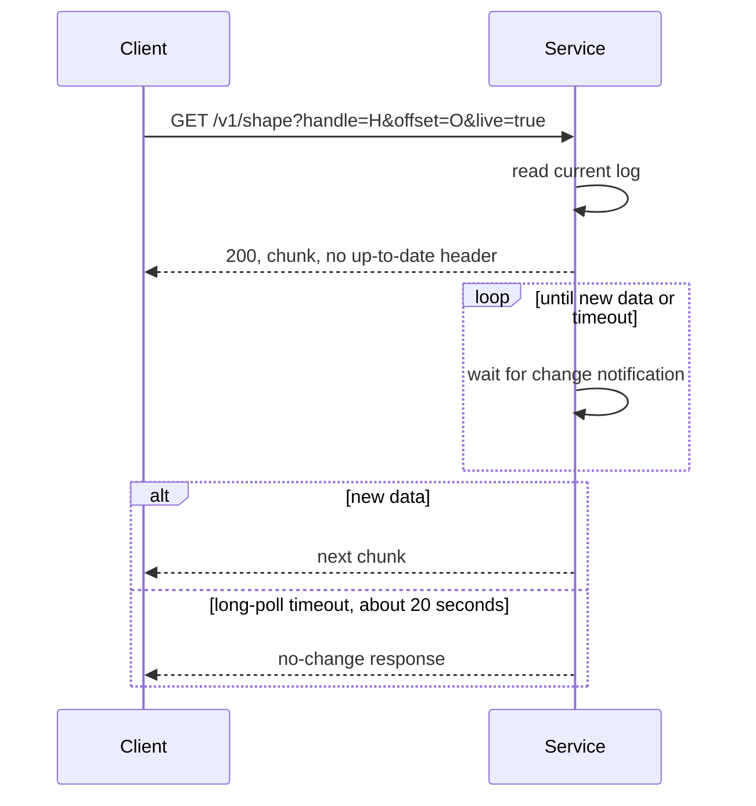
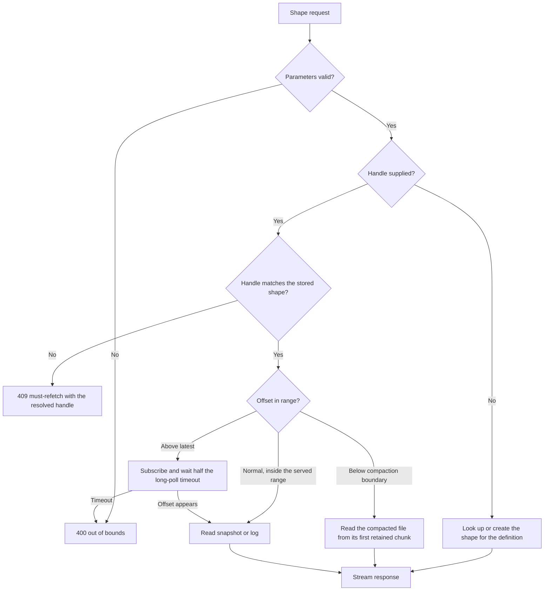

# HTTP Interface and Shapes

The service exposes one small interface over HTTP (Hypertext Transfer Protocol). Almost all behavior is in one route: `/v1/shape`. This document lists every endpoint, every shape parameter, the caching rules, and the error responses. It cites the source for each rule.

A **shape** is one saved, declarative query over one PostgreSQL table. The service materializes the definition as a snapshot plus an ordered log of later changes. A client reads that materialized data as a read-only, ordered stream of rows. The definition has an optional `where` filter and column list. A **shape log** is the stored sequence of a shape's snapshot rows and later changes, which a client reads by offset. [00-overview.md](00-overview.md) gives the full vocabulary.

## Endpoints

The router defines these routes:

| Method | Path | Plug | Purpose |
|--------|------|------|---------|
| `GET` | `/` | none | Returns 200 with an empty body |
| `GET` | `/v1/shape` | `Electric.Plug.ServeShapePlug` | Reads a shape or a shape log |
| `POST` | `/v1/shape` | `Electric.Plug.ServeShapePlug` | Reads a shape; the body can define a subset or hold shape parameters |
| `DELETE` | `/v1/shape` | `Electric.Plug.DeleteShapePlug` | Deletes a shape, when deletion is enabled |
| `OPTIONS` | `/v1/shape` | `Electric.Plug.OptionsShapePlug` | Returns the cross-origin policy |
| `GET` | `/v1/health` | `Electric.Plug.HealthCheckPlug` | Reports the stack status |
| any | any other path | router fallback | Returns 404 with `Not found` |

The route table is in `packages/sync-service/lib/electric/plug/router.ex:32-50`. A Plug is an Elixir library for composing HTTP request handlers. Each module in the table is one such handler. The `HEAD` method is converted to `GET` by `Plug.Head` before routing.

Deletion is off by default. The configuration key is `allow_shape_deletion?`, and it defaults to false at `packages/sync-service/lib/electric/config.ex:77`. The key ends with a question mark. The `Api` option and the struct field that the code reads have the same name without the question mark: `allow_shape_deletion`. This document uses `allow_shape_deletion?` for the configuration key and `allow_shape_deletion` for the `Api` value. When the value is false, a `DELETE` request returns status 405 with the text `DELETE not allowed`. The check is at `packages/sync-service/lib/electric/shapes/api/delete.ex:12-18`. The runtime configuration enables deletion only for integration testing at `packages/sync-service/config/runtime.exs:216`.

### DELETE parameters and responses

A `DELETE` request accepts the same shape-definition parameters as a read: `table`, `where`, `columns`, `replica`, `log`, `params`, and `handle`. It ignores request-only parameters such as `offset` and `live` (`packages/sync-service/lib/electric/plug/delete_shape_plug.ex:17-23`; `packages/sync-service/lib/electric/shapes/api/params.ex:189-212`). Two forms are valid:

- A `table` definition, with or without `handle`. The service finds the active handle for the definition. If the request also gives a handle and that handle is not the active handle, the request returns 400 with the shape-definition mismatch message (`packages/sync-service/lib/electric/shapes/api/delete.ex:78`).
- A `handle` alone, with no table. The service deletes that handle. The handle is required in this form (`packages/sync-service/lib/electric/shapes/api/params.ex:203-210`).

A successful delete returns status 202 with an empty JavaScript Object Notation (JSON) array body. An unknown shape returns 404 with `No existing shape found` (`packages/sync-service/lib/electric/shapes/api.ex:251-264`; `packages/sync-service/lib/electric/shapes/api/delete.ex:64-69`).

The Prometheus endpoint is not part of this router. Prometheus is a metrics collection system that reads an HTTP endpoint at a fixed interval. The service serves `GET /metrics` on a separate Bandit listener. Bandit is an HTTP server for Elixir. The health endpoint is on the main listener.

### Authentication

The router checks the secret only for the shape route. `GET /`, `GET /v1/health`, and unmatched routes are not authenticated, because the router clause matches only the normalized path `/v1/shape`. The secret is part of the application programming interface (API) configuration. The client sends it in one of two query parameters:

- `secret`
- `api_secret`

The second name exists for backward compatibility. The comparison is an exact match:

```elixir
# packages/sync-service/lib/electric/plug/router.ex:73-81
case conn.query_params["secret"] || conn.query_params["api_secret"] do
  ^api_secret ->
    conn

  _ ->
    conn
    |> send_resp(401, Jason.encode!(%{message: "Unauthorized - Invalid API secret"}))
    |> halt()
end
```

Authentication is disabled only in insecure mode. Insecure mode means `ELECTRIC_INSECURE=true` with no secret. A nil secret with the insecure flag off raises at boot, and setting both a secret and the insecure flag also raises. The test environment skips the check. The validation is at `packages/sync-service/lib/electric/config.ex:706-723`; the call and the test-environment exception are at `packages/sync-service/config/runtime.exs:197-203`. The service logs a warning at boot when insecure mode is active.

The route match uses `conn.private.plug_route`, not the raw request path. The comment explains why: `plug :match` normalises `/v1/shape/`, `/v1//shape`, and percent-encoded forms to the same route. Matching the raw path would leave an authentication bypass.

`OPTIONS` requests skip authentication. The router clause is first, so a preflight request never needs the secret. A **preflight request** is the browser's `OPTIONS` request before a cross-origin request that uses a non-simple method or header.

### Cross-origin policy

The shape route allows these methods: `GET`, `POST`, `HEAD`, `DELETE`, and `OPTIONS`. Other routes allow only `GET` and `HEAD`. The policy is applied by `Electric.Plug.Utils.CORSHeaderPlug`. CORS means Cross-Origin Resource Sharing: the browser rules that let a page on one origin read a response from another origin.

The `OPTIONS` response has status 204. It sets `access-control-max-age` to 86400 seconds. It allows the headers `if-none-match` and `traceparent`. `traceparent` is the World Wide Web Consortium (W3C) Trace Context header, which carries a distributed trace identifier. It sets the connection header to `keep-alive`.

The allowed origin is the request's `Origin` header. When the header is absent, the service sends `*`. A configured `origin` option overrides both rules. The rule is at `packages/sync-service/lib/electric/plug/utils.ex:274-283`.

### Health endpoint

The health endpoint maps the stack status to an HTTP status:

| Stack status | HTTP status | Body |
|--------------|-------------|------|
| `:active` | 200 | `{"status":"active"}` |
| `:waiting` | 202 | `{"status":"waiting"}` |
| `:starting` | 202 | `{"status":"starting"}` |
| `:sleeping` | 200 | `{"status":"active"}` |

The body is JSON with one `status` field. The content type is `application/json`. The response sets `cache-control: no-cache, no-store, must-revalidate`. The states have these triggers. `:waiting` means the service is waiting to acquire the advisory lock while the shape metadata is already loaded, so existing shapes can be read. `:starting` covers every other case, including a stack that is still loading metadata or connecting. `:sleeping` means every database connection is closed. A sleeping stack reports active because it can wake on demand. The mapping is at `packages/sync-service/lib/electric/plug/health_check_plug.ex:16-27`; the state rules are at `packages/sync-service/lib/electric/status_monitor.ex:42-58`.

## The shape parameters

The `Electric.Shapes.Api.Params` module defines the request schema. The fields are:

| Parameter | Type | Default | Meaning |
|-----------|------|---------|---------|
| `table` | string | none | Root table as `schema.table` |
| `offset` | string | required | Log position to read from; the field is required |
| `handle` | string | none | Stable shape identifier |
| `live` | boolean | `false` | Keep the connection open |
| `where` | string | none | Filter expression in Structured Query Language (SQL) |
| `columns` | list | none | Selected columns |
| `queryable_columns` | list | none | Columns the shape may select; it does not limit the columns that `where` may read |
| `shape_definition` | internal | none | Parsed `%Electric.Shapes.Shape{}`; the service sets it, and it does not come from the request |
| `replica` | enum | `default` | `default` or `full` |
| `params` | map | `{}` | Values for placeholders in the shape `where` clause |
| `experimental_compaction` | boolean | `false` | Temporary switch that enables storage compaction for the new shape |
| `live_sse` | boolean | `false` | Use Server-Sent Events (SSE) |
| `log` | enum | `full` | `changes_only` or `full` |
| `subset` | embedded | none | Ordered, limited view of the shape result |

The field list is at `packages/sync-service/lib/electric/shapes/api/params.ex:148-164`. The top-level `params` field supplies values for the shape `where` clause. The `subset` object has its own `params` field, which supplies values for the subset `where` clause (`packages/sync-service/lib/electric/shapes/api/params.ex:90-101`, `:158`). The two fields are separate. One does not fill the other. A `where` clause uses PostgreSQL positional placeholders: `$1`, `$2`, and so on. The `params` object keys are the placeholder numbers as strings. They must start at `"1"` and have no gaps. The values are strings (`packages/sync-service/lib/electric/shapes/shape/validators.ex:2-29`). The `cursor` value is not a schema field. The service reads it directly from the raw query string when it writes the `electric-cursor` response header. The client sends it back as a query parameter without validation (`packages/sync-service/lib/electric/shapes/api/response.ex:370-383`).

`shape_definition` is not a client parameter. The schema declares it, but `cast_params/1` removes it from the cast list at `packages/sync-service/lib/electric/shapes/api/params.ex:214-217`. The service fills it with the parsed shape struct after it validates `table`, `where`, and the other shape fields at `packages/sync-service/lib/electric/shapes/api/params.ex:303-375`. A client sends the shape fields, not the parsed value.

`experimental_compaction` is a temporary client flag, not an internal field. The schema casts it because `cast_params/1` removes only `shape_definition` and `subset` at `packages/sync-service/lib/electric/shapes/api/params.ex:214-217`. When it is true, the service builds the shape with storage compaction enabled at `packages/sync-service/lib/electric/shapes/api/params.ex:328-338`. The plug rejects the flag on a shape whose `where` clause contains a subquery, because compaction is not supported for that case at `packages/sync-service/lib/electric/plug/serve_shape_plug.ex:284-295`.

A `where` clause can contain a subquery. In that case the service parses the full SELECT statement and builds one shape for each level of the subquery. The shapes are linked as dependencies. A change to the inner shape can move a row into or out of the outer shape. The documents use different names for the same two roles:

| Role | 02 (this document) | 03 |
|------|--------------------|----|
| Inner shape, the subquery result | inner shape | source consumer, dependency shape |
| Outer shape, the requested shape | outer shape | dependent, dependent shape |

[04-replication-and-consumers.md](04-replication-and-consumers.md) calls the inner shape the **dependency shape** and the outer shape the **dependent shape**. [01-architecture.md](01-architecture.md) calls the inner shape the **dependency shape** and the outer shape the **subquery shape**. The source comments use parent and dependency for the inner shape. The names describe the same two roles.

[04-replication-and-consumers.md](04-replication-and-consumers.md) explains the dependency layers and the subquery buffer. The construction is at `packages/sync-service/lib/electric/shapes/shape.ex:213-230`.

### Validation order

The `validate/2` function applies these steps in order:

```elixir
# packages/sync-service/lib/electric/shapes/api/params.ex:172
def validate(%Electric.Shapes.Api{} = api, params) do
  params
  |> cast_params()
  |> validate_required([:offset])
  |> cast_offset()
  |> validate_handle_with_offset()
  |> validate_live_with_offset()
  |> validate_live_sse()
  |> cast_root_table(api)
  |> cast_subset(api)
  |> apply_action(:validate)
  |> SubsetParams.extract_result(from: :subset)
  |> convert_error(api)
end
```

The order matters. The offset is parsed before the handle rule. The handle rule needs to know whether the offset is `-1` or `now`.

The rules are:

- `offset` is required.
- `offset` must parse as a log offset or the word `now`.
- `handle` is required when `offset` is not `-1` and not `now`.
- `live` must be `false` when `offset` is `-1` or `now`.
- `live_sse` requires `live` to be `true`. A client must send both `live=true` and `live_sse=true`. The value `live_sse=true` alone is rejected.
- `table` is required when the API has no predefined shape. This rule applies to every read request, not only the first one: a later request sends the handle and the table. A predefined shape is a shape that the host application sets on the API object with `Electric.Shapes.Api.predefined_shape/2`. The request then ignores the shape-definition parameters (`packages/sync-service/lib/electric/shapes/api.ex:134-150`, `packages/sync-service/lib/electric/shapes/api/params.ex:305-309`).
- A subset requires `order_by` when `limit` or `offset` is present.
- A subset `limit` must be greater than zero.
- A subset `offset` must be zero or greater.

The value `now` is a read of the current position. The service returns status 200 with an up-to-date control message and the latest offset, and no log rows. This request has no stored offset, so it cannot be out of bounds. An ordinary offset can be out of bounds. The "Reading the log" section below gives that case. The rules are at `packages/sync-service/lib/electric/shapes/api.ex:277-284` and `:669-680`.

The service rejects `live=true` at `-1` and at `now`. An initial request creates or finds the shape and starts a snapshot. A live request needs an existing position to wait from, so the two cases cannot combine. The rule is at `packages/sync-service/lib/electric/shapes/api/params.ex:270-287`.

The handle rule is:

```elixir
# packages/sync-service/lib/electric/shapes/api/params.ex:258-268
def validate_handle_with_offset(%Ecto.Changeset{} = changeset) do
  offset = fetch_change!(changeset, :offset)

  cond do
    offset in [LogOffset.before_all(), :now] ->
      delete_change(changeset, :handle)

    true ->
      validate_required(changeset, [:handle], message: "can't be blank when offset != -1")
  end
end
```

The reason is simple. An offset is only meaningful inside one shape log. Without a handle, the service cannot know which log the offset belongs to. The only exception is the initial read, which creates or finds the shape.

### Subsets

A subset is a nested object under `subset`. It defines an ordered, limited view of the shape result. A subset is not a SQL subquery: the word "subquery" in this document always means a subquery inside a `where` clause. The fields are:

| Field | Type | Meaning |
|-------|------|---------|
| `order_by` | string | SQL ordering expression |
| `limit` | integer | Maximum rows, greater than zero |
| `offset` | integer | Rows to skip, zero or greater |
| `where` | string | SQL filter over the result |
| `params` | map | Values for the filter |

`order_by` is required when `limit` or `offset` is present. The schema is at `packages/sync-service/lib/electric/shapes/api/params.ex:91-103`. The subset `offset` is a count of rows to skip in the result. It is not a log offset.

The service does not keep a separate log for a subset. Each subset request runs one query in a repeatable-read, read-only transaction. The query combines the base shape `where` with the subset `where`. It applies `ORDER BY`, `LIMIT`, and `OFFSET`. It returns the selected columns in the same key, value, and headers format. The result is one stable snapshot of the current window. A row that later enters or leaves the window appears only in a later request. The service does not send an incremental row for it. For that reason, a subset request with `live=true` and `live_sse=true` returns 400. The message is `Subset snapshots are a stable view of data, so SSE is not applicable`. A subset request with `live=true` but without `live_sse=true` is accepted, but it does not long-poll. The service runs the one query and returns the snapshot, and the `live` flag has no further effect (`packages/sync-service/lib/electric/shapes/api.ex:563-574`). The query is at `packages/sync-service/lib/electric/shapes/querying.ex:42-78`, the transaction wrapper is at `packages/sync-service/lib/electric/postgres/snapshot_query.ex:125-150`, and the rejection is at `packages/sync-service/lib/electric/shapes/api.ex:563-574`.

A subset request can use the `GET` or `POST` method. A `GET` request carries the subset fields in the query string with the `subset__` prefix. A `POST` request carries a JSON body. The body object can hold shape parameters such as `table`, `columns`, `replica`, and `log`, and it can hold subset fields at the top level. Some bodies have no nested `subset` object. In that case, the merge code moves the keys `where`, `order_by`, `limit`, `offset`, `params`, `where_expr`, and `order_by_expr` into the subset object. A top-level `where` in that form therefore filters the subset, not the shape. To set the shape filter, send `where` as a query parameter. The merge code also lists `where_expr` and `order_by_expr`, but the subset schema has no such fields. Ecto ignores the unknown keys, so the two names have no effect. A client uses `where` and `order_by`. The source gives no reason for their presence in the list.

A worked example makes the difference clear. Suppose the query string is `?table=t&where=a=1&subset__where=b=2`.

- **Body without a nested subset:** `{"where":"c=3","limit":"10"}`. The merge code splits the body into subset keys and other keys. The body `where` and `limit` are subset keys, so they move into the subset. The subset filter becomes `c=3` and the subset limit becomes `10`. The query-string `where=a=1` stays a shape filter, so the shape filter is `a=1`. The body `where` replaces the query subset filter `b=2`. It does not add to it.
- **Body with a nested subset:** `{"where":"c=3","subset":{"where":"d=4","limit":"5"}}`. The merge code merges the whole body over the query parameters first. The body `where` replaces the query `where`, so the shape filter becomes `c=3`. Then it merges the nested object key by key into the query subset. The subset filter becomes `d=4` and the subset limit becomes `5`. The query subset filter `b=2` is replaced.

The merge order is precise. The service first builds the parameters from the query string, including a subset from the `subset__` prefixed keys. It then merges the body. If the body has no nested `subset` object, a top-level subset key moves into the subset. So a body `where` filters the subset while a `where` query parameter keeps filtering the shape. Body keys that are not subset keys override query keys with the same name. Body subset keys override query subset keys with the same name. When the body contains a nested `subset` object, the service merges the whole body over the query parameters. It then merges the nested object key by key into the query-string subset. Top-level subset keys are not extracted in that path. A top-level `where` becomes a shape filter. A top-level `params` fills the shape placeholders. A top-level `limit` or `order_by` has no matching shape field and is ignored. Do not mix the two forms in one body. An empty body is allowed. A body that is not an object, or that is not valid JSON, gets status 400. A body over the connection read limit gets status 413. The parser calls `Plug.Conn.read_body/1` without a custom length, so the Plug default applies. The parsing is at `packages/sync-service/lib/electric/plug/serve_shape_plug.ex:176-223`, and the merge is at `:257-282`.

### Columns

The `columns` and `queryable_columns` parameters use a custom Ecto type. Ecto is an Elixir library for parameter validation and database access. A changeset is its validated parameter set. The type accepts a JSON string or a list. An empty column name is rejected. The selected columns control the row data that the shape sends. They do not limit the columns that a `where` clause may read. The shape tests the full row before it projects the selected columns (`packages/sync-service/lib/electric/shapes/shape.ex:238-249`, `:760-762`). The `queryable_columns` parameter limits which columns the shape may select. When it is omitted, every table column is selectable. When it is present, it must be non-empty and must include the primary key. The rule is at `packages/sync-service/lib/electric/shapes/shape.ex:537-544`; the non-empty rule is at `:550`.

### Replica mode

The `replica` parameter selects the row shape:

- `default` sends the new row on an insert. It sends the primary key and the changed columns on an update. It sends only the primary key on a delete. An update has no `old_value` field.
- `full` sends the full row. It is the new row for an insert or update, and the old row for a delete. An update also has an `old_value` object with the columns that changed.

The consumer applies the mode when it writes the change to the log (`packages/sync-service/lib/electric/log_items.ex:168-185`).

### Log mode

The `log` parameter selects the log content:

- `full` starts the shape with the initial snapshot and then serves the change log.
- `changes_only` starts the shape with no rows. The initial snapshot stream is empty (`packages/sync-service/lib/electric/shapes/querying.ex:120-122`), so the log holds only the changes after shape creation.

The mode changes only the snapshot. Both modes use the same change conversion and the same drop rule. An update is removed when its projected old record equals its projected new record. The exception is a change that also removes a move tag, or a change with a non-empty `active_conditions` list. A **move tag** is a per-row marker that a subquery membership test produced. A **subquery membership position** is one membership test in the shape's planned `where` expression. [03-shape-log-and-storage.md](03-shape-log-and-storage.md) explains move tags, and [04-replication-and-consumers.md](04-replication-and-consumers.md#change-conversion) explains the membership positions. The wire names are `removed_tags` for the first condition and `active_conditions` for the second (`packages/sync-service/lib/electric/shapes/shape.ex:964-977`). [04-replication-and-consumers.md](04-replication-and-consumers.md#change-conversion) gives the exact comparison. The value is stored in the shape definition. Two clients that ask for different log modes get different shape handles.

## Request to response flow

The serve plug runs a fixed pipeline:

```elixir
# packages/sync-service/lib/electric/plug/serve_shape_plug.ex:54-64
plug :put_resp_content_type, "application/json"
plug :check_admission
plug :parse_body
plug :validate_request
plug :reject_subquery_shape_compaction_request
plug :load_shape
plug :hold_initial_until_snapshot_started
# Reclassify off :initial so the :initial admission slot becomes available
# for new requests while the current handler streams the response.
plug :reclassify_admission_kind
plug :serve_shape_response
```

The steps do the following:

1. Set the response content type before any error can be written.
2. Acquire an admission-control permit.
3. Parse the request body for the subset definition.
4. Validate the parameters.
5. Reject the client compaction flag, `experimental_compaction`, on a shape whose `where` clause contains a subquery.
6. Load or create the shape.
7. For an initial request, wait until the snapshot starts.
8. Reclassify the permit from `:initial` to `:existing`.
9. Write the response.

The classification uses only the query handle and one Erlang Term Storage (ETS) lookup. The lookup is `ShapeStatus.has_shape_handle?/2`, which reads a dedicated ETS table of known handles (`packages/sync-service/lib/electric/shape_cache/shape_status.ex:320-322`). That table is an in-memory mirror of the stored shapes. The service inserts a row when it creates the shape. It deletes the row when it cleans the shape. It rebuilds the row from SQLite when the stack restores its shapes (`packages/sync-service/lib/electric/shape_cache/shape_status.ex:124-131`, `:266`, `:497`). A deleted or expired handle therefore leaves the table at once. A request with no handle or an unknown handle is `:initial`. A request with a known handle is `:existing`. This classification is for admission control only. A request with an unknown handle and a table definition still goes through shape resolution. The service finds or creates the shape for the definition, then returns 409 must-refetch with the resolved handle. It never returns 200 for the old handle. A request without a table definition fails validation with 400. This admission check does not touch SQLite, which is the embedded database that holds the shape index and the shape metadata. The shape resolution path is different: it checks the shape-database write buffer in ETS and then SQLite, without a GenServer call ([00-overview.md](00-overview.md) gives that path).

The admission limits default to 300 initial requests and 10,000 existing requests. A rejected request gets status 503 with the code `concurrent_request_limit_exceeded`. The `retry-after` value is 5 seconds plus a random number from 1 to 5, so it is between 6 and 10 seconds. The function is `calculate_retry_after/2` at `packages/sync-service/lib/electric/plug/serve_shape_plug.ex:351-358`.

A permit is a counter in one public ETS table, `:electric_admission_control`. The table has one row per stack and one counter for each kind. Acquire increments the counter and compares it with the limit. A value above the limit is decremented again and rejected. Release decrements the counter. The plug stores the acquired permit in the process dictionary. It releases the permit in an `after` block, so success, a halt, and an exception all release it. A long-lived stream keeps its permit until the response body drains. The swap from `:initial` to `:existing` moves the request to the larger bucket before it streams, which frees the initial slot for a new request. The counters are at `packages/sync-service/lib/electric/admission_control.ex:76-120`, release is at `:133-150`, and the `after` release is at `packages/sync-service/lib/electric/plug/serve_shape_plug.ex:64-107`.

## Reading the log

The service compares the requested offset with the stored offsets. The result decides the response:

- A snapshot read returns the snapshot rows.
- A log read returns log rows between the requested offset and the chunk end.
- An offset above the latest offset is out of bounds. The service subscribes the request as if it were live. It waits for half of the long-poll timeout, 10 seconds by default. The delay covers a client that restarted or moved to another instance. That client may be slightly ahead, and the offset may appear shortly. If the offset still does not appear, the request returns a 400 error. The body is `{"message":"Invalid request","errors":{"offset":["out of bounds for this shape"]}}`. The response has no `offset_out_of_bounds` code field. The short wait applies to a live request and a non-live request alike. **Long polling** is a request that stays open for a limited time. It returns when data arrives or the time ends. The code is at `packages/sync-service/lib/electric/shapes/api.ex:682-698`, `:936-954`.
- A handle that is unknown or expired returns 409 with a `must-refetch` control message. This happens only when the request also gives a table definition (or the API has a predefined shape). Without a table definition and without a predefined shape, the `table` field is required, so parameter validation fails with 400 before the handle lookup. A schema change and a relevant `TRUNCATE` both remove the stored shape, so the next request with the old handle gets the same 409. The schema-change path is `{:error, %SnapshotError{type: :schema_changed}}` at `packages/sync-service/lib/electric/shapes/api.ex:747-754`. The live path is `:922-933`.

The 409 body is a JSON array with one control object. A control object is a JSON object whose `headers.control` field names the control type. This document also calls it a control message.

```json
[{"headers":{"control":"must-refetch"}}]
```

The client must drop its local state and start again with offset `-1`. When the response includes a new shape handle, the client uses that handle on the next request.

Both bodies are JSON arrays. The 409 array contains one control object. The up-to-date array also contains one control object, with `headers.control` set to `up-to-date` and `headers.global_last_seen_lsn` set to the position. A snapshot response ends with a different control object, after its data rows. In that object, `headers.control` is `snapshot-end`. The fields `headers.xmin`, `headers.xmax`, and `headers.xip_list` hold the PostgreSQL snapshot identifier as strings. The service writes this object at the end of every snapshot, including the empty snapshot of a `changes_only` shape (`packages/sync-service/lib/electric/shapes/consumer/snapshotter.ex:238-246`, `packages/sync-service/lib/electric/shapes/consumer/effects.ex:365-372`). The snapshot and the log are one logical stream, but each response carries one part of it. A request below the snapshot end returns one snapshot chunk and stops. The next request at the returned offset reads the next chunk, or the log when the snapshot is complete. `Electric.Shapes.get_merged_log_stream/3` selects the right part through one storage interface (`packages/sync-service/lib/electric/shapes.ex:31-58`; `packages/sync-service/lib/electric/shape_cache/pure_file_storage.ex:987-1023`). Neither response is a bare object. An envelope here means one JSON object in the response array. A data envelope has three fields:

```json
{"key":"\"public\".\"items\"/\"1\"","value":{"id":"1","name":"pen"},"headers":{"operation":"insert","txids":[123],"relation":["public","items"],"lsn":"123","op_position":0}}
```

The `key` is the row key. The `value` holds the selected columns. The `headers` object names the operation and relation and carries the commit position. The `last` header, when present, is `true` on the final change of a transaction (`packages/sync-service/lib/electric/log_items.ex:50`). On a log record, the optional headers are `last`, `tags`, `removed_tags`, and `active_conditions`. A snapshot row can carry `tags` and `active_conditions`. A snapshot row that a move-in query produced also carries `is_move_in`. A snapshot response ends with a control envelope like this one:

```json
[{"headers":{"control":"snapshot-end","xmin":"100","xmax":"110","xip_list":[]}}]
```

The three values are the PostgreSQL snapshot identifier, written as strings. `xmin` is the oldest transaction that was still running. `xmax` is the first transaction identifier that was not yet assigned. `xip_list` lists the in-progress transaction identifiers between them. A client does not need these values to apply rows. They record the exact database snapshot that produced the rows. [03-shape-log-and-storage.md](03-shape-log-and-storage.md#change-log-format) lists the log headers. A client must handle each envelope by its headers, not as the same object type for every response.

The service computes the chunk end from the storage. A chunk ends at a size threshold. The default threshold is 10 mebibytes (MiB). The threshold exists so that an upstream cache can store a response. The `electric-up-to-date` header is present with an empty value when the requested offset reaches the latest offset. Otherwise the header is absent (`packages/sync-service/lib/electric/shapes/api/response.ex:405-411`).

## Live requests

A live request keeps the connection open. The service has two transports.



- Long polling is the default. The request waits up to `long_poll_timeout`, which defaults to 20 seconds. When no change arrives, the service sends a no-change response with the `electric-up-to-date` header present and empty. The client sends the request again.
- SSE is selected with `live_sse=true`. The response stays open. The service sends a keepalive every 21 seconds. The total stream timeout is 60 seconds. This value is the `sse_timeout` setting, 60,000 milliseconds at `packages/sync-service/lib/electric/shapes/api.ex:56`. It is an `Electric.Shapes.Api` option with that default. No environment variable sets it (`api.ex:25`, `:56`). At that timeout the stream closes with no up-to-date control message, and the client reconnects. Each event is `data: <json>` followed by a blank line. The timeout clause is at `packages/sync-service/lib/electric/shapes/api.ex:1147-1148`.

The live handler is at `packages/sync-service/lib/electric/shapes/api.ex:792-804`.

The no-change response is important. It is a normal 200 response. It carries the up-to-date control message in the body and the latest global last-seen log sequence number:

```elixir
# packages/sync-service/lib/electric/shapes/api.ex:1198-1200
defp up_to_date_ctl(up_to_date_lsn) do
  %{headers: %{control: "up-to-date", global_last_seen_lsn: to_string(up_to_date_lsn)}}
end
```

The `global_last_seen_lsn` value lets a client compare its position with the server position across shapes. It is a PostgreSQL log sequence number (LSN).

## How the service picks a response

The API compares the request with the stored state. The comparison has a small number of outcomes.



A request with no handle looks up or creates the shape for the table definition. A request with a handle that does not match the stored shape receives 409 with the resolved handle. The client restarts with that handle and offset `-1`. The service finds the resolved handle by a hash lookup of the shape definition. Alternatively, it uses the API's predefined shape when the host application set one (`packages/sync-service/lib/electric/shapes/api.ex:134-150`). This includes a handle whose shape was deleted. A request with neither a known handle nor a table definition fails parameter validation with 400. A known handle with an offset below the compaction boundary reads the compacted set. The compacted set is the file set whose name contains `.compacted.`. A complete log name is `log.compacted.<milliseconds>.jsonfile.bin`. Compaction rewrites the operations in the chunks before the boundary into that set. The stream starts at the first retained chunk, and rows at or below the requested offset are filtered out. Dropped changes are therefore absent, and the service does not return a must-refetch error for this case (`packages/sync-service/lib/electric/shape_cache/pure_file_storage.ex:1175-1212`, `packages/sync-service/lib/electric/shape_cache/pure_file_storage/log_file.ex:287-330`). A known handle with an offset above the latest offset is out of bounds. The service waits half of the long-poll timeout, in the live case and the non-live case. It then returns 400 if the offset does not appear (see "Reading the log"). The short rule lets a client that is slightly ahead recover. It does not let a client wait without end for data that cannot arrive.

## Response headers

Every shape response can carry these headers:

| Header | Meaning |
|--------|---------|
| `electric-handle` | Shape handle |
| `electric-offset` | Offset of the last row in the response |
| `electric-cursor` | Live-poll time cursor, not a log offset. Send it as `cursor` on the next live request |
| `electric-schema` | JSON schema of the selected columns |
| `electric-up-to-date` | Present with an empty value when no more data is known; absent otherwise |
| `electric-has-data` | `true` or `false`; sent on every response with status below 400, and absent on an error |
| `electric-snapshot` | `true` only on a subset snapshot response; absent on a normal snapshot or log response |
| `electric-internal-known-error` | `true` when the response carries a handled server error; absent otherwise |
| `retry-after` | Delay before a retry, in seconds |
| `etag` | Cache validator |

The header names are constants in `packages/sync-service/lib/electric/shapes/api/response.ex:9-17`. The `electric-internal-known-error` value is the string `true`. The service sets it in two cases: an admission-control rejection, and a 503 response caused by a transient snapshot failure. A database-unreachable 503 does not set it. The writers are at `packages/sync-service/lib/electric/plug/serve_shape_plug.ex:315-327` and `packages/sync-service/lib/electric/shapes/api.ex:760-768`; the header writer is at `packages/sync-service/lib/electric/shapes/api/response.ex:421-427`.

The `electric-cursor` value is an interval token, not a log position. It is a decimal integer. The value is the number of seconds since 9 October 2024, Universal Time Coordinated (UTC). It is rounded up to a multiple of the long-poll timeout in seconds. The source does not explain that epoch. The client may send a cursor that is not less than the newly computed value. In that case, the service returns the cursor value that the client sent plus a random number. The number is from 1 to 3600 seconds, so the next response differs (`packages/sync-service/lib/electric/plug/utils.ex:75-78`). The cursor is sent only on live responses. A shared cache that keys on the cursor therefore sees a different key for the next poll. The shape position is `electric-offset`. The code is at `packages/sync-service/lib/electric/shapes/api/response.ex:369-383` and `packages/sync-service/lib/electric/plug/utils.ex:67-84`.

The `electric-schema` header is sent only for a non-live request with status 200. It describes the selected columns and their PostgreSQL types. It is a JSON object that maps each column name to an object. That object has a `type` field and optional `dims`, `pk_index`, `not_null`, `max_length`, `length`, `precision`, and `scale` fields. For example, `{"id":{"type":"int8","not_null":true,"pk_index":0},"name":{"type":"text"}}`. The builder is `Electric.Schema.from_column_info/2` (`packages/sync-service/lib/electric/schema.ex:47-58`); the header writer is at `packages/sync-service/lib/electric/shapes/api/response.ex:276-282`.

The `etag` value combines the handle, the requested offset, and the response offset. For a no-change response, the service appends a monotonic time value. This prevents a cache from serving an old empty response after new data arrives.

## Caching rules

The service sets cache headers by response class:

| Response class | Cache control |
|----------------|---------------|
| Any method other than `GET` or `OPTIONS` | `no-cache` |
| 409 with a handle | `public, max-age=60, must-revalidate` |
| 409 without a handle | `public, max-age=1, must-revalidate` |
| Status 400 or higher | `no-store`, plus the `surrogate-control` header set to `no-store` |
| Offset `-1` | `public, max-age=604800, s-maxage=3600, stale-while-revalidate=2629746` |
| Live SSE | `public, max-age=<sse_timeout seconds minus 1>` |
| Live long poll | `public, max-age=5, stale-while-revalidate=5` |
| Non-live 200 | `public, max-age=<max_age>, stale-while-revalidate=<stale_age>` |

The rules are in `packages/sync-service/lib/electric/shapes/api/response.ex:243-359`. The clauses apply in source order, so the first match wins. The 409 clause is before the `status >= 400` clause. Without that order, a 409 would get `no-store` instead of its short public cache. The default `max_age` is 60 seconds. The default `stale_age` is 300 seconds. The `s-maxage` directive sets the lifetime for a shared cache, such as a content delivery network (CDN). The `stale-while-revalidate` directive lets a cache serve a stale response while it fetches a new one. The `surrogate-control` header carries a separate instruction to a shared cache. Here it prevents storage of an error response.

A `POST` read is deliberately not cacheable. The request can carry a subset definition in its body, so a shared cache cannot key the response from the Uniform Resource Locator (URL) alone. The source marks every method other than `GET` and `OPTIONS` as `no-cache` (`packages/sync-service/lib/electric/shapes/api/response.ex:287-292`).

The offset `-1` rule is a special case. Every client starts at offset `-1`. The response is shared only between requests with the same shape definition and parameters, because an HTTP cache keys on the full request target. For one such request, the response stays the same until the shape changes. A shared cache can keep it for one hour. A browser can keep it for one week.

A response with status 304 is possible when the request has a matching `if-none-match` header. The service compares the entity tag (ETag) and returns 304 with no body.

## Error responses

The service uses these status codes:

| Status | Condition | Body |
|--------|-----------|------|
| 400 | Invalid parameter, bad body, or offset out of bounds | JSON error with a message |
| 401 | Wrong or missing secret | JSON object `{"message":"Unauthorized - Invalid API secret"}` |
| 404 | Unknown route | `Not found` |
| 404 | `DELETE` of an unknown shape | `No existing shape found` |
| 405 | `DELETE` when shape deletion is disabled | `DELETE not allowed` |
| 409 | Shape must be refetched: the handle is unknown, removed, expired, changed by a schema change, or affected by a truncate | `must-refetch` control message |
| 413 | Request body is too large | JSON error |
| 499 | Client disconnected | no body |
| 503 | Stack not ready, database unreachable, or admission limit | JSON error with retry delay |

Two error mappings are notable:

- A Bandit transport error with reason `:closed` becomes status 499. The client closed the connection, so the service does not treat it as a server fault.
- A `DBConnection.ConnectionError` becomes status 503 with code `database_unreachable` and the text `Database is unreachable`. The retry delay is 10 seconds.

The stack-ready wait has its own behavior. Every shape request waits up to `stack_ready_timeout`, which defaults to 5 seconds, not only the first request for a shape. The wait is in `Api.validate_params/2`, which every shape request calls (`packages/sync-service/lib/electric/shapes/api.ex:199-204`). The timeout is a configuration default (`packages/sync-service/lib/electric/config.ex:80`). No `ELECTRIC_*` environment variable sets it. If the stack is still not ready, the response is 503 with `retry-after: 5`. The `Electric.StatusMonitor.wait_until/3` function returns `:conn_sleeping` when the stack has closed its database connections after the idle timeout. The API then calls `Electric.Connection.Restarter.restore_connection_subsystem/1` to wake the stack. It retries the wait with `block_on_conn_sleeping: true`, so the next attempt waits instead of returning `:conn_sleeping` again. The code is at `packages/sync-service/lib/electric/shapes/api.ex:412-430` and `packages/sync-service/lib/electric/status_monitor.ex:183-191`.

## Proxies, HTTP versions, and streaming

The service runs on Bandit, which uses Thousand Island (ThousandIsland) for connection handling. Thousand Island is the Elixir library that accepts sockets and manages one process per connection. Several settings exist because real deployments put a proxy in front of the service.

- **Read timeout.** `ELECTRIC_TCP_READ_TIMEOUT` must exceed the proxy idle timeout. If the service closes an idle connection first, the proxy can reuse a closed connection and return a 502. The default is the Thousand Island value of 60 seconds.
- **Send timeout.** `ELECTRIC_TCP_SEND_TIMEOUT` defaults to 30 seconds. A slow client that stops reading can hold a stream until this timeout.
- **HTTP/1 request limit.** `ELECTRIC_TWEAKS_CONN_MAX_REQUESTS` defaults to 50. The limit recycles the handler process and its heap at a request boundary.
- **HTTP/2 reset limit.** `ELECTRIC_TWEAKS_HTTP2_MAX_RESET_STREAM_RATE` defaults to `disabled`. Bandit would otherwise close the whole multiplexed connection after too many client resets. Behind a proxy that multiplexes many clients, ordinary long-poll cancellations can trip that limit. The service handles cancellation per stream instead.
- **Acceptors.** `ELECTRIC_TWEAKS_HTTP_API_NUM_ACCEPTORS` defaults to 100.

A streamed response holds a connection for the life of the stream. A long poll holds it for up to the long-poll timeout. Capacity planning must count these open connections, not only request throughput. The admission controller limits initial and existing requests separately for this reason.

The `HEAD` method is converted to `GET` before routing. The response body is removed, but the headers remain. A client can use `HEAD` to read the shape schema and the current offset without downloading rows.

## Key insight

The HTTP interface is a shape-log reader, not a general query endpoint. A client sends a root table name and shape parameters, not arbitrary SQL. It cannot join tables, aggregate, or change the shape without a new shape log. The first request uses offset `-1` and creates or finds the shape. Every later request repeats the table definition, adds the handle, and sends the offset. The service validates the definition on every request. The handle then confirms the stored shape with a cheap hash check, instead of a definition-to-handle lookup (`packages/sync-service/lib/electric/shape_cache.ex:83-100`). This design makes the request path cheap and makes caching safe. The cost is that a client cannot change the shape without starting a new shape log.

## Related documents

- [00-overview.md](00-overview.md) defines shapes and offsets.
- [03-shape-log-and-storage.md](03-shape-log-and-storage.md) explains how offsets are produced.
- [04-replication-and-consumers.md](04-replication-and-consumers.md) explains how changes reach the log.
- [05-configuration-and-deployment.md](05-configuration-and-deployment.md) lists the HTTP timeouts.
