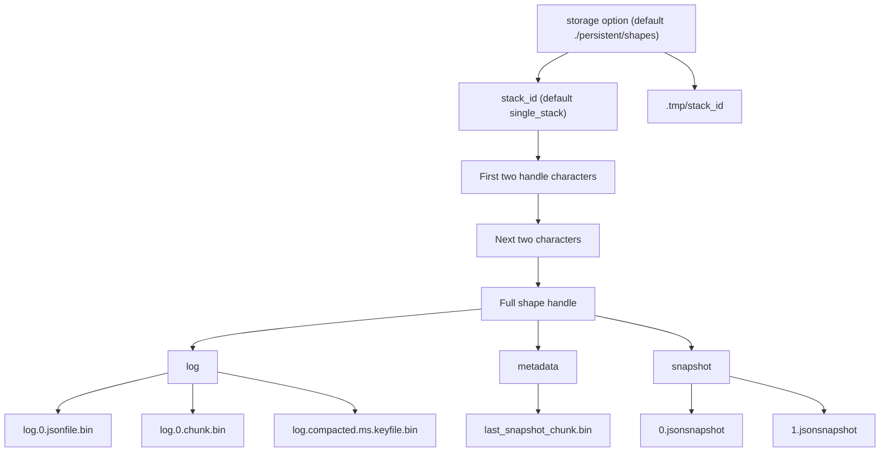
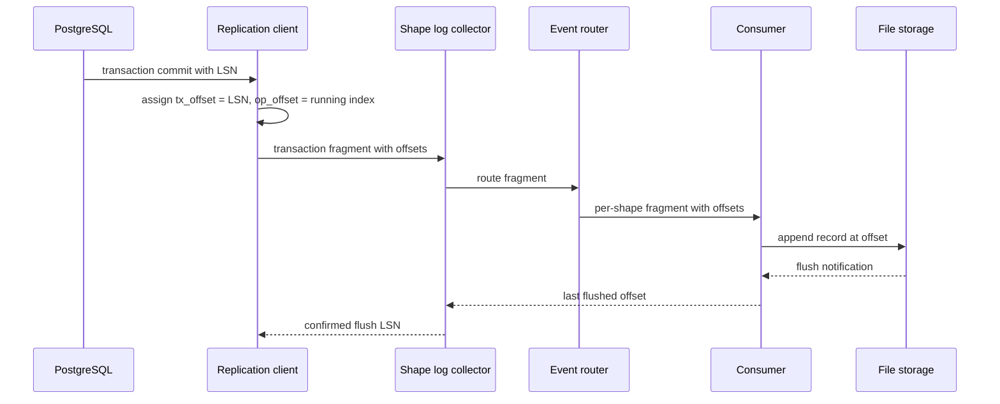

# Shape Log and Storage

The shape log is the durable record of a shape. A **shape** is one saved, declarative query over one PostgreSQL table, together with the data that the service materializes from it. The materialized data is a read-only, ordered stream of rows; the query has an optional `where` filter and a selected column list. The shape log has two parts: a snapshot and a change log. The snapshot is the query result at one PostgreSQL snapshot. The change log is the ordered list of changes after that snapshot. This document explains the on-disk formats, the storage backend, the Erlang Term Storage (ETS) tables that support live reads, and how the service produces log offsets.

## The storage contract

`Electric.ShapeCache.Storage` is a behaviour. A behaviour is an Elixir contract: one module declares the callbacks, and another module must implement them. A storage backend implements these main callbacks:

- `shared_opts/1` validates the stack-wide storage configuration.
- `for_shape/2` builds per-shape options.
- `stack_start_link/1` starts stack-wide processes.
- `init_writer!/2` creates the writer state for one shape. The arguments are the shape options and the shape definition; later appends update the returned state. The callback is at `packages/sync-service/lib/electric/shape_cache/storage.ex:57`.
- `fetch_latest_offset/1` returns the latest stored offset.
- `snapshot_started?/1` reports whether the snapshot is complete.
- `make_new_snapshot!/2` writes the initial snapshot.
- `write_move_in_snapshot!/3` writes the state that a subquery move-in copies. A move-in is a query that adds the rows of a new subquery member set to the outer shape without a full rescan. A **member set** is the set of rows that satisfy one subquery condition. The arguments are the rows, a snapshot name, and the shape options. The snapshot name is a new Universally Unique Identifier, version 4 (UUID4), generated for that move-in (`packages/sync-service/lib/electric/shapes/consumer/effects.ex:254`, `:272`).
- `append_move_in_snapshot_to_log!/3` appends that state to the change log. The arguments are the snapshot name, the writer state, and a function that skips rows already in the log. The writer state is the in-process storage accumulator that `init_writer!/2` returns and each append updates (`packages/sync-service/lib/electric/shape_cache/storage.ex:56-57`).
- `append_to_log!/2` appends a change.
- `get_log_stream/3` returns rows for an offset range. The arguments are the first offset, the last offset, and the shape options. The facade function `Storage.get_log_stream/2` supplies `LogOffset.last()` as the last offset, so it reads the rest of the log (`packages/sync-service/lib/electric/shape_cache/storage.ex:222`, `:401-406`).
- `get_chunk_end_log_offset/2` returns the last offset of a chunk.
- `supports_txn_fragment_streaming?/0` reports whether the backend can store part of a transaction. `PureFileStorage` returns true. `InMemoryStorage` returns false, so the consumer buffers the whole transaction before it writes. The two answers are at `packages/sync-service/lib/electric/shape_cache/pure_file_storage.ex:1228` and `packages/sync-service/lib/electric/shape_cache/in_memory_storage.ex:316`.
- `compact/2` merges old log data into one compacted file, when compaction is enabled for the shape.

The callback list is in `packages/sync-service/lib/electric/shape_cache/storage.ex`. "Snapshots and move-in" below explains the two move-in callbacks. Two storage backends can be selected. A third module name is rejected at startup:

| Backend | Selection | Use |
|---------|-----------|-----|
| `Electric.ShapeCache.PureFileStorage` | `ELECTRIC_STORAGE=fast_file` or default | Production file storage |
| `Electric.ShapeCache.InMemoryStorage` | `ELECTRIC_STORAGE=memory` | Tests and ephemeral use |
| `Electric.ShapeCache.FileStorage` | none | Removed. The runtime configuration rejects the names `file` and `legacy_file` with an error, so no run mode selects it |

The word "none" in the selection column means that no configuration value chooses this backend. The runtime configuration rejects the legacy file backend with a clear message. The check is in `packages/sync-service/lib/electric/application.ex:225-228`.

## Log offsets

An offset identifies one change in one shape log. The struct has two fields. The first field is the transaction part, a 64-bit integer, with `-1` used only for the `before_all()` sentinel. The second field is a non-negative integer or the sentinel `:infinity`.

```elixir
# Condensed excerpt from packages/sync-service/lib/electric/replication/log_offset.ex:229-255
def before_all(), do: %LogOffset{tx_offset: -1, op_offset: 0}

def first(), do: %LogOffset{tx_offset: 0, op_offset: 0}

def last(), do: %LogOffset{tx_offset: 0xFFFFFFFFFFFFFFFF, op_offset: :infinity}

def last_before_real_offsets(), do: %LogOffset{tx_offset: 0, op_offset: :infinity}
```

The string form is `<tx_offset>_<op_offset>`. The operation part prints as `inf` for `:infinity`, so `last()` prints as `18446744073709551615_inf`. The one exception is `before_all()`, which prints as `-1` with no operation part; the serializer clause is at `packages/sync-service/lib/electric/replication/log_offset.ex:320-322`. The parser accepts `-1`, `now`, and a numeric pair such as `11_13` or `18446744073709551615_inf` (the printed form of `last()`). The pair `0_0` is an ordinary numeric pair to the parser, so `first()` needs no special clause. The function is `from_string/1` at line 368.

The transaction offset comes from the PostgreSQL log sequence number (LSN) of the transaction commit. The operation offset is a counter inside the transaction. The first change has operation offset 0. Each later change adds 2, not 1. The code comment gives the reason: the extra step leaves room to split one operation into two stored records (`packages/sync-service/lib/electric/postgres/replication_client/message_converter.ex:271-279`). The split is in use: an update that changes the primary key writes a delete at offset N and an insert at offset N+1 (`packages/sync-service/lib/electric/log_items.ex:113-163`). When a change does not split, the writer uses only the even offset and leaves the odd offset unused. The unused value is not a hole in the data; it is a reserved slot. The counter advances for every change that the replication stream delivers in the transaction, including changes for other tables. A shape that filters out those other changes therefore sees operation offsets with gaps. The counter is at `packages/sync-service/lib/electric/postgres/replication_client/message_converter.ex:271-279`. A transaction with no matching changes still advances the collector's global position, but it adds no record to that shape log. The shape stays at its previous offset.

The service also uses virtual offsets for the snapshot. A virtual offset has a transaction part of 0. The operation part counts snapshot chunks:

- `0_0` is the boundary at the end of the first snapshot chunk. A read from `0_0` returns the second chunk.
- `0_1` is the boundary at the end of the second snapshot chunk.
- `0_inf` is the position just after the last snapshot chunk and before the first real change.

The two offset ranges cannot collide. A snapshot chunk boundary is written as `LogOffset.new(0, chunk_number)`, so every snapshot offset has a transaction part of 0 (`packages/sync-service/lib/electric/shape_cache/pure_file_storage.ex:892`). A real change uses the commit log sequence number (LSN) as its transaction part. A commit LSN is greater than 0, so `0_0` is the end of the first snapshot chunk and also the value of `first()`, but no real change has that offset.

The first snapshot chunk starts at `before_all`, which prints as `-1`. In memory the offset is the pair `(-1, 0)`. The helper `get_chunk_end_log_offset/2` maps a virtual offset to the end of the requested snapshot chunk. When the offset moves past the last snapshot chunk, the function switches to the change log. The code is at `packages/sync-service/lib/electric/shape_cache/pure_file_storage.ex:837-858`.

## Snapshot format

The snapshot is a set of files, one per chunk. Each file uses the JavaScript Object Notation (JSON) Lines format (JSONL) with one twist: every line ends with a comma and a newline, and the reader removes both. A standard JSON Lines parser will reject the trailing comma. The format is a private variant, not strict JSON Lines. The trailing comma is on every line, including the last. The file ends with the single byte `0x04`, the End Of Transmission (EOT) marker. The reader logic is at `packages/sync-service/lib/electric/shape_cache/pure_file_storage/snapshot.ex:135-150`.

The marker solves a concurrency problem. A reader can reach the end of a file while the writer is still writing. Without a marker, the reader cannot tell "no more data yet" from "snapshot complete". The `0x04` byte means complete.

Each line is one JSON object with three top-level fields: `key`, `value`, and `headers`. `key` is a string. The relation name is quoted as `"schema"."table"`. Each primary key value is quoted as text, and a `/` inside a value becomes `//`. The parts are joined with `/`, for example `"public"."test_table"/"1"` or, for a composite key, `"public"."test_table"/"1"/"2"`. A null primary key part becomes `_` without quotes. A literal `_` stays quoted as `"_"`, and an empty string stays `""`, so a null is distinguishable from a literal underscore (`packages/sync-service/lib/electric/shapes/querying.ex:251-260`; the matching encoder is at `packages/sync-service/lib/electric/replication/changes.ex:396-415`). `value` is an object with one field for each selected column. Each value is a JSON string or `null`, because the query casts every column to text before it encodes the JSON (`packages/sync-service/lib/electric/shapes/querying.ex:262-302`). `headers` always holds `operation`, which is `insert` for a snapshot row, and `relation`, a two-element array of the schema name and the table name. It can also hold `active_conditions` and `tags`. The move-in query adds `is_move_in` with the value true (`packages/sync-service/lib/electric/shapes/querying.ex:26`, `:224-243`). The builder that assembles the three fields is `json_like_select/5` at `packages/sync-service/lib/electric/shapes/querying.ex:195-214`.

The snapshot writer uses a 64 kibibytes (KiB) buffer:

```elixir
# packages/sync-service/lib/electric/shape_cache/pure_file_storage/snapshot.ex:9
@write_buffer_size 64 * 1024

# packages/sync-service/lib/electric/shape_cache/pure_file_storage/snapshot.ex:27
def write_snapshot_stream!(stream, %ST{} = opts, write_buffer \\ @write_buffer_size) do
  stream
  |> Stream.transform(
    fn -> {0, nil, {[], 0}} end,
    fn line, {chunk_num, file, {buffer, buffer_size}} ->
      file = file || open_snapshot_chunk_to_write(opts, chunk_num)
      ...
```

The 64 KiB size is the snapshot writer's line buffer, not the chunk size (`packages/sync-service/lib/electric/shape_cache/pure_file_storage/snapshot.ex:9`, `:43-48`). It controls how often the snapshot writer appends lines to the current snapshot file. The log writer has a separate buffer with the same 64 KiB threshold; [Log write buffering and the ETS layer](#log-write-buffering-and-the-ets-layer) gives its two flush triggers. The chunk boundary is a different limit. `Electric.Shapes.Querying` adds a `:chunk_boundary` marker when the next row would cross the 10 MiB threshold. The writer opens the next snapshot file at that marker. The chunk logic is at `packages/sync-service/lib/electric/shapes/querying.ex:145-156`. [The chunk size section](#chunking) below gives the threshold.

When the buffer reaches the limit, the writer flushes and returns the current chunk number. A reader can open a chunk file while the writer is still adding lines, so a read can follow the write. Before the writer creates the file, a reader waits up to 5 seconds for it to appear (`snapshot_file_timeout` at `packages/sync-service/lib/electric/shape_cache/pure_file_storage.ex:60`). If the shape directory still exists after that wait, the open fails with `File.Error`; if the directory is gone, the reader stops. That value is a storage option default; no environment variable sets it. After it opens the file, the function waits at the end of the data. If no new line and no End Of Transmission marker arrive in 90 seconds, the function raises `Snapshot hasn't updated in 90s`. The code is at `packages/sync-service/lib/electric/shape_cache/pure_file_storage/snapshot.ex:126-174` and `packages/sync-service/lib/electric/shape_cache/pure_file_storage.ex:1384-1407`.

The snapshot is produced by `Electric.Shapes.Consumer.Snapshotter`. The snapshotter runs the shape query inside a repeatable-read transaction. It records the PostgreSQL snapshot identifier, which is the `{xmin, xmax, xip_list}` tuple from `pg_current_snapshot()`. The tuple is saved with the shape. The consumer buffers changes until the snapshotter sends it the tuple. It then drops every buffered transaction that is visible in the snapshot and keeps the rest. The check is `Electric.Shapes.Consumer.InitialSnapshot.filter/3` at `packages/sync-service/lib/electric/shapes/consumer/initial_snapshot.ex:97-108`. The recorded identifier lets the change log start from a known position without a gap.

A shape in `changes_only` log mode has no snapshot rows. **Log mode** is the `log` request parameter: `full` includes the initial snapshot, and `changes_only` omits it ([02-http-api-and-shapes.md](02-http-api-and-shapes.md) lists the parameter). Its initial data stream is the empty list (`packages/sync-service/lib/electric/shapes/querying.ex:120-122`). The service still writes an empty snapshot chunk 0 that holds only the End Of Transmission marker. The snapshot ends at offset `0_0`, and the response carries the `snapshot-end` control message. The writer comment states why the empty file exists: the API layer reads snapshot data from it (`packages/sync-service/lib/electric/shape_cache/pure_file_storage/snapshot.ex:58-62`, `packages/sync-service/lib/electric/shapes/consumer/snapshotter.ex:262-270`).

## Change log format

The change log is a binary file. Each record has this layout:

```text
<<tx_offset::64, op_offset::64,
  key_size::32, key::binary(key_size),
  op_type::8, flag::8,
  json_size::64, json::binary(json_size)>>
```

The format is documented in `packages/sync-service/lib/electric/shape_cache/pure_file_storage.ex:11-18`. The fixed overhead is 30 bytes per record:

```elixir
# packages/sync-service/lib/electric/shape_cache/pure_file_storage/log_file.ex:16
@line_overhead 16 + 4 + 1 + 1 + 8
```

The `json` field holds a JSON object with `key`, `value`, and `headers`. A change in `replica=full` mode also has `old_value`. The `value` holds the row data that the replica mode selects. The headers are `operation` (`insert`, `update`, or `delete`), `txids` (the transaction identifiers), `relation`, `lsn` (the transaction part written as a decimal string), and `op_position`. Optional headers are `last`, `tags`, `removed_tags`, and `active_conditions`. A snapshot row that a move-in query produced also has `is_move_in`, set to true. The same header stays on the record when the service appends that row to the shape log. A log record that came from a move-in snapshot therefore also has it. A change from the write-ahead log (WAL) does not (`packages/sync-service/lib/electric/shapes/querying.ex:26`, `:189-243`; `packages/sync-service/lib/electric/shape_cache/pure_file_storage.ex:919-959`). `active_conditions` holds one boolean for each subquery membership position in the shape's planned `where` test (`packages/sync-service/lib/electric/shapes/shape.ex:883-897`); [04-replication-and-consumers.md](04-replication-and-consumers.md) gives its role in the drop rule. `last` is true on the last change that a committed transaction produces for the shape. The service can set it only on the final transaction fragment, because only that fragment carries the commit record. Earlier fragments are written without it and are not rewritten (`packages/sync-service/lib/electric/shapes/consumer.ex:863-872`, `packages/sync-service/lib/electric/shapes/consumer/transaction_converter.ex:47-67`). The header writer is `packages/sync-service/lib/electric/log_items.ex:32-166`.

The `op_type` byte is `?i` for insert, `?u` for update, or `?d` for delete. The `flag` byte is the processed flag (`packages/sync-service/lib/electric/shape_cache/pure_file_storage/log_file.ex:15`). A normal append writes 0. Compaction rewrites the record's JSON, keeps only the generic headers, and sets the flag to 1. A record that compaction keeps but does not merge also gets flag 1, because compaction applies the same JSON processing to it (`:412`, `:428-433`, `:470`). A move-in copies the state of a row that enters a subquery result; it lets a dependent shape start from current data without a new full query. A move-in append uses the normal append path, so its flag stays 0 (`packages/sync-service/lib/electric/shape_cache/pure_file_storage.ex:919-959`). The reader uses the flag to know that a record already has processed JSON. The op-type mapping is at `packages/sync-service/lib/electric/shape_cache/pure_file_storage/log_file.ex:335-337`, and the type is declared at `:19`. A record is appended with `append_to_log!/2`.

A live log chunk uses two files. The `<suffix>` in each name is the chunk number, starting at 0:

- `log.<suffix>.jsonfile.bin` holds the records.
- `log.<suffix>.chunk.bin` holds the chunk index.

The live writer opens only these two files (`packages/sync-service/lib/electric/shape_cache/pure_file_storage/write_loop.ex:244-267`). A compacted set uses three files under one suffix. The suffix is `compacted.<milliseconds>`, so a complete example set is `log.compacted.1730000000000.jsonfile.bin`, `log.compacted.1730000000000.chunk.bin`, and `log.compacted.1730000000000.keyfile.bin` (`packages/sync-service/lib/electric/shape_cache/pure_file_storage.ex:344-351`, `:1360-1372`). The key index has one entry per record in the compacted log. The entry holds the primary key, a one-byte label, the record offset, the operation type, the position of the record in the log file, and the JSON size. The label is 0 for a record written to the live main log. Label 1 marks a record written by the log-file rebuild that compaction uses (`packages/sync-service/lib/electric/shape_cache/pure_file_storage/log_file.ex:71`). A reader uses the label to select the correct key index and log file. The live main log and the compacted rebuild are different file sets, and one key index describes only one of them. The source reserves 0 for the main log and requires a non-zero label on the rebuild path (`packages/sync-service/lib/electric/shape_cache/pure_file_storage/key_index.ex:129-130`). Compaction builds the compacted key index from the live log, so a copied live record keeps label 0; the rebuild path that regenerates a record writes label 1. A move-in does not use another label; it appends its rows through the main log with label 0, as "Snapshots and move-in" below explains. Compaction reads the index to group the operations for one key and to decide which old operations it can drop. The entry layout is at `packages/sync-service/lib/electric/shape_cache/pure_file_storage/key_index.ex:6-25`; the compaction use is at `packages/sync-service/lib/electric/shape_cache/pure_file_storage/action_file.ex:35-49`; the index build is at `packages/sync-service/lib/electric/shape_cache/pure_file_storage.ex:309-320`.

The path helpers are at `packages/sync-service/lib/electric/shape_cache/pure_file_storage.ex:1360-1373`.

The chunk index record has this layout:

```text
<<min_tx_offset::64, min_op_offset::64, start_pos::64, key_start_pos::64,
  max_tx_offset::64, max_op_offset::64, end_pos::64, key_end_pos::64>>
```

The minimum and maximum offsets are inclusive. A chunk read that starts at the minimum offset includes that record. A chunk read that ends at the maximum offset includes that record. These bounds describe the records that the chunk holds. A request offset is different: it is an exclusive resume point. A request that carries offset X returns the records after X, so the record at X is not sent again. The reader applies that rule by skipping records at or below the request offset. `start_pos` and `end_pos` are positions in the JSON log file. `key_start_pos` and `key_end_pos` are positions in the key index file. The start and end positions allow a full chunk read into memory. A completed chunk uses the full 64-byte record. An open chunk uses the first 32 bytes only: the two minimum offsets and the two start positions. The maximum offsets and the end positions are absent because the writer has not closed the chunk. A reader of an open chunk starts at `start_pos` and reads to the current end of the log file. It treats only the data up to the persisted pointer as durable. The ETS layer supplies the rest. The two layout comments are at `packages/sync-service/lib/electric/shape_cache/pure_file_storage.ex:16-27`, and the open-chunk read is at `packages/sync-service/lib/electric/shape_cache/pure_file_storage/chunk_index.ex:82-89`, `:117-125`.

## Chunking

A chunk is a unit of storage and cache. The default size limit is 10 mebibytes (MiB). The value is:

```elixir
# packages/sync-service/lib/electric/shape_cache/log_chunker.ex:4
@default_threshold 10 * 1024 * 1024
```

The reason is caching. A response larger than the common cache object limit is not stored by upstream caches. A chunk below 10 MiB stays cacheable. The chunker function `fit_into_chunk/3` returns `{:threshold_exceeded, 0}` when the next record would cross the limit. The record is still added to the current chunk. The chunk then closes, and the returned 0 is the byte count for the new chunk, which starts with the following record (`packages/sync-service/lib/electric/shape_cache/pure_file_storage/chunk_index.ex:398-411`). The function is at `packages/sync-service/lib/electric/shape_cache/log_chunker.ex:14-28`.

The HTTP response boundary follows the same chunks. HTTP means Hypertext Transfer Protocol. A client that reads to the end of a chunk gets the chunk end offset in `electric-offset`. The next request starts at that offset.

## The storage directory layout

`PureFileStorage` scopes every path by stack identifier. The base path is the `storage_dir` storage option joined with the stack identifier (`packages/sync-service/lib/electric/shape_cache/pure_file_storage.ex:99-101`). The `storage_dir` option is not the `ELECTRIC_STORAGE_DIR` root itself. The default storage builder adds a `shapes` segment (`packages/sync-service/lib/electric/config.ex:10-12`), and the default environment root is `./persistent` (`packages/sync-service/lib/electric/config.ex:40`). When `ELECTRIC_DATABASE_ID` is unset, the default stack identifier is `single_stack` (`packages/sync-service/lib/electric/config.ex:44`). The default base path is therefore `./persistent/shapes/single_stack`. The temporary directory is `<storage option>/.tmp/<stack_id>`, not inside the stack directory (`packages/sync-service/lib/electric/shape_cache/pure_file_storage.ex:103-105`). With the defaults it is `./persistent/shapes/.tmp/single_stack`. The code comment gives the reason: the `.tmp` directory sits at the root of the storage option, not under the stack identifier, "so it's easy to remove" (`:103-104`). This makes cleanup of temporary files a single directory removal.

The shape directory is nested by the first four hexadecimal characters of the handle:

```elixir
# packages/sync-service/lib/electric/shape_cache/pure_file_storage.ex:155-160
def shape_data_dir(base_path, shape_handle, suffix \\ [])
    when is_binary(base_path) and is_binary(shape_handle) do
  # nest storage to limit number of files per directory
  <<p1::binary-2, p2::binary-2, _::binary>> = shape_handle
  Path.join([base_path, p1, p2, shape_handle | suffix])
end
```

For a handle that starts with `a1b2c3`, the path is `base/a1/b2/a1b2c3.../`. The two-level nesting keeps the number of files per directory low. A single flat directory with millions of shapes would slow down file system operations.

Inside each shape directory there are three subdirectories:

| Directory | Content |
|-----------|---------|
| `log` | Binary log files and their indexes |
| `metadata` | Snapshot state and storage metadata |
| `snapshot` | Snapshot chunk files |

The directory names are defined at `packages/sync-service/lib/electric/shape_cache/pure_file_storage.ex:135-137`.

The full layout is:



A snapshot chunk file is named `<chunk_number>.jsonsnapshot`; the number starts at 0. The path helper is at `packages/sync-service/lib/electric/shape_cache/pure_file_storage/snapshot.ex:76`.

A temporary directory at the storage root holds compaction work files (`packages/sync-service/lib/electric/shape_cache/pure_file_storage.ex:105`, `:299-323`). The service can remove the whole temporary tree after a crash without scanning every shape.

The `metadata` directory holds one file per metadata key. Each file is named `<key>.bin` and holds the Erlang term form of the value, written with `:erlang.term_to_binary/1`. The write path is at `packages/sync-service/lib/electric/shape_cache/pure_file_storage.ex:691-701`. The `last_snapshot_chunk.bin` file records the virtual offset of the last complete snapshot chunk. The value is a `LogOffset` term with a transaction part of 0 and an operation part equal to the chunk number. The value is written at `packages/sync-service/lib/electric/shape_cache/pure_file_storage.ex:892`. A reader uses it to decide whether the requested offset is still inside the snapshot or already in the change log. The read is at `packages/sync-service/lib/electric/shape_cache/pure_file_storage.ex:734-735`.

## Log write buffering and the ETS layer

This section is about the per-shape log buffer. It is not the shape-database write buffer that holds shape metadata, which [00-overview.md](00-overview.md) describes. The writer does not flush every record to disk. It buffers records for up to one second:

```elixir
# packages/sync-service/lib/electric/shape_cache/pure_file_storage.ex:113-117
flush_period: Keyword.get(opts, :flush_period) || :timer.seconds(1),
compaction_config: %{
  period: Keyword.get(opts, :compaction_period) || :timer.minutes(10),
  keep_complete_chunks: Keyword.get(opts, :keep_complete_chunks) || 2
}
```

The buffer must still be readable. A live HTTP request must see a change before the writer flushes it to disk. The storage solves this with two levels of ETS table. ETS means Erlang Term Storage, an in-memory key-value store. There is one table per stack that holds shape metadata and a pointer to each shape's buffer table. There is one table per shape that holds that shape's unflushed records.

The stack table name is `:"Electric.ShapeCache.PureFileStorage:<stack_id>"`. The writer inserts unflushed records into the per-shape table and records that table's identifier in the stack table. A reader merges the ETS rows with the on-disk rows. When the writer flushes, it removes the rows from ETS.

A read can cross the flush point while the writer works. The reader uses the recorded `last_persisted_offset` as the seam. It streams the on-disk rows up to that offset, then adds the ETS rows after it. The code comment states that the ETS range is small, at most about 64 KiB (`packages/sync-service/lib/electric/shape_cache/pure_file_storage.ex:1075`). The reason is the log writer's flush threshold. The writer inserts each buffered row into ETS and flushes when its byte buffer reaches 64 KiB. The unflushed range stays near that size. The mixed branch is at `packages/sync-service/lib/electric/shape_cache/pure_file_storage.ex:1069-1089`. A flush that clears ETS at the same moment can make the ETS range empty or partial. The reader then reads the same range from disk, because the writer writes the file before it clears ETS. The fallback is in the same function.

The `last_persisted_offset` value has no metadata file of its own. The writer keeps it in the ETS metadata row for the shape, together with `last_persisted_txn_offset` and `last_seen_txn_offset` (`packages/sync-service/lib/electric/shape_cache/pure_file_storage.ex:1313-1322`). Only `last_persisted_txn_offset` is written to disk, as `metadata/last_persisted_txn_offset.bin`, and only when the value changes (`:684-696`, `:1309-1311`). The value on disk uses the Erlang external term format and an atomic rename. A read uses the ETS metadata row when the storage table exists. When the row is absent, for example after the write path restarts or in read-only mode, the read loads the metadata from disk and caches it (`packages/sync-service/lib/electric/shape_cache/pure_file_storage.ex:638-681`). The service then rebuilds the read boundary from the stored transaction offset. On that disk-load path only `last_persisted_txn_offset` is present, because it is the only transaction offset that the writer stores on disk. The boundary function prefers `last_seen_txn_offset` when a writer has already set it in ETS, and otherwise uses `last_persisted_txn_offset`. If the chosen offset is virtual, it uses the last snapshot chunk (`packages/sync-service/lib/electric/shape_cache/pure_file_storage.ex:476-484`, `:1024-1038`).

The storage module documentation describes the two-layer design as follows: anything not yet flushed is addressable in ETS and is deleted when flushed. Reads work from both layers when a transaction is partially written.

The ETS table is created by the storage stack process. It is keyed by shape handle. For each shape it stores metadata that includes the identifier of that shape's own buffer table. The writer creates the per-shape table with `:ets.new(:in_memory_storage, [:ordered_set, :protected])` at `packages/sync-service/lib/electric/shape_cache/pure_file_storage.ex:489`. The lookup is at `:122-124`. The option `:ordered_set` keeps the keys in sort order, so a range read returns offsets in order. The option `:protected` lets the owner write and other processes read. The atom `:in_memory_storage` is a label, not a global table name: the call does not pass `:named_table`, so each call returns a separate table reference and two shapes cannot collide.

## Crash recovery and the buffer

The buffer has a durability rule. A record in the ETS buffer is readable but is not yet on disk. If the service stops, the record is lost. The loss is safe because the service only acknowledges data that it has flushed.

The flush tracker computes a safe flush position across the shapes that the pending transaction affects. It tracks only the shapes that a transaction affects and that have not yet caught up. A shape with no pending change does not hold the boundary, because it has no unflushed data that the change could expose. While any tracked shape lags, the base value is the minimum flushed offset among the tracked shapes. The replication client receives the transaction part of that offset minus 1 byte. LSN values count bytes, so this position is the last byte before the commit record. PostgreSQL then has not seen the commit and resends the whole transaction after a reconnect. The lag exists because the tracker cannot prove that a partial transaction is fully on disk, so it acknowledges only the transaction before the earliest incomplete one. When every tracked shape has caught up, the tracker removes them from its map. An empty map means that all shapes are current, and the client receives the exact last-seen transaction offset. The rule is in the module comment at `packages/sync-service/lib/electric/replication/shape_log_collector/flush_tracker.ex:82-84`; the tracking of affected shapes only is at `:57-70`. A record that is still in ETS is above that position. After a restart, PostgreSQL replays the write-ahead log (WAL) from the confirmed position. The consumer writes the record again. [04-replication-and-consumers.md](04-replication-and-consumers.md) gives the full flush rule.

The service checks the stored state at boot. The `Electric.ShapeCache.ShapeStatusOwner` process loads the shape metadata before the service acquires the replication lock. This lets the service serve existing shapes in read-only mode while another instance holds the lock:

```elixir
# packages/sync-service/lib/electric/shape_cache/shape_status_owner.ex:60
:ok = ShapeStatus.initialize(state.stack_id)

# Signal that shape metadata is loaded and shapes can be served read-only
Electric.StatusMonitor.mark_shape_metadata_ready(state.stack_id, self())
```

`ShapeStatus.initialize/1` validates the shape metadata against the stored shape folders. Two helpers do the work. `ShapeDb` is the module that reads and writes the SQLite shape database. `ShapeCleaner` is the module that removes a shape's consumer, status entry, publication entry, and on-disk data. The initialize function also rebuilds the routing state: an ETS table that records which shapes have an optimised `where` clause, plus total, indexed, and unindexed shape counts. "Indexed" means that the `where` clause can be turned into an index lookup; the check is `WhereCondition.indexed_where?/1` at `packages/sync-service/lib/electric/shapes/filter/where_condition.ex:39`. The routing table is rebuilt from the SQLite rows at `packages/sync-service/lib/electric/shape_cache/shape_status.ex:505-522`.

```elixir
# packages/sync-service/lib/electric/shape_cache/shape_status.ex:54-78
def initialize(stack_id) when is_stack_id(stack_id) do
  create_shape_meta_table(stack_id)

  {:ok, invalid_handles, valid_shape_count} = ShapeDb.validate_existing_shapes(stack_id)

  Logger.notice(
    "Found #{valid_shape_count} existing valid shapes and #{length(invalid_handles)} shapes in an invalid state"
  )

  if valid_shape_count == 0 do
    # delete any orphaned shape data
    stack_id
    |> Electric.ShapeCache.Storage.for_stack()
    |> Electric.ShapeCache.Storage.cleanup_all!()

    :ok
  else
    with :ok <-
           Electric.ShapeCache.ShapeCleaner.remove_shape_storage_async(
             stack_id,
             invalid_handles
           ),
         :ok <- rebuild_shape_routing_state(stack_id) do
      populate_shape_meta_table(stack_id, 0)
    end
  end
end
```

Three outcomes follow:

- No valid shape: the service removes all shape data and the temporary directory. This clears orphaned files from an interrupted run.
- Some invalid shapes: the service removes only their folders, asynchronously, and rebuilds the routing state for the rest.
- All shapes valid: the service loads the index and serves the shapes.

The temporary directory sits outside the stack directory, at `<storage option>/.tmp/<stack_id>`. With the defaults that is `./persistent/shapes/.tmp/single_stack`. A cleanup then removes one directory tree. The path rule is at `packages/sync-service/lib/electric/shape_cache/pure_file_storage.ex:103-105`.

The record format has no checksum field. The service detects an incomplete snapshot chunk through the End Of Transmission marker, but it does not detect a damaged log record. The format assumes that the file system returns the bytes that the writer stored.

## Snapshots and move-in

There are two ways to create shape data:

1. **Initial snapshot.** Run the shape query and write the result.
2. **Move-in snapshot.** Copy the state of an existing shape when the new shape is a subquery shape and a row enters the inner query result. The service does not use move-in for two unrelated queries.

A subquery shape is a shape whose `where` clause contains a subquery, such as `WHERE id IN (SELECT ...)`. The service builds one shape for each subquery and a shape for the outer query. The inner shape is the **source consumer**: its consumer process owns the inner result. The outer shape is the **dependent**: its result depends on the inner result. [01-architecture.md](01-architecture.md) calls the inner shape the dependency shape and the outer shape the subquery shape. [02-http-api-and-shapes.md](02-http-api-and-shapes.md) calls them the inner shape and the outer shape. [04-replication-and-consumers.md](04-replication-and-consumers.md) calls them the dependency shape and the dependent shape. The source comments use parent and dependency for the inner shape. The names describe the same two roles; [02-http-api-and-shapes.md](02-http-api-and-shapes.md) gives a table that maps the names used in each document to the two roles. The **materializer** is the process that keeps the dependent shape in step with the source shape without linking the two lifecycles. For each subquery membership test, the service builds a **tag structure**: a pattern of source column names (`packages/sync-service/lib/electric/shapes/subquery_tags.ex:14-54`). For each pattern, it computes a namespaced hash from the column values with Message Digest 5 (MD5): `md5(stack_id <> shape_handle <> namespaced_value)` (`packages/sync-service/lib/electric/shapes/subquery_tags.ex:56-68`). `namespaced_value` is `v:` followed by the value, or `NULL` for a null; the prefix separates a real value from another value that only looks equal (`subquery_tags.ex:7-12`). A single-column test expression hashes the value only; the column name is not in its input (`packages/sync-service/lib/electric/shapes/shape.ex:949-950`). A row expression with several columns, which the source calls `hash_together`, puts each column name into the input. For such an expression, the input concatenates each `column:namespaced_value` in the pattern's column order with no separator between columns (`shape.ex:952-958`). Several such hashes in one pattern are joined with `/` (`shape.ex:946-962`). A concrete two-column example shows the exact input. For values `1` and `2` in columns `a` and `b`, the component is `md5(stack_id <> shape_handle <> "a:v:1b:v:2")`. A one-column component is `md5(stack_id <> shape_handle <> "v:1")`, because `make_value_hash/3` adds the `v:` prefix itself (`packages/sync-service/lib/electric/shapes/subquery_tags.ex:56-68`). A null value uses the text `NULL` in place of `v:` plus a value. The snapshot query computes that hash inside the `SELECT` and writes it into the `tags` field of each snapshot row's `headers` object, not into the row `value` (`packages/sync-service/lib/electric/shapes/querying.ex:168-185`, `:304-335`). Change conversion computes the same hash with the same function and stores it in `move_tags` (`packages/sync-service/lib/electric/shapes/shape.ex:946-962`). `move_tags` is the field name in the in-memory change struct; the log writer serializes it as the `tags` header, so the two names describe one value (`packages/sync-service/lib/electric/log_items.ex:51`, `:76`, `:101`). A **move tag** is one such hash. The materializer reads the move tags to detect a row that enters or leaves the inner result.

The storage behaviour has callbacks for both paths:

- `make_new_snapshot!/2`
- `write_move_in_snapshot!/3`
- `append_move_in_snapshot_to_log!/3`

The move-in sequence has seven steps:

1. The materializer counts the rows for each tag value. When a count changes from 0 to 1, it emits a move-in event (`packages/sync-service/lib/electric/shapes/consumer/materializer.ex:738`). It first cancels a move-in and a move-out for the same value in one batch, so the two events cannot remove the data that the query returns (`materializer.ex:505-534`).
2. The dependent consumer is in steady state. `Steady.drain_queue/3` sees the event and calls `Buffering.start/6`, which adds a `StartMoveInQuery` effect (`packages/sync-service/lib/electric/shapes/consumer/event_handler/subqueries/steady.ex:69-84`, `packages/sync-service/lib/electric/shapes/consumer/event_handler/subqueries/buffering.ex:52-60`, `:172-180`).
3. The consumer runs the effect in a supervised task. `query_move_in_async/4` computes the move-in `where` clause and makes a Universally Unique Identifier, version 4 (UUID4) snapshot name. It runs `Querying.query_move_in/6` and writes the rows with `Storage.write_move_in_snapshot!/3`. It then sends `{:query_move_in_complete, snapshot_name, row_count, row_bytes, move_in_lsn}` (`packages/sync-service/lib/electric/shapes/consumer/effects.ex:202-206`, `:240-282`). This call is the only place that writes the temporary snapshot file. The clause comes from `Querying.move_in_where_clause/5` (`packages/sync-service/lib/electric/shapes/querying.ex:352`). It takes the outer `where` and replaces each subquery membership test with a value list. A row test uses `lhs IN (SELECT * FROM unnest(...))`; a single-column array test uses `lhs = ANY (array)` (`querying.ex:494-539`). The value list is the set of values that the move adds to the view.
4. The buffering handler records that message (`buffering.ex:101-117`; `packages/sync-service/lib/electric/shapes/consumer/subqueries/active_move.ex:116-131`).
5. The splice waits for three values, and each one arrives by a different route:
   - The PostgreSQL snapshot tuple arrives as `{:pg_snapshot_known, snapshot}` (`buffering.ex:95-99`).
   - The temporary snapshot name and the move-in LSN arrive in `{:query_move_in_complete, ...}` (`buffering.ex:101-117`).
   - The current global LSN arrives as `{:global_last_seen_lsn, lsn}` from the global LSN subscription (`buffering.ex:79-85`).

   The boundary is a count of buffered transactions, not an LSN. The handler sets it in one of two ways. When the snapshot arrives, it sets the count to the first buffered transaction that the snapshot does not contain (`active_move.ex:177-191`). When the global LSN reaches the move-in LSN, it sets the count to the whole buffer (`active_move.ex:193-215`).
6. `SplicePlan.build/2` splits the buffered transactions at the boundary and returns one ordered effect list (`packages/sync-service/lib/electric/shapes/consumer/subqueries/splice_plan.ex:20-40`). The list has four parts in this order. The parts are the conversions of the transactions before the boundary with the old **view**, `MoveBroadcast`, `AppendMoveInSnapshot`, and the conversions of the transactions after the boundary with the new view. The old view is the map from each subquery reference to the values that the dependency shape contained before the move; the new view includes the moved-in value (`packages/sync-service/lib/electric/shapes/consumer/subqueries/views.ex:11-25`, `buffering.ex:127-170`).
7. The consumer executes the effects in order. `AppendMoveInSnapshot` copies the temporary rows into the shape log. Each row keeps `is_move_in`, set to true. A `snapshot-end` control message follows the rows (`effects.ex:143-180`).

The move-in snapshot file is in the shape's `snapshot/` directory, under the UUID4 name (`packages/sync-service/lib/electric/shape_cache/pure_file_storage.ex:895-897`). The log writer copies the file into the shape log, deletes the file, and the dependent shape does not run the full outer query again (`:919-956`).

A move-in avoids a second full query. The subquery dependency system uses it. The `Electric.Shapes.Consumer.Materializer` process monitors the source consumer process rather than linking to it. A link connects two processes in both directions: when either process stops, the other receives an exit signal. A monitor is one-way: the watcher receives a message and does not stop. The materializer uses a monitor so that it survives long enough to send a message. If the source consumer stops for any reason other than a clean shutdown, the monitor message makes the materializer send `{:materializer_shape_invalidated, shape_handle}` to each dependent outer shape. The dependent shape then refetches. The monitor is set at `packages/sync-service/lib/electric/shapes/consumer/materializer.ex:161-163`; the message is sent at `:310-314`. The module comment calls the lifecycle "linked", but the code uses a monitor.

Subquery shapes work while the stack runs. They do not survive a collector restart. On the restore path, the shape log collector prunes every subquery shape before it rebuilds the routing state, because consistent restore is not yet implemented. A client that still holds such a handle receives the usual must-refetch error and requests the shape again. The prune call is at `packages/sync-service/lib/electric/replication/shape_log_collector.ex:295-305`.

## Compaction

The change-log part of a shape log grows without bound. When compaction is enabled for the shape, the service compacts old chunks. The **live file** is the current binary log file that receives new records. The compactor keeps the last two complete chunks by default and rewrites the older chunks into one compacted file set. A set has three files with one suffix: the log file, the chunk index, and the key index. Each run creates a new set from two parts: the compacted form of the older chunks and a copy of the retained tail of the live file. It then deletes the previous compacted set and the old live file (`packages/sync-service/lib/electric/shape_cache/pure_file_storage.ex:370-411`). During the rewrite, it merges successive update operations for the same row into one update and skips the intermediate updates. The input is grouped first by primary key and then by operation type. A group with one operation is kept unchanged. A group with more than one operation becomes one record. The target record is the last operation in the group, and it keeps that operation's offset and key (`packages/sync-service/lib/electric/shape_cache/pure_file_storage/log_file.ex:435-437`). The service reads the JSON of every operation in the group in offset order and merges them from oldest to newest (`:446-463`). A later update wins when two updates set the same column (`packages/sync-service/lib/electric/log_items.ex:193-202`). The merged record keeps only the `operation` and `relation` headers; the per-change headers such as `last`, `lsn`, and `txids` are dropped (`log_items.ex:189-192`, `:197-201`). A client that reads a compacted record therefore gets no `last`, `lsn`, or `txids` for that record. The record keeps its original offset and key, and the offset is the ordering key; a client must not use the missing headers to order or deduplicate it. At most one record of each operation type remains for each key, so the set grows with the number of distinct keys, not with the number of updates. The grouping is at `packages/sync-service/lib/electric/shape_cache/pure_file_storage/action_file.ex:33-66`.

For example, suppose one key receives three updates. The update at offset `10_0` sets column `a`. The update at `10_2` sets column `b`. The update at `12_0` sets column `a` again. The compacted file holds one update at offset `12_0`. Its value has the primary key, `a` from `12_0`, and `b` from `10_2`. The records at `10_0` and `10_2` are gone. Compaction is opt-in. The storage schedules it only when `shape.storage.compaction == :enabled` (`packages/sync-service/lib/electric/shape_cache/pure_file_storage.ex:502-505`). The HTTP layer sets that value when the request has `experimental_compaction=true` (`packages/sync-service/lib/electric/shapes/api/params.ex:159`, `:337`). The configuration is:

```elixir
# packages/sync-service/lib/electric/shape_cache/pure_file_storage.ex:114-117
compaction_config: %{
  period: Keyword.get(opts, :compaction_period) || :timer.minutes(10),
  keep_complete_chunks: Keyword.get(opts, :keep_complete_chunks) || 2
}
```

The compaction period has jitter. The code schedules the next run at the period plus or minus half the period. This prevents all shapes from compacting at the same moment.

Compaction writes a boundary record. The record is the `compaction_boundary.bin` file in the `metadata` directory. Its value is the pair `{boundary_offset, compacted_suffix}`. `boundary_offset` is the end offset of the last merged chunk. `compacted_suffix` names the current compacted set: its three files share that suffix, and the suffix starts with `compacted.`. The write is at `packages/sync-service/lib/electric/shape_cache/pure_file_storage.ex:435-442`, and the read is at `:432-433`. The compactor builds the set at `:297-367`.

A reader that asks for an offset below the boundary reads the compacted set. The suffix selection is at `packages/sync-service/lib/electric/shape_cache/pure_file_storage.ex:1208-1212`. The chunk lookup finds the first retained chunk whose last offset is after the request at `:861-876`. The stream starts from that chunk at `:1175-1206`, and it skips every row at or below the requested offset at `packages/sync-service/lib/electric/shape_cache/pure_file_storage/log_file.ex:287-330`. The intermediate changes that compaction dropped are not in the response. The source has no must-refetch response for this case. The compaction boundary condition does not appear in the HTTP error paths. A slow client can therefore miss rows without an error.

This is a client-visible data-loss risk for a shape that uses compaction. The source does not state whether the team intends it as a hard retention limit. The intended recovery is an open question; the verified behavior is the read from the first retained chunk. [07-testing-and-limitations.md](07-testing-and-limitations.md) records the same risk as a limitation.

## The in-memory backend

`Electric.ShapeCache.InMemoryStorage` uses three ETS tables per shape: a snapshot table, a log table, and a chunk checkpoint table (`packages/sync-service/lib/electric/shape_cache/in_memory_storage.ex:81-92`). Each table is an ordered set keyed by an integer-encoded offset:

```elixir
# packages/sync-service/lib/electric/shape_cache/in_memory_storage.ex:92
:ets.new(name, [:public, :named_table, :ordered_set])
```

The snapshot writer stores each chunk row in the snapshot table under a key built from the chunk's virtual offset and the row position in the chunk. It writes a `:snapshot_checkpoint` marker at each chunk boundary and a `nil` end marker at the chunk end. The end marker lets a reader wait for the rest of the chunk (`packages/sync-service/lib/electric/shape_cache/in_memory_storage.ex:230-268`). The log writer stores changes in the log table under their real offsets and records each chunk boundary in the checkpoint table (`:289-305`). A read below the last snapshot chunk returns snapshot rows; a read at or above the snapshot boundary reads the log table only (`:178-189`). The table supports the same read semantics as the file backend, but there is no disk persistence. A restart loses all shapes. The backend is useful for tests and for short-lived processes. It also cannot store part of a transaction: `supports_txn_fragment_streaming?/0` returns false, so the consumer buffers the whole transaction before it writes (`:316`).

## ETS tables in the stack

The stack uses ETS for fast shared state. The main tables and process registries are:

| Table | Owner | Purpose |
|-------|-------|---------|
| `Electric.ProcessRegistry:<stack_id>` | Process registry | Named process lookup |
| `Electric.Registry.ShapeChanges:<stack_id>` | Registry | Shape change subscriptions |
| `Electric.StackConfig:<stack_id>` | Stack config | Fixed runtime settings |
| `Electric.StatusMonitor:<stack_id>` | Status monitor | Readiness conditions |
| `Electric.LsnTracker:<stack_id>` | LSN tracker | Last processed LSN and last broadcast LSN |
| `Electric.Shapes.ConsumerRegistry:<stack_id>` | Consumer registry | Shape to consumer map |
| `Electric.Shapes.DynamicConsumerSupervisor:<stack_id>` | Consumer supervisor | Partition count |
| `Electric.ShapeCache.PureFileStorage:<stack_id>` | Storage | Unflushed rows and per-shape buffer table identifiers |
| `shape_indexability_table:<stack_id>` | Shape status | Shape to partial-index capability |
| `shape_counts_table:<stack_id>` | Shape status | Total, indexed, and unindexed shape counts |
| `Electric.Postgres.Inspector.EtsInspector` table | ETS inspector | Relation and column cache |

A partial index is a PostgreSQL index with its own `WHERE` clause. The `shape_indexability_table` records whether the shape's `where` clause can become such an index. The earlier section on crash recovery defines the indexability check and its source lines. A `true` value means that the filter can use an index; a `false` value means that the service must test each row.

`Electric.LsnTracker` is an ETS table with two keys. The `:last_processed_lsn` key holds the last log sequence number (LSN) that the service processed. The `:last_broadcast_lsn` key holds the last LSN that the service sent to consumers, and a new consumer reads it without waiting for the next broadcast (`packages/sync-service/lib/electric/lsn_tracker.ex:22-70`). Two processes write these keys. The replication client sets `:last_processed_lsn` one time at slot setup. It writes the value for a new slot. For an existing slot, it uses `ets.insert_new` to fill the value only when it is absent (`packages/sync-service/lib/electric/postgres/replication_client.ex:260-272`). The shape log collector then updates `:last_processed_lsn` after each committed transaction and also broadcasts that LSN (`packages/sync-service/lib/electric/replication/shape_log_collector.ex:921-927`). The broadcast writes `:last_broadcast_lsn`. The replication client also broadcasts the server WAL end on a keepalive when no transaction is open. That broadcast writes `:last_broadcast_lsn` only; it does not change `:last_processed_lsn` (`packages/sync-service/lib/electric/postgres/replication_client.ex:470-477`). The table is created when the shape status owner starts; the call is `LsnTracker.initialize/1` (`packages/sync-service/lib/electric/shape_cache/shape_status_owner.ex:51`).

The source for each name is an `:ets.new` call or a registry name option in the owning module. A registry row such as `Electric.ProcessRegistry:<stack_id>` is a process registry backed by ETS, not a plain table with rows that the service writes. A few examples:

- `packages/sync-service/lib/electric/status_monitor.ex:37`
- `packages/sync-service/lib/electric/shapes/consumer_registry.ex:301`
- `packages/sync-service/lib/electric/shape_cache/pure_file_storage.ex:178`
- `packages/sync-service/lib/electric/postgres/inspector/ets_inspector.ex:111`

Most tables use `read_concurrency: true`. Many are `public`, because several processes read them. The filter tables are `private` and unnamed, because the event router owns them inside one process. The filter tables are `:filter_counters`, `:filter_shapes`, `:filter_tables`, `:filter_where`, `:filter_eq`, and `:filter_incl`. The code is at `packages/sync-service/lib/electric/shapes/filter.ex:56-64`.

## How offsets are produced

The following diagram shows the route from a PostgreSQL commit to a stored offset.



The replication client assigns the transaction offset from the commit LSN. Its message converter also assigns the operation offset, because it numbers the changes before the collector routes them. Inside the transaction, the operation offset increases by 2 for each change. The event router keeps only the changes that match the shape. A shape can therefore see operation offsets with gaps. The gaps are correct. They show that other changes in the same transaction did not match. The converter is at `packages/sync-service/lib/electric/postgres/replication_client/message_converter.ex:267-279`.

The consumer appends each change with its offset. The writer buffers the record. When the writer flushes, the consumer calls `ShapeLogCollector.notify_flushed/3`. The collector's flush tracker holds one entry per affected shape that has not yet caught up, not one entry per shape in the stack. It computes the minimum safe position across those entries. A shape with no pending data holds no entry and does not delay the boundary. The tracker's notify function sends `{:flush_boundary_updated, lsn}` to the replication client at `packages/sync-service/lib/electric/replication/shape_log_collector.ex:275-283`. The replication client reports that position to PostgreSQL. The client handler is at `packages/sync-service/lib/electric/postgres/replication_client.ex:290-293`.

## Key insight

The log is not a copy of the table. It is a copy of the effect of transactions on the query result. This is why the offset has two parts. The transaction part is the commit log sequence number (LSN). The operation part identifies the position inside that source transaction. A shape keeps only its matching changes, so the operation part can have gaps. A client can still resume at an exact point without replaying or skipping a change, as long as the requested offset is at or after the compaction boundary. Below the boundary, the compacted file can omit intermediate changes, as the compaction section explains. The exact-resume property is therefore a property of the uncompacted tail, not of the whole log.

## Related documents

- [00-overview.md](00-overview.md) defines the special offsets.
- [01-architecture.md](01-architecture.md) explains where the storage process lives.
- [02-http-api-and-shapes.md](02-http-api-and-shapes.md) explains how offsets appear in responses.
- [04-replication-and-consumers.md](04-replication-and-consumers.md) explains the collector and the flush tracker.
