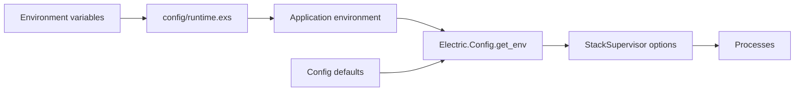
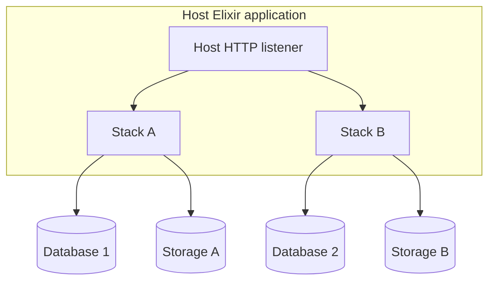

# Configuration and Deployment

The service reads configuration from three layers:

1. Environment variables in `config/runtime.exs`.
2. Application environment values set from those variables.
3. Defaults in `Electric.Config.Defaults` and the `@defaults` keyword list in `Electric.Config` (`packages/sync-service/lib/electric/config.ex:42-160`).

This document lists the environment variables, their effective defaults, the Docker build, the run modes, and the deployment constraints. Every variable below appears in `config/runtime.exs` unless the text says otherwise.

## Configuration flow



`Electric.Config.get_env/1` has a special rule. If the application environment value is `nil`, the function uses the default. This lets `runtime.exs` write `nil` for an unset variable without hard-coding the default twice. The fallback is at `packages/sync-service/lib/electric/config.ex:229-239`.

## Database variables

| Variable | Default | Meaning |
|----------|---------|---------|
| `DATABASE_URL` | none, required | PostgreSQL connection for replication and queries |
| `ELECTRIC_DATABASE_ID` | `single_stack` | Stack identifier; also the final segment of the storage path |
| `ELECTRIC_QUERY_DATABASE_URL` | `DATABASE_URL` | Deprecated separate pooled query connection. A code comment marks it for removal in a later minor version |
| `ELECTRIC_POOLED_DATABASE_URL` | `ELECTRIC_QUERY_DATABASE_URL`, else `DATABASE_URL` | Pooled connection for non-replication queries |
| `ELECTRIC_DATABASE_USE_IPV6` | `false` | Use Internet Protocol version 6 (IPv6) for database connections |
| `ELECTRIC_DATABASE_CA_CERTIFICATE_FILE` | none | Certificate authority file for Transport Layer Security (TLS) |
| `ELECTRIC_DB_POOL_SIZE` | `20` | Size of the query connection pool |
| `ELECTRIC_DATABASE_TCP_KEEPALIVE_IDLE` | none | Transmission Control Protocol (TCP) keepalive idle time; time value |
| `ELECTRIC_DATABASE_TCP_KEEPALIVE_INTERVAL` | none | TCP keepalive probe interval; time value |
| `ELECTRIC_DATABASE_TCP_KEEPALIVE_COUNT` | none | TCP keepalive probe count; integer |
| `ELECTRIC_DATABASE_TCP_USER_TIMEOUT` | none | TCP user timeout; time value |

The Uniform Resource Locator (URL) parser accepts `postgres` and `postgresql` schemes. It accepts `sslmode` values `disable`, `allow`, `prefer`, and `require`. It rejects `verify-ca` and `verify-full` with a message that tells the user to set the certificate file instead. It rejects a `replication` query parameter, because the service opens both a replication connection and normal connections as needed.

The replacement for `verify-ca` and `verify-full` is `sslmode=require` together with `ELECTRIC_DATABASE_CA_CERTIFICATE_FILE`. The source comment states that a certificate file forces full verification, equivalent to PostgreSQL's `verify-full`. Without a certificate file, the same mode encrypts the connection but does not verify the server identity (`packages/sync-service/lib/electric/connection/manager/connection_resolver.ex:134-160`).

The database identifier is set with `ELECTRIC_DATABASE_ID`. The default is `single_stack` at `packages/sync-service/lib/electric/config.ex:44`. The value becomes the stack identifier, which is also the final segment of the default shape storage path, `./persistent/shapes/<stack_id>`. If you change it, the service looks in a different storage directory and sees no existing shapes. Change it only when you deliberately start a new storage set.

A time value is a number with an optional unit: `ms` or `msec` for milliseconds, `s` or `sec` for seconds, and `m` or `min` for minutes. A bare number is milliseconds. The parser is `Electric.Config.parse_human_readable_time!/1` at `packages/sync-service/lib/electric/config.ex:496-521`. The runtime mapping is at `packages/sync-service/config/runtime.exs:259-278`.

The TCP keepalive options are applied only on Linux. On other operating systems the service logs a warning and drops them. The reason is that the Erlang socket driver rejects these options where the operating system does not define the constants.

## HTTP variables

This section uses three short forms: HTTP (Hypertext Transfer Protocol), API (application programming interface), and JSON (JavaScript Object Notation). It also uses Thousand Island, the Elixir library that accepts sockets and manages one process per connection; the Bandit HTTP server uses it.

| Variable | Default | Meaning |
|----------|---------|---------|
| `ELECTRIC_PORT` | `3000` | HTTP listen port |
| `ELECTRIC_LISTEN_ON_IPV6` | `false` | Listen on Internet Protocol version 6 (IPv6) |
| `ELECTRIC_SECRET` | none | API secret |
| `ELECTRIC_INSECURE` | `false` | Disable the secret requirement |
| `ELECTRIC_LONG_POLL_TIMEOUT` | `20000` | Long-poll wait in milliseconds |
| `ELECTRIC_CACHE_MAX_AGE` | `60` | Default `max-age` in seconds |
| `ELECTRIC_CACHE_STALE_AGE` | `300` | Default stale-while-revalidate in seconds |
| `ELECTRIC_MAX_CONCURRENT_REQUESTS` | `{"initial":300,"existing":10000}` | Admission limits as JSON |
| `ELECTRIC_TCP_SEND_TIMEOUT` | `30s` | Socket send timeout |
| `ELECTRIC_TCP_READ_TIMEOUT` | Thousand Island default, 60s | Socket read and keepalive timeout |
| `ELECTRIC_TWEAKS_HTTP_API_NUM_ACCEPTORS` | `100` | Acceptor process count |
| `ELECTRIC_TWEAKS_CONN_MAX_REQUESTS` | `50` | Maximum requests per HTTP/1 connection |
| `ELECTRIC_TWEAKS_HANDLER_FULLSWEEP_AFTER` | none | Number of minor garbage collections before a full sweep in an HTTP handler process |
| `ELECTRIC_TWEAKS_HTTP2_MAX_RESET_STREAM_RATE` | `disabled` | HTTP/2 reset-stream limit |

`ELECTRIC_TWEAKS_HANDLER_FULLSWEEP_AFTER` sets the Erlang `fullsweep_after` spawn option. The source comment says that the setting forces a full sweep after N minor collections to reclaim memory. The source gives no recommended value or cost estimate (`packages/sync-service/lib/electric/config.ex:119-125`).

The security validation is strict. The service raises an error if both `ELECTRIC_SECRET` and `ELECTRIC_INSECURE=true` are set. It also raises when no shared secret is set and `ELECTRIC_INSECURE` is not true, outside the test environment. The function itself has no test check. The caller wraps it in `if config_env() != :test` at `packages/sync-service/config/runtime.exs:201-203`, so only that caller supplies the exemption:

```elixir
# Condensed excerpt from packages/sync-service/lib/electric/config.ex:706-723
def validate_security_config!(secret, insecure) do
  cond do
    insecure && secret != nil ->
      raise "You cannot set both ELECTRIC_SECRET and ELECTRIC_INSECURE=true"

    !insecure && secret == nil ->
      raise "You must set ELECTRIC_SECRET unless ELECTRIC_INSECURE=true. ..."

    true ->
      if insecure do
        Logger.warning("Electric is running in insecure mode ...")
      end
      :ok
  end
end
```

The read timeout needs care behind a proxy. If a load balancer or reverse proxy has an idle timeout, `ELECTRIC_TCP_READ_TIMEOUT` must be larger than that timeout. Otherwise the proxy can reuse a connection that the service closes without notice. The result is a 502 error at the proxy. The source comment explains this race.

`ELECTRIC_MAX_CONCURRENT_REQUESTS` is a JSON object with two integer fields. The `initial` limit applies to requests without a known shape handle. The `existing` limit applies to requests with a known handle. A limit of `0` in either field rejects every request in that class with a 503 `concurrent_request_limit_exceeded` response. There is no unlimited value; use a large positive integer (`packages/sync-service/lib/electric/admission_control.ex:85-103`, `packages/sync-service/lib/electric/plug/serve_shape_plug.ex:312-327`).

## Storage variables

| Variable | Default | Meaning |
|----------|---------|---------|
| `ELECTRIC_STORAGE_DIR` | `./persistent` | Root for all persistent data |
| `ELECTRIC_STORAGE` | `fast_file` | `fast_file` or `memory` |
| `ELECTRIC_PERSISTENT_STATE` | `file` | `file` or `memory` |
| `ELECTRIC_SHAPE_CHUNK_BYTES_THRESHOLD` | `10485760` | Chunk size limit in bytes |
| `ELECTRIC_CLEANUP_INTERVAL_MS` | `10000` | Deleted shape cleanup interval |
| `ELECTRIC_SUBQUERY_BUFFER_MAX_TRANSACTIONS` | `1000` | Subquery buffer limit |

The storage root holds three areas. The default file storage writes under `shapes/<stack_id>/`; with the default stack identifier it uses `./persistent/shapes/single_stack/` (`packages/sync-service/lib/electric/config.ex:10-12`, `packages/sync-service/lib/electric/shape_cache/pure_file_storage.ex:99-101`). The filesystem key-value store writes under `state/` (`packages/sync-service/lib/electric/config.ex:16-18`). That store is `Electric.PersistentKV.Filesystem`: it writes one file per key, stores the value as an Erlang term, and replaces the file with an atomic rename (`packages/sync-service/lib/electric/persistent_kv/filesystem.ex:1-60`). The shape metadata database is the file `meta/shape-db/<database-name>.sqlite` under the same root, where `<database-name>` is the versioned name that the next paragraph gives (`packages/sync-service/lib/electric/shape_cache/shape_status/shape_db/connection.ex:578-580`). `ELECTRIC_SHAPE_DB_STORAGE_DIR` replaces the root for the database only; when it is unset, the service uses `ELECTRIC_STORAGE_DIR`.

The complete database name is `v<status-version>_<schema-version>@otp-<otp-major>.sqlite`. The **status version** counts changes to the comparable shape encoding; the source requires an update to it whenever `Shape.comparable/1` changes (`packages/sync-service/lib/electric/shape_cache/shape_status.ex:34-35`). The **schema version** counts changes to the SQLite table layout (`packages/sync-service/lib/electric/shape_cache/shape_status/shape_db/connection.ex:15`). The status version is 10 and the schema version is 4 at this source commit. The name changes when either version changes, so the service never opens a file from an incompatible version. The Erlang Open Telecom Platform (OTP) major version is in the name because the binary term format has limited compatibility between major releases (`connection.ex:545-562`). The schema has three tables. `shapes` holds the handle, the shape term, the comparable term, the hash, and the snapshot-complete flag. `relations` maps a handle to a relation identifier. `shape_count` holds one row with the count (`connection.ex:17-64`). The migration function accepts an empty database (version 0) or the current version. The case has no clause for any other value, so any other value raises a `CaseClauseError` (`connection.ex:81-97`). The source comment states that this cannot happen in normal operation, because the version is part of the file name. The current version is stored in `PRAGMA user_version`.

`ELECTRIC_STORAGE=file` and `ELECTRIC_STORAGE=legacy_file` are rejected. The message tells the user to use `fast_file`. The legacy backend is removed from the code.

The persistent state backend can be memory. If it is memory, the installation identifier is not persisted across restarts. The service uses `ELECTRIC_INSTANCE_ID` when the environment sets it, and otherwise generates a new identifier at each boot (`packages/sync-service/lib/electric/config.ex:175-188`). With the file backend, the same value is written under the key `electric_installation_id` at `packages/sync-service/lib/electric/config.ex:162`. That key and `ELECTRIC_INSTANCE_ID` describe the same identifier.

## Replication variables

| Variable | Default | Meaning |
|----------|---------|---------|
| `ELECTRIC_REPLICATION_STREAM_ID` | `default` | Suffix for publication and slot names |
| `ELECTRIC_REPLICATION_IDLE_TIMEOUT` | `0` | Scale-to-zero idle timeout |
| `CLEANUP_REPLICATION_SLOTS_ON_SHUTDOWN` | `false` | Make the slot temporary |
| `ELECTRIC_TEMPORARY_REPLICATION_SLOT_USE_RANDOM_NAME` | `false` | Random temporary slot name |
| `ELECTRIC_EXPERIMENTAL_MAX_TXN_SIZE` | `250 MiB` | Maximum transaction size |
| `ELECTRIC_EXPERIMENTAL_MAX_BATCH_SIZE` | `100` | Changes per fragment |
| `ELECTRIC_MANUAL_TABLE_PUBLISHING` | `false` | Do not alter the publication automatically |
| `ELECTRIC_PUBLICATION_ALTER_DEBOUNCE_TIME` | `0` | Publication change debounce, in milliseconds |
| `ELECTRIC_TWEAKS_PUBLICATION_REFRESH_PERIOD` | `60000` | Publication refresh period, in milliseconds |
| `ELECTRIC_TWEAKS_SCHEMA_RECONCILER_PERIOD` | `60000` | Schema reconciliation period, in milliseconds |

The idle timeout has two states. The value `0` disables the feature. A value above `0` has a minimum of 30 seconds, and a shorter value raises an error at boot. The check is at `packages/sync-service/lib/electric/application.ex:120-126`. The minimum prevents rapid connection churn with managed databases that scale to zero.

When the timeout passes with no new transaction, the replication client disconnects with reason `{:connection_idle, elapsed}`. A timer checks the idle time every 30 seconds (`packages/sync-service/lib/electric/postgres/replication_client.ex:147`, `:319-326`). The connection manager handles the exit by calling `Electric.Connection.Restarter.stop_connection_subsystem/1` (`packages/sync-service/lib/electric/connection/manager.ex:693-709`). The restarter marks the connection state as `:sleeping` and stops the connection manager subtree, so every database connection closes. The shape subsystem keeps running and keeps its stored data (`packages/sync-service/lib/electric/connection/restarter.ex:29-35`, `:81-90`). A later shape request finds the stack in `:sleeping`; the wait function returns the atom `:conn_sleeping`, calls `Restarter.restore_connection_subsystem/1`, and waits for the status to return to `:active` (`packages/sync-service/lib/electric/shapes/api.ex:412-428`). Concurrent requests serialize on the restarter, so they start the connection subsystem once. The health endpoint reports `active` for this state, because a request can wake the stack; [02-http-api-and-shapes.md](02-http-api-and-shapes.md) gives the health table.

The random temporary slot option is dangerous with persistent storage. The service logs a warning that the slot is deleted on shutdown. A stored shape that depends on that slot cannot resume after a restart.

The variable `ELECTRIC_MANUAL_TABLE_PUBLISHING` makes the operator own the publication. When it is true, Electric does not add or remove tables (`packages/sync-service/lib/electric/replication/publication_manager/configurator.ex:330-336`) and does not drop the publication (`packages/sync-service/lib/electric/connection/manager.ex:1338-1340`). A table that the publication lacks then produces an error that names this setting (`packages/sync-service/lib/electric/replication/publication_manager/configurator.ex:354-361`). The operator must add every table that a shape reads.

The `ELECTRIC_EXPERIMENTAL_*` variables are not part of the stable public configuration. The `EXPERIMENTAL` part of each name is the source's own marker that the setting may change or disappear. Do not base a production deployment on them.

A transaction above `ELECTRIC_EXPERIMENTAL_MAX_TXN_SIZE` stops replication with an irrecoverable slot error. A restart replays the same transaction and fails again. To recover, raise the limit or break the transaction into smaller commits. The environment variable accepts only an integer number of bytes; the default `250 MiB` is 262,144,000 bytes. It cannot remove the limit. A library configuration can set `max_txn_size: nil`, because the check is skipped when the value is nil (`packages/sync-service/lib/electric/postgres/replication_client/message_converter.ex:96-102`).

## Memory and performance variables

| Variable | Default | Meaning |
|----------|---------|---------|
| `ELECTRIC_SHAPE_HIBERNATE_AFTER` | `30s` | Idle time before a consumer hibernates |
| `ELECTRIC_SHAPE_SUSPEND_CONSUMER` | `false` | Suspend consumers after hibernation |
| `ELECTRIC_SHAPE_SUSPEND_AFTER` | `10m` | Wait before suspension |
| `ELECTRIC_FLUSH_STALL_GRACE_PERIOD` | `1m` | Flush stall grace period |
| `ELECTRIC_CONSUMER_GC_HEAP_THRESHOLD` | none | Heap size, in bytes, above which the consumer forces a full garbage collection |
| `ELECTRIC_PROCESS_SPAWN_OPTS` | `{}` | Per-process spawn options as JSON |
| `ELECTRIC_TWEAKS_PROCESS_REGISTRY_PARTITIONS` | number of schedulers | Registry partitions |
| `ELECTRIC_CONSUMER_PARTITIONS` | computed | Consumer supervisor partitions |
| `ELECTRIC_MAX_SHAPES` | none | Maximum active shapes |
| `ELECTRIC_EXPERIMENTAL_MAX_SHAPES` | none | Old name for the same setting. `ELECTRIC_MAX_SHAPES` wins |

`ELECTRIC_PROCESS_SPAWN_OPTS` accepts a JSON object. The keys are process names. The values are objects with allowed keys: `min_bin_vheap_size`, `min_heap_size`, `priority`, `fullsweep_after`, and `message_queue_data`. Unknown keys are dropped. Invalid values are dropped. A non-empty result is logged at notice level.

The five keys map to Erlang spawn options. `min_heap_size` is the minimum process heap in words, as an integer of zero or more. `min_bin_vheap_size` is the minimum virtual binary heap in words, as an integer of zero or more. `priority` is the scheduler priority, one of `low`, `normal`, or `high`. `fullsweep_after` is the number of garbage collections before a full sweep, as an integer of zero or more. `message_queue_data` is `off_heap` or `on_heap` and selects where the process mailbox is stored. The validation clauses are at `packages/sync-service/lib/electric/config.ex:775-786`.

The maximum shape setting drives the expiry manager. When the count is greater than the limit, the manager removes the least recently used shapes until the count equals the limit. The number removed is the count minus the limit. Use here is the `last_read_time` value that the shape status records when it confirms the snapshot start or starts the consumer. The manager checks every 60 seconds and only while the shape state is `up` (`packages/sync-service/lib/electric/shape_cache/expiry_manager.ex:12`, `:54-75`). The removed shape data is deleted. A client that asks for a removed shape gets a 409 must-refetch.

## Shape database variables

| Variable | Default | Meaning |
|----------|---------|---------|
| `ELECTRIC_SHAPE_DB_EXCLUSIVE_MODE` | `false` | Exclusive access mode |
| `ELECTRIC_SHAPE_DB_STORAGE_DIR` | storage directory | Shape database location |
| `ELECTRIC_SHAPE_DB_SYNCHRONOUS` | `OFF` | SQLite synchronous mode |
| `ELECTRIC_SHAPE_DB_CACHE_SIZE` | `4MiB` (4,194,304 bytes) | SQLite cache size; human-readable size value |

The shape database is a SQLite database. It stores shape metadata, not shape data. The synchronous and cache values are passed to the database connection. The defaults come from `Electric.ShapeCache.ShapeStatus.ShapeDb.Connection.default!/1` at `packages/sync-service/lib/electric/shape_cache/shape_status/shape_db/connection.ex:443-449`. The code sets `synchronous: "OFF"` and `cache_size: 4096 * 1024`. The environment value uses the human-readable size parser, so `4MiB`, `4096KiB`, and `4194304` are equivalent (`packages/sync-service/config/runtime.exs:347-348`, `packages/sync-service/lib/electric/config.ex:523-577`). The source comment says that `OFF` is enough for "our current deployment mode" because the service hands data to the kernel without an fsync. The comment then says that an open-source deployment should keep a higher durability setting, because no platform-level recovery is assumed. The source does not define "our current deployment mode"; the contrast implies the managed Electric Cloud service. This reading is an inference. A self-hosted operator should set `ELECTRIC_SHAPE_DB_SYNCHRONOUS` to a durable value.

Exclusive mode has three effects. When `ELECTRIC_SHAPE_DB_EXCLUSIVE_MODE` is true, the supervisor starts only the writer pool, the writer pool has no idle timeout, and the database uses journal mode `DELETE` instead of `WAL` (write-ahead log). The writer pool is the SQLite connection pool that accepts writes. In normal mode a separate reader pool serves reads. In exclusive mode the writer pool serves both roles. The pool rule is in `packages/sync-service/lib/electric/shape_cache/shape_status/shape_db/pool_registry.ex:3-20`; the no-idle-timeout rule for the writer pool is at `packages/sync-service/lib/electric/shape_cache/shape_status/shape_db/supervisor.ex:23-26`; the journal rule is at `packages/sync-service/lib/electric/shape_cache/shape_status/shape_db/connection.ex:113-117`.

## Telemetry variables

The telemetry system has more variables than the four export paths. The table gives the default for each one. Five product names appear in the table. Prometheus is a metrics system that collects values by polling an HTTP endpoint. StatsD is a simple metrics protocol that sends counters and timings to a collector. OpenTelemetry is the tracing and metrics framework; `ELECTRIC_OTLP_ENDPOINT` names the collector that receives its data through the OpenTelemetry Protocol (OTLP). Honeycomb is a hosted tracing service that receives traces through that endpoint. Sentry is an error-reporting service. [06-telemetry-and-observability.md](06-telemetry-and-observability.md) explains how the values are used.

| Variable | Default | Meaning |
|----------|---------|---------|
| `ELECTRIC_PROMETHEUS_PORT` | unset | Port for the separate `GET /metrics` listener |
| `ELECTRIC_STATSD_HOST` | unset | StatsD host in `host:port` form |
| `ELECTRIC_OTLP_ENDPOINT` | unset | OpenTelemetry Protocol (OTLP) endpoint |
| `ELECTRIC_OTEL_SAMPLING_RATIO` | `0.01` | Fraction of traces kept |
| `ELECTRIC_METRICS_SAMPLING_RATIO` | `1` | Fraction of metrics kept |
| `ELECTRIC_OTEL_EXPORT_PERIOD` | 30 seconds | OTLP export interval |
| `ELECTRIC_OTEL_DEBUG` | `false` | Verbose OpenTelemetry diagnostics |
| `ELECTRIC_HNY_API_KEY` | unset | Honeycomb API key |
| `ELECTRIC_HNY_DATASET` | unset | Honeycomb dataset |
| `ELECTRIC_DROP_EMPTY_RESPONSE_SPANS` | `false` | Drop spans for up-to-date shape responses |
| `ELECTRIC_EXCLUDE_SPANS` | empty | Span names to exclude |
| `SENTRY_DSN` | unset | Sentry error-reporting target |
| `ELECTRIC_LIVE_DASHBOARD_PORT` | unset | Port for Phoenix LiveDashboard, a web dashboard for Erlang runtime metrics. The dashboard has no authentication |
| `ELECTRIC_SYSTEM_METRICS_POLL_INTERVAL` | 5 seconds | Application poller interval |
| `ELECTRIC_STACK_TELEMETRY_INIT_DELAY` | 30 seconds | Delay before the first stack measurement |
| `ELECTRIC_TELEMETRY_TOP_PROCESS_LIMIT` | `count:5` | Top process list limit. The environment form accepts `count:N` or `mem_percent:N`. The library option also accepts `at_least_bytes:N`, but the environment parser does not |
| `ELECTRIC_TELEMETRY_TOP_PROCESS_COUNT` | unset | Deprecated form of the limit. It logs a warning and maps to `count:N` |
| `ELECTRIC_TELEMETRY_LONG_GC_THRESHOLD` | 50 milliseconds | Garbage collection warning threshold |
| `ELECTRIC_TELEMETRY_LONG_SCHEDULE_THRESHOLD` | 150 milliseconds | Scheduler run warning threshold |
| `ELECTRIC_TELEMETRY_LONG_MESSAGE_QUEUE_ENABLE_THRESHOLD` | 20 messages | Queue depth that starts reporting |
| `ELECTRIC_TELEMETRY_LONG_MESSAGE_QUEUE_DISABLE_THRESHOLD` | 0 messages | Queue depth that stops reporting |

The time values accept a human-readable form such as `5s` or `1m`. A bare number is milliseconds. The parser is `Electric.Config.parse_human_readable_time!/1` at `packages/sync-service/lib/electric/config.ex:500-521`.

## Feature and test variables

Three variables change behavior rather than measurement:

| Variable | Default | Meaning |
|----------|---------|---------|
| `ELECTRIC_FEATURE_FLAGS` | empty list | Comma-separated feature flags. The known list is empty at `packages/sync-service/lib/electric/config.ex:39`. An unknown flag logs an error and the boot continues |
| `ELECTRIC_PROFILE_WHERE_CLAUSES` | `false` | Adds OpenTelemetry spans for `where` clause filters. The check is at `packages/sync-service/lib/electric/telemetry/sampler.ex:16` |
| `ELECTRIC_ENABLE_INTEGRATION_TESTING` | `false` | Sets the configuration key `allow_shape_deletion?` to the same value at `packages/sync-service/config/runtime.exs:216`; the `Api` value that the code reads is `allow_shape_deletion`. A normal deployment must leave it unset, or `DELETE /v1/shape` becomes enabled |

The last row is easy to misread. The variable name suggests tests only. The code uses it as the one switch for the delete endpoint outside a custom configuration. The development environment file `packages/sync-service/.env.dev:3` sets it to true, so the development stack has shape deletion enabled. A production deployment must not set it.

## Logging variables

| Variable | Default | Meaning |
|----------|---------|---------|
| `ELECTRIC_LOG_LEVEL` | `info` | Logger level |
| `ELECTRIC_LOG_COLORS` | `true` | Color output |
| `ELECTRIC_LOG_OTP_REPORTS` | `false` | Log Open Telecom Platform (OTP) system reports |
| `ELECTRIC_TEST_LOG_LEVEL` | `error` | Test-only logger level |
| `ELECTRIC_SERVICE_NAME` | `electric` | Service name in telemetry resources |
| `ELECTRIC_INSTANCE_ID` | random Universally Unique Identifier (UUID) | Instance identifier. The runtime default is a new UUID (`packages/sync-service/config/runtime.exs:47`). With `ELECTRIC_PERSISTENT_STATE=file`, the value stored in the filesystem key-value store wins over the environment value, so the identifier stays the same across restarts (`packages/sync-service/lib/electric/config.ex:195-206`). With `memory`, the environment value is used, and the default is new at each boot |

The logger format has a blank line before and after each message. This makes long messages easy to find. The metadata fields are `pid`, `shape_handle`, and `request_id`.

The default log handler has a bounded queue. Three lengths control it. At `sync_mode_qlen` (2000) the handler would switch to synchronous mode, and the caller would wait. At `drop_mode_qlen` (2000) the handler drops messages. At `flush_qlen` (5000) the handler flushes its queue to the log device. The two mode lengths are equal, so both rules start at the same queue length. The drop rule wins, and the handler never enters the synchronous phase. A burst of errors therefore sheds log events instead of blocking the caller. The settings are at `packages/sync-service/config/runtime.exs:30-31`, and the source comment gives the reason.

## The Docker image

The Dockerfile is a two-stage build. The builder stage uses the official Hex Package Manager (Hex) Elixir image with Debian. The runner stage uses a slim Debian image.

Key build arguments:

| Argument | Default | Meaning |
|----------|---------|---------|
| `ELIXIR_VERSION` | `1.20.2` | Elixir version |
| `OTP_VERSION` | `29.0.2` | Erlang/OTP version |
| `DEBIAN_VERSION` | `bookworm-20260623-slim` | Debian base |
| `MIX_ENV` | `prod` | Mix environment |
| `MIX_TARGET` | `application` | Telemetry target |
| `ELECTRIC_VERSION` | none | Version string in the build |
| `RELEASE_NAME` | `electric` | Release name |

The build copies the sibling `electric-telemetry` package into the builder. It fetches dependencies, compiles them, copies the source, sets the version, compiles the application, packages the source for Sentry, and builds a release.

The runner copies the release and renames the start script to `entrypoint`. The health check calls `/v1/health` on the configured port. The image entrypoint runs `/app/bin/entrypoint`, and the default command is `start`. To run a different release command, replace the container command (the Docker `CMD`); the entrypoint passes its arguments to the release script (`packages/sync-service/Dockerfile:89-91`).

The telemetry dependencies are included only when the Mix target is `application`. Mix is the Elixir build tool, and a Mix target selects an optional dependency set through `Mix.target()` (`packages/sync-service/mix.exs:8-15`). The set is `electric_telemetry`, `opentelemetry`, `opentelemetry_exporter`, `protobuf`, and `sentry` (`packages/sync-service/mix.exs:128-143`). The comment gives the reason: path dependencies and overrides prevent Hex package building. The Docker build sets `MIX_TARGET=application`, so the image includes the set (`packages/sync-service/Dockerfile:7`, `:19`, `:63`).

## Local development services

`dev/docker-compose.yml` starts four services:

| Service | Host port | Purpose |
|---------|-----------|---------|
| `postgres` | 54321 | Main development database |
| `postgres2` | 54322 | Second database for multi-tenant tests |
| `pgbouncer` | 65432 | Connection pooler in transaction mode |
| `nginx` | 3002 | Reverse proxy for header and streaming tests |

The development environment file sets `ELECTRIC_INSECURE=true` and a small chunk size of 10,000 bytes. The small chunk makes tests that cross a chunk boundary fast.

The image compose file `dev/docker-compose-electric.yml` runs the Electric image with `env_file: ../.env.dev`. It overrides `DATABASE_URL` to point at the compose network. It adds a health check with 10 retries.

## Run modes and clustering

The package does not implement a multi-node cluster. There is no distributed Erlang, no leader election, and no shared cache. The default deployment runs one stack in one service process, and each stack owns one shape storage root.

A PostgreSQL advisory lock enforces one active replication client per slot:

```elixir
# packages/sync-service/lib/electric/postgres/replication_client/connection_setup.ex:115
query = "SELECT pg_advisory_lock(hashtext('#{lock_name}'))"
```

The lock name is the slot name. Two service instances that use the same slot name cannot both stream. The call blocks the database session until the lock is free. It does not return an error to the second instance, so the second instance waits. This is a safety rule, not a high-availability feature. A second instance does not take over the storage of the first.

Two deployment shapes are supported:

1. **Single stack.** One service process serves one database and one storage directory. The HTTP interface is public. This is the Docker mode.
2. **Embedded library.** A host Elixir application starts one or more `Electric.StackSupervisor` processes. The host mounts the API Plug or calls the API module directly. A Plug is an Elixir library for composing HTTP request handlers.

The library mode starts no HTTP server. The host supplies the listener. The required public functions are `Electric.Application.api/1`, `api_plug_opts/1`, and `configuration/1`. `api/1` has a documentation string; `api_plug_opts/1` and `configuration/1` are marked `@doc false` (`packages/sync-service/lib/electric/application.ex:69-72`, `:78`, `:89`). All three are required by the Elixir client and by Phoenix.Sync, a separate library that connects a Phoenix application to Electric.

Multiple stacks in one Erlang virtual machine (the BEAM) are possible. Each stack needs a different stack identifier, storage directory, slot name, and publication name. The stacks do not coordinate. A shape belongs to exactly one stack. A request does not choose a stack. The stack identifier is part of the `Api` configuration, not part of the uniform resource locator (URL). `Electric.Application.api/1` and `api_plug_opts/1` read `stack_id` from the options or the environment and pass the value into the configured interface (`packages/sync-service/lib/electric/application.ex:179-200`; `packages/sync-service/lib/electric/shapes/api.ex:19`, `:115`). `Electric.Plug.Router` reads the same value from its startup options (`packages/sync-service/lib/electric/plug/router.ex:96-99`). A host that runs two stacks must mount two routers, each with its own options, or call two configured `Api` values. One router cannot send one request to Stack A and the next request to Stack B.

The host application uses three public functions to mount the service:

```elixir
# packages/sync-service/lib/electric/application.ex:72
def api(opts \\ []) do
  opts
  |> api_configuration()
  |> Electric.Shapes.Api.configure!()
end

@doc false
# REQUIRED (but undocumented) public API for Phoenix.Sync
def api_plug_opts(opts \\ []) do
  opts
  |> api_configuration()
  |> Electric.Shapes.Api.plug_opts()
end
```

`api/1` returns a configured `Electric.Shapes.Api` for direct calls. `api_plug_opts/1` returns options for a Plug router. `configuration/1` takes an optional keyword list of overrides and returns the full keyword list for a stack supervisor. The list holds the stack identifier, the two connection option sets, the replication options, the pool options, the storage settings, the tweaks, and the shape database options. It also ensures the instance identifier and persists it to the key-value store. The assembly is at `packages/sync-service/lib/electric/application.ex:90-179`. `api_plug_opts/1` and `configuration/1` are marked `@doc false`, and `api/1` has a documentation string. Downstream packages depend on all three. A change to their return shape is a breaking change.

```elixir
# packages/sync-service/lib/electric/application.ex:89-96
@doc false
def configuration(opts \\ []) do
  instance_id = Electric.Config.ensure_instance_id()

  core_config = core_configuration(opts)

  persistent_kv = Keyword.fetch!(core_config, :persistent_kv)
  Electric.Config.persist_installation_id(persistent_kv, instance_id)
```

Phoenix.Sync calls these functions, so their return shape is part of its contract.



## Sizing and capacity

Four numbers bound one stack:

| Resource | Default | Effect |
|----------|---------|--------|
| Database connection pool | 20 total | Split between administrative and snapshot roles |
| Initial requests | 300 | Admission limit for a request without a known handle |
| Existing requests | 10,000 | Admission limit for a request with a known handle |
| Active shapes | no limit | `ELECTRIC_MAX_SHAPES` sets a cap |

The pool split is not obvious. `Electric.Connection.Manager.pool_sizes/1` divides the configured total. The administrative pool takes one quarter of the total, with a minimum of 1 and a maximum of 4. The snapshot pool takes the rest, but never less than the administrative pool. For the default total of 20, the split is 4 administrative connections and 16 snapshot connections. A total below 2 logs a warning. The arithmetic still opens one connection in each pool, so a configured total of 1 results in two connections. The function is at `packages/sync-service/lib/electric/connection/manager.ex:243-263`.

The split has these consequences:

- The snapshot pool runs every shape snapshot query and every metadata query. Many concurrent initial requests contend for its connections.
- The administrative pool runs lock breaking, shutdown cleanup, and inspector cache population. Lock breaking terminates a PostgreSQL backend that still holds the advisory lock for an inactive replication slot, so a new instance can take the lock (`packages/sync-service/lib/electric/connection/manager.ex:1250-1298`).
- Raising `ELECTRIC_DB_POOL_SIZE` raises the snapshot share. It also raises the connection count on PostgreSQL. Check the database connection limit for the whole deployment.

The HTTP limits are connection limits as well as request limits. A long poll holds a connection for up to 20 seconds. A Server-Sent Events (SSE) stream holds one for up to 60 seconds. The 60-second value is the API `sse_timeout`, not the socket read timeout (`packages/sync-service/lib/electric/shapes/api.ex:56`). The existing-request limit of 10,000 is therefore an upper bound on open connections, not only on requests per second. The acceptor count defaults to 100. It controls how fast the listener accepts new sockets, not how many sockets stay open. Check the file descriptor limit of the operating system against the connection limit.

Memory has two parts. Each connection handler process has a heap. The HTTP/1 request limit `ELECTRIC_TWEAKS_CONN_MAX_REQUESTS` defaults to 50, which recycles that heap at a request boundary. Each shape consumer has a heap and a buffer. A hibernate period of 30 seconds releases the heap of an idle consumer.

Storage has three parts. The snapshot part has no fixed limit: it is the size of the query result. The log part also has no fixed limit. When compaction is enabled, each run rewrites the chunks before the boundary into one compacted file and leaves the last two complete chunks in the live part. Each live chunk can reach 10 MiB, so the live tail is about 20 MiB plus the writes that arrived since the run. The compacted file is not bounded by 20 MiB. It keeps the remaining operations for every key, so its size grows with the number of distinct keys, not with the number of updates. A shape with many rows therefore has a large compacted file. The only safe estimate is to measure the snapshot for the largest shape, add the compacted file for its keys, and add the live chunk bound. With a cap of N shapes, the worst case is roughly N times that sum. The third part is the write-ahead log that PostgreSQL retains for the slot. A stalled consumer pins the slot position and the database disk grows without a relation to the shape count. Size the database disk for WAL retention, not only for the shape storage volume.

## Deployment checklist

1. Set `DATABASE_URL` with a replication-capable user.
2. Set `ELECTRIC_SECRET` or explicitly set `ELECTRIC_INSECURE=true` for a protected development network.
3. Set `ELECTRIC_STORAGE_DIR` to a persistent volume. Shape data and the replication slot must share a lifetime.
4. Set `ELECTRIC_PORT` and expose the health endpoint.
5. Set `ELECTRIC_TCP_READ_TIMEOUT` above the idle timeout of any proxy in front of the service.
6. If a pooler is used for normal queries, set `ELECTRIC_POOLED_DATABASE_URL`. The replication connection must not go through a transaction-mode pooler.
7. If the database scales to zero, set `ELECTRIC_REPLICATION_IDLE_TIMEOUT` to at least 30 seconds.
8. If Prometheus is enabled, make sure a scraper polls `/metrics`. An unscraped endpoint grows without bound.
9. Restrict the LiveDashboard port or leave it unset. It has no authentication.

Item 6 has a protocol reason. A transaction-mode pooler can give each statement a different server connection, and logical replication needs one database session that keeps its replication state for the life of the stream. The source states the requirement but gives no reason; this explanation is an inference.

## Key insight

Configuration is deliberately split between build-time and run-time values. The Docker build fixes the telemetry target. The environment fixes everything else. The stack identifier links the configuration to the storage directory. A wrong stack identifier does not corrupt data, but it hides the existing shapes and starts a new replication slot. Treat the identifier and the storage directory as one unit.

## Related documents

- [02-http-api-and-shapes.md](02-http-api-and-shapes.md) explains the HTTP parameters and timeouts.
- [04-replication-and-consumers.md](04-replication-and-consumers.md) explains the replication settings.
- [06-telemetry-and-observability.md](06-telemetry-and-observability.md) explains the telemetry variables.
- [07-testing-and-limitations.md](07-testing-and-limitations.md) explains how the development services are used in tests.
