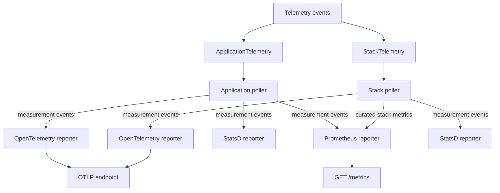
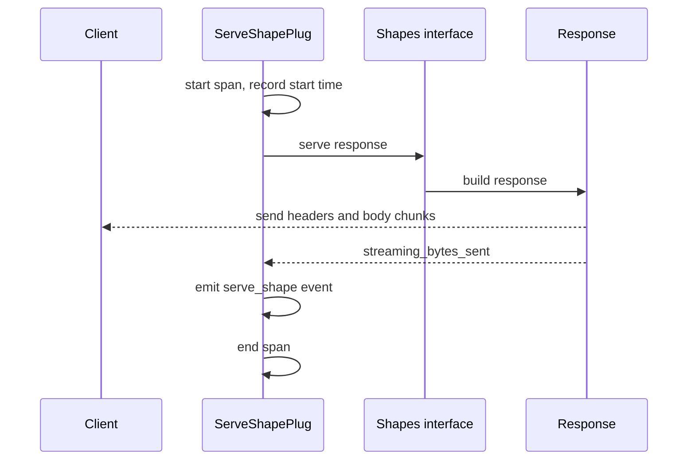

# Telemetry and Observability

The service can export metrics, traces, and logs. Telemetry is optional at compile time. It is enabled when the Mix target is `application`. Mix is the Elixir build tool, and a target is a build profile that selects optional dependencies. The official Docker image builds with the `application` target. A plain `mix test` run does not compile the telemetry exporters. When the code is compiled out, the stack telemetry child specification returns `nil` (`packages/sync-service/lib/electric/stack_supervisor/telemetry.ex:187-240`) and the application telemetry child list is empty (`packages/sync-service/lib/electric/application.ex:298-304`), so no telemetry supervisor starts. The Prometheus route still exists, but it returns an empty body (see the Prometheus section).

This document lists the telemetry events, the metrics, the logging behavior, and the Phoenix LiveDashboard security warning.

## Telemetry architecture

The telemetry code lives in two layers:

1. `packages/sync-service/lib/electric/telemetry/` emits events and configures traces.
2. `packages/electric-telemetry/lib/electric/telemetry/` collects periodic measurements and runs the reporters.

The first layer has the service-specific knowledge. The second layer is reusable by other Electric packages.



The pollers emit periodic measurement events. The reporters subscribe to those events and turn them into exported metrics. Each OpenTelemetry and StatsD reporter receives the events of the poller that its supervisor owns. The Prometheus reporter is different: it runs under the application supervisor and also registers a curated set of stack metric definitions, so it receives those stack measurements through the same shared aggregator. The application starts that reporter once, in `ElectricTelemetry.ApplicationTelemetry.exporter_child_specs/1` (`packages/electric-telemetry/lib/electric/telemetry/application_telemetry.ex:42-54`). A shared aggregator is one metric registry process that both pollers write to and that the scrape reads. It holds the metric definitions and the values since the last scrape. OTLP means OpenTelemetry Protocol.
`ApplicationTelemetry` collects process, memory, scheduler, and system metrics. It starts once per application. `StackTelemetry` collects replication, shape, storage, and request metrics. It starts once per stack.

Both supervisors start only when an exporter is configured. If no exporter is enabled, `start_link/1` returns `:ignore`. The check is in `packages/electric-telemetry/lib/electric/telemetry/application_telemetry.ex:17-27` and `packages/electric-telemetry/lib/electric/telemetry/stack_telemetry.ex:17-27`.

## Enabling telemetry

There are two conditions for telemetry:

- The Mix target must be `application`.
- At least one exporter must be configured.

Set the target at build time:

```sh
MIX_TARGET=application mix compile
```

The Dockerfile sets this argument by default. The target adds these dependencies:

- `electric_telemetry`
- `opentelemetry`
- `opentelemetry_exporter`
- `protobuf`, pinned to version 0.13.x
- `sentry`

The dependency rule is in `packages/sync-service/mix.exs:128-143`.

## Exporters

### Prometheus

Prometheus is a metrics service that reads a text endpoint at a fixed interval. The Prometheus exporter is enabled when `ELECTRIC_PROMETHEUS_PORT` is set. The service starts a separate Bandit listener on that port. The only functional route is `GET /metrics`; any other path returns 404 with `Not found`. The `with_telemetry` macro is a compile-time switch. It includes the block only when telemetry is enabled and the named module is loaded. Otherwise it includes the `else` block. The macro is at `packages/sync-service/lib/electric/telemetry.ex:14-40`.

```elixir
# packages/sync-service/lib/electric/plug/utility_router.ex:8-12
with_telemetry TelemetryMetricsPrometheus.Core do
  get "/metrics", do: text_resp(conn, 200, TelemetryMetricsPrometheus.Core.scrape())
else
  get "/metrics", do: text_resp(conn, 200, "")
end
```

If telemetry is compiled out, the endpoint returns an empty body with status 200. If telemetry is compiled in, it returns the current scrape.

The Prometheus endpoint must be scraped. The `Electric` module documentation gives the reason: distribution metrics buffer in memory between scrapes. An enabled but unscraped endpoint grows without bound and can crash the service. Leave the port unset if nothing scrapes it.

The Prometheus reporter receives the application metrics plus a curated set of stack metrics. The extra set is `Electric.StackSupervisor.Telemetry.prometheus_metrics/0`. It includes shape counts, retained write-ahead log (WAL) size, replication lag, request counts per status, and admission control values. The application passes those definitions as `additional_prometheus_metrics` at `packages/sync-service/lib/electric/application.ex:478`; the definitions are at `packages/sync-service/lib/electric/stack_supervisor/telemetry.ex:41-72`. The definitions carry no `stack_id` tag, so they assume one stack per instance. The source comment says that with multiple stacks the series would collide in the shared aggregator (`packages/sync-service/lib/electric/stack_supervisor/telemetry.ex:38-39`). [05-configuration-and-deployment.md](05-configuration-and-deployment.md) explains that library mode can run multiple stacks; in that configuration these curated Prometheus series are not separable by stack.

### OpenTelemetry

The OpenTelemetry exporter is enabled when `ELECTRIC_OTLP_ENDPOINT` is set. The service configures the endpoint, headers, and resource attributes. It also configures a metrics exporter with a default export period of 30 seconds.

The sampling ratio defaults to 0.01, which is one percent. The metric sampling ratio defaults to 1, which is all metrics. Both values are configurable with `ELECTRIC_OTEL_SAMPLING_RATIO` and `ELECTRIC_METRICS_SAMPLING_RATIO`.

A Honeycomb shortcut is available. Honeycomb is a hosted observability service. Set `ELECTRIC_HNY_API_KEY` and `ELECTRIC_HNY_DATASET`. The service adds the `x-honeycomb-team` and `x-honeycomb-dataset` headers to the OpenTelemetry Protocol (OTLP) request.

If no OTLP endpoint is set, the service disables the exporter processors:

```elixir
# packages/sync-service/config/runtime.exs:434
else
  # Disable opentelemetry_exporter.
  #
  # Without any explicit config, opentelemetry starts some resource detectors and initializes
  # otel_batch_processor which then tries to communicate with a remote OTLP server
  # (localhost:4318 by default) periodically.
  #
  # We don't want any of that unless OpenTelemetry export is explicitly enabled.
  config :opentelemetry, processors: []
end
```

This prevents a background connection attempt to `localhost:4318` in every deployment.

Empty response spans are dropped only when `ELECTRIC_DROP_EMPTY_RESPONSE_SPANS` is true. The sampler is `Electric.Telemetry.EmptyResponseSampler`. The purpose is to cut trace volume from frequent up-to-date responses.

### StatsD

The StatsD exporter is enabled when `ELECTRIC_STATSD_HOST` is set. StatsD is a metrics aggregation protocol. The host string has the form `host:port`. The reporter uses the Datadog formatter and adds the instance identifier as a global tag. Datadog is a monitoring service, and the formatter uses its tag style. The reporter sends the application and stack metrics.

### Sentry

Sentry export is configured when `SENTRY_DSN` (Data Source Name) is set. The service installs a logger handler at boot when the build includes telemetry. The handler captures error-level log messages. It also sets the stack identifier as a tag. When telemetry is enabled, the runtime configuration always sets the Sentry client; it sets the Data Source Name only when `SENTRY_DSN` exists (`packages/sync-service/config/runtime.exs:357-363`). Without the variable, no destination is configured for events.

The handler has a bounded queue:

```elixir
# packages/sync-service/lib/electric/application.ex:50
Electric.Telemetry.Sentry.add_logger_handler(
  Electric.Telemetry.Sentry.default_handler_id(),
  discard_threshold: 2000,
  sync_threshold: nil
)
```

The synchronous threshold is `nil`, so the logger never blocks on Sentry. Events are discarded when the queue is full. This is the correct trade-off for a logging path.

The Sentry client is `Electric.Telemetry.SentryReqHTTPClient`. It uses `Req`, an Elixir client for HTTP (Hypertext Transfer Protocol). The source-code context is packaged at build time with `mix sentry.package_source_code`.

## Telemetry events

Four terms recur in this document. An event is a named message with a measurement map and a metadata map. A metric is an aggregation of one event's measurements over time. A span is one timed operation with a start, an end, and a parent. A trace is the tree of spans that share one root. The service uses the Erlang `telemetry` library for events and metrics, and OpenTelemetry for spans and traces. The service emits these main events. The event names below use the Erlang list form. The exported metric names use a dotted form; for example, the event `[:electric, :shape, :response_size]` with measurement `bytes` becomes the metric `electric.shape.response_size.bytes`.

### Request events

| Event | Measurements | Metadata |
|-------|--------------|----------|
| `[:electric, :plug, :serve_shape]` | `count`, `bytes`, `duration`, `monotonic_time` | `live`, `shape_handle`, `client_ip`, `status`, `stack_id`, `known_error`, `empty` |
| `[:electric, :shape, :response_size]` | `bytes` | `root_table`, `is_live`, `stack_id` |

The event is emitted after the full response, including a streamed response. The function is `emit_shape_telemetry/1` at `packages/sync-service/lib/electric/plug/serve_shape_plug.ex:444-485`. There is one exception. If the response is already committed and an error occurs, the plug re-raises the error and does not emit this event. The reason is that the `catch` clause sees the connection passed into `call/2`, not the connection that holds the accumulated assignments. The source states this limit at `packages/sync-service/lib/electric/plug/serve_shape_plug.ex:116-121`. The admission permit and the OpenTelemetry span are still released. Only the aggregate request metric is lost.

The `duration` value is in native time units. Erlang reports time as a "native" unit, and the runtime chooses the scale at start. Code must not assume that the unit is a nanosecond or a microsecond. The metric definition names the target unit, and the reporter asks the runtime to convert the value to milliseconds. The `bytes` value is the count of streamed bytes. It is zero for a non-streamed response, because only `Electric.Shapes.Api.Response.send_stream/2` assigns `streaming_bytes_sent`. A zero is an actual measurement of zero, not a missing sample. The plug reads `assigns[:streaming_bytes_sent] || 0` at `packages/sync-service/lib/electric/plug/serve_shape_plug.ex:447`; the assignment is at `packages/sync-service/lib/electric/shapes/api/response.ex:503`.

The `empty` metadata value is true for an up-to-date response. That is the no-change response that carries the `up-to-date` control message, set at `packages/sync-service/lib/electric/shapes/api.ex:1172-1175`. It is not true for a response with zero rows from the snapshot or the log.

The response-size event is a distribution. It has three labels: `root_table`, `is_live`, and `stack_id`. The `is_live` label is boolean, so the data can be split into two groups. The non-live group contains both the initial snapshot and a later catch-up read. The live group contains long polls and live streams. A reader who needs to separate the snapshot from the catch-up read must use another signal, such as the offset in the request. The root table label has low cardinality because it comes from the validated request parameter, not the raw query string. The metric definition is at `packages/electric-telemetry/lib/electric/telemetry/stack_telemetry.ex:93-96`.

The three request metrics `electric.plug.serve_shape.duration`, `.count`, and `.bytes` keep only non-live requests. A `keep` function receives the metadata and rejects a measurement when `live` is true. The definitions are at `packages/electric-telemetry/lib/electric/telemetry/stack_telemetry.ex:77-87`. A fourth metric, `electric.plug.serve_shape.requests.count`, counts every request, live or not. It carries the `status`, `known_error`, `live`, and `empty` tags at `packages/electric-telemetry/lib/electric/telemetry/stack_telemetry.ex:88-92`. Use the first group for the cost of a normal read. Use the counter for the mix of request kinds.

### Replication and storage metrics

The service exports these metrics. Each name below is the exported metric name, which combines an event name and a measurement name. In the names, LSN means log sequence number:

- `electric.postgres.replication.transaction_received.receive_lag`, `.operations`, `.count`, and `.bytes`: replication lag, operation count, transaction count, and byte count.
- `electric.storage.transaction_stored.replication_lag`, `.bytes`, `.count`, and `.operations`.
- `electric.storage.snapshot_stored.bytes`, `.count`, and `.operations`.
- `electric.shape_snapshot.create_snapshot_task.stop.duration`: snapshot task duration.
- `electric.storage.make_new_snapshot.stop.duration`: snapshot file duration.
- `electric.postgres.replication.slot_retained_wal_size`: retained WAL bytes.
- `electric.postgres.replication.slot_confirmed_flush_lsn_lag`: confirmed flush lag.
- `electric.postgres.replication.pg_wal_offset`: current WAL position.
- `electric.storage.used.bytes` and `electric.storage.used.measurement_duration`: storage used and the duration of the measurement.

The definitions are at `packages/electric-telemetry/lib/electric/telemetry/stack_telemetry.ex:77-121`; the WAL metrics are at `packages/sync-service/lib/electric/stack_supervisor/telemetry.ex:48-56` and `:227-233`.

The metric list uses four metric types. A `last_value` metric reports the most recent value, such as a queue depth or a shape count. A `distribution` metric reports a histogram, such as request duration or response size. A `counter` reports a monotonic total since start. A `sum` adds every measurement that arrives inside the export interval and then resets. Use `sum` for a quantity such as bytes written during the interval. Use `counter` for a total since start. Units name the scale: `:byte`, `:millisecond`, `:microsecond`, or `{:native, :millisecond}` for a native time value that the reporter converts. The definitions are at `packages/electric-telemetry/lib/electric/telemetry/stack_telemetry.ex:75-138`.

### Shape and connection events

The stack also exports:

- `electric.shapes.total_shapes.count`
- `electric.shapes.total_shapes.count_indexed`
- `electric.shapes.total_shapes.count_unindexed`
- `electric.shapes.active_shapes.count`
- `electric.shape_db.write_buffer.pending_writes.count`. This is the shape-database write buffer for shape metadata, not the per-shape log buffer ([03-shape-log-and-storage.md](03-shape-log-and-storage.md) describes the log buffer).
- `electric.shape_db.sqlite.connections`
- `electric.shape_db.pool.checkout.queue_time_us`
- `electric.connection.consumers_ready.duration`
- `electric.connection.consumers_ready.total`
- `electric.admission_control.acquire.current` and `.limit`
- `electric.admission_control.reject.count` and `.limit`
- `electric.shape_log_collector.transaction.affected_shape_count`
- `electric.flush_tracker.writer_down.count`
- `electric.flush_tracker.stall_detected.count`
- `electric.subqueries.subset_result.bytes`, `.rows`, and `.count`
- `electric.subqueries.move_in_triggered.count`

The shape counts are emitted by a periodic measurement. The measurement emits the active count first, so a failure in the shape cache does not drop that value for that poll cycle. The code is at `packages/sync-service/lib/electric/stack_supervisor/telemetry.ex:75-92`.

The retained WAL query reads `pg_replication_slots`. It returns the retained size and the confirmed flush lag. The lag is clamped to zero because PostgreSQL returns `-1` when the service is caught up. The query is at `packages/sync-service/lib/electric/stack_supervisor/telemetry.ex:107-116`.

### Periodic measurements

The application poller runs these measurements:

| Measurement | What it reads |
|-------------|---------------|
| `:memory` | Total memory of the Erlang virtual machine |
| `:persistent_term` | Memory held by `persistent_term` values |
| `:system_counts` | Counts of processes, ports, and atoms |
| `:total_run_queue_lengths` | Total work that waits to run |
| `:uptime_event` | Virtual machine uptime |
| `:cpu_utilization` | Processor load of the host |
| `:scheduler_utilization` | Busy share of each scheduler |
| `:run_queue_lengths` | Waiting work for each scheduler |
| `:garbage_collection` | Garbage collection runs and bytes reclaimed |
| `:reductions` | Reduction count; a reduction is the Erlang unit of work |
| `:process_memory` | Memory for each process type |
| `:process_bin_memory` | Binary memory for each process type |
| `:ets_memory` | Memory for each Erlang Term Storage (ETS) table type |
| `:get_system_load_average` | Operating system load average |
| `:get_system_memory_usage` | Operating system memory usage |

Both pollers use the same `system_metrics_poll_interval`, which defaults to 5 seconds (`packages/electric-telemetry/lib/electric/telemetry/opts.ex:22`, `packages/electric-telemetry/lib/electric/telemetry/poller.ex:18`). The stack poller runs:

| Measurement | What it reads |
|-------------|---------------|
| `count_shapes` | Active, total, indexed, and unindexed shape counts |
| `report_write_buffer_size` | Pending writes in the shape database buffer |
| `report_retained_wal_size` | Slot retained WAL size, WAL offset, and confirmed flush lag |
| `report_disk_usage` | Bytes used in the storage directory |
| `report_shape_db_stats` | SQLite connection and pool statistics |

The stack poller has a separate initial delay, `stack_telemetry_init_delay`, which defaults to 30 seconds (`packages/electric-telemetry/lib/electric/telemetry/opts.ex:23`). The delay avoids noise while the stack starts. The application poller uses an initial delay of 5 seconds (`packages/electric-telemetry/lib/electric/telemetry/poller.ex:19`).

### Monitor thresholds

The system monitor emits events when a process behaves badly:

| Event | Default threshold |
|-------|-------------------|
| Long garbage collection | 50 milliseconds |
| Long scheduler run | 150 milliseconds |
| Long message queue, enable | 20 messages |
| Long message queue, disable | 0 messages |

The two message-queue numbers form a hysteresis band. The monitor reports a process when its queue reaches 20 messages. It stops reporting when the queue falls to 0. Without the band, a queue near one threshold would produce a stream of start and stop events.

The monitor events include a list of the busiest process groups. The list defaults to 5 groups, ranked by memory. Each group holds one process type, and its memory is the total for that type (`packages/electric-telemetry/lib/electric/telemetry/processes.ex:82-93`). `count:N` sets how many groups are reported. It is not a limit on the total number of processes. The option schema also allows a memory share (`mem_percent:N`) or a low byte cutoff (`at_least_bytes:N`). The environment variable `ELECTRIC_TELEMETRY_TOP_PROCESS_LIMIT` accepts only `count:N` and `mem_percent:N`; `at_least_bytes:N` is available only when the host sets the library option (`packages/sync-service/lib/electric/config.ex:590-618`). The list of largest ETS tables defaults to 10 tables. These values are in `packages/electric-telemetry/lib/electric/telemetry/opts.ex:22-50`.

## Where request telemetry is captured

The request event is emitted once, after the response body is fully sent. This is deliberate for streamed responses.



Plug's `register_before_send` callback would fire when `send_chunked` starts streaming, not when it finishes (`packages/sync-service/lib/electric/plug/serve_shape_plug.ex:25-30`). At that moment the byte count is zero and the duration is incomplete. This callback is not the OpenTelemetry `before_send` span processor. The plug therefore uses an `after` clause around the whole pipeline. The clause releases the admission permit and records the final values. The module documentation calls out this reason.

## Reading the metrics in an incident

Start with the symptom, then read the metric that names the cause.

| Symptom | Metric to read | Likely cause |
|---------|----------------|--------------|
| Database disk grows | `electric.postgres.replication.slot_retained_wal_size` | A consumer does not flush, so the slot confirmation is pinned |
| Disk grows and a shape disappears | `electric.flush_tracker.stall_detected.count` | A consumer passed the stall grace period |
| A storage writer stops | `electric.flush_tracker.writer_down.count` | A writer process crashed, so the shape may require a refetch |
| Clients receive 409 | request status counts for status 409 | A truncate, a schema change, an unknown or removed handle, or the shape limit invalidated the shape |
| Clients receive 503 | `electric.admission_control.reject.count` | The initial or existing request limit is full |
| First request is slow | `electric.connection.consumers_ready.duration` | The stack is starting, or shape metadata is loading |
| Shape requests pause | `electric.shape_db.pool.checkout.queue_time_us` | SQLite pool contention |
| Central processing unit is busy | scheduler utilization and run queue lengths | Many active consumers, or heavy change conversion |
| Memory grows | process memory, ETS memory, and process binary memory | A consumer heap or a subquery buffer grows |

Three rules make the table useful.

1. **Check retained WAL first.** It is the only metric that combines every consumer. One slow consumer is enough to make it grow. Request metrics show the client effect, not the cause.
2. **Distinguish a rate from a single event.** One 409 after a truncate or a schema change is correct behavior. The schema-change path is `{:error, %SnapshotError{type: :schema_changed}}` at `packages/sync-service/lib/electric/shapes/api.ex:747-754`, and the shape-invalidation path is at `:922-934`. The service calls the message tag `:shape_rotation`. It is an internal process message to the waiting request process, not a telemetry event. It is sent when an asynchronous cleanup removes a shape (`packages/sync-service/lib/electric/shape_cache/shape_cleaner/cleanup_task_supervisor.ex:75-86`) or when the resolved handle differs from the request handle, or when a read goes backward (`packages/sync-service/lib/electric/shapes/api.ex:846-852`, `:868-886`). A waiting live request turns the event into a 409 must-refetch. A sustained 409 rate means clients hold invalidated handles or request handles that do not exist. Compaction does not cause a 409; a read below the compaction boundary uses the compacted file ([03-shape-log-and-storage.md](03-shape-log-and-storage.md) gives the detail).
3. **Read the labels before the value.** The request event carries `live`, `shape_handle`, `status`, and `known_error`. A high count with `live=true` describes long polls, not row traffic. The `known_error` tag is true only for two 503 classes: admission control overload (`packages/sync-service/lib/electric/plug/serve_shape_plug.ex:315-327`) and a snapshot failure that the service recognizes as transient (`packages/sync-service/lib/electric/shapes/api.ex:760-768`). A 503 caused by an unreachable database does not set it. It is false for a 409 must-refetch. A 409 is an expected protocol step, not an internal fault. A 500 also has `known_error=false`, and it is a fault.

Sampling changes what is visible. The OpenTelemetry trace ratio defaults to 0.01, so one trace in 100 is kept. The metric ratio defaults to 1, so every metric is kept. Use metrics for counting and traces for one slow request. A low-volume error may not appear in a trace sample.

The request event is emitted after the response body is sent. A live request that stays open for the long-poll or stream timeout has no duration sample until it closes. A dashboard that shows only completed requests understates the latency of the requests that are still open. Alert on open connections and admission counters for that case, not on request duration alone.

## Logging

The service uses the Elixir `Logger`. The default formatter has this format:

```text
"\n$time $metadata[$level] $message\n"
```

The format starts and ends with a newline, so each entry gets one blank line above and below. The source comment calls these doubled line breaks a boundary for long messages (`packages/sync-service/config/runtime.exs:21-25`). The metadata fields are `pid`, `shape_handle`, and `request_id`; `pid` means process identifier. Colors are enabled by default and can be disabled with `ELECTRIC_LOG_COLORS=false`.

The default handler has bounded queues. The `sync_mode_qlen` value is 2000, the `drop_mode_qlen` value is also 2000, and the `flush_qlen` value is 5000 (`packages/sync-service/config/runtime.exs:30-31`). Because the two thresholds are equal, the handler goes from asynchronous mode directly to drop mode; it has no synchronous phase. When the queue reaches the drop mode, the handler drops events. It does not block the caller.

The router sets the stack identifier in the logger metadata for every request. The stack supervisors set it for their child processes. This means a log line from a consumer can be traced to the stack.

The OpenTelemetry log handler is enabled only with an OTLP endpoint. It maps logger metadata to OpenTelemetry attributes. For example:

- `request_id` becomes `http.request_id`.
- `stack_id` becomes `source_id`.
- `shape_handle` becomes `shape.handle`.

The map is in `packages/sync-service/config/runtime.exs:418-430`.

## The Phoenix LiveDashboard warning

The LiveDashboard is enabled when `ELECTRIC_LIVE_DASHBOARD_PORT` is set. It runs on a separate Bandit listener. It uses Phoenix PubSub, the publish-and-subscribe layer that sends events between Phoenix processes, and a generated secret key base. The key base is 48 random bytes, encoded as base 64, generated at every boot. Phoenix uses the key base to sign LiveView connection data. LiveView is the Phoenix library that renders a server-side page and updates it over a socket. Because the key base changes at every boot, a signed value from one run is not valid in the next run. The key base generation is at `packages/sync-service/config/runtime.exs:470`. It listens on IPv4 by default, or IPv6 when `ELECTRIC_LISTEN_ON_IPV6` is true.

The configuration file contains an explicit warning:

```elixir
# packages/sync-service/config/runtime.exs:446-452
# Phoenix LiveDashboard Endpoint Configuration
#
# WARNING: The dashboard is completely unauthenticated and exposes internal
# system state (VM metrics, process info, ETS tables, etc.). In production,
# ensure the dashboard port is firewalled or otherwise restricted to trusted
# networks only.
if live_dashboard_port do
  ...
```

The warning is not decorative. The dashboard has no login. It shows the Erlang virtual machine (VM) state, process lists, ETS tables, and application configuration. The route uses the default `phoenix_live_dashboard` pages (`packages/sync-service/lib/electric/live_dashboard/router.ex:24`). Those pages include a Processes page with an action that terminates a process. An attacker who can reach the port can therefore read internal data and change the running system.

The safe default is to leave `ELECTRIC_LIVE_DASHBOARD_PORT` unset. If you enable it, bind it to a private network and restrict access with a firewall or a private load balancer. Do not expose it on a public port.

## Health and readiness

The health endpoint reports the stack status. The status has two parts:

- The connection status: `waiting_on_lock`, `starting`, `up`, or `sleeping`.
- The shape status: `starting`, `read_only`, or `up`.

The service maps the pair to four status values. For example, the pair `%{conn: :up, shape: :up}` maps to `active`. The pair `%{conn: :waiting_on_lock, shape: :read_only}` maps to `waiting`. The mapping is at `packages/sync-service/lib/electric/status_monitor.ex:51-58`. [01-architecture.md](01-architecture.md) explains how a `read_only` shape status behaves: the service can serve stored shapes but cannot create new ones.

| Value from `StatusMonitor` | Meaning | Health response |
|-------|---------|-------------|
| `active` | Fully operational | 200, body `{"status":"active"}` |
| `waiting` | Waiting for the advisory lock, read-only shapes | 202, body `{"status":"waiting"}` |
| `starting` | Initializing | 202, body `{"status":"starting"}` |
| `sleeping` | Connections scaled down | 200, body `{"status":"active"}` |

The last row is a deliberate translation. The health plug reports a sleeping stack as `active`, because an incoming shape request restores the connection subsystem before it serves the request. The internal value `sleeping` does not appear in the response body. The public body therefore has three values: `active`, `waiting`, and `starting` (`packages/sync-service/lib/electric/plug/health_check_plug.ex:14-28`).

The status monitor uses an ETS table. Each subsystem marks its condition. The conditions are the PostgreSQL advisory lock, the replication client, the admin pool, the snapshot pool, the shape log collector, the supervisor processes, the integrity checks, and the shape metadata. The integrity condition reports that the shape database passed its SQLite `quick_check` when it opened. The connection manager marks the condition after the shape subtree starts, at `packages/sync-service/lib/electric/connection/manager.ex:528`. The condition list is at `packages/sync-service/lib/electric/status_monitor.ex:12-21`.

## Observability checklist

1. Scrape `ELECTRIC_PROMETHEUS_PORT` or export OTLP. Do not enable Prometheus without a scraper.
2. Monitor `electric.postgres.replication.slot_retained_wal_size`. A growing value means the service is not flushing.
3. Monitor `electric.flush_tracker.stall_detected.count` and `writer_down.count`.
4. Monitor the request status counts. A rise in 409 responses means shapes are being invalidated or clients request handles that do not exist. Compaction is not a cause of 409.
5. Monitor `electric.shapes.active_shapes.count` against `ELECTRIC_MAX_SHAPES`.
6. Set `SENTRY_DSN` only if you want error reports to leave the network.
7. Leave the LiveDashboard disabled or firewalled.

## Key insight

The most important metric is not request latency. It is retained WAL size. A shape that stops flushing pins the stack-wide flush boundary. PostgreSQL then keeps WAL for the slot. The retention grows until the database disk fills. The flush tracker metrics and the retained WAL metric are the early warning for that failure. Request metrics show the symptom, not the cause.

## Related documents

- [02-http-api-and-shapes.md](02-http-api-and-shapes.md) explains the request path that emits the request events.
- [04-replication-and-consumers.md](04-replication-and-consumers.md) explains the flush tracker.
- [05-configuration-and-deployment.md](05-configuration-and-deployment.md) lists the telemetry variables.
- [07-testing-and-limitations.md](07-testing-and-limitations.md) explains how telemetry is tested.
