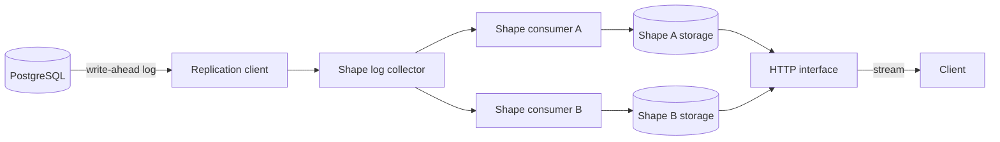
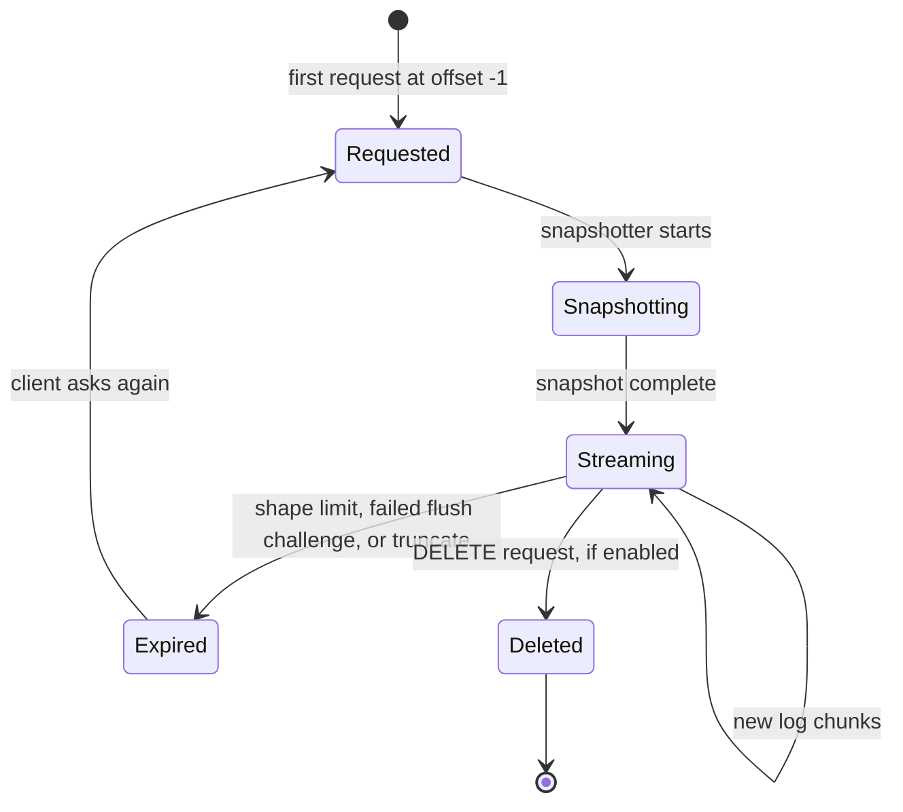

# Electric Sync Service

This directory is the deep dive for the Electric Sync service. The service is an Elixir application. It tails the PostgreSQL write-ahead log (WAL). It reads that log with **logical replication**. That is a PostgreSQL feature that decodes the WAL into a stream of row changes, rather than a stream of raw bytes. It stores per-shape data on local disk. It serves that data over HTTP (Hypertext Transfer Protocol).

The source root is `packages/sync-service` in the Electric repository. The main source set has 328 files. It has 189 Elixir source files in `lib/`, 115 test files, and 19 support files under `test/support`. It also has one `test_helper.exs` and 4 build and configuration files (`mix.exs`, `mix.lock`, `config/config.exs`, and `config/runtime.exs`). The package also holds development scripts, fixtures, and metadata outside that set. Every claim about this package comes from those files. Two limitations are also quoted from the repository file `LIMITATIONS.md`. The text says so at those points.

## Key terms

Read this list first. The other documents assume it.

- A **shape** is one saved, declarative query over one PostgreSQL table, together with the data that the service materializes from it. The definition has an optional `where` filter and an optional column list. It also has a replica mode (which columns each change carries) and a log mode (snapshot plus changes, or changes only). The materialized form is a snapshot plus an ordered log of later changes, served as a stream of rows.
- A **handle** is the identifier of one stored shape. The service builds it from a hash of the shape definition and a microsecond timestamp.
- An **offset** is a position in one shape log, written as `<transaction>_<operation>`, for example `1234_2`. The value `-1` means "before all data".
- A **snapshot** is the query result at one point in time. A **snapshotter** is the short-lived process that runs the snapshot query and writes the result.
- A shape **log** is the durable, ordered stream for one shape. It has two parts. A **snapshot** is the query result at one point in time. A **change log** is the ordered list of changes after that snapshot. Each part is stored in **chunks**.
- A **consumer** is the process that owns one shape. It filters WAL changes, writes the log, and reports progress.
- To **flush** is to write buffered changes from memory to disk. A **tracked shape** is a shape that the pending transaction affects and whose flush the service still waits for. The **flush boundary** is the minimum offset that every tracked shape has flushed. While any tracked shape lags, the service acknowledges the write-ahead log byte position at the flush boundary minus 1 byte. When every tracked shape has caught up, it acknowledges the exact last seen position. The WAL position is a count of bytes, so subtracting 1 byte makes PostgreSQL resend the whole transaction after a reconnect. The rule is in [04-replication-and-consumers.md](04-replication-and-consumers.md).
- **Compaction** rewrites the older chunks of the change-log part of one shape into one compacted file set. A set has three files under one suffix, and the newest set replaces the older one. The **compaction boundary** is the end offset of the last chunk that a compaction run consumed. A run merges the previous compacted set and the current **live** log file into a new set. It then rewrites the live file to hold only the rows after the boundary. A read below the boundary comes from the compacted set. A read at or after it comes from the live file.
- A **control message** is a small JavaScript Object Notation (JSON) object in the response body that tells the client how to continue, for example `must-refetch`.
- A **stack** is one PostgreSQL connection set with its pools, replication client, shape cache, and consumers.

## Who this is for

Read these documents if you want to know:

- How the service starts and supervises its parts.
- How a shape request becomes a stream of rows.
- How the service turns PostgreSQL changes into shape log offsets.
- How to configure and deploy the service.
- How to observe the service in production.
- What the service does not do.

## Documents

| Order | Document | What it explains |
|-------|----------|------------------|
| 1 | [00-overview.md](00-overview.md) | The purpose, the concepts, and the one-paragraph architecture |
| 2 | [01-architecture.md](01-architecture.md) | The supervision tree, the boot path, and how the parts fit |
| 3 | [02-http-api-and-shapes.md](02-http-api-and-shapes.md) | The HTTP interface, the shape parameters, caching, and errors |
| 4 | [03-shape-log-and-storage.md](03-shape-log-and-storage.md) | The shape log, the storage backend, snapshots, and offsets |
| 5 | [04-replication-and-consumers.md](04-replication-and-consumers.md) | PostgreSQL logical replication, consumers, and consistency |
| 6 | [05-configuration-and-deployment.md](05-configuration-and-deployment.md) | Every environment variable, Docker, and deployment |
| 7 | [06-telemetry-and-observability.md](06-telemetry-and-observability.md) | Telemetry events, metrics, logging, and the dashboard warning |
| 8 | [07-testing-and-limitations.md](07-testing-and-limitations.md) | The test strategy, how to run tests, and the known limits |

## Reading order

1. Start with [00-overview.md](00-overview.md) for the vocabulary.
2. Read [01-architecture.md](01-architecture.md) for the process layout.
3. Read [02-http-api-and-shapes.md](02-http-api-and-shapes.md) if you work on clients.
4. Read [03-shape-log-and-storage.md](03-shape-log-and-storage.md) and [04-replication-and-consumers.md](04-replication-and-consumers.md) if you work on the engine.
5. Read [05-configuration-and-deployment.md](05-configuration-and-deployment.md) if you operate the service.
6. Read [06-telemetry-and-observability.md](06-telemetry-and-observability.md) if you monitor the service.
7. Read [07-testing-and-limitations.md](07-testing-and-limitations.md) before you change the service.

## The one-paragraph architecture

A client sends a `GET /v1/shape` request. A normal read names the root table and an offset. When the service is configured with one predefined shape, the client may omit the table. The first request omits the shape handle and uses offset `-1`. A later request adds the shape handle, so the service can confirm the stored shape with a cheap hash check. The service reads the shape definition or finds the stored shape. It finds or creates a shape handle. It starts a consumer process for the shape. The consumer starts a snapshotter task, and that task writes the initial snapshot to disk. The replication client streams PostgreSQL WAL changes. The shape log collector routes each change to the consumers that need it. Each consumer writes the change to its own log with a stable offset. The service serves the snapshot in chunks and then the log in chunks. Each response carries one chunk range. A live request holds the connection open and sends new chunks as they appear.



## Shape lifecycle

A shape moves through a small number of states. The states are visible in the HTTP responses.



The states appear in HTTP responses as follows:

- `Requested` and `Snapshotting` occur inside one request. The service allocates the handle (`Requested`), starts the snapshotter (`Snapshotting`), and streams the snapshot rows in the same 200 response. The `electric-snapshot: true` header is not set on this response. The service sets that header only for a subset snapshot, which is a stable windowed view of a shape that a `subset__` parameter requests.
- `Streaming` produces a 200 response with log rows.
- `Expired` produces a 409 response with a `must-refetch` control message. The shape data is gone, so the client must ask for the shape again.
- `Deleted` produces 202 with an empty JSON array body (`[]`) when the deletion succeeds. A missing shape returns 404. A 405 with the text `DELETE not allowed` means the feature is off, so the shape was not deleted and the state did not change.

The three expiry causes are defined as follows. A shape limit is the `ELECTRIC_MAX_SHAPES` environment variable, which sets the `max_shapes` stack option. When the shape count is greater than it, the service removes the least recently used shape. That shape is the one with the smallest `last_read_time` (`packages/sync-service/lib/electric/shape_cache/expiry_manager.ex:54-75`). A flush stall is a consumer that makes no flush progress for a grace period. The collector first challenges the consumer. The shape expires only when it fails the next check. A shape whose writer process is already gone has no one to challenge, so it expires at the first check. A challenge is a progress-check message that the collector sends to the consumer process. A truncate is a PostgreSQL `TRUNCATE` message that affects the shape.

Shape deletion is off by default. The application programming interface (API) returns 405 `DELETE not allowed` unless the configuration key `allow_shape_deletion?` is true. The `Api` value that the code reads is `allow_shape_deletion`. The default is at `packages/sync-service/lib/electric/config.ex:77`. A successful deletion returns 202 with an empty JSON array body at `packages/sync-service/lib/electric/shapes/api.ex:257`.

## Source map

| Area | Directory | Main module |
|------|-----------|-------------|
| Application start | `lib/electric/application.ex` | `Electric.Application` |
| Supervision | `lib/electric/stack_supervisor.ex` | `Electric.StackSupervisor` |
| HTTP | `lib/electric/plug/` | `Electric.Plug.Router` |
| Shapes | `lib/electric/shapes/` | `Electric.Shapes.Api` |
| Replication | `lib/electric/replication/` | `Electric.Replication.ShapeLogCollector` |
| Storage | `lib/electric/shape_cache/` | `Electric.ShapeCache.PureFileStorage` |
| Telemetry | `lib/electric/telemetry/` | `Electric.Telemetry.OpenTelemetry` |
| Configuration | `config/runtime.exs` | `Electric.Config` |

## Three source anchors

These three excerpts show the smallest set of ideas needed to read the rest of the documents.

### 1. The two run modes

The application starts either a small library tree or the full single-stack tree.

```elixir
# packages/sync-service/lib/electric/application.ex:9
if Application.get_env(:electric, :start_in_library_mode, true) do
  Supervisor.start_link(children_library(), supervisor_opts)
else
  app_vsn = Application.spec(:electric, :vsn)
  Logger.notice("Starting ElectricSQL #{app_vsn}")

  Supervisor.start_link(
    children_application(),
    [auto_shutdown: :any_significant] ++ supervisor_opts
  )
end
```

### 2. The shape route

Almost all behavior is on one route with four methods.

```elixir
# packages/sync-service/lib/electric/plug/router.ex:34-46
get "/v1/shape",
  to: PassAssignToOptsPlug,
  init_opts: [plug: Electric.Plug.ServeShapePlug, assign_key: :config]

post "/v1/shape",
  to: PassAssignToOptsPlug,
  init_opts: [plug: Electric.Plug.ServeShapePlug, assign_key: :config]

delete "/v1/shape",
  to: PassAssignToOptsPlug,
  init_opts: [plug: Electric.Plug.DeleteShapePlug, assign_key: :config]

options "/v1/shape", to: Electric.Plug.OptionsShapePlug
```

### 3. The special offsets

Every read starts or ends at one of these positions.

```elixir
# Condensed excerpt from packages/sync-service/lib/electric/replication/log_offset.ex:229-255
def before_all(), do: %LogOffset{tx_offset: -1, op_offset: 0}

def first(), do: %LogOffset{tx_offset: 0, op_offset: 0}

def last(), do: %LogOffset{tx_offset: 0xFFFFFFFFFFFFFFFF, op_offset: :infinity}

def last_before_real_offsets(), do: %LogOffset{tx_offset: 0, op_offset: :infinity}
```

`:infinity` is a sentinel that sorts after every integer operation offset. `last()` has the largest transaction part and `:infinity`. Its string form is `18446744073709551615_inf`. `last_before_real_offsets()` is `0_inf`, the boundary just before the first real change. `before_all()` is the pair `(-1, 0)` in memory, but it prints as `-1` with no operation part. The serializer has a special clause for a transaction offset of `-1` (`packages/sync-service/lib/electric/replication/log_offset.ex:320-322`). The request parameter also accepts `now`, which is not a stored offset.

## Key insight

The service has one shared write path and many private read paths. The replication client reads the PostgreSQL write-ahead log once. The shape log collector sends each change to every consumer that needs it. Each consumer then writes its own log with its own offsets. This design makes a shape cheap to add and isolates a slow reader. It also means the health of the whole stack depends on the slowest consumer. One stalled consumer holds the shared flush boundary and keeps the write-ahead log on disk. The flush tracker is the bridge between the two views. It keeps a map from each tracked shape to its last flushed offset, and it converts that map into one PostgreSQL acknowledgement. A shape enters the map when a transaction first reaches it. The slot advances only when every tracked shape has written its share. Each shape keeps its snapshot plus the changes after it. Without compaction, that log grows without bound. With compaction, the chunks before the boundary become one compacted file set. The live file is rewritten to hold only the rows after the boundary: by default, the last two complete chunks and any newer partial chunk. The compacted set also holds a copy of those retained rows. When a shape is created with `experimental_compaction=true`, compaction merges successive updates to each row into one operation. The compacted file set still grows with the number of distinct keys. A reader below the compaction boundary reads that set from its first retained chunk, so intermediate changes that compaction dropped are absent without an error.

## Source of truth

The source commit for this package is `3f9809fb0`. Line references use the form `packages/sync-service/lib/electric/...:line`.

Return to the platform index, which lists every exploration in this repository: [../README.md](../README.md).

## Related documents

- [00-overview.md](00-overview.md)
- [07-testing-and-limitations.md](07-testing-and-limitations.md)
