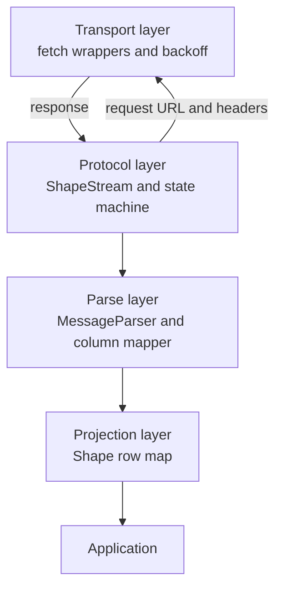
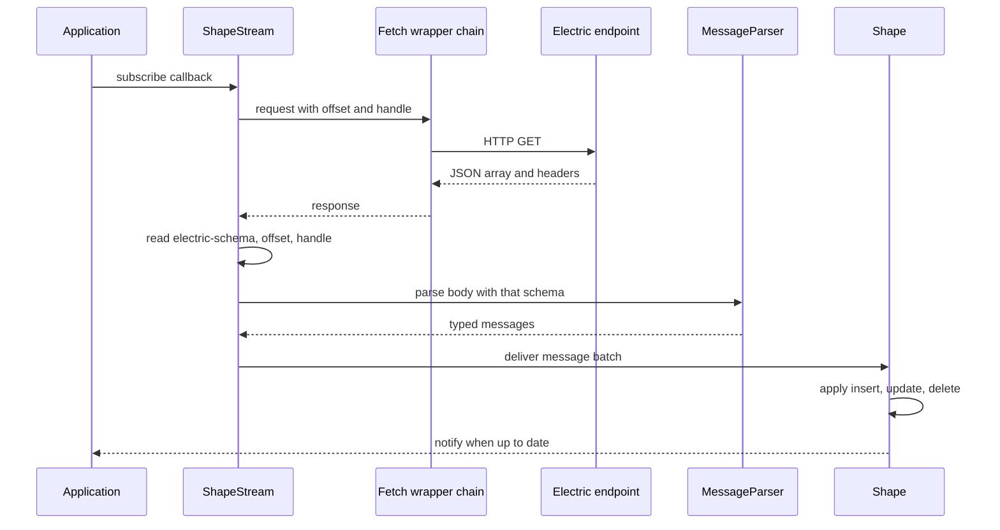

# Overview

The `@electric-sql/client` package is the TypeScript client for Electric shapes. It turns the Electric Hypertext Transfer Protocol (HTTP) stream into typed messages and materialized rows. It works in browsers, Node.js, Bun, Deno, and React Native. It does not keep a durable copy of the data. It keeps one offset, one shape handle, and one in-memory projection.

The package has two public classes. `ShapeStream` is the protocol client. `Shape` is the row projection. The package also exports three type guards, two error classes, a column mapper, an expression compiler, and protocol constants. It does not export its internal parser. The citation is `src/index.ts:1-19`.

## Package facts

| Fact | Value | Source |
|------|-------|--------|
| Package name | `@electric-sql/client` | `package.json:2` |
| Version | `1.5.28` | `package.json:4` |
| License | Apache-2.0 | `package.json:98` |
| Module type | ECMAScript module (ESM) | `package.json:39` |
| Only runtime dependency | `@microsoft/fetch-event-source` | `package.json:12-14` |
| Build tool | `tsup` | `package.json:33` |
| Test runner | `vitest` | `package.json:36` |
| Browser entry | `dist/index.mjs` | `package.json:43-53` |
| React Native entry | `dist/index.react-native.mjs` | `package.json:54-64` |

The dependency list is small on purpose. The package uses the platform `fetch` function. The `@microsoft/fetch-event-source` dependency supplies the Server-Sent Events (SSE) parser. The citation is `package.json:12-14`.

## The four layers

The transport layer owns HTTP. It retries, consumes the body, checks required headers, and prefetches the next chunk. The citation is `src/client.ts:789-815`.

The protocol layer owns the request loop. It builds the uniform resource locator (URL), tracks the offset, detects a stale response, checks required headers, and handles a 409 response. It calls the transport layer for each request. It then calls the parse layer and publishes the messages to `Shape`. The layers are a cycle at the top and a pipeline below it, not a one-way stack. The citation is `src/client.ts:970-1128`.

The parse layer converts JavaScript Object Notation (JSON) strings into typed messages. It uses the `electric-schema` response header. The citation is `src/parser.ts:99-128`.

The projection layer applies each change to a map. It controls when subscribers receive a notification. The citation is `src/shape.ts:198-272`.

## The public surface

| Group | Public symbols | Source |
|-------|----------------|--------|
| Stream | `ShapeStream`, `ShapeStreamOptions`, `ShapeStreamInterface`, `LogMode` | `src/client.ts:300-589`, `src/client.ts:649` |
| Projection | `Shape`, `ShapeData`, `ShapeChangedCallback` | `src/shape.ts:10-78` |
| Types | `Row`, `Value`, `Offset`, `Message`, `ChangeMessage`, `ControlMessage`, `ColumnInfo`, `Schema`, `SubsetParams` | `src/types.ts:5-249` |
| Guards | `isChangeMessage`, `isControlMessage`, `isVisibleInSnapshot` | `src/helpers.ts:28-132` |
| Parsing (internal) | `MessageParser`, `Parser`, `TransformFunction`, `defaultParser`, `pgArrayParser` (not exported) | `src/parser.ts:18-229` |
| Mapping | `ColumnMapper`, `createColumnMapper`, `snakeCamelMapper`, `snakeToCamel`, `camelToSnake` | `src/column-mapper.ts:46-392` |
| Expressions | `compileExpression`, `compileOrderBy` | `src/expression-compiler.ts:18-132` |
| Errors | `FetchError`, `FetchBackoffAbortError` (exported); the other error classes are internal | `src/error.ts:1-125` |
| Constants | `ELECTRIC_PROTOCOL_QUERY_PARAMS` | `src/constants.ts:37` |

## One request cycle

The first request uses offset `-1` and no handle. The server returns a shape handle, a schema, an offset, and a batch of messages. Later requests send that offset and handle. A live request sends `live=true` and holds the connection open for up to 20 seconds on the server. The server ends the request at that timeout. The client reads the response, then sends the next live request. The client watchdog allows 45 seconds, so a normal 20-second timeout does not fire it. The citations are `src/client.ts:729-818` and `src/client.ts:784-787`.

Some terms need short definitions:

- **Shape.** A named subset of a PostgreSQL table, selected by a `WHERE` clause and a column list.
- **Shape handle.** A server-side identifier for one build of a shape's backing log. The server can retire a handle. A retired handle requires a refetch. The client sends the current handle on every later request.
- **Offset.** A position in the shape log. The form is `<transaction>_<operation>`. The first number identifies the PostgreSQL transaction. The second identifies the operation inside that transaction.
- **Up-to-date message.** A control message that marks the end of a batch and confirms that all data before it is present.
- **Must-refetch message.** A control message that tells the client to discard its rows and restart from offset `-1`.
- **Long poll.** An HTTP request that the server holds open until new data exists or a timeout expires.

The protocol is the subject of [02-shape-protocol-and-offsets.md](02-shape-protocol-and-offsets.md). The request loop is the subject of [01-shape-stream-client.md](01-shape-stream-client.md).

**Aha:** the client separates the stream from the projection. A caller can use `ShapeStream` for raw protocol messages. A caller can use `Shape` for a full row array. Both share the same underlying request loop and offset. This split lets a user interface consume the whole projected shape while a separate listener receives every raw message and filters by operation or key.

## Runtime support

The package ships four build targets. The `exports` conditions in `package.json` select the build. The `browser` condition selects `dist/index.mjs`. The `react-native` condition selects `dist/index.react-native.mjs`. The React Native entry registers an application state adapter. The adapter pauses the stream when the application goes to the background. The citation is `src/client.ts:256-292` and `package.json:43-64`.

The adapter contract has two members. `getCurrentState()` returns `visible`, `hidden`, or `undefined`. `subscribe(callback)` calls the callback on each change and returns an unsubscribe function. A stream uses the `runtimeVisibility` option when the caller supplies one. Otherwise it uses the factory stored by `setDefaultRuntimeVisibilityAdapterFactory`. The citations are `src/client.ts:256-262` and `src/runtime-visibility.ts:1-21`.

## Limits of this document

This overview names the layers and the public symbols. It does not prove all behavior. Each later document proves its claims with source citations. Read [01-shape-stream-client.md](01-shape-stream-client.md) next.
