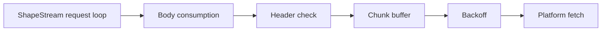
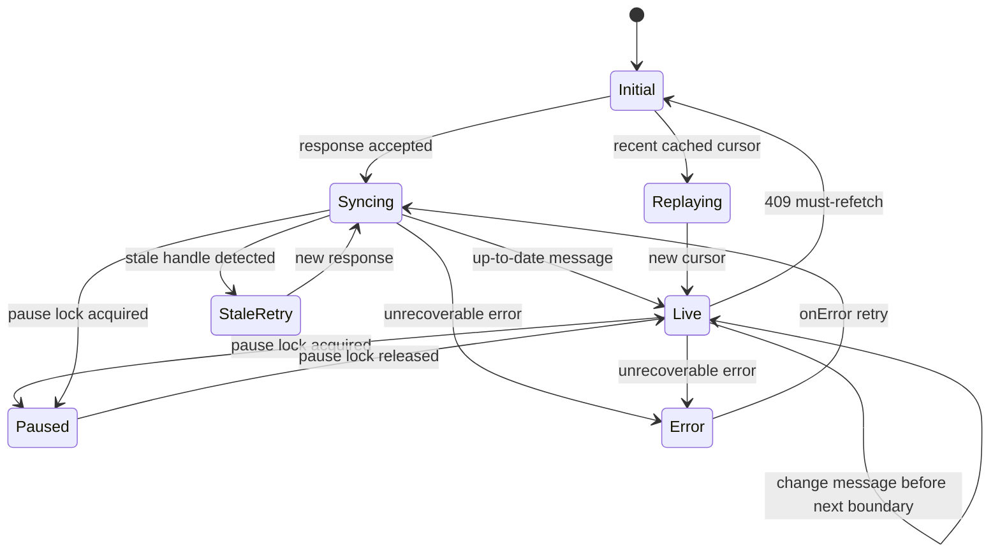
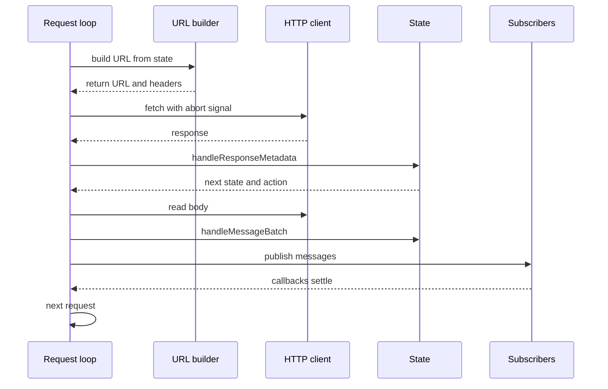

# ShapeStream Client

`ShapeStream` is the protocol client for one Electric shape. It sends Hypertext Transfer Protocol (HTTP) requests, tracks the stream offset and shape handle, parses messages, and delivers batches to subscribers. It does not store rows. It gives each subscriber the raw change, control, and event messages in order.

The class is in `src/client.ts`. The declaration runs from line 649 to line 2417. The class implements `ShapeStreamInterface`, which is declared in `src/client.ts:557-589`.

## Construction

The constructor receives a `ShapeStreamOptions` object. The object requires a `url`. It accepts an offset, a handle, headers, parameters, a subscribe flag, a Server-Sent Events (SSE) flag, a log mode, and an abort signal. It also accepts a fetch client, a visibility adapter, backoff options, a live request timeout, a parser, and a transformer. The remaining options are a column mapper, an error handler, a subset method, and an HTTP warning flag. The citation is `src/client.ts:300-555`.

The constructor does six things in order:

1. It applies the default `subscribe: true`.
2. It validates the options.
3. It creates the initial state from the offset and handle.
4. It creates the pause lock.
5. It builds the parser and transformer chain.
6. It builds the fetch wrapper chain.

The citation is `src/client.ts:729-818`.

The fetch chain has four wrappers around the platform `fetch`. The innermost wrapper adds backoff. The next wrapper buffers response chunks. The next wrapper checks required headers. The outermost wrapper consumes the response body. The citation is `src/client.ts:789-815`.

## The state machine

The stream holds one immutable state object. The class is `ShapeStreamState`. The valid kinds are `initial`, `syncing`, `live`, `replaying`, `stale-retry`, `paused`, and `error`. The citation is `src/shape-stream-state.ts:38-45`.

Each transition returns a new state object. No state mutates another state. The diagram shows the principal transitions. A change message in the `live` state does not leave it: the state changes at the next up-to-date boundary, not at each row change. The base class describes the common getters and the universal transitions. The citation is `src/shape-stream-state.ts:127-224`.

The `InitialState`, `SyncingState`, and `StaleRetryState` share a `FetchingState` base. A response moves the stream to `SyncingState`. A 204 no-content response moves it directly to `LiveState`. A 204 is a deprecated server response that means "you are caught up"; it has no body, so the state advances without a message batch. The citation is `src/shape-stream-state.ts:370-404`.

`LiveState` applies the live query parameters. It adds the `electric-cursor` value as the `cursor` query parameter and adds `live=true`. It does not add them to a snapshot request. The `canLongPoll` context flag suppresses `live=true` when the stream is refreshing or resuming from a pause. Those catch-up requests must not wait for new data. The flag is computed in `#requestShape` from the refresh counter and the pause state. The citations are `src/shape-stream-state.ts:512-521` and `src/client.ts:1340-1347`.

## The request loop

`#requestShape` is the loop. It runs until the stream reaches an up-to-date state and the `subscribe` option is false, or until the signal aborts. The citation is `src/client.ts:970-1128`.

The loop does these steps:

1. It stops when the signal is aborted.
2. It rethrows an error state.
3. It returns when the pause lock is held.
4. It returns when `subscribe` is false and the state is up to date.
5. It checks for a fast retry loop: five requests at the same offset inside 500 milliseconds.
6. It resumes a paused state.
7. It builds the request uniform resource locator (URL) and headers.
8. It creates an abort listener.
9. It fetches the shape.
10. It handles a 409 response.
11. It waits for the next loop tick.

The citation is `src/client.ts:970-1128`.

The loop is recursive. A successful response ends with `return this.#requestShape()`. The call moves to the next offset. The citation is `src/client.ts:1126-1127`.

## Subscribers and delivery order

`subscribe` adds a callback to a map. The first call starts the loop. The method returns an unsubscribe function. The citation is `src/client.ts:1848-1865`.

Delivery uses a promise chain. The field is `#messageChain`. Each batch waits for all subscriber callbacks in the previous batch. The citation is `src/client.ts:1958-1994`.

The SSE parser calls its message handler synchronously. The promise chain is necessary to keep callback order across SSE events and long-poll batches. A nested snapshot batch may bypass the chain. The bypass exists because `requestSnapshot` can be called from inside a subscriber callback. Without the bypass, the snapshot would wait for the subscriber that is waiting for the snapshot. The citation is `src/client.ts:1975-1993`.

**Aha:** the bypass is a controlled re-entrancy door, not a general parallel path. Ordinary stream batches always stay serialized. Only a snapshot batch injected by `requestSnapshot` can pass through the door. This avoids a deadlock and still preserves message order for the stream.

## Snapshots

`requestSnapshot` requests a subset of the shape and injects the result into the normal subscriber stream. It works only when the log mode is `changes_only`. The log mode is the `log` option: `full` loads an initial snapshot and then sends changes; `changes_only` skips the snapshot and sends changes only. The separate `replica` option selects row content: the default sends only changed columns, and `full` sends complete rows. The citation is `src/client.ts:2152-2235` and `src/client.ts:784`.

The method does these steps:

1. It rejects the call in `full` mode.
2. It starts the stream if necessary.
3. It acquires the pause lock with a unique snapshot reason.
4. It fetches the snapshot.
5. It appends a synthetic `snapshot-end` control message and a synthetic `subset-end` control message.
6. It registers the snapshot with the snapshot tracker.
7. It publishes the data as one re-entrant batch.
8. It advances the stream offset to the position in the snapshot response headers.
9. It releases the pause lock.

The citation is `src/client.ts:2152-2235`.

The two synthetic messages mark different boundaries. `snapshot-end` carries the PostgreSQL snapshot metadata (`xmin`, `xmax`, `xip_list`, `snapshot_mark`, `database_lsn`). `subset-end` carries the subset parameters that produced the rows. Neither changes the row map; they tell a subscriber where the injected batch starts and ends. The citations are `src/client.ts:2187-2192` and `src/types.ts:120-128`.

Advancing the stream offset is safe because of the snapshot tracker. The tracker holds the snapshot metadata and the set of keys in the snapshot. It drops a live change when the change's transaction is visible in the snapshot and the key is already present. The offset then continues after the snapshot boundary without a gap. The citation is `src/snapshot-tracker.ts:94-141`.

`fetchSnapshot` performs the same HTTP request but does not inject the data. It returns the metadata and the rows. It uses `GET` by default. It can use `POST` when the caller sets `method: 'POST'` or the stream sets `subsetMethod: 'POST'`. The citation is `src/client.ts:2248-2372`.

The snapshot tracker removes duplicate changes. A live change that is already part of the snapshot is rejected. The tracker compares the transaction identifiers against the PostgreSQL snapshot coordinates `xmin` (oldest active transaction), `xmax` (first unassigned transaction), and `xip_list` (transactions in progress when the snapshot was taken). A transaction is visible when its identifier is below `xmin`, or below `xmax` and absent from `xip_list`. The citation is `src/snapshot-tracker.ts:123-141` and `src/helpers.ts:116-132`.

## Pause, visibility, and wake recovery

`PauseLock` is a set of reason strings. The stream is paused when the set is not empty. It resumes when the last reason is released. The citation is `src/pause-lock.ts:32-112`.

This design solves a real ordering problem. The browser can hide the tab while a snapshot request is active. A boolean pause flag would let the snapshot release resume the stream while the tab is still hidden. A set keeps the `visibility` reason until the tab is visible again. The citation is `src/pause-lock.ts:1-31`.

The stream subscribes to browser visibility events. A hidden document acquires the `visibility` reason. A visible document releases it. The citation is `src/client.ts:2018-2052`.

In non-browser runtimes, the stream detects a system wake with a timer. The timer runs every 2000 milliseconds. If the total gap between timer ticks is more than 6000 milliseconds, the stream aborts the current request and refreshes. The interval is 2000 milliseconds and the threshold is 4000 milliseconds beyond that interval, so both statements describe the same 6000-millisecond total. The citation is `src/client.ts:2094-2122`.

## Forced refresh

`forceDisconnectAndRefresh` aborts a live request without waiting for the server long-poll timeout. It increments a refresh counter, aborts the active request with the reason `force-disconnect-and-refresh`, and waits for the next loop tick. The next request does not long-poll. It catches up first. The citation is `src/client.ts:1935-1956`.

The `canLongPoll` flag in the URL builder reads the refresh counter. A refresh request sends no `live=true`. The citation is `src/client.ts:1340-1347`.

## Errors

The constructor validates options. It throws `MissingShapeUrlError`, `InvalidSignalError`, `InvalidShapeOptionsError`, `MissingShapeHandleError`, or `ReservedParamError`. The citation is `src/client.ts:2498-2554`.

The request loop sends errors to subscribers and tears down the stream. If an `onError` handler exists, the handler can return an object to retry. The handler can change the params or headers before the retry. The loop bounds retries at 50. The citation is `src/client.ts:840-931`.

The error classes are in `src/error.ts`. `FetchError` carries the status, text, JSON (JavaScript Object Notation) body, headers, and URL. The citation is `src/error.ts:1-46`.

Read [02-shape-protocol-and-offsets.md](02-shape-protocol-and-offsets.md) for the message and offset model. Read [03-fetching-caching-and-reconnect.md](03-fetching-caching-and-reconnect.md) for the retry and cache details.
