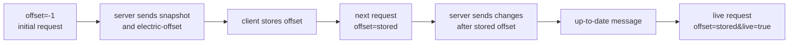
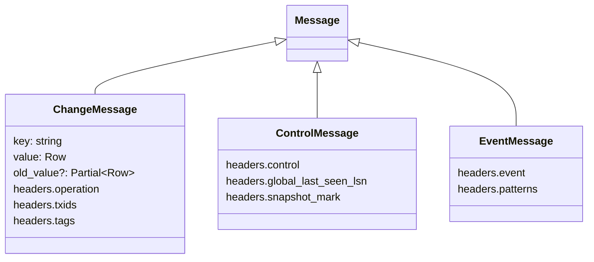

# Shape Protocol and Offsets

The Electric shape protocol is a JavaScript Object Notation (JSON) message stream over Hypertext Transfer Protocol (HTTP). Each response contains an array of messages and a set of `electric-*` headers. The client uses the headers to advance an offset. It uses the messages to change a row projection. The protocol has three message families: change messages, control messages, and event messages.

All protocol names are in `src/constants.ts:1-54`. All message shapes are in `src/types.ts:120-152`.

## One concrete request and response

A shape request is an HTTP `GET` to the URL that the caller supplies. The client adds the protocol parameters to that URL. This example asks for the `todos` table from the start of the log:

```http
GET /v1/shape?table=todos&offset=-1 HTTP/1.1
Host: localhost:3000
```

The response uses `electric-*` HTTP headers and a JavaScript Object Notation (JSON) array body:

```http
HTTP/1.1 200 OK
electric-handle: 1234567890
electric-offset: 0_0
electric-schema: {"id":{"type":"int4"},"title":{"type":"text"}}

[
  {"key":"1","value":{"id":1,"title":"Buy milk"},"headers":{"operation":"insert"}},
  {"key":"2","value":{"id":2,"title":"Walk"},"headers":{"operation":"insert"}},
  {"headers":{"control":"up-to-date"}}
]
```

The next request sends the values from the headers:

```http
GET /v1/shape?table=todos&offset=0_0&handle=1234567890 HTTP/1.1
```

A live request adds `live=true` and the `electric-cursor` value as `cursor`. The server holds that request open. The response can contain new changes and a new `up-to-date` message. The client reads the new offset and sends the next request. The citation is `src/client.ts:1213-1355`.

The example is illustrative. The server can add a cursor, an up-to-date header, or other headers. The required set is in the header-check section of [03-fetching-caching-and-reconnect.md](03-fetching-caching-and-reconnect.md). The parameter names are in `src/constants.ts:1-54`.

## Offsets

An offset is a position in the shape log. The TypeScript type has four accepted forms:

```ts
export type Offset =
  | `-1`
  | `now`
  | `${number}_${number}`
  | `${bigint}_${number}`
```

The citation is `src/types.ts:26-30`.

| Offset | Meaning | Source |
|--------|---------|--------|
| `-1` | Start from the beginning of the shape | `src/types.ts:27` |
| `now` | Start from the current end of the shape | `src/types.ts:28` |
| `<number>_<number>` | A concrete log position with a 64-bit transaction offset | `src/types.ts:29-30` |
| `<bigint>_<number>` | The same form when the transaction offset exceeds the safe integer range | `src/types.ts:30` |

The first number is the transaction offset. The second number is the operation offset inside that transaction. The client does not parse the parts. It stores the offset as a string and passes it back unchanged. It uses string equality to decide whether two offsets are the same. It does not sort offsets, so the lack of numeric parsing is safe. The citation is `src/types.ts:26-30`.

The offset travels in the `offset` query parameter. The required header for the next offset is `electric-offset`. The citations are `src/constants.ts:3` and `src/constants.ts:12`.



## Message families



The union type is `Message<T>`. It combines `ControlMessage`, `EventMessage`, and `ChangeMessage<T>`. The citation is `src/types.ts:120-152`.

The `headers` field in a message is a message header, not an HTTP header. It is part of the JSON object.

A change message has a `key`, a `value`, an optional `old_value`, and message headers. The headers carry the `operation`, the transaction identifiers, and optional move tags. The `old_value` field appears only on an update when the `replica` shape parameter is `full`. The citation is `src/types.ts:134-146`.

The three operations are `insert`, `update`, and `delete`. The citation is `src/types.ts:49`.

A move tag is a string that names one reason why a row belongs to a shape. A tag can be composite; the parts are separated by `|`. A tag is present only when the shape has a subquery in its `WHERE` clause. An event message reports that a row left or entered the shape because a tag changed. `move-out` reports a departure and `move-in` reports an arrival. A move pattern is the column position and value that matched. The client delivers event messages to subscribers. `Shape` does not act on them: its processing loop handles change messages and control messages only. A subscriber that needs move provenance must read the event messages from `ShapeStream`. The citation is `src/types.ts:50-69` and `src/shape.ts:198-269`.

A control message has a `control` message header. The values are `up-to-date`, `must-refetch`, `snapshot-end`, and `subset-end`. The `up-to-date` message can also carry `global_last_seen_lsn`. The `snapshot-end` message carries the PostgreSQL snapshot coordinates. The `subset-end` message carries the subset parameters. The client consumes `snapshot-end` and `subset-end` as batch boundaries around an injected snapshot; they do not change rows. The citation is `src/types.ts:120-128`.

An event message has an `event` message header and a `patterns` array. The event values are `move-out` and `move-in`. The citation is `src/types.ts:130-132` and `src/types.ts:62-69`.

The client provides type guards. `isChangeMessage` tests for the `key` property. `isControlMessage` tests for the `control` header. The citation is `src/helpers.ts:28-55`.

## The up-to-date boundary

`up-to-date` is the most important control message. It marks the end of a batch of changes. It tells the client that every change before the boundary is present. The `Shape` class uses the boundary to decide when to notify subscribers. The citation is `src/shape.ts:18-40`.

The notification rules are:

- **N1.** While the shape status is `syncing`, data messages change the row map but do not call subscriber callbacks.
- **N2.** While the shape status is `up-to-date`, a data message changes the row map and calls subscriber callbacks. The status then returns to `syncing`.

The citation is `src/shape.ts:18-40`.

A `must-refetch` message clears the row map and returns the status to `syncing`. The client also publishes a synthetic `must-refetch` message after a 409 response. The citation is `src/shape.ts:251-267` and `src/client.ts:1105-1110`.

The `getOffset` helper reads the offset from an up-to-date message. The offset comes only from the `global_last_seen_lsn` header. The helper returns `undefined` when the header is absent. The helper is used in Server-Sent Events (SSE) mode, where the message itself carries the new transaction position. The citation is `src/helpers.ts:63-72`.

**Aha:** the long-poll response carries the new offset in a header. The SSE response carries the new position inside the up-to-date message as a log sequence number. The client resolves both into the same offset string. The SSE value becomes `${lsn}_0`, because an up-to-date message marks a transaction boundary with operation offset zero. The citation is `src/helpers.ts:68-71`.

## State advancement from headers

A response updates five fields: the handle, the offset, the schema, the live cursor, and the last-sync time. The worker is `parseResponseFields`. The citation is `src/shape-stream-state.ts:275-290`.

The rules are:

| Header | Field | Rule | Source |
|--------|-------|------|--------|
| `electric-handle` | handle | Use it when present and not expired; otherwise keep the prior handle | `src/shape-stream-state.ts:278-282` |
| `electric-offset` | offset | Use it when present | `src/shape-stream-state.ts:283` |
| `electric-cursor` | live cursor | Use it when present | `src/shape-stream-state.ts:284` |
| `electric-schema` | schema | Keep the first schema | `src/shape-stream-state.ts:285` |
| none | last sync time | Set to now on a 204 response | `src/shape-stream-state.ts:286-287` |

The "not expired" test uses the `expiredHandle` input to `handleResponseMetadata`. The client looks up the shape key in its expired-handle cache and passes that value. The state machine itself does not read the cache. The citation is `src/client.ts:1349-1354`.

The schema is kept from the first response. A later response does not replace it. A `must-refetch` reset clears the schema, so the first response after the reset supplies a new one. The citation is `src/shape-stream-state.ts:285` and `src/shape-stream-state.ts:215-223`.

## Live cursor and replay

The `electric-cursor` header identifies the cache generation of a live response. The client sends it back in the `cursor` query parameter. A content delivery network (CDN) uses the value to separate cached responses. The citation is `src/constants.ts:1` and `src/constants.ts:8`.

The client stores the last up-to-date cursor in `localStorage` under the key `electric_up_to_date_tracker`. The entry is valid for 60000 milliseconds. The citation is `src/up-to-date-tracker.ts:17-24`.

On a new page load, the client checks the stored cursor. If the entry is fresh, the stream enters replay mode. Replay mode can suppress the first up-to-date message when the cursor has not changed. The client then waits for a new cursor before it reports fresh data. The citation is `src/shape-stream-state.ts:637-650` and `src/client.ts:1627-1637`.

The entry has a maximum of 250 shapes. The cache removes the oldest entry when the limit is exceeded. The citation is `src/up-to-date-tracker.ts:20-21` and `src/up-to-date-tracker.ts:42-49`.

## Schema and parsing

The `electric-schema` header is a JSON object. Each key is a column name. Each value is a column description with a `type` and optional metadata. The citation is `src/types.ts:159-227`.

The column types include `varchar` with a maximum length, `bpchar` with a length, and time types with a precision. They also include interval types with fields and precision, `bit` with a length, and `numeric` with precision and scale. The citation is `src/types.ts:164-215`.

The parser maps these types to JavaScript values:

| PostgreSQL type | Parser | Result |
|-----------------|--------|--------|
| `int2` | `parseNumber` | number |
| `int4` | `parseNumber` | number |
| `int8` | `parseBigInt` | bigint |
| `bool` | `parseBool` | boolean, accepts `true` and `t` |
| `float4` | `parseNumber` | number |
| `float8` | `parseNumber` | number |
| `json` | `parseJson` | parsed value |
| `jsonb` | `parseJson` | parsed value |
| any other type | `identityParser` | the raw string |

The citation is `src/parser.ts:26-41` and `src/parser.ts:192-194`.

A caller can add or replace a parser. The `MessageParser` merges the caller parser over the default parser. The citation is `src/parser.ts:99-111`.

An array column uses the `dims` field. The parser applies `pgArrayParser` when `dims` is greater than zero. The array parser handles quoted values, escaped characters, nested arrays, and the literal `NULL`. The citation is `src/parser.ts:44-97` and `src/parser.ts:197-207`.

A `NULL` value in a column with `not_null` set throws `ParserNullValueError`. The citation is `src/parser.ts:211-229`.

## Log modes

The `log` query parameter selects the row content. The default is `full`. The other value is `changes_only`. The citation is `src/client.ts:784` and `src/constants.ts:26`.

In `full` mode, the client materializes every row and applies every insert, update, and delete. In `changes_only` mode, the client applies an update or a delete only for a key that it observed as an insert. This rule prevents a client from applying a partial row to a key it does not have. The citation is `src/shape.ts:205-248`.

The `log` option is not the `replica` parameter. `log` controls how much history and row content the shape sends: `full` or `changes_only`. `replica` controls the content of one update message: `default` sends only changed columns, and `full` sends the whole row and an `old_value`. A shape can use `log=full` with `replica=default`. The `ShapeStream.Replica` constants name the `replica` values; they do not name the `log` values. The citations are `src/client.ts:113-151` and `src/client.ts:652-655`.

`requestSnapshot` is available only in `changes_only` mode. The citation is `src/client.ts:2156-2160`.

## Snapshot metadata

A snapshot response carries `xmin`, `xmax`, `xip_list`, `snapshot_mark`, and `database_lsn`. The citation is `src/types.ts:32-43` and `src/types.ts:245-249`.

These values follow PostgreSQL visibility rules. A transaction is visible in the snapshot when its identifier is less than `xmin`, or when it is less than `xmax` and not in `xip_list`. The citation is `src/helpers.ts:116-132`.

The snapshot tracker uses these rules to drop a live change that the snapshot already contains. A change message carries 32-bit transaction identifiers. A snapshot carries 64-bit `xid8` values. The tracker maps each 32-bit identifier to the 64-bit value in the same epoch. It uses `xmax` as the reference and signed modulo-2^32 arithmetic. The calculation mirrors the server implementation. The citation is `src/snapshot-tracker.ts:94-117`.

The tracker retires a snapshot when the stream passes the snapshot `database_lsn`. This bound is necessary for the modulo-2^32 comparison: it keeps every compared transaction within 2^31 of the reference. The citation is `src/snapshot-tracker.ts:143-151`.

## Offset edge cases

| Case | Client behavior | Source |
|------|-----------------|--------|
| Offset is not `-1` or `now`, and no handle is supplied | Throw `MissingShapeHandleError` | `src/client.ts:2517-2524` |
| Caller supplies a reserved parameter | Throw `ReservedParamError` | `src/client.ts:2446-2455` |
| Response has no `electric-handle` or `electric-offset` | Throw `MissingHeadersError` | `src/fetch.ts:310-368` |
| Response handle equals the expired handle | Enter stale retry and add a `cache-buster` query parameter | `src/shape-stream-state.ts:296-320` |
| Server returns 409 | Reset the stream and publish `must-refetch` | `src/client.ts:1083-1111` |
| Offset is up to date and `subscribe` is false | Stop the request loop | `src/client.ts:992-997` |

The required response headers are `electric-offset` and `electric-handle`. A live response also requires `electric-cursor`. A non-live response requires `electric-schema`, unless it is a snapshot request; the header check skips all snapshot requests. The citation is `src/fetch.ts:310-347`.

Read [01-shape-stream-client.md](01-shape-stream-client.md) for the client that drives this protocol. Read [03-fetching-caching-and-reconnect.md](03-fetching-caching-and-reconnect.md) for the transport behavior.
