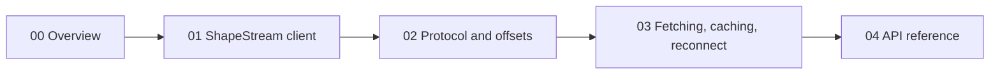
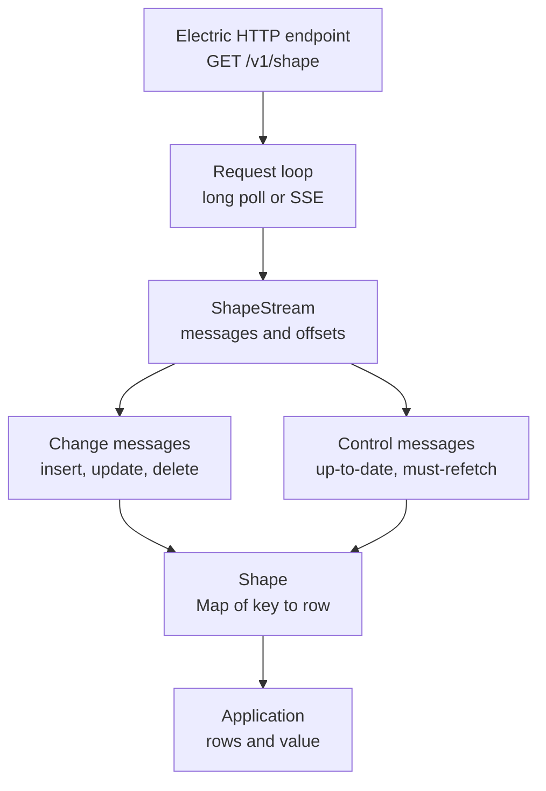

# TypeScript Client

The `@electric-sql/client` package is the TypeScript client for Electric. It reads a shape over Hypertext Transfer Protocol (HTTP). A shape is a named subset of one PostgreSQL table, selected by a table name, a `WHERE` clause, and a column list. The shape's uniform resource locator (URL) and parameters identify it. It gives an application two levels of access. `ShapeStream` delivers individual protocol messages. `Shape` keeps a materialized map of rows in memory.

The package is published as `@electric-sql/client` at version `1.5.28`. The license is Apache-2.0. The entry point exports the public surface of the `client`, `shape`, and `types` modules. It also exports selected helpers, errors, constants, column mapping, and an expression compiler. The compiler turns a structured `WHERE` or `ORDER BY` value into Structured Query Language (SQL) text. The citation is `src/index.ts:1-19`.

## Reading order

| Order | Document | What you learn |
|-------|----------|----------------|
| 1 | [00-overview.md](00-overview.md) | The purpose, layers, package facts, and public surface |
| 2 | [01-shape-stream-client.md](01-shape-stream-client.md) | `ShapeStream` options, request loop, subscribers, snapshots, and pause control |
| 3 | [02-shape-protocol-and-offsets.md](02-shape-protocol-and-offsets.md) | Messages, headers, offsets, schemas, and the up-to-date boundary |
| 4 | [03-fetching-caching-and-reconnect.md](03-fetching-caching-and-reconnect.md) | Backoff, prefetch, content delivery network (CDN) recovery, Server-Sent Events (SSE) fallback, and wake recovery |
| 5 | [04-api-reference.md](04-api-reference.md) | Every public option, method, type, error class, and helper |

## Package map

All paths are relative to `packages/typescript-client`.

| Area | File | Lines | Purpose |
|------|------|-------|---------|
| Public exports | `src/index.ts` | 1-19 | Re-exports the public surface |
| Stream client | `src/client.ts` | 649-2417 | `ShapeStream`, options, request loop, snapshots |
| Materialized shape | `src/shape.ts` | 78-360 | `Shape`, row map, notification rules |
| State machine | `src/shape-stream-state.ts` | 127-835 | Immutable stream states and transitions |
| Protocol types | `src/types.ts` | 5-249 | Rows, offsets, messages, schema, snapshots |
| Constants | `src/constants.ts` | 1-54 | Header names and query parameter names |
| Message parsing | `src/parser.ts` | 26-229 | Type parsing and array parsing |
| Fetch wrappers | `src/fetch.ts` | 49-564 | Backoff, body consumption, prefetch, header checks |
| Helpers | `src/helpers.ts` | 28-132 | Type guards, offsets, JavaScript Object Notation (JSON), snapshot visibility |
| Errors | `src/error.ts` | 1-125 | Error classes |
| Column mapping | `src/column-mapper.ts` | 25-392 | Name mapping and `WHERE` encoding |
| Expression compiler | `src/expression-compiler.ts` | 18-132 | Structured `WHERE` and `ORDER BY` to SQL |
| Pause control | `src/pause-lock.ts` | 32-112 | Multi-reason pause lock |
| Snapshots | `src/snapshot-tracker.ts` | 16-152 | Duplicate change filtering |
| CDN cache memory | `src/expired-shapes-cache.ts` | 9-77 | Expired handle tracking |
| Replay memory | `src/up-to-date-tracker.ts` | 17-159 | Cached response detection |
| Runtime visibility | `src/runtime-visibility.ts` | 1-21 | Default application-state adapter registry |

## Two levels of access

`ShapeStream` is the protocol client. It tracks the offset, the shape handle, the schema, and the connection state. `Shape` is the projection client. It applies each change message to a map. It stops notifying during initial synchronization. It notifies when the stream reaches an up-to-date boundary. The rules are in `src/shape.ts:18-40`.

The two control messages have different jobs. An `up-to-date` message marks a sync boundary. Every change before the boundary is present. A `must-refetch` message tells the projection to discard its rows and start again. The citations are `src/types.ts:120-128` and `src/shape.ts:251-267`.

**Aha:** the package has no database and no cache of rows on disk. `Shape` is a live projection of an HTTP message stream. The offset is a position in the shape log, in the form `<transaction>_<operation>`. The shape handle identifies one server-side build of the shape. A new `Shape` can rebuild the same state from the same offset and handle. This is why the client can resume after a reload with that pair. The pair is not enough alone. The new stream also needs the same shape URL, parameters, and authentication headers.

## Related studies

- [TypeScript client overview](00-overview.md) explains the package layers.
- [Sync service](../sync-service/README.md) explains the server that produces the messages.
- [Sync service HTTP interface](../sync-service/02-http-api-and-shapes.md) explains `/v1/shape`.
- [The durable stream primitive](../03-the-durable-stream-primitive.md) explains the offset model at the protocol level.
- [Electric and Durable Streams](../README.md) is the parent study.

## Source of truth

Every claim in this directory comes from the source files under `packages/typescript-client`. A citation has the form `src/client.ts:120-145`. The line range is inclusive. The end line is never larger than the file length.

Return to the platform index: [../README.md](../README.md).
