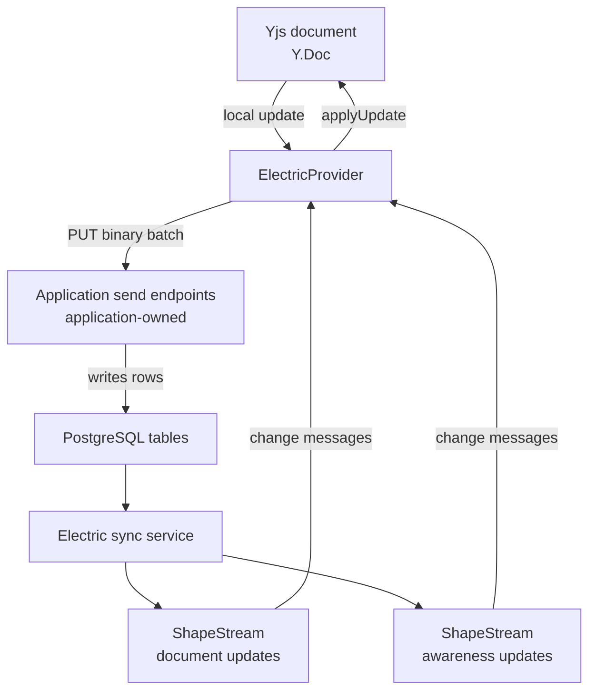
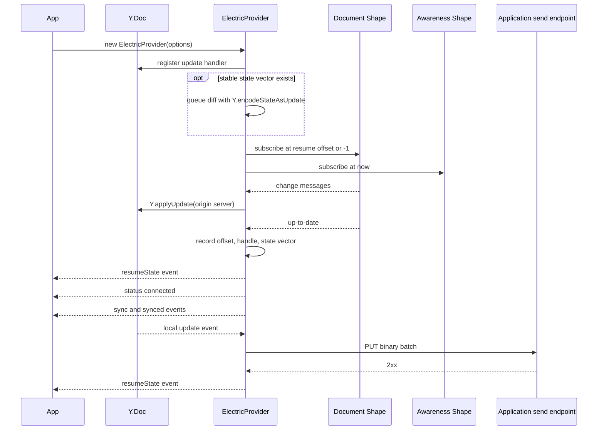

# Overview

`@electric-sql/y-electric` is the Yjs network provider for Electric. Yjs is a Conflict-free Replicated Data Type (CRDT) library for shared editing. The provider sends local document edits to an application-owned Hypertext Transfer Protocol (HTTP) endpoint. That endpoint writes the rows. The provider receives remote edits through one or two Electric shape streams. An Electric shape is a live query over one PostgreSQL table; a `ShapeStream` is the client stream that receives its messages.

The package is small. It has one provider class, one reference persistence class, one row parser, and the types that connect them. The citation is `src/index.ts:1-4`.

## Package facts

| Fact | Value | Source |
|------|-------|--------|
| Package name | `@electric-sql/y-electric` | `package.json:2` |
| Version | `0.1.54` | `package.json:3` |
| License | Apache-2.0 | `package.json:72` |
| Module type | ECMAScript module (ESM) | `package.json:9` |
| Client dependency | `@electric-sql/client` | `package.json:11` |
| Encoding dependency | `lib0` | `package.json:12` |
| Awareness dependency | `y-protocols` | `package.json:13` |
| Document dependency | `yjs` | `package.json:14` |
| Build tool | `tsup` | `package.json:27` |
| Test tool | `vitest` | `package.json:29` |

The package has two runtime shapes. The document shape is always present. The awareness shape is optional. The citation is `src/types.ts:78-100`.

## The layers



The Electric sync service is the server that reads the PostgreSQL log and serves each shape as a message stream. The provider is a bridge, not a store. It holds one pending document update buffer. It holds one pending awareness update buffer. It does not hold the remote history. On the first start, the document shape replays history into the document. With a stored offset, it replays from that offset instead.

The citation is `src/y-electric.ts:51-60` and `src/y-electric.ts:263-308`.

## The public surface

| Symbol | Kind | Behavior | Source |
|--------|------|----------|--------|
| `ElectricProvider` | Class | Connect a Yjs document to Electric | `src/y-electric.ts:30-457` |
| `LocalStorageResumeStateProvider` | Class | Save and load resume state in browser storage | `src/local-storage-resume-state.ts:11-61` |
| `parseToDecoder.bytea` | Function | Convert a PostgreSQL `bytea` hex string to a decoder | `src/utils.ts:18-23` |
| `ElectricProviderOptions` | Type | Constructor options | `src/types.ts:78-100` |
| `ResumeState` | Type | Offset, handle, and stable state vector | `src/types.ts:102-112` |
| `YProvider` | Type | Event names and payloads | `src/types.ts:36-45` |
| `ElectricResumeStateProvider` | Type | Event interface with one `synced(resumeState)` event; `LocalStorageResumeStateProvider` implements it | `src/types.ts:54-56` |
| `SendErrorRetryHandler` | Type | Retry decision for a failed send | `src/types.ts:19-25` |
| `ConnectivityStatus` | Type | `connected`, `disconnected`, or `connecting` | `src/types.ts:11` |

## The two shapes

The provider opens the document shape at the stored offset and handle. If no resume state exists, it uses the options in `documentUpdates.shape`. If those options have no offset, the `ShapeStream` default is `-1`, which replays the full log. The citation is `src/y-electric.ts:269-283`.

The provider opens the awareness shape at the literal offset `now`. The citation is `src/y-electric.ts:287-297`. In the Electric protocol, `-1` means "start at the beginning" and `now` means "start at the current end". Awareness data is ephemeral. A new client does not need the old awareness history. A start at `now` gives the client only new awareness changes.

**Aha:** the two shapes use different starting offsets on purpose. A Yjs update is an incremental delta, not a document snapshot. Skipping document rows loses content, so the document shape starts at the beginning unless a matching local document and stored offset exist. Awareness updates must not replay from the beginning because old presence records would reappear as ghost users. One piece of code uses two consistency rules: durable history for the document, current state only for presence.

## One start sequence



The constructor registers the local update handler before it connects. The citation is `src/y-electric.ts:125-145`. The provider emits `sync` and `synced` together when the boolean changes, so both events appear at the boundary in the diagram.

The "record" step writes the in-memory `resumeState` field and emits the `resumeState` event. It does not write storage. The application must attach a persistence provider, as described in [01-yjs-provider-bridge.md](01-yjs-provider-bridge.md).

## Resume state

`ResumeState` has two parts. The first part is the document position: an offset and a handle. The second part is a stable state vector. The citation is `src/types.ts:102-112`.

```ts
type ResumeState = {
  document?: { offset: Offset; handle: string }
  stableStateVector?: Uint8Array
}
```

The state vector is a Yjs summary of the document at the last sync boundary. When the provider starts, it calls `Y.encodeStateAsUpdate(this.doc, this.resumeState.stableStateVector)`. That call encodes the difference between the current document and the vector. The provider stores the difference in `pendingChanges`. The citation is `src/y-electric.ts:136-141`.

This behavior preserves edits made while the application was offline. The edits are in the local document. They are not in the server history. The diff sends them at the first connection. The application must persist the Y.Doc itself between sessions. A stored offset or vector without the matching document can skip content, because the diff assumes the document already contains everything before the vector.

## The send endpoint contract

The provider sends one binary body per request. The method is `PUT`. The content type is `application/octet-stream`. The citation is `src/y-electric.ts:459-475`.

The body is one `lib0` variable-length byte array: a variable-length unsigned integer (varUint) length prefix followed by the merged Yjs update bytes. One request carries one batch, and that batch can contain several merged updates. The citation is `src/y-electric.ts:368-369` and `src/y-electric.ts:174-180`.

The endpoint must return a 2xx status. Any other status is an error. The citation is `src/y-electric.ts:477-479`.

A send error calls the optional retry handler with `{ response, error }`. The `response` value is undefined when the fetch call itself failed. The handler returns a promise of a boolean. The type comment says true means "retry". The implementation treats true as "the send succeeded": `send` returns true, and `sendOperations` continues without re-batching the failed buffer. A handler that returns true must perform its own retry if the data must not be lost. The citation is `src/types.ts:19-25` and `src/y-electric.ts:482-488`.

## What the package does not do

The package does not define the database schema. The application creates the table that stores document update rows.

The package does not define the HTTP endpoints. The application creates the endpoints that accept `PUT` requests and write rows.

The package does not perform authentication. The shape options carry the headers for receive requests. The `fetchClient` option can add headers to send requests, because the package passes it the request options. Without a custom `fetchClient`, the send request carries only `Content-Type: application/octet-stream`. The application must authenticate its own endpoint.

The package does not resolve conflicts. Yjs resolves conflicts. The provider only transports updates.

The package does not persist resume state by itself. It emits a `resumeState` event. A persistence class must subscribe to that event. The citation is `src/y-electric.ts:335` and `src/y-electric.ts:384`.

Read [01-yjs-provider-bridge.md](01-yjs-provider-bridge.md) for the full lifecycle, the send and receive paths, and the awareness protocol. Read [../typescript-client/00-overview.md](../typescript-client/00-overview.md) for the shape client that the provider uses.
