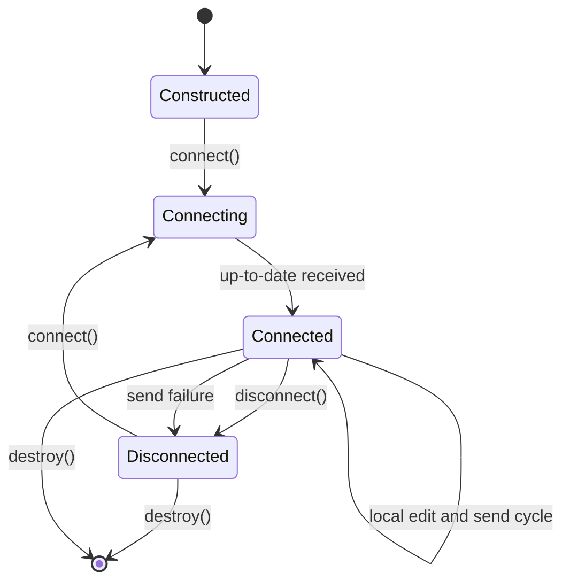
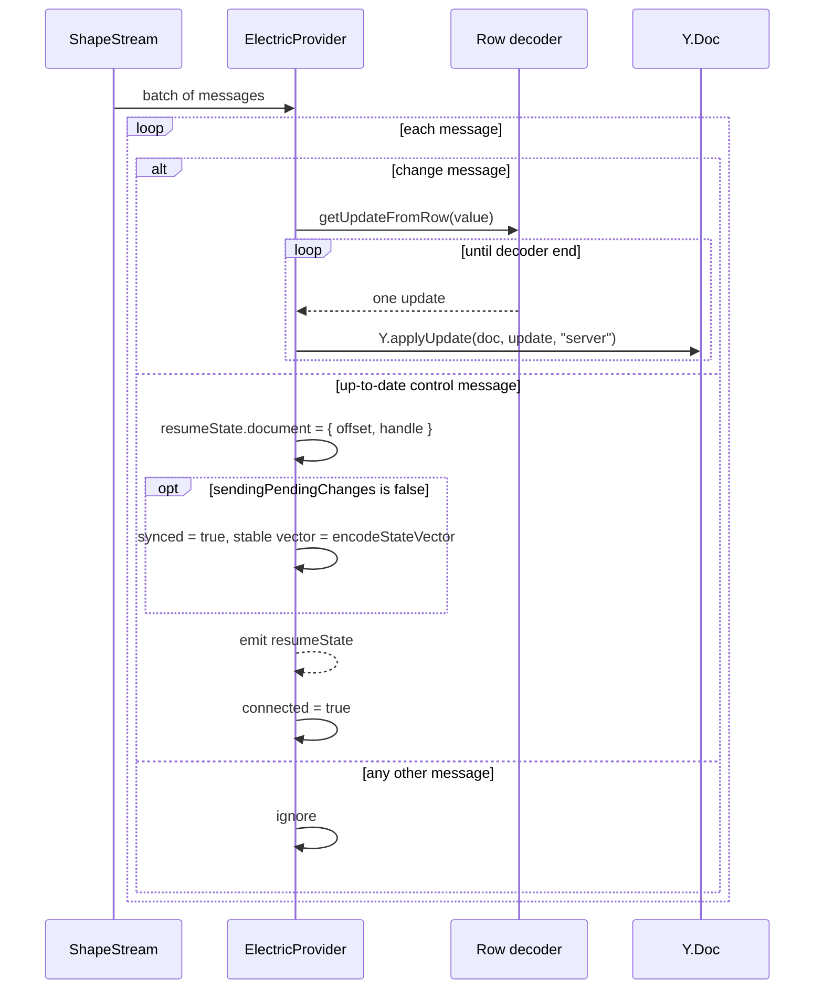
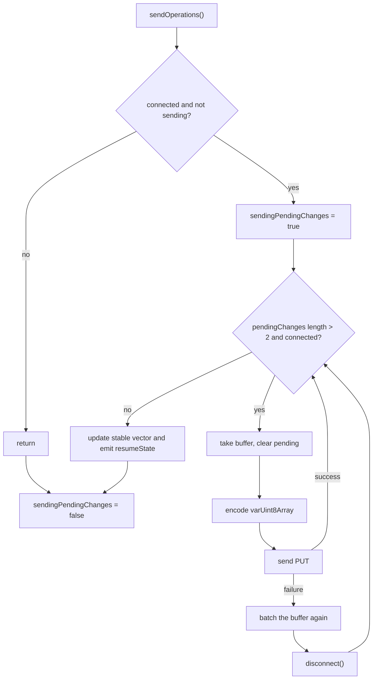

# The Yjs Provider Bridge

`ElectricProvider` is a two-way bridge between a Yjs document and Electric. The receive path replays stored binary updates into the document. The send path batches local document updates and sends them to an application endpoint. A separate optional path carries awareness data for cursors and presence.

This document follows one provider from construction to destruction. The source is `src/y-electric.ts:30-457`.

## Construction

The constructor accepts `doc`, `documentUpdates`, optional `awarenessUpdates`, optional `resumeState`, `connect`, `fetchClient`, and `debounceMs`. The citation is `src/y-electric.ts:100-108`.

It stores the configuration and applies two defaults:

| Field | Default | Source |
|-------|---------|--------|
| `resumeState` | `{}` (no position and no vector) | `src/y-electric.ts:114` |
| `debounceMs` | `0` | `src/y-electric.ts:115` |

`ResumeState` has an optional `document` field with `offset` and `handle`, and an optional `stableStateVector` field of type `Uint8Array`. The citation is `src/types.ts:102-112`.

The constructor then performs four steps in order:

1. It registers a handler on the `update` event of the Yjs document.
2. It registers a handler on the `update` event of the awareness protocol, if awareness is configured.
3. It queues the difference between the current document and the stored stable state vector, if a vector exists.
4. It calls `connect()`, unless the caller sets `connect` to false.

The citation is `src/y-electric.ts:125-145`.

The order matters. The document handler is active before the network connection starts. A local edit during startup enters the pending buffer.

## Connection lifecycle



The `connect()` method returns immediately only when the provider is already `connected`. The citation is `src/y-electric.ts:263-266`.

The guard does not cover the `connecting` state. A second `connect()` call before the first connection completes creates a second pair of shape streams. The second call also overwrites `unsubscribeShapes`. The first pair is then no longer reachable for cleanup. An application must call `connect()` only once until `connected` or `disconnected` is true.

Otherwise it creates one `AbortController` for both shape streams. The citation is `src/y-electric.ts:267-273`.

| Stream | Options | Start position |
|--------|---------|----------------|
| Document | `documentUpdates.shape` plus `resumeState.document` | Stored offset and handle; if absent, the `documentUpdates.shape` options; if those also omit it, the `ShapeStream` default `-1` |
| Awareness | `awarenessUpdates.shape` plus `offset: now` | Current end of the awareness shape only |

The document stream citation is `src/y-electric.ts:269-273`. The awareness stream citation is `src/y-electric.ts:287-291`.

The provider subscribes to the document stream first. The callback passes the messages, the current offset, and the current handle to `operationsShapeHandler`. The citation is `src/y-electric.ts:275-283`.

The awareness subscription follows, when configured. The citation is `src/y-electric.ts:293-297`.

The provider stores a cleanup function in `unsubscribeShapes`. The function aborts the shared signal and calls both unsubscribe functions. The citation is `src/y-electric.ts:300-305`.

The final step emits `status` with the value `connecting`. The citation is `src/y-electric.ts:307`.

## The receive path



The handler sees change messages with operations `insert`, `update`, and `delete`, and control messages. It acts on change messages and on `up-to-date`. It ignores every other control message and every event message. The citation is `src/y-electric.ts:310-339`.

`operationsShapeHandler` loops over every message in the batch. For a change message, it calls `getUpdateFromRow`. The function returns a `lib0` decoder. The handler reads variable-length byte arrays until the decoder reaches the end. It applies each array with the origin `server`. The citation is `src/y-electric.ts:310-321`.

One row can contain more than one Yjs update. The decoder loop handles that case. The row value is the storage format of the application. For this reason, `getUpdateFromRow` is the only application-specific parsing step on the receive path.

For an `up-to-date` control message, the handler records the current offset and handle in `resumeState.document`. The citation is `src/y-electric.ts:322-329`.

It then checks `sendingPendingChanges`. If no send is in flight, it sets `synced` to true and stores a new stable state vector. The citation is `src/y-electric.ts:331-334`.

The handler emits `resumeState` and sets `connected` to true on every `up-to-date` message. The citation is `src/y-electric.ts:335-336`.

The `connected` setter emits a `status` event. When the state becomes true, it also calls `sendOperations()`. The `synced` setter emits both `synced` and `sync` with the same boolean. The citation is `src/y-electric.ts:148-172`.

**Aha:** the up-to-date boundary is the sync point for two different state machines. The Electric stream says "you have every change up to this offset." The provider translates that into a Yjs state vector. It computes the vector from the local document. The vector is not an acknowledgement from the server. It is `Y.encodeStateVector(this.doc)` at the moment of the boundary. If local edits are pending but no send is in flight, the vector includes those edits. On a later restart, the diff from that vector can then skip edits that the server never received. The provider stores the offset and the vector together because they describe one instant. However, the vector is only safe when the local document and the server history agree at that instant.

If a document send is in flight at the up-to-date boundary, the handler does not set `synced` and does not store a new vector. The next boundary does. The citation is `src/y-electric.ts:331-334`.

## The send path

`applyDocumentUpdate` is the local edit handler. It ignores any update whose origin is `server`. The citation is `src/y-electric.ts:341-345`.

The guard prevents a received update from returning to the server. The provider applies a received update with the origin `server`. Such an update therefore never enters the send path.

For every other update, the handler calls `batch` and then `scheduleSendOperations`. The citation is `src/y-electric.ts:347-348`.

`batch` merges the new update with the pending buffer. It uses `Y.mergeUpdates`. The citation is `src/y-electric.ts:174-180`.

`scheduleSendOperations` has two modes:

| Condition | Behavior | Source |
|-----------|----------|--------|
| `debounceMs` is greater than 0 | Start one timer, then send when it fires | `src/y-electric.ts:190-203` |
| `debounceMs` is 0 | Send immediately | `src/y-electric.ts:204-206` |

The timer reschedules itself when changes remain, the provider is connected, and no send is in flight. The citation is `src/y-electric.ts:195-201`.

`sendOperations` performs the send loop. The citation is `src/y-electric.ts:351-388`.



The loop guards three conditions:

- A pending buffer exists.
- The buffer is longer than two bytes.
- The provider is still connected.

The citation is `src/y-electric.ts:360-364`.

The handler takes the buffer and clears the field before the network call. The citation is `src/y-electric.ts:365-366`.

It encodes the buffer with `writeVarUint8Array` and calls `send`. The citation is `src/y-electric.ts:368-376`.

A successful send continues the loop. A failed send re-batches the buffer and disconnects. The citation is `src/y-electric.ts:377-380`.

When the loop ends, the provider stores a new stable state vector and emits `resumeState`. The citation is `src/y-electric.ts:382-384`.

The `finally` block always clears `sendingPendingChanges`. The citation is `src/y-electric.ts:385-387`.

The failure path has an ordering detail. The provider calls `disconnect()` while `sendingPendingChanges` is still true. The flush inside `disconnect` calls `sendOperations`, but the guard returns because a send is already marked in flight. The outer loop then stops because `connected` is false. The citation is `src/y-electric.ts:354-356` and `src/y-electric.ts:377-380`.

The loop also does not send a buffer of two bytes or less. A two-byte buffer is the usual encoding of an empty Yjs update. The threshold therefore skips an update with no content. The pending field remains set in that case. The loop therefore ends and the buffer stays in memory. The citation is `src/y-electric.ts:360-366`.

The loop ends in two ways. It ends when the pending buffer is empty or too small, or when `connected` becomes false. In both cases the code after the loop still computes a new stable vector from the document and emits `resumeState`. On the failure path, the provider re-batches the failed buffer and disconnects, but the vector still moves forward. The citation is `src/y-electric.ts:377-384`. An application that relies on the stored vector for correctness must treat the vector as "document state at the last local attempt". It must not treat the vector as "document state acknowledged by the server".

## The send helper

`send` wraps one Hypertext Transfer Protocol (HTTP) request. The method is `PUT`. The content type is `application/octet-stream`. The citation is `src/y-electric.ts:459-475`.

A non-2xx response throws an error. The citation is `src/y-electric.ts:477-479`.

The catch block calls the optional `SendErrorRetryHandler` with `{ response, error }`. `response` is defined when the server returned a response with a non-2xx status. It is undefined when `fetchClient` rejected before a response existed. The handler is asynchronous and returns a promise of a boolean. When no handler exists, the result is false. The citation is `src/y-electric.ts:482-488` and `src/types.ts:19-25`.

If the handler returns true, `send` returns true. `sendOperations` treats that result as success and continues. It does not re-batch the buffer that failed. If the handler returns false, `send` returns false. `sendOperations` re-batches the sending buffer and disconnects. The citation is `src/y-electric.ts:377-380` and `src/y-electric.ts:482-488`.

This behavior contradicts the type comment. That comment says true means "the send request should be retried". The code does not retry on true. A handler that returns true must perform its own retry if the data must not be lost. A handler that returns false causes the provider to re-batch the data and disconnect.

## Awareness

The awareness path has the same shape as the document path, but with presence data. It is optional. The citation is `src/y-electric.ts:43-49`.

The local handler is `applyAwarenessUpdate`. It acts only when the origin is `local` and the provider is connected. The citation is `src/y-electric.ts:390-396`.

It assigns the update to `pendingAwarenessUpdate`. It then checks `sendingAwarenessState`. If a send is already in flight, it returns. The assignment replaces any earlier pending update. It does not merge with it. The later update usually contains the current state of the clients that it names. It does not necessarily name every client named by the replaced update. The citation is `src/y-electric.ts:398-402`.

Otherwise it enters a single-flight loop. The loop takes the pending update, clears the field, and builds the list of changed clients from `added`, `updated`, and `removed`. The citation is `src/y-electric.ts:404-412`.

It encodes one awareness update for those clients and sends it. The citation is `src/y-electric.ts:413-427`.

A failed send disconnects. The citation is `src/y-electric.ts:428-430`.

The receive handler is `awarenessShapeHandler`. For a change message, it checks the operation. The citation is `src/y-electric.ts:437-455`.

The awareness row must contain a `client_id` column. The provider reads `Number(message.value.client_id)` and removes that client's state with origin `remote`.

| Operation | Action |
|-----------|--------|
| `delete` | Remove the awareness state for `client_id` with origin `remote` |
| any other | Decode and apply the awareness update |

The delete branch citation is `src/y-electric.ts:440-445`. The apply branch citation is `src/y-electric.ts:446-452`.

The awareness shape starts at `now`. The receive path therefore handles only new presence changes. The citation is `src/y-electric.ts:290`.

## Disconnect and destroy

`disconnect` flushes pending document changes when the provider is connected. The citation is `src/y-electric.ts:222-227`.

It then unsubscribes the shapes. The unsubscribe function aborts the shared signal. The citation is `src/y-electric.ts:229` and `src/y-electric.ts:300-305`.

If the provider is not connected, it returns before the awareness cleanup. At that point it has already unsubscribed the shapes and cleared the debounce timer. It skips only the awareness cleanup, the `connection-close` event, and the final `connected = false` and `synced = false` assignments. The citation is `src/y-electric.ts:222-233`.

If awareness is configured, it removes the states of every other client. It then removes its own state and sets the local state to an empty object. The citation is `src/y-electric.ts:235-252`.

It emits `connection-close`, clears the pending awareness update, and sets `connected` and `synced` to false. The citation is `src/y-electric.ts:254-260`.

A call to `connect()` while the provider is still connecting is not guarded. It creates another stream pair and replaces `unsubscribeShapes`, as described in the connection section. `disconnect()` during that time aborts only the latest pair.

`destroy` clears the debounce timer, disconnects, removes the Yjs and awareness handlers, removes the process exit listener, and calls the parent `destroy`. The citation is `src/y-electric.ts:209-220`.

The constructor stores a function in the `exitHandler` field. That function would register `process.on('exit')` if it ran. The source stores the function at `src/y-electric.ts:119-123` but never calls it. The only other use removes it at `src/y-electric.ts:216-218`. This source does not register an exit hook. Nothing therefore cleans up the provider at process exit.

## Resume state persistence

The provider does not write resume state to storage. It emits the state. A persistence class must listen.

`LocalStorageResumeStateProvider` is the reference implementation. The citation is `src/local-storage-resume-state.ts:11-61`.

`subscribeToResumeState` attaches `save` to the `resumeState` event of the provider. It returns an unsubscribe function. The citation is `src/local-storage-resume-state.ts:20-23`.

`save` writes the document position as JavaScript Object Notation (JSON) under the constructor key. It writes the stable state vector as base64 under `${key}_vector`. It removes the vector key when no vector exists. The citation is `src/local-storage-resume-state.ts:24-38`.

`load` caches the first non-empty result. It reads the JSON and the vector. It emits `synced` on the persistence object when no stored state exists, and returns `undefined` in that case. A later call with no stored state emits again. The citation is `src/local-storage-resume-state.ts:40-60`.

The `synced` event here belongs to `LocalStorageResumeStateProvider`, not to `ElectricProvider`. Its payload is a `ResumeState` object. The provider's own `synced` event has a boolean payload. The names collide, but the emitters and payloads are different. The citation is `src/types.ts:36-56`.

The constructor takes the storage key. The application must call `load()` before it constructs the provider, and it must call `subscribeToResumeState(provider)` after:

```ts
const persistence = new LocalStorageResumeStateProvider('my-doc')
const resumeState = persistence.load()

const provider = new ElectricProvider({
  doc,
  documentUpdates: { shape, sendUrl, getUpdateFromRow },
  resumeState,
})

persistence.subscribeToResumeState(provider)
```

The provider has no option for a persistence object. The application wires the two objects together. The citation is `src/local-storage-resume-state.ts:14-23`.

A field-name mismatch exists in the reference implementation. `save` stores `{ operations: resumeState.document }`. `load` returns the parsed object as a `ResumeState`. The `ResumeState` type names the field `document`. For this reason, the provider does not read the saved position from the loaded object. Treat this class as a sketch and check or correct the key before production use. The citation is `src/local-storage-resume-state.ts:25-29` and `src/types.ts:102-112`.

The reference class has no schema version and no error handling for malformed storage. It is a starting point, not a production store. The citation is `src/local-storage-resume-state.ts:6-10`.

The class persists only the position and the vector. It does not persist the Y.Doc. The application must store the document itself, and the stored document must match the stored position. Otherwise the offset can resume at a point that the local document never reached.

## Row parsing

The application chooses the row format. The package supplies one parser for PostgreSQL `bytea` values. The citation is `src/utils.ts:18-23`.

`parseToDecoder.bytea` strips an optional `\x` prefix. It reads each pair of hexadecimal characters as one byte. It returns a `lib0` decoder. The citation is `src/utils.ts:6-13`.

This parser is the usual value of `getUpdateFromRow` for a table that stores updates in a `bytea` column.

## Related documents

- [00-overview.md](00-overview.md) for the package surface and the two-shape model.
- [TypeScript client ShapeStream](../typescript-client/01-shape-stream-client.md) for the stream behavior under this provider.
- [TypeScript client API reference](../typescript-client/04-api-reference.md) for the stream options used in `documentUpdates.shape`.
- [React hooks](../react-hooks/README.md) for the browser binding pattern.
- [Electric and Durable Streams](../README.md) for the parent study.
