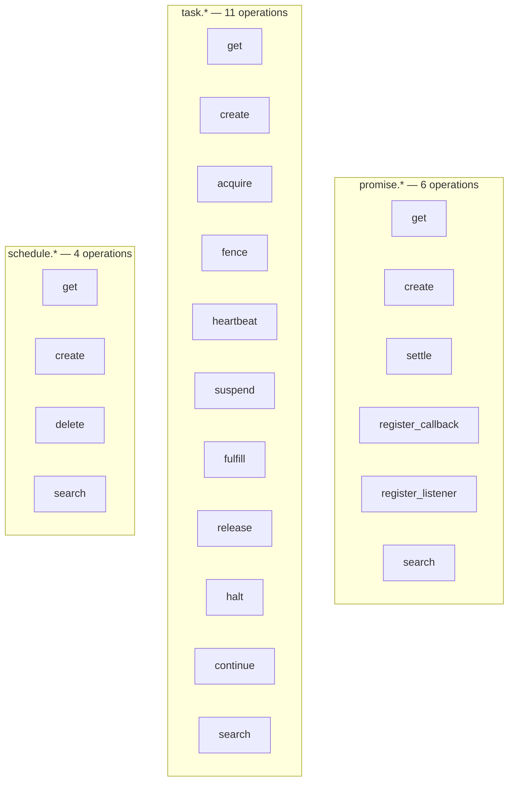
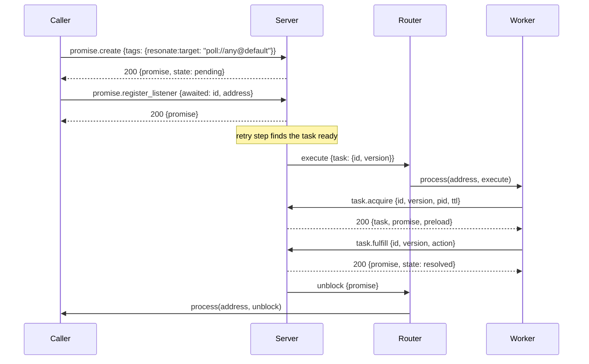

# The protocol: one envelope, 21 operations, seven status codes

The wire protocol is small. Every message has the same three top-level fields: `kind`, `head`, and `data`. The `head` differs between a request and a response. There are 21 request kinds, split into three groups: `promise.*`, `task.*`, and `schedule.*`. There are two outbound message kinds: `execute` and `unblock`.

The protocol version is `2026-04-01`. A request that names any other version is rejected at the gateway before it reaches a server.

Source: `impl/server/core/crates/resonate-core/src/types.rs:132-135`, `impl/server/core/crates/resonate-core/src/types.rs:139-173`

## Terms used in this document

The protocol uses a small vocabulary. This table defines each term before the operations use it.

| Term | Meaning |
|------|---------|
| Settled | Any promise state other than `pending`: `resolved`, `rejected`, `rejected_canceled`, or `rejected_timedout` |
| Runnable | The promise carries `resonate:target`. A runnable promise has a task. |
| Awaitable, or external | The promise carries `resonate:target`, `resonate:timer`, `resonate:scope = global`, or `resonate:external = true`. Another task may wait on it. |
| Origin | The part of an identifier before the first colon. `a:1.2` has origin `a`. |
| Lease | A time-bounded right to execute a task. It has a time to live (TTL), a process identifier (`pid`), and an expiry time. |
| Fencing version | A counter on the task. It increases on each acquire. A request must present the current value for the write to succeed. |
| `resumes` | The list of awaited identifiers that settled while the task was not suspended. The wire exposes its length as a number. |
| Preload | A list of branch-sibling promises returned with a create, acquire, fence, or suspend. It is a replay cache. |
| Empty data | The response `data` is `{}`. |
| Cursor | An opaque pagination token returned by a search response. |
| Task face | The task columns of the one-row record. They exist only when the promise is runnable. |
| Branch sibling | A promise on the same branch as another promise. |
| Poll address | An address with scheme `poll`. `poll://any@default` selects the default poll group. |
| Inductive type | A Lean data type with a fixed list of named cases, called constructors. |
| Gateway | The edge that accepts requests from a transport and applies envelope validation. |
| Server port | The `ResonateServer` trait. It applies one well-formed request. |
| Lean model | The executable abstract machine in `spec/`. It is the reference behavior, not the shipped server. |

Source: `spec/spec/01-protocol/validation.lean:20-32`, `impl/server/core/crates/resonate-core/src/types.rs:573-647`, `impl/server/core/crates/resonate-core/src/server.rs:1-38`

### The tag vocabulary

Tags are string keys with string values. The protocol reads these tags:

| Tag | Value | Effect in this document |
|-----|-------|-------------------------|
| `resonate:target` | An address such as `poll://any@default` | Makes the promise runnable and awaitable. The address selects a worker. |
| `resonate:timer` | `"true"` | A deadline resolves the promise instead of rejecting it. |
| `resonate:scope` | `"global"` | Makes the promise awaitable. |
| `resonate:external` | `"true"` | Makes the promise awaitable. |
| `resonate:origin` | An identifier without a colon | The identifier must start with this origin. |
| `resonate:branch` | An identifier | The identifier must start with this branch. |
| `resonate:parent` | An identifier | The identifier must start with this parent. |
| `resonate:prefix` | An identifier without a colon | A prefix rule for generated identifiers. |
| `resonate:delay` | A millisecond timestamp | The first time the task may be dispatched. Requires a target. |

Source: `impl/server/core/crates/resonate-core/src/types.rs:333-400`, `impl/server/core/crates/resonate-core/src/types.rs:618-647`

Document [03-durable-promises-and-tasks.md](03-durable-promises-and-tasks.md) explains how these tags drive the state machines.

## The request envelope

Every request is a JavaScript Object Notation (JSON) object with three fields.

```json
{
  "kind": "promise.create",
  "head": {
    "corrId": "client-7f3a",
    "version": "2026-04-01",
    "auth": "optional-bearer-token",
    "resonate:debug_time": 1767225600000
  },
  "data": {
    "id": "research.1:plan",
    "timeoutAt": 1767229200000,
    "param": { "data": "{\"question\":\"...\"}" },
    "tags": { "resonate:scope": "global" }
  }
}
```

Source: `impl/server/core/crates/resonate-core/src/types.rs:139-156`

| Field | Type | Meaning |
|-------|------|---------|
| `kind` | string | The operation name, such as `promise.create` |
| `head.corrId` | string | Correlation identifier. The response repeats it. |
| `head.version` | string | Protocol version. Only `2026-04-01` is supported. |
| `head.auth` | string, optional | Authentication material. The protocol does not define its format. The gateway or an authentication plugin validates it. |
| `head.resonate:debug_time` | integer, optional | A caller-supplied clock in milliseconds, honored only in debug mode. It is not echoed in the response. |
| `data` | object | The operation's own fields |

Source: `impl/server/core/crates/resonate-core/src/types.rs:146-156`

The debug time is gated by the server's debug setting. Under debug mode, the clock belongs to the caller, so a test can drive time forward.

Source: `impl/server/core/crates/resonate-core/src/types.rs:154-155`, `impl/server/core/crates/resonate-core/src/server.rs:14-18`

## The response envelope

Every response has the same three top-level fields: `kind`, `head`, and `data`. The `head` changes shape. It carries `corrId`, `status`, and `version`, and it does not repeat `auth` or `resonate:debug_time`.

```json
{
  "kind": "promise.create",
  "head": {
    "corrId": "client-7f3a",
    "status": 200,
    "version": "2026-04-01"
  },
  "data": {
    "promise": {
      "id": "research.1:plan",
      "state": "pending",
      "param": { "data": "..." },
      "value": {},
      "tags": { "resonate:scope": "global" },
      "timeoutAt": 1767229200000,
      "createdAt": 1767225600000
    }
  }
}
```

Source: `impl/server/core/crates/resonate-core/src/types.rs:160-173`, `impl/server/core/crates/resonate-core/src/types.rs:240-253`

The `kind` is echoed from the request. The `corrId` is echoed from the request head. The `version` is always the server's protocol version.

Source: `impl/server/core/crates/resonate-core/src/types.rs:1010-1030`

### Rejection at the edge

Four faults are answered by the gateway, not by a server:

| Fault | Status | Message |
|-------|--------|---------|
| The bytes are not a request envelope | 400 | `Invalid request envelope: ...` |
| `kind` is absent or empty | 400 | `Missing or invalid 'kind' field` |
| `data` is not an object | 400 | `Invalid 'data' field — must be an object` |
| `head.version` is not supported | 400 | `Unsupported protocol version ...` |

Source: `impl/server/core/crates/resonate-core/src/types.rs:1044-1122`

A malformed message never reaches a server, so the server port has no way to report one. Inside the boundary, envelopes are built in code, so a bad one is a bug, not untrusted input.

Source: `impl/server/core/crates/resonate-core/src/server.rs:24-38`

## The record shapes

The protocol returns three record types. Each one is a plain JSON object.

### `PromiseRecord`

| Field | Type | Meaning |
|-------|------|---------|
| `id` | string | The promise identifier |
| `state` | string | `pending`, `resolved`, `rejected`, `rejected_canceled`, or `rejected_timedout` |
| `param` | `PromiseValue` | The input, as optional headers and optional data |
| `value` | `PromiseValue` | The result, in the same shape |
| `tags` | object | String keys and string values |
| `timeoutAt` | integer | Deadline, in milliseconds |
| `createdAt` | integer | Creation time, in milliseconds |
| `settledAt` | integer, optional | Settlement time, in milliseconds |

Source: `impl/server/core/crates/resonate-core/src/types.rs:232-253`, `spec/spec/01-protocol/types.lean:31-40`

`PromiseValue` has two optional fields: `headers`, a map of strings, and `data`, a string. The data is usually serialized JSON carried as a string. That keeps the server from depending on the payload shape.

Source: `impl/server/core/crates/resonate-core/src/types.rs:232-238`

One rule applies before any record is returned. A pending promise whose deadline has passed is *projected*. In the Rust record type, the projection is a pure function applied when the record is read, and it does not write to storage. The Lean model is different: when `mat` is true, `readObject` writes the projected state back through `materialise` (see [04-the-formal-specification.md](04-the-formal-specification.md)). If the promise has `resonate:timer = true`, it reads as `resolved`. Otherwise it reads as `rejected_timedout`. The settlement time is the deadline, not the current time. A projected timer keeps whatever `value` the record holds, which is usually the empty object. The projection also applies when a promise is created with a deadline that is already in the past: the new record reads as settled at once. The projection does not require the storage engine to have written the expiry down.

Source: `impl/server/core/crates/resonate-core/src/types.rs:255-275`, `spec/spec/02-abstract/state.lean:317-330`

### `TaskRecord`

| Field | Type | Meaning |
|-------|------|---------|
| `id` | string | The same identifier as the promise |
| `state` | string | `pending`, `acquired`, `suspended`, `halted`, or `fulfilled` |
| `version` | integer | The fencing version |
| `resumes` | integer | The length of the task's resume list, defaulted to zero. The Lean model keeps the list of identifiers; the wire exposes only the count. |
| `ttl` | integer, optional | Lease duration, in milliseconds |
| `pid` | string, optional | The process identifier that holds the lease |

Source: `impl/server/core/crates/resonate-core/src/types.rs:277-288`, `spec/spec/01-protocol/types.lean:42-49`

### `ScheduleRecord`

| Field | Type | Meaning |
|-------|------|---------|
| `id` | string | Schedule identifier |
| `cron` | string | Cron expression |
| `promiseId` | string | Promise identifier template |
| `promiseTimeout` | integer | Timeout for each fired promise |
| `promiseParam` | `PromiseValue` | Parameter for each fired promise |
| `promiseTags` | object | Tags for each fired promise |
| `createdAt` | integer | Creation time |
| `nextRunAt` | integer | Next due time |
| `lastRunAt` | integer, optional | Last fired time |

Source: `impl/server/core/crates/resonate-core/src/types.rs:290-308`, `spec/spec/01-protocol/types.lean:51-61`

## The 21 operations

The worker-facing operation set is closed. The abstract machine defines it as one inductive type with 21 constructors. The server's dispatcher matches on those names and also on the console operations (`ui.*`) and the debug operations (`debug.*`). The worker endpoint refuses the console names.

Source: `spec/spec/02-abstract/system.lean:38-59`, `impl/server/core/crates/resonate-server-sqlite/src/lib.rs:214-260`



Source: `spec/spec/02-abstract/system.lean:38-59`

The diagram groups the 21 names for reading. The Lean definition is one inductive type, not three types. The groups are not a dependency; the wire kinds are flat.

### `promise.*`

| Kind | Request data | Success response | Notes |
|------|--------------|------------------|-------|
| `promise.get` | `id` | `{promise}` | 404 when absent |
| `promise.create` | `id`, `timeoutAt`, `param`, `tags` | `{promise}` | Idempotent. An existing promise returns 200 unchanged. 400 if `resonate:timer` and `resonate:target` are both present. |
| `promise.settle` | `id`, `state`, `value` | `{promise}` | 400 if `state` is not `resolved`, `rejected`, or `rejected_canceled`. An already settled promise returns 200 unchanged. |
| `promise.register_callback` | `awaited`, `awaiter` | `{promise}` | 400 if the two identifiers are equal or have different origins. 404 if the awaited promise is absent. 422 if the awaiter is absent, the awaiter is not runnable, or the awaited promise is not awaitable. |
| `promise.register_listener` | `awaited`, `address` | `{promise}` | 404 when absent. 422 if the promise is not awaitable. |
| `promise.search` | `state`, `tags`, `limit`, `cursor` | `{promises, cursor}` | The Lean model returns 501. Shipped servers implement it. |

Source: `spec/spec/02-abstract/external.lean:28-100`, `impl/server/core/crates/resonate-core/src/types.rs:313-455`

The difference between 404 and 422 depends on the subject of the operation. A 404 means the record named by the main identifier is absent. A 422 means a precondition or list item is absent, or its tags make the operation impossible. For `promise.register_callback`, the main identifier is `awaited`, so a missing awaited promise is 404; the awaiter is a precondition, so a missing awaiter is 422. For `task.suspend`, the task is the main identifier, so a missing awaited promise is 422. The same rule explains `task.create`: a runnable promise without a task is a 409, because the operation asks to create a task and the existing promise is the conflict.

Source: `spec/spec/02-abstract/external.lean:60-83`, `spec/spec/02-abstract/external.lean:125-174`, `spec/spec/02-abstract/external.lean:271-305`

### `task.*`

| Kind | Request data | Success response | Notes |
|------|--------------|------------------|-------|
| `task.get` | `id` | `{task}` | 404 when the promise exists but has no task |
| `task.create` | `pid`, `ttl`, `action` | `{task, promise, preload}` | The task identifier is `action.data.id`. The action data is a `promise.create` payload. 400 if the action is not runnable or is a timer with a target. 422 if an existing promise is not runnable. 409 if a runnable promise has no task, or its task is acquired, suspended, or halted. A fulfilled task returns 200. |
| `task.acquire` | `id`, `version`, `pid`, `ttl` | `{task, promise, preload}` | 404 when there is no task. 409 if the task is not pending, the promise is not pending, or the version does not match. |
| `task.fence` | `id`, `version`, `action` | `{action, preload}` | The action is `promise.create` or `promise.settle`. The response echoes the result of that action, so the caller sees the created or settled promise. 400 if the target is the task itself or has a different origin. 409 if the task is not acquired, the promise is not pending, or the version does not match. |
| `task.heartbeat` | `pid`, `tasks` | empty | `tasks` is a list of `{id, version}` pairs. It renews each listed lease. A task that does not match the process, version, and pending state is skipped without an error. |
| `task.suspend` | `id`, `version`, `actions` | empty with 200, or `{preload}` with 300 | `actions` is a list of `{awaited, awaiter}` pairs. 400 if the list is empty, names the task itself, has a different origin, or repeats an awaited identifier. 409 on state or version. 422 if an awaited promise is absent or not awaitable. 300 if any awaited promise is already settled. |
| `task.fulfill` | `id`, `version`, `action` | `{promise}` | The action is a `promise.settle` for the same identifier. 400 if the action state is not settable. 409 if the task is not acquired, the promise is not pending, or the version does not match. |
| `task.release` | `id`, `version` | empty | Returns the task to pending and sets `retryTimeoutAt` to the current time. The retry step dispatches it again after the server's retry interval. 409 on state or version. |
| `task.halt` | `id` | empty | 409 if the task is fulfilled. Idempotent when already halted. |
| `task.continue` | `id` | empty | 409 if the task is not halted or the promise is not pending. |
| `task.search` | `state`, `limit`, `cursor` | `{tasks, cursor}` | The Lean model returns 501. Shipped servers implement it. |

Source: `spec/spec/02-abstract/external.lean:114-382`, `impl/server/core/crates/resonate-core/src/types.rs:457-776`

Empty means the response `data` is `{}`. A task operation that reads or acquires a promise without a task gets 404. `task.create` treats that shape as 409, because the operation asks to create a task and the existing runnable promise is the conflict.

Source: `spec/spec/02-abstract/external.lean:125-174`, `impl/server/core/crates/resonate-core/src/types.rs:867-897`

### `schedule.*`

| Kind | Request data | Success response | Notes |
|------|--------------|------------------|-------|
| `schedule.get` | `id` | `{schedule}` | 404 when absent |
| `schedule.create` | `id`, `cron`, `promiseId`, `promiseTimeout`, `promiseParam`, `promiseTags` | `{schedule}` | Idempotent. The promise tags must include `resonate:target`; a missing tag returns 400. A timer with a target also returns 400. |
| `schedule.delete` | `id` | empty | 404 when absent |
| `schedule.search` | `limit`, `cursor` | `{schedules, cursor}` | The Lean model returns 501. Shipped servers implement it. |

Source: `spec/spec/02-abstract/external.lean:390-426`, `impl/server/core/crates/resonate-core/src/types.rs:778-845`

The `cron` field is a schedule expression. The server parses it; this document does not define the dialect. The `promiseId` template is expanded with the schedule identifier and the occurrence time. The `cursor` field is opaque: the caller passes back the value from the previous response. A missing `state` or `tags` filter means no filter. The page size is a server setting.

## The status codes

| Status | Name | Meaning in this protocol |
|--------|------|--------------------------|
| 200 | OK | The operation completed. `data` carries the result. |
| 300 | Multiple Choices | `task.suspend` only. An awaited promise is already settled, so the task did not suspend. |
| 400 | Bad Request | The request is malformed, or it violates a protocol invariant. |
| 404 | Not Found | The named promise, task, or schedule does not exist. |
| 409 | Conflict | The record exists in a state that forbids the change, or the version does not match. |
| 422 | Unprocessable Content | The request is well formed, but the state machine forbids it. The awaiter is missing, the awaiter is not runnable, or the awaited promise is not awaitable. |
| 501 | Not Implemented | The three search operations in the Lean model. Shipped servers implement them. |

Source: `spec/spec/02-abstract/external.lean:28-427`

### 400: the request is wrong

A 400 means no state could accept the request. The cases are:

- `promise.settle` with a state that is not settable. The settable states are `resolved`, `rejected`, and `rejected_canceled`.
- `promise.create` with both a timer tag and a target tag. A timer that is also a task would have two owners for its deadline.
- A callback whose awaited and awaiter identifiers are equal, or whose origins differ.
- A task action whose target is the task itself or has a different origin.
- A suspend action list that is empty, repeats an awaited identifier, names the task itself, or crosses an origin.

Source: `spec/spec/01-protocol/validation.lean:47-49`, `spec/spec/02-abstract/external.lean:36-37`, `spec/spec/02-abstract/external.lean:62-65`, `spec/spec/02-abstract/external.lean:272-280`, `spec/spec/02-abstract/external.lean:307-309`

The general rule is this. A 400 is a malformed request or a broken invariant inside the request itself. A 422 is a well-formed request that the promise graph refuses because a record or a tag is unsuitable. The boundary is the request, not the stored state.

The Rust server's request validation applies the same rules before the handler runs. It also validates the tag lineage: an identifier must start with its `resonate:origin`, `resonate:branch`, or `resonate:parent`, and a `resonate:delay` must be smaller than the timeout and must have a target.

Source: `impl/server/core/crates/resonate-core/src/types.rs:333-400`

### 404: the record is absent

A 404 is a fact about storage, not a judgment. The handler read the record named by the operation's main identifier and found nothing. For a task operation, a promise that exists without a task is also a 404, because the task face is absent. The exception is `task.create`: there, the same shape is a 409, because the operation asks to create a task and the existing runnable promise is the conflict.

Source: `spec/spec/02-abstract/external.lean:114-123`, `spec/spec/02-abstract/external.lean:176-183`

### 409: the state or the version is wrong

A 409 is the fencing response. It means one of four things:

1. The task is not in the state the operation requires. For example, `task.acquire` requires `pending`.
2. The promise is not `pending`.
3. The task version does not match the request version.
4. `task.create` finds a runnable promise that has no task, or that has an acquired, suspended, or halted task.

The fourth case is a conflict, not a missing record, because the operation asks to create a task. The first three are the ordinary fencing and state rules.

A worker that lost its lease still holds the old version. Its `task.fulfill` gets a 409, so it cannot overwrite the new worker's result.

Source: `spec/spec/02-abstract/external.lean:185-197`, `spec/spec/02-abstract/external.lean:318-327`

### 422: the request is well formed but not allowed

A 422 is the semantic refusal. The JSON is valid and the operation's main record exists, but the promise graph does not permit the operation.

- The awaiter promise is missing.
- The awaiter is not runnable. Only a promise with `resonate:target` can be a task, and only a task may await.
- The awaited promise is not awaitable. Only an external promise may be awaited.
- An awaited promise in a `task.suspend` list is absent or not awaitable.

Source: `spec/spec/02-abstract/external.lean:70-77`, `spec/spec/02-abstract/external.lean:271-305`, `spec/spec/01-protocol/validation.lean:20-32`

The distinction between 409 and 422 is useful. A 409 may succeed later, after a retry or after the state changes. A 422 will not succeed for this pair of promises, because the tag shape is wrong.

### 300: do not suspend, resume now

A 300 is not an error. It is a fast path. The caller asked to suspend on a set of promises. At least one of them is already settled. The server does not register callbacks. It sets the task's `resumes` list to empty and leaves the task not suspended.

The caller then continues. The preload gives it the settled records to replay. It is not the `resumes` list: it holds branch-sibling promises, ordered by identifier, up to a server limit.

Source: `spec/spec/02-abstract/external.lean:295-305`, `impl/server/core/crates/resonate-server-sqlite/src/lib.rs:1398-1410`

### 501: a model boundary, not a server limit

The Lean abstract machine returns 501 for `promise.search`, `task.search`, and `schedule.search`. Search does not change the state machine, so the model leaves it out.

A shipped server implements all three. The SQLite server has search operations for promises, tasks, and schedules. The 501 is therefore a statement about the model, not about the product.

Source: `spec/spec/02-abstract/external.lean:99-100`, `spec/spec/02-abstract/external.lean:381-382`, `spec/spec/02-abstract/external.lean:425-426`, `impl/server/core/crates/resonate-server-sqlite/src/lib.rs:667`, `impl/server/core/crates/resonate-server-sqlite/src/lib.rs:1817`, `impl/server/core/crates/resonate-server-sqlite/src/lib.rs:2067`

## The two outbound messages

The server emits two message kinds to a worker through the router.

### `execute`

The `execute` message tells a worker that a task may be acquired. It carries the task identifier and the version that the worker must present. Delivery is not execution. The worker must still send `task.acquire`.

```json
{
  "kind": "execute",
  "head": { "serverUrl": "http://localhost:8001" },
  "data": { "task": { "id": "search.1:2", "version": 1 } }
}
```

Source: `impl/server/core/crates/resonate-core/src/types.rs:177-199`, `spec/spec/01-protocol/validation.lean:62-65`

The `serverUrl` tells the worker where to send its requests. That is what makes a worker location transparent: the address of the server is data in the message, not a constant in the worker.

Source: `impl/server/core/crates/resonate-core/src/types.rs:177-181`

### `unblock`

The `unblock` message tells a registered listener that a promise it waits on has settled. It carries the full promise record. One message carries one promise.

```json
{
  "kind": "unblock",
  "head": {},
  "data": { "promise": { "id": "search.1:2", "state": "resolved", "...": "..." } }
}
```

Source: `impl/server/core/crates/resonate-core/src/types.rs:201-228`

The head is empty. The promise record already names the identifier and the state.

A callback ties an awaiting task to an awaited promise, inside the server. The server resumes the task itself, with no outbound message. A listener stores an address. When the promise settles, the server sends an `unblock` message to that address. That is why the sequence below registers a listener.

Source: `impl/server/core/crates/resonate-core/src/types.rs:201-203`



Source: `impl/server/core/crates/resonate-core/src/types.rs:183-228`, `impl/server/core/crates/resonate-base/src/router.rs:90-99`

The sequence shows the full loop for a listener. The router selects the worker by the address scheme. Delivery means accepted for delivery, not executed. The `execute` message is a hint, not a guarantee. A worker must call `task.acquire` and present the version. If another worker won the race, the acquire fails with 409 and the message is dropped. A duplicate `execute` is safe for the same reason: the acquire fences it. The retry deadline is what brings the task back.

Source: `impl/server/core/crates/resonate-core/src/worker.rs:8-18`, `spec/spec/02-abstract/internal.lean:102-117`

## Aha: status 300 is the protocol's shortcut for a race that already resolved

Most protocols use a status code to report a failure. Resonate uses 300 to report a success that arrived too early.

A task calls `task.suspend` with a list of promises. The server checks each one. If all are pending, it registers callbacks and returns 200. If any is already settled, it returns 300 with a preload. It can replay the settled record and continue.

Source: `spec/spec/02-abstract/external.lean:295-305`

Without it, the caller would suspend and immediately receive a callback for the settled promise. With it, the caller learns the truth and continues in the same turn.

The same idea appears in the preload field. Create, acquire, fence, and suspend return a list of branch-sibling promises on the same branch other than the task, ordered by identifier, up to a server limit. It is a replay cache, not the task's `resumes` list.

Source: `impl/server/core/crates/resonate-core/src/types.rs:867-897`

## Related documents

- [00-overview.md](00-overview.md) — the model behind the protocol.
- [01-architecture.md](01-architecture.md) — the ports that carry these messages.
- [03-durable-promises-and-tasks.md](03-durable-promises-and-tasks.md) — the state transitions that produce these status codes.
- [04-the-formal-specification.md](04-the-formal-specification.md) — the Lean request and response types.
- [09-the-typescript-sdk.md](09-the-typescript-sdk.md) — the client that sends these requests.
- [17-glossary.md](17-glossary.md) — every operation and status name.
