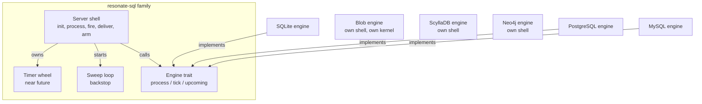
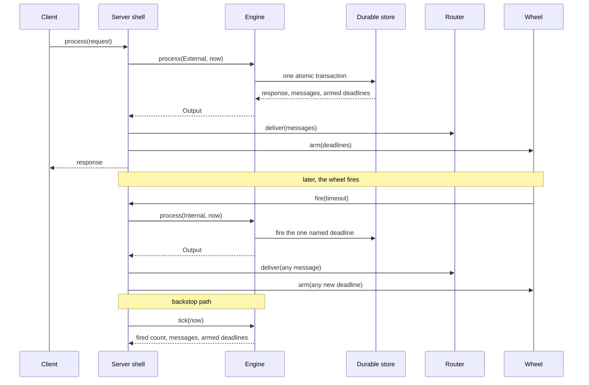

# Storage engines: one contract, six answers

The server keeps durable state in six places. Three are relational databases. One is a wide-column store. One is an object store. One is a graph database. The differences are real: the query languages, the consistency models, and the cost of a write. The contract above them is the protocol, not a code interface. Every backend answers the same protocol questions and produces the same messages. Three of them, SQLite, PostgreSQL, and MySQL, also implement the shared `Engine` trait described below. ScyllaDB, Blob, and Neo4j implement the protocol and bring their own server shell.

A shared differential harness runs the same random operation sequence against the oracle and several backends in lock step and compares every response and state snapshot. In this checkout it always runs SQLite in memory and the oracle, and adds PostgreSQL, MySQL, and Neo4j when `TEST_POSTGRES_URL`, `TEST_MYSQL_URL`, and `TEST_NEO4J_URI` are set. ScyllaDB and Blob are not part of it. The harness is still the reason this chapter can compare the backends without describing six protocols.

Source: `impl/server/core/diff/differential.rs:1-30`, `impl/server/core/diff/differential.rs:249-320`, `impl/server/core/crates/resonate-sql/src/engine.rs:184-230`

## What the Structured Query Language (SQL) family shares, and what it does not

The crate `resonate-sql` is a family library, not a port. It holds what SQLite, PostgreSQL, and MySQL genuinely share: the `Engine` contract, the error type, the parameter structs, the timer wheel, the sweep loop, the server shell, and the migration runner.

It holds no shared query layer. Each of the three engines parses a request, applies the transition in its own SQL, shapes the response, and returns what it emitted. The crate documentation gives the reason: lifting the state machine into shared Rust would cost PostgreSQL its single-round-trip Common Table Expression (CTE), which is the property that makes it fast. A PostgreSQL transition is one statement built from CTEs: it reads, decides, and writes in one round trip. A shared Rust engine would read rows into Rust and write them back, which adds round trips and a window between the read and the write.

Source: `impl/server/core/crates/resonate-sql/src/lib.rs:1-20`

The name is also deliberate. `resonate-server-*` means a server plugin, and a plugin depends on no other plugin. `resonate-sql` is a family library for the three SQL servers; ScyllaDB defines its own engine trait. Reaching into the family library would be the mistake the name prevents.

Source: `impl/server/core/crates/resonate-sql/src/lib.rs:16-20`



The three SQL engines implement the `Engine` trait and receive the shell, wheel, sweep, and migration runner from the family library. Blob, ScyllaDB, and Neo4j have no edge to that trait: they answer the protocol with their own shell and their own kernel.

## The `Engine` contract

An engine takes one `Input` and one `now` value. It returns one `Output`.

```rust
async fn process(&self, input: Input<'_>, now: i64) -> Output;
```

Source: `impl/server/core/crates/resonate-sql/src/engine.rs:184-195`

`Input` has two variants.

- `External(&RequestEnvelope)` is a request from outside. The request is already validated. The engine never sees malformed input.
- `Internal(Timeout)` is the system asking something of itself.

Source: `impl/server/core/crates/resonate-sql/src/engine.rs:140-147`

`Timeout` has four variants, and each one reads a deadline column in the schema.

| Variant | Column | Meaning |
|---------|--------|---------|
| `PromiseTimeout { promise_id }` | `promises.timeout_at` | A pending promise passed its deadline |
| `TaskRetryTimeout { task_id }` | `promises.retry_timeout_at` | A pending task waited too long for dispatch |
| `TaskLeaseTimeout { task_id, pid }` | `promises.lease_timeout_at`, `pid` | An acquired task's lease expired; `pid` is the process identifier of the worker that holds it |
| `ScheduleDue { schedule_id }` | `schedules.next_run_at` | A cron schedule reached its next run |

Source: `impl/server/core/crates/resonate-sql/src/engine.rs:73-130`

The kind and the identifier together form the timeout's identity, because one row can hold two deadlines.

Source: `impl/server/core/crates/resonate-sql/src/engine.rs:87-129`

`Output` has three fields.

- `response` is `None` for an internal input, because nobody is waiting.
- `messages` carries the execute and unblock messages that the transition emitted.
- `timeouts` carries the deadlines that the transition armed, as hints for the in-memory wheel. The durable deadline columns were written in the same transaction; this list is a projection, so replaying it is harmless.

Source: `impl/server/core/crates/resonate-sql/src/engine.rs:149-170`

Three properties belong to the contract:

1. **`process` is atomic across state, messages, and the durable deadline columns.** Either all of it happened or none of it did. The `timeouts` list is the wheel's copy, not a second durable write.
2. **`Internal` is idempotent and narrow.** It fires the one timeout it names and nothing else. Firing it when the deadline has moved or the row has settled is a no-op.
3. **`timeouts` reports arming, not disarming.** A promise settled early leaves a stale wheel entry that fires into a no-op, and idempotency covers it.

Source: `impl/server/core/crates/resonate-sql/src/engine.rs:149-161`

The contract also has `tick(now)`.

- `tick(now)` fires every promise, retry, lease, and schedule timeout that is now due. It returns the count of schedules fired, because the caller records that metric, plus the messages emitted and the deadlines armed. The engine decides the batch boundary; the caller only sees the result.
- `upcoming(limit)` returns the nearest durable deadlines, soonest first. Overdue deadlines are included and sort first.

Source: `impl/server/core/crates/resonate-sql/src/engine.rs:196-221`

`upcoming` is the one place an engine scans for what is armed rather than reporting what it just wrote. A timer calls it after a restart and on a refresh, to pick up deadlines that another instance armed.

## The timer wheel

The durable row is the truth. The wheel is a cache in front of it.

The wheel keeps its entries ordered by deadline. It fires an entry only when `now` is greater than or equal to that deadline, so an early firing on a live deadline is impossible by construction. An entry with the same identity replaces the earlier one, which is how a renewed lease or a moved deadline does not leave a duplicate. Different identities on one row, such as a promise deadline and a retry deadline, both remain.

The wheel holds a bounded prefix of the deadlines that one process has heard about. That is not the same set as the deadlines that exist. Another instance's arming is invisible until the next backfill. A restart empties the wheel. A full wheel drops its farthest entries. Backfill and sweep close those gaps.

Source: `impl/server/core/crates/resonate-sql/src/deadlines.rs:1-15`, `impl/server/core/crates/resonate-sql/src/deadlines.rs:29-46`

The wheel identity is the timeout kind plus the row identifier. The identifier alone would merge a promise deadline and a task deadline on the same row. The lease `pid` is deliberately excluded, because the same lease renewed by the same holder is the same deadline moving.

Source: `impl/server/core/crates/resonate-sql/src/deadlines.rs:29-46`

| Setting | Value | Meaning |
|---------|-------|---------|
| `capacity` | 8,192 by default | How many deadlines the wheel holds |
| `low_watermark` | `capacity / 2` | Free slots below this mark trigger a backfill |
| `backfill_interval` | `wheel_refresh`, 30,000 ms | How often to re-read durable deadlines |
| `idle` | `wheel_refresh` | Longest sleep before a refresh |

Source: `impl/server/core/crates/resonate-sql/src/deadlines.rs:59-72`

`low_watermark` and `idle` are two triggers for the same refresh. The first refills a wheel that work has drained. The second bounds how long a deadline from another instance can stay invisible. Both use `wheel_refresh`, so the durable deadlines are re-read at least every 30 seconds.

The fire callback upgrades a weak reference to the server. The backfill callback asks for `upcoming(room)`; a failure logs a warning because the sweep still covers the gap.

Source: `impl/server/core/crates/resonate-sql/src/deadlines.rs:74-107`

### The sweep

The sweep is the backstop, not the mechanism. The timer fires a deadline when it comes due, and its backfill re-reads the durable deadlines more often than the sweep runs. The sweep covers what neither sees.

| Gap | Closed by |
|-----|-----------|
| Restart empties the wheel | `init` seeds from `upcoming`, then backfill |
| Another instance arms a deadline | Backfill every 30 seconds, then sweep |
| A full wheel drops its farthest entry | Sweep |
| Early settle leaves a stale entry | Idempotent no-op when it fires |

Source: `impl/server/core/crates/resonate-sql/src/sweep.rs:1-25`

Every `sweep_interval`, the loop calls `engine.tick(now)`. It records the schedules fired, delivers the messages, and arms the new deadlines. A redispatched task gets a fresh retry deadline, and those deadlines are the ones most likely to come due soon.

Source: `impl/server/core/crates/resonate-sql/src/sweep.rs:30-65`

## The server shell

Each SQL engine builds a `Server` over its own engine.

| Field | Purpose |
|-------|---------|
| `server_url` | Stamped into every emitted message |
| `sweep_interval` | How often the backstop runs |
| `engine` | Durable state, absent until `init` connects |
| `connect` | A function consumed once by `init` to open the engine |
| `router` | Where a transition's messages are delivered |
| `debug` | The process-wide clock flag |
| `timer` | The near-future wheel |
| `sweep` | The background task handle |
| `this` | A weak self-reference for the wheel and sweep callbacks |

Source: `impl/server/core/crates/resonate-sql/src/server.rs:18-75`

`init` does four things in order: it stores the debug flag, declares the metrics, takes the connect function and opens the engine, and either seeds the timer and starts the sweep or returns early under debug.

Source: `impl/server/core/crates/resonate-sql/src/server.rs:263-299`

Under debug, neither the timer nor the sweep starts. The wheel reads a clock, and in debug mode the caller owns that clock. `debug.tick` advances time and runs the sweep as part of moving.

`process` resolves `debug_time` only when debug is on, calls the engine, delivers the messages after the transaction commits, arms the returned deadlines, and returns the response.

Source: `impl/server/core/crates/resonate-sql/src/server.rs:316-338`

The comment on delivery is the important one: the engine returns only what its transaction actually wrote, so a message cannot be sent for a transition that rolled back.



Delivery is best effort. A failed route is logged and the attempt is lost. An execute message comes back because the task stays pending and its retry timeout re-emits it, so execution is at least once. An unblock message does not come back, so it is at most once. That matches the old outbox, which deleted before delivery.

Source: `impl/server/core/crates/resonate-sql/src/server.rs:186-249`

## The relational schemas

The three SQL schemas differ in dialect, but they share a shape.

- One row holds a promise and its task.
- Tags are key/value metadata. Generated columns project the reserved keys into queryable fields: `resonate:target` into `target`, `resonate:parent` into `parent_id`, and `resonate:branch` into `branch_id`. `origin_id` is computed from the identifier prefix, not from a tag. `is_timer` reads `resonate:timer`.
- Callbacks and listeners have their own tables in SQLite and MySQL; PostgreSQL keeps callbacks as arrays on the promise row. `listeners` are the poll addresses registered for a promise.
- Partial indexes cover only the rows that need them.
- There is no outbox table. A transition returns its messages.

Source: `impl/server/core/crates/resonate-server-sqlite/migrations/0001_initial.sql:14-100`

The `external` column is true when a promise has global scope, is marked external, carries a target, or is a timer. It is exactly the predicate that decides whether a deadline arms the timer. An external promise can be awaited outside its origin, so it needs a deadline. An internal promise is driven by its task flow and expires lazily.

Source: `impl/server/core/crates/resonate-server-sqlite/migrations/0001_initial.sql:37-41`

The partial index `idx_promises_timeout_at` covers only pending external promises. The index `idx_promises_branch_id` covers only rows with a branch identifier. These indexes narrow the rows a scan must consider; the effective-state rule is applied as a predicate on top, not as an index.

Source: `impl/server/core/crates/resonate-server-sqlite/migrations/0001_initial.sql:59-68`

The effective state is a query, not only a stored value. A search for `pending` must exclude a row whose deadline has passed. A search for `resolved` must include a pending timer promise whose deadline has passed, because a timer resolves on expiry. The function `effective_state_sql` returns a SQL predicate over the row for one state and one `now` value, so every backend's filter and every backend's page agree.

Source: `impl/server/core/crates/resonate-sql/src/lib.rs:32-55`

### Migrations

Each engine owns a `migrations/` directory, because the schemas are genuinely different. The mechanism is the same: one embedded `sqlx` migrator per engine, applied in version order, recorded in `_sqlx_migrations`, and checksummed.

Source: `impl/server/core/crates/resonate-sql/src/migrate.rs:1-18`

SQLite runs on `rusqlite`, which `sqlx` cannot drive. The `run_rusqlite` helper reads the same embedded `sqlx::migrate::Migrator`, executes each statement on the rusqlite connection, and writes the same `_sqlx_migrations` table. The executor differs because it must; nothing else does.

Source: `impl/server/core/crates/resonate-sql/src/migrate.rs:12-20`

The migration policy is pre-release. The initial schema is edited in place, not followed by a second migration. A database created before an edit holds version 1 under the old checksum, and no migration carries it forward. The server refuses to start and tells the operator to drop the database.

Source: `impl/server/core/crates/resonate-sql/src/migrate.rs:22-33`

`migrate` defaults to false for SQLite, PostgreSQL, and MySQL. An empty database is always created. With `migrate = true`, startup applies pending migrations. Otherwise a schema behind the binary stops startup with the pending list named, rather than running schema changes nobody asked for. A checksum mismatch stops startup in either case.

Source: `impl/server/core/crates/resonate-server-sqlite/src/lib.rs:4344-4356`, `impl/server/core/crates/resonate-server-postgres/src/lib.rs:4701-4713`

## The six backends

| Setting | SQLite | PostgreSQL | MySQL | ScyllaDB | Blob | Neo4j |
|---------|--------|------------|-------|----------|------|-------|
| Connection | `path = "resonate.db"` | `url` required | `url` required | `hosts = ["localhost"]`, `port = 0` | `bucket = None` means in memory | `bolt://localhost:7687` |
| Pool | Not applicable | 10 | 10 | Not applicable | Not applicable | 16 |
| `preload_limit` | 10 | 10 | 10 | 10 | 10 | 10 |
| `retry_timeout` | 30,000 ms | 30,000 ms | 30,000 ms | 30,000 ms | 60,000 ms | 30,000 ms |
| `migrate` | false | false | false | false | Not applicable | true |
| `wheel_capacity` | 8,192 | 8,192 | 8,192 | 8,192 | Not applicable | 8,192 |
| `wheel_refresh` | 30,000 ms | 30,000 ms | 30,000 ms | 30,000 ms | Not applicable | 30,000 ms |
| `sweep_interval` | 60,000 ms | 60,000 ms | 60,000 ms | 60,000 ms | Not applicable | 60,000 ms |
| Backend extra | none | none | none | `bucket_width` 3,600,000 ms, `bucket_lookback` 1, `shards` 1, `worker_ttl` 180,000 ms | `timer_shards` 4, `cache_capacity` 10,000, `max_cas_retries` 8, `search_enabled` false | `fetch_size` 500, `database` `neo4j` |

Source: `impl/server/core/crates/resonate-server-sqlite/src/lib.rs:4333-4405`, `impl/server/core/crates/resonate-server-postgres/src/lib.rs:4687-4766`, `impl/server/core/crates/resonate-server-mysql/src/lib.rs:4912-4991`, `impl/server/core/crates/resonate-server-scylladb/src/lib.rs:51-165`, `impl/server/core/crates/resonate-server-blob/src/plugin.rs:49-140`, `impl/server/core/crates/resonate-server-neo4j/src/lib.rs:81-150`

SQLite, PostgreSQL, and MySQL share the `resonate-sql` shell. `preload_limit` is how many branch siblings a task response may carry; `port = 0` means the driver's default; `shards` is the ScyllaDB timeout-queue shard count; `timer_shards` is the Blob timer-key prefix count; `cache_capacity` is the Blob document cache; `fetch_size` is the Neo4j page size. Blob's `retry_timeout` is 60,000 ms. Neo4j defaults `migrate` to true because its schema is `IF NOT EXISTS` and idempotent.

### ScyllaDB

ScyllaDB is a wide-column store. Its `promises` table is partitioned by origin, the call-graph root before the first `:` in an identifier, so a transition and its fan-out are a single-partition lightweight transaction (LWT) or conditional batch. Callbacks and listeners are sets on the promise row, and schedules have their own table.

Deadlines live in bucketed, sharded timeout queues. The bucket width is one hour by default, and each scan covers the current bucket plus the immediately preceding one, to catch overdue entries. Entries land on `fnv32a(id) % shards`, where `fnv32a` is the Fowler-Noll-Vo 32-bit hash, and the default shard count is one.

A worker heartbeat time to live (TTL) keeps a shard assignment alive for a dead instance. The default is 180,000 ms, and it must exceed the sweep interval. Otherwise a live worker expires between its own heartbeats.

Source: `impl/server/core/crates/resonate-server-scylladb/src/lib.rs:1-10`, `impl/server/core/crates/resonate-server-scylladb/src/lib.rs:70-90`, `impl/server/core/crates/resonate-server-scylladb/schema.cql:24-97`

ScyllaDB gives every pending promise an eager deadline, internal promises included: a promise row always has a queue entry. The relational engines stay lazy and arm a deadline only for an external promise. The source names the differential as the experiment that would decide whether the difference is observable. ScyllaDB is not among the backends the harness starts in this checkout, so no verdict is recorded.

Source: `impl/server/core/crates/resonate-server-scylladb/src/lib.rs:1-10`

### Blob storage

The blob backend keeps all durable state in objects. It is the most different of the six, and the most instructive.

The core is a pure kernel. `handle(doc, req, now)` decides a request, and `drain(doc, now)` sweeps every deadline in one origin. A document is the complete state of one origin. Neither function reads a system clock, generates an identifier, or touches input and output. Every consequence comes back as an `Effect`: persist the document, arm a timer, clear a timer, or send a message.

Source: `impl/server/core/crates/resonate-server-blob/src/kernel/mod.rs:1-33`

One document holds one origin. An in-process actor serialises local callers per origin. Between processes, a write is a compare-and-swap (CAS) on the object's entity tag (ETag). The default retry count is 8. When the retries are exhausted, the caller gets no answer, which the protocol renders as `503`.

Source: `impl/server/core/crates/resonate-server-blob/src/kernel/mod.rs:1-33`, `impl/server/core/crates/resonate-server-blob/src/plugin.rs:49-140`

Timers aggregate. Each origin has exactly one timer object, at the earliest deadline in the document. The function `min_deadline` takes the minimum of the three sets that the SQL backends sweep: armed promise deadlines, task retry deadlines, and task lease deadlines. Schedules are handled by the same drain, not by this aggregate.

Source: `impl/server/core/crates/resonate-server-blob/src/kernel/state.rs:323-340`

Timer keys carry their deadline, so they increase monotonically. That is the classic hot-prefix problem in an object store. The default spreads timer keys across four prefixes.

Source: `impl/server/core/crates/resonate-server-blob/src/plugin.rs:70-80`

Search is off by default. Each search reads every document in the store, which is one GET per origin. A deployment that needs search turns it on and accepts the cost.

Source: `impl/server/core/crates/resonate-server-blob/src/plugin.rs:96-100`

When `bucket` is unset, the backend runs against an in-process, in-memory store. Nothing survives the process. Startup says so loudly.

Source: `impl/server/core/crates/resonate-server-blob/src/plugin.rs:49-56`

### Neo4j

Neo4j stores one `:Promise` node per promise, with the task's properties on the same node. Two relationship types sit beside it. `AWAITS` points from the waiting promise to the awaited promise and carries what the relational engines keep in callback tables. `CHILD_OF` points from a child to its parent and records the `resonate:parent` tag as an edge, so a graph tool can draw the call tree.

The semantics are the PostgreSQL engine's, transition for transition. The implementation differs: where PostgreSQL writes one CTE, Neo4j reads the nodes a transition touches under write locks, decides in Rust, and writes back. Every operation is one Bolt transaction, where Bolt is Neo4j's binary protocol, and the transaction is what makes a settle and its fan-out atomic.

Source: `impl/server/core/crates/resonate-server-neo4j/src/lib.rs:1-15`

Locking is the subtle part. Neo4j runs at read-committed isolation: readers do not block writers and see only committed data. It takes a write lock when a statement modifies a node. A `MATCH ... WHERE p.state = 'pending' SET ...` is not safe against a concurrent writer, because the predicate is evaluated before the lock.

So every transition begins by locking the nodes it will decide on, with `SET p.rev = p.rev + 1 RETURN p.*`. The update forces a write, which takes the node's write lock before the `RETURN` reads it, and the lock is held to commit. `rev` is incremented only to force the write lock. No code compares it as a version fence. This is the equivalent of `SELECT ... FOR UPDATE`, and it lets the Rust between the read and the write reason about state that nothing else is changing.

Source: `impl/server/core/crates/resonate-server-neo4j/src/lib.rs:34-46`

Two transactions that take the same nodes in different orders deadlock. Neo4j detects the deadlock, the driver reports a transient error, and the Neo4j plugin's own shell retries the whole transaction once before answering `503`.

Source: `impl/server/core/crates/resonate-server-neo4j/src/lib.rs:40-50`

Neo4j properties are scalars and homogeneous lists. There are no maps. Headers and tags are therefore stored as JavaScript Object Notation (JSON) strings for exact round-trip storage, and the tag pairs are also flattened into `tag_kv`, a list of JSON-encoded two-element arrays, so a query can match one tag without parsing the whole string. The duplication costs space.

Source: `impl/server/core/crates/resonate-server-neo4j/src/db.rs:68-99`

`migrate` defaults to true here, unlike the SQL servers. The schema is `IF NOT EXISTS` constraints and indexes, so re-applying it is a no-op, and there is no migration history to get ahead of.

Source: `impl/server/core/crates/resonate-server-neo4j/src/lib.rs:98-112`

## The oracle and the differential

An executable specification is only useful if the implementations are held to it. Resonate holds them with a reference model and a random differential.

The oracle in `resonate-oracle` is an in-memory model of the protocol. It stores promises, tasks, and schedules in `BTreeMap` values, so every traversal is ordered by identifier. It records emitted messages and armed deadlines in explicit lists, and `take_emitted` and `take_armed` drain them. `apply_timeout` applies the transition for one named timeout without advancing a clock.

Source: `impl/server/core/crates/resonate-oracle/src/lib.rs:1-7`, `impl/server/core/crates/resonate-oracle/src/lib.rs:90-175`

`SharedOracle` implements both `ResonateServer` and `Engine`. `ResonateServer` is the protocol-facing trait that every backend implements. `Engine` is the storage-level trait shared by the three SQL engines. The dual implementation is what lets the differential drive the oracle exactly like a backend.

Source: `impl/server/core/crates/resonate-oracle/src/lib.rs:2748-2820`

The differential harness applies each operation to every backend before the next, in lock step, and compares the response and the state snapshot at every step.

- SQLite in memory and the oracle always run.
- PostgreSQL, MySQL, and Neo4j run when their environment variables are set.
- The harness covers 22 operation kinds, from `promise.create` to `debug.tick`.
- It runs until every operation kind has produced at least one success response, so it cannot pass by exercising only failure paths. Only after that coverage does it stop after 20 batches with no new state signature.
- The constants are a fixed epoch `T0 = 1,000,000,000` milliseconds, a worker Uniform Resource Locator (URL), a process identifier, and a 60,000 ms task lease time to live.
- A state signature is a hash of the canonical ordered snapshot.
- The loop allows 200,000 steps, in batches of 200.

Source: `impl/server/core/diff/differential.rs:1-90`, `impl/server/core/diff/differential.rs:356-358`

## Aha: the timer is allowed to be wrong, and the design depends on it

Most systems treat a timer as a source of truth. If it misses, work is lost.

Resonate inverts this. The durable row is the truth. The wheel is a cache that may drop entries, miss another instance's writes, and forget everything on restart. Backfill re-reads the durable deadlines every 30 seconds, and the sweep reads them again as a backstop.

The inversion has a precise consequence. The wheel may fire late or not at all. It may never fire early on something that is not due. That is a one-directional error bound, and it is why the system can use a bounded in-memory structure without risking correctness.

Source: `impl/server/core/crates/resonate-sql/src/deadlines.rs:1-15`

## Unresolved source questions

- The ScyllaDB backend gives internal promises eager deadlines, while the relational engines stay lazy. The source states that the differential decides whether the difference is observable, but ScyllaDB is not in the harness and no verdict is recorded in the files read for this chapter.

## Related documents

- [04-the-formal-specification.md](04-the-formal-specification.md) — the machine that the engines implement.
- [05-the-server-core.md](05-the-server-core.md) — the composition root that selects a server plugin.
- [07-transports-and-workers.md](07-transports-and-workers.md) — where the emitted messages go.
- [11-schedules-timers-and-time.md](11-schedules-timers-and-time.md) — the schedule and deadline model in depth.
- [12-the-postgres-server-in-one-file.md](12-the-postgres-server-in-one-file.md) — the single-file PostgreSQL implementation.
- [13-the-s3-server-in-zig.md](13-the-s3-server-in-zig.md) — the other object-store implementation.
- [21-documents-rows-and-partitions.md](21-documents-rows-and-partitions.md) — the document, row, partition, and node shapes compared, with the write cost of each.
- [README.md](README.md) — the reading order and the document map.
