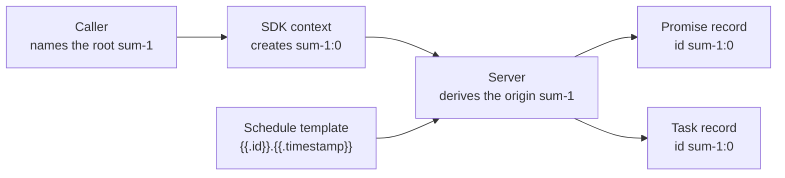
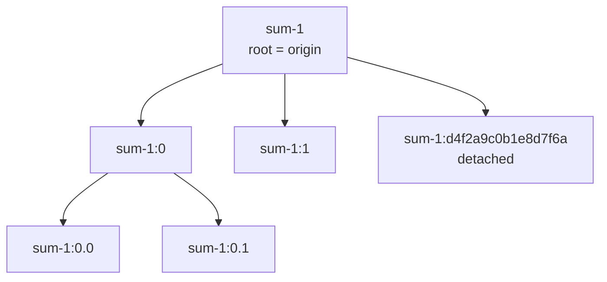
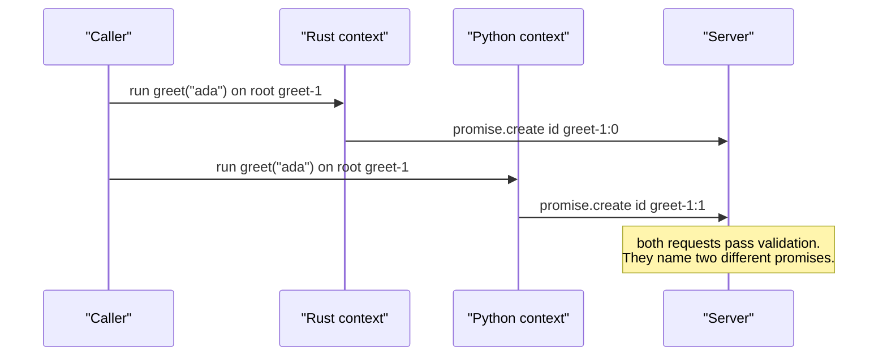
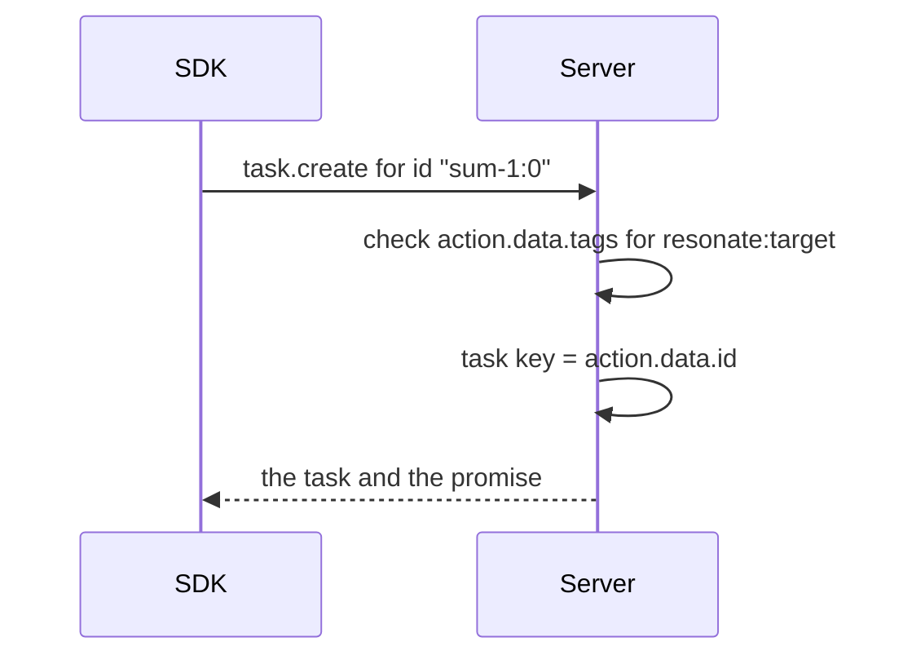
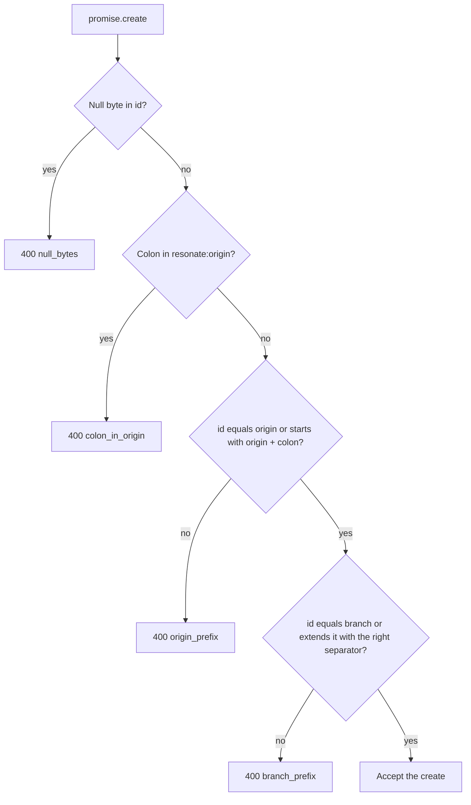
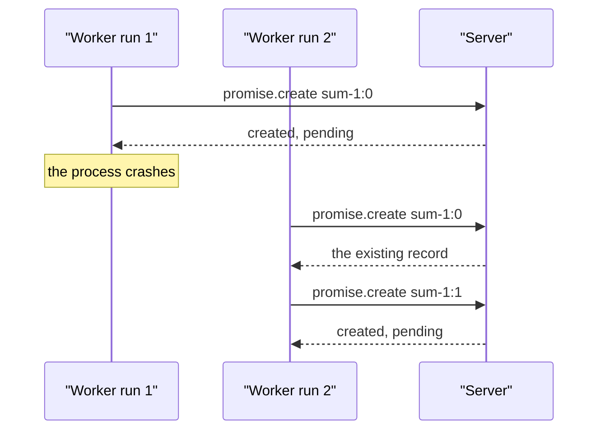

# Deterministic Identifiers

## The short answer

The server does not create identifiers for workflow calls. The caller supplies a root identifier, the identifier of the workflow. A workflow is a function that the runtime can run more than one time. The code of the function is the workflow body. Each client library creates child identifiers from a counter in its own context. A context is one function invocation. A counter is a number that the context increments for each child call. The Rust core server takes the origin from the request identifier. The one-file PostgreSQL server reads the `resonate:origin` tag. The origin is the text before the first colon. The server also checks the declared lineage, the identifiers after the colon. The request states the origin, branch, and parent in tags: `resonate:origin`, `resonate:branch`, and `resonate:parent`. A tag is a key-value field on the request. The section "What the server checks" explains each tag. The five client libraries share one grammar. They split into two counter families. The SDKs in one family produce the same child identifiers as each other. The SDKs in different families do not. A detached identifier starts work outside the normal child chain. Detached identifiers are different in every pair; the section "Detached identifiers" defines them.

This document uses short forms. Software Development Kit (SDK) means a client library for the Resonate protocol. The Resonate protocol is the request and response format that the server and the SDKs share. A hash function is a function that changes input text into a short fixed-length value. SHA-256 means Secure Hash Algorithm 256-bit. FNV-1a means Fowler-Noll-Vo 1a. seahash, cyrb53, and BLAKE2b are hash function names. S3 means Amazon Simple Storage Service. SQL means Structured Query Language.

A promise is the named record with a state and a result. The record is durable: it survives a process crash and a server restart. A task is the record that lets a worker run the function behind a promise. It holds a lease, a version, and the process identifier of the worker. The version fences a stale worker: a request with an old version receives status 409. A worker is a process that acquires a task and runs its function. A lease is a time-limited claim on a task. Document [03-durable-promises-and-tasks.md](03-durable-promises-and-tasks.md) defines both records.

Source paths are relative to the Resonate repository at commit `9c72d818`. The Rust SDK paths below refer to the copy under `impl/sdk/rs/`. Document [19-the-rust-sdk.md](19-the-rust-sdk.md) states that this copy and the separate Rust workspace are identical.

The table lists the component that creates each identifier and the source location that shows it.

| Item | Creator | Source location |
|------|---------|-----------------|
| Root identifier | The caller of a workflow | `impl/sdk/rs/resonate/src/resonate.rs:303-307` |
| Child identifier | The SDK context counter | `impl/sdk/rs/resonate/src/context.rs:137-140` |
| Detached identifier (defined below) | The SDK, from a hash of the next child identifier | `impl/sdk/rs/resonate/src/context.rs:451-455` |
| Task identifier | The same value as the promise identifier | `impl/server/core/crates/resonate-oracle/src/lib.rs:959-979` |
| Origin | The Rust core server computes it from the identifier; the one-file PostgreSQL server reads the tag | `impl/server/core/crates/resonate-core/src/types.rs:420-423`, `impl/server/postgres/resonate.sql:33` |
| Schedule-fired identifier | The server, from the schedule template | `impl/server/core/crates/resonate-oracle/src/lib.rs:2260-2266` |

A replay runs the workflow body again from its first statement. The second run must ask for the same identifiers. The counter makes a child identifier a function of the call order, the order in which the workflow body builds each child call. A child identifier does not depend on the function name, the arguments, the wall-clock time, or a random number. A schedule identifier is different; its template can include the fire time.



The diagram shows the two identifier sources. The caller starts a workflow call. A schedule starts a promise from a template. The document uses the verb mint to mean create. The upper path is a workflow call. The lower path is a schedule. A schedule creates the same two records. The template uses `{{.id}}` for the schedule identifier and `{{.timestamp}}` for the fire time. The dot between them is literal template text. The schedule section defines both placeholders. A schedule is the one source of identifiers that the server expands itself.

## The grammar

An identifier has an origin and an optional lineage. The origin is the text before the first colon. A root identifier is its own origin. The lineage is the rest of the identifier after the first colon. The chain of calls under one root is the call lineage. The first child adds a colon and a decimal sequence. Each deeper child adds a dot and its own decimal sequence.

The base is the first value that a counter returns. The examples below use the Rust base of 0. The TypeScript base is also 0.

| Form | Example | Rule |
|------|---------|------|
| Root | `sum-1` | Not empty, no colon, no null byte. A dot is allowed. |
| First child | `sum-1:0` | The root, a colon, and a sequence. |
| Deeper child | `sum-1:0.1` | The parent, a dot, and a sequence. |
| Detached child | `sum-1:d4f2a9c0b1e8d7f6a` | The origin, a colon, `d`, and a hash. |
| Dotted root, first child | `my.app.workflow:0` | The dots are part of the origin, not separators. |

A null byte is the character with value 0. The identifier must not contain one. The letter `d` marks a detached segment. The hash function in "Detached identifiers" makes the hash value.

Each SDK implements the join rule as one function. In the Rust identifier module, `ORIGIN_SEP` is the colon and `LINEAGE_SEP` is the dot. This is the Rust copy:

```rust
pub fn join_id(ancestor: &str, segment: &str) -> String {
    let sep = if ancestor.contains(ORIGIN_SEP) {
        LINEAGE_SEP
    } else {
        ORIGIN_SEP
    };
    format!("{}{}{}", ancestor, sep, segment)
}
```

Source: `impl/sdk/rs/resonate/src/ids.rs:49-57`

The function chooses the separator from the ancestor. A bare ancestor gets a colon. An ancestor that already has a colon gets a dot. Every descendant then keeps the same origin.

A root may contain dots. Splitting at the first colon gives the origin. The origin is therefore never ambiguous. A root may not contain a colon. If it did, no identifier could split back to that root. The SDK rejects the root at the call site. The server rejects a colon in the declared origin.

The function is `validate_root_id`. It receives the proposed root in `id`:

```rust
pub fn validate_root_id(id: &str) -> Result<()> {
    if id.is_empty() {
    return Err(Error::InvalidId { /* ... */ });
}
if id.contains('\0') {
    return Err(Error::InvalidId { /* ... */ });
}
if id.contains(ORIGIN_SEP) {
    return Err(Error::InvalidId { /* ... */ });
}
```

Source: `impl/sdk/rs/resonate/src/ids.rs:83-108`

A child call creates a new context. The new context identifier is the child promise identifier. Calls inside the child then extend that promise's lineage. The new context starts its own counter at the same base. A call in that context joins with a dot. The base applies at every level. The first call inside the root `sum-1` is `sum-1:0` in Rust and `sum-1:1` in Python. The first call inside each child context adds a dot: `sum-1:0.0` in Rust, and `sum-1:1.1` in Python.

Source: `impl/sdk/rs/resonate/src/context.rs:578-590`

The diagram shows one example branch under the root `sum-1`.



The diagram uses the Rust 0-based counter. `sum-1:0` is the first child and `sum-1:1` is the second. The two grandchildren are under `sum-1:0` in this example. The detached child hangs from the origin, not from `sum-1:0`. Its `resonate:parent` tag is `sum-1`. Its `resonate:branch` tag is its own identifier. The Rust example uses 16 hexadecimal digits after the `d`. The TypeScript test asserts the same shape with its own 14-digit hash (`impl/sdk/ts/tests/id-format.test.ts:205-219`). The tags are defined in "What the server checks".

## Five copies of one rule

Each SDK has a small identifier module. The modules are separate code. They do not share a library. They agree on the three operations: join a segment, read the origin, and validate a root. Each language uses its own naming convention, such as `join_id`, `joinId`, or `JoinID`.

| SDK | Module | Functions | Lines |
|-----|--------|-----------|-------|
| Rust | `impl/sdk/rs/resonate/src/ids.rs` | `join_id`, `origin_of`, `validate_root_id` | 49-108 |
| TypeScript | `impl/sdk/ts/src/ids.ts` | `joinId`, `originOf`, `validateRootId` | 46-94 |
| Python | `impl/sdk/py/src/resonate/ids.py` | `join_id`, `origin_of`, `validate_root_id` | 42-102 |
| Go | `impl/sdk/go/ids.go` | `JoinID`, `OriginOf`, `ValidateRootID` | 50-99 |
| Java | `impl/sdk/java/src/main/java/io/resonatehq/resonate/Ids.java` | `joinId`, `originOf`, `validateRootId` | 51-99 |

The comments in the five modules are also near copies. The comments explain why the origin matters: two operations require one origin. `promise.register_callback` registers a callback on a promise. `task.suspend` parks a task until another promise settles. A promise settles when it finishes with a result or an error. The awaiter is the promise or task that waits. The awaited promise is the one it waits for. Document [03-durable-promises-and-tasks.md](03-durable-promises-and-tasks.md) describes both operations.

They state the same three facts:

1. The origin is everything before the first colon.
2. `promise.register_callback` and `task.suspend` require one origin for the awaiter and the awaited promise.
3. The origin selects the partition that stores the promise state.

A partition is one slice of the promise state.

Source: `impl/sdk/rs/resonate/src/ids.rs:1-16`, `impl/sdk/ts/src/ids.ts:1-16`, `impl/sdk/py/src/resonate/ids.py:1-29`, `impl/sdk/go/ids.go:7-25`, `impl/sdk/java/src/main/java/io/resonatehq/resonate/Ids.java:5-23`

A partition is one slice of the promise state. The server sends every request for one origin to the same partition. The promises under one origin therefore stay together. The callback registration and the promise state must change together. One partition can make both changes in one step. Two partitions would need an agreement protocol. The server forbids the cross-partition case.

The server applies the same root rules to the `resonate:origin` tag. It rejects a null byte in the promise identifier. It rejects a colon in the origin tag. It requires the promise identifier to equal the origin tag or to start with the origin tag and a colon. It allows a dot in the origin tag. The request type rejects an empty identifier (`impl/server/core/crates/resonate-core/src/types.rs:322-323`). The origin check alone does not reject an empty origin tag. A promise identifier that starts with a colon would pass the origin-prefix check. The five SDKs in this study do not write an empty origin. The server therefore depends on the SDKs to prevent an empty origin.

Source: `impl/server/core/crates/resonate-core/src/types.rs:337-357`

## The counter is where the SDKs part

The counter belongs to one context. The call site mints the child identifier while the workflow body runs. The counter advances at that point. The server never sees the counter.

The Rust SDK uses an atomic counter. `fetch_add` returns the old value. The first call therefore returns 0.

```rust
fn next_id(&self) -> String {
    let seq = self.seq.fetch_add(1, Ordering::Relaxed);
    crate::ids::join_id(&self.id, &seq.to_string())
}
```

Source: `impl/sdk/rs/resonate/src/context.rs:137-140`. The field starts at 0 at `impl/sdk/rs/resonate/src/context.rs:109`.

The TypeScript SDK also starts at 0. It reads `this.seq`, then increments it. The first child is `:0`. The TypeScript SDK has two execution engines: a generator engine and an asynchronous engine. Both use the same rule. Document [09-the-typescript-sdk.md](09-the-typescript-sdk.md) describes both engines.

Source: `impl/sdk/ts/src/context.ts:282`, `impl/sdk/ts/src/context.ts:809-813`, `impl/sdk/ts/src/async/context.ts:201`, `impl/sdk/ts/src/async/context.ts:786-789`

The Python SDK increments first. The first call therefore returns 1.

```python
def _next_id(self) -> str:
    self._state.seq += 1
    return join_id(self._state.id, str(self._state.seq))
```

Source: `impl/sdk/py/src/resonate/context.py:368-370`. The field starts at 0 at `impl/sdk/py/src/resonate/context.py:235`.

The Go and Java SDKs also increment before they return a value, as Python does. Go calls `c.seq.Add(1)`. Java does `state.seq += 1`. The first child is `:1` in both SDKs.

Source: `impl/sdk/go/context.go:195-197`, `impl/sdk/java/src/main/java/io/resonatehq/resonate/Context.java:334-337`

In the table, `wf` is a sample root identifier.

| SDK | First child of `wf` | Source | Test |
|-----|---------------------|--------|------|
| Rust | `wf:0` | `impl/sdk/rs/resonate/src/context.rs:137-140` | `impl/sdk/rs/resonate/src/context.rs:3394-3406` |
| TypeScript | `wf:0` | `impl/sdk/ts/src/context.ts:809-813` | `impl/sdk/ts/tests/id-format.test.ts:194-201` |
| Python | `wf:1` | `impl/sdk/py/src/resonate/context.py:368-370` | `impl/sdk/py/tests/test_id_format.py:151-155` |
| Go | `wf:1` | `impl/sdk/go/context.go:195-197` | `impl/sdk/go/id_format_test.go:172-175` |
| Java | `wf:1` | `impl/sdk/java/src/main/java/io/resonatehq/resonate/Context.java:334-337` | `impl/sdk/java/src/test/java/io/resonatehq/resonate/IdFormatTest.java:201-203` |

The server accepts both families. The validator checks the separator and the declared origin, branch, and parent. It does not parse the sequence number. `wf:0` and `wf:1` are both valid first children.

Source: `impl/server/core/crates/resonate-core/src/types.rs:359-369`

The two families are the 0-based family (Rust and TypeScript) and the 1-based family (Python, Go, and Java). The counter gives replay consistency inside each SDK. The two bases cause a difference between the families. A replay inside one SDK produces the same child identifiers as the first run. A workflow that moves to the other family produces different child identifiers.

The source does not explain the split. The tests assert these values. No test compares the output of two SDKs.



The diagram uses one sample function, `greet`, with the argument `"ada"`. The root is `greet-1`.

The caller supplies the root identifier. In the Rust SDK, the top-level `run` call takes it as the first argument (`impl/sdk/rs/resonate/src/resonate.rs:303-307`).

The diagram shows the core limit. The root is the same. The function and the arguments are the same. The first child is not the same. The server cannot tell that these two calls express one logical step. The limit is the missing shared counter.

## One identifier, two records

A durable task is the task record that the server creates. The two records share one identifier. The `task.create` request carries a nested `promise.create` action. The field path is `action.data.id`.

The request envelope has `kind`, `head`, and `data`. The `head` holds `corr_id`, a correlation identifier. The `data` is a `TaskCreateData`. The request has three nested levels below the envelope:

```
task.create request
└── data: TaskCreateData
    ├── pid: process identifier (PID)
    ├── ttl: time to live (TTL)
    └── action: TaskCreateAction
        ├── kind: "promise.create"
        ├── head: corr_id (correlation identifier)
        └── data: PromiseCreateData
            ├── id: "sum-1:0"
            └── tags: { "resonate:target": "..." }
```

The middle level is the nested `promise.create` action. The inner level is the promise payload. The action `kind` is `promise.create`. The action `data` is a promise payload.

Source: `impl/server/core/crates/resonate-core/src/types.rs:465-494`

The action data is a `PromiseCreateData`. The `validate_promise_create_data` function also runs on it through nested validation (`impl/server/core/crates/resonate-core/src/types.rs:487-494`).

The server requires `resonate:target` in the action tags. That tag is a string that the transport uses to reach the worker. The transport is the component that sends tasks to workers. A promise with this tag can have a task.

Source: `impl/server/core/crates/resonate-core/src/types.rs:465-485`

The handler reads the identifier one time from the nested payload:

```rust
fn op_task_create(&mut self, req: &RequestEnvelope, now: i64) -> ResponseEnvelope {
    let r: TaskCreateData = match self.parse(req) {
        Ok(r) => r,
        Err(e) => return e,
    };
    let action = &r.action.data;
    // ...
    let promise_id = action.id.clone();
    self.try_timeout(std::slice::from_ref(&promise_id), now);

    // Task already exists
    if let Some(t) = self.tasks.get(&promise_id) {
        // ...
```

Source: `impl/server/core/crates/resonate-oracle/src/lib.rs:959-979`

The alias `action` points at `r.action.data`, the promise payload. `TaskCreateData` has a field named `action`. The value of that field is a `TaskCreateAction`. That type has a field named `data`. The alias points at the payload of the outer action, not at the outer action object.

The server reads the identifier one time. It uses that value for the task map and for the promise. The task map is the server's table of tasks, keyed by identifier. There is no second identifier to keep in step.

Document [02-the-protocol.md](02-the-protocol.md) states the same path. The `task.create` envelope also has a `head` and a `kind`. The identifier is in the nested payload, at `action.data.id`.



The task and the promise cannot disagree about identity. They share one identifier value. This part of the answer is simple: the server does not generate identifiers for the two records. The server generates no identifier for either record.

## Worked example: many items in Rust and Python

A workflow often calls one function many times with different values. The root caller supplies the root identifier. The workflow body supplies the argument values for each child call. The SDK makes every child identifier from the counter. The function name is registration data; it is not part of any identifier.

A registration is the step that gives a function a name. The Rust macro does this step. The Python decorator does this step. The worker uses the name to find the code.

| Item | Who supplies it | Example |
|------|-----------------|---------|
| Root identifier | The root caller | `batch-1` |
| Child identifier | The SDK counter | `batch-1:0` in Rust, `batch-1:1` in Python |
| Function name | The developer, at registration (default: the function source name) | `summarize` |
| Child argument values | The workflow body | text, count, options, items |

The example has two functions. `batch` is the workflow; it makes the child calls. `summarize` is the child function. It receives four business arguments of four types. In Python, every durable function also receives the injected context as its first parameter. The workflow runs two jobs, so it makes two children. The runtime supplies the context to a workflow; the caller does not pass it.

### Rust

```rust
use resonate_sdk::prelude::*;
use serde::{Deserialize, Serialize};

#[derive(Serialize, Deserialize)]
struct Options {
    mode: String,
    retries: i32,
}

#[resonate_sdk::function]
async fn summarize(
    text: String,
    count: i64,
    options: Options,
    items: Vec<String>,
) -> Result<String> {
    Ok(format!(
        "{} {} {} {}",
        &text[..count as usize],
        options.mode,
        options.retries,
        items.len()
    ))
}

#[resonate_sdk::function]
async fn batch(ctx: &Context) -> Result<Vec<String>> {
    let jobs = vec![
        (
            "alpha".to_string(),
            3_i64,
            Options { mode: "fast".into(), retries: 1 },
            vec!["a".to_string(), "b".to_string()],
        ),
        (
            "beta".to_string(),
            2_i64,
            Options { mode: "safe".into(), retries: 2 },
            vec!["x".to_string()],
        ),
    ];

    let mut out = Vec::new();
    for (text, count, options, items) in jobs {
        out.push(ctx.run(summarize, (text, count, options, items)).await?);
    }
    Ok(out)
}

#[tokio::main]
async fn main() {
    let resonate = Resonate::new(ResonateConfig::default());
    resonate.register(batch).unwrap();
    resonate.register(summarize).unwrap();

    let out: Vec<String> = resonate.run("batch-1", batch, ()).await.unwrap();
    println!("{out:?}");
}
```

No server address is set, so `ResonateConfig::default()` selects the SDK's in-process local network. Set `url` or `RESONATE_URL` to use a server.

The first child call makes `batch-1:0`. The second child call makes `batch-1:1`. If the first child were a workflow, a child call inside it would make `batch-1:0.0`. The argument values do not change the identifiers.

The macro sets the function name. The default name is the function's Rust source identifier (`impl/sdk/rs/resonate-macros/src/lib.rs:115-117`). The macro implements the `Durable` trait for the function. That trait is the SDK interface for a runnable function. Its constant `Durable::NAME` holds the registered name (`impl/sdk/rs/resonate/src/durable.rs:57`). The SDK reads `NAME` when it registers the function. The attribute `#[resonate_sdk::function(name = "summarize")]` can change it.

`register` adds the function to the worker's name-to-code table. The top-level run needs that table because the worker receives the root task by name. A local `ctx.run` with the function object does not need the table. A remote `rpc("summarize", ...)` call does need it.

Rust requires every argument to implement `Serialize` (`impl/sdk/rs/resonate/src/context.rs:273-277`). The macro joins the four parameters into one tuple. The tuple therefore carries four different types. For a local child, Rust serializes the arguments into the child promise parameter (`impl/sdk/rs/resonate/src/context.rs:213-227`).

### Python

```python
import asyncio
from dataclasses import dataclass

from resonate.context import Context
from resonate.resonate import Resonate

resonate = Resonate(autostart=False)


@dataclass
class Options:
    mode: str
    retries: int


@resonate.register
async def summarize(
    ctx: Context,
    text: str,
    count: int,
    options: Options,
    items: list[str],
) -> str:
    return f"{text[:count]} {options.mode} {options.retries} {len(items)}"


@resonate.register
async def batch(ctx: Context) -> list[str]:
    jobs = [
        ("alpha", 3, Options("fast", 1), ["a", "b"]),
        ("beta", 2, Options("safe", 2), ["x"]),
    ]
    out = []
    for text, count, options, items in jobs:
        out.append(await ctx.run(summarize, text, count, options, items))
    return out


async def main() -> None:
    resonate.start()
    handle = resonate.run("batch-1", batch)
    print(await handle.result())
    await resonate.stop()


asyncio.run(main())
```

No `url` or `network` is set, so the SDK uses its in-process local connection. The two examples run without a server and print the same two strings.

The first child call makes `batch-1:1`. The second child call makes `batch-1:2`. Python starts the counter at 1. If the first child were a workflow, a child call inside it would make `batch-1:1.1`.

The arguments of a local child, a child that runs in the current process, stay in memory. Python does not serialize them into the child promise parameter (`impl/sdk/py/src/resonate/context.py:556-565`). The child can therefore take an object with no serializer. On replay, the parent body builds the same objects again. The SDK re-derives the arguments from that replay. A remote call, such as a remote procedure call (`rpc`) or a `detached` call, is different. Its arguments cross a process boundary and must be serializable. The next section defines a detached call.

The registration supplies the function name. `@resonate.register` uses `fn.__name__` by default (`impl/sdk/py/src/resonate/resonate.py:490-522`, `impl/sdk/py/src/resonate/durable.py:62`). The keyword form `@resonate.register(name="summarize")` can change it. The registry maps the name to the code. The top-level `resonate.run` also needs the registration, because the worker receives the root task by name.

### How the SDK knows the name

The root caller gives the SDK a root identifier. The workflow body gives the argument values for each child call. The user does not give the SDK a child identifier. The SDK makes each child identifier at the call. The function name comes from the registration.

The name and the identifier do different jobs. The name selects the code to run. The identifier selects the promise and task record. A local child still sends a `promise.create` request with its identifier and tags. It omits only the function name; the SDK holds the function object and runs it in process. A remote `rpc` call sends the name in the task data (`impl/sdk/rs/resonate/src/context.rs:241-250`, `impl/sdk/py/src/resonate/context.py:764`). The identifier is still the counter value.

The server never resolves a function name. The worker registry does. The worker registry is the name-to-code table inside the worker process. `register` fills it. The server stores the identifier, the state, and the tags.

On replay, `batch` builds the same list and the same `Options` objects again. The counter gives the same child identifiers. The SDK finds the existing promise for each child. If the child has a value, the SDK returns that value and does not call the child function. If the child is still pending, the parent task suspends until the child settles. The section "Replay: why the counter must be deterministic" gives the full sequence.

## Detached identifiers

| Term | Meaning |
|------|---------|
| Detached identifier | An identifier of the form `<origin>:d<hash>`. |
| Detached call | An SDK call that creates a detached identifier. It stays under the current origin. |
| Detached child | The promise that a detached call creates. |
| Detached context | The context that runs a detached child. It keeps the origin and uses it as the parent. |
| Detached computation | Work that starts from a new root in another origin. It is not an SDK detached call. |

The SDK detached call is not the same as a detached computation. A detached computation starts a new root in another origin. The SDK call stays under the current origin. The `task.fence` rule, described in "What the server checks", allows a request to name a new root in another origin.

A detached call starts work that is not a normal child of the current context. The context that makes the call is the spawning context. The identifier must still be deterministic on replay. The identifier must also stay short. Its length must not grow as the spawning context gets deeper. The SDK solves both needs with a hash.

The call consumes one counter value. It does not use that value as the final segment. It hashes the full next child identifier. It then places the hash under the origin with the letter `d`. The letter `d` marks a detached hash segment.

The consumed value has a purpose. Two detached calls in one context must get two different identifiers. The counter makes the hash input different for each call. Without the counter, two detached calls in the same context would hash the same input and get the same identifier. You might expect the function name and arguments to enter the hash. They do not. The `func` and `args` parameters are carried in the request payload. They are not part of the identifier.

```rust
pub fn detached(&self, func: &str, args: impl Serialize) -> DetachedTask<'_> {
    let raw = self.next_id();
    let child_id = crate::ids::join_id(&self.origin_id, &format!("d{}", hash_id(&raw)));
```

Source: `impl/sdk/rs/resonate/src/context.rs:451-455`

`self.origin_id` is the origin of the context. The root context sets it to the root identifier. A child context keeps the origin of its parent. A detached context keeps the origin and uses it as the parent.

Each SDK uses a different hash function. TypeScript uses 14 hexadecimal digits. The other four use 16. The digit count excludes the `d` marker. The cyrb53 output is 53 bits, which needs 14 hexadecimal digits.

| SDK | Hash function | Output | Source |
|-----|---------------|--------|--------|
| Rust | seahash, a non-cryptographic hash function, 64-bit | 16 hexadecimal digits | `impl/sdk/rs/resonate/src/context.rs:1169-1174` |
| TypeScript | cyrb53, a non-cryptographic hash function | 14 hexadecimal digits | `impl/sdk/ts/src/util.ts:101-125` |
| Python | BLAKE2b, a cryptographic hash function, with an 8-byte digest | 16 hexadecimal digits | `impl/sdk/py/src/resonate/context.py:71-72`, `impl/sdk/py/src/resonate/context.py:837` |
| Go | FNV-1a, a non-cryptographic hash function, 64-bit | 16 hexadecimal digits | `impl/sdk/go/context.go:561-565`, `impl/sdk/go/context.go:597-601` |
| Java | SHA-256, a cryptographic hash function, first 8 bytes | 16 hexadecimal digits | `impl/sdk/java/src/main/java/io/resonatehq/resonate/Context.java:635`, `impl/sdk/java/src/main/java/io/resonatehq/resonate/Context.java:784-800` |

The SDK pads the hash to the stated width. A hash with leading zeros keeps the full length. For example, `d0000a1b2c3d4e5f6` keeps 16 hexadecimal digits after the `d`.

The hash input also differs between SDKs. The SDK hashes its own next child identifier. That identifier contains the SDK's own counter base. A Rust detached identifier and a Python detached identifier for the same logical call do not match.

In this document, a runtime is one SDK implementation. The Go source states the result directly:

> The hash is FNV-1a 64; other Resonate runtimes may hash differently, so Detached IDs are NOT portable across runtimes. If you need cross-runtime determinism, do not run the same workflow body on multiple runtimes.

Source: `impl/sdk/go/context.go:558-560`

The Java source makes a narrower statement. It says that the exact algorithm does not matter inside one SDK (`impl/sdk/java/src/main/java/io/resonatehq/resonate/Context.java:780-783`). That statement is true inside one SDK. It does not claim that the identifier is portable. Across SDKs, the different hash functions produce different detached identifiers. No cross-check exists to warn about the difference.

The hash keeps a detached lineage short. Every detached child hangs one segment below the origin, however deep the spawning context is. A chain of detached children does not add a segment per level. The TypeScript comment gives this bounded shape as the goal at `impl/sdk/ts/src/util.ts:116-125`. It does not give a length limit. A bounded shape keeps the key length predictable in every request and index.

## What the server checks

The server receives one `promise.create` request. The same checks run on the action `data` inside a `task.create` request. It does not see the workflow body. It checks the shape of the declared lineage. A remote child is a call that a worker runs. A local child runs in the current process. The request tags have these roles:

| Tag | Meaning | Writer |
|-----|---------|--------|
| `resonate:origin` | The root identifier | The SDK |
| `resonate:branch` | The identifier where the current control path started | The SDK |
| `resonate:parent` | The context that made the call | The SDK |
| `resonate:prefix` | An optional prefix | A custom client, or a server schedule path |
| `resonate:target` | The worker address | The SDK |
| `resonate:scope` | `local` or `global` | The SDK |

Source: `impl/sdk/rs/resonate/src/context.rs:190-211`, `impl/sdk/ts/src/async/context.ts:722-728`

A control path is the chain of calls from the current context back to its branch point. The branch point is the context whose identifier is in the `resonate:branch` tag. A normal local child keeps the parent's branch. A remote child starts a new branch at its own identifier. A detached child also starts a new branch at its own identifier. Its parent is the origin. A spawning context is the context that makes a call. A local child uses `local` scope. A remote or detached child uses `global` scope. The source does not state a further purpose for `resonate:prefix`.

For the root `sum-1`, the local child `sum-1:0` has `resonate:branch` set to `sum-1` and `resonate:parent` set to `sum-1`. A remote child sets `resonate:branch` to its own identifier and `resonate:parent` to the spawning context. A detached child sets `resonate:branch` to its own identifier and `resonate:parent` to the origin.

The Rust core computes the origin by splitting the identifier at the first colon. The Rust core does not use the origin tag to compute the origin. It uses the tag only to check the declared root. One other server uses the tag directly. The one-file PostgreSQL server is the PostgreSQL server written as one SQL file. Its `origin_id` column reads the `resonate:origin` tag (`impl/server/postgres/resonate.sql:33`). The lineage checks are:

| Check | Error code | Lines |
|-------|------------|-------|
| No null byte in the identifier | `null_bytes` | `types.rs:336-339` |
| No colon in `resonate:origin` | `colon_in_origin` | `types.rs:350-353` |
| The identifier equals the declared origin or starts with `declared origin:` | `origin_prefix` | `types.rs:354-357` |
| The identifier equals the branch or extends it with the right separator | `branch_prefix` | `types.rs:359-366` |
| The identifier equals the parent or extends it with the right separator | `parent_prefix` | `types.rs:368-374` |
| No colon in `resonate:prefix` | `colon_in_prefix` | `types.rs:375-379` |

Source: `impl/server/core/crates/resonate-core/src/types.rs:333-400`

The validator also runs three delay checks (`types.rs:381-398`). A delay is a `resonate:delay` tag that postpones a task. The value must be a non-negative integer. It must be less than `timeout_at`, the promise timeout, a millisecond timestamp since the Unix epoch. It must have a target. These checks do not concern identifiers.

The separator rule is the same rule as `join_id`. A branch or parent without a colon joins with a colon. A branch or parent with a colon joins with a dot.

```rust
if let Some(branch) = data.tags.get("resonate:branch") {
    let sep = if branch.contains(':') { '.' } else { ':' };
    if data.id != branch.as_str() && !data.id.starts_with(&format!("{}{}", branch, sep)) {
        return Err(validator::ValidationError::new("branch_prefix")
            .with_message("Promise ID must be prefixed by resonate:branch".into()));
    }
}
```

Source: `impl/server/core/crates/resonate-core/src/types.rs:359-366`



The diagram shows the main lineage checks. A `400` is the error response. The table lists all six lineage checks.

The origin is not only a validation key. It is a storage key. The server stores promise state in several storage implementations, and each one uses the origin as the partition key. SQLite uses `instr` to find the first colon and `substr` to take the text before it. The core PostgreSQL server uses `split_part(id, ':', 1)`, which returns the first field. The core PostgreSQL server indexes this column. Requests for one origin therefore reach one partition. The Python test states that the origin is the partition key (`impl/sdk/py/tests/test_id_format.py:138`). The ScyllaDB schema makes it literal with `PRIMARY KEY (origin, id)` (`impl/server/core/crates/resonate-server-scylladb/schema.cql:48`).

Source: `impl/server/core/crates/resonate-server-sqlite/migrations/0001_initial.sql:29-30`, `impl/server/core/crates/resonate-server-postgres/migrations/0001_initial.sql:73`, `impl/server/core/crates/resonate-server-postgres/migrations/0001_initial.sql:138-139`

Source: `impl/sdk/py/tests/test_id_format.py:138`, `impl/server/core/crates/resonate-server-scylladb/schema.cql:48`

The origin also controls which promises may interact. A callback needs one origin for the awaiter and the awaited promise. A suspend needs one origin for the task and the awaited promise. A `task.fence` action names a promise action that belongs to a task's work. The action's promise must stay in the task origin. The same-origin rule has one exception: a root identifier. A root has no colon, so it starts a new origin. The server allows that case. The new root starts a detached computation. The task's own promise stays in its origin. The new root is not the SDK `detached()` call, which stays in the current origin.

Source: `impl/server/core/crates/resonate-core/src/types.rs:433-436`, `impl/server/core/crates/resonate-core/src/types.rs:562-566`, `impl/server/core/crates/resonate-core/src/types.rs:711-721`

The server can enforce the origin. It cannot enforce the call position. It does not know that `sum-1:0` was the first call and that `sum-1:1` was the second. Only the SDK knows.

## Schedules: the promise identifier that the server expands

A schedule stores a cron expression, a promise identifier template, and a set of tags. A cron expression is a rule such as `0 * * * *`. This example fires at the start of every hour. The schedule identifier is the `id` of the schedule record. The template is the `promiseId` field in the request and the `promise_id_template` value in the Rust source. The two names hold the same text. When a schedule fires, the server expands the template. It replaces `{{.id}}` with the schedule identifier. It replaces `{{.timestamp}}` with the fire time, a millisecond timestamp since the Unix epoch. The source variable is named `current_timeout`, but it holds the fire time for this occurrence, not a timeout duration. The result is the expanded promise identifier.

The server also copies the expanded identifier into all four lineage tags:

```rust
let promise_id = promise_id_template
    .replace("{{.id}}", &schedule_id)
    .replace("{{.timestamp}}", &current_timeout.to_string());
tags.insert("resonate:origin".to_string(), promise_id.clone());
tags.insert("resonate:branch".to_string(), promise_id.clone());
tags.insert("resonate:parent".to_string(), promise_id.clone());
tags.insert("resonate:prefix".to_string(), promise_id.clone());
```

Source: `impl/server/core/crates/resonate-oracle/src/lib.rs:2260-2266`

If the template contains `{{.timestamp}}`, two fires with the same timestamp produce the same identifier. A template with only `{{.id}}` produces the same identifier for every fire. The `if !self.promises.contains_key(&promise_id)` check prevents a duplicate (`impl/server/core/crates/resonate-oracle/src/lib.rs:2267-2292`). If the promise already exists, the server skips the insert and keeps the existing record. The second fire therefore does nothing.

The repository has several server implementations. The Rust core is the reference implementation. The PostgreSQL server has a core version and a one-file version. The one-file version is the PostgreSQL server written as one SQL file. The Zig server keeps its state in an S3 object store. Document [13-the-s3-server-in-zig.md](13-the-s3-server-in-zig.md) describes the Zig server.

The Rust core, the core PostgreSQL server, and the Zig server set all four lineage tags to the expanded identifier. Each tag equals the identifier. If the validator did run, each prefix check would pass by equality. The Rust core server, called the oracle in the source, does not run the `promise.create` validator on this path. Unless the template adds a colon, the expanded identifier becomes the root of a new call lineage. A schedule promise is not a child that an SDK counter makes. The one-file PostgreSQL server does not set these tags. It passes the schedule tags unchanged to `promise_create`, and its `origin_id` column reads the `resonate:origin` tag. Document [11-schedules-timers-and-time.md](11-schedules-timers-and-time.md) describes the difference.

On the oracle path, the validator does not run, so the prefix tag can contain a colon. The source does not state whether that case can occur.

The expanded identifier is the only server-created promise identifier. It is also the only server-created identifier that does not come from an SDK counter.

These server implementations expand the template in different orders:

| Server | Order | Source |
|--------|-------|--------|
| Rust core | `{{.id}}` first, then `{{.timestamp}}` | `impl/server/core/crates/resonate-oracle/src/lib.rs:2260-2266` |
| PostgreSQL core server | `{{.id}}` first, then `{{.timestamp}}` | `impl/server/core/crates/resonate-server-postgres/src/lib.rs:4599-4602`, `impl/server/core/crates/resonate-server-postgres/src/lib.rs:4269` |
| PostgreSQL one-file server | `{{.timestamp}}` first, then `{{.id}}` | `impl/server/postgres/resonate.sql:370-373` |
| Zig S3 server | One left-to-right scan, with no second pass over inserted text | `impl/server/s3/src/schedules.zig:594-612` |

The order matters in one edge case. A schedule identifier may contain braces. The validator rejects a colon in the schedule identifier. It does not reject a placeholder. If the schedule identifier contains `{{.timestamp}}`, the Rust core and the core PostgreSQL server then replace the inserted placeholder in their next pass. The one-file PostgreSQL function does not, because it replaced the timestamp before it inserted the identifier. The Zig scanner does not, because it scans each input byte one time. For example, with the promise template `{{.id}}` and the schedule identifier `job-{{.timestamp}}`, the Rust core and the core PostgreSQL server produce `job-1700000000000`. The one-file PostgreSQL server and the Zig server produce `job-{{.timestamp}}`. The source does not state which behavior is correct.

Source: `impl/server/core/crates/resonate-core/src/types.rs:803-818`

The schedule validator rejects a colon in the schedule identifier. On the paths that set the lineage tags to the expanded identifier, the schedule identifier becomes part of the origin of every fired promise. A template that adds a colon produces an origin tag with a colon. The split at the first colon then puts every firing under the text before the colon. The oracle inserts the fired promise without the `promise.create` validator (`validate_promise_create_data`) (`impl/server/core/crates/resonate-oracle/src/lib.rs:2260-2292`). The source does not state whether this case is supported. The tests use a dot in the template (`impl/server/s3/src/schedules.zig:1081`). No test covers the colon case.

## Replay: why the counter must be deterministic

A worker acquires a task by taking its lease. The workflow body runs. A child call creates a promise. If the worker crashes, the lease expires and the task becomes runnable again. A new worker runs the same body from the first statement.

The second run must use the same identifiers. The SDK counter gives that result, because the counter follows the order in which the workflow body builds each call. The server then returns the existing records. `promise.create` is idempotent by identifier. If the promise exists, the server returns the record and does not create a second one.

```rust
if let Some(p) = self.promises.get(&r.id) {
    return ResponseEnvelope::success(
        req.kind.clone(),
        req.head.corr_id.clone(),
        &PromiseResponseData {
            promise: Self::to_promise_record(now, &r.id, p),
        },
    );
}
```

Source: `impl/server/core/crates/resonate-oracle/src/lib.rs:377-385`



The diagram assumes the body starts both calls before it awaits the first. A body that awaits the first call suspends there. The second call then waits for the resume. The diagram shows identifier creation only; it does not show that wait.

A terminal operation is the builder method that completes a child call and submits it to the creation sequence. The SDKs send creation calls one at a time, in terminal-operation order. In the Rust SDK, the terminal operations are `spawn()`, `.await`, and `.create()`. `spawn()` starts a child task without a wait. The `.await` operator waits for the result. `.create()` creates a promise and returns its identifier. A slot is a first-in-first-out ticket in a per-context queue. An operation takes the next ticket and waits for the previous operation to finish.

The Rust SDK makes this order explicit. The context-level `run` call makes the child context, returns a builder, and mints the child identifier. The builder holds the call. It does not claim a slot until a terminal operation runs. A terminal operation submits the call to the creation sequence and claims a slot. The Rust sequence stops at the first failure. A failed creation stops later creations. The server therefore sees every creation before the first failure, with no later creation.

Source: `impl/sdk/rs/resonate/src/sequencing.rs:1-14`, `impl/sdk/rs/resonate/src/sequencing.rs:47-60`, `impl/sdk/rs/resonate/src/sequencing.rs:118-150`

The other SDKs also send creation calls in order, but they differ after a failure. The difference matters because a failed create can stop later calls or leave a gap in the sequence:

- The TypeScript asynchronous engine keeps a `createTail` chain. It releases the slot in a `finally` block, so a later create still runs after a failure. Sources: `impl/sdk/ts/src/async/context.ts:216`, `impl/sdk/ts/src/async/context.ts:315-325`.
- The TypeScript generator engine mints the identifier and yields at the create. The engine therefore sends each create before the next call. Source: `impl/sdk/ts/src/context.ts:392-393`.
- The Python SDK keeps a `Chain`. A failed create propagates down the chain, and each later link re-raises the error. Sources: `impl/sdk/py/src/resonate/context.py:159`, `impl/sdk/py/src/resonate/context.py:552-554`, `impl/sdk/py/src/resonate/context.py:943-950`.
- The Java SDK keeps a `Chain`. Its comment states that the chain order holds and that a call blocks until the promise is created. Sources: `impl/sdk/java/src/main/java/io/resonatehq/resonate/Context.java:45-52`, `impl/sdk/java/src/main/java/io/resonatehq/resonate/Context.java:179-180`.
- The Go SDK has no separate chain type. It calls `CreatePromise` synchronously at each operation, so the normal path keeps source order. A failed create returns an error to the workflow body; the next call still runs if the body continues. Sources: `impl/sdk/go/context.go:396`, `impl/sdk/go/context.go:497`, `impl/sdk/go/context.go:519`.

In the Rust SDK, the identifier comes from the builder. The slot comes from the terminal operation. In normal use, each call is awaited before the next, so the build order and the terminal-operation order match. A workflow that stores builders and runs them out of order can separate the two orders. The identifiers are still deterministic, because a replay builds and runs the builders in the same order as the first run. The server does not require the identifiers to arrive in numeric order. The validator checks that a child extends its declared parent. It does not compare sequence numbers between requests (`impl/server/core/crates/resonate-core/src/types.rs:359-374`).

The counter is not enough on its own. The workflow must take the same control-flow path on each run. A decision on wall-clock time or a random number can skip a call. Every later child then gets a different counter position.

A durable call is an operation whose result the SDK stores in a promise. On replay, the SDK returns the stored result instead of calling the real function. The TypeScript SDK is the only SDK in this group with public durable helpers for time and random numbers. The context methods `ctx.date.now()` and `ctx.math.random()` are durable calls. Each records a value in a promise. On the second run, the workflow body reads the stored value; it does not call the operating system clock or the random source.

Source: `impl/sdk/ts/src/context.ts:653-661`

The other four SDKs in this study have no public equivalent in their context classes. A workflow in those SDKs must not branch on time or a random number if it needs replay. The server does not check the control-flow path.

The server does not compare the function or the arguments of an existing promise. If the workflow calls a different function at the same counter position, the server returns the old promise. The identifier matches, but the payload does not. The workflow then reads a result from the old call, or fails to decode it. Determinism is therefore a property of the program, not a check in the server.

## Where consistency holds

The table separates the properties that hold from the properties that do not.

| Property | Holds? | Basis |
|----------|--------|-------|
| One identifier grammar | Yes, in all five SDKs | The five modules: `ids.rs`, `ids.ts`, `ids.py`, `ids.go`, `Ids.java` |
| One root maps to one origin | Yes | The origin functions in those modules |
| Same-SDK replay gives the same child identifiers as the first run | Yes, for a deterministic workflow | The counter (`impl/sdk/rs/resonate/src/context.rs:137-140`) and the existing-promise return (`impl/server/core/crates/resonate-oracle/src/lib.rs:377-385`) |
| Same-family child identifiers from the counter match | Yes, by the rule | Rust and TypeScript both start at 0 and add 1; Python, Go, and Java both start at 1 and add 1. No test compares two SDKs. |
| Cross-family child identifiers from the counter match | No | The two counter bases differ |
| Cross-SDK detached identifiers match | No | Five hash functions and two counter bases |
| A task and its promise share one identifier | Yes | The handler copies `action.data.id` (`impl/server/core/crates/resonate-oracle/src/lib.rs:959-979`) |
| The Rust core applies one validator to all SDK creates | Yes | `validate_promise_create_data` (`impl/server/core/crates/resonate-core/src/types.rs:333-400`) |
| A cross-SDK conformance test exists | No | Each test mirrors the server rules; none compares two SDKs |

The TypeScript and Java test headers name the Python test as their source (`impl/sdk/ts/tests/id-format.test.ts:2-3`, `impl/sdk/java/src/test/java/io/resonatehq/resonate/IdFormatTest.java:24-25`). A port is a test rewritten for another language, not a shared test. Each test ports the server validator. The port can drift. Each SDK also has a test for its own first child value, as the table above shows. No test runs two SDKs and compares their output.

> **Aha:** Identity is a rule that the SDK obeys, not a check that the server makes. The server can check that an identifier extends the lineage it declares. It cannot check that the identifier matches the call position, because it never sees the workflow body. Two SDKs from different counter families can pass every server check and still disagree about the first child of the same root. Every pair of SDKs shares the origin of a root when the caller supplies the same root string. Not every pair shares the child identifiers that the counter makes.

The practical rule follows from the Aha. Use one SDK family for all calls under one root. A root identifier identifies a workflow across restarts of that family. The same root string does not give the same child identifiers in the other family. Detached identifiers are not portable between SDKs.

The documents [09-the-typescript-sdk.md](09-the-typescript-sdk.md) and [10-the-other-sdks.md](10-the-other-sdks.md) describe the five SDKs. Document [03-durable-promises-and-tasks.md](03-durable-promises-and-tasks.md) describes the tags that carry the origin and lineage. Document [11-schedules-timers-and-time.md](11-schedules-timers-and-time.md) describes the schedule templates. Document [18-laws-of-durable-promises.md](18-laws-of-durable-promises.md) states the origin law as Durable Promise law 3 (DP-3).

## Limits and open questions

The source leaves these questions open.

1. **The counter base is unexplained.** Rust and TypeScript start at 0. Python, Go, and Java start at 1. The source does not say why. The tests assert the values, so the split is not a typo in one test.
2. **Detached identifiers are not portable.** The Go source says this in plain words. The Java source says that nothing cross-checks its hash. A workflow that moves between SDKs gets a new detached child, not the old one.
3. **The schedule replacement order differs.** The implementations do not all agree on the order. The Rust core and the core PostgreSQL server replace `{{.id}}` first. The one-file server replaces `{{.timestamp}}` first. The Zig server scans once. A schedule identifier that contains a placeholder can expand differently. The source does not state which behavior is correct.
4. **The schedule template is not checked.** A template that adds a colon produces an origin tag with a colon. The oracle inserts the fired promise without the `promise.create` validator (`validate_promise_create_data`). The source does not state whether this case is supported.
5. **The test copies reject a different character in `resonate:prefix`.** The TypeScript, Python, Go, and Java test copies reject a dot in the prefix. The server rejects a colon. The sources are `impl/sdk/ts/tests/id-format.test.ts:56-58`, `impl/sdk/py/tests/test_id_format.py:61-62`, `impl/sdk/go/id_format_test.go:59-61`, and `impl/sdk/java/src/test/java/io/resonatehq/resonate/IdFormatTest.java:86-88`. The ports carry a local copy of the validator, and the copy has drifted. The SDKs do not write the tag, so the difference is latent.
6. **An older specification note uses a dot as the first separator.** `spec/work/ts/README.md:41-43` shows `demo.0`, `demo.1`, and `demo.2`. The current first-level separator is a colon. That note is not evidence for the current rule.
7. **The server cannot detect a changed call.** `promise.create` returns an existing promise without a parameter comparison. A changed function or argument at the same counter position reuses the old promise.
8. **No cross-SDK test exists.** Each SDK has a compliance test against a local copy of the server validator. No test runs two SDKs against one root and compares the identifiers.

These limits do not break a single-runtime deployment. They do constrain a migration, a deployment that uses more than one SDK, and a shared history.

## Related documents

The documents below give the related detail.

- [02-the-protocol.md](02-the-protocol.md) — the request shapes, including the `task.create` action.
- [03-durable-promises-and-tasks.md](03-durable-promises-and-tasks.md) — the tags, leases, and the state machine.
- [09-the-typescript-sdk.md](09-the-typescript-sdk.md) — the generator and asynchronous contexts.
- [10-the-other-sdks.md](10-the-other-sdks.md) — the Python, Go, Java, and Rust clients.
- [11-schedules-timers-and-time.md](11-schedules-timers-and-time.md) — cron templates and timer promises.
- [18-laws-of-durable-promises.md](18-laws-of-durable-promises.md) — law DP-3 and the origin rules.
- [19-the-rust-sdk.md](19-the-rust-sdk.md) — the Rust workspace and its promise naming.
