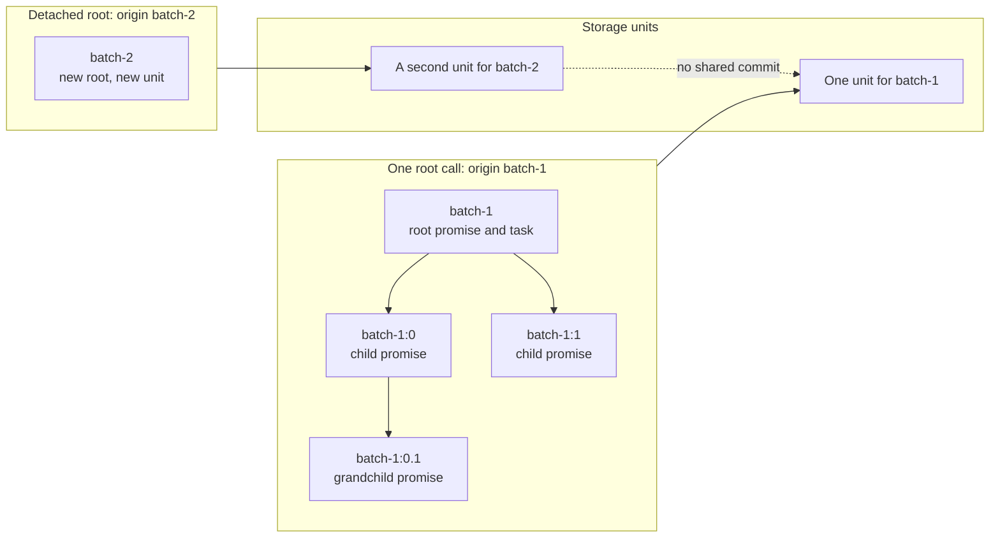
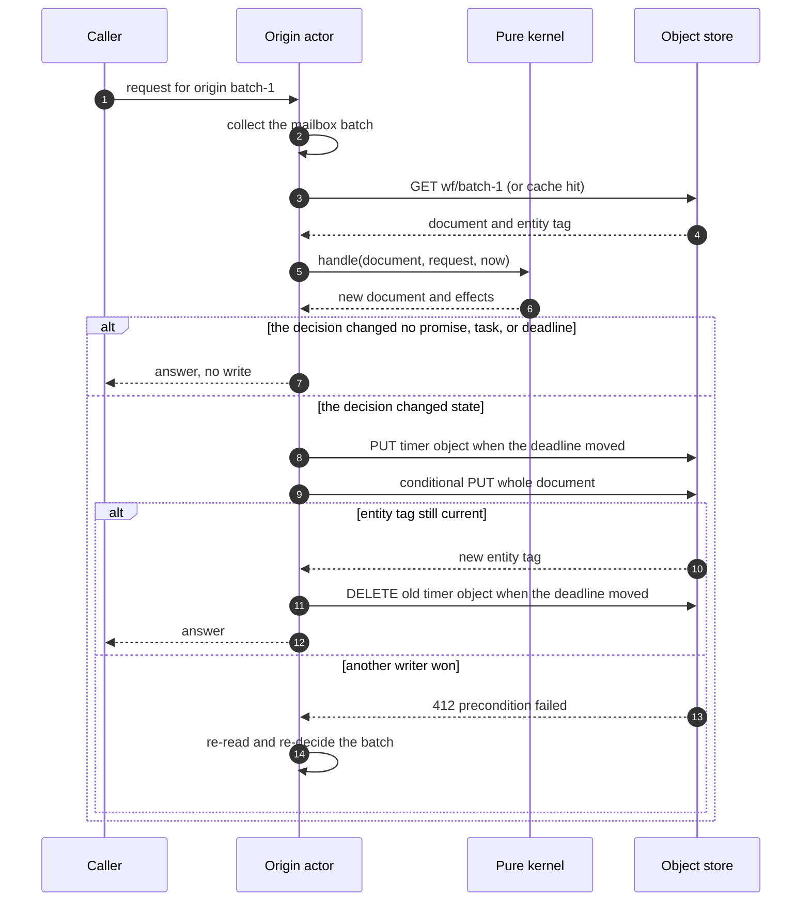
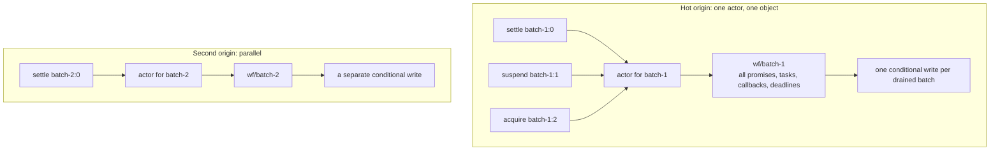

# Documents, rows, and partitions

Resonate keeps the same protocol state in several storage shapes. Two shapes are object documents. One is a table row. One is a wide-column partition. One is a graph node. This document shows what each shape holds, how one transition rewrites it, and what that rewrite costs.

The thesis is one sentence. The unit of storage decides the cost of one transition, and the origin decides that unit wherever the backend can co-locate one call tree.

The baseline is SQLite. A reader who knows what one SQLite transaction costs can compare every other backend against it.

## What this document covers, and what it does not

The server code holds six backends: SQLite, PostgreSQL, MySQL, ScyllaDB, Blob, and Neo4j. A separate S3 server is written in Zig. This document compares five shapes:

| Shape | Backends that use it |
|-------|----------------------|
| Newline-delimited canonical document, relative identifiers | Blob |
| Newline-delimited canonical document, full identifiers | S3 |
| Table row and index entry | SQLite, PostgreSQL, MySQL |
| Wide-column partition | ScyllaDB |
| Graph node and edge | Neo4j |

Blob and S3 share the document shape but not the encoding, the identifier rule, or the deadline rule, so each gets its own row and its own section. PostgreSQL and MySQL use the same row shape as SQLite. This document uses SQLite as the example and does not describe the differences between the three SQL engines, because those differences do not change the write unit.

Source: `impl/server/core/crates/resonate-server-sqlite`, `impl/server/core/crates/resonate-server-postgres`, `impl/server/core/crates/resonate-server-mysql`, `impl/server/core/crates/resonate-server-scylladb`, `impl/server/core/crates/resonate-server-blob`, `impl/server/core/crates/resonate-server-neo4j`, `impl/server/s3`.

## Terms used in this document

| Term | Meaning |
|------|---------|
| Identifier | The name of a promise, such as `batch-1:charge`. |
| Origin | The text before the first colon of an identifier. An identifier with no colon is its own origin. |
| Promise | A durable result slot that a caller can wait on. |
| Task | The executable half of a promise. A promise with a target has a task. |
| Target | The value of the `resonate:target` tag. It is a delivery address, such as `poll://any@group`, whose scheme selects a transport. A promise with a target has a task. |
| Callback | A registration on an awaited promise that names the promise of the task that is waiting on it. A task registers callbacks when it suspends. |
| Awaiter | The promise of a task that is suspended on another promise. The callback set of the awaited promise names its awaiters. |
| Listener | A delivery address that is notified when a promise settles. A listener is not a promise and not an identifier. |
| Branch | The value of the `resonate:branch` tag. Promises that share it are branch siblings. A task response carries its siblings, so a resumed task needs no separate read. |
| Schedule | A durable timer that creates promises when it is due. A schedule is not a promise, and it is not part of an origin document. |
| Document | The complete state of one origin in one object. |
| Row | One record in one table. |
| Partition | The unit of co-location and atomicity in a wide-column store. |
| Write unit | The smallest set of bytes that one commit writes. |
| Atomicity | The all-or-none property of one commit. |
| Conditional write | A write that the store applies only if the object is still the version that the reader saw. |
| Entity tag (ETag) | An opaque version string that the object store returns with an object. |
| Compare-and-swap (CAS) | A write that succeeds only if the current value equals an expected value. |
| Fence version | A number that one task acquire increments. Every later task operation is checked against it. |
| Linearizable read | A read that sees the latest acknowledged write. |
| Lightweight transaction (LWT) | A compare-and-set that a database runs with a consensus round. The round uses the Paxos algorithm. |
| Bolt | The binary protocol that the Neo4j database server uses. |
| Write law | The rule that a transition which changes nothing writes nothing. |
| External promise | A promise that something can wait on. The test is four predicates: global scope (`resonate:scope` is `global`), the external tag (`resonate:external` is `true`), a target (`resonate:target` is present), or the timer tag (`resonate:timer` is `true`). |
| Internal promise | A promise that nothing can wait on. The backends do not arm a timer for it, so its deadline is applied lazily, when a request names the promise. |
| Arm | To write a durable timer object (Blob and S3) or a timeout queue entry (ScyllaDB) that will fire at a deadline. A deadline that is not armed is still applied, but only when a request names the promise. |
| Kernel | In the Blob backend, the pure decision function. It reads no clock, makes no identifier, and performs no input or output. |
| Shell | In the Blob backend, the code around the kernel that reads and writes the object store and the timer service. |
| Sweep | One pass by a timer handler that reads an origin document, applies every deadline that is due, and commits the result. |
| Collector | The timer firing loop, which deletes a timer object only after the sweep that it started has committed. |
| Execute message | The message that offers a task to its target. The task stays pending until a worker acquires it. |
| Unblock message | The message that tells a listener address that a promise settled. |
| Timer prefix | The object-key prefix `t/` under which timer objects live. |
| Recovery | The work that a storage engine does after a crash to make committed bytes readable again. |
| Resurrection | The work that the protocol does after a recovery to make an interrupted operation observable again. The caller retries, and the retry is idempotent under the identifier and the fence version. |

## The origin and the call tree

An origin is the text before the first colon in an identifier. The server computes it in one function:

```rust
// impl/server/core/crates/resonate-core/src/types.rs:420-424
fn origin(id: &str) -> &str {
    // An id has the form "<promiseId>:<lineage>", so the origin is everything
    // before the ':' (lineage segments are '.'-separated).
    id.split_once(':').map(|(origin, _)| origin).unwrap_or(id)
}
```

The caller supplies the root identifier when it starts a root task. That root name becomes the origin. Every child id extends the root name.

An identifier has the form `<origin>:<segment>.<segment>...`. The origin is the root promise's identifier and holds no colon. A first-level child appends `:<n>`. A deeper descendant appends `.<m>`, so `batch-1:0.1` reads as a child of `batch-1:0`. The server does not parse the lineage: it treats everything after the first colon as opaque text. The client library builds the text, and the client tags each promise with `resonate:parent` or `resonate:branch`. The server checks that such a tag is a prefix of the identifier, and that is the whole rule. When a reader sees `batch-1:0.1`, the convention says it is a grandchild of `batch-1:0`. The convention is real, but it is the client's, not the server's. The source comment for `origin()` calls the pre-colon text `promiseId`; it is the origin, because the root promise's identifier is the origin text.

Source: `impl/server/core/crates/resonate-core/src/types.rs:339-372`.

| Identifier | Origin | What it names |
|------------|--------|---------------|
| `batch-1` | `batch-1` | The root promise and its task |
| `batch-1:0` | `batch-1` | The first child promise |
| `batch-1:0.1` | `batch-1` | A grandchild promise, by client convention |
| `batch-2` | `batch-2` | A detached root, created by a task in another origin |

A detached computation is a new root. It is an identifier with no colon, so its origin is itself. It is not a child of the origin that started it. The protocol allows one task to create a root in another origin. Every other cross-origin action is refused with status 400.

```rust
// impl/server/core/crates/resonate-core/src/types.rs:711-723
// A fence and its action belong to one origin — with one exception.
// Creating a root (an id with no ':', so its origin is itself) from a
// task in another origin is how a detached computation starts, and
// is allowed. Extending another origin's lineage, or settling any
// promise outside the task's origin, is not.
if origin(action_id) != origin(&data.id) {
    let is_root_create =
        data.action.kind == "promise.create" && origin(action_id) == action_id;
    if !is_root_create {
        return Err(validator::ValidationError::new("origin_mismatch")
            .with_message("Action must belong to the task's origin".into()));
    }
}
```

The validator also keeps callbacks, suspends, fences, and heartbeat batches inside one origin. A callback needs the same origin for the awaiter and the awaited promise. A suspend needs the same origin for the task and the awaited promise.

Source: `impl/server/core/crates/resonate-core/src/types.rs:426-450`, `impl/server/core/crates/resonate-core/src/types.rs:560-580`.



The diagram shows why one document can hold a whole call tree. The tree is already one origin. Atomicity at the origin is therefore enough for every operation that the protocol admits.

Neo4j is the exception. It stores the origin as an indexed property, but it does not use the origin to place a write. The next sections give the details.

## The write unit is not one thing

A backend has four separate costs: the write unit, the atomicity boundary, the contention unit, and the read unit. They often coincide, but they are not the same property.

| Backend | Write unit | Atomicity boundary | Contention unit | Read unit |
|---------|------------|--------------------|-----------------|-----------|
| Blob | The whole origin document | One conditional object write | One origin object and one actor | One object, or a cache entry |
| S3 | The whole origin document | One conditional object write | One origin object and one actor | One conditional object read |
| SQLite | The pages that the transaction changed | One database transaction | The whole database in one process | One row by primary key |
| ScyllaDB | The rows that the batch changed in one partition | One conditional batch or LWT | One partition | One row by primary key in one partition |
| Neo4j | The node and edge property records that the transaction changed | One Bolt transaction | One node lock, or a sorted set of node locks | One node by the unique identifier index |

The table already shows the central difference. A Blob or S3 commit writes the whole origin. A SQLite or ScyllaDB commit writes only the changed records. A Neo4j commit writes the revision counter and properties of the locked node, plus every edge property that the transition changes.

Source: `impl/server/core/crates/resonate-server-blob/README.md:8-12`, `impl/server/s3/README.md:45-60`, `impl/server/core/crates/resonate-server-sqlite/migrations/0001_initial.sql:14-58`, `impl/server/core/crates/resonate-server-scylladb/schema.cql:24-49`, `impl/server/core/crates/resonate-server-neo4j/schema.cypher:1-26`.

## What a document is

A document is the complete state of one origin in one object. It holds every promise, every task, every callback registration, every listener, and every armed deadline for that origin. Blob and S3 use different encoders and different id rules, but they share the idea.

### The Blob document

Blob stores one object per origin under `<prefix>wf/<origin>`. The origin is percent-encoded into the key. The letters, digits, the dot, and the hyphen pass through. Every other byte becomes `%XX` with uppercase hexadecimal digits.

A timer object uses the key `<prefix>t/<NN>/<20-digit deadline>_<encoded target>`. `NN` is the shard: the first 8 hexadecimal digits of the same FNV-1a 64-bit hash of the target, modulo the shard count (default 4). The deadline is zero-padded to 20 digits, so a lexicographic listing returns the nearest deadlines first. The target is the origin, or `sched:<encoded schedule id>` for a schedule. The Blob key has no token after the target. The S3 difference is explained below.

Source: `impl/server/core/crates/resonate-server-blob/README.md:14-24`, `impl/server/core/crates/resonate-server-blob/src/applier.rs:200-233`.

The body is one canonical JavaScript Object Notation (JSON) line per entity, joined by a newline, with no trailing newline. Each line starts with a `t` field that names the line type. The line order is fixed:

1. The header line.
2. The promise lines, sorted by identifier.
3. The task lines, sorted by identifier.
4. The armed promise deadline lines, sorted by deadline and identifier.
5. The armed task deadline lines, sorted by deadline, identifier, and kind.

| `t` value | Line | One line per |
|-----------|------|--------------|
| `"h"` | Header | Document. It is always the first line. |
| `"p"` | Promise | Promise, sorted by identifier |
| `"k"` | Task | Task, sorted by identifier |
| `"pt"` | Armed promise deadline | Pending external promise, sorted by `(dl, id)` |
| `"kt"` | Armed task deadline | Retry or lease deadline, sorted by `(dl, id, kind)`. Kind `0` is retry and kind `1` is lease. |

Source: `impl/server/core/crates/resonate-server-blob/README.md:31-42`, `impl/server/core/crates/resonate-server-blob/src/codec.rs:260-427`.

The identifiers in the body are relative to the origin. The origin's own promise has the empty identifier. A child of `order-7` named `order-7:charge` is stored as `charge`. The origin appears in the body zero times.

The header `og` field binds the body to its key. It holds 16 lowercase hexadecimal digits of a 64-bit Fowler-Noll-Vo 1a (FNV-1a) hash over the origin string. A document whose `og` does not hash the origin it was read under is refused. A misrouted read cannot graft one workflow's promises onto another.

Source: `impl/server/core/crates/resonate-server-blob/README.md:26-29`, `impl/server/core/crates/resonate-server-blob/README.md:60-68`.

This example is the published encoder example in the Blob README. The origin is `order-7`. The origin has no root promise in this example, so no line has the empty identifier. A root promise would appear as `"id":""`.

The published example omits one line that the encoder emits. The promise `paid` is pending and external, so its `timeout_armed()` test is true. A real encode therefore also writes `{"t":"pt","dl":600000,"id":"paid"}`. The encoder rule is `state == pending && is_external` (`state.rs:145-147`). That rule is wider than the README line-type table, which says a `pt` line is for a pending promise that carries `resonate:target`. The published example and the README line-type table agree with each other, and both disagree with the code; the code is authoritative. The header `ta` stays 61,000 in both forms, because the lease deadline is earlier than either promise deadline.

```json
{"t":"h","v":1,"clk":1500,"g":6,"og":"dee47a9f34bede3b","ta":61000}
{"t":"p","id":"charge","st":0,"tg":{"resonate:target":"http://worker:9999"},"pm":{"d":"aGk="},"to":900000,"ca":1000}
{"t":"p","id":"done","st":1,"vl":{"h":{"x":"1"},"d":"b2s="},"to":500000,"ca":1400,"sa":1500}
{"t":"p","id":"paid","st":0,"tg":{"resonate:external":"true"},"to":600000,"ca":1100,"cb":["charge"],"ls":["poll://any@group"]}
{"t":"k","id":"charge","st":1,"v":1,"pid":"p1","ttl":60000}
{"t":"pt","dl":900000,"id":"charge"}
{"t":"kt","dl":61000,"id":"charge","k":1}
```

Source: `impl/server/core/crates/resonate-server-blob/README.md:44-58`.

The next table explains every field that the example uses.

| Line | Field | Meaning |
|------|-------|---------|
| Header | `v` | Format version. A document with a higher version is refused, not misread. |
| Header | `clk` | The latest clock value observed for the origin, in milliseconds. It is diagnostic metadata. |
| Header | `g` | The generation, which the shell increments once per committed write. It is diagnostic. |
| Header | `og` | The origin hash. |
| Header | `ta` | The deadline of the one timer object that is armed for this origin. It is the minimum of all armed deadlines. |
| Promise | `id` | The relative identifier. |
| Promise | `st` | Promise state: `0` pending, `1` resolved, `2` rejected, `3` rejected_canceled, `4` rejected_timedout. |
| Promise | `tg` | Tags. |
| Promise | `pm` | Parameter payload. A payload is `{"h":{...},"d":"<base64>"}`. |
| Promise | `vl` | Value payload. |
| Promise | `to` | The absolute deadline, `timeoutAt`, in milliseconds since the Unix epoch. It is not a duration. |
| Promise | `ca` | Creation time, in milliseconds. |
| Promise | `sa` | Settlement time, in milliseconds. It is omitted while the promise is pending. |
| Promise | `cb` | The relative identifiers of the callback awaiters, in registration order. |
| Promise | `ls` | Listener delivery addresses, in registration order, such as `poll://any@group`. An address is not an identifier, so it is never made relative. |
| Task | `id` | The relative identifier. It equals its promise identifier. |
| Task | `st` | Task state: `0` pending, `1` acquired, `2` suspended, `3` halted, `4` fulfilled. |
| Task | `v` | The fence version. |
| Task | `pid` | The process identifier that holds the lease. |
| Task | `ttl` | The lease length, in milliseconds. It is a duration, not a deadline. |
| Task | `rs` | The relative identifiers of awaited promises whose settlement the task has not observed. The kernel calls this set `resumes`; the protocol reports its size under that name. |
| Deadline | `dl` | The absolute deadline, in milliseconds since the Unix epoch. |
| Deadline | `id` | The relative identifier. |
| Deadline | `k` | The kind for a `kt` line only: `0` retry, `1` lease. |

Source: `impl/server/core/crates/resonate-server-blob/README.md:60-119`, `impl/server/core/crates/resonate-server-blob/src/codec.rs:334-361`.

The times in the example are test values, not a real clock. In the example, `charge` is a pending promise that carries a target, so it has a task. The task line has no acquisition timestamp. The example takes the acquisition time as 1,000 milliseconds, the same as the promise creation time, so the `kt` lease deadline is 1,000 + 60,000 = 61,000. `done` is resolved with a value. `paid` is a pending external promise with one callback awaiter, `charge`, and one listener address. `paid` also has a `pt` line in the encoder's output, as the note above says. The header `ta` is 61,000 because the lease deadline is the earliest armed deadline.

### The S3 document

The S3 server uses the same storage idea with a different key space and a different encoder. It keeps three prefixes.

| Key | Holds |
|-----|-------|
| `wf/<enc(origin)>` | Every promise and task of one origin, as one document |
| `sched/<enc(id)>` | One schedule |
| `t/<NN>/<20-digit deadline>_<enc(timer target)>@<arm token>` | One deadline, as a zero-byte object |

The timer key has four parts, and none of them is the promise target tag:

- `NN` is the shard. It is `(FNV-1a 64-bit hash of the timer target >> 32) % timer_shards`, in two digits.
- The 20-digit number is the deadline, zero-padded, so lexicographic order is time order.
- The timer target is the origin for an origin deadline. For a schedule deadline, the literal text `sched:` goes before the percent-encoded schedule id. The marker is outside the encoding, so an origin literally named `sched:evil` cannot be confused with a schedule. The separate `sched/<enc(id)>` object holds the schedule itself.
- The arm token names the arm that wrote the object. It is not the deadline and not the document generation.

Source: `impl/server/s3/src/store.zig:277-340`, `impl/server/s3/README.md:45-53`.

The S3 document header is one JSON object. It has no `t` field. The fields are `v` for the format version, `og` for the origin hash, `cl` for the clock, and `gn` for the generation. When a deadline is armed, the header also has `ta` for the deadline and `tgn` for the generation that wrote the timer object.

```zig
// impl/server/s3/src/doc.zig:538-566
pub fn encode(self: *const Doc, out: *std.ArrayList(u8), origin: []const u8) !void {
    out.clearRetainingCapacity();
    const hash = origin_hash(origin);

    try out.appendSlice("{\"v\":");
    try out.writer().print("{d}", .{format_version});
    try out.appendSlice(",\"og\":\"");
    try out.appendSlice(&hash);
    try out.appendSlice("\",\"cl\":");
    try out.writer().print("{d}", .{self.clock});
    try out.appendSlice(",\"gn\":");
    try out.writer().print("{d}", .{self.generation});
    if (self.timer_at) |at| {
        try out.appendSlice(",\"ta\":");
        try out.writer().print("{d}", .{at});
        try out.appendSlice(",\"tgn\":");
        try out.writer().print("{d}", .{self.timer_generation});
    }
    try out.append('}');

    for (self.promises.items) |p| {
        try out.append('\n');
        try encode_promise(out, p);
    }
    for (self.tasks.items) |t| {
        try out.append('\n');
        try encode_task(out, t);
    }
}
```

The S3 document stores full identifiers, not relative ones. A promise in origin `o` is written as `o:a`. The header hash still binds the document to its key.

The first field of a line is the line type. A promise line starts with `{"p":`, and a task line starts with `{"t":`. There is no separate line-type field. This is why the Blob table uses `k` and the S3 table uses `t` for the two task-line shapes: the letter names the first field, not the same field in both encoders.

The S3 document has no separate deadline lines. It records deadlines in two places instead:

- A promise line records `to`, the absolute deadline, and `ar`, a flag that the promise deadline is armed. The flag exists because the deadline is always `to`; a second copy of the value could only disagree with the first. A promise line with `ar` is a promise whose deadline has a timer object.
- A task line records its one deadline, either a retry deadline or a lease deadline. `tk` is the kind, `0` for retry and `1` for lease. `tt` is the deadline, in milliseconds. A task has one deadline at a time, not two.

| Promise field | Meaning |
|---------------|---------|
| `p` | Full promise identifier |
| `s` | State, as a name: `pending`, `resolved`, `rejected`, `rejected_canceled`, or `rejected_timedout` |
| `to` | Absolute deadline, `timeoutAt`, in milliseconds |
| `ca` | Creation time, in milliseconds |
| `sa` | Settlement time, in milliseconds. Omitted while the promise is pending. |
| `ar` | Present and `true` when the promise deadline has a timer object |
| `pa` | Parameter payload |
| `va` | Value payload |
| `tg` | Tags |
| `cb` | Callback awaiter identifiers |
| `ls` | Listener addresses |

| Task field | Meaning |
|------------|---------|
| `t` | Full task identifier, equal to its promise identifier |
| `s` | State, as a name: `pending`, `acquired`, `suspended`, `halted`, or `fulfilled` |
| `v` | Fence version |
| `pid` | Process identifier that holds the lease |
| `ttl` | Lease length, in milliseconds |
| `rs` | Awaited promise identifiers whose settlement the task has not observed. Internally the set is named `resumes`; the protocol message reports its size under that name. |
| `tk` | Deadline kind: `0` retry, `1` lease |
| `tt` | The absolute deadline, in milliseconds since the Unix epoch. It is not a duration. |

Source: `impl/server/s3/src/doc.zig:209-250`, `impl/server/s3/src/doc.zig:568-631`.

The arming rule differs from Blob, and the difference matters. S3 arms a promise deadline only when the promise carries a task. The code sets `timeout_armed = !already_timedout and address != null`, where `address` is the target (`handle.zig:688`). A pending external promise without a target has `ar` absent and no timer object. It expires lazily: every operation that names it first asks `expired(now)`, and a promise past its deadline reads as settled even when nothing has written that down (`doc.zig:252-258`). Blob arms every pending external promise, target or not. Neither rule loses a deadline; they differ in whether an observer, rather than the next request, applies the expiry.

| Blob field | S3 field | Difference |
|------------|----------|------------|
| `st` (int) | `s` (string) | Blob uses a number; S3 uses a name. |
| `pm` | `pa` | Same payload meaning. |
| `vl` | `va` | Same payload meaning. |
| `tg` | `tg` | Same meaning. |
| `ca`, `sa`, `to` | `ca`, `sa`, `to` | Same meaning. |
| `cb`, `ls` | `cb`, `ls` | Same meaning. |
| `k` line, `v` fence | `t` line, `v` fence | Blob uses `k` as the line-type value; S3 uses `t` as the task identifier field that begins a task line. |
| `pt` and `kt` lines | `tk` and `tt` fields | Blob keeps separate deadline lines; S3 keeps the task deadline in the task line and a promise deadline flag in `ar`. |

Source: `impl/server/s3/src/doc.zig:568-631`.

When a promise settles, its `ar` flag is gone. When that settle also fulfils the promise's task, the task line loses `tk` and `tt`. A pending task keeps its retry deadline, and an acquired task keeps its lease deadline. The `rs` set shrinks as the task observes settlements. The kernel names that set `resumes`, and the protocol message reports its size under the same name.

Source: `impl/server/s3/src/doc.zig:209-250`.

### The canonical form and the write law

Canonical encoding means equal state produces equal bytes. Two runs of one encoder, given the same document, write the same object. The Blob encoder and the S3 encoder produce different objects from the same protocol state, because their fields, identifier rules, and deadline rules differ.

The rules are the same in both backends:

- American Standard Code for Information Interchange (ASCII) only. Other characters become `\uXXXX` escapes.
- Minimal escapes and integers without exponents.
- Fixed key order within a line and fixed line order within the document.
- Omission of empty values, never `null`, `[]`, `false`, or `{}`.

Source: `impl/server/core/crates/resonate-server-blob/README.md:121-131`, `impl/server/s3/src/doc.zig:532-537`.

The canonical form is load-bearing in three places:

1. A seeded simulation replays byte for byte. The same seed produces the same objects, so a failing run reproduces.
2. The write-law comparison is well defined. The implementations compare decoded state, not bytes: Blob compares its `OriginDoc` values (`applier.rs:660-664`) and S3 compares its `Doc` fields (`doc.zig:261-269`). Canonical encoding is what makes "equal state means equal bytes" true, so a byte comparison would also be sound.
3. A differential test can compare two servers' trajectories byte for byte.

The Blob README goes further. It says a writer "recognizes its own landed write after a lost response by re-encoding and comparing" (`README.md:133-136`). The applier in this commit does not do that. After a `Conflict` it retries the same conditional write, and after a `PreconditionFailed` it re-reads and re-decides (`applier.rs:505-542`). No byte comparison appears on either path. The property may return in a later commit; treat the README sentence as a stated intent, not as a description of this code.

The write law itself is this. A transition that changes no promise, no task, and no deadline writes nothing. The clock and the generation are excluded, because a write that advances only those fields would turn every read into a write.

Source: `impl/server/core/crates/resonate-server-blob/src/applier.rs:656-664`, `impl/server/s3/src/applier.zig:540-553`.

## The document in memory

Blob decodes the document into one `OriginDoc` value. The value holds two sorted maps, one for promises and one for tasks. The task map uses the promise identifier as its key.

```rust
// impl/server/core/crates/resonate-server-blob/src/kernel/state.rs:51-65
pub struct OriginDoc {
    pub promises: BTreeMap<String, PromiseDoc>,
    pub tasks: BTreeMap<String, TaskDoc>,
    pub clock: i64,
    pub gen: u64,
    pub timer_at: Option<i64>,
}
```

A `PromiseDoc` holds the state, the parameter, the value, the tags, the deadlines, the callback identifiers, and the listener addresses. A `TaskDoc` holds the state, the fence version, the process identifier, the lease time to live, and the awaited set. It also holds at most one deadline, which is either the retry deadline or the lease deadline.

Source: `impl/server/core/crates/resonate-server-blob/src/kernel/state.rs:67-105`.

The sorted maps are not a style choice. Iteration order is part of the protocol. A task response lists branch siblings in identifier order. The encoder writes lines in identifier order. A seeded differential run must reproduce the same bytes.

Source: `impl/server/core/crates/resonate-server-blob/README.md:199-201`.

## How Blob updates a document

A request does not write. It enters a mailbox for its origin. One actor per origin drains the mailbox. Every request in one drain sees the document that the request before it produced. The batch then performs one write.

The kernel is pure. `handle(document, request, now)` and `drain(document, now)` read no clock, make no identifier, and touch no input or output. They return effect values for the shell to perform. The shell is the code around the kernel that owns the object store and the timer service. The effects are: arm a timer, store the document, clear a timer, or send a message.

Source: `impl/server/core/crates/resonate-server-blob/src/kernel/mod.rs:1-33`.

A decision works on a clone of the document. The `Tx` value holds the clone and the messages that the decision owes. At the end, `finish` produces the effects in a fixed order.

```rust
// impl/server/core/crates/resonate-server-blob/src/kernel/handle.rs:70-94
pub(crate) fn finish(mut self, before: &OriginDoc) -> Vec<Effect> {
    let old = before.timer_at;
    let new = min_deadline(&self.doc);
    self.doc.timer_at = new;

    let mut fx = Vec::new();
    if old != new {
        if let Some(at) = new {
            fx.push(Effect::SetTimeout { at });
        }
    }
    fx.push(Effect::SetDocument(self.doc));
    if old != new {
        if let Some(at) = old {
            fx.push(Effect::DelTimeout { at });
        }
    }
    for (address, msg) in self.sends {
        fx.push(Effect::Send { address, msg: Box::new(msg) });
    }
    fx
}
```

The order is the crash safety rule. The new timer comes first. The document comes second. The old timer is removed third. The messages go last.

| Crash after | State left | Repair |
|-------------|------------|--------|
| Timer arm | A timer for a document that did not change | It fires into a sweep with nothing due, and the firing loop collects it |
| Document write | The transition is durable, and the old timer is still armed | The old timer fires early; the drain either does nothing or advances state that is already due |
| Old timer removal | The transition is durable, and the messages did not leave | The committed retry deadline sends the execute message again. A lost unblock message is not repaired. |
| Message send | The caller heard nothing | The caller retries an idempotent operation |

Source: `impl/server/core/crates/resonate-server-blob/src/applier.rs:1-60`, `impl/server/core/crates/resonate-server-blob/src/timerd.rs:1-14`.

The Blob shell writes a durable zero-byte timer object for the new deadline. It also mirrors that deadline in an in-process timer queue. The queue is a fast path, not a second source of truth. At startup, `Timerd::seed` lists the timer prefix in full and rebuilds the queue from the durable objects. A crash therefore loses only the in-memory copy.

```rust
// impl/server/core/crates/resonate-server-blob/src/applier.rs:680-689
// (1) The new timer first, so the deadline is covered even if we die here.
if new_timer != old_timer {
    if let Some(at) = new_timer {
        let key = shared.keys.timer_key(origin, at);
        shared.store.put(&key, Vec::new()).await?;
        // Durable, so it may be mirrored: the firing loop reads the
        // queue, not the bucket.
        shared.timers.arm(at, key);
    }
}
```

The write law decides whether the document write happens at all:

```rust
// impl/server/core/crates/resonate-server-blob/src/applier.rs:660-664
fn changed(before: &OriginDoc, after: &OriginDoc) -> bool {
    before.promises != after.promises
        || before.tasks != after.tasks
        || before.timer_at != after.timer_at
}
```

The commit itself is one conditional write of the whole document:

```rust
// impl/server/core/crates/resonate-server-blob/src/applier.rs:691-699
let mut doc = decision.doc.clone();
doc.gen = loaded.doc.gen.saturating_add(1);
let body = codec::encode(&doc, origin);
let key = shared.keys.doc_key(origin);
let etag = match &loaded.etag {
    Some(etag) => shared.store.put_if_match(&key, body, etag).await?,
    None => shared.store.put_if_none_match(&key, body).await?,
};
```

There is no diff and no partial update. The document is the write unit. The server clones it, decides over the clone, encodes the whole clone, and replaces the whole object.

A failed conditional write has three outcomes. A precondition failure means that the state moved. The server drops the cache entry, reads the document again, and re-decides the whole batch. It never replays the decision. A conflict means that the store could not order two writes, and nothing is known about whether the write landed. The server keeps the cache entry and runs the decision again against the same document. Because the decision is pure, it produces the same write, and the server attempts that write again. If the retry returns a precondition failure, the first branch applies. An unavailable store fails the whole batch with status 503.

The default limit is eight retries after the first attempt. When the limit is reached, the caller gets status 503.

The S3 server keeps the same three outcomes as three separate error values, because a conflict and a precondition failure demand opposite responses.

Source: `impl/server/core/crates/resonate-server-blob/src/applier.rs:511-542`, `impl/server/core/crates/resonate-server-blob/src/plugin.rs:115-117`.

> Aha: the write law makes the document a cheap read path and an expensive write path. A read that changes nothing costs zero object writes on a cache hit. A write pays for the whole origin, not for the one promise it changed. The design bets that a hot origin produces fewer commits than reads and that the batches are large enough to spread the rewrite cost over many requests.



The Blob cache is never authoritative. Its contract covers writes only. A cache hit is not validated, so a read can return a state that an earlier write has replaced. That is safe for the protocol because every write is conditional and because the Blob backend does not claim linearizable reads. A stale read that changes nothing is answered with no write, and its answer may be stale. A stale read that changes something produces a conditional write. If another writer got there first, the write fails the entity tag check, and the server re-reads and re-decides.

The Blob deployment is one node, so a cache entry is normally stale only after a crash or after a `Conflict` whose write actually landed. The cache contract does not depend on the single-node assumption. It depends only on the rule that a stale entry costs a failed conditional write, never correctness.

Source: `impl/server/core/crates/resonate-server-blob/src/cache.rs:1-15`, `impl/server/core/crates/resonate-server-blob/src/applier.rs:579-608`.

## How S3 updates a document

The S3 server uses the same sequence with its own actor and its own timer objects. The actor has six phases: idle, loading, arming, committing, disarming, and waiting. A phase change is an assertion, so an unexpected callback stops the server in `ReleaseSafe` mode.

Source: `impl/server/s3/src/applier.zig:292-330`.

The commit order is arm, commit, disarm, send, answer. The arm step writes a zero-byte deadline object. The commit step replaces the origin document. The disarm step removes the old deadline.

The arm step is first for one reason. A committed document whose deadline was never armed is a promise that never times out and a task that is never offered again. No later process can detect that state. Every other crash window leaves an orphan or a duplicate that a later step repairs, with one exception. A message lost after the commit is repaired only when it is an `execute`: the committed retry deadline emits it again. A lost `unblock` is lost, because an unblock is a notification to a listener, not a durable obligation (`contract.md:291-293`). Both document backends state the same rule.

Source: `impl/server/s3/docs/on-s3.md:95-112`, `impl/server/core/crates/resonate-server-blob/src/applier.rs:24-29`.

The conditional write has three outcomes, and they are not the same:

| Store answer | What is known | Action |
|--------------|---------------|--------|
| `412 precondition failed` | The write did not land, and the state moved | Read again and re-decide |
| `409 conflict` | The store could not order the write. Nothing is known about whether it landed. | Retry the same write |
| `unavailable` | There is no answer at all | Answer 503 and let the caller retry |

Source: `impl/server/s3/src/store.zig:1-27`, `impl/server/s3/src/s3.zig:211-227`.

The S3 timer key has one more part than the Blob timer key given above: a token. The token names the arm, not the commit. To see why it exists, name the collector. The collector is the firing loop. When a deadline fires, it sweeps the origin, and only after the sweep commits does it delete the object it fired (`timerd.zig:332-377`). An attempt can arm an object and then fail to commit. That object is an orphan. It fires into a sweep that finds nothing due, and it is collected by the same code path.

The danger is a name collision. Suppose the retry of the same document version computes the same deadline. If the token came from the document counter, the retry would compute the same key as the orphan. The live object and the orphan would then be one object, and a collect could remove the timer that a committed document now depends on. That is a deadline lost for good. The token removes the collision: each arm gets a name of its own.

Blob does not need a token because it makes a different assumption. Its timer service states that the deployment is a single node (`timerd.rs:11-13`). Its delete also waits for the sweep to commit. A deadline that a sweep re-arms is that sweep's `now` plus the retry timeout or plus a task's time to live. Both values are validated as positive, so the new deadline is strictly later than `now`, and a key that the sweep just wrote cannot be in the set it deletes (`timerd.rs:33-40`). S3 supports several servers over one bucket, so two writers can arm the same deadline for the same timer target. The token is what keeps their objects apart.

```zig
// impl/server/s3/src/applier.zig:938-950
pub fn fresh_arm(self: *Applier, loaded_generation: u64) u64 {
    const rng = self.random orelse return loaded_generation + 1;
    while (true) {
        const token = rng.word() & std.math.maxInt(i64);
        if (token != 0) return token;
    }
}
```

The token is 63 random bits. Zero means "no deadline armed", so it is not a valid token. The production binary always installs a random source, seeded from the current time in milliseconds (`main.zig:546-548`). The fallback of `loaded_generation + 1` therefore runs only in an embedded server with no random source, such as the simulator and the unit tests. That fallback is deterministic, so it can reuse a name. It is sound only under the assumption that no two writers arm the same origin, which is the assumption those test servers make.

The same file has a second, unrelated function. `backoff_ms` spaces the retries of a failed conditional write; it has nothing to do with the arm token:

```zig
// impl/server/s3/src/applier.zig:952-958
fn backoff_ms(self: *Applier, attempt: u32) i64 {
    const base: i64 = @as(i64, 5) * (@as(i64, 1) << @intCast(@min(attempt, 6)));
    let jitter: i64 = if (self.random) |rng|
        @intCast(rng.below(@intCast(base + 1)))
    else
        0;
    return base + jitter;
}
```

The wait starts at 5 milliseconds and doubles with each attempt, up to a limit of 6 doublings, which is 320 milliseconds. A random jitter of up to the base is added so that two servers do not retry in step. `retry()` calls it after every `412` or `409`, and the batch fails with status 503 when the attempt count passes `max_cas_retries`.

The S3 server validates a cached read with a conditional read by default. The store answers "not modified" and sends no body. A cache hit therefore costs one round trip and no transfer. The `--sole-writer` flag turns the validation off, and its name states the assumption. Without validation, two servers over one bucket can serve a read from a state that another server has replaced.

This is the point where S3 and Blob deliberately differ. S3 supports several servers over one bucket, and its default contract claims that reads are linearizable when validation is on. The conditional read is the price of that claim (`applier.zig:77-90`). Blob's cache contract makes the opposite choice: the cache is never authoritative, and Blob does not claim linearizable reads (`cache.rs:1-15`). A stale Blob read costs either nothing, when it changes nothing, or one failed conditional write and one re-decision, when it changes something. Neither design is inconsistent; they promise different read behaviour.

Source: `impl/server/s3/src/applier.zig:403-435`, `impl/server/s3/src/main.zig:537`, `impl/server/core/crates/resonate-server-blob/src/cache.rs:1-15`.

The S3 server also groups commits. A request that arrives while a write is in flight waits for the next write. A hot origin therefore costs one conditional write per round, not one per request.

Source: `impl/server/s3/src/applier.zig:844-848`.

```mermaid
sequenceDiagram
    autonumber
    participant C as Caller
    participant A as Origin actor
    participant S as Object store
    C->>A: request for origin batch-1
    A->>S: GET wf/batch-1 (with If-None-Match when cached)
    S-->>A: document and ETag, or 304 not modified
    A->>A: apply the batch in memory
    alt nothing changed
        A-->>C: answer, no write
    else the deadline moved
        A->>S: PUT deadline object (unconditional)
        S-->>A: stored
        A->>S: PUT whole document If-Match ETag
        alt ETag still current
            S-->>A: new ETag
            A->>S: DELETE old deadline object
            A->>A: enqueue messages, then answer the batch
        else 412 precondition failed
            S-->>A: precondition failed
            A->>A: re-read and re-decide
            Note over A,S: the object armed in this attempt stays<br/>as an orphan; it fires later and is collected
        end
    else the deadline did not move
        A->>S: PUT whole document If-Match ETag
        S-->>A: new ETag
        A->>A: enqueue messages, then answer the batch
    end
```

The order of the last two steps is deliberate. The actor hands every outgoing message to its transport before it answers the caller (`applier.zig:737-757`). A caller that got its answer first could look at the world before the worker that the message summoned had any chance to act.

## Many promises, one document

A workflow under one root makes many durable calls. The root call creates the root promise and its task. Each child call creates a child promise. A suspend registers callbacks. A settle wakes the callbacks. All of these identifiers share one origin, so all of them live in one document.

Take a root `batch-1` with three children and one grandchild. The document holds five promise lines if every call creates a promise, and five task lines if every promise has a target.

Callbacks are registered when a task suspends, not when a promise settles. A suspend of a child task writes one callback onto each awaited promise, and records the awaited set on the task. That changes the awaited promise's line, so it is part of the same document.

A settle of `batch-1:0` then changes one atomic set:

- the settled promise's state, value, and settlement time;
- its callback list and its listener list, both of which are cleared;
- its task, which becomes fulfilled and loses its deadline;
- each awaiter, whose callback becomes ready;
- each suspended awaiter, which returns to pending with a retry deadline.

One conditional write covers all of them. If a settle and a suspend landed in two objects, the two would need an agreement protocol. A crash between them could leave a callback that no promise will ever fire, or a waiter that no settle will ever wake.

Source: `impl/server/core/crates/resonate-server-blob/README.md:70-119`, `impl/server/core/crates/resonate-server-blob/src/kernel/handle.rs:845-880`.

The cost model follows from the same fact. A hot origin serialises every write through one actor and one object. Separate origins do not contend. A system with many small call trees therefore uses the backend well. A single call tree with a very large number of promises makes every commit rewrite the whole tree.



The document also answers a whole-origin read in one object read. That is the other side of the trade. SQLite has no whole-origin read in the protocol: an operation reads the rows it names by primary key, one query for each row. Its `origin_id` column has no index, so the console's whole-execution query scans the table (`0001_initial.sql:20-31`, `lib.rs:3586-3603`). ScyllaDB can read the whole partition in one query. Neo4j needs one node lookup and one traversal for each relation.

## SQLite: one row per promise

SQLite is the simplest comparison because it stores the smallest unit. It uses one Structured Query Language (SQL) table for promises, named `promises`, with one row for each promise. The optional task is not a second table. It is a group of nullable columns in the same row.

```sql
-- impl/server/core/crates/resonate-server-sqlite/migrations/0001_initial.sql:46-58
-- was the `tasks` table. NULL task_state means this promise has no
-- task, which is what `LEFT JOIN tasks` used to express.
task_state TEXT
  CHECK (task_state IS NULL OR task_state IN ('pending', 'acquired', 'suspended', 'halted', 'fulfilled')),
task_version INT NOT NULL DEFAULT 0,

-- was `task_timeouts`, whose timeout_type discriminated two queues.
-- Two nullable columns say the same thing without the row.
retry_timeout_at   BIGINT,   -- type 0: redispatch a pending task
lease_timeout_at BIGINT,   -- type 1: an acquired task's lease
ttl        BIGINT,
pid        TEXT
```

`task_state IS NULL` is the test for "this promise has no task". A value in that column is the test for "this promise has a task". The task fence version, the process identifier, the lease time to live, and the two deadline columns are also in the row.

Relations are separate tables. `callbacks` holds one row for each awaited and awaiter pair, with primary key `(awaited_id, awaiter_id)`. `listeners` holds one row for each promise and address pair. Both declare `ON DELETE CASCADE`, and the engine enables foreign keys.

Source: `impl/server/core/crates/resonate-server-sqlite/migrations/0001_initial.sql:70-83`.

The `promises` table also has generated columns: `target`, `origin_id`, `parent_id`, `branch_id`, `is_timer`, and `external`. A generated column is a stored projection of the row. The `external` column is the test for "something can wait on this promise". It is true for global scope (`resonate:scope` is `global`), the external tag (`resonate:external` is `true`), a target (`resonate:target` is present), or the timer tag (`resonate:timer` is `true`).

The column does not test the callback or listener lists, and it does not need to. Both registration paths refuse an awaited promise that fails this test: callback registration returns status 422, and listener registration returns status 422 (`lib.rs:568-575`, `lib.rs:632-639`). An internal promise therefore cannot hold an observer, so the four tags are a complete test.

Source: `impl/server/core/crates/resonate-server-sqlite/migrations/0001_initial.sql:23-41`.

### One transaction per transition

The engine holds one connection behind a mutex. Every protocol operation runs on that connection inside one transaction. The transaction is the atomicity mechanism, and it replaces the conditional write that the object backends use.

```rust
// impl/server/core/crates/resonate-server-sqlite/src/lib.rs:141-158
tokio::task::block_in_place(|| {
    let conn = conn.lock().unwrap_or_else(|e| e.into_inner());
    let tx = conn.unchecked_transaction()?;
    let db = SqliteDb { conn: &tx, ... };
    let result = f(&db)?;
    let emitted = db.emitted.into_inner();
    let armed = db.armed.into_inner();
    tx.commit()?;
    Ok((result, emitted, armed))
})
```

The messages are not rows. The closure pushes them onto a vector, and the engine returns that vector only after the commit succeeds. There is no outbox table. A message that the transition emitted exists only if the transition is durable. That is not a promise that it is delivered. A lost `execute` is repaired by the retry deadline; a lost `unblock` is not repaired. The same distinction applies to every backend, not only to Blob.

Source: `impl/server/core/crates/resonate-server-sqlite/src/lib.rs:8-16`, `impl/server/core/crates/resonate-server-sqlite/src/lib.rs:2343-2345`.

A settle shows the fan-out inside the one transaction:

```rust
// impl/server/core/crates/resonate-server-sqlite/src/lib.rs:2541-2565
let updated = db.conn.execute(
    "UPDATE promises SET state = ?2, value_headers = ?3, value_data = ?4, settled_at = ?5 WHERE id = ?1 AND state = 'pending'",
    params![id, state, value_headers, value_data, settled_at],
)?;
if updated == 0 {
    return Ok(false);
}
settlement_enqueued(db.conn, id)?;
resumption_enqueued(db, id, time, task_retry_timeout, None)?;
listener_unblocked(db, id)?;
```

The three helper calls after the update map one to one onto three effects:

| Call | What it changes or emits |
|------|--------------------------|
| `settlement_enqueued` | Fulfils the promise's own task, if it has one, and deletes that task's callback rows as an awaiter |
| `resumption_enqueued` | Marks the settled promise's callback rows ready, moves each suspended awaiter to pending with a retry deadline, and emits one `execute` for each |
| `listener_unblocked` | Emits one `unblock` for each listener address |

The promise row itself is settled by the `UPDATE` above those calls. A crash before the commit leaves none of these changes. A crash after the commit leaves all of them.

Source: `impl/server/core/crates/resonate-server-sqlite/src/lib.rs:2423-2525`.

### The indexes are the timeout queues

SQLite does not keep timeout tables. A partial index over the rows that have a deadline is the queue. The sweep scans the index, not the table.

```sql
-- impl/server/core/crates/resonate-server-sqlite/migrations/0001_initial.sql:59-68
CREATE INDEX idx_promises_timeout_at ON promises (timeout_at) WHERE state = 'pending' AND external;
CREATE INDEX idx_promises_target ON promises (target) WHERE target IS NOT NULL;
CREATE INDEX idx_promises_branch_id ON promises (branch_id) WHERE branch_id IS NOT NULL;
CREATE INDEX idx_promises_retry_timeout_at ON promises (retry_timeout_at ASC, id ASC) WHERE retry_timeout_at IS NOT NULL;
CREATE INDEX idx_promises_lease_timeout_at ON promises (lease_timeout_at ASC, id ASC) WHERE lease_timeout_at IS NOT NULL;
CREATE INDEX idx_promises_pid ON promises (pid) WHERE pid IS NOT NULL;
```

An index entry is not a separate durable object, but it is not in the table's B-tree either. It lives in the index's own B-tree. SQLite writes the pages of both B-trees in one transaction and one write-ahead log commit, so the row and its index entries become durable together. This is the strongest contrast with the object backends: the deadline and the state it describes cannot disagree.

SQLite creates no timeout index entry for an internal promise, because the `external` condition excludes it. The deadline is not lost. It is applied lazily through `try_timeout`, the first time a request names the promise.

Source: `impl/server/core/crates/resonate-server-sqlite/migrations/0001_initial.sql:34-41`, `impl/server/core/crates/resonate-server-sqlite/src/lib.rs:2357-2362`.

### The cost of one transaction

SQLite does not write a row. It writes pages. The default page is 4,096 bytes. A column-scoped `UPDATE` dirties the pages that hold the changed row, plus the pages that hold each index entry the change touches. The engine writes those pages to the write-ahead log (WAL), not to the main database file.

A settle of one promise touches that promise row, its callback rows, the awaiter rows that become ready, and the listener rows that send a message. That is a small number of pages, and it does not grow with the number of promises in the database.

The writer is serialized inside one process. One connection behind one mutex means one transaction at a time. Correctness at the row level also comes from predicate guards such as `WHERE id = ?1 AND task_version = ?2 AND task_state = 'pending'`. The guard makes the operation correct if the same database file is opened by a second process, and it states the precondition inside the statement that applies it. In one process the mutex is the serialization point; the guard checks that the state still matches the decision.

Source: `impl/server/core/crates/resonate-server-sqlite/src/lib.rs:2994-2999`.

The durability setting is a WAL with `synchronous = NORMAL`. The log makes the commit atomic. The normal sync level gives durability across a process crash and a weaker guarantee across a power loss.

Source: `impl/server/core/crates/resonate-server-sqlite/src/lib.rs:80-88`.

## ScyllaDB: one partition per origin

ScyllaDB is a wide-column store. Its `promises` table has primary key `(origin, id)`. Every row with the same origin therefore lives in one partition, and one partition lives on one set of replicas.

```cql
-- impl/server/core/crates/resonate-server-scylladb/schema.cql:24-49
CREATE TABLE IF NOT EXISTS promises (
    id                 TEXT,
    origin             TEXT,
    ...
    callbacks          SET<TEXT>,
    listeners          SET<TEXT>,
    task_state         TEXT,
    ...
    task_timeout_lease BIGINT,
    PRIMARY KEY (origin, id)
);
```

The task is in the same row, as `task_*` columns. Callbacks and listeners are sets in that row, not separate tables. The origin is derived from the identifier and is not supplied by the caller:

```rust
// impl/server/core/crates/resonate-server-scylladb/src/lib.rs:382-386
pub(crate) fn origin_of(id: &str) -> &str {
    id.split_once(':').map(|(o, _)| o).unwrap_or(id)
}
```

The derivation is the enforcement point. Every handler computes the partition key from the promise identifier, so a promise and its callbacks cannot land in different partitions.

### One lightweight transaction per transition

A lightweight transaction (LWT) is a compare-and-set operation that the database runs with a Paxos round. It reads the current values, checks the condition, and writes only if the condition holds. The engine uses serial consistency for that round and quorum consistency for ordinary reads and writes.

Source: `impl/server/core/crates/resonate-server-scylladb/src/lib.rs:230-237`.

A fan-out uses a conditional batch instead of several single-row LWTs. All statements in the batch must be in one partition. The code states this precondition and names the protocol rule that guarantees it:

```rust
// impl/server/core/crates/resonate-server-scylladb/src/db.rs:318-322
/// A logged conditional batch — gocql's MapExecuteBatchCAS. All
/// statements must live in one partition; the protocol's same-origin
/// rules are what guarantee they do.
pub(crate) async fn batch_cas(
    &self,
    stmts: Vec<(String, Args)>,
) -> StorageResult<(bool, RowMap)> {
```

A suspend shows the shape. The first statement moves the task to suspended. The next statements register one callback on each awaited promise. The batch uses the suspending row's origin for every statement.

```rust
// impl/server/core/crates/resonate-server-scylladb/src/ops_task.rs:744-763
let mut stmts: Vec<(String, Args)> = vec![(
    "UPDATE promises SET task_state = 'suspended', task_pid = null, task_ttl = null, task_resumes = {}, task_timeout_lease = null WHERE origin = ? AND id = ? IF task_state = 'acquired' AND task_version = ?".to_string(),
    vec![text(&row.origin), text(&r.id), int(r.version as i32)],
)];
for a in &awaited_rows {
    stmts.push((
        "UPDATE promises SET callbacks = callbacks + ? WHERE origin = ? AND id = ? IF state = 'pending'".to_string(),
        vec![cql_set(std::slice::from_ref(&r.id)), text(&row.origin), text(&a.id)],
    ));
}
```

A settle is the same pattern in the other direction. The first statement writes the new state, value, and settlement time. Its condition requires the row to still be pending, to still hold exactly the callback set that the decision read, and to have empty settlement and value columns. That condition is the compare-and-set: a concurrent settle, or a concurrent callback registration, makes it fail. The remaining statements move each suspended awaiter to pending and arm its retry deadline. The batch applies as one unit, and a failed condition means that no statement applied.

Source: `impl/server/core/crates/resonate-server-scylladb/src/ops_promise.rs:333-347`, `impl/server/core/crates/resonate-server-scylladb/src/db.rs:512-646`.

### The timeout queues are the exception

The deadline queues cannot live in the promise partition. One sweep must return deadlines across all origins in time order. The engine therefore keeps them in three separate tables, partitioned by `(bucket, shard)` and clustered by time.

```cql
-- impl/server/core/crates/resonate-server-scylladb/schema.cql:67-95
CREATE TABLE IF NOT EXISTS promise_timeouts (
    bucket     BIGINT,
    shard      SMALLINT,
    timeout_at BIGINT,
    origin     TEXT,
    promise_id TEXT,
    PRIMARY KEY ((bucket, shard), timeout_at, origin, promise_id)
) WITH CLUSTERING ORDER BY (timeout_at ASC);

CREATE TABLE IF NOT EXISTS task_timeouts (
    bucket             BIGINT,
    shard              SMALLINT,
    timeout_at         BIGINT,
    timeout_type       TINYINT,
    origin             TEXT,
    task_id            TEXT,
    promise_timeout_at BIGINT,
    PRIMARY KEY ((bucket, shard), timeout_at, timeout_type, origin, task_id)
) WITH CLUSTERING ORDER BY (timeout_at ASC);

CREATE TABLE IF NOT EXISTS schedule_timeouts (
    bucket       BIGINT,
    shard        SMALLINT,
    timeout_at   BIGINT,
    origin       TEXT,
    schedule_id  TEXT,
    create_token UUID,
    PRIMARY KEY ((bucket, shard), timeout_at, origin, schedule_id, create_token)
) WITH CLUSTERING ORDER BY (timeout_at ASC);
```

A bucket is a time window. The code computes it as `timeout_at / bucket_width` with integer floor division. The default width is 3,600,000 milliseconds, which is one hour. A shard is a small integer. The code computes it as `fnv32a(id) % shards`, so the shard depends on the entity identifier, not on the origin. One call tree's deadlines therefore spread across shards.

Source: `impl/server/core/crates/resonate-server-scylladb/src/lib.rs:286-309`, `impl/server/core/crates/resonate-server-scylladb/src/lib.rs:146-160`.

One bucket does not map to one partition. The partition key is the pair `(bucket, shard)`. A scan over one bucket must query every shard of that bucket. The scan covers the current bucket and a configurable lookback window, so a late sweep still finds its deadlines.

The scan returns no global order. Rows come back in partition-token order, which is hash order, not time order. The sweep therefore collects the entries from every `(bucket, shard)` it queried into one list and sorts that list by deadline before it acts (`timeouts.rs:750-840`). The time order is produced in the server's memory, not by the store.

Source: `impl/server/core/crates/resonate-server-scylladb/src/timeouts.rs:856-888`.

The promise update and the queue write cannot be one atomic step, because they are in different partitions. The design answers with a pre-insert protocol. Write the queue entry first. Run the LWT second. If the LWT fails, delete the entry by one comparison: the entry belongs to the surviving row only if that row is still pending and its `timeout_at` equals the entry's `timeout_at`. Anything else is stale. The three stale cases are: no row, a row that is no longer pending, and a row whose deadline differs from the entry's. A failure leaves an orphan entry, never a missing one. The deadline handlers classify the entry and delete it.

A successful LWT does not remove the old entry at once. The entry survives until a handler reaches it. If the entry is for a deadline that the new state no longer has, the handler classifies it as stale and deletes it. The queue therefore holds entries for old state only until the next sweep covers their bucket.

Source: `impl/server/core/crates/resonate-server-scylladb/schema.cql:7-13`, `impl/server/core/crates/resonate-server-scylladb/src/ops_promise.rs:157-186`, `impl/server/core/crates/resonate-server-scylladb/src/timeouts.rs:125-163`.

| Failure point | Promise row | Queue entry | Result |
|---------------|-------------|-------------|--------|
| After the queue insert, before the LWT | Old state | Orphan entry | The handler sees a deadline that does not match the row and deletes it |
| After the LWT, before the stale entry is removed | New state | Old entry | The next handler sees a stale deadline and deletes it |
| Crash before the queue insert | Old state | No entry | The request did not start its durable work |

Source: `impl/server/core/crates/resonate-server-scylladb/src/timeouts.rs:125-163`.

> Aha: SQLite can make the deadline and the state one fact because one transaction writes the table's B-tree pages and the index's B-tree pages together. ScyllaDB cannot, because a global time index and an origin-local state cannot share a partition. It replaces atomicity with an ordering rule: write the hint first, commit the state second, and let the reader treat a hint that disagrees with the state as garbage. The orphan is the cost of a global index in a partitioned store.

ScyllaDB is eager where SQLite is lazy. Every pending promise gets a queue entry, internal promises included. SQLite creates a timeout index entry only for an external promise. A comment in the ScyllaDB schema names this difference as an experiment. The differential test suite is the experiment; it would show whether a reader can observe the difference.

Source: `impl/server/core/crates/resonate-server-scylladb/schema.cql:15-18`, `impl/server/core/crates/resonate-server-sqlite/src/lib.rs:2359-2362`.

## Neo4j: one node and its edges

Neo4j stores one `:Promise` node for each promise. The task is not a second node. The task fields are properties on the same node, and a missing `task_state` property means that the promise has no task. A schedule is not a promise, and it is not part of an origin document. Neo4j stores it as a `:Schedule` node with its own identifier space.

Two edge types carry the relations. An `AWAITS` edge runs from the awaiter to the awaited promise, and its `ready` flag is false while the awaited promise is pending. A settle flips the flag to true. The same edge therefore holds the callback before the settle and the resume after it. A `CHILD_OF` edge records the parent. Listeners are not edges. They are a list property on the awaited node, and a settle reads that list, emits one unblock message for each address, and clears it.

Source: `impl/server/core/crates/resonate-server-neo4j/schema.cypher:1-26`, `impl/server/core/crates/resonate-server-neo4j/src/db.rs:766-792`, `impl/server/core/crates/resonate-server-neo4j/src/ops_promise.rs:344-355`.

Origin is not a placement rule in Neo4j. The server derives the origin from the identifier and stores it as an indexed property. It does not route a request by origin, and the database does not co-locate one origin. The console uses the property to list the promises of one root. Every request that names an identifier reaches its node by the unique `id` index. This is the one backend where the origin is metadata and not the address of the write unit.

Source: `impl/server/core/crates/resonate-server-neo4j/src/db.rs:22-26`, `impl/server/core/crates/resonate-server-neo4j/src/db.rs:481-505`, `impl/server/core/crates/resonate-server-neo4j/schema.cypher:32-41`.

### One transaction and one explicit lock

A transition runs in one Bolt protocol transaction. The first statement takes a write lock on the node and increments the revision:

```cypher
// impl/server/core/crates/resonate-server-neo4j/src/db.rs:404-417
MATCH (p:Promise {id: $id})
SET p.rev = p.rev + 1
RETURN p.id, p.state, p.task_state, ...
```

The increment is a write, so the transaction holds a lock on the node until it commits. A second transaction that runs the same statement waits, then reads the new revision. The revision is only a lock token. It is not compared with an expected value, so it does not detect a stale writer. The lock itself is the guarantee. It orders writers in the same place that the entity tag and the predicate guard do, but by a different mechanism: the entity tag and the predicate guard detect a lost race after it happens, while the Neo4j lock prevents two writers from entering the critical section at the same time.

Source: `impl/server/core/crates/resonate-server-neo4j/src/db.rs:404-417`, `impl/server/core/crates/resonate-server-neo4j/src/db.rs:419-440`.

The isolation level is read committed. A plain `MATCH ... WHERE p.state = 'pending' SET ...` is unsafe, because the predicate is evaluated before the lock. The lock statement is therefore a separate first step, and the decision uses the row that the statement returns.

Source: `impl/server/core/crates/resonate-server-neo4j/src/lib.rs:34-46`.

A multi-node lock sorts the identifiers into a `BTreeSet` before it sends one `UNWIND` statement, so two transactions that lock the same set through that one call take the locks in the same order (`db.rs:422-440`). That is not a global lock order. A settle locks its own node first, through a separate statement, and only then locks the awaiters through `lock_many` (`db.rs:544-580`). Two settles that await each other can therefore hold one node each and wait for the other. Neo4j detects the cycle, the driver reports a transient error, and the shell retries the whole transaction. The code allows three retries, which is four attempts, before it answers status 503. The crate's own comment says these deadlocks happen more often here than on PostgreSQL, because every decision reads before it locks. A comment in the same crate says one retry; the code is authoritative.

Source: `impl/server/core/crates/resonate-server-neo4j/src/db.rs:419-440`, `impl/server/core/crates/resonate-server-neo4j/src/db.rs:544-580`, `impl/server/core/crates/resonate-server-neo4j/src/lib.rs:248-267`.

A settle shows the fan-out cost. The transaction runs these statements:

1. Find the awaiters of the settled node.
2. Lock all of them in one sorted batch.
3. Update the settled node and clear its listener list.
4. Delete the fulfilled task's own `AWAITS` edges, when the settle also fulfils the task.
5. For each awaiter, set its edge to ready.
6. For each suspended awaiter, wake it with another statement.

One settle with A awaiters therefore costs at least 3 + A statements, plus one more for each suspended awaiter, plus one delete when the settle fulfils a task. That is more statements than the ScyllaDB batch. Its byte count depends on the size of the changed node and edges, not on the number of promises in the origin.

Source: `impl/server/core/crates/resonate-server-neo4j/src/db.rs:544-646`.

> The graph model has one more cost: the tag search reads every node and tests each pair in the `tag_kv` property, which is a flattened list of JSON-encoded `[key, value]` pairs. Neo4j has no index on that list, so a tag search is a scan. The full graph model and its indexes are described in [Storage engines](06-storage-engines.md).

## The cost of one transition

The five shapes do the same logical work with different physical work. The next table compares the cost of one transition.

| Backend | Bytes written for one transition | Round trips | Contention unit | Read of one promise |
|---------|----------------------------------|-------------|-----------------|---------------------|
| Blob | The whole origin document, as one object | One conditional write, plus an arm write and a disarm write when the deadline changes | One origin object | One object read, or zero on a cache hit |
| S3 | The whole origin document, as one object | One conditional write, plus arm and disarm writes | One origin object | One unconditional read, or one conditional validation round trip on a cache hit |
| SQLite | The pages that hold the changed rows and index entries | Zero network trips; one local transaction | The whole database in one process | One row by primary key, plus one query per relation |
| ScyllaDB | The changed rows in one partition, plus the queue pre-insert | One batch round trip, plus pre-inserts and reads | One partition | One row by primary key in the partition |
| Neo4j | The changed node and edge properties | One transaction; at least 3 + A statements for A awaiters, plus one per suspended awaiter | One node lock, or a sorted lock set | One node, by the unique identifier index |

The object backends have a write cost that grows with the size of the origin. A call tree with 1,000 promises has at least 1,000 promise lines, plus task and deadline lines. A commit that changes one promise rewrites all of them. A call tree with 10 promises rewrites 10. SQLite writes a small and roughly constant number of pages in both cases, because a page write does not read or rewrite its neighbours.

The object backends have a read advantage. One object read returns every promise in the origin. SQLite has no equivalent call: an operation reads the rows it names by primary key, one query for each row, and the console's whole-execution query scans because `origin_id` has no index. ScyllaDB can read the whole partition in one query, but one partition holds one origin only if the origin is small enough for the partition limit. Neo4j needs one node lookup plus one traversal for each relation.

This is the trade: the document pays on writes and wins on whole-origin reads. The row store pays one small write per transition and wins on independent row reads.

| Question | Blob and S3 | SQLite | ScyllaDB | Neo4j |
|----------|-------------|--------|----------|-------|
| Where is the atomicity boundary? | One object write | One transaction | One partition batch | One transaction |
| How is a lost race detected? | Entity tag mismatch | Predicate matches no row | LWT condition false | A write lock; there is no lost race to detect |
| How is a deadline kept with its state? | In the same document, and in a separate timer object | In the same row and index | In a separate queue with compensation | In the same node's properties |
| What limits write throughput? | Rewrite size and object store latency | One writer process | Partition hot spot | Node lock and graph traversal |
| What happens on restart? | The next request loads the object | The log replays; the next query reads | The next query reads; orphans are collected | The next transaction reads; locks are released |

### When each shape is the right one

- Use Blob or S3 when the call trees are many and small. Use them when the object store is the durability layer you already operate. Use them when whole-origin snapshots help debugging and testing.
- Use SQLite when one process must serve a small or medium state with the lowest possible latency, and when you can serialize writes.
- Use ScyllaDB when one machine cannot hold the state or the write rate, when the origins are many, and when you need a partition-level write guarantee under a shared-nothing cluster.
- Use Neo4j when the relations are the query, for example when you need to walk a call graph or find a shared dependency.

## Recovery and resurrection

The object backends have no in-memory authority. A restart loses the cache and the actors. The next request for an origin loads the object and starts a new actor.

A stale deadline object is not a correctness problem in either object backend. The token or the deadline in the key names the arm, and the handler checks the document before it acts. Blob writes a durable timer object and also mirrors the deadline in an in-process queue. At startup, `Timerd::seed` lists the timer prefix and rebuilds the queue. An orphan timer object fires into a sweep that finds nothing due.

Source: `impl/server/core/crates/resonate-server-blob/src/applier.rs:667-717`, `impl/server/core/crates/resonate-server-blob/src/timerd.rs:11-14`, `impl/server/core/crates/resonate-server-blob/src/timerd.rs:120-143`, `impl/server/s3/README.md:85-90`, `impl/server/s3/src/applier.zig:938-950`.

SQLite replays its WAL after a crash. The WAL holds committed page images, not SQL statements. Replay therefore restores the rows and the index pages together. The indexes are not rebuilt from the rows. The last committed transaction marker decides which frames are replayed and which are discarded.

ScyllaDB replays its commit log and repairs replicas. The queue orphans are collected by the deadline handlers.

Neo4j releases the locks of an uncommitted transaction when the connection ends. The next transaction reads the last committed node and edge properties.

The paragraphs above describe recovery: the storage-layer work that makes committed bytes readable again after a crash. Resurrection is the next layer, and it is the same in every backend. A caller retries an operation. The operation is idempotent under its identifier and its fence version. A retry of a create returns the existing promise. A retry of a settle returns the settled value. A task write with an old fence version returns status 409. The documents, rows, and partitions only have to agree with the protocol on what the retry sees.

One claim needs care. A transition's messages exist only if the transition commits. That is a necessary condition, not a delivery guarantee. A process that dies between the commit and the send leaves a durable transition and no message. The repair depends on the kind of message. A lost `execute` returns when the committed retry deadline fires. A lost `unblock` is a notification, and it is not repaired.

> Aha: the document is not a cache of a row store. It is the whole durable state of one origin. The commit that flips one promise also records the consequences: which callbacks are ready, which task resumes, and when the next deadline fires. That is why one object read restores the whole origin, and why the write cost is the whole origin. The row store is not "one row" either. Its write unit is a transaction, and its physical write is a set of pages. Its advantage is that the set grows with the change, not with the tree.

## Related documents

- [Durable promises and tasks](03-durable-promises-and-tasks.md) for the two halves of the stored object.
- [Storage engines](06-storage-engines.md) for the six backend settings and the shared engine trait.
- [The S3 server in Zig](13-the-s3-server-in-zig.md) for the full S3 document format, the deadline token, and the validation rules.
- [Deterministic identifiers](20-deterministic-identifiers.md) for the origin rule and the identifier algorithms.
- [The protocol](02-the-protocol.md) for the operations that produce these transitions.
- [The formal specification](04-the-formal-specification.md) for the state that the document encodes.
