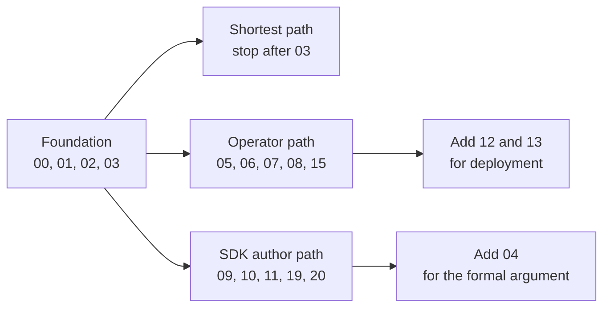
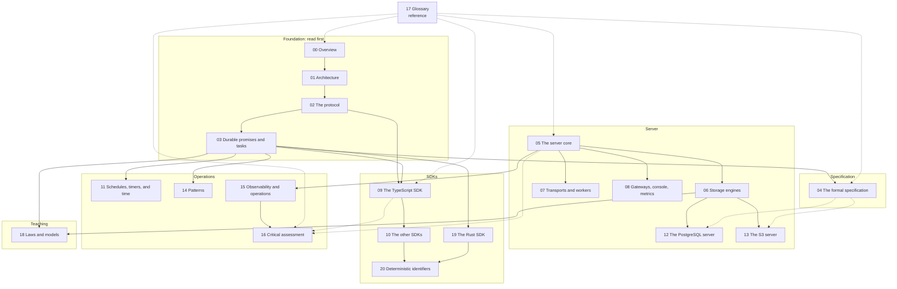

# Resonate: durable execution on durable promises

Resonate is a durable execution platform. *Durable execution* means a program keeps its progress across a process crash, a network partition, and a machine restart. The platform stores each call or step as a *durable promise*. A durable promise is a named record with a state, a parameter, a value, a set of tags, and a deadline. A *durable task* is the part of the same record that a worker can execute. A worker acquires the task with a lease and a version. The server resumes the task when the promises it waits on settle. The repository holds an executable specification in Lean 4 and three server implementations. The first implementation is a Rust single binary with its plugins compiled in. The second is one Structured Query Language (SQL) file for PostgreSQL. The third is a Zig server whose only durable state is objects in an Amazon Simple Storage Service (S3) bucket. Five Software Development Kits (SDKs) speak the wire protocol. The source of truth for this exploration is the repository at commit `9c72d818`.

Source: `README.md:15-16`, `README.md:69-84`, `spec/spec/02-abstract/state.lean:28-45`

## Key terms in one line

The documents define these terms in full. This table lets a reader start without a second reference.

| Term | One-line meaning |
|------|------------------|
| Durable promise | A named record with a state, a parameter, a value, tags, and a deadline |
| Durable task | The executable part of a runnable promise. The promise and the task share one record. |
| Settle | To end the `pending` state: `resolved`, `rejected`, `rejected_canceled`, or `rejected_timedout` |
| Runnable | The promise carries `resonate:target`, so it has a task |
| Awaitable | Another task may wait on the promise. A target, a timer, a global scope, or an external flag makes it awaitable. |
| Lease | A time-bounded right to execute a task. It has a time to live and a process identifier. |
| Version fence | A version counter on the task. A write must present the current value, so a stale worker is refused. |
| Heartbeat | A periodic lease renewal from the worker to the server |
| Schedule | A stored cron expression and promise template. It creates promises; it does not run code. |
| Replay | Re-execution of a function from its start. Settled promises return their stored values. |
| Location transparent | A local call and a remote call have the same shape. |
| Failure transparent | A crash is a pause; the program text does not change. |
| Abstract machine | The executable Lean 4 model in `spec/`. It is the reference behavior. |
| Port | An interface trait, not a network port: server, worker, or gateway |
| Plugin registry | The table that selects a server, worker, or gateway implementation by name |
| Composition root | `resonate-base`, the crate that loads the registry and starts and stops the plugins |
| Wire protocol | The request and response envelopes and the 21 operations between a client and a server |

The abbreviations in this document are: Software Development Kit (SDK), Amazon Simple Storage Service (S3), Hypertext Transfer Protocol (HTTP), Hypertext Transfer Protocol Secure (HTTPS), Server-Sent Events (SSE), Structured Query Language (SQL), Temporal Logic of Actions (TLA+), Remote Procedure Call (RPC), time to live (TTL), process identifier (`pid`), and ASD Simplified Technical English (ASD-STE100). Google Cloud Pub/Sub is a publish and subscribe messaging service.

Source: `spec/spec/01-protocol/types.lean:19-61`, `spec/spec/02-abstract/state.lean:74-159`, `impl/server/core/crates/resonate-core/src/types.rs:11-20`

## Why this system is worth a careful read

Resonate makes one strong claim. A program can call a function, start several calls at the same time, wait for results, and survive a crash. It does this without a message queue, a workflow engine state table, or a separate scheduler process. Three design choices carry that claim.

| Choice | What it means | Where it lives |
|--------|---------------|----------------|
| One record, two faces | A promise and its task are one record. The task is not a second table. | `spec/spec/02-abstract/state.lean:28-45`, `impl/server/core/crates/resonate-server-sqlite/migrations/0001_initial.sql:46-57` |
| Tags carry the semantics | `resonate:target` makes a promise runnable. `resonate:timer` makes the deadline resolve the promise instead of rejecting it. `resonate:scope = global` and `resonate:external = true` are alternate ways to make a promise awaitable. | `spec/spec/02-abstract/state.lean:118-125` |
| Execution is a lease | A task is acquired with a version and a time limit. A worker that lost its lease presents an old version and is refused. | `spec/spec/01-protocol/types.lean:42-49`, `impl/server/core/crates/resonate-server-sqlite/src/lib.rs:1023-1142` |

A *schedule* is a stored record that creates promises on a cron expression. A *scheduler* is a separate process that would fire them. Resonate has no scheduler process. The server runs the schedule step in its own loop.

The rest of this exploration follows those choices from the formal machine, through the wire protocol, into the server and the SDKs.

## Before you start

The citations point to the Resonate source repository at commit `9c72d818`, not to this exploration. A path without a leading slash, such as `impl/server/core/src/main.rs`, is relative to that repository root. The reader does not need to build the project to follow the documents. Knowledge of one programming language and basic distributed systems helps, but each document defines its terms.

## Reading order

The documents build in dependency order. A reader who wants the shortest path should read 00, 01, 02, and 03 in that order. The later documents go deeper into one subsystem each.

| Document | One-line purpose |
|----------|------------------|
| [00-overview.md](00-overview.md) | State the thesis and the component map. Explain durable promise, durable task, schedule, location transparency, and failure transparency. |
| [01-architecture.md](01-architecture.md) | Explain the three interface ports, the plugin registry, the composition root, build and stop order, the weak and strong reference rule, and configuration layering. |
| [02-the-protocol.md](02-the-protocol.md) | Show the request envelope, the response envelope, all 21 operations, the record shapes, the status codes, and the two outbound messages from server to worker. |
| [03-durable-promises-and-tasks.md](03-durable-promises-and-tasks.md) | Show the promise and task state machines, the tags, version fencing, leases, heartbeat, and the suspend and resume mechanism. |
| [04-the-formal-specification.md](04-the-formal-specification.md) | Explain the Lean 4 abstract machine, the catalogue of 92 properties, the TLA+ model, and the trace checkers. |
| [05-the-server-core.md](05-the-server-core.md) | Explain `resonate-base` (a crate and the composition root), the registry, configuration, and the exact startup order of the shipped binary. |
| [06-storage-engines.md](06-storage-engines.md) | Compare the SQLite, PostgreSQL, MySQL, ScyllaDB, blob storage, and Neo4j storage engines in the Rust core. |
| [07-transports-and-workers.md](07-transports-and-workers.md) | Explain HTTP push, HTTP poll with Server-Sent Events (SSE), Google Cloud Pub/Sub, and the bash execution worker that runs shell commands. |
| [08-gateways-console-and-metrics.md](08-gateways-console-and-metrics.md) | Explain the HTTP edge, authentication, the web console, and the Prometheus metrics endpoint. |
| [09-the-typescript-sdk.md](09-the-typescript-sdk.md) | Explain the generator engine (JavaScript generator functions with `yield`) and the asynchronous engine (with `await`), the context object, replay, and traces. |
| [10-the-other-sdks.md](10-the-other-sdks.md) | Compare the Python, Go, Java, and Rust SDKs with the TypeScript SDK. |
| [11-schedules-timers-and-time.md](11-schedules-timers-and-time.md) | Explain cron schedules, timer promises, lease deadlines, and retry deadlines. |
| [12-the-postgres-server-in-one-file.md](12-the-postgres-server-in-one-file.md) | Explain how one SQL file implements the whole protocol on PostgreSQL 16 or later. |
| [13-the-s3-server-in-zig.md](13-the-s3-server-in-zig.md) | Explain how the Zig server keeps all durable state in S3 objects. |
| [14-patterns.md](14-patterns.md) | Show the saga, fan-out, human-in-the-loop, and retry patterns as graphs of durable promises. |
| [15-observability-and-operations.md](15-observability-and-operations.md) | Explain metrics, traces, logs, readiness, configuration, and deployment. |
| [16-critical-assessment.md](16-critical-assessment.md) | State the limits, the open questions, and the risks of the design. |
| [17-glossary.md](17-glossary.md) | Define every term and spell out every abbreviation used in this exploration. |
| [18-laws-of-durable-promises.md](18-laws-of-durable-promises.md) | State the laws as 53 numbered rules, show the SQLite and PostgreSQL table structures, and run a 22-scenario Python model. |
| [19-the-rust-sdk.md](19-the-rust-sdk.md) | Explain the separate Rust workspace: its three crates, the function macro, registration and naming, promise creation, retries, replay, and the mirror in the main repository. |
| [20-deterministic-identifiers.md](20-deterministic-identifiers.md) | Show the shared identifier grammar, the per-SDK counters, detached hashes, task identity, and the server checks. |

Source: `README.md:69-79`

PostgreSQL has two roles in this repository. It is one storage engine inside the Rust core, and it is also an independent server implemented by one SQL file. The reading order treats the two roles in documents 06 and 12.

## Reading paths

Three paths cover most readers. A reader does not need to follow the full order.

| Reader | Documents | Why this path |
|--------|-----------|---------------|
| Shortest path | 00, 01, 02, 03 | The thesis, the ports, the wire surface, and the state machine |
| Operator | 01, 05, 06, 07, 08, 15 | The composition root, the storage engines, the transports, the gateways, and operations |
| SDK author | 02, 03, 09, 10, 11, 19, 20 | The protocol, the state machine, the TypeScript engine, the other SDKs, time, the Rust SDK, and identifiers |

A reader who wants the formal argument should add document 04. A reader who wants the deployment options should add documents 12 and 13.



The solid arrows show that each path starts from the foundation. The last two boxes are optional additions, not new paths.

## The documents in five groups

The groups show the reading dependency. The foundation defines the model. The specification states and checks the model. The server implements the model. The SDKs use the model. The operations documents apply the model. The glossary is a reference, not a step in the order.



Solid arrows show a reading dependency. Dashed arrows show a reference link only. The PostgreSQL server and the S3 server are independent implementations of the same protocol. They are not built from the Rust core, so the arrows from storage engines show only that the reader should know the storage model first.

## What each group answers

The groups are not only a reading order. Each one answers a different question.

**Foundation.** The first four documents answer "what is the model?" Document 00 defines the durable promise, the durable task, the schedule, and the one-record model. Document 01 explains the three interface ports and the plugin registry that turn the model into a process. Document 02 shows the wire surface that carries the model between processes. Document 03 follows the promise and task state machines through every transition.

**Specification.** Document 04 answers "why should a reader believe the model?" The Lean 4 file is an executable abstract machine. It is a function from a step and a time to a response and a new state. A *step* is one request or one internal event, such as a lease timeout. The 92 properties are safety and liveness claims about runs of the machine. The TLA+ model is a second statement of the same rules. The trace checkers replay a real server's recorded traffic and ask whether the machine can explain it. The servers are not compared to a diagram. They are compared to an executable oracle, which is the machine run on the same steps.

**Server.** Documents 05 through 08, 12, and 13 answer "how is the model implemented?" The Rust core is a single binary built from a plugin registry. Its storage engines are SQLite, PostgreSQL, MySQL, ScyllaDB, blob storage, and Neo4j. Its transports are HTTP push, HTTP poll with Server-Sent Events (SSE), Google Cloud Pub/Sub, and a bash execution worker. Its gateways are an HTTP edge, a web console, and a Prometheus metrics endpoint. The PostgreSQL server implements the same protocol in one SQL file. The Zig server implements it with objects in an S3 bucket. An S3 bucket is a container, and an S3 object is a stored file.

**SDKs.** Documents 09, 10, 19, and 20 answer "how does a program use the model?" The TypeScript SDK has two execution engines. The generator engine uses `yield`. The asynchronous engine uses `await`. Both produce the same protocol traffic. The Python, Go, Java, and Rust SDKs are separate protocol clients. They do not share code with the TypeScript SDK. They share the wire contract. Document 19 studies the separate Rust workspace in depth. Document 20 follows one identifier through all five SDKs and the server.

**Operations.** Documents 11, 14, 15, and 16 answer "how does the model behave in production?" Document 11 covers cron schedules, timer promises, lease deadlines, and retry deadlines. Document 14 turns the primitives into patterns: saga, fan-out, human in the loop, and retries. Document 15 covers metrics, traces, logs, readiness, configuration, and deployment. Document 16 states the limits, the open questions, and the risks.

## What is stated and what is implemented

The exploration keeps three levels apart. The distinction matters because a claim about the model is not always a claim about the product.

| Level | What it is | Where it lives |
|-------|------------|----------------|
| Model | An executable abstract machine with 21 external handlers and 6 internal steps | `spec/spec/02-abstract/` |
| Check | 92 properties, a TLA+ model, and trace checkers | `spec/` |
| Implementation | Three servers and five SDKs | `impl/` |

Source: `spec/spec/02-abstract/system.lean:38-107`, `README.md:71-84`

Three differences follow from that split, and the documents state them where they matter.

1. **Search is not in the model.** The Lean handlers for `promise.search`, `task.search`, and `schedule.search` return 501. The shipped servers implement all three. A 501 from the model is a statement about the model's boundary, not a missing product feature.
2. **Some defaults differ.** The Lean `ServerConfig.retryTimeout` is 5,000 milliseconds. The shipped SQLite plugin defaults to 30,000 milliseconds. Both are real defaults at their own level. A reader should not treat one as the other.
3. **A trace checker checks accounting, not every implementation choice.** It asks whether the machine can explain the observed traffic. It does not prove that a storage engine is efficient or that a transport is reliable.

Source: `spec/spec/02-abstract/external.lean:99-100`, `spec/spec/02-abstract/state.lean:249-251`, `impl/server/core/src/serve.rs:143-145`

## How to read the references

Every claim in this exploration points to a source path and a line range. The form is:

```text
Source: impl/server/core/crates/resonate-core/src/types.rs:132-135
```

A path without a leading slash is relative to the Resonate source repository root at commit `9c72d818`. A range such as `120-140` includes both end lines. When a claim covers a concept that appears in two places, the reference lists both. For example, the one-record model appears in the Lean machine and in the SQLite migration.

Document 19 is the exception. Its paths are relative to the separate `resonate-sdk-rs` repository at commit `6545265`, because that repository is the publish source for the Rust SDK. The copy under `impl/sdk/rs/` is a mirror.

The documents use ASD Simplified Technical English (ASD-STE100). A sentence carries one idea. Every abbreviation is spelled out at first use in the place where it appears. The goal is that a reader can follow the mechanism without a second reference.

The file `../spec.md` is the exploration's own project tracker. It is not the `spec.md` that the citations name in the source repository.

## What the source contains

| Part | Path | Language | Purpose |
|------|------|----------|---------|
| Specification | `spec/` | Lean 4, TLA+, Go | Executable abstract machine, 92 properties, formal model, trace checkers |
| Server core | `impl/server/core/` | Rust | Single binary, plugin registry, storage and transport plugins |
| Storage plugins | `impl/server/core/crates/resonate-server-*` | Rust | SQLite, PostgreSQL, MySQL, ScyllaDB, blob storage, Neo4j |
| PostgreSQL server | `impl/server/postgres/` | SQL | The whole server as one SQL file on PostgreSQL 16 or later |
| S3 server | `impl/server/s3/` | Zig | Server with S3 objects as the only durable state |
| TypeScript SDK | `impl/sdk/ts/` | TypeScript | Generator engine and asynchronous engine |
| Python SDK | `impl/sdk/py/` | Python | Protocol client |
| Go SDK | `impl/sdk/go/` | Go | Protocol client |
| Java SDK | `impl/sdk/java/` | Java | Protocol client |
| Rust SDK | `impl/sdk/rs/` | Rust | Protocol client, mirrored from the separate `resonate-sdk-rs` repository |

Source: `README.md:69-80`, `spec/README.md:5-10`

## Aha: the core of the specification is executable

Most projects describe a protocol in prose, then implement it in code, and then drift. Resonate inverts the order. The abstract machine in `spec/spec/02-abstract/` is executable Lean 4 code. It is a function from a step and a time to a response and a new state. The server backends are compared against an oracle that runs the same steps. The trace checker asks whether the machine can account for a real server's traffic. The TLA+ model and the Go trace checkers are separate statements and tools; the Lean machine is the executable core.

Source: `spec/spec/02-abstract/system.lean:156-173`, `README.md:81-84`

That choice explains why the documentation can state the state machine with exact line references. The machine is not a diagram beside the code. The machine is code, and the servers are held to it.

## Related documents

The reading-order table above links every document. These are the best starting points.

- [00-overview.md](00-overview.md) — the thesis and the component map.
- [01-architecture.md](01-architecture.md) — the three ports and the plugin composition root.
- [02-the-protocol.md](02-the-protocol.md) — the wire surface.
- [03-durable-promises-and-tasks.md](03-durable-promises-and-tasks.md) — the state machine.
- [04-the-formal-specification.md](04-the-formal-specification.md) — the executable machine and the 92 properties.
- [17-glossary.md](17-glossary.md) — every term and abbreviation.
- [spec.md](../spec.md) — the exploration's project tracker and full document list.
