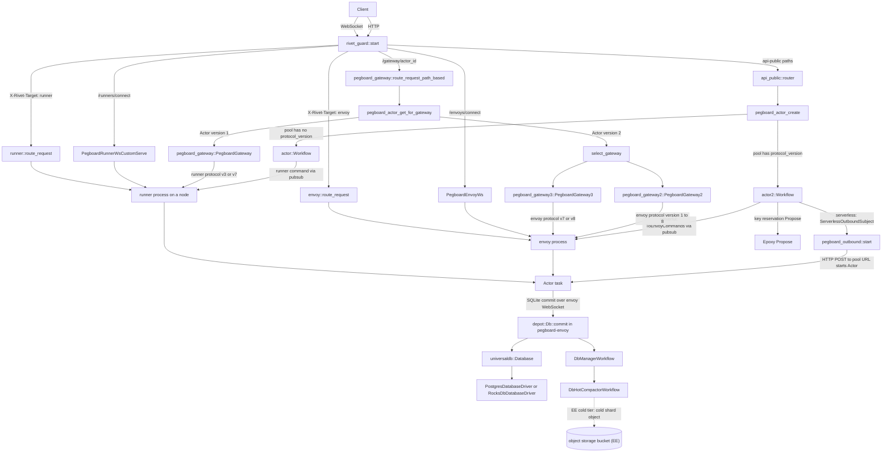
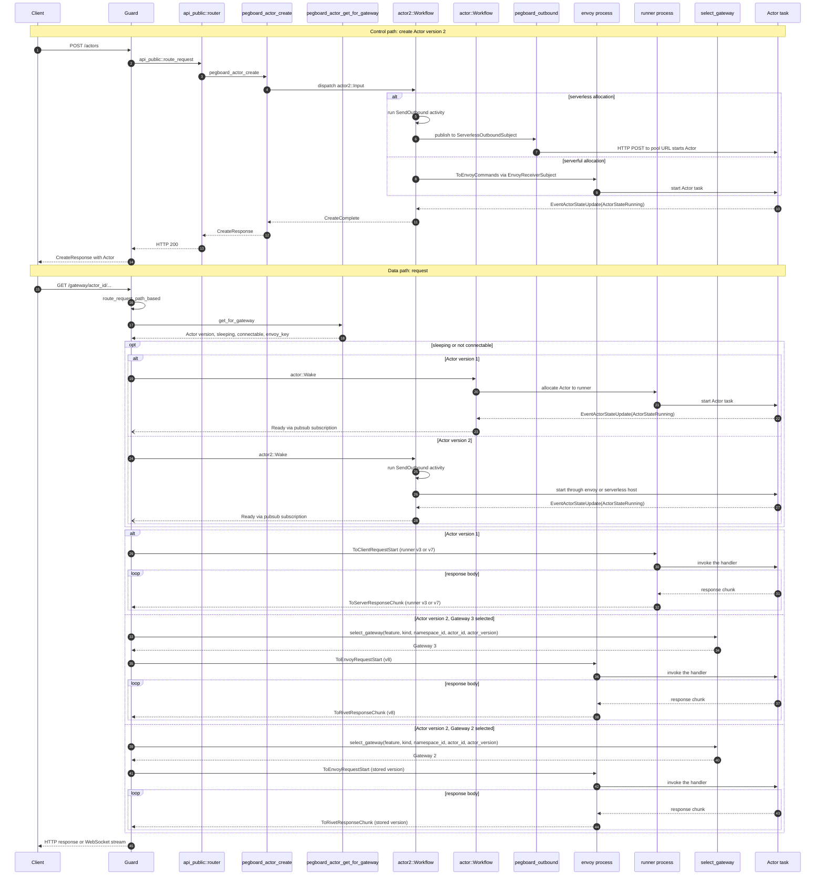

# 00 Overview: the problem and the mental model

Rivet is an orchestrator for many keyed, stateful processes, which it calls
Actors. An Actor is not a container and not a virtual machine (VM). An Actor is
a task inside a node process that the operator already runs. In this document,
*operator* means the person or team that runs the deployment. *Node* means one
worker process that runs the operator's application with the Rivet Software
Development Kit (SDK). *Control plane* means the `rivet-engine` service group
that schedules Actors and routes requests. An Actor has a key, durable
state, a SQLite database, a queue, realtime connections, and a schedule. SQLite
is the name of the embedded relational database library, not an abbreviation.
When the Actor is idle, it writes its state and
unloads. When a request arrives, the control plane starts the Actor again on a
node with capacity. This document gives the problem, the vocabulary, the two
paths that meet at an Actor, and the map of the exploration. The later documents
give the mechanism. Read this document first, then follow one of the two reading
paths in section 8.

> **Scope note.** The source of truth is commit
> `4a58441c50d1ce20d8803cfb1ab7c3285a5141d6`, version 2.3.31. All paths are
> relative to `/Users/darkvoid/GitSources/src.Rivet/rivet`. A citation has the
> form `path:line` or `path:line-line`. This exploration reads the source and
> does not run the code. Section 7 lists the reported numbers and separates them
> from the source-confirmed mechanisms.

## 1. The problem: many small stateful processes

An agentic workload puts one process behind each agent, each session, each user,
or each tenant. Each process needs identity, memory, a database, realtime
connections, and a schedule. The processes are numerous and small. Most of them
are idle at any moment. A request can arrive at any one of them at any time.
The operator wants to add capacity by adding machines.

The obvious alternatives are a container for each process or a shared database
with stateless functions.

### 1.1 The container alternative

A container or a pod gives each process its own image, file system, network
namespace, and kernel boundary. Kubernetes can schedule it, restart it, and move
it. This is a mature and well-understood design.

The cost is the start path. A new pod needs a scheduling decision, an image
pull (unless the image is cached), a container start, and a health check. The
project states about 6 seconds for a pod cold start on a pre-provisioned node
and about 200 megabytes (MB)
of memory for an idle Node.js pod. It states about 5,000 nodes for one Kubernetes
cluster. A Kubernetes node is one worker machine in that cluster.
The project marks these figures as typical published values, not as a matched
benchmark (`README.md:157`). The comparison table is at `README.md:141-148`.

The second cost is density. A pod owns a fixed memory reservation and a
persistent volume. Ten thousand idle agents mean ten thousand idle pods, or a
scale-to-zero controller that adds the same start path back. The project states
a 72.4 kilobytes (KB) resident set size (RSS) increase for one running Actor
(`README.md:156`). The README states an increase. An increase implies a
before-and-after measurement. The README does not state the baseline value. This
document describes the baseline as the resident set of the node process before
the Actor starts. That description is an inference from the word "increase".
That number measures a running Actor inside a shared process. It does not measure a pod.

The third cost is the storage boundary. A pod gets a persistent volume. The
volume has a size, and the operator must choose it. An Actor database that grows
without a size decision does not fit that model.

### 1.2 The database alternative

A shared database plus stateless functions gives identity through a row and
memory through a query. This design is simple to operate at small scale. It
fails on three points.

First, the process does not exist. A function runs for one request and exits.
There is no place to hold an open WebSocket, a queue, an in-memory cache, or a
timer between requests. Second, every call is a database round trip. A hot
Actor that handles many small messages pays a query for each message. Third,
the database becomes a shared bottleneck and a shared failure domain. The
operator must size one large database for all tenants.

### 1.3 What Rivet changes

Rivet keeps the process, but makes the process small and movable. The Actor is
a task in a node process. Many Actors share one process. The Actor's state lives
outside the process, so the Actor can unload and start again elsewhere. The
request does not need the Actor's address. The control plane finds the Actor,
wakes it, and forwards the request.

The design moves cost from the start path to the storage path. A cold start
does not pull an image or boot a kernel. It schedules a task, creates or opens
its storage, and runs the first request. The storage path must then carry the
durability that the container file system used to carry.

> **Aha:** Rivet makes the unit of scheduling a task, not a machine. The
> obvious alternative is one container or micro VM for each stateful agent. That
> alternative buys a hard isolation boundary and a familiar deployment unit. It
> pays an image pull, a kernel boot, a network namespace, and about 200 MB of
> memory for each idle agent (`README.md:145`, `README.md:157`). Rivet pays a
> different cost: many Actors share one process and one event loop. The source
> does not state a per-Actor memory or crash isolation guarantee beyond the
> separate database and file system. A native crash in the node process can
> affect every Actor on that node. Document 16 lists this as a risk that the
> benchmarks do not measure.

## 2. What an Actor is in Rivet

The project README gives the shortest definition:

> "Rivet schedules Actors: long-lived processes with durable state, a SQLite
> database, a queue, realtime connections, and scheduling, each addressed by
> key." (`README.md:60`)

The quotation names six parts. The table below adds a seventh part, placement,
because the code must choose a host. Each part answers a question that a
stateless function cannot answer.

RivetKit is the Rivet SDK and runtime library that runs inside the node process.
The queue and the alarms are tables that RivetKit creates in the Actor SQLite
database.

| Part | Question it answers | Where the mechanism lives |
|------|--------------------|---------------------------|
| Key | Which logical process is this? | Key reservation in Pegboard; document [03](03-actors-and-lifecycle.md) |
| Durable state | What survives a stop? | Actor SQLite tables; the legacy key-value (KV) store is a frozen snapshot for downgrade; document [06](06-actor-sqlite-and-depot.md) |
| SQLite database | How does the Actor store structured data? | Depot and UniversalDB; documents [06](06-actor-sqlite-and-depot.md) and [07](07-universaldb-and-buckets.md) |
| Queue | How does work wait while the Actor is busy? | RivetKit runtime tables; document [11](11-rivetkit-typescript.md) |
| Realtime connections | How do clients receive events? | Guard and the realtime layer; document [10](10-realtime-and-hibernation.md) |
| Schedule | How does the Actor run later? | Actor alarms and cron; documents [03](03-actors-and-lifecycle.md) and [10](10-realtime-and-hibernation.md) |
| Placement | Which machine hosts the Actor now? | Pegboard allocation; document [04](04-pegboard-scheduling.md) |

The rows "Durable state" and "SQLite database" both describe the same database
in current Actors. "Durable state" answers what survives a stop. "SQLite
database" answers how the Actor stores structured data. The legacy key-value
(KV) snapshot is separate and exists only for downgrade.

### 2.1 Actor, key, namespace, node, runner, envoy

The words below appear in every later document. The full glossary is document
[19](19-glossary.md). This section gives the minimum needed to read the map.

**Actor.** A keyed, stateful process that Rivet schedules. The public type is
`rivet_types::actors::Actor`. It holds the Actor identifier, the name, the
optional key, the namespace identifier, the datacenter label, the runner name
selector, the crash policy, and the lifecycle timestamps
(`engine/packages/types/src/actors.rs:7-38`).

**Actor identifier.** A generated `Id`. The create path calls `Id::new_v1` with
the datacenter label (`engine/packages/api-peer/src/actors/create.rs:35`). The
label is stored inside the 18-byte V1 identifier
(`engine/packages/util-id/src/lib.rs:35-68`). The label is part of the
identifier and does not change. The identifier is not the key. A client can
create an Actor with no key at all.

**Key.** An optional string that a client supplies at create time. A
*reservation key* is the lookup tuple that stops two Actors from claiming the
same key. It is the tuple of namespace identifier, Actor name, and key
(`engine/packages/pegboard/src/keys/epoxy/ns.rs:8-21`). Epoxy stores this tuple
(section 5.5). The reservation key includes the Actor name, so the same key
under two names uses two reservation keys. The public create path rejects an
empty key and a key longer than 1,024 bytes
(`engine/packages/api-peer/src/actors/create.rs:6`, `:15-25`).

An absent key and an empty string are different. No key means that the Actor
has no key. An empty string is a key of length zero. The create path rejects the
empty string (`engine/packages/api-peer/src/actors/create.rs:15-18`).

**Namespace.** A separator for Actors, keys, and node pools. The project
documentation uses `production` and `staging` on one control plane as the
example (`docs/general/content/architecture.mdx:54`). A namespace has a slug.
The slug appears in Uniform Resource Locator (URL) and Application
Programming Interface (API) requests.

**Node.** A long-running process that runs the operator's application with the
Rivet Software Development Kit (SDK). It starts with `registry.start()`. It
connects outbound to the control plane and hosts the Actors assigned to it
(`docs/general/content/nodes.mdx:7`). A node needs no public address for Actor
traffic (`docs/general/content/architecture.mdx:38`).

**Runner.** The client-side process that hosts Actors on the legacy version 1
path. The internal terminology file defines "Runner" as "the client-side runner
code" (`docs-internal/engine/TERMINOLOGY.md:5`). The legacy gateway accepts the
runner protocol family. The current runner protocol version is 7 (MK2)
(`engine/packages/runner-protocol/src/lib.rs:8-12`). The gateway defaults to
version 3 (MK1) when the runner record has no version
(`engine/packages/pegboard-gateway/src/lib.rs:895-907`).

**Envoy.** The actor-hosting process on the user side on the newer Actor
version 2 path. The internal rescheduling document defines the word this way
(`docs-internal/engine/actor-rescheduling.md:7`). The newer path currently uses
envoy protocol version 7 or 8. Version 8 is the current compiled version
(`engine/sdks/rust/envoy-protocol/build.rs:23-30`). Both paths exist in this
commit. A document must say which path a claim applies to.

**Version words.** Three different versions appear in this document. The *Actor
version* is 1 or 2 and selects the hosting path. The phrase *envoy version 2* is
another name for the Actor version 2 path; it is not a process version. The
*envoy protocol version* is the wire message set, from 1 through 8. The *runner
protocol version* is the legacy wire message set, 3 or 7.

**Envoy key.** A string identifier for one envoy connection. It must have 3 to
128 identifier characters (`engine/packages/pegboard-envoy/src/utils.rs:8-90`).
An identifier character is an ASCII digit, a lowercase letter, a hyphen, an
uppercase letter, or an underscore. The first and last character cannot be a
hyphen, and two hyphens cannot touch (`engine/packages/util/src/check.rs:22-33`).
The control plane addresses the envoy through the topic
`pegboard.envoy.{namespace_id}.{envoy_key}`
(`engine/packages/pegboard/src/pubsub_subjects.rs:113-138`). That topic is the
`EnvoyReceiverSubject` type. When the envoy connects, the control plane
subscribes `PegboardEnvoyWs` to that subject and forwards each command over the
envoy WebSocket (`engine/packages/pegboard-envoy/src/lib.rs:109-131`). The envoy
process receives the command on that WebSocket.

**Generation.** A counter for one allocation of an Actor. It starts at 0 and
increases on each allocation
(`engine/packages/pegboard/src/workflows/actor2/runtime.rs:15-34`, `:483-497`).
The workflow ignores an event from an older generation
(`engine/packages/pegboard/src/workflows/actor2/mod.rs:643-647`). Gateway 3
sends the exact generation. Gateway 2 omits it and uses the highest live
generation (section 4.5).

**Control plane.** The `rivet-engine` Rust binary. It schedules Actors, routes
requests, and stores durable records. Every control plane instance runs the same
services. Section 6 shows the service list.

**Datacenter.** A region with a label, a public URL, a peer URL, and a proxy URL
(`engine/packages/config/src/config/topology.rs:155-209`). The topology lists one
leader datacenter and any number of peer datacenters
(`engine/packages/config/src/config/topology.rs:7-14`). The leader is a
datacenter, not a process. The leader datacenter runs the Epoxy coordinator
workflow (`engine/packages/epoxy/README.md:526`). The Actor identifier embeds the
label of the datacenter that created it.

**Bucket.** An object storage bucket. The README calls it the only external
dependency (`README.md:262`). Section 5.6 shows an important limit: in this
commit, the cold object-storage tier is Enterprise-only, and the
open-source software (OSS) build never writes cold rows
(`docs-internal/engine/oss-to-ee-upgrade.md:9-20`).

Six more names appear in the table above. Their one-line definitions follow
here. Guard is the routing proxy at the network edge. Pegboard is
the scheduling and networking layer for Actors. Depot is the storage engine that stores SQLite pages in
UniversalDB. UniversalDB is the transactional key-value store. Epoxy is the per-key consensus store that
reserves Actor keys. Gasoline is the workflow engine. Section 9 repeats each one in one line.

### 2.2 The public Actor record

The public record is small. It carries the identity and the lifecycle
timestamps. It does not carry the Actor's user state. The user state lives in
the Actor database. The legacy KV snapshot is frozen for downgrade only.

```rust
// engine/packages/types/src/actors.rs:7-38
#[derive(Debug, Clone, Serialize, Deserialize, ToSchema)]
pub struct Actor {
	pub actor_id: Id,
	pub name: String,
	pub key: Option<String>,

	pub namespace_id: Id,
	pub datacenter: String,
	pub runner_name_selector: String,
	pub crash_policy: CrashPolicy,

	/// Denotes when the actor was first created.
	pub create_ts: i64,
	/// Denotes when the actor was first made connectable. Null if never.
	pub start_ts: Option<i64>,
	/// Denotes when the actor started waiting for an allocation.
	pub pending_allocation_ts: Option<i64>,
	/// Denotes when the actor was last connectable. Null if actor is not running.
	pub connectable_ts: Option<i64>,
	/// Denotes when the actor entered a sleeping state.
	pub sleep_ts: Option<i64>,
	/// Denotes when the actor will try to allocate again. If this is set, the actor will not attempt to
	/// allocate until the given timestamp.
	pub reschedule_ts: Option<i64>,
	/// Denotes when the actor was destroyed.
	pub destroy_ts: Option<i64>,

	/// Error details if the actor failed to start.
	#[serde(skip_serializing_if = "Option::is_none")]
	#[schema(value_type = Option<Object>, additional_properties = true)]
	pub error: Option<crate::actor::ActorError>,
}
```

The public record does not carry the workflow identifier, the runner
identifier, the `envoy_key`, the generation, or the Actor version. The Actor
version is 1 or 2; it is not a record revision.
`pegboard_actor_get_for_gateway` reads those fields from the internal `Output`
type (`engine/packages/pegboard/src/ops/actor/get_for_gateway.rs:11-26`).
Section 4.4 uses them. Document [03](03-actors-and-lifecycle.md) and
[04](04-pegboard-scheduling.md) give the internal records.

The `crash_policy` field has three values: `Restart`, `Sleep`, and `Destroy`.
`Destroy` is the default (`engine/packages/types/src/actors.rs:40-47`). The
policy decides what happens after a failed start or a lost host. Document
[03](03-actors-and-lifecycle.md) gives the full behavior.

### 2.3 One concrete example

A client creates an Actor for one agent. The request body names the pool
`default`, the Actor name `agent`, and the key `agent-123`. The namespace is
`production`.

```text
POST /actors?namespace=production
{
  "name": "agent",
  "key": "agent-123",
  "runner_name_selector": "default"
}
```

The words in the steps below have these meanings. A *pool* is a node pool: a
group of nodes by name inside a namespace (`docs/general/content/nodes.mdx:9`).
A *serverful* pool uses a long-lived envoy process
(`engine/packages/pegboard/src/workflows/actor2/alloc_serverful/mod.rs:20-29`).
A *serverless* pool has no long-lived envoy. The control plane sends a
Hypertext Transfer Protocol (HTTP) request to the pool URL, and
that host starts the Actor
(`engine/packages/pegboard/src/workflows/actor2/runtime.rs:401-481`). A *slot*
is one unit of the pool concurrency limit. Allocation takes a slot before it
places an Actor (`runtime.rs:217-243`). The *configured load balancer* is the
`EnvoyLoadBalancer` strategy that selects a serverful envoy
(`engine/packages/config/src/config/pegboard.rs:456-475`). A *rate-limit token*
is one permit from the per-namespace limiter. The create operation takes a
permit before it continues
(`engine/packages/pegboard/src/ops/actor/create.rs:57-81`).

The path through the code is:

1. Guard receives the request. The path has no `/gateway/` prefix and the
   request has no `X-Rivet-Target` header. Guard falls through to
   `api_public::route_request` (`engine/packages/guard/src/routing/mod.rs:340-355`).
2. `api_public::actors::create::create` checks authorization, resolves the
   namespace, and picks a datacenter. An optional requested datacenter wins.
   Otherwise the first enabled datacenter in ascending ping order wins
   (`engine/packages/api-public/src/actors/utils.rs:133-177`,
   `engine/packages/pegboard/src/ops/runner/list_runner_config_enabled_dcs.rs:14-18`,
   `:95-100`). A local pick calls the local peer API. A remote pick calls
   `request_remote_datacenter`
   (`engine/packages/api-public/src/actors/create.rs:58-98`).

   An *enabled datacenter* is one with a runner configuration for the pool
   (`engine/packages/pegboard/src/ops/runner/list_runner_config_enabled_dcs.rs:20-23`,
   `:95-100`). *Ascending ping order* means the enabled datacenters sorted from
   the shortest round-trip time to the longest (`:16-17`, `:57-100`).

3. The local path calls `rivet_api_peer::actors::create::create`
   (`engine/packages/api-public/src/actors/create.rs:86-87`).
4. That function rejects an empty or oversized key, then calls
   `Id::new_v1` and `pegboard_actor_create`
   (`engine/packages/api-peer/src/actors/create.rs:6`, `:15-26`, `:35-52`).
5. `pegboard_actor_create` takes a per-namespace rate limit token, subscribes
   to the create, fail, and destroy messages for both Actor versions, and reads
   the pool record (`engine/packages/pegboard/src/ops/actor/create.rs:57-103`).
6. If the pool has an envoy protocol version, the operation dispatches the
   `actor2::Workflow` with the input
   (`engine/packages/pegboard/src/ops/actor/create.rs:105-124`). A pool with no
   protocol version uses the legacy runner path.
7. The workflow reserves the key and allocates a slot. A serverful pool calls
   `allocate_serverful` to choose an envoy with the configured load balancer. A
   serverless pool uses an outbound start
   (`engine/packages/pegboard/src/workflows/actor2/runtime.rs:184-330`). The
   workflow then publishes the start command through UniversalPubSub or
   `pegboard_outbound` (`:401-481`, `:1044-1139`). The workflow publishes
   `Ready` after the envoy reports `ActorStateRunning`
   (`engine/packages/pegboard/src/workflows/actor2/mod.rs:802-817`).
   Section 4.4 gives the full mechanism.

   UniversalPubSub (UPS) is the publish/subscribe layer. It uses the NATS
   message bus when the `pubsub` configuration selects NATS, and in-memory
   channels otherwise
   (`engine/packages/config/src/config/pubsub.rs:8-17`).

8. Guard returns the `CreateResponse` with the new `Actor` record to the
   client. The response comes from `pegboard_actor_create`, through the public
   API service, through Guard.

If the key reservation belongs to another datacenter, the operation forwards
the create request to that datacenter with no Actor identifier
(`engine/packages/pegboard/src/ops/actor/create.rs:139-157`, `:344-362`). The
remote datacenter creates a new identifier with its own label. The Actor does
not change datacenter. A cross-datacenter move is future work
(`docs-internal/engine/ACTOR_KEY_RESERVATION.md:36-40`). A *reservation chain*
is a pointer from an old reservation identifier to a new reservation identifier.
The old datacenter returns the pointer when a client resolves the key (`:36-61`).
The design in that document is destroy then create in the new datacenter, with a
reservation chain from the old reservation to the new one. The new Actor gets a
new identifier (`:36-50`). Guard reroutes a request when the identifier label differs from the
local label, and it uses the peer `proxy_url`
(`engine/packages/guard/src/routing/pegboard_gateway/mod.rs:341-362`).
The route exists because the request arrived at the wrong datacenter. It does
not mean that the Actor moved.

The key `agent-123` is not the Actor identifier. The key is the lookup name.
The identifier is generated in step 4. A second create with the same namespace,
name, and key builds the same `ReservationByKeyKey`
(`engine/packages/pegboard/src/keys/epoxy/ns.rs:7-22`) and can return `KeyExists`
(`engine/packages/pegboard/src/workflows/actor2/keys.rs:14-19`).
`ReservationByKeyKey` is the Rust type for the reservation key
(`engine/packages/pegboard/src/keys/epoxy/ns.rs:7-22`).
Document [03](03-actors-and-lifecycle.md) gives the exact behavior.

### 2.4 The four parts of the deployment

The project documentation states that Rivet has three parts: object storage,
the control plane, and actor nodes (`docs/general/content/architecture.mdx:7`).
The code shows a fourth concern inside the control plane: the storage engine
stack. The stack is Depot, UniversalDB (UDB), and a database driver. Figure 1
adds that stack and shows which path uses which part. The dashed path is the
Enterprise Edition (EE) cold tier. The paths carry HTTP and WebSocket traffic.



The solid arrows are the paths in this commit. `select_gateway` runs after the
`pegboard_actor_get_for_gateway` lookup, so the lookup is not a sibling of the
selection. The lookup splits on the Actor version. Version 1 uses the legacy
`PegboardGateway` and the runner. Version 2 runs `select_gateway`, which chooses
`PegboardGateway2` or `PegboardGateway3`, and both gateways address an envoy
(`engine/packages/guard/src/routing/pegboard_gateway/mod.rs:469-514`,
`:762-805`). That envoy runs in a serverful host or a serverless host. Guard has
separate WebSocket routes for a runner and for an envoy. The header-target arrows
use `runner::route_request` and `envoy::route_request`. The `/runners/connect`
and `/envoys/connect` arrows use the WebSocket route types. A
pool with no protocol version uses `actor::Workflow` and the runner path. A pool
with a protocol version uses `actor2::Workflow` and the envoy path. A serverless
start goes through `pegboard_outbound` to the pool URL. The dashed
arrow comes from the compaction workflow. The OSS build keeps the cold-row
schema but never writes those rows
(`docs-internal/engine/oss-to-ee-upgrade.md:9-20`). Section 5 explains the
correction.

## 3. The four separations

The project README describes four separations (`README.md:31-57`). Each
separation answers one failure. These separations are the mental model. The
mechanism behind each one is a later document.

### 3.1 The Actor is separate from its location

An Actor has an identifier, a key, and durable state. It does not own a
machine. Pegboard chooses the runner or envoy that hosts the Actor now. If the
host dies, the Actor starts on another host with the same state. The internal
rescheduling document states that the newer path is Actor version 2 and envoy
version 2, and that the legacy runner version 1 path still exists
(`docs-internal/engine/actor-rescheduling.md:7`).

The failure answered is a dead node. The cost is a placement layer. The
placement layer must know which hosts are alive, which hosts have capacity, and
which host holds each Actor. Document [04](04-pegboard-scheduling.md) explains
allocation and the envoy protocol. Document [03](03-actors-and-lifecycle.md)
explains the Actor lifecycle.

### 3.2 The request is separate from the process

A client sends an HTTP request or opens a WebSocket connection to Guard. Guard
finds the Actor and forwards the request. The client never needs the address of
the node. If the Actor is asleep, Guard wakes it and waits for the `Ready`
message before it forwards the request
(`engine/packages/guard/src/routing/pegboard_gateway/mod.rs:531-561`,
`:615-713`).

The failure answered is a moving or sleeping Actor. The cost is a routing hop
and a readiness protocol. The routing hop must not become a single bottleneck.
The readiness protocol must handle a failed wake and a stop during the wait.
Document [09](09-guard-routing.md) explains the routing order and the timeouts.

### 3.3 The database is separate from the disk

Each Actor has its own SQLite database. The SQLite engine runs in the node
process. The Depot database object that stores the pages runs in the control
plane (section 5.3). The Virtual File System (VFS) is the SQLite interface that
replaces local file input and output. `depot-client` implements this VFS in the
node process (`engine/packages/depot-client/src/lib.rs:1-32`). The VFS sends
each page read and write to the control plane over a WebSocket connection. On
the control plane, the Guard process hosts `depot::Db` in the `pegboard-envoy`
crate (`engine/packages/pegboard-envoy/src/conn.rs:31-57`). Depot stores the pages in
UniversalDB. UniversalDB commits the write through its driver. The driver is
PostgreSQL or a local RocksDB store in this commit
(`engine/packages/config/src/config/db/mod.rs:10-21`,
`engine/packages/pools/src/db/udb.rs:20-68`). The EE build can add a cold tier
that moves compacted shards to a bucket
(`docs-internal/engine/oss-to-ee-upgrade.md:9-20`).

The failure answered is a full disk and a fixed volume size. The cost is a
storage engine, a network hop, and a compaction workflow. The Actor's database
is not a file on one machine. It is a set of rows that the storage layer can
read from another machine. Document [06](06-actor-sqlite-and-depot.md) explains
Depot. Document [07](07-universaldb-and-buckets.md) explains UniversalDB and its
drivers.

The README says that "the bucket never sits on the write path"
(`README.md:68`). The statement is true by design in the EE build, where
compaction writes cold objects. The statement is vacuous in the OSS build,
which has no cold tier and never writes cold rows. Section 5.6 gives the exact
source conflict.

### 3.4 The workflow is separate from one execution

Gasoline runs a workflow as a series of durable steps. It records the result of
each step in a history. When the workflow wakes again, it replays the history.
A recorded step returns the recorded result and does not run the code again
(`docs-internal/engine/GASOLINE/OVERVIEW.md:12-30`). An *activity* is one
durable step inside a workflow. It wraps a native Rust function, and Gasoline
records its result. Each activity can retry with backoff
(`docs-internal/engine/GASOLINE/OVERVIEW.md:9`, `:26`).

The failure answered is a crash in the middle of a multi-step operation. The
cost is a recorded history and a replay rule. A workflow that branches
differently on replay raises `WorkflowError::HistoryDiverged`
(`docs-internal/engine/oss-to-ee-upgrade.md:22-27`). A *version check* is a
recorded history step. It records which branch the workflow took, so a replay
can detect a different branch (`docs-internal/engine/GASOLINE/OVERVIEW.md:30`).
This is why a code change that alters a workflow path needs a version check.
Document
[05](05-gasoline-durable-execution.md) explains the engine.

### 3.5 The failure table

| Separation | Failure it answers | What must exist | Cost | Deep dive |
|------------|-------------------|-----------------|------|-----------|
| Actor from location | The host dies | Placement, key reservation, state outside the process | A scheduler and a placement record | [04](04-pegboard-scheduling.md) |
| Request from process | The Actor moves or sleeps | Guard, wake, readiness, tunnel protocol | A routing hop and a readiness wait | [09](09-guard-routing.md) |
| Database from disk | The disk fills or the host moves | Depot, UniversalDB, a driver, compaction | A storage engine and background work | [06](06-actor-sqlite-and-depot.md) |
| Workflow from one execution | A crash in the middle | History, replay, activity retries | Recorded steps and version rules | [05](05-gasoline-durable-execution.md) |

## 4. The request path end to end

The request path has two parts. The control path creates and manages Actors.
The data path carries the Actor's HTTP and WebSocket traffic. They meet at Guard
and at the Pegboard layer, but they are not the same path. A reader who confuses
them will expect every Actor request to pass through the public API. It does
not.

### 4.1 Control path versus data path

The control path uses these public routes:

```rust
// engine/packages/api-public/src/router.rs:102-128
			// MARK: Actors
			.route("/actors", axum::routing::get(actors::list::list))
			.route("/actors", axum::routing::post(actors::create::create))
			.route(
				"/actors",
				axum::routing::put(actors::get_or_create::get_or_create),
			)
			.route(
				"/actors/{actor_id}",
				axum::routing::delete(actors::delete::delete),
			)
			.route(
				"/actors/names",
				axum::routing::get(actors::list_names::list_names),
			)
			.route(
				"/actors/{actor_id}/kv/keys/{key}",
				axum::routing::get(actors::kv_get::kv_get),
			)
			.route(
				"/actors/{actor_id}/sleep",
				axum::routing::post(actors::sleep::sleep),
			)
			.route(
				"/actors/{actor_id}/reschedule",
				axum::routing::post(actors::reschedule::reschedule),
			)
```

The data path uses the `/gateway/` prefix. The parser in Guard accepts three
forms (`engine/packages/guard/src/routing/actor_path.rs:104-113`):

```text
/gateway/{actor_id}/{...path}
/gateway/{actor_id}@{token}/{...path}
/gateway/{name}/{...path}?rvt-namespace=...&rvt-method=...&rvt-key=...
```

The third form resolves a name and a key to an Actor identifier. The first form
uses the identifier directly. The second form adds an optional token to the
path, and Guard removes the token before it forwards the request
(`engine/packages/guard/src/routing/actor_path.rs:172-192`). The third form
requires `rvt-namespace` and `rvt-method`. The method is `get` or `getOrCreate`.
`rvt-key` is optional, and `rvt-token` is optional
(`engine/packages/guard/src/routing/actor_path.rs:80-101`, `:280-329`).

### 4.2 The routing order inside Guard

Guard does not use one router. It tries a fixed order. The order is:

Each row is one dispatch attempt. *Target value* is the value that Guard reads
from `X-Rivet-Target`, or from the `sec-websocket-protocol` header for a
WebSocket. `none; path-based` means that Guard matches the path and reads no
target. Rows 5 through 8 apply to both HTTP and WebSocket requests.

| Step | Condition | Target value | Destination | Source |
|------|-----------|--------------|-------------|--------|
| 1 | Path is `/health/ws` | none; path-based | WebSocket health service | `engine/packages/guard/src/routing/mod.rs:197-210`, `ws_health.rs:14-20` |
| 2 | Path starts with `/gateway/` | none; path-based | `pegboard_gateway::route_request_path_based` | `engine/packages/guard/src/routing/mod.rs:214-226` |
| 3 | Path is `/runners/connect` | none; path-based | `PegboardRunnerWsCustomServe` | `engine/packages/guard/src/routing/mod.rs:228-240`, `runner.rs:31-47` |
| 4 | Path is `/envoys/connect` | none; path-based | `PegboardEnvoyWs` | `engine/packages/guard/src/routing/mod.rs:242-254`, `envoy.rs:31-47` |
| 5 | Header target is `actor` | `actor` | `pegboard_gateway::route_request` | `engine/packages/guard/src/routing/mod.rs:282-296`, `pegboard_gateway/mod.rs:196-207` |
| 6 | Header target is `runner` | `runner` | `runner::route_request` | `engine/packages/guard/src/routing/mod.rs:298-311`, `runner.rs:11-26` |
| 7 | Header target is `envoy` | `envoy` | `envoy::route_request` | `engine/packages/guard/src/routing/mod.rs:313-324`, `envoy.rs:11-19` |
| 8 | Header target is `api-public` | `api-public` | `api_public::route_request` | `engine/packages/guard/src/routing/mod.rs:326-339`, `api_public.rs:53-61` |
| 9 | No condition matches | none | `api_public::route_request` | `engine/packages/guard/src/routing/mod.rs:340-355` |

The short source paths in the table are under
`engine/packages/guard/src/routing/`. The header is `X-Rivet-Target` (`engine/packages/guard/src/routing/mod.rs:20`).
For a WebSocket, Guard reads the target from the `sec-websocket-protocol`
header instead (`:256-279`). The value has the prefix `rivet_target.`
(`engine/packages/guard/src/routing/mod.rs:26`). A request with no Actor path
and no target reaches `api_public` by default. That is how `POST /actors`
reaches the public API without a special case in the client.

### 4.3 The sequence diagram

Figure 2 shows the control path and the data path in one sequence. The first
half creates an Actor. The second half sends a request to it. The data path
uses the newer envoy gateway when the Actor and the feature flag allow it. It
uses the legacy runner gateway otherwise.



Figure 2 uses Actor version 2 for the create path. It returns the
`CreateResponse` through the public API service and Guard. On the data path it
branches on the Actor version. Version 1 uses the legacy runner gateway.
Version 2 calls `select_gateway` and both gateway results address an envoy. The
figure also shows the response chunk loop. The `Ready` message arrives through
the Guard subscription, not as a direct reply from the workflow. The wake block
branches by Actor version. An Actor version 1 wake sends `actor::Wake` to
`actor::Workflow` (`engine/packages/guard/src/routing/pegboard_gateway/mod.rs:831-855`).
An Actor version 2 wake sends `actor2::Wake` to `actor2::Workflow`.

A serverless Actor has no inbound port. The `actor2::Workflow` records a
`SendOutboundInput` activity
(`engine/packages/pegboard/src/workflows/actor2/runtime.rs:401-481`). For a
serverless allocation, the activity publishes `ToOutboundActorStart` to
`ServerlessOutboundSubject`
(`engine/packages/pegboard/src/pubsub_subjects.rs:171-184`). The
`pegboard_outbound` service subscribes to that subject
(`engine/packages/pegboard-outbound/src/lib.rs:101-134`) and sends an HTTP
request to the pool URL with the pool headers
(`engine/packages/pegboard-outbound/src/lib.rs:221-234`, `:279-293`). For a
serverful allocation, the activity writes the command rows and publishes
`ToEnvoyCommands` to `EnvoyReceiverSubject` (`runtime.rs:446-473`,
`engine/packages/pegboard/src/pubsub_subjects.rs:113-138`). Document
[04](04-pegboard-scheduling.md) gives the full delivery flow.

Guard does not call a workflow directly. It subscribes to workflow messages by
the `actor_id` tag (`engine/packages/guard/src/routing/pegboard_gateway/mod.rs:364-405`).
That subscription is how `Ready`, `Stopped`, `Failed`, and `DestroyStarted`
reach Guard. `PegboardGateway2` and `PegboardGateway3` are the two gateway
implementations (`engine/packages/guard/src/routing/pegboard_gateway/mod.rs:762-805`).

### 4.4 The wake and readiness wait

The data path starts with a lookup. `pegboard_actor_get_for_gateway` reads the
Actor's records from UniversalDB in one transaction. The output holds the
namespace identifier, the workflow identifier, the key, and the runner name
selector. It also holds the sleep, destroyed, and connectable flags, the runner
identifier, the envoy key, the envoy protocol version, the generation, and the
Actor version (`engine/packages/pegboard/src/ops/actor/get_for_gateway.rs:11-26`).
The operation has a 5 second timeout (`:28-33`).

The output fields drive the next step. If `destroyed` is true, Guard returns
`pegboard::errors::Actor::NotFound`
(`engine/packages/guard/src/routing/pegboard_gateway/mod.rs:465-467`).
If the Actor is asleep, Guard sends the `Wake` signal to the Actor workflow and
waits for the signal to be accepted (`:531-561`). An asleep Actor is normally
not connectable. The `SetSleeping` step deletes the connectable key
(`engine/packages/pegboard/src/workflows/actor2/runtime.rs:961-988`). The normal
sleep path is therefore wake first, then wait.

Guard then checks the record that it read before the wake. For an Actor version
2 Actor, it skips the wait only when the record has an `envoy_key` and the
record is connectable (`engine/packages/guard/src/routing/pegboard_gateway/mod.rs:563-569`).
The `envoy_key` is required because Gateway 2 and Gateway 3 address the envoy by
that key. An Actor version 1 record has a `runner_id` instead, so it never takes
this skip. `handle_actor_v1` applies the same rule with `runner_id` (`:858-862`).
Otherwise Guard waits for `Ready` (`:570-578`). A request with the
`x-rivet-skip-ready-wait` header can also skip the wait (`:1040-1050`).

The wait is not a simple sleep. Guard creates the subscriptions before the first
Actor lookup. It subscribes to four Actor version 2 messages: `Ready`, `Stopped`,
`Failed`, and `DestroyStarted`. It also subscribes to five version 1 messages:
`Ready`, `Stopped`, `Failed`, `DestroyStarted`, and `MigratedToV2`
(`engine/packages/guard/src/routing/pegboard_gateway/mod.rs:364-405`). It waits
on the version 2 subscriptions with `tokio::select!` (`:615-713`). The branches
are:

| Branch | Result |
|--------|--------|
| `Ready` | Stop the wait and use the `envoy_key` in the message (`:618-622`) |
| `Stopped` with fewer than 8 retries | Increment the retry counter and send `Wake` again (`:623-668`). The loop then waits again for `Ready` or `Stopped`. |
| `Stopped` at 8 retries | Return `ActorWakeRetriesExceeded` (`:669-683`) |
| `Stopped` and the workflow is not found | Return `NotFound` (`:659-668`) |
| `Failed` | Return the error in the message (`:685-689`) |
| `DestroyStarted` | Return `DestroyedWhileWaitingForReady` (`:690-694`) |
| Pool error | Return `ActorRunnerFailed` (`:695-700`) |
| 30 second timer | Return `ActorReadyTimeout` (`:702-711`) |

`MigratedToV2` is a version 1 message. When it arrives, `handle_actor_v1` calls
`handle_actor_v2` and continues the same request on the envoy path
(`engine/packages/guard/src/routing/pegboard_gateway/mod.rs:938-953`). The
version 2 select does not consume it.

A pool error is an active `RunnerPoolError` record for the Actor's runner pool
(`engine/packages/types/src/actor/error.rs:8-32`). Guard creates a
`check_runner_pool_error_loop` future before the loop
(`engine/packages/guard/src/routing/pegboard_gateway/mod.rs:607-613`). That
future waits 1 second, then reads the record every 2 seconds (`:32-34`,
`:1060-1100`). Guard polls the future as one branch of `tokio::select!`
(`:695-700`). The 1 second delay lets a flapping pool settle before Guard fails
the request.

The 30 second timer is created inside the loop
(`engine/packages/guard/src/routing/pegboard_gateway/mod.rs:702`). A `Stopped`
rewake starts a new loop iteration, so the timer starts again. The timer
measures the time since the loop iteration started, not the total wait.

The 30 second value comes from `actor_ready_timeout`
(`engine/packages/config/src/config/guard.rs:240-243`). The source comment says
the value stays high because serverless cold starts can take 10 to 20 seconds
(`:241-242`).

After the wait, Guard reads the Actor record again. If the Actor is destroyed or
its `envoy_key` changed, Guard returns `ActorStoppedWhileWaiting`
(`engine/packages/guard/src/routing/pegboard_gateway/mod.rs:716-733`). This check
closes the race between "the Actor became ready" and "the Actor stopped again".

### 4.5 Gateway selection and the two protocol versions

Guard does not always use the same gateway. Five things choose the path: the
Actor version, the feature mode, the request kind, the envoy protocol version,
and the rollout sample.

| Actor version | Hosting process | Protocol | Gateway | Selector input |
|---------------|-----------------|----------|---------|----------------|
| Version 1 | runner | Runner protocol 3 (MK1) or 7 (MK2) | `pegboard_gateway::PegboardGateway` | No envoy `protocol_version`; the Actor record has `version = 1` (`engine/packages/guard/src/routing/pegboard_gateway/mod.rs:469-514`, `:809-978`) |
| Version 2 | envoy (serverful or serverless host) | Envoy protocol 7 or 8 | `pegboard_gateway3::PegboardGateway3`, when the feature allows it | `protocol_version` is present; the feature mode and the sample allow Gateway 3 (`engine/packages/pegboard/src/ops/actor/create.rs:105-124`; `engine/packages/pegboard/src/ops/runner_config/get.rs:14-20`, `:54-104`) |
| Version 2 | envoy (serverful or serverless host) | Envoy protocol 7 or 8 | `pegboard_gateway2::PegboardGateway2`, when the sample falls out or the feature is off | `protocol_version` is present; `select_gateway` does not choose Gateway 3 (`gateway3_selector.rs:146-164`) |
| Version 2 | envoy (serverful or serverless host) | Envoy protocol below 7 or above 8 | `pegboard_gateway2::PegboardGateway2`, as the compatibility gateway | `protocol_version` is outside the Gateway 3 range (`gateway3_selector.rs:150-155`) |

`create.rs` in the table is under `engine/packages/pegboard/src/ops/actor/`.
`gateway3_selector.rs` and `mod.rs` are under
`engine/packages/guard/src/routing/pegboard_gateway/`.

The pool record holds `protocol_version: Option<u16>`
(`engine/packages/pegboard/src/ops/runner_config/get.rs:14-20`). The value comes
from `ProtocolVersionKey` (`:54-104`). `pegboard_actor_create` sends a pool with
the field to `actor2::Workflow`; a pool without the field uses
`actor::Workflow` (`engine/packages/pegboard/src/ops/actor/create.rs:105-124`,
`:178-192`). That second case is the version 1 path. Version 1 does not use
`select_gateway`; Guard calls `handle_actor_v1` and builds
`pegboard_gateway::PegboardGateway`
(`engine/packages/guard/src/routing/pegboard_gateway/mod.rs:469-514`,
`:809-978`). Gateway 2 is an envoy gateway. It can address an envoy, so an Actor
version 2 request can stay on Gateway 2.

`select_gateway` receives the namespace identifier and the Actor identifier
because it uses both in the sample
(`engine/packages/guard/src/routing/pegboard_gateway/gateway3_selector.rs:122-136`,
`:239-246`). The sample is a 128-bit xxHash3 value with seed 0 over four parts:
the constant `pegboard-gateway3-rollout-v1\0`, the namespace identifier string,
one zero byte, and the Actor identifier string. The code reduces the result
modulo 10,000 (`:239-246`). The result is a number from 0 through 9,999. This
document calls that number the *rollout position*, to avoid confusion with an
object-storage bucket. A rollout position below `percentage * 100` is sampled in
(`:231-237`). `percentage` is the configured rollout percentage from 0 through
100 (`engine/packages/config/src/config/features.rs:34`, `:38-41`).

The current compiled envoy protocol version is 8
(`engine/sdks/rust/envoy-protocol/build.rs:23-30`). Gateway 3 requires a version
from 7 through 8 (`gateway3_selector.rs:11`, `:152-155`). The selector uses
10,000 rollout positions (`:12`).

Gateway 2 is the compatibility gateway. It addresses an envoy by publishing to
`EnvoyReceiverSubject` (`engine/packages/pegboard-gateway2/src/lib.rs:185-190`).
It serializes the message at the envoy version
(`engine/packages/pegboard-gateway2/src/shared_state.rs:107-123`). It sends a
version from 1 through 8 as given, clamps a version above 8 to 8, and uses
version 6 when the version is unknown (`:109-115`). The fallback is a
serialization choice, not a claim that the envoy speaks version 6.

The selector applies its conditions in this order
(`engine/packages/guard/src/routing/pegboard_gateway/gateway3_selector.rs:146-164`):

| Condition | Decision | Gateway |
|-----------|----------|---------|
| Feature mode is `Off` | `Disabled` | Gateway 2 |
| Request is a WebSocket | `WebSocket` | Gateway 2 |
| Protocol version is unknown | `ProtocolUnknown` | Gateway 2 |
| Protocol version is outside 7 through 8 | `ProtocolIncompatible` | Gateway 2 |
| Mode is `Opportunistic` and the request is not a candidate | `NotCandidate` | Gateway 2 |
| The sample falls in the rollout | `SampledIn` | Gateway 3 |
| The sample falls out | `SampledOut` | Gateway 2 |

The feature mode has three values: `Off`, `Opportunistic`, and `On`
(`engine/packages/config/src/config/features.rs:49-54`). `Off` sends every
request to Gateway 2. `Opportunistic` sends only a candidate request to Gateway
3. `On` permits Gateway 3 for every eligible request kind except a WebSocket.

The request kinds are WebSocket, `HttpSse`, `HttpUnknownLength`, and `HttpOther`
(`:15-36`). `HttpSse` means HTTP Server-Sent Events (SSE). `HttpUnknownLength`
means that the request body length is not known in advance, so the request can
stream (`:193-194`). Only `HttpSse` and `HttpUnknownLength` are opportunistic
candidates (`:33-35`). A WebSocket stays on Gateway 2 in this selector, because
the selector checks the request kind before it checks the mode (`:148-149`).

The runner path and the envoy path use different protocol families. The legacy
`pegboard_gateway::PegboardGateway` sends `ToClientRequestStart` and waits for
`ToServerResponseStart`:

```rust
// engine/packages/pegboard-gateway/src/lib.rs:147-176
		// Start request
		let message = protocol::mk2::ToClientTunnelMessageKind::ToClientRequestStart(
			protocol::mk2::ToClientRequestStart {
				actor_id: actor_id.clone(),
				method: req_ctx.method().to_string(),
				path: self.path.clone(),
				headers,
				body: if body_bytes.is_empty() {
					None
				} else {
					Some(body_bytes.to_vec())
				},
				stream: false,
			},
		);
		self.shared_state.send_message(request_id, message).await?;

		// Wait for response
		tracing::debug!("gateway waiting for response from tunnel");
		let fut = async {
			loop {
				tokio::select! {
					res = msg_rx.recv() => {
						if let Some(msg) = res {
							match msg {
								protocol::mk2::ToServerTunnelMessageKind::ToServerResponseStart(
									response_start,
								) => {
									return anyhow::Ok(response_start);
								}
```

The runner protocol schema defines the message shapes:

```text
// engine/sdks/schemas/runner-protocol/v7.bare:223-252
# HTTP
type ToClientRequestStart struct {
	actorId: Id
	method: str
	path: str
	headers: map<str><str>
	body: optional<data>
	stream: bool
}

type ToClientRequestChunk struct {
	body: data
	finish: bool
}

type ToClientRequestAbort void

type ToServerResponseStart struct {
	status: u16
	headers: map<str><str>
	body: optional<data>
	stream: bool
}

type ToServerResponseChunk struct {
	body: data
	finish: bool
}

type ToServerResponseAbort void
```

BARE is the schema serialization format. The `.bare` files define the message
types, and code generation produces the Rust modules
(`engine/sdks/schemas/README.md:3`). The schema README does not expand the name
BARE. The module name `mk2` is the generated Rust
module for runner protocol version 7. The crate maps `mk2` to `generated::v7`
and sets `PROTOCOL_MK2_VERSION` to 7
(`engine/packages/runner-protocol/src/lib.rs:8-12`). The name is historical; the
version is 7.

Gateway 3 sends `ToEnvoyRequestStart` and waits for `ToRivetResponseStart`. The
envoy protocol schema defines those messages:

```text
// engine/sdks/schemas/envoy-protocol/v8.bare:472-535
# HTTP
type ToEnvoyRequestStart struct {
	actorId: Id
	# Exact actor generation selected by Gateway 3. Legacy Gateway 2 requests
	# omit this and retain highest-live-generation routing.
	actorGeneration: optional<u32>
	method: str
	path: str
	headers: map<str><str>
	body: optional<data>
	stream: bool
	# Whether the gateway can accept a streamed response body.
	responseStream: bool
}

type ToEnvoyRequestChunk struct {
	body: data
	finish: bool
}

# Cumulative request-body bytes consumed by the actor handler. This restores
# sender credit without requiring one acknowledgement per chunk.
type ToRivetRequestBodyWindowUpdate struct {
	consumedBytes: u64
}

type ToRivetResponseStart struct {
	status: u16
	headers: map<str><str>
	body: optional<data>
	stream: bool
}

type ToRivetResponseChunk struct {
	body: data
	finish: bool
}
```

The quoted `actorGeneration` comment states the handoff rule. Gateway 3 sends
the exact generation. Gateway 2 omits the field, so the envoy uses the highest
live generation. The *handoff window* is the time during the switch when the old
generation and the new generation can both be live. The source comment does not
define the length of that window. The workflow ignores a start command for an
older generation
(`engine/packages/pegboard/src/workflows/actor2/mod.rs:643-647`, `:704-709`).
This is why one active generation can sit beside a briefly live older
generation. Gateway 2 routes to the highest live generation. Gateway 3 routes to
the exact active generation.

The full sequence for gateway 3 is in document
[09](09-guard-routing.md) and the full protocol is in document
[04](04-pegboard-scheduling.md). This document only needs the shape: a request
has a start message, zero or more chunks, and a response start message. The
gateway waits for the response start with a 5 minute timeout
(`engine/packages/config/src/config/pegboard.rs:310-313`).

### 4.6 The failure path of a request

The request path has more failure cases than the success path. The important
ones are:

| Failure | Detection | Result |
|---------|-----------|--------|
| Actor record missing | `get_for_gateway` returns `None` | `pegboard::errors::Actor::NotFound` (`engine/packages/guard/src/routing/pegboard_gateway/mod.rs:426-428`) |
| Actor destroyed | `destroyed` is true | `pegboard::errors::Actor::NotFound` (`:465-467`) |
| Actor asleep | `sleeping` is true | Send `Wake` and wait (`:531-561`) |
| Wake fails 8 times | `Stopped` branch count | `ActorWakeRetriesExceeded` (`:669-683`) |
| Ready timeout | 30 second timer | `ActorReadyTimeout` (`:702-711`) |
| Actor stops during wait | `Stopped` after refresh | `ActorStoppedWhileWaiting` (`:716-733`) |
| Request arrives in the wrong datacenter | Identifier label differs from the local label | Guard reroutes to the peer datacenter (`:341-362`) |
| Envoy does not answer | Gateway response timer | `GatewayResponseStartTimeout` (`engine/packages/pegboard-gateway/src/lib.rs:218-234`) |

The datacenter reroute is important. An Actor identifier carries a datacenter
label. If the label differs from the current control plane instance, Guard
forwards the request to the proxy address of the peer datacenter
(`engine/packages/guard/src/routing/pegboard_gateway/mod.rs:341-362`). This is
why a client can keep one address when the Actor moves between nodes in the
same datacenter (`docs/general/content/architecture.mdx:42`). The identifier
does not change. A cross-datacenter move is future work, and it would use a
reservation chain (`docs-internal/engine/ACTOR_KEY_RESERVATION.md:36-40`). The
reroute above is for a request that arrived at the wrong datacenter.

### 4.7 What the network edge does not do

Guard does not run the Actor code. An *action* is one named handler that a
client invokes on an Actor (`docs/general/content/tracing.mdx:7`, `:51`). Guard
does not translate the user's action names. It forwards the HTTP request or the
WebSocket frames. The Actor runtime
inside the node process reads the request and calls the handler. This is why
the project can say that the Actor runs on native Node.js or Bun with no custom
runtime (`README.md:290`). The protocol is a tunnel, not a new application
runtime.

The same design has a cost. The gateway must buffer or stream the body, enforce
size limits, and handle a response start that never arrives. The 5 minute
response start timeout and the 20 mebibytes (MiB) maximum response payload
(`engine/packages/config/src/config/pegboard.rs:395-398`) are the visible
budgets. Document [09](09-guard-routing.md) lists the rest.

## 5. The durable path

This section starts from the stack that the project documentation names:

```text
Actor SQLite -> Depot -> UniversalDB -> Epoxy -> bucket
```

The first three layers are correct. The last two need a correction. The
correction changes what a reader should expect from an OSS deployment.

### 5.1 The requested stack against the source

| Requested layer | What the source shows | Document |
|-----------------|-----------------------|----------|
| Actor SQLite | Each Actor has a private SQLite database. | [06](06-actor-sqlite-and-depot.md) |
| Depot | Depot stores SQLite pages as rows in UniversalDB. | [06](06-actor-sqlite-and-depot.md) |
| UniversalDB | UniversalDB is the transactional key-value layer. | [07](07-universaldb-and-buckets.md) |
| Epoxy | Epoxy is a per-key Paxos store used for Actor key reservation. It is not in the page path. | [08](08-epoxy-multi-region.md) |
| Bucket | The cold object-storage tier is Enterprise-only. OSS never writes cold rows. | [06](06-actor-sqlite-and-depot.md), [15](15-deployment-and-self-hosting.md) |

The rest of this section gives one paragraph for each requested layer and the actual paths.

### 5.2 Layer 1: the Actor SQLite database

The Actor sees a SQLite database. The RivetKit runtime creates the tables that
the Actor uses for state, connections, queues, workflow storage, and alarms.
The internal Actor KV document states that current RivetKit actors keep this
data in internal SQLite tables after the first wake. The *first wake* is the
first start on the migrated runtime. At that start, the runtime imports the
legacy store into the SQLite tables. The legacy Actor KV store
remains as a frozen downgrade snapshot
(`docs-internal/engine/ACTOR_KV.md:3-7`).

The database is per Actor. It is not a shared table with an Actor identifier
column. The isolation boundary is the database, not a query predicate. This is
the property that lets one Actor use a normal SQLite schema and normal SQLite
transactions.

The frozen downgrade snapshot is the last legacy key-value copy. The current
runtime does not write Actor state there. A downgrade to an older build can
read the snapshot. The snapshot is not fully frozen. One value is still
mirrored: the inspector token is copied there for dashboard compatibility
(`docs-internal/engine/ACTOR_KV.md:5`). The *inspector token* is the Actor
credential that the dashboard inspection view uses
(`docs-internal/engine/ACTOR_KV.md:5`, `docs/general/content/mcp.mdx:3`).

Document [06](06-actor-sqlite-and-depot.md) explains the SQLite Virtual File
System (VFS), the page format, and the migration behavior. Document
[11](11-rivetkit-typescript.md) explains the tables that RivetKit creates.

### 5.3 Layer 2: Depot

Depot is the storage engine between the Actor SQLite database and
UniversalDB. The Depot README states that Depot stores SQLite pages in
UniversalDB and that UniversalDB is the durable source of truth
(`engine/packages/depot/README.md:3-5`,
`docs-internal/engine/depot.md:7-10`).

A commit is one UniversalDB transaction. The transaction appends a DELTA blob,
updates the page index rows, writes the COMMITS and VTX rows, updates the head
and quota counters, and writes a dirty marker
(`engine/packages/depot/README.md:131-151`). The commit returns durable after
the UniversalDB commit (`:151`).

Compaction is separate. The commit path does not publish SHARD rows and does
not delete old history (`docs-internal/engine/depot.md:53`). A background
Gasoline workflow plans the compaction, stages the output, publishes the SHARD
rows, and later deletes the old rows. The invariant is stated directly:
"commits write deltas directly to UDB; workflow compaction is the only
publish/delete authority for compaction output"
(`docs-internal/engine/depot.md:24`).

The source of the commit path is below. The quoted block uses the abbreviation
WS for WebSocket.

```text
// engine/packages/depot/README.md:131-149
### Commit path (write)

pegboard-envoy WS handler
       │  validates page numbers + sizes at trust boundary
       ▼
Db::commit (conveyer/commit/apply.rs)
       │  one UDB tx:
       │   • appends DELTA blob
       │   • updates PIDX rows
       │   • writes COMMITS/VTX row (versionstamped)
       │   • updates /META/head + /META/quota
       │   • writes SQLITE_CMP_DIRTY marker if newly dirty
       ▼
CompactionSignaler → unique DbManagerWorkflow (by branch_id tag)
       │  signals DeltasAvailable
       ▼
manager refresh → maybe plans hot job → dispatches to DbHotCompactorWorkflow
```

The block omits the inner code fences at lines 133 and 149. The handler in the
block is `handle_sqlite_commit`
(`engine/packages/pegboard-envoy/src/ws_to_tunnel_task.rs:1668-1707`).

`depot::Db` runs in the control plane, inside the `pegboard-envoy` crate
(`engine/packages/pegboard-envoy/src/conn.rs:31-57`). The Guard process hosts
that crate. It is not a service in the run configuration (section 6.1). The SQLite VFS runs in the
node process (`engine/packages/depot-client/src/lib.rs:1-32`). The VFS sends the
commit over the envoy WebSocket. `handle_sqlite_commit` calls
`actor_db.commit_with_options`
(`engine/packages/pegboard-envoy/src/ws_to_tunnel_task.rs:1668-1707`). The
`actor_db` function creates `Db::new` or
`Db::new_with_compaction_signaler`, then dispatches `DbManagerInput` with the
branch identifier tag (`engine/packages/pegboard-envoy/src/ws_to_tunnel_task.rs:2384-2438`).

The terms in the quoted block have these meanings:

| Term | Meaning | Source |
|------|---------|--------|
| `LTX` | The Litestream and LiteFS V3 file format that encodes page data. The source gives only the format name. | `engine/packages/depot/README.md:52`, `engine/packages/depot/CLAUDE.md:169` |
| `DELTA` | LTX-encoded chunks of the dirty pages from one commit, keyed by transaction identifier and chunk number. | `storage-structure.md:101-102`, `depot.md:18` |
| reclaimed DELTA | A DELTA row that compaction removed after it published the SHARD. A read then falls back to the newest SHARD. | `depot.md:33-35` |
| `PIDX` | Page index. It maps a page number to the transaction identifier that owns the newest version. | `storage-structure.md:99-100`, `:109` |
| `COMMITS` | One row per commit. It holds the wall-clock time, the versionstamp, the size in pages, and the checksum. | `storage-structure.md:95-96`, `:109` |
| `VTX` | Versionstamp-to-transaction-identifier lookup. Restore points and garbage collection use it. | `storage-structure.md:97-98`, `:109` |
| `META` | Head and quota counters. `head` is the current commit pointer. `quota` is an i64 little-endian byte counter. | `storage-structure.md:89-94` |
| dirty marker | `SQLITE_CMP_DIRTY/{database_branch_id}`. This row says that hot data needs compaction. It wakes `DbManagerWorkflow`. | `components.md:16`, `:28` |
| `SHARD` | A reader-visible compacted page image, versioned by `as_of_txid`. A read uses the largest version at or below its read transaction. | `storage-structure.md:103-104`, `:111` |
| ancestry | The parent pointer chain of a forked branch. A fork does not copy data. A read walks the chain. | `storage-structure.md:12`, `constraints-and-design-decisions.md:9` |
| versionstamp | The 16-byte commit version that the transaction records. `COMMITS` stores it and `VTX` maps it to a transaction identifier. | `storage-structure.md:95-98` |
| `branch_id` | The identifier of one database branch. A *branch* is a separate logical history that shares unchanged parent data. A fork creates a branch without copying data. The manager workflow is unique by this identifier. | `db_manager.rs:13-17`, `components.md:41`, `storage-structure.md:12` |
| `DbManagerWorkflow` | The one manager workflow per active branch. It plans compaction and authorizes publish and delete. | `db_manager.rs:13-27`, `depot.md:55-59` |
| `DbHotCompactorWorkflow` | The hot companion. It writes staged shard blobs and installs the hot output. | `db_hot_compactor.rs:19`, `components.md:32-33` |
| throttle | A cluster-wide byte-rate budget for background UniversalDB work. A transaction charges its reads and writes to the budget. | `engine/packages/universaldb/src/throttle.rs:1-12` |

`storage-structure.md`, `components.md`, and
`constraints-and-design-decisions.md` are under `docs-internal/engine/sqlite/`.
`depot.md` is under `docs-internal/engine/`. `db_manager.rs` and
`db_hot_compactor.rs` are under `engine/packages/depot/src/workflows/`.

Document [06](06-actor-sqlite-and-depot.md) explains the row families, the
read plan, the compaction jobs, and the restore points. This overview keeps
only the shape: a commit is small and direct; compaction is the background
publisher.

> **Aha:** Depot writes each SQLite commit as a small set of rows in one
> UniversalDB transaction. The obvious alternative is to write full pages to
> object storage on every commit. That alternative puts the bucket on the write
> path. Every commit pays an object-storage round trip, and every reader waits
> for that round trip. Rivet keeps the bucket out of the commit path. The cost
> is a second representation of the same pages: the DELTA rows that a commit
> writes, and the SHARD rows that compaction later publishes
> (`engine/packages/depot/README.md:131-151`,
> `docs-internal/engine/depot.md:24`). A background workflow must run, and the
> read path must know how to fall back from a reclaimed DELTA to the newest
> SHARD. The source does not state the compaction latency target in the files
> this document opens. Document [06](06-actor-sqlite-and-depot.md) gives the
> tuning values that the source does state.

### 5.4 Layer 3: UniversalDB

UniversalDB is the transactional key-value layer under Depot. The
`universaldb::Database` type holds a driver and a throttle
(`engine/packages/universaldb/src/database.rs:40-53`). A transaction runs
through the driver and retries on conflict
(`engine/packages/universaldb/src/database.rs:110-140`).

The driver is the part that matters for deployment. In this commit, the
`DatabaseDriver` implementations are `PostgresDatabaseDriver` and
`RocksDbDatabaseDriver` only:

```rust
// engine/packages/universaldb/src/driver/mod.rs:14-18
pub mod postgres;
pub mod rocksdb;

pub use postgres::PostgresDatabaseDriver;
pub use rocksdb::RocksDbDatabaseDriver;
```

The pool setup selects one of them from the engine configuration. In the code
comment below, UPS means UniversalPubSub.

```rust
// engine/packages/pools/src/db/udb.rs:19-68
#[tracing::instrument(skip(config))]
pub async fn setup(config: &Config) -> Result<Option<UdbPool>> {
	let db_driver = match config.database() {
		config::Database::Postgres(pg) => {
			// A NATS config (set directly or inherited from the UPS config in
			// `validate_and_set_defaults`) selects UniversalDB multi-node mode.
			let nats = pg
				.nats
				.as_ref()
				.map(|nats| universaldb::driver::postgres::NatsConfig {
					addresses: nats.addresses.clone(),
					username: nats.username.clone(),
					password: nats.password.as_ref().map(|p| p.read().clone()),
					client_capacity: nats.client_capacity,
					subscription_capacity: nats.subscription_capacity,
				});

			let postgres_config = universaldb::driver::postgres::PostgresConfig {
				connection_string: pg.url.read().clone(),
				ssl_config: pg.ssl.as_ref().map(|ssl| {
					universaldb::driver::postgres::PostgresSslConfig {
						ssl_root_cert_path: ssl.root_cert_path.clone(),
						ssl_client_cert_path: ssl.client_cert_path.clone(),
						ssl_client_key_path: ssl.client_key_path.clone(),
					}
				}),
				nats,
				pool_max_size: None,
			};

			Arc::new(
				universaldb::driver::PostgresDatabaseDriver::new_with_config(
					config.clone(),
					postgres_config,
				)
				.await?,
			) as universaldb::DatabaseDriverHandle
		}
		config::Database::FileSystem(fs) => {
			Arc::new(universaldb::driver::RocksDbDatabaseDriver::new(fs.path.clone()).await?)
				as universaldb::DatabaseDriverHandle
		}
	};

	tracing::debug!("udb started");

	let db = universaldb::Database::new(db_driver).with_throttle(throttle_config(config));

	Ok(Some(UdbPool { db }))
}
```

UPS is the publish/subscribe layer that section 2.3 defines.

The configuration enum has exactly two variants:

```rust
// engine/packages/config/src/config/db/mod.rs:10-21
#[derive(Debug, Serialize, Deserialize, Clone, JsonSchema)]
#[serde(rename_all = "snake_case", deny_unknown_fields)]
pub enum Database {
	Postgres(Postgres),
	FileSystem(FileSystem),
}

impl Default for Database {
	fn default() -> Self {
		Self::FileSystem(FileSystem::default())
	}
}
```

The default is `FileSystem`. The default path is
`rivet-engine/db` under the local data directory
(`engine/packages/config/src/config/db/mod.rs:29-36`). The PostgreSQL variant
selects UniversalDB multi-node mode when a NATS message bus configuration is
present (`engine/packages/pools/src/db/udb.rs:19-68`,
`engine/packages/universaldb/src/driver/postgres/database.rs:82-85`). NATS is a
messaging system; the name is not an abbreviation in the source. async-nats is
the Rust client library for NATS
(`engine/packages/universaldb/src/driver/postgres/nats.rs:28`, `:71-94`). NATS
is required only when more than one control plane instance must share the
transactional store. A single instance uses the in-process commit queue
(`engine/packages/universaldb/src/driver/postgres/commit.rs:52-60`).

In multi-node mode, each control plane instance is both a follower and a leader
candidate (`engine/packages/universaldb/src/driver/postgres/shared.rs:31-52`).
The nodes elect one leader with a lease row in `udb_lease`. The lease has an
epoch and a 10 second time to live
(`engine/packages/universaldb/src/driver/postgres/resolver/lease.rs:6-42`). A
candidate can take the lease only after it expires, and each acquisition
increments the epoch (`:15-42`). The leader renews the lease (`:44-63`) and
releases it on shutdown (`:65-87`).

A follower sends each commit to the leader by NATS request/reply
(`engine/packages/universaldb/src/driver/postgres/commit.rs:97-140`). The
request carries a deduplication key. The follower resends the same key across a
leader failover, so the leader applies the commit at most once (`:109-125`). The
deduplication state is durable. It is the `udb_applied` table, keyed by
`(client_node_id, client_seq)`
(`engine/packages/universaldb/src/driver/postgres/database.rs:68-74`). The
leader writes one row for each applied commit
(`engine/packages/universaldb/src/driver/postgres/resolver/mod.rs:635`). The leader applies the commit to
PostgreSQL and publishes a new durable watermark
(`engine/packages/universaldb/src/driver/postgres/nats.rs:59-62`,
`commit.rs:124-145`). A *durable watermark* is the `udb_lease.durable_version`
value (`database.rs:57-63`). The leader publishes each advance on the NATS
`watermark` subject, and every node subscribes (`nats.rs:59-62`). A read-only
transaction sends no commit (`commit.rs:39-50`).

Zone placement is a deployment choice. The code does not require a zone or a
quorum. The source contains one elected leader and one PostgreSQL store.

The benchmark page states that two of three instances acknowledge each write,
with at least one in another zone
(`docs/general/content/benchmarking.mdx:15`). The code in this commit has one
leader and one PostgreSQL store. The source does not show a two-of-three
acknowledgement path. A PostgreSQL deployment outside this repository could add
synchronous replication, but the page does not say that. This exploration cannot
reconcile the statement with the source, and document
[16](16-tests-benchmarks-and-limits.md) lists it as unverified.

Document [07](07-universaldb-and-buckets.md) explains the key space, the
transaction model, the drivers, and the limits. The overview needs one point:
UniversalDB is a transactional store with a PostgreSQL or local RocksDB driver
in this commit. It is not an object storage driver.

### 5.5 Layer 4: Epoxy

Epoxy is a geo-distributed, strongly consistent key-value store. It uses
single-decree Fast Paxos for each key. A key is immutable by default
(`engine/packages/epoxy/README.md:1-3`). A key can opt in to mutable overwrite
(`:3`, `:15`). A committed immutable value never changes, so a replica that
holds the value can serve a read locally (`:9`). A *mutable key* runs a new
versioned round for each overwrite (`:52`). The README does
not state how a replica that has not learned the decree answers a read. A
joining replica pages the changelog from one active source while it applies
live commits (`engine/packages/epoxy/README.md:184-186`, `:311`). *Paging* means
reading the changelog in order from the first unread entry to the current end.
Document [08](08-epoxy-multi-region.md) gives the read rule for a lagging
replica and the catch-up protocol.

Epoxy is not the storage layer for SQLite pages. It reserves Actor keys. The
Actor version 2 workflow calls the Epoxy propose operation with a
check-and-set command on the reservation key
(`engine/packages/pegboard/src/workflows/actor2/keys.rs:201-235`). The
reservation key is the tuple of namespace identifier, Actor name, and key
(`engine/packages/pegboard/src/keys/epoxy/ns.rs:8-21`). The value is the
reservation identifier. A *reservation identifier* is a generated identifier
that includes the datacenter label. It is not the Actor identifier
(`docs-internal/engine/ACTOR_KEY_RESERVATION.md:7-9`, `:20-22`).

The reservation lifecycle is: `Propose` commits the reservation value, then
`get_reservation_for_key` reads it with an optimistic read
(`engine/packages/pegboard/src/ops/actor/get_reservation_for_key.rs:21-69`).
An *optimistic read* reads the cached value without a lock. It assumes that the
value does not change after it is set
(`docs-internal/engine/ACTOR_KEY_RESERVATION.md:18`). Document [08](08-epoxy-multi-region.md)
gives the full lifecycle and the conflict cases.

The Epoxy README names two Actor key operations
(`engine/packages/epoxy/README.md:37-42`). The README does not attach those
operations to Actor version 1. The actor version 2 code also calls
Epoxy (`engine/packages/pegboard/src/workflows/actor2/keys.rs:56-65`,
`:211-235`). The code wins. The accurate statement is: Epoxy reserves the key
tuple on both Actor paths. The README's two-operation list is narrower than the
code in this commit. Document [08](08-epoxy-multi-region.md) explains the
protocol and the reservation semantics.

```text
// engine/packages/epoxy/README.md:37-42
Rivet uses Epoxy for two workflows:

- `pegboard::workflows::actor::actor_keys::Propose` reserves an actor key with a single-key set-if-absent write.
- `pegboard::ops::get_reservation_for_key` resolves that reservation with an optimistic read.

Those workloads do not need cross-key ordering or shared global proposal metadata, so Epoxy keeps consensus state per key. For workloads that do need cross-key ordering in high-latency geo-distributed environments, EPaxos (Moraru et al., 2013) is a useful reference.
```

### 5.6 Layer 5: the bucket

The bucket is the part that the README describes as the only external durable
store (`README.md:69`, `README.md:262`). The claim is true by design in the EE
build: compaction writes cold objects, and a commit never waits for the bucket.
The claim is vacuous in the OSS build: the OSS build has no cold tier and never
writes cold rows. The OSS build keeps the cold-storage row schema but writes no
cold rows. The internal upgrade document states this directly:

```text
// docs-internal/engine/oss-to-ee-upgrade.md:9-20
UDB rows written by OSS are readable by EE and vice versa. The cold storage subsystem is
Enterprise-only, but OSS keeps its row schema rather than deleting it:

- The cold key builders in `depot/src/conveyer/keys.rs`.
- The row codecs in `depot/src/conveyer/types/compaction.rs`: `encode_cold_shard_ref`,
  `decode_cold_shard_ref`, `encode_retired_cold_object`, `decode_retired_cold_object`.
- `cold_watermark_txid` and `cold_watermark_versionstamp` on the compaction root, which
  `decode_compaction_root` still reads.

An OSS cluster simply never writes cold rows, so an EE build reading OSS storage finds an empty cold
tier rather than a missing one. Do not delete these as dead code in OSS. They read as unused, and
removing them is what would make this upgrade path fail.
```

The EE build configures the cold tier with `sqlite.workflow_cold_storage`
(`docs-internal/engine/oss-to-ee-upgrade.md:45`). The OSS `Sqlite` struct has no
such field, and `deny_unknown_fields` rejects an EE configuration
(`engine/packages/config/src/config/sqlite.rs:18-20`,
`docs-internal/engine/oss-to-ee-upgrade.md:60-62`). The tier stores compacted
cold shard objects. The cold shard reference stays in UniversalDB
(`docs-internal/engine/oss-to-ee-upgrade.md:9-20`).

A UniversalDB row is a key-value record. The cold shard reference is a row that
points to an object in the bucket. The row can travel between builds. The object
cannot. An EE cold shard reference read in OSS finds the row but not the object.
The read then fails with `ShardCoverageMissing`
(`docs-internal/engine/depot.md:36-37`).

The engine configuration root has no bucket block. The root has `auth`,
`guard`, `api_peer`, `pegboard`, `features`, `logs`, `topology`, `database`,
`pubsub`, `cache`, `clickhouse`, `telemetry`, `runtime`, `sqlite`, and `metrics`
(`engine/packages/config/src/config/mod.rs:70-120`). The `database` block is the
two-variant enum in section 5.4. The `pubsub` block is separate. There is no
object-storage configuration in the root in this commit.

The public documentation and the README describe a bucket as the production
store. The self-host Kubernetes README describes a different stack: "2+ engine
replicas with HPA auto-scaling, a 2-node NATS cluster, and PostgreSQL"
(`self-host/control-plane/kubernetes/README.md:5`). HPA means Horizontal Pod
Autoscaler. The Docker Compose file
runs one engine with a local file system path:
`RIVET__FILE_SYSTEM__PATH=/var/lib/rivet-engine`
(`self-host/control-plane/docker-compose/docker-compose.yml:8-13`).

These statements do not agree. The code and the self-host artifacts are the
source for this exploration. The accurate statement is:

- In this commit, the OSS storage path is Depot to UniversalDB to PostgreSQL or
  local RocksDB.
- The cold object-storage tier exists in the EE build. The OSS build keeps its
  row schema and never writes cold rows.
- The README's "one binary and a bucket" describes a deployment shape that the
  OSS source and self-host artifacts in this commit do not configure.

Document [15](15-deployment-and-self-hosting.md) gives the deployment
consequences. Document [06](06-actor-sqlite-and-depot.md) gives the storage
consequences. This document will not claim that the bucket is on the OSS write
path.

### 5.7 The actual commit path and read path

The actual commit path in the OSS build is:

```text
Actor SQLite (node process)
  -> depot-client VFS (SQLite Virtual File System, node process)
  -> envoy WebSocket to /envoys/connect
  -> pegboard-envoy handle_sqlite_commit (control plane)
  -> depot::Db::commit (control plane)
  -> one UniversalDB transaction
       DELTA, PIDX, COMMITS, VTX, META, quota, dirty marker
  -> PostgreSQL or RocksDB driver
  -> durable local or shared disk
```

`depot::Db` runs in the control plane, inside the `pegboard-envoy` crate
(`engine/packages/pegboard-envoy/src/conn.rs:31-57`). The node does not host a
Depot database. The node hosts the VFS from `depot-client`
(`engine/packages/depot-client/src/lib.rs:1-32`). The VFS sends the commit over
the envoy WebSocket, and `handle_sqlite_commit` receives it
(`engine/packages/pegboard-envoy/src/ws_to_tunnel_task.rs:1668-1707`).

The EE build adds this after compaction:

```text
compaction shard
  -> cold object
  -> object storage bucket
```

The actual read path is:

```text
SQLite read (node process)
  -> depot-client VFS (node process)
  -> envoy WebSocket
  -> pegboard-envoy handle_sqlite_get_pages (control plane)
  -> depot::Db::get_pages (control plane)
  -> one UniversalDB transaction
       head, PIDX, ancestry, DELTA or SHARD
  -> PostgreSQL or RocksDB driver
```

`handle_sqlite_get_pages` receives the page request on the control plane
(`engine/packages/pegboard-envoy/src/ws_to_tunnel_task.rs:1621-1651`). The
hosting rule above applies to both paths: the node sends a request over its
outbound WebSocket, and the control plane answers.

The read path falls back to the newest SHARD when the DELTA is absent or
reclaimed (`docs-internal/engine/depot.md:26-35`). An EE branch can hold a cold
shard reference whose object is not reachable in OSS. In that case the read
fails with `ShardCoverageMissing` rather than returning zero-filled bytes
(`docs-internal/engine/depot.md:36-37`). This is a deliberate correctness rule.

### 5.8 What "durable" means here

A write is durable when the UniversalDB transaction commits. The commit path
does not wait for the bucket. That is the design claim that the README makes
when it says the bucket is not on the write path (`README.md:68`). In the OSS
build, the durability comes from the PostgreSQL transaction or from the local
RocksDB write. In the EE build, the cold tier adds a second copy for old data.

The benchmark table uses a different meaning of "durable" for the SQLite insert:
"One 128-byte SQLite row inserted in autocommit mode. Timed around the query on
the node, including the write to a majority of disks across zones"
(`docs/general/content/benchmarking.mdx:30`). The timer starts and ends on the
node around the query. This exploration infers that the measured interval
contains the VFS call, the envoy WebSocket round trip, the `depot::Db::commit`
transaction, the UniversalDB commit, and the disk acknowledgement. The query
cannot complete without those steps. The page does not list those layers, so
treat the list as an inference. The interval excludes the client request, Guard
routing, the Actor wake, and the HTTP response. The page gives no separate
client-side timer for this row.

That measurement uses the three-instance control plane and the two-of-three
acknowledgement statement. The source in this commit does not show that
acknowledgement path (section 5.4). The page does not say how the deployment
produced it. The run used three control-plane instances, so it was not the
single-instance default configuration. Document
[16](16-tests-benchmarks-and-limits.md) states which measurements were
reproduced and which were not.

## 6. Deployment shapes

The deployment section has a simple shape and several source conflicts.

### 6.1 One binary, many services

The engine is one Rust binary. `main` parses the command line, loads the
configuration, starts telemetry, builds the run configuration, and executes the
subcommand:

```rust
// engine/packages/engine/src/main.rs:21-60
fn main() -> Result<()> {
	rivet_runtime::run(main_inner()).transpose()?;
	Ok(())
}

async fn main_inner() -> Result<()> {
	let cli = Cli::parse();

	tracing::info!(
		version=%rivet_build_meta::VERSION,
		git_sha=%rivet_build_meta::GIT_SHA,
		built_at=%rivet_build_meta::BUILD_TIMESTAMP,
		"starting rivet",
	);

	// Load config
	let config = rivet_config::Config::load(
		&cli.config,
		rivet_build_meta::build_meta(),
		rivet_build_meta::compiled_runtime_protocols(),
	)
	.await?;
	tracing::info!(config=?*config, "loaded config");

	// Initialize telemetry (does nothing if telemetry is disabled)
	let _guard = rivet_telemetry::init(&config);

	// Build run config
	let run_config = Arc::new(run_config::config(config.clone()).inspect_err(|err| {
		rivet_telemetry::capture_error(err);
	})?);

	// Execute command
	cli.command
		.execute(config, run_config)
		.await
		.inspect_err(|err| {
			rivet_telemetry::capture_error(err);
		})
}
```

The subcommand enum has one server command and several diagnostics commands:

```rust
// engine/packages/engine/src/lib.rs:10-58
#[derive(Parser)]
pub enum SubCommand {
	/// Starts the Rivet server
	Start(start::Opts),
	/// Manages databases
	#[clap(alias = "db")]
	Database {
		#[clap(subcommand)]
		command: db::SubCommand,
	},
	/// Manages workflows
	#[clap(alias = "wf")]
	Workflow {
		#[clap(subcommand)]
		command: wf::SubCommand,
	},
	/// Manage the Rivet config
	Config {
		#[clap(subcommand)]
		command: config::SubCommand,
	},
	/// Manage authentication state
	Auth {
		#[clap(subcommand)]
		command: auth::SubCommand,
	},
	/// Manage tracing configuration
	Tracing {
		#[clap(subcommand)]
		command: tracing::SubCommand,
	},
	/// Manage CPU profiling
	Profile {
		#[clap(subcommand)]
		command: profile::SubCommand,
	},
	/// Epoxy debug commands
	Epoxy {
		#[clap(subcommand)]
		command: epoxy::SubCommand,
	},
	/// Depot SQLite diagnostic commands
	Depot {
		#[clap(subcommand)]
		command: depot::SubCommand,
	},
	/// Allows inspection of UDB data
	Udb(udb::Opts),
}
```

The `Start` command builds a fixed service list:

```rust
// engine/packages/engine/src/run_config.rs:4-70
pub fn config(_rivet_config: rivet_config::Config) -> Result<RunConfigData> {
	let services = vec![
		Service::new(
			"api_peer",
			ServiceKind::ApiPeer,
			|config, pools| Box::pin(rivet_api_peer::start(config, pools)),
			false,
		),
		Service::new(
			"guard",
			ServiceKind::ApiPublic,
			|config, pools| Box::pin(rivet_guard::start(config, pools)),
			true,
		),
		Service::new(
			"workflow_worker",
			ServiceKind::Standalone,
			|config, pools| Box::pin(rivet_workflow_worker::start(config, pools)),
			true,
		),
		Service::new(
			"pegboard_outbound",
			ServiceKind::Standalone,
			|config, pools| Box::pin(pegboard_outbound::start(config, pools)),
			true,
		),
		Service::new(
			"bootstrap",
			ServiceKind::Oneshot,
			|config, pools| Box::pin(rivet_bootstrap::start(config, pools)),
			false,
		),
		// Core services
		Service::new(
			"dynamic_config",
			ServiceKind::Core,
			|config, pools| Box::pin(rivet_dynamic_config::start(config, pools)),
			false,
		),
		Service::new(
			"version_management",
			ServiceKind::Core,
			|config, pools| Box::pin(rivet_version_management::start(config, pools)),
			false,
		),
		Service::new(
			"epoxy_protocol_version",
			ServiceKind::Core,
			|config, pools| Box::pin(epoxy::protocol_version::start(config, pools)),
			false,
		),
		Service::new(
			"cache_purge",
			ServiceKind::Core,
			|config, pools| Box::pin(rivet_cache_purge::start(config, pools)),
			false,
		),
		Service::new(
			"profiling",
			ServiceKind::Core,
			|config, pools| Box::pin(rivet_profiling::start(config, pools)),
			false,
		),
	];

	Ok(RunConfigData { services })
}
```

Each service has one role:

| Service | Role | Source |
|---------|------|--------|
| `api_peer` | Serves the internal HTTP API that peer control-plane instances call. The router covers Actors, Depot inspection, envoys, namespaces, runner configurations, and runners. | `engine/packages/api-peer/src/lib.rs:17-29` |
| `guard` | Runs the edge proxy. It routes HTTP and WebSocket traffic, applies Transport Layer Security (TLS), and caches responses. | `engine/packages/guard/src/lib.rs:12-41` |
| `workflow_worker` | Runs the Gasoline workflow worker. It registers the Pegboard, namespace, Epoxy, Gasoline, authentication, datacenter, and Depot workflows. | `engine/packages/workflow-worker/src/lib.rs:5-22` |
| `pegboard_outbound` | Subscribes to the serverless outbound queue and sends the HTTP start request to the pool URL. | `engine/packages/pegboard-outbound/src/lib.rs:27-42`, `:101-134` |
| `bootstrap` | Runs once at startup. It sets up Epoxy replicas and the coordinator, creates the default namespace, runs backfill, starts the metrics aggregator and Gas pruner, pings datacenters, and rotates the authentication key. | `engine/packages/bootstrap/src/lib.rs:5-33` |
| `dynamic_config` | Applies runtime configuration and tracing changes that arrive over pubsub. | `engine/packages/dynamic-config/src/lib.rs:1-29` |
| `version_management` | Checks and updates the fleet protocol versions in UniversalDB every 15 seconds. | `engine/packages/version-management/src/lib.rs:10-45` |
| `epoxy_protocol_version` | Probes the other datacenters over HTTP for their Epoxy protocol version. | `engine/packages/epoxy/src/protocol_version.rs:1-28` |
| `cache_purge` | Subscribes to cache purge messages and purges the local cache. | `engine/packages/cache-purge/src/lib.rs:6-44` |
| `profiling` | Runs Pyroscope continuous profiling. On an unsupported target it waits and does nothing. | `engine/packages/profiling/src/lib.rs:19-30` |

The list has no `pegboard-envoy` service and no `pegboard` service. Both are
library crates. The Guard service hosts `PegboardEnvoyWs` and `depot::Db` from
`pegboard-envoy` (section 5.3). Guard and the workflow worker call the
`pegboard` library. Neither crate has a `Service::new` entry in
`run_config.rs`.

The bootstrap row uses three words. The *coordinator* is the Epoxy workflow
that adds and removes replicas and tracks their catch-up
(`engine/packages/epoxy/README.md:526-535`). A *backfill* is a one-time
workflow that fills a new field for existing records. The two backfills here
fill the runner name selector and the serverless data
(`engine/packages/bootstrap/src/backfill.rs:4-29`). The *Gas pruner* is the
Gasoline workflow that removes old workflow history
(`engine/packages/bootstrap/src/lib.rs:136-146`).

The service manager starts each service and restarts a crashed service after
one second. The `Service` struct holds the name, the kind, the run function, and
a flag for graceful shutdown
(`engine/packages/service-manager/src/lib.rs:15-28`). The `ServiceKind` enum
decides the behavior:

```rust
// engine/packages/service-manager/src/lib.rs:50-61
/// Defines the type of the service. Used for filtering service types to run.
#[derive(Debug, Clone, PartialEq)]
pub enum ServiceKind {
	ApiPublic,
	ApiPeer,
	Standalone,
	Singleton,
	Oneshot,
	Cron(CronConfig),
	/// Run no matter what.
	Core,
}
```

The per-kind behavior is:

| Kind | Behavior | Restart rule |
|------|----------|--------------|
| `ApiPublic`, `ApiPeer`, `Standalone`, `Singleton`, `Core` | `ServiceBehavior::Service`: the service runs indefinitely. | After a return or a crash, wait one second and restart (`engine/packages/service-manager/src/lib.rs:164-197`). |
| `Oneshot` | `ServiceBehavior::Oneshot`: the service runs one time. | A success stops the task. A crash waits one second and retries (`:207-237`). |
| `Cron` | `ServiceBehavior::Cron`: the service runs on a schedule. | An optional immediate run has up to 8 attempts at one second intervals (`:246-330`). |

`Singleton` appears in the enum, but no service in `run_config.rs` uses it
(`engine/packages/service-manager/src/lib.rs:50-61`,
`engine/packages/engine/src/run_config.rs:5-67`). `Core` carries the comment
"Run no matter what". In this commit, `Core` has no separate code path. It maps
to `ServiceBehavior::Service` like the other indefinite kinds
(`engine/packages/service-manager/src/lib.rs:50-71`). The comment states an
intent that the code does not enforce.

The `Service` flag controls shutdown. A true value means the manager leaves the
task running and waits for it to exit. A false value means the manager aborts
the task immediately
(`engine/packages/service-manager/src/lib.rs:383-391`).

The runtime wraps the process in a Tokio multi-thread runtime. It initializes
OpenTelemetry, starts a metrics sampler, and selects between the main future and
a shutdown notification:

```rust
// engine/packages/runtime/src/lib.rs:24-51
/// Returns `None` if the runtime was shut down manually.
pub fn run<F: Future>(f: F) -> Option<F::Output> {
	// Build runtime
	let mut rt_builder = build_tokio_runtime_builder();
	let rt = rt_builder.build().expect("failed to build tokio runtime");
	let output = rt.block_on(async move {
		let notify = SHUTDOWN
			.get_or_init(|| std::future::ready(Arc::new(Notify::new())))
			.await
			.clone();

		// Must be called from within a tokio context
		let providers = init_otel_providers();
		traces::init_tracing_subscriber(&providers);

		tokio::spawn(sample_runtime_metrics(tokio::runtime::Handle::current()));

		tokio::select! {
			_ = notify.notified() => {
				tracing::info!("shutting down runtime");
				None
			},
			res = f => Some(res),
		}
	});

	output
}
```

The runtime builder uses an 8 MiB stack for the worker threads. The source
comment says async-nats requires a fat stack
(`engine/packages/runtime/src/lib.rs:121-122`). This is a concrete cost of the
message bus dependency in the OSS build.

### 6.2 Identical instances

The README says control plane instances are identical, run every service, and
find each other through the bucket (`README.md:69`). The first two parts match
the code. The start command builds one service list for every instance. There
is no per-instance role in `run_config.rs`.

The third part does not match the OSS source in this document's scope. The
services use UniversalDB and the pubsub layer. The PostgreSQL driver can run in
multi-node mode when a NATS configuration is present
(`engine/packages/pools/src/db/udb.rs:22-45`). The self-host Kubernetes README
names a NATS cluster and PostgreSQL
(`self-host/control-plane/kubernetes/README.md:5`). There is no bucket-based
discovery in the files this document opens.

The accurate statement is: every instance runs the same services, and the
instances coordinate through the shared storage and pubsub configuration. The
README's bucket-discovery sentence is not verified in this commit. Document
[02](02-control-plane-architecture.md) traces service startup and document
[15](15-deployment-and-self-hosting.md) covers the deployment artifacts.

A request can reach any control plane instance. The Actor's envoy connects
outbound to one instance at `/envoys/connect`
(`engine/packages/guard/src/routing/envoy.rs:28-61`). That instance runs
`PegboardEnvoyWs` and subscribes to `EnvoyReceiverSubject` for the envoy key
(`engine/packages/pegboard-envoy/src/lib.rs:43-131`). Every instance shares
UniversalPubSub. Any instance can publish to that topic
(`engine/packages/pegboard/src/pubsub_subjects.rs:113-138`). Guard on instance A
can therefore reach an Actor whose envoy connected to instance B through the
shared pubsub. If the Actor is in another datacenter, Guard uses the peer
`proxy_url` instead (section 4.6).

### 6.3 Nodes

A node is not a control plane service. It is a process that runs the operator's
application with the Rivet SDK. It connects outbound to the control plane and
hosts the Actors assigned to it (`docs/general/content/nodes.mdx:7`). The node
has no inbound port for Actor traffic. This is what lets an Actor run inside a
private network.

The node pool groups nodes by name inside a namespace. The control plane refuses
a node whose pool does not exist (`docs/general/content/nodes.mdx:9`, `:25`).
The pool name in the create request is `runner_name_selector`. It selects the
pool, not a single machine.

### 6.4 The three deployment options

The README lists three options (`README.md:179-218`). The difference is who
operates the same binary.

| Option | Who operates the control plane | Where the Actor data lives | Source |
|--------|-------------------------------|---------------------------|--------|
| Local and self-host | The operator | The operator's storage | `README.md:185-195` |
| Rivet Cloud | Rivet | Rivet Cloud, or the operator's nodes | `README.md:199-205` |
| Bring your own cloud (BYOC) | Rivet, inside the operator's cloud account | The operator's account (and, in EE, the operator's bucket) | `README.md:208-212` |

The README states that every option runs the same binary
(`README.md:218`). It describes self-hosting with identical control plane
instances, a persistent disk for each instance, one bucket for the cluster, and
the nodes that run the Actors (`README.md:218`). In this commit, the OSS
artifacts do not configure that bucket. The EE cold tier uses a bucket. The
self-host artifacts show a local file system path for a one-machine setup
(`self-host/control-plane/docker-compose/docker-compose.yml:8-13`) and a
PostgreSQL plus NATS stack for Kubernetes
(`self-host/control-plane/kubernetes/README.md:5`). A reader should treat the
"one bucket for the cluster" sentence as a product-level statement and read
document [15](15-deployment-and-self-hosting.md) for the artifact-level truth.

## 7. The measured claims

The project reports the measurements below. This exploration did not reproduce
them. It reads the source and the benchmark document. Document
[16](16-tests-benchmarks-and-limits.md) checks the method and lists the limits.

### 7.1 The numbers

| Measure | Value | Samples | What it measures | Source |
|---------|-------|---------|------------------|--------|
| Cold start | 6.92 ms at the 50th percentile (p50), 8.11 ms at the 99th (p99) | 1,500 | Client send to full first reply from a new keyed Actor, including scheduling, storage creation, and framework startup | `README.md:153`, `docs/general/content/benchmarking.mdx:28` |
| Wake from sleep | 4.37 ms p50, 6.80 ms p99 | 1,200 | Client send to full reply from an Actor asleep for at least 10 seconds | `README.md:154`, `docs/general/content/benchmarking.mdx:29` |
| Durable insert | 0.69 ms p50, 0.80 ms p99 | 1,200 | One 128-byte SQLite row in autocommit mode, including the majority-disk write | `docs/general/content/benchmarking.mdx:30` |
| Warm read | 0.059 ms p50, 0.080 ms p99 | 1,200 | Primary-key read of one 128-byte row from the SQLite memory cache | `docs/general/content/benchmarking.mdx:31` |
| Memory per running Actor | 72.4 KB | Not stated in the table | RSS increase per running Actor, measured with the Rust RivetKit SDK | `README.md:156` |
| Write durability | Two of three instances | Not applicable | Benchmark deployment statement: every write is acknowledged by two of three control plane instances, at least one in another zone. The source in this commit does not show this quorum (section 5.4). | `docs/general/content/benchmarking.mdx:15` |

The create and wake values appear in the README (`README.md:153-154`) and in
the documentation page with the sample counts (`docs/general/content/benchmarking.mdx:24-31`).

### 7.2 The method

The benchmark ran on October 25, 2026, in Azure `eastus2` across three
availability zones (`docs/general/content/benchmarking.mdx:7`, `:13`). The
control plane had three instances, one per zone. Each was a `Standard_L8as_v5`
with 8 virtual central processing units (vCPU), 64 gibibytes (GiB) of memory,
and about 1.7 terabytes (TB) of local Non-Volatile Memory Express (NVMe) storage
(`docs/general/content/benchmarking.mdx:14`). The page states that every write
was acknowledged by two of three instances, and at least one of the two was in
another zone (`:15`). The source code does not contain that quorum (section
5.4).

The node and the client ran on one `Standard_D16as_v7` VM with 16 vCPU in the
first zone (`docs/general/content/benchmarking.mdx:16`). The software was
Debian 13, Node.js 24, and release builds (`:17`). The object storage was Azure
Blob Storage in the same region with locally redundant storage
(`:18`). Requests used plain HTTP inside the region over reused connections,
with one request in flight. Create and wake requests had 20 ms gaps. The table
reports every successful sample with nearest-rank percentiles and no trimming
(`:20`). The page does not name the build. The setup lists Azure Blob Storage
(`:18`). The results table has no object-storage row. The OSS configuration in
section 5.6 has no bucket block. A reader therefore cannot tell whether the
benchmark used the OSS build or the EE build. The page does not say.

The page says to use a new key for each create (`:51`). It does not state that
the benchmark deletes and recreates each Actor. The 1,500 cold-start samples
are therefore 1,500 new Actors, not 1,500 restarts of one Actor. The page names
one node in the first zone (`:16`). It does not name which of the three control
plane instances that node uses. The 20 ms gaps pace the requests, and they are
not part of a reported latency (`:20`).

Two cold-start scopes are in play. The 6.92 ms figure is an Actor cold start:
create, schedule, open storage, and start the Actor (`:28`). The 10 to 20 second
figure is a serverless host cold start. It appears in the Guard comment that
justifies the 30 second ready timeout
(`engine/packages/config/src/config/guard.rs:241-243`). The first figure is the
Actor task. The second figure is the serverless host. They are not the same
measurement.

### 7.3 What this exploration did not do

This exploration did not run the benchmark. It did not measure cold start,
wake, memory, or throughput. Every number in section 7 comes from the project
README or the project documentation page. The source confirms the paths that
the benchmark measures, but it does not confirm the latency values.

The Kubernetes comparison figures are typical published values, not a matched
benchmark. They are about 6 seconds for a pod cold start on a pre-provisioned
node and about 200 MB for an idle Node.js pod. The cluster limit is about 5,000
Kubernetes nodes (`README.md:157`). A Kubernetes node is one worker machine.
These figures do not come from the Rivet benchmark run.

The 72.4 KB figure is an RSS increase per running Actor. An increase implies a
before-and-after measurement. The README does not state the baseline value.
This document describes the baseline as the resident set of the node process
before the Actor starts. That description is an inference from the word
"increase", not a statement in the README. The figure is not the total memory of a node
divided by the number of Actors. It does not include the memory of the shared
runtime, the Actor code, or the SQLite cache. The README does not give a
confidence interval or a sample count for this figure (`README.md:156`).
Document [16](16-tests-benchmarks-and-limits.md) lists this as an open question.

## 8. How to read this exploration

The exploration has 20 documents. This document is the map. Each later document
is a deep dive with its own code blocks, diagrams, and source citations.

### 8.1 The document table

| Document | Subject | Read it when |
|----------|---------|--------------|
| [00](00-overview.md) | The problem and the mental model | You are new to Rivet |
| [01](01-repository-map.md) | Every workspace crate, package, and sibling repository | You need to find code |
| [02](02-control-plane-architecture.md) | The binary, services, pools, configuration, and bootstrap | You need the control plane shape |
| [03](03-actors-and-lifecycle.md) | Identity, create, start, sleep, wake, destroy, and rescheduling | You need the Actor state machine |
| [04](04-pegboard-scheduling.md) | Runner pools, allocation, envoy, and the protocols | You need placement |
| [05](05-gasoline-durable-execution.md) | Workflows, activities, replay, history, and versioning | You need durable execution |
| [06](06-actor-sqlite-and-depot.md) | Per-Actor SQLite, the virtual file system, the log, and compaction | You need the storage engine |
| [07](07-universaldb-and-buckets.md) | The key space, transactions, drivers, and buckets | You need the transactional layer |
| [08](08-epoxy-multi-region.md) | Fast Paxos, replicas, ballots, and multi-region commit | You need key reservation |
| [09](09-guard-routing.md) | HTTP and WebSocket routing, Transport Layer Security (TLS), and the reverse proxy | You need the network edge |
| [10](10-realtime-and-hibernation.md) | Connections, events, broadcasts, hibernation, and restore | You need realtime |
| [11](11-rivetkit-typescript.md) | Actor definition, registry, client, server, and React hooks | You write an Actor |
| [12](12-rivetkit-rust-and-clients.md) | The Rust runtime, the Rust client, and the other SDKs | You use a non-TypeScript SDK |
| [13](13-auth-and-namespaces.md) | Tokens, namespaces, policy, and Actor keys | You need security |
| [14](14-observability-and-operations.md) | Telemetry, metrics, logs, profiling, and the command line interface | You operate the system |
| [15](15-deployment-and-self-hosting.md) | Self-host, Rivet Cloud, BYOC, nodes, and buckets | You deploy it |
| [16](16-tests-benchmarks-and-limits.md) | The test harness, snapshots, benchmarks, limits, and risks | You need the evidence |
| [17](17-the-product-family.md) | Agents, Workflows, agentOS, Dynamic Apps, OpenOrange, and the migrator | You need the product context |
| [18](18-comparisons.md) | Durable Objects, Kubernetes, Resonate, and the durable stream model | You compare systems |
| [19](19-glossary.md) | Every term, spelled out | You need a definition |

### 8.2 Reading path 1: the system

Read in this order:

1. This document.
2. [01 Repository map](01-repository-map.md) for the shape of the source.
3. [02 Control plane](02-control-plane-architecture.md) and
   [03 Actors](03-actors-and-lifecycle.md) for the two central ideas.
4. [04 Pegboard](04-pegboard-scheduling.md) and
   [06 Depot](06-actor-sqlite-and-depot.md) for the two hardest mechanisms.
5. [05 Gasoline](05-gasoline-durable-execution.md) for durable execution.
6. [09 Guard](09-guard-routing.md) and
   [10 Realtime](10-realtime-and-hibernation.md) for the network edge.
7. [11 RivetKit TypeScript](11-rivetkit-typescript.md) for the developer view.
8. The remaining documents in numeric order.

This path answers the question: how does one request reach an Actor and come
back? It starts with the repository map, then follows a request from the edge to
the storage.

### 8.3 Reading path 2: the storage

Read in this order:

1. [06 Depot](06-actor-sqlite-and-depot.md) for the per-Actor SQLite storage.
2. [07 UniversalDB](07-universaldb-and-buckets.md) for the transactional layer.
3. [08 Epoxy](08-epoxy-multi-region.md) for key reservation.
4. [18 Comparisons](18-comparisons.md) for the comparison with other storage
   models.

This path answers the question: where does the durable memory of a distributed
program live, and which system pays which cost to keep it there? It is the path
for a reader who cares about the storage design more than the request path.

## 9. Vocabulary

The table below has 14 terms, and each row links to the full glossary, document
[19](19-glossary.md). The glossary box at the end covers only special uses.

| Term | Meaning in this exploration | Full entry |
|------|-----------------------------|------------|
| Actor | A keyed, stateful process that Rivet schedules inside a node process | [19](19-glossary.md) |
| key | An optional client string that identifies one Actor inside a namespace and Actor name | [19](19-glossary.md) |
| namespace | A separator for Actors, keys, and node pools | [19](19-glossary.md) |
| node | A long-running process that runs the operator's application and hosts Actors | [19](19-glossary.md) |
| runner | The actor-hosting process on the legacy version 1 path | [19](19-glossary.md) |
| envoy | The actor-hosting process on the newer version 2 path | [19](19-glossary.md) |
| control plane | The `rivet-engine` binary and its services | [19](19-glossary.md) |
| bucket | An object storage bucket; the EE cold tier uses it | [19](19-glossary.md) |
| Guard | The HTTP and WebSocket routing proxy | [19](19-glossary.md) |
| Pegboard | The scheduling and networking layer for Actors | [19](19-glossary.md) |
| Gasoline | The durable execution engine for workflows | [19](19-glossary.md) |
| Depot | The storage engine that puts SQLite pages in UniversalDB | [19](19-glossary.md) |
| UniversalDB | The transactional key-value layer under Depot | [19](19-glossary.md) |
| Epoxy | The per-key Fast Paxos store used for Actor key reservation | [19](19-glossary.md) |

## What to read next

Read [01 Repository map](01-repository-map.md) first if you want to find the
code. Read [03 Actors and lifecycle](03-actors-and-lifecycle.md) first if you
want the state machine. Read [06 Actor SQLite and Depot](06-actor-sqlite-and-depot.md)
first if you want the storage design.

## Glossary box

**FDB.** The short name that the Depot README uses for FoundationDB. Depot
describes itself as a SQLite-on-FDB system
(`engine/packages/depot/README.md:3`). In this commit, UniversalDB fills the role
of the durable transactional store. The code has no FoundationDB driver
(`engine/packages/universaldb/src/driver/mod.rs:14-18`).

**Cold tier.** The EE storage tier that moves compacted shards to object
storage. The OSS build keeps the row schema and does not write cold rows
(`docs-internal/engine/oss-to-ee-upgrade.md:9-20`).

**Connectable.** The state in which an Actor has a host and can receive a
request. Guard waits for the `Ready` message before it forwards a request to an
Actor that is not connectable
(`engine/packages/guard/src/routing/pegboard_gateway/mod.rs:563-573`).

**Generation.** A counter that starts at 0 and increases on each reallocation
(`engine/packages/pegboard/src/workflows/actor2/runtime.rs:15-34`, `:483-497`).
The workflow ignores events from an older generation
(`engine/packages/pegboard/src/workflows/actor2/mod.rs:643-647`,
`:704-709`). Gateway 3 sends the exact generation. Gateway 2 omits it and uses
the highest live generation during the handoff window
(`engine/sdks/schemas/envoy-protocol/v8.bare:472-477`).

**Runner protocol version 7.** The message set for the legacy runner path. The
generated Rust module is `mk2`
(`engine/packages/runner-protocol/src/lib.rs:8-12`). It carries
`ToClientRequestStart` and `ToServerResponseStart`
(`engine/sdks/schemas/runner-protocol/v7.bare:223-252`). BARE is the schema
serialization format (`engine/sdks/schemas/README.md:3`).

**Envoy protocol version 8.** The message set for the newer envoy path. Version
8 is the current compiled version
(`engine/sdks/rust/envoy-protocol/build.rs:23-30`). It carries
`ToEnvoyRequestStart` and `ToRivetResponseStart`
(`engine/sdks/schemas/envoy-protocol/v8.bare:472-530`).

**Not verified.** A claim in a README or a product page that this exploration could not confirm in the source or the
self-host artifacts. The main example is the bucket as the only dependency in an OSS deployment.

## Source note

The source is commit `4a58441c50d1ce20d8803cfb1ab7c3285a5141d6`, version 2.3.31, at
`/Users/darkvoid/GitSources/src.Rivet/rivet`. The exploration reads the source and the project
documentation and does not run the code. A claim without a path and line is a summary, not a source
fact. When the README and the code disagree, this document states both and follows the code.
