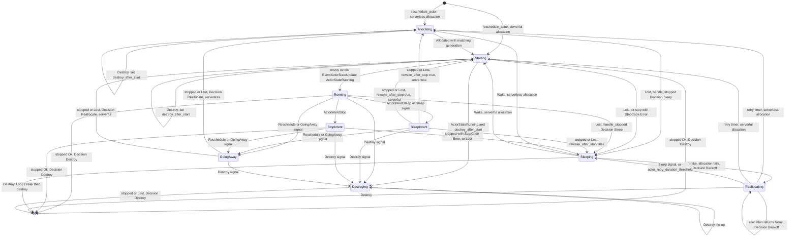
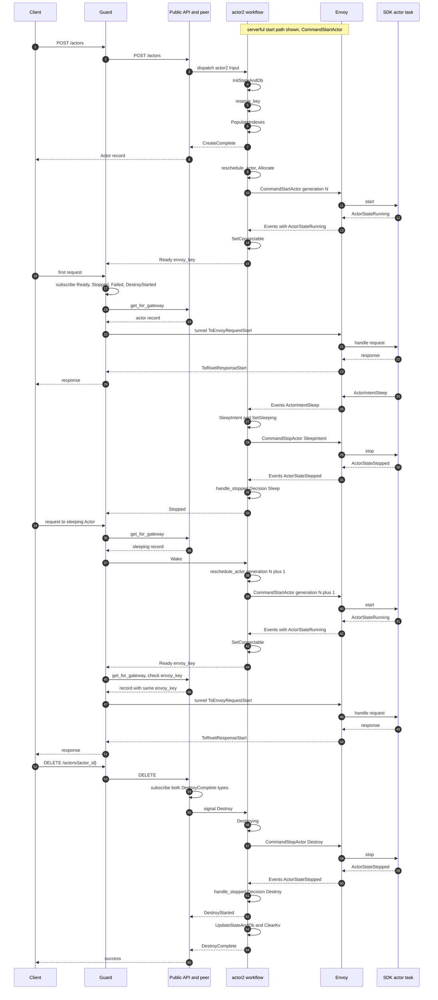

# 03 Actors and lifecycle

An Actor in Rivet is a durable keyed process. It is not a container and not a
virtual machine. It is a task inside a node process that the operator already
runs. The control plane (the Rivet engine) keeps the Actor record and the key
reservation (the record that fixes a key to one datacenter). The live task runs
on a host process. The newer host process is an envoy. The older host process
is a runner. The Actor record stays in the control plane while the live task
moves between host processes. A state machine in the control plane owns that
movement. This document explains the identity of an Actor, the
Application Programming Interface (API) operations that create and delete it,
every state in the Actor workflow, and the sleep, wake, reschedule, and destroy
paths. It uses the envoy version 2 path as the main path. It names the legacy
runner version 1 path where the two differ. Placement is in
[04 Pegboard](04-pegboard-scheduling.md). The SQLite database storage is in
[06 Actor SQLite and Depot](06-actor-sqlite-and-depot.md).

## 1. What an Actor is

An Actor has a name, an optional key, a namespace, and durable state. The source
represents it with one record. The record is not the live task. The record holds
identity and timestamps. The live task is a separate task that the host process
starts. The namespace is the isolation boundary for Actor names and keys. It is
identified by `namespace_id`. [13 Auth](13-auth-and-namespaces.md) covers the
namespace record.

```rust
// engine/packages/types/src/actors.rs:7-47
#[derive(Debug, Clone, Serialize, Deserialize, ToSchema)]
pub struct Actor {
	pub actor_id: Id,
	pub name: String,
	pub key: Option<String>,

	pub namespace_id: Id,
	pub datacenter: String,
	pub runner_name_selector: String,
	pub crash_policy: CrashPolicy,

	/// Denotes when the actor was first created.
	pub create_ts: i64,
	/// Denotes when the actor was first made connectable. Null if never.
	pub start_ts: Option<i64>,
	/// Denotes when the actor started waiting for an allocation.
	pub pending_allocation_ts: Option<i64>,
	/// Denotes when the actor was last connectable. Null if actor is not running.
	pub connectable_ts: Option<i64>,
	/// Denotes when the actor entered a sleeping state.
	pub sleep_ts: Option<i64>,
	/// Denotes when the actor will try to allocate again. If this is set, the actor will not attempt to
	/// allocate until the given timestamp.
	pub reschedule_ts: Option<i64>,
	/// Denotes when the actor was destroyed.
	pub destroy_ts: Option<i64>,

	/// Error details if the actor failed to start.
	#[serde(skip_serializing_if = "Option::is_none")]
	#[schema(value_type = Option<Object>, additional_properties = true)]
	pub error: Option<crate::actor::ActorError>,
}

#[derive(Debug, Copy, Clone, Default, Serialize, Deserialize, PartialEq, Eq, Hash, ToSchema)]
#[serde(rename_all = "snake_case")]
pub enum CrashPolicy {
	Restart,
	Sleep,
	#[default]
	Destroy,
}
```

The `Actor` record is a public view. The control plane builds it from workflow
state, not from a separate Actor table. The same record has one shape for both
runner generations, but two fields have different meanings on the envoy path.
`crash_policy` is fixed to `CrashPolicy::Sleep` when the record comes from the
`pegboard_actor2` workflow. `pending_allocation_ts` is always `None` on that
path. The conversion from version 2 workflow state writes those two values at
`engine/packages/pegboard/src/ops/actor/util.rs:208-226`. The
`pegboard_actor2` workflow does not read a crash policy at all.

| Field | Type | Meaning |
|---|---|---|
| `actor_id` | `Id` | The immutable address of the Actor. |
| `name` | `String` | The Actor type name. The key is unique inside this name and the namespace. |
| `key` | `Option<String>` | The user key. It is absent for an unkeyed Actor. |
| `namespace_id` | `Id` | The owning namespace. |
| `datacenter` | `String` | The control plane datacenter that serves the record. |
| `runner_name_selector` | `String` | The runner pool name. |
| `crash_policy` | `CrashPolicy` | Restart, sleep, or destroy after a crash. Fixed to `Sleep` on the envoy path. |
| `create_ts` | `i64` | First creation time. |
| `start_ts` | `Option<i64>` | First time the Actor became connectable. |
| `pending_allocation_ts` | `Option<i64>` | When allocation started waiting. Version 1 path. |
| `connectable_ts` | `Option<i64>` | Last time the Actor was connectable. |
| `sleep_ts` | `Option<i64>` | When the Actor entered sleep. |
| `reschedule_ts` | `Option<i64>` | Earliest time of the next allocation attempt. |
| `destroy_ts` | `Option<i64>` | When the Actor was destroyed. |
| `error` | `Option<ActorError>` | The last allocation or runner failure. |

The `Actor` record also has a metadata form. `ActorName` wraps a JavaScript
Object Notation (JSON) metadata map. It is a separate type. The source does not
show a lifecycle use for it in this commit.

```rust
// engine/packages/types/src/actors.rs:49-52
#[derive(Debug, Deserialize, Serialize, Hash, ToSchema)]
pub struct ActorName {
	pub metadata: serde_json::Map<String, serde_json::Value>,
}
```

An Actor is durable in three classes of storage and one live task. The control
plane owns the Actor workflow state. It owns the key reservation. It owns the
per-Actor UniversalDB (UDB) records, which include the Actor database pages.
The host process owns the live task. The control plane can send a stop command
to the host and keep all three storage classes. That is the basis of sleep and
wake. Section 11 splits the same picture by owner.

## 2. Identity: the Actor identifier (ID), namespace, name, and key

The Actor ID is a value of type `Id`. In this commit `Id` has one version. A
version 1 `Id` is 18 bytes. The first 16 bytes are a Universally Unique
Identifier (UUID). The last two bytes are a big-endian `u16` label. The source
uses the label for the datacenter that created the value.

```rust
// engine/packages/util-id/src/lib.rs:35-46
#[derive(Clone, Copy, PartialEq, Eq, Hash, PartialOrd, Ord)]
pub enum Id {
	V1([u8; 18]),
}

impl Id {
	pub fn new_v1(label: u16) -> Self {
		let mut data = [0u8; 18];
		data[..16].copy_from_slice(Uuid::new_v4().as_bytes());
		data[16..].copy_from_slice(&label.to_be_bytes());
		Id::V1(data)
	}
```

The API handlers create the Actor ID with the local datacenter label. The call
is `Id::new_v1(ctx.config().dc_label())` in
`engine/packages/api-peer/src/actors/create.rs:35` and in
`engine/packages/api-peer/src/actors/get_or_create.rs:52`. The label is read
back with `Id::label()` at `engine/packages/util-id/src/lib.rs:60-68`. The
public API uses that label to send a delete or sleep request to the correct
datacenter. That routing is in
`engine/packages/api-public/src/actors/delete.rs:44-68`.

Identity has five separate parts. They answer different questions.

| Part | Example | Scope | Changeable |
|---|---|---|---|
| `actor_id` | 16-byte UUID plus datacenter label | Global | No |
| `namespace_id` | `Id` of the namespace | Global | No |
| `name` | `"chat"` | Namespace | No |
| `key` | `"room-42"` | Namespace plus name | No |
| `runner_name_selector` | `"default"` | Namespace | No |

All five values are fixed for one Actor. A new create with the same key makes a
new Actor with a new Actor ID. It can choose a different pool.

The key is optional on create. If the key is present, it must not be empty and
must not be longer than 1024 bytes. The constant `MAX_ACTOR_KEY_SIZE` is 1024
at `engine/packages/api-peer/src/actors/create.rs:6`. The check uses
`key.len()`, so the limit is bytes, not characters. The same check is at
`engine/packages/api-peer/src/actors/get_or_create.rs:16-25`. Get-or-create
requires a key. Its request type has `pub key: String`, not
`Option<String>`, at `engine/packages/api-types/src/actors/get_or_create.rs:18`.

The tuple of the namespace, the Actor name, and the key is unique.
The reservation key is built from those three values at
`engine/packages/pegboard/src/workflows/actor2/keys.rs:174-178`. The pool name
does not join that tuple. Two Actor names in one namespace can use the same
key. Two pools in one namespace also share the key space for the same name.

### 2.1 The key reservation is separate from the Actor

A key needs one home in a multi-datacenter system. Rivet stores the home in
Epoxy, its per-key consensus layer. The value is a reservation ID, not the
Actor ID. The reservation ID is also an `Id`. Its label is the datacenter that
owns the key.

Epoxy is the replicated key-value layer in
[08 Epoxy](08-epoxy-multi-region.md). It orders writes to each key through
consensus. A read with `CachingBehavior::Optimistic` returns the locally cached
value without a consensus round. That read is correct only if the stored value
never changes.

An Actor ID can be destroyed and replaced. The value of a key must stay the
same. The control plane therefore cannot store an Actor ID and then update it.
The document `docs-internal/engine/ACTOR_KEY_RESERVATION.md:18-28` states this
limitation. The code matches the document. The lookup uses
`CachingBehavior::Optimistic` at
`engine/packages/pegboard/src/workflows/actor2/keys.rs:179-188`.

> **Aha:** The reservation ID is a stable pointer, so the key row never needs an
> update. The obvious alternative is to store the Actor ID in the key row and
> rewrite it on every destroy and create. That costs a consensus write on the
> hot key, and a failed rewrite leaves the key pointing at a dead Actor. The
> design uses an immutable reservation and a future pointer chain instead. A
> pointer chain stores a pointer from the old reservation to the new one in the
> old datacenter, so the Epoxy value never changes
> (`docs-internal/engine/ACTOR_KEY_RESERVATION.md:40-60`). The pointer chain is
> future work, not implemented in this commit.

The current cost is explicit. A key stays tied to its first datacenter. The
document says so at `docs-internal/engine/ACTOR_KEY_RESERVATION.md:98-100`, and
the code returns `ForwardToDatacenter` when the reservation label differs from
the local label at `engine/packages/pegboard/src/workflows/actor2/keys.rs:122-141`.
A key cannot move to another datacenter until the reservation chain exists.

Three names describe this condition at three layers.
`ReserveKeyOutput::ForwardToDatacenter` is the workflow result.
`errors::Actor::KeyReservedInDifferentDatacenter` is the API error that the
workflow sends at
`engine/packages/pegboard/src/workflows/actor2/mod.rs:194-202`.
`get_for_key::Output::Forward { dc_label }` is the read operation result at
`engine/packages/pegboard/src/ops/actor/get_for_key.rs:15-20`.

## 3. Creation: POST /actors and get-or-create

Rivet has two create operations. `POST /actors` creates an Actor. `PUT
/actors` with the get-or-create handler returns the existing Actor for a key,
or creates one. The public handlers authenticate and choose the target
datacenter. The peer handlers validate and call the control plane.

### 3.1 The public handler and the datacenter choice

The public create handler is `create_inner` in
`engine/packages/api-public/src/actors/create.rs:53-99`. It performs four
steps.

1. It authorizes the caller for the namespace with `AccessNamespaceScope::Name`
   at lines 58-64.
2. It resolves the namespace at lines 66-71.
3. It calls `find_dc_for_actor_creation` at lines 73-80.
4. It calls the local peer if the target label is local. Otherwise it sends an
   HTTP `POST /actors` request to the remote datacenter at lines 86-98. HTTP
   means Hypertext Transfer Protocol.

The get-or-create public handler has the same shape. It uses `PUT` for the
remote call at `engine/packages/api-public/src/actors/get_or_create.rs:60-106`.
The choice of datacenter is not the Actor ID. The Actor ID is created later by
the peer in the target datacenter. The public handler reads the optional
`datacenter` field at `engine/packages/api-types/src/actors/create.rs:14-23`.
The peer handler does not read it. The peer creates the Actor ID with its own
datacenter label at `engine/packages/api-peer/src/actors/create.rs:35`, and it
passes `datacenter_name: None` at lines 49-50. No caller in the opened files
sets `datacenter_name: Some`. The peer sets `forward_request: true` at line 48.
Its comment at lines 46-47 gives the reason: this datacenter can forward again
when the user targets a remote datacenter. The field comment at
`engine/packages/pegboard/src/ops/actor/create.rs:28-29` says "api-peer should
set this to false". The two comments disagree, and the code follows the caller.
The comment at lines 49-50 also states that the peer always creates in its own
datacenter, which is why it passes `None`.

The public request fields are these.

| Field | Type | Purpose |
|---|---|---|
| `datacenter` | `Option<String>` | Public-only target constraint. Ignored by the peer. |
| `name` | `String` | Actor type name. |
| `key` | `Option<String>` | Optional user key on create. |
| `input` | `Option<String>` | Base64 binary input. The workflow sends it in every start command. |
| `runner_name_selector` | `String` | Runner pool name. |
| `crash_policy` | `CrashPolicy` | Version 1 crash behavior. |

### 3.2 The peer handler

The peer create handler is `engine/packages/api-peer/src/actors/create.rs:8-55`.
It validates the key. It resolves the namespace. It creates the Actor ID with
the local datacenter label. Then it calls
`pegboard::ops::actor::create::Input`. The input has the Actor ID, the
namespace, the name, the key, the pool name, the crash policy, the input, a
`forward_request` flag, and an optional `datacenter_name`.

```rust
// engine/packages/pegboard/src/ops/actor/create.rs:19-36
#[derive(Debug)]
pub struct Input {
	pub actor_id: Id,
	pub namespace_id: Id,
	pub name: String,
	pub key: Option<String>,
	pub runner_name_selector: String,
	pub crash_policy: CrashPolicy,
	pub input: Option<String>,
	/// If true, will handle ForwardToDatacenter errors by forwarding the request to the correct datacenter.
	/// Used by api-public. api-peer should set this to false.
	pub forward_request: bool,
	/// Datacenter to create the actor in
	///
	/// Providing this value will cause an error if attempting to create an actor where the key is
	/// reserved in a different datacenter.
	pub datacenter_name: Option<String>,
}
```

The operation has three controls. The decoded input must be at most 1 mebibyte
(MiB). `MAX_INPUT_SIZE` is `util::size::mebibytes(1)` at
`engine/packages/pegboard/src/ops/actor/create.rs:15`. The create rate limiter
is a leaky bucket for each namespace. A leaky bucket holds a burst allowance
and restores it at a fixed drip rate. It starts with 500
requests and restores one request every 10 milliseconds. The defaults are at
`engine/packages/config/src/config/pegboard.rs:441-447`, and the per-namespace
cache is at `engine/packages/pegboard/src/ops/actor/create.rs:57-78`. The
limiter cache is dropped after one hour idle. `RATE_LIMITER_CACHE_TTL` is 60
times 60 seconds at line 10. The create loop polls the workflow state every 5
seconds as a fallback. `CREATE_COMPLETE_POLL_INTERVAL` is 5 seconds at line 13.

Before it dispatches the workflow, the operation subscribes to six messages.
The messages are `CreateComplete`, `Failed`, and `DestroyStarted` for both
`actor` and `actor2`. The six subscriptions are at
`engine/packages/pegboard/src/ops/actor/create.rs:84-103`. It reads the runner
pool and chooses the workflow. The pool record has `protocol_version:
Option<u16>` at `engine/packages/pegboard/src/ops/runner_config/get.rs:20`. If
the field is `Some`, the operation dispatches `actor2`. Otherwise it dispatches
the legacy `actor` workflow. Only the presence of the value matters; the code
does not compare the protocol number. A pool lookup that returns no row takes
the same legacy branch, because `unwrap_or_default()` makes the flag false. The
choice is at lines 105-110.

```rust
// engine/packages/pegboard/src/ops/actor/create.rs:84-124
	let (
		mut create_sub,
		mut fail_sub,
		mut destroy_sub,
		mut create_sub2,
		mut fail_sub2,
		mut destroy_sub2,
		pool_res,
	) = tokio::try_join!(
		ctx.subscribe::<crate::workflows::actor::CreateComplete>(("actor_id", input.actor_id)),
		ctx.subscribe::<crate::workflows::actor::Failed>(("actor_id", input.actor_id)),
		ctx.subscribe::<crate::workflows::actor::DestroyStarted>(("actor_id", input.actor_id)),
		ctx.subscribe::<crate::workflows::actor2::CreateComplete>(("actor_id", input.actor_id)),
		ctx.subscribe::<crate::workflows::actor2::Failed>(("actor_id", input.actor_id)),
		ctx.subscribe::<crate::workflows::actor2::DestroyStarted>(("actor_id", input.actor_id)),
		ctx.op(crate::ops::runner_config::get::Input {
			runners: vec![(input.namespace_id, input.runner_name_selector.clone())],
			bypass_cache: false,
		}),
	)?;

	let actor_v2 = pool_res
		.into_iter()
		.next()
		.map(|p| p.protocol_version.is_some())
		.unwrap_or_default();
	if actor_v2 {
		// Dispatch actor workflow
		let workflow_id = ctx
			.workflow(crate::workflows::actor2::Input {
				actor_id: input.actor_id,
				name: input.name.clone(),
				pool_name: input.runner_name_selector.clone(),
				key: input.key.clone(),
				namespace_id: input.namespace_id,
				input: input.input.clone(),
				from_v1: false,
			})
			.tag("actor_id", input.actor_id)
			.dispatch()
			.await?;
```

The caller then waits. The select loop watches four things. It watches
`CreateComplete`, `Failed`, and `DestroyStarted`. It also polls the workflow
state every 5 seconds. The loop is at
`engine/packages/pegboard/src/ops/actor/create.rs:129-177`. A failed create
can return a `KeyReservedInDifferentDatacenter` error. If `forward_request` is
true and `datacenter_name` is `None`, the operation forwards the create with an
HTTP `POST /actors` to the other datacenter. That branch is at lines 139-157.
The forwarding helper is at lines 318-367. The public handler chooses the
datacenter first, at
`engine/packages/api-public/src/actors/create.rs:73-98`. This second branch runs
only if the key reservation still reports a different owner.

### 3.3 Get-or-create and the duplicate key

Get-or-create first asks for the Actor by key. The handler calls
`pegboard::ops::actor::get_for_key` at
`engine/packages/api-peer/src/actors/get_or_create.rs:35-43`. That operation
resolves the Epoxy reservation. If there is no reservation, it returns
`NotFound`. If the reservation label is local, it lists Actors by key. If the
reservation label is remote, it returns `Forward { dc_label }`. The three
outputs are at `engine/packages/pegboard/src/ops/actor/get_for_key.rs:15-20`,
and the branch is at lines 34-62.

| `get_for_key` output | Get-or-create action | `created` value |
|---|---|---|
| `Found { actor }` | Return the Actor. | `false` |
| `NotFound` | Create an Actor with a new ID. | `true` |
| `Forward { dc_label }` | Return `KeyReservedInDifferentDatacenter`. | Error |

If the local list has no live Actor, the operation returns `NotFound` at
`engine/packages/pegboard/src/ops/actor/get_for_key.rs:53-55`. Get-or-create
then creates a new Actor under the existing reservation.

The create path can still lose a race. Two requests can both see `NotFound` in
Epoxy and both dispatch an Actor workflow. The loser must not create a second
live Actor. Before the index scan, `reserve_key` calls the `Propose` activity at
`engine/packages/pegboard/src/workflows/actor2/keys.rs:211-247`. `Propose`
sends one `CheckAndSetCommand` with `expect_one_of: vec![None]`. The value is
written only if the key has no value at consensus. The check happens in the UDB
transaction `ReserveActorKey`. It scans `ActorByKeyKey` for the namespace, name,
and key. It stops at the first entry with `is_destroyed == false` and returns
`ExistingActor { existing_actor_id }`. Otherwise it writes a new index entry
with `is_destroyed: false`.

```rust
// engine/packages/pegboard/src/workflows/actor2/keys.rs:264-322
#[activity(ReserveActorKey)]
pub async fn reserve_actor_key(
	ctx: &ActivityCtx,
	input: &ReserveActorKeyInput,
) -> Result<ReserveActorKeyOutput> {
	let state = ctx.state::<State>()?;

	let create_ts = state.create_ts;
	let res = ctx
		.udb()?
		.txn("pegboard_actor2_reserve_key", |tx| async move {
			let tx = tx.with_subspace(keys::subspace());

			// Check if there are any actors that share the same key that are not destroyed
			let actor_key_subspace = keys::subspace().subspace(&keys::ns::ActorByKeyKey::subspace(
				input.namespace_id,
				input.name.clone(),
				input.key.clone(),
			));

			let mut stream = tx.get_ranges_keyvalues(
				universaldb::RangeOption {
					mode: StreamingMode::Iterator,
					..(&actor_key_subspace).into()
				},
				Serializable,
			);

			while let Some(entry) = stream.try_next().await? {
				let (idx_key, data) = tx.read_entry::<keys::ns::ActorByKeyKey>(&entry)?;
				if !data.is_destroyed {
					return Ok(ReserveActorKeyOutput::ExistingActor {
						existing_actor_id: idx_key.actor_id,
					});
				}
			}

			// Write key
			tx.write(
				&keys::ns::ActorByKeyKey::new(
					input.namespace_id,
					input.name.clone(),
					input.key.clone(),
					create_ts,
					input.actor_id,
				),
				ActorByKeyKeyData {
					workflow_id: ctx.workflow_id(),
					is_destroyed: false,
				},
			)?;

			Ok(ReserveActorKeyOutput::Success)
		})
		.custom_instrument(tracing::info_span!("actor_reserve_key_tx"))
		.await?;

	Ok(res)
}
```

`ActorByKeyKey` includes `create_ts` and `actor_id`, so two Actors with the same
key have different index keys. Only the winner writes a live entry. A destroy
later tombstones that entry. A tombstone is an entry whose `is_destroyed` field
is true. The comment in
`engine/packages/pegboard/src/ops/actor/list_for_ns.rs:9-20` says that every
loser writes an index entry before it detects the conflict. The code in this
commit does not do that. `ReserveActorKey` returns `ExistingActor` before it
writes at `engine/packages/pegboard/src/workflows/actor2/keys.rs:292-316`. The
code wins over the comment.

`list_for_ns` keeps a cap of 4096 entries for one by-key lookup.
`MAX_ACTOR_BY_KEY_SCAN_ENTRIES` is 4096 at
`engine/packages/pegboard/src/ops/actor/list_for_ns.rs:21`. If the scan reaches
the cap, `list_for_ns` returns `KeyIndexScanLimitExceeded` at
`engine/packages/pegboard/src/errors.rs:65-74`. It does not return an empty
list. An empty list would make get-or-create create a replacement and write
another entry under the same key.

The loser takes three actions in the Actor workflow. It sends
`Failed { error: DuplicateKey { key, existing_actor_id } }`. It calls
`destroy(ctx, input)`. It returns. The branch is at
`engine/packages/pegboard/src/workflows/actor2/mod.rs:209-224`. The error type
is at `engine/packages/pegboard/src/errors.rs:42-47`.

Get-or-create then turns the error into the existing Actor. It checks both the
local `RivetError` form and the remote `RawErrorResponse` form. It reads the
`existing_actor_id` field from the error metadata. Then it calls
`pegboard::ops::actor::get` and returns `created: false`. The logic is at
`engine/packages/api-peer/src/actors/get_or_create.rs:75-107`, and the helper
is at lines 121-159.

> **Aha:** The duplicate check is in the key index, not only in Epoxy. Epoxy
> gives one reservation for the key. It does not give one live Actor, because
> the reservation is immutable and outlives the Actor. The index scan closes
> that gap. The alternative is to make the reservation carry a live Actor
> pointer. That alternative breaks the optimistic read rule. The cost of the
> chosen design is the tombstone history. The 4096-entry cap and the
> `key_index_scan_limit_exceeded` error are the price.

A create with a key that already has a live Actor does not return the existing
Actor. A live Actor is one whose key-index entry has `is_destroyed: false`. The
create returns the `duplicate_key` error. Only get-or-create maps that error to
a successful response. This is an API semantic difference, not a lifecycle
difference. After the previous Actor is destroyed, a create with the same key
succeeds: the index scan at
`engine/packages/pegboard/src/workflows/actor2/keys.rs:292-299` skips destroyed
entries and writes a new `ActorByKeyKey`. The Epoxy reservation itself stays in
place, because `ReserveActorKey` rewrites only the index.

## 4. The Actor workflow: input, state, and creation order

The envoy Actor workflow is `pegboard_actor2` in
`engine/packages/pegboard/src/workflows/actor2/mod.rs:142-285`. The workflow
input is small. The state is the durable Actor record inside the workflow.

```rust
// engine/packages/pegboard/src/workflows/actor2/mod.rs:21-67
#[derive(Clone, Debug, Serialize, Deserialize)]
pub struct Input {
	pub actor_id: Id,
	pub name: String,
	pub pool_name: String,
	pub key: Option<String>,

	pub namespace_id: Id,

	/// Arbitrary user-provided binary data encoded in base64.
	pub input: Option<String>,
	pub from_v1: bool,
}

#[derive(Deserialize, Serialize)]
pub struct State {
	pub actor_id: Id,
	pub name: String,
	pub pool_name: String,
	pub key: Option<String>,
	pub namespace_id: Id,

	pub acquired_slot: bool,
	pub envoy_last_command_idx: i64,
	// Used as a cache
	pub envoy_key: Option<String>,

	pub create_ts: i64,
	pub create_complete_ts: Option<i64>,
	pub allocate_ts: Option<i64>,
	/// Set only on first allocation.
	pub start_ts: Option<i64>,
	// NOTE: This is not the alarm ts, this is when the actor started sleeping. See `LifecycleState` for alarm
	pub sleep_ts: Option<i64>,
	pub connectable_ts: Option<i64>,
	pub reschedule_ts: Option<i64>,
	pub destroy_ts: Option<i64>,

	/// Explains why the actor is NOT healthy, either due to failure to allocate or a failed
	/// envoy.
	///
	/// # When error is cleared
	///
	/// - When actor is allocated
	/// - When actor becomes connectable
	pub error: Option<ActorError>,
}
```

| State field | Type | Purpose |
|---|---|---|
| `actor_id` | `Id` | The immutable identity. |
| `name` | `String` | Actor type name. |
| `pool_name` | `String` | Runner pool. |
| `key` | `Option<String>` | User key. |
| `namespace_id` | `Id` | Namespace. |
| `acquired_slot` | `bool` | True when a concurrency slot is held. |
| `envoy_last_command_idx` | `i64` | Last command index sent to the envoy. |
| `envoy_key` | `Option<String>` | Cached host key. |
| `create_ts` | `i64` | First creation time. |
| `create_complete_ts` | `Option<i64>` | When indexes were written. |
| `allocate_ts` | `Option<i64>` | When the start message was sent. |
| `start_ts` | `Option<i64>` | First connectable time. |
| `sleep_ts` | `Option<i64>` | When the Actor entered sleep. |
| `connectable_ts` | `Option<i64>` | Last connectable time. |
| `reschedule_ts` | `Option<i64>` | Next retry time. |
| `destroy_ts` | `Option<i64>` | Destroy time. |
| `error` | `Option<ActorError>` | Last failure. |

The workflow uses a fixed creation order. The source comment at
`engine/packages/pegboard/src/workflows/actor2/mod.rs:145-156` gives the reason.
The Actor must exist by ID before creation is complete. The key must be
reserved before the Actor appears in a list. The indexes must be written after
the reservation is certain.

The order is:

1. `InitStateAndDb` writes the Actor keys to UDB. It writes `CreateTsKey`,
   `WorkflowIdKey`, `NamespaceIdKey`, `PoolNameKey`, `NameKey`, `VersionKey`
   with value 2, and `GenerationKey` with value 0. If a key exists, it writes
   `KeyKey`. For a new Actor, it also increments the `TotalActors` metric. It
   skips the increment when `from_v1` is true. The activity is at
   `engine/packages/pegboard/src/workflows/actor2/mod.rs:298-373`.
2. If `from_v1` is true, the workflow runs three activities. The first is
   `MigrateSqliteV1ToV2`. It copies the version 1 SQLite pages into the version
   2 layout, and it does nothing when no version 1 data exists or the copy is
   already complete (`engine/packages/pegboard/src/workflows/actor2/sqlite.rs:12-30`,
   `engine/packages/pegboard/src/actor_sqlite.rs:98-117`). The version 1 data is
   never deleted, as the comment at lines 111-114 states. The second is
   `UpdateKeyIndex`. It rewrites `ActorByKeyKey` so the entry's `workflow_id`
   points at the new `pegboard_actor2` workflow
   (`engine/packages/pegboard/src/workflows/actor2/keys.rs:327-364`). Without
   that rewrite, a by-key lookup would resolve to the old version 1 workflow.
   The third is `PopulateIndexes`. This branch does not call `reserve_key`. The
   branch has no comment about the reservation. The version 1 workflow reserved
   the key at its creation at
   `engine/packages/pegboard/src/workflows/actor/mod.rs:94-105`, before it
   dispatched this workflow at lines 220-239.
   This branch does not send `CreateComplete`. The branch is at lines 169-180.
3. If the Actor is new and has a key, `keys::reserve_key` runs. A
   `ForwardToDatacenter` result sends `Failed` and destroys the new Actor. A
   `KeyExists` result sends `Failed { DuplicateKey }` and destroys the new
   Actor. `KeyExists` is the `ReserveKeyOutput` variant. It carries the
   `existing_actor_id` from `ReserveActorKeyOutput::ExistingActor` at
   `engine/packages/pegboard/src/workflows/actor2/keys.rs:131-136`. The branch
   is at lines 182-226.
4. `PopulateIndexes` writes `ActiveActorKey` and `AllActorKey`, and sets
   `create_complete_ts`. It does not write `ActorByKeyKey`, because the
   reservation step owns that entry. The activity is at lines 378-426.
5. For a new Actor, the workflow sends `CreateComplete`. This message tells the API operation
   that the Actor exists and has indexes.
6. The workflow starts the metrics workflow. It creates
   `runtime::LifecycleState::new()`.
7. It calls `runtime::reschedule_actor` for the first allocation.
8. It enters `ctx.lupe()` with a commit interval of 1 loop iteration. The
   default interval is 20 at
   `engine/packages/gasoline/src/builder/workflow/lupe.rs:16-17`. The loop
   listens for signals, processes them, and updates the lifecycle state.
   `ctx.lupe()` is the Gasoline workflow loop in
   [05 Gasoline](05-gasoline-durable-execution.md). The loop is at lines 252-274.

The `CreateComplete` message comes before the Actor is ready. `POST /actors`
therefore returns an Actor that may still be allocating. The first request
waits for the ready message, not for create. This separation is important for
the error model. A create failure is an API error on the create call. A start
failure is a routing error on the first request.

The workflow has `#[prune = history]` at
`engine/packages/pegboard/src/workflows/actor2/mod.rs:143`. That variant makes
the pruner delete the workflow history after completion and keep the state. The
other variant deletes state and history. The state is not pruned, because
`list_for_ns` reads it. The source comment states this. A destroyed Actor still
has a readable workflow state. The `destroy_ts` field is the marker that the
Actor is gone. `UpdateStateAndDb` sets it at
`engine/packages/pegboard/src/workflows/actor2/mod.rs:1215-1216`.

## 5. The lifecycle state machine

The envoy path has an explicit `Transition` enum. This is the main difference
from the legacy path. The legacy `runtime::LifecycleState` uses booleans:
`sleeping`, `stopping`, `going_away`, and `will_wake`. The source has a TODO
that says the boolean state should be rewritten as nested structs or enums for
transparency, and that this likely requires Actor workflow version 2. That
comment is at `engine/packages/pegboard/src/workflows/actor/runtime.rs:39-40`.
The envoy path implements that idea.

```rust
// engine/packages/pegboard/src/workflows/actor2/runtime.rs:15-76
#[derive(Deserialize, Serialize)]
pub struct LifecycleState {
	pub generation: u32,
	pub transition: Transition,
	pub alarm_ts: Option<i64>,
	pub retry_backoff_state: RetryBackoffState,
}

impl LifecycleState {
	pub fn new() -> Self {
		LifecycleState {
			generation: 0,
			transition: Transition::Allocating {
				destroy_after_start: false,
				lost_timeout_ts: 0,
			},
			alarm_ts: None,
			retry_backoff_state: RetryBackoffState::default(),
		}
	}
}

#[derive(Debug, Deserialize, Serialize)]
#[serde(rename_all = "snake_case")]
pub(crate) enum Transition {
	Allocating {
		destroy_after_start: bool,
		/// Handles cleaning up the actor if it does not receive a certain state before the timeout (ex.
		/// created -> running event, stop intent -> stop event). If the timeout is reached, the actor is
		/// considered lost.
		lost_timeout_ts: i64,
	},
	Starting {
		destroy_after_start: bool,
		lost_timeout_ts: i64,
	},
	Running {
		envoy: EnvoyState,
	},
	SleepIntent {
		envoy: EnvoyState,
		lost_timeout_ts: i64,
		/// If a wake was received in between an actor's intent to sleep and actor stop.
		rewake_after_stop: bool,
	},
	StopIntent {
		envoy: EnvoyState,
		lost_timeout_ts: i64,
	},
	GoingAway {
		envoy: EnvoyState,
		lost_timeout_ts: i64,
	},
	Sleeping,
	Reallocating {
		since_ts: i64,
	},
	Destroying {
		envoy: EnvoyState,
		lost_timeout_ts: i64,
	},
}
```

There are two pool kinds. A serverless pool starts an Actor through an outbound
subject. A serverful pool starts an Actor on an envoy. The `generation` value is
a fencing counter. It increases only when `Allocate` returns an allocation. A
failed allocation leaves it unchanged. A stale generation makes an old host
event invalid.

`Starting` has two entry paths. A serverful start enters it from
`reschedule_actor`. A serverless start enters it from `Allocated` at
`engine/packages/pegboard/src/workflows/actor2/mod.rs:649-661`. In both paths
the Actor waits for the host event `ActorStateRunning`.

| State | Fields | Meaning |
|---|---|---|
| `Allocating` | `destroy_after_start`, `lost_timeout_ts` | A serverless start was sent. The Actor waits for the allocation acknowledgement. |
| `Starting` | `destroy_after_start`, `lost_timeout_ts` | A start was sent and acknowledged, or a serverless allocation was acknowledged. The Actor waits for `ActorStateRunning`. |
| `Running` | `envoy` | The Actor is connectable on an envoy. |
| `SleepIntent` | `envoy`, `lost_timeout_ts`, `rewake_after_stop` | The Actor asked to sleep. The stop command is in flight. |
| `StopIntent` | `envoy`, `lost_timeout_ts` | The Actor asked to stop. The stop command is in flight. |
| `GoingAway` | `envoy`, `lost_timeout_ts` | The host is draining. The Actor will reallocate after stop. |
| `Sleeping` | none | The Actor is not on a host. Durable state remains. |
| `Reallocating` | `since_ts` | Allocation failed. The Actor waits for the next backoff time. |
| `Destroying` | `envoy`, `lost_timeout_ts` | Destruction was requested. The stop command is in flight. |

The `EnvoyState` holds the host key, the last event index, the last
acknowledged event index, and the last liveness check time. Its fields are at
`engine/packages/pegboard/src/workflows/actor2/runtime.rs:110-140`. Every state
that has a host carries this value. The `Transition::envoy()` method returns a
mutable reference only for those states. It returns `None` for `Allocating`,
`Starting`, `Sleeping`, and `Reallocating`. The method is at lines 78-92.



The left `[*]` is the start of the Actor workflow. The right `[*]` is the
return of the workflow. A return runs the `destroy` function. The diagram is
the union of the transitions in `process_signal` and `handle_stopped`.
`process_signal` is at
`engine/packages/pegboard/src/workflows/actor2/mod.rs:635-1153`.
`handle_stopped` is at
`engine/packages/pegboard/src/workflows/actor2/runtime.rs:558-748`.
The diagram does not draw the alarm override. When `handle_stopped` chooses
`Sleep` and `alarm_ts <= now`, it changes the decision to `Reallocate` at
`engine/packages/pegboard/src/workflows/actor2/runtime.rs:665-673`. The edge
then goes to `Allocating` or `Starting`, not to `Sleeping`.
The next table lists each signal by its real name and the
transition it causes. A signal with a stale `generation` is ignored. The
generation check is in the `Events` branch at
`engine/packages/pegboard/src/workflows/actor2/mod.rs:704-711`.
The `Allocated` generation check is at lines 644-647.

| Signal or event | Current state | New state and action |
|---|---|---|
| `Allocated { generation }` | `Allocating` | `Starting`; carries `destroy_after_start`; timeout is now plus `actor_start_threshold`; metrics resume. |
| `Events` with `ActorStateRunning` | `Starting` | `Running`; `SetConnectable`; send `Ready { envoy_key }`. |
| `Events` with `ActorStateRunning` and `destroy_after_start` | `Starting` | `Destroying`; send `CommandStopActor` with reason `Destroy`. |
| `ActorIntentSleep` | `Running` | `SleepIntent`; `SetSleeping`; stop reason `SleepIntent`. |
| `ActorIntentStop` | `Running` | `StopIntent`; `SetNotConnectable`; stop reason `StopIntent`. |
| `ActorStateStopped` | any host state | `handle_stopped`; decision `Reallocate`, `Backoff`, `Sleep`, or `Destroy`. |
| `Wake` | `Sleeping` | `reschedule_actor`; a new generation only if allocation succeeds. |
| `Allocate` activity returns `None` | `Sleeping` or `Reallocating` | `Reallocating`; decision `Backoff`. |
| `Wake` | `SleepIntent` | Set `rewake_after_stop = true`; wake waits for stop. |
| `Sleep` | `Running` | `SleepIntent`; `SetSleeping`; stop reason `SleepIntent`. |
| `Sleep` | `Reallocating` | `Sleeping`. |
| `Reschedule` | `Running` | `GoingAway`; stop reason `GoingAway`. |
| `Reschedule` | `SleepIntent` or `StopIntent` | `GoingAway`; command is already in flight. |
| `Lost` | any | `handle_stopped` with a lost reason. |
| `GoingAway` | `Running` | `GoingAway`; `SetNotConnectable`; stop reason `GoingAway`. |
| `GoingAway` | `SleepIntent` or `StopIntent` | `GoingAway`; command is already in flight. |
| `Destroy` | `Running` | `Destroying`; stop reason `Destroy`. |
| `Destroy` | `SleepIntent`, `StopIntent`, or `GoingAway` | `Destroying`; command is already in flight. |
| `Destroy` | `Allocating` or `Starting` | Set `destroy_after_start = true`. |
| `Destroy` | `Sleeping` or `Reallocating` | Break the workflow loop, then run `destroy`. |
| `Destroy` | `Destroying` | No change. |

`ActorIntentSleep` is handled at
`engine/packages/pegboard/src/workflows/actor2/mod.rs:721-744`. `ActorIntentStop`
is handled at lines 746-769. Each branch acts only in `Running`.

`SetConnectable` and `SetNotConnectable` are separate activities.
`SetConnectable` writes the routing records. `SetNotConnectable` deletes
`ConnectableKey` and clears `connectable_ts` at
`engine/packages/pegboard/src/workflows/actor2/runtime.rs:939-959`. It does not
release the slot. `Deallocate` releases the slot later.

The code has several explicit no-op branches. They matter for correctness.
`Reschedule` does nothing in `Allocating`, `Starting`, `Sleeping`,
`Reallocating`, `GoingAway`, and `Destroying` at
`engine/packages/pegboard/src/workflows/actor2/mod.rs:1010-1018`. `GoingAway`
does nothing in `Sleeping`, `Reallocating`, `GoingAway`, and `Destroying`. It
logs a warning in `Allocating` and has a TODO in `Starting` at lines
1037-1097. `Sleep` has a TODO for `Allocating`, `Starting`, and `GoingAway` at
lines 933-939. It does nothing in `SleepIntent`, `StopIntent`, `Sleeping`, and
`Destroying` at lines 969-972. A Sleep request that arrives during allocation
is therefore ignored, not queued. The source says `TODO`, so the behavior is
not a finished design.

### 5.1 Stopped events and the decision table

Every stop path calls `runtime::handle_stopped`. It saves the error, deallocates
the slot, pauses metrics, sends a lost stop command if needed, and chooses one
of four decisions. The decision is at
`engine/packages/pegboard/src/workflows/actor2/runtime.rs:639-673`.

```rust
// engine/packages/pegboard/src/workflows/actor2/runtime.rs:639-673
	let mut decision = match &state.transition {
		Transition::SleepIntent {
			rewake_after_stop: true,
			..
		} => Decision::Reallocate,
		Transition::SleepIntent {
			rewake_after_stop: false,
			..
		} => Decision::Sleep,
		Transition::GoingAway { .. } => Decision::Reallocate,
		Transition::Destroying { .. } => Decision::Destroy,
		_ => match variant {
			StoppedVariant::FailedAllocation => Decision::Backoff,
			// An actor stopping with `StopCode::Ok` indicates a graceful exit
			StoppedVariant::Stopped {
				code: protocol::StopCode::Ok,
				..
			} => Decision::Destroy,
			StoppedVariant::Stopped {
				code: protocol::StopCode::Error,
				..
			}
			| StoppedVariant::Lost { .. } => Decision::Sleep,
		},
	};

	// Check alarm
	if let (Decision::Sleep, Some(alarm_ts)) = (&decision, state.alarm_ts) {
		let now = ctx.activity(GetTsInput {}).await?;

		if now >= alarm_ts {
			state.alarm_ts = None;
			decision = Decision::Reallocate;
		}
	}
```

The decision table is this.

| Current state | Stop variant | Decision |
|---|---|---|
| `SleepIntent` with `rewake_after_stop` true | any | `Reallocate` |
| `SleepIntent` with `rewake_after_stop` false | any | `Sleep` |
| `GoingAway` | any | `Reallocate` |
| `Destroying` | any | `Destroy` |
| other | `FailedAllocation` | `Backoff` |
| other | `Stopped` with code `Ok` | `Destroy` |
| other | `Stopped` with code `Error`, or `Lost` | `Sleep` |
| any state that yields `Sleep` | any, when `alarm_ts <= now` | `Reallocate` |

The last row is an override, not a separate state case. The code checks it after
the main match and clears `state.alarm_ts`.

The envoy path does not use `CrashPolicy` here. A crash becomes `Sleep`. A
graceful stop becomes `Destroy`. The version 1 path uses `CrashPolicy` at
`engine/packages/pegboard/src/workflows/actor/mod.rs:1242-1293`. This is a
real lifecycle difference, not a naming difference.

When `Decision::Sleep` is chosen and the Actor has an alarm time that has
passed, the decision changes to `Reallocate`. This makes a scheduled wake win
over sleep. The check is at
`engine/packages/pegboard/src/workflows/actor2/runtime.rs:665-673`.

The alarm time comes from the host event `EventActorSetAlarm { alarm_ts }`.
That event sets `state.alarm_ts` at
`engine/packages/pegboard/src/workflows/actor2/mod.rs:841-847`. A `Sleeping`
Actor also wakes at `alarm_ts`. The loop calls `ctx.listen_n_until` with that
time, and an empty result becomes a synthetic `Wake` at lines 586-598.

After the decision, `Reallocate` performs the allocation and starts the new
generation. `Backoff` sets `Reallocating { since_ts: now }`. `Sleep` sets
`Sleeping`. `Destroy` returns `StoppedResult::Destroy`. The code is at lines
675-733. The workflow always sets sleeping when the new state is `Sleeping` or
`Reallocating`, and always sends the `Stopped` message. That is at lines
735-745.

## 6. Start, allocation, and the ready signal

The start path has two levels. `Allocate` chooses a slot and a host or a
serverless endpoint. `SendOutbound` sends the start message. The Actor is not
ready until the host reports `ActorStateRunning`.

### 6.1 Allocate

`allocate` reads the runner pool. It checks `max_concurrent_actors` for a
serverless pool. It uses one UDB transaction to increment the slot counter and
choose an envoy. For a serverless pool, the allocation is just
`Allocation::Serverless`. For a serverful pool, it calls
`alloc_serverful::allocate_serverful`. The transaction is at
`engine/packages/pegboard/src/workflows/actor2/runtime.rs:217-301`.

```rust
// engine/packages/pegboard/src/workflows/actor2/runtime.rs:217-241
	let (acquired_slot, allocation, error) = ctx
		.udb()?
		.txn("pegboard_actor2_acquire_slot", |tx| {
			let pools = pools.clone();
			async move {
				let now = util::timestamp::now();
				let tx = tx.with_subspace(keys::subspace());

				let actor_slots_key = keys::ns::ActorSlotsKey::new(namespace_id, pool_name.clone());

				let acquired_slot = if let Some(max_concurrent_actors) = max_concurrent_actors {
					if tx.read_opt(&actor_slots_key, Snapshot).await?.unwrap_or(0)
						< max_concurrent_actors as i64
					{
						tx.atomic_op(&actor_slots_key, &1i64.to_le_bytes(), MutationType::Add);

						true
					} else {
						false
					}
				} else {
					tx.atomic_op(&actor_slots_key, &1i64.to_le_bytes(), MutationType::Add);

					true
				};
```

If an allocation exists, the same transaction deletes `SleepTsKey` and writes
`GenerationKey` with the new generation. That is at lines 291-295. The
allocation activity then clears `sleep_ts` and `reschedule_ts` in the state.
Those fields are at lines 309-312. A failed allocation sets
`ActorError::NoEnvoys` or `ActorError::ConcurrentActorLimitReached`. The errors
are at lines 280-289.

The `Allocate` activity also records `acquired_slot` and resets
`envoy_last_command_idx` to 0. `reschedule_actor` sets `allocate_ts` only later,
after `SendOutbound` returns, at
`engine/packages/pegboard/src/workflows/actor2/runtime.rs:476-478`. The source
comment gives the reason. The start duration must not include the control plane
send work.

### 6.2 SendOutbound

`send_outbound` has two branches. A serverless allocation publishes
`ToOutboundActorStart` on `ServerlessOutboundSubject`. The message carries an
`ActorCheckpoint`. The checkpoint is the position marker that the host echoes
back in its events. This one has the Actor ID, the new generation, and index 0.
Index 0 is safe because every new allocation has a unique generation, as the
comment says. The code is at
`engine/packages/pegboard/src/workflows/actor2/runtime.rs:415-436`. A serverful
allocation sends
`CommandStartActor` to the chosen envoy through
`insert_and_send_commands_inner`. The command contains the Actor name, key,
create time, and decoded input. The code is at
`engine/packages/pegboard/src/workflows/actor2/runtime.rs:408-481`.

`CommandStartActor` also has a `hibernating_requests` vector. The code fills it
with `Vec::new()` at line 459. A comment at lines 457-458 says request IDs are
ephemeral and the envoy refreshes them on the WebSocket send path. Hibernating
requests are the replay mechanism for realtime connections. They are not used
for the first start in this path.

### 6.3 From Running to Ready

The host sends an `EventActorStateUpdate` with `ActorStateRunning`. The
workflow handles it only in `Starting`. It changes to `Running`, calls
`SetConnectable`, and sends `Ready`. The ready message carries the envoy key.
The code is at `engine/packages/pegboard/src/workflows/actor2/mod.rs:776-820`.

```rust
// engine/packages/pegboard/src/workflows/actor2/mod.rs:776-820
						protocol::ActorState::ActorStateRunning => {
							if let Transition::Starting {
								destroy_after_start,
								..
							} = &mut state.transition
							{
								if *destroy_after_start {
									// Transition to destroying
									state.transition = Transition::Destroying {
										envoy: runtime::EnvoyState::new(sig.envoy_key.clone(), now),
										lost_timeout_ts: now
											+ ctx.config().pegboard().actor_stop_threshold(),
									};

									ctx.activity(runtime::InsertAndSendCommandsInput {
										generation: state.generation,
										envoy_key: sig.envoy_key.clone(),
										commands: vec![protocol::Command::CommandStopActor(
											protocol::CommandStopActor {
												reason: protocol::StopActorReason::Destroy,
											},
										)],
									})
									.await?;
								} else {
									// Transition to starting
									state.transition = Transition::Running {
										envoy: runtime::EnvoyState::new(sig.envoy_key.clone(), now),
									};

									ctx.activity(runtime::SetConnectableInput {
										envoy_key: sig.envoy_key.clone(),
										generation: state.generation,
									})
									.await?;

									ctx.msg(Ready {
										envoy_key: sig.envoy_key.clone(),
									})
									.topic(("actor_id", input.actor_id))
									.send()
									.await?;
								}
							}
						}
```

`SetConnectable` is more than a flag. It writes `ConnectableKey` and
`EnvoyKeyKey` for the Actor. It increments the envoy slot counter. It writes
the `envoy::ActorKey` entry. Then it updates the state with the start time, the
connectable time, and the envoy key. The transaction is at
`engine/packages/pegboard/src/workflows/actor2/runtime.rs:855-933`.

The `Ready` message is the signal that the first request waits for. The
`docs-internal/engine/ACTOR_LIFECYCLE.md:31-48` sequence calls this step
"Publish Ready msg". The code matches. The message is sent after
`SetConnectable`, so a reader that receives it can route to the envoy key it
contains.

### 6.4 Who waits, and for what

Five wait points exist on the create and request path. Guard is the routing
service that receives client requests. Two callers wait for create. Three
callers wait at Guard and Gateway 2.

Gateway 2 is the `pegboard_gateway2` service. Guard holds its state at
`engine/packages/guard/src/shared_state.rs:32-35` and starts it at lines 42-46.
Guard constructs `PegboardGateway2` for an Actor that has an envoy protocol
version at `engine/packages/guard/src/routing/pegboard_gateway/mod.rs:791-800`.
The `V2` metric label at line 787 shows the selection.

| Caller | Waits for | Timeout or limit | Source |
|---|---|---|---|
| Create operation | `CreateComplete`, `Failed`, or `DestroyStarted`, or a state poll | Poll every 5 seconds | `engine/packages/pegboard/src/ops/actor/create.rs:129-177` |
| Get-or-create | The create operation result | Same as create | `engine/packages/api-peer/src/actors/get_or_create.rs:54-107` |
| Guard, ready wait | `Ready`, `Stopped`, `Failed`, or `DestroyStarted` | `actor_ready_timeout` | `engine/packages/guard/src/routing/pegboard_gateway/mod.rs:566-713` |
| Guard, wake signal | The Actor workflow receives `Wake` | `route_pegboard_wake_signal_timeout` | `engine/packages/guard/src/routing/pegboard_gateway/mod.rs:540-560` |
| Gateway 2, request | `ToRivetResponseStart` | `gateway_response_start_timeout_ms` | `engine/packages/pegboard-gateway2/src/lib.rs:301-315` |

The defaults are these. `actor_ready_timeout` is 30,000 milliseconds at
`engine/packages/config/src/config/guard.rs:240-244`. The comment there gives a
serverless cold start of 10 to 20 seconds as the reason.
`route_pegboard_wake_signal_timeout` is 5,000 milliseconds at lines 227-231.
`route_pegboard_fetch_actor_timeout` is 5,000 milliseconds at lines 217-221.
`route_pegboard_subscribe_timeout` is 2,000 milliseconds at lines 213-215.
`gateway_response_start_timeout_ms` is 300,000 milliseconds (`5 * 60 * 1000`)
at `engine/packages/config/src/config/pegboard.rs:310-313`.

The create operation does not wait for `Ready`. The first request does. That
is why a create can return in a few milliseconds while the Actor is still
starting. It is also why the first request can fail with
`ActorReadyTimeout` while create succeeded.

The start budgets are configured in milliseconds. `actor_start_threshold` is
30,000 at `engine/packages/config/src/config/pegboard.rs:241-243`.
`actor_allocation_threshold` is 2,000 at lines 237-239. Each budget becomes the
`lost_timeout_ts` field of a transition. `reschedule_actor` sets
`Transition::Allocating { lost_timeout_ts: now + actor_allocation_threshold }`
for `Allocation::Serverless` at
`engine/packages/pegboard/src/workflows/actor2/runtime.rs:500-507`. It sets
`Transition::Starting { lost_timeout_ts: now + actor_start_threshold }` for
`Allocation::Serverful` at lines 508-515. `handle_stopped` repeats the same two
assignments at lines 687-700.

| Transition | Lost timeout budget | Config key | Wait that the timeout bounds |
|---|---|---|---|
| `Allocating` | 2,000 milliseconds | `actor_allocation_threshold` | Wait for `Allocated` from a serverless host |
| `Starting` | 30,000 milliseconds | `actor_start_threshold` | Wait for the host start event after `SendOutbound` |

## 7. Sleep

Sleep is not a request to the control plane in the normal case. The SDK idle
timer decides that the Actor is idle. The host process sends an intent. The
host process is the legacy Runner or the newer envoy. The control plane then
sends a stop command. The host stops the task. The durable state stays in the
control plane.

### 7.1 The idle path in the software development kit (SDK)

The TypeScript SDK has an option named `sleepTimeout`. Its default is 30,000
milliseconds at
`rivetkit-typescript/packages/rivetkit/src/actor/config.ts:1314`. The Rust core
has the same concept as `sleep_timeout`. The idle task checks the lifecycle and
the `can_sleep()` result. If both allow sleep, it calls `ctx.sleep()`.

```rust
// rivetkit-rust/packages/rivetkit-core/src/actor/task.rs:2193-2221
	async fn on_sleep_tick(&mut self) {
		self.sleep_deadline = None;
		if self.lifecycle != LifecycleState::Started {
			return;
		}

		let can_sleep = self.ctx.can_sleep().await;
		if can_sleep == crate::actor::sleep::CanSleep::Yes {
			tracing::debug!(
				actor_id = %self.ctx.actor_id(),
				sleep_timeout_ms = self.factory.config().sleep_timeout.as_millis() as u64,
				"sleep idle deadline elapsed"
			);
			if let Err(err) = self.ctx.sleep() {
				tracing::debug!(
					actor_id = %self.ctx.actor_id(),
					?err,
					"sleep idle deadline request suppressed"
				);
			}
		} else {
			tracing::warn!(
				actor_id = %self.ctx.actor_id(),
				reason = ?can_sleep,
				"sleep idle deadline elapsed but actor stayed awake"
			);
			self.reset_sleep_deadline().await;
		}
	}
```

The deadline is reset to `Instant::now() + sleep_timeout` when the Actor is
started and can sleep. The reset is at
`rivetkit-rust/packages/rivetkit-core/src/actor/task.rs:2223-2251`. The effect
is a sliding idle window. Each allowed activity moves the deadline. The source
does not state every activity that calls the reset. It does state that the
reset is skipped outside the started state.

The TypeScript `Runner` class is the version 1 host runtime. It connects to
`/runners/connect` with `PROTOCOL_VERSION: 7` at
`engine/sdks/typescript/runner/src/mod.ts:22,752`. It sends the intent.
`sleepActor` keeps the Actor instance in memory and sends the `"sleep"` intent.
The comment says the server sends a `StopActor` command when it wants a full
stop. The code is at `engine/sdks/typescript/runner/src/mod.ts:284-293`.

```typescript
// engine/sdks/typescript/runner/src/mod.ts:284-293
	sleepActor(actorId: string, generation?: number) {
		const actor = this.getActor(actorId, generation);
		if (!actor) return;

		// Keep the actor instance in memory during sleep
		this.#sendActorIntent(actorId, actor.generation, "sleep");

		// NOTE: We do NOT remove the actor from this.#actors here
		// The server will send a StopActor command if it wants to fully stop
	}
```

The Rust envoy client belongs to the version 2 path. It imports
`rivet_envoy_protocol` at `engine/sdks/rust/envoy-client/src/handle.rs:5`. It
has the same intent. `sleep_actor` sends `ActorIntent::ActorIntentSleep`. It can
carry an error. An error marks the sleep as a crash, and the engine records it
as `StopCode::Error`. The comment at
`engine/sdks/rust/envoy-client/src/handle.rs:161-165` states this. The
`stop_actor` method sends `ActorIntentStop` and takes no error. A crash cannot
be sent as an intent to destroy.

### 7.2 What the control plane does

The Actor workflow receives the sleep intent inside the `Events` signal. It acts
only in `Running`. It moves the current `EnvoyState` into a new `SleepIntent`.
It sets `lost_timeout_ts` to now plus `actor_stop_threshold`. That default is
30 minutes at `engine/packages/config/src/config/pegboard.rs:245-249`. It calls
`SetSleeping`. Then it sends `CommandStopActor` with reason `SleepIntent`. The
code is at `engine/packages/pegboard/src/workflows/actor2/mod.rs:721-744`.

```rust
// engine/packages/pegboard/src/workflows/actor2/mod.rs:721-745
							protocol::ActorIntent::ActorIntentSleep => {
								if let Transition::Running { envoy, .. } = &mut state.transition {
									let envoy = std::mem::take(envoy);
									// Transition to sleep intent
									state.transition = Transition::SleepIntent {
										envoy,
										lost_timeout_ts: now
											+ ctx.config().pegboard().actor_stop_threshold(),
										rewake_after_stop: false,
									};

									ctx.activity(runtime::SetSleepingInput {}).await?;

									ctx.activity(runtime::InsertAndSendCommandsInput {
										generation: state.generation,
										envoy_key: sig.envoy_key.clone(),
										commands: vec![protocol::Command::CommandStopActor(
											protocol::CommandStopActor {
												reason: protocol::StopActorReason::SleepIntent,
											},
										)],
									})
									.await?;
								}
							}
```

`SetSleeping` deletes `ConnectableKey` and writes `SleepTsKey` with the current
time. It also clears `connectable_ts` in the state. The activity is at
`engine/packages/pegboard/src/workflows/actor2/runtime.rs:965-988`. The Actor is
therefore not connectable while the stop is still in flight. A request that
arrives in this window does not route to the old host.

The envoy sends `ActorStateStopped`. `handle_stopped` chooses `Sleep` because
`rewake_after_stop` is false. It sets the transition to `Sleeping`, calls
`SetSleeping` again, and sends the `Stopped` message. The decision and the
double call are at `engine/packages/pegboard/src/workflows/actor2/runtime.rs:639-647`
and `735-745`. `Deallocate` runs first. It deletes `ConnectableKey`. When a slot
was acquired, it also deletes `EnvoyKeyKey` and the envoy `ActorKey`, and it
decrements the two slot counters. The activity is at lines 993-1042.

The same `SetSleeping` call also runs for `Reallocating` at
`engine/packages/pegboard/src/workflows/actor2/runtime.rs:735-740`. In that
state the Actor is waiting to retry an allocation, not sleeping. The code still
deletes `ConnectableKey` and writes `SleepTsKey`. The source does not state a
reason for the call in that state.

Between `SetSleeping` and the stop event, the Actor is not connectable and is
not yet `Sleeping`. A `get_for_gateway` read reports `sleeping: true`. A request
in that window signals `Wake`; the workflow defers it with
`rewake_after_stop`, as section 8 describes. The request does not fail on this
condition alone.

The public sleep API is `POST /actors/{actor_id}/sleep`. The peer handler gets
the Actor, checks the namespace, and signals `actor2::Sleep`. A missing
workflow is not an error. The code is at
`engine/packages/api-peer/src/actors/sleep.rs:39-54`. This is an explicit sleep
request, not the idle path. The explicit path sends the `Sleep` signal. The
idle path sends the `ActorIntentSleep` event. In `Running`, both paths lead to
`SleepIntent`. They differ in other states. The `Sleep` signal also moves
`Reallocating` to `Sleeping` at
`engine/packages/pegboard/src/workflows/actor2/mod.rs:965-968`. It does nothing
in `Allocating`, `Starting`, `GoingAway`, `SleepIntent`, `StopIntent`,
`Sleeping`, and `Destroying`. The idle event does nothing outside `Running`.

### 7.3 What remains durable

| Item | After sleep | Source |
|---|---|---|
| Actor workflow state | Remains | `State` in `engine/packages/pegboard/src/workflows/actor2/mod.rs:35-67` |
| `CreateTsKey`, `WorkflowIdKey`, `NamespaceIdKey`, `PoolNameKey`, `NameKey`, `VersionKey`, `GenerationKey`, `KeyKey` | Remain | `engine/packages/pegboard/src/workflows/actor2/mod.rs:314-346` |
| `SleepTsKey` | Written | `engine/packages/pegboard/src/workflows/actor2/runtime.rs:977` |
| `ConnectableKey` | Deleted | `engine/packages/pegboard/src/workflows/actor2/runtime.rs:976` |
| `EnvoyKeyKey` and envoy `ActorKey` | Deleted by `Deallocate` when a slot was acquired | `engine/packages/pegboard/src/workflows/actor2/runtime.rs:1010-1027` |
| Actor key-value (KV) subspace | Remains; destroy clears it | `engine/packages/pegboard/src/workflows/actor2/mod.rs:1298-1303` |
| Actor SQLite database | Remains; destroy clears it | `engine/packages/pegboard/src/workflows/actor2/mod.rs:1298-1303` |
| Epoxy key reservation | Remains | `docs-internal/engine/ACTOR_KEY_RESERVATION.md:98-100` |
| Live task and its memory | Gone after the host processes `CommandStopActor` | `engine/packages/pegboard/src/workflows/actor2/mod.rs:734-743` |

Sleep keeps the Actor ID, the key, the workflow, the user state, and the
reservation. It removes the host binding and the live task. A wake needs an
allocation but not a new Actor. This is the difference from destroy.

| Question | Sleep | Destroy |
|---|---|---|
| Same Actor ID after the operation | Yes, the same record | No, a new create gets a new ID |
| Key reservation | Kept | Kept; the index entry is tombstoned |
| Actor workflow state | Kept | Kept, with `destroy_ts` set |
| Actor KV and SQLite | Kept | Cleared |
| Namespace active index | Kept | Deleted |
| Host binding | Removed | Removed |
| Wake possible | Yes | No |
| API call | `POST /actors/{id}/sleep` or idle intent | `DELETE /actors/{id}` |

The source does not give a retention period for a sleeping Actor. It also does
not show a reaper that destroys old sleeping Actors. The document does not
claim one.

## 8. Wake

A request to a sleeping Actor is the normal wake trigger. Guard reads the Actor
for the gateway first. The read returns a `sleeping` flag from the presence of
`SleepTsKey`. If the flag is true, Guard signals `Wake` to the Actor workflow.
The wake is phase-limited. The code is at
`engine/packages/guard/src/routing/pegboard_gateway/mod.rs:531-561`.

```rust
// engine/packages/guard/src/routing/pegboard_gateway/mod.rs:531-561
	// Wake actor if sleeping
	if actor.sleeping {
		tracing::debug!(
			?actor_id,
			actor_key = ?actor.key,
			pool_name = ?actor.runner_name_selector,
			"actor sleeping, waking"
		);

		phase_timeout(
			Phase::new(
				"route_pegboard_wake_signal",
				&metrics::ROUTE_PEGBOARD_WAKE_SIGNAL_DURATION,
			)
			.with_namespace_id(actor.namespace_id)
			.with_actor_id(actor_id),
			ctx.config().guard().route_pegboard_wake_signal_timeout(),
			ctx.signal(pegboard::workflows::actor2::Wake {})
				.to_workflow_id(actor.workflow_id)
				.send(),
			|elapsed, timeout| {
				pegboard::errors::RouteWakeSignalTimeout {
					actor_id: actor_id.to_string(),
					elapsed_ms: elapsed.as_millis() as u64,
					timeout_ms: timeout.as_millis() as u64,
				}
				.build()
			},
		)
		.await?;
	}
```

The Actor workflow handles `Wake` in three ways. In `Sleeping`, it calls
`reschedule_actor`. In `SleepIntent`, it sets `rewake_after_stop = true` and
does not allocate yet. In every other state, it logs that it cannot wake the
Actor. It also clears an expired alarm before it matches the state. The code is
at `engine/packages/pegboard/src/workflows/actor2/mod.rs:899-932`.

```rust
// engine/packages/pegboard/src/workflows/actor2/mod.rs:899-932
		Main::Wake(_) => {
			// Clear alarm
			if let Some(alarm_ts) = state.alarm_ts {
				let now = ctx.activity(runtime::GetTsInput {}).await?;

				if now >= alarm_ts {
					state.alarm_ts = None;
				}
			}

			match &mut state.transition {
				Transition::Sleeping => {
					runtime::reschedule_actor(ctx, &input, state, metrics_workflow_id).await?;
				}
				Transition::SleepIntent {
					rewake_after_stop, ..
				} => {
					if !*rewake_after_stop {
						*rewake_after_stop = true;

						tracing::debug!(
							actor_id=?input.actor_id,
							"cannot wake an actor that intends to sleep but has not stopped yet, deferring wake until after stop",
						);
					}
				}
				_ => {
					tracing::debug!(
						actor_id=?input.actor_id,
						"cannot wake actor that is not sleeping",
					);
				}
			}
		}
```

`reschedule_actor` computes the next generation and calls `Allocate`. If an
allocation exists, it stores the new generation, sends the start message, and
sets `Allocating` for a serverless allocation or `Starting` for a serverful
allocation. Otherwise it calls `handle_stopped` with `FailedAllocation`. The
code is at
`engine/packages/pegboard/src/workflows/actor2/runtime.rs:483-538`.

```rust
// engine/packages/pegboard/src/workflows/actor2/runtime.rs:483-538
pub async fn reschedule_actor(
	ctx: &mut WorkflowCtx,
	input: &Input,
	state: &mut LifecycleState,
	metrics_workflow_id: Id,
) -> Result<()> {
	let next_gen = state.generation + 1;
	let allocate_res = ctx
		.activity(AllocateInput {
			generation: next_gen,
		})
		.await?;

	if let Some(allocation) = allocate_res.allocation {
		state.generation += 1;

		match &allocation {
			Allocation::Serverless => {
				// Transition to allocating
				state.transition = Transition::Allocating {
					destroy_after_start: false,
					lost_timeout_ts: allocate_res.now
						+ ctx.config().pegboard().actor_allocation_threshold(),
				};
			}
			Allocation::Serverful { .. } => {
				// Transition to starting
				state.transition = Transition::Starting {
					destroy_after_start: false,
					lost_timeout_ts: allocate_res.now
						+ ctx.config().pegboard().actor_start_threshold(),
				};
			}
		}

		ctx.activity(SendOutboundInput {
			generation: state.generation,
			input: input.input.clone(),
			allocation,
		})
		.await?;
	} else {
		// NOTE: Cannot return `StoppedResult::Destroy` if provided `StoppedVariant::FailedAllocation` so we
		// can ignore it
		handle_stopped(
			ctx,
			&input,
			state,
			metrics_workflow_id,
			StoppedVariant::FailedAllocation,
		)
		.await?;
	}

	Ok(())
}
```

The generation is the fencing token. The start message carries generation N.
The host echoes generation N in its event checkpoints. The workflow ignores an
event whose generation does not equal the current generation. The filter is at
`engine/packages/pegboard/src/workflows/actor2/mod.rs:704-711`. This prevents an
old host from marking a new incarnation as running. The `Allocated` signal is
also filtered by generation at lines 643-647.

After the host reports `ActorStateRunning`, `SetConnectable` writes the new
host keys, and the workflow sends `Ready`. Guard receives `Ready` with the
envoy key. It refetches the Actor. If the Actor was destroyed, or if the envoy
key changed, Guard returns `ActorStoppedWhileWaiting` with phase
`route_after_ready`. The check is at
`engine/packages/guard/src/routing/pegboard_gateway/mod.rs:716-733`. Otherwise
Guard opens the tunnel to the new host.

### 8.1 Failure paths while waiting

Guard does not fail on the first stop. It counts rewakes. If a `Stopped`
message arrives while Guard waits for `Ready`, and the count is less than 8,
Guard sends `Wake` again. The limit is the literal `8` at
`engine/packages/guard/src/routing/pegboard_gateway/mod.rs:626`. After 8
retries, it returns `ActorWakeRetriesExceeded` with reason
`actor_stopped_before_ready` at lines 669-683. The error type is at
`engine/packages/guard-core/src/errors.rs:131-142`.

Other wait failures are separate. A `Failed` message returns its error. A
`DestroyStarted` message returns `DestroyedWhileWaitingForReady`. A pool error
returns `ActorRunnerFailed`. A timeout returns `ActorReadyTimeout`. These
branches are at
`engine/packages/guard/src/routing/pegboard_gateway/mod.rs:685-711`.

The source does not say why the limit is 8. The number is a literal in the
code. The document reports the number and does not invent a reason.

### 8.2 The full sequence

The next diagram shows one create, one first request, one sleep, one wake, and
one destroy. It uses the message and signal names from the source.



The diagram has two simplifications. First, `Ready` is a message, not a
request. Guard receives it only if Guard subscribed before the Actor sends it.
A first request that arrives after `Ready` finds `connectable` true in
`get_for_gateway` and skips the wait. Second, Guard does not always refetch.
It refetches only when it waited for `Ready`, at
`engine/packages/guard/src/routing/pegboard_gateway/mod.rs:716-733`. The
post-wake refetch is shown because wake always waits. The subscription itself
happens at lines 364-405, before the fetch at lines 407-420. It closes the race
between the read and the ready message.

## 9. Rescheduling and failure

Rescheduling moves an Actor off a host. It is not the same as sleep. Sleep has
no host and waits for a request. The code does not treat every rescheduling
cause the same way. A draining host starts the Actor on a new host without a
client request. A host that stops responding puts the Actor to sleep by
default; the next request wakes it. Section 9.3 gives the exact decision.

### 9.1 The three causes

The internal document lists exactly three causes at
`docs-internal/engine/actor-rescheduling.md:48-56`. The code supports the
same three.

1. A version upgrade with `drain_on_version_upgrade` enabled. The engine asks
   old hosts to drain. The drain operation is at
   `engine/packages/pegboard/src/ops/runner/drain.rs:36-88`.
2. The host sends `ToRivetStopping`. This happens on `SIGTERM`, on a serverless
   `request_lifespan` deadline, or after `ToEnvoyConnClose`. The envoy handles
   the message at
   `engine/packages/pegboard-envoy/src/ws_to_tunnel_task.rs:866`. The serverless
   deadline is at `engine/packages/pegboard/src/workflows/serverless/conn.rs:456`.
3. The host stops responding. The workflow detects a ping timeout or a
   per-transition event timeout, at
   `engine/packages/pegboard/src/workflows/actor2/mod.rs:477-585`.

The document says that manual destroy, sleep, and alarms are normal lifecycle,
not rescheduling. The code agrees. Those paths do not use the
`RetryBackoffState` or the `GoingAway` transition.

### 9.2 Detection: lost timeouts and pings

`listen_for_signals` chooses a deadline from the current transition. In
`Allocating` and `Starting`, it waits until `lost_timeout_ts`. If no signal
arrives, it creates a synthetic `Lost { reason: EnvoyNoResponse }`. The code is
at `engine/packages/pegboard/src/workflows/actor2/mod.rs:477-495`.

In `SleepIntent`, `StopIntent`, `GoingAway`, and `Destroying`, it waits until
the earlier of two times. One is the next ping check, which is
`last_liveness_check_ts + envoy_lost_threshold`. The other is
`lost_timeout_ts`. If the earlier time is the lost timeout, the Actor is lost
with `EnvoyNoResponse`. If it is the ping check, the `CheckEnvoyLiveness`
activity runs. An expired ping produces `EnvoyConnectionLost`. The code is at
lines 497-555.

In `Running`, only the ping check applies. The deadline is
`last_liveness_check_ts + envoy_lost_threshold`. An expired ping produces
`EnvoyConnectionLost`. The code is at lines 557-585.

`CheckEnvoyLiveness` reads `LastPingTsKey` and compares it with the current
time. The comparison is at
`engine/packages/pegboard/src/workflows/actor2/mod.rs:428-467`. The default
`envoy_lost_threshold` is 15,000 milliseconds at
`engine/packages/config/src/config/pegboard.rs:378-380`. The internal document
also gives 15 seconds at
`docs-internal/engine/actor-rescheduling.md:35`. The code and the document
agree.

### 9.3 Who decides

The Actor workflow decides. No central scheduler moves an Actor. Each Actor
workflow has its own `RetryBackoffState` in its own `LifecycleState`. The
fields are `last_retry_ts` and `retry_count` at
`engine/packages/pegboard/src/workflows/actor2/runtime.rs:142-146`.

The decision depends on the current transition and on the stop variant. The
match is at `engine/packages/pegboard/src/workflows/actor2/runtime.rs:639-663`.
The cases for a lost Actor are these.

| Transition at loss | Decision | Result |
|---|---|---|
| `Running` | `Sleep` | The Actor becomes `Sleeping`. It allocates only after a request wakes it. |
| `Starting` or `Allocating` | `Sleep` | Same as `Running`. |
| `GoingAway` | `Reallocate` | The Actor allocates at once. |
| `SleepIntent` with `rewake_after_stop` true | `Reallocate` | The deferred wake runs after the stop. |
| `SleepIntent` with `rewake_after_stop` false | `Sleep` | The Actor becomes `Sleeping`. |
| `Destroying` | `Destroy` | The destroy sequence continues. |
| Any case that yields `Sleep`, when `alarm_ts <= now` | `Reallocate` | The due alarm overrides the sleep. The code clears `alarm_ts`. |

If an allocation fails during `Reallocate` or during a `Wake`, the decision is
`Backoff`, and the state becomes `Reallocating`. The backoff state then applies.

The internal document says that a lost Actor "triggers `reschedule_actor`" at
`docs-internal/engine/actor-rescheduling.md:117`. The code does not do that for
the common `Running` case. It sleeps. The code wins over the document. A later
`Wake` calls `reschedule_actor`. The internal document also says that a lost
cohort calls `Allocate` together at
`docs-internal/engine/actor-rescheduling.md:133`. Under the code, that cohort
sleeps first, and the allocation burst follows the incoming requests.

The `Reallocating` state listens until the next retry time. The retry time comes
from `RetryBackoffState::get_next_retry_ts`, which calls the `CompareRetry`
activity. The activity builds `util::throttle::Backoff::new_at` with the maximum
exponent from config, `None` for the retry limit, `base_retry_timeout`, 500 as
the randomness value, and the retry count. The activity then calls
`current_duration()`. That method returns `wait * 2^min(i, max_exponent)`. The
local `wait` is the `base_retry_timeout` value. The local `i` is the zero-based
`retry_count`. The first retry therefore waits 2,000 milliseconds. The method
adds no randomness. The 500 value applies only to `tick()` and `step()`,
which this path does not call. The reschedule delay therefore has no jitter.
The formula is at `engine/packages/util/src/throttle.rs:96-98`.
`get_next_retry_ts` sets `retry_count` to 0 when the activity reports a reset,
and otherwise adds 1. The activity reports a reset when
`last_retry_ts < now - retry_reset_duration`. It then returns no retry time. In
that case the `Reallocating` branch gets an empty signal list and calls
`reschedule_actor` at once, with no wait
(`engine/packages/pegboard/src/workflows/actor2/mod.rs:615-625`). The code is at
`engine/packages/pegboard/src/workflows/actor2/runtime.rs:815-847` and
`engine/packages/util/src/throttle.rs:96-98`.

The defaults are in milliseconds. `base_retry_timeout` is 2,000 at
`engine/packages/config/src/config/pegboard.rs:233-235`.
`reschedule_backoff_max_exponent` is 8 at lines 259-261.
`retry_reset_duration` is 10 minutes at lines 255-257.
`actor_retry_duration_threshold` is 5 minutes at lines 251-253. If the last
retry is later than `since_ts + actor_retry_duration_threshold`, the workflow
sets the transition to `Sleeping` and stops retrying. The check is at
`engine/packages/pegboard/src/workflows/actor2/mod.rs:604-613`.

The source comment in the internal document says the backoff base is about
`min_metadata_poll_interval` at
`docs-internal/engine/actor-rescheduling.md:123`. The code passes
`base_retry_timeout` from the engine config, not `min_metadata_poll_interval`.
This is a place where the document and the code do not match. The code wins.
The default is 2,000 milliseconds.

The same internal document line says the backoff is jittered by plus or minus
500 milliseconds. The code passes 500 to the `randomness` field, but this path
calls `current_duration()` and adds no randomness. Section 9.3 gives the
mechanism. The code wins here too.

### 9.4 Draining a host

The host sends `ToRivetStopping`. The envoy waits `actor_eviction_delay`
seconds if that value is not zero, then calls the `evict_actors` operation. The
delay is evaluated at
`engine/packages/pegboard-envoy/src/ws_to_tunnel_task.rs:905-914`. The operation
lists the host's Actors and sends `actor2::GoingAway { generation }` to each
one. It paces the sends with a throttle. The throttle is at
`engine/packages/pegboard/src/ops/envoy/evict_actors.rs:8-14`. The code uses two
local values. The first is `period = 1.0 / throttle.rate`. The second is
`max_period = throttle.period / actors.len()`. The spacing is
`period.min(max_period)` at
`engine/packages/pegboard/src/ops/envoy/evict_actors.rs:83-89`. The send is at
lines 102-133. One diagram in the internal document shows
`max(1.0/rate, period/num_actors)` at
`docs-internal/engine/actor-rescheduling.md:98-99`. Its table and text at lines
22 and 107 say `min`. The code agrees with the table. The diagram is wrong.

The three pool settings come from the runner pool. The internal document lists
them at `docs-internal/engine/actor-rescheduling.md:19-25`.
`actor_eviction_delay` is 0 seconds. `actor_eviction_period` is 0 seconds.
`actor_eviction_rate` is 1.0 Actor per second. With these defaults the first
value is 1 second and the second value is 0 seconds. The minimum is 0 seconds,
so `period != Duration::ZERO` is false. The code then skips the interval wait
and sends every `GoingAway` without pacing. The same happens when
`input.throttle` is `None`. The source does not explain the interaction of the
default values. The document reports the arithmetic and does not invent an
intent.

The legacy runner path differs. `runner2::handle_stopping` sends `GoingAway` to
every Actor in a tight loop with no throttle. The loop is at
`engine/packages/pegboard/src/workflows/runner2.rs:247-274`. The internal
document also states this at `docs-internal/engine/actor-rescheduling.md:113`.
The eviction knobs are an envoy-only feature.

The Actor workflow handles `GoingAway` by moving `Running` to `GoingAway` and
sending `CommandStopActor` with reason `GoingAway`. If it is already in
`SleepIntent` or `StopIntent`, it moves to `GoingAway` and does not send a
second command. The code is at
`engine/packages/pegboard/src/workflows/actor2/mod.rs:1037-1097`. When the host
reports stopped, `handle_stopped` sees `GoingAway` and chooses `Reallocate`.
The Actor starts on a new host without a client request.

### 9.5 What happens to an in-flight request

The exact behavior depends on where the stop happens. Gateway 2 subscribes to
`actor2::Stopped` before it reads the Actor and before it sends the request.
The subscription and envoy key check are at
`engine/packages/pegboard-gateway2/src/lib.rs:150-183`. The request is then
sent inside a `tokio::select!` with a biased stop branch. A stop before the
send returns `ActorStoppedWhileWaiting` with phase `pre_request`. The code is
at lines 233-245.

After the send, the gateway waits for `ToRivetResponseStart`. Four failures are
possible. A response abort returns `TunnelRequestAborted`. A closed response
channel returns `TunnelResponseClosed`. A message timeout returns
`TunnelMessageTimeout` with a reason. A stop message returns
`ActorStoppedWhileWaiting` with phase `waiting_for_response_start`. The select
is at lines 247-298. A timeout on the whole response start returns the gateway
response start timeout at lines 301-315.

Guard treats these errors as retryable. A `RivetError` has a group and a code.
`should_retry_error` accepts only the `guard` group. It then checks the code
with `is_retryable_guard_http_error`. The accepted codes are
`service_unavailable`, `actor_ready_timeout`, `actor_wake_retries_exceeded`,
`actor_stopped_while_waiting`, `tunnel_request_aborted`,
`tunnel_message_timeout`, `tunnel_response_closed`, and
`gateway_response_start_timeout`. The list is at
`engine/packages/guard-core/src/utils.rs:480-492`. The retry count is 7 at
`engine/packages/config/src/config/guard.rs:9`. The first interval is 150
milliseconds at line 10. The retry is a new proxy attempt. It is not a replay
of a recorded Actor action.

| Error | Where it is raised | Retryable by Guard |
|---|---|---|
| `ActorStoppedWhileWaiting` | Guard ready check, gateway 2 request | Yes |
| `ActorWakeRetriesExceeded` | Guard after 8 rewakes | Yes |
| `ActorReadyTimeout` | Guard ready wait | Yes |
| `DestroyedWhileWaitingForReady` | Guard on `DestroyStarted` | No |
| `TunnelRequestAborted` | Gateway 2 response wait | Yes |
| `TunnelMessageTimeout` | Gateway 2 response wait | Yes |
| `TunnelResponseClosed` | Gateway 2 response wait | Yes |
| `GatewayResponseStartTimeout` | Gateway 2 response wait | Yes |

The source does not claim exactly-once execution for a retried request. If the
first attempt reached the Actor action and the stop happened after the side
effect, the retry can run the action again. The realtime hibernation path has a
separate replay record, and `CommandStartActor` carries
`hibernating_requests`. The normal request path in this code does not use that
field for a retry. The document states only what the code shows.

## 10. Destroy

Destroy is the only lifecycle step that removes durable user state. It is
explicit. It is not a crash path. A crash on the envoy path sleeps the Actor,
as the decision table shows.

### 10.1 The API path

The public delete handler routes by the Actor ID label. A local Actor goes to
the peer. A remote Actor gets a raw `DELETE` to its datacenter. The code is at
`engine/packages/api-public/src/actors/delete.rs:44-68`.

The peer handler subscribes to both `actor::DestroyComplete` and
`actor2::DestroyComplete` before it reads the Actor. The subscriptions are at
`engine/packages/api-peer/src/actors/delete.rs:21-25`. The read and namespace
check follow at lines 27-54. If `destroy_ts` is set, the handler returns success
without a signal. That idempotent branch is at lines 46-49.

The handler tries `actor2::Destroy` first. If the workflow does not exist, it
tries `actor::Destroy` as a fallback. It waits for the matching
`DestroyComplete` message. The code is at lines 56-85. If neither workflow
exists, it logs a warning and returns success. The source treats a missing
workflow as an already stopped Actor.

```rust
// engine/packages/api-peer/src/actors/delete.rs:56-86
	// Try actor2 first, then fallback to actor
	let res = ctx
		.signal(pegboard::workflows::actor2::Destroy {})
		.to_workflow::<pegboard::workflows::actor2::Workflow>()
		.tag("actor_id", path.actor_id)
		.graceful_not_found()
		.send()
		.await?;
	if res.is_none() {
		let res = ctx
			.signal(pegboard::workflows::actor::Destroy {})
			.to_workflow::<pegboard::workflows::actor::Workflow>()
			.tag("actor_id", path.actor_id)
			.graceful_not_found()
			.send()
			.await?;

		if res.is_none() {
			tracing::warn!(
				actor_id=?path.actor_id,
				"actor workflow not found, likely already stopped"
			);
		} else {
			destroy_sub.next().await?;
		}
	} else {
		destroy_sub2.next().await?;
	}

	Ok(DeleteResponse {})
}
```

### 10.2 The state transitions

`Main::Destroy` has five branches. In `Running`, it moves to `Destroying` and
sends `CommandStopActor` with reason `Destroy`. In `SleepIntent`, `StopIntent`,
or `GoingAway`, it moves to `Destroying` and does not send a second command. In
`Allocating` or `Starting`, it sets `destroy_after_start = true`. In
`Sleeping` or `Reallocating`, it breaks the workflow loop. In `Destroying`, it
does nothing. The code is at
`engine/packages/pegboard/src/workflows/actor2/mod.rs:1098-1152`.

```rust
// engine/packages/pegboard/src/workflows/actor2/mod.rs:1098-1152
		Main::Destroy(_) => {
			match &mut state.transition {
				Transition::Running { envoy, .. } => {
					let now = ctx.activity(runtime::GetTsInput {}).await?;
					let envoy_key = envoy.envoy_key.clone();
					let envoy = std::mem::take(envoy);

					// Transition to destroying
					state.transition = Transition::Destroying {
						envoy,
						lost_timeout_ts: now + ctx.config().pegboard().actor_stop_threshold(),
					};

					ctx.activity(runtime::InsertAndSendCommandsInput {
						generation: state.generation,
						envoy_key,
						commands: vec![protocol::Command::CommandStopActor(
							protocol::CommandStopActor {
								reason: protocol::StopActorReason::Destroy,
							},
						)],
					})
					.await?;
				}
				Transition::SleepIntent { envoy, .. }
				| Transition::StopIntent { envoy, .. }
				| Transition::GoingAway { envoy, .. } => {
					let now = ctx.activity(runtime::GetTsInput {}).await?;
					let envoy = std::mem::take(envoy);

					state.transition = Transition::Destroying {
						envoy,
						lost_timeout_ts: now + ctx.config().pegboard().actor_stop_threshold(),
					};

					// Stop command was already sent
				}
				Transition::Allocating {
					destroy_after_start,
					..
				} => {
					*destroy_after_start = true;
				}
				Transition::Starting {
					destroy_after_start,
					..
				} => {
					*destroy_after_start = true;
				}
				Transition::Sleeping | Transition::Reallocating { .. } => {
					return Ok(Loop::Break(()));
				}
				Transition::Destroying { .. } => {}
			}
		}
```

The `destroy_after_start` flag is the answer to a destroy that arrives during
allocation. The workflow does not cancel the start. It lets the start finish.
Then the `ActorStateRunning` event moves `Starting` to `Destroying` and sends
the destroy command. That branch is at
`engine/packages/pegboard/src/workflows/actor2/mod.rs:782-799`.

When the host reports `ActorStateStopped`, `handle_stopped` returns
`StoppedResult::Destroy`. The workflow loop breaks. The workflow then signals
`metrics::Destroy` and calls `destroy(ctx, input)`. The tail is at
`engine/packages/pegboard/src/workflows/actor2/mod.rs:276-284`.

### 10.3 The destroy activities

`destroy` is a four-step sequence. It sends `DestroyStarted`, runs
`UpdateStateAndDb`, runs `ClearKv`, and sends `DestroyComplete`. The code is at
`engine/packages/pegboard/src/workflows/actor2/mod.rs:1191-1206`.

```rust
// engine/packages/pegboard/src/workflows/actor2/mod.rs:1191-1206
async fn destroy(ctx: &mut WorkflowCtx, input: &Input) -> Result<()> {
	ctx.msg(DestroyStarted {})
		.topic(("actor_id", input.actor_id))
		.send()
		.await?;

	ctx.activity(UpdateStateAndDbInput {}).await?;
	ctx.activity(ClearKvInput {}).await?;

	ctx.msg(DestroyComplete {})
		.topic(("actor_id", input.actor_id))
		.send()
		.await?;

	Ok(())
}
```

`UpdateStateAndDb` writes `DestroyTsKey`. It deletes `ActiveActorKey` from the
namespace index. It tombstones `ActorByKeyKey` only when that exact index entry
exists. The comment explains the condition. An Actor that lost the reservation
race never wrote the entry. A tombstone for it would leave a permanent entry
under a key it never owned. The code is at
`engine/packages/pegboard/src/workflows/actor2/mod.rs:1211-1277`.

```rust
// engine/packages/pegboard/src/workflows/actor2/mod.rs:1223-1272
	ctx.udb()?
		.txn("pegboard_actor2_destroy", |tx| {
			async move {
				let tx = tx.with_subspace(crate::keys::subspace());

				tx.write(&crate::keys::actor::DestroyTsKey::new(actor_id), destroy_ts)?;

				// Update namespace indexes
				tx.delete(&crate::keys::ns::ActiveActorKey::new(
					namespace_id,
					name.clone(),
					create_ts,
					actor_id,
				));

				if let Some(key) = &key {
					// Only tombstone the index entry this actor wrote when it reserved the key. An
					// actor that lost the reservation race never wrote one, and creating a
					// tombstone for it would leave a permanent entry under a key it never owned.
					// Every such entry has to be read back by later lookups for that key.
					let idx_key = crate::keys::ns::ActorByKeyKey::new(
						namespace_id,
						name.clone(),
						key.clone(),
						create_ts,
						actor_id,
					);

					if tx.exists(&idx_key, Serializable).await? {
						tx.write(
							&idx_key,
							ActorByKeyKeyData {
								workflow_id: ctx.workflow_id(),
								is_destroyed: true,
							},
						)?;
					}
				}

				// Update metrics
				namespace::keys::metric::inc(
					&tx.with_subspace(namespace::keys::subspace()),
					namespace_id,
					namespace::keys::metric::Metric::TotalActors(name.clone()),
					-1,
				);

				Ok(())
			}
		})
```

`ClearKv` estimates the size of the Actor KV subspace, clears the whole
subspace, and calls `crate::actor_sqlite::clear_v2_storage_for_destroy`. The
size is "simply an estimate, not accurate under 3MiB", per the field comment at
`engine/packages/pegboard/src/workflows/actor2/mod.rs:1284`. The code is at
`engine/packages/pegboard/src/workflows/actor2/mod.rs:1288-1311`.

```rust
// engine/packages/pegboard/src/workflows/actor2/mod.rs:1288-1311
#[activity(ClearKv)]
async fn clear_kv(ctx: &ActivityCtx, input: &ClearKvInput) -> Result<ClearKvOutput> {
	let state = ctx.state::<State>()?;

	let actor_id = state.actor_id;
	let final_size = ctx
		.udb()?
		.txn("pegboard_actor2_clear_kv", |tx| async move {
			let subspace = crate::keys::actor_kv::subspace(actor_id);

			let (start, end) = subspace.range();
			let final_size = tx.get_estimated_range_size_bytes(&start, &end).await?;

			// Matches `delete_all` from actor kv
			tx.clear_subspace_range(&subspace);
			crate::actor_sqlite::clear_v2_storage_for_destroy(&tx, actor_id);

			Ok(final_size)
		})
		.custom_instrument(tracing::info_span!("actor_clear_kv_tx"))
		.await?;

	Ok(ClearKvOutput { final_size })
}
```

### 10.4 What is deleted and what is kept

| Item | After destroy | Source |
|---|---|---|
| Live task | Stopped | `engine/packages/pegboard/src/workflows/actor2/mod.rs:1100-1121` |
| `ActiveActorKey` | Deleted | `engine/packages/pegboard/src/workflows/actor2/mod.rs:1231-1236` |
| `ActorByKeyKey` | Tombstoned if it exists | `engine/packages/pegboard/src/workflows/actor2/mod.rs:1238-1260` |
| `AllActorKey` | Kept | `engine/packages/pegboard/src/workflows/actor2/mod.rs:407-415` |
| `DestroyTsKey` | Written | `engine/packages/pegboard/src/workflows/actor2/mod.rs:1228` |
| `ConnectableKey`, `SleepTsKey`, `EnvoyKeyKey`, `envoy::ActorKey` | Deleted by `Deallocate` before the destroy transaction when a host or slot was held | `engine/packages/pegboard/src/workflows/actor2/runtime.rs:993-1042` |
| `ActorSlotsKey` and `envoy::SlotsKey` | Decremented by `Deallocate` when `acquired_slot` is true | `engine/packages/pegboard/src/workflows/actor2/runtime.rs:1010-1027` |
| Actor workflow state | Kept, with `destroy_ts` | `engine/packages/pegboard/src/workflows/actor2/mod.rs:143` |
| Actor KV | Cleared | `engine/packages/pegboard/src/workflows/actor2/mod.rs:1302` |
| Actor SQLite | Cleared | `engine/packages/pegboard/src/workflows/actor2/mod.rs:1303` |
| Epoxy key reservation | Kept | `docs-internal/engine/ACTOR_KEY_RESERVATION.md:98-100` |
| `TotalActors` metric | Decremented | `engine/packages/pegboard/src/workflows/actor2/mod.rs:1262-1268` |

The source never deletes the `AllActorKey` in the destroy transaction. It
deletes only the `ActiveActorKey`. The source does not state a reason for the
difference. The names and the delete calls are the evidence. The `ActorByKeyKey` tombstone stays so a new Actor can reserve the same
key in the same datacenter. The reservation itself stays because the Epoxy
value is immutable. A new create with the same key in the original datacenter
scans past the tombstone and writes a new index entry. A create in another
datacenter still forwards to the original datacenter.

The `AllActorKey` stays because a list request can ask for destroyed Actors.
That reason is an inference from the list code, not a source comment.
`list_for_ns` reads `AllActorKey` only when `input.include_destroyed` is true at
`engine/packages/pegboard/src/ops/actor/list_for_ns.rs:112-149`. Otherwise it
reads `ActiveActorKey` at lines 150-188. Destroy removes the Actor from the
active list and keeps it in the all list.

A destroy signal during `Sleeping` or `Reallocating` breaks the workflow loop
and runs the same `destroy` function. A sleeping Actor therefore does not need
a host to be destroyed. This is visible in `Main::Destroy` at
`engine/packages/pegboard/src/workflows/actor2/mod.rs:1147-1149`.

### 10.5 Destroy failure paths

The source defines no separate failure branch for `destroy`. `destroy` awaits
each activity with `?`. If `UpdateStateAndDb` or `ClearKv` returns an error,
`destroy` returns that error and the next step does not run. The source does
not set a special timeout for `DestroyComplete`. What the workflow engine does
with the error is the Gasoline policy in
[05 Gasoline](05-gasoline-durable-execution.md).

`DestroyComplete` is a message, not a reply. `ctx.msg(DestroyComplete {}).send()`
writes the message to the workflow outbox and returns. The outbox is the durable
list of messages that the workflow sends. The workflow does not wait for a
listener to acknowledge it. A listener that misses the message has no
source-level retry from `destroy`.

The `destroy_after_start` flag has a gap. A destroy signal during `Allocating`
or `Starting` sets the flag at
`engine/packages/pegboard/src/workflows/actor2/mod.rs:1135-1146`. If the start
fails first, `handle_stopped` chooses `Decision::Backoff` for
`StoppedVariant::FailedAllocation` or `Decision::Sleep` for
`StoppedVariant::Stopped { code: StopCode::Error }` and `StoppedVariant::Lost`.
Those branches replace the transition at
`engine/packages/pegboard/src/workflows/actor2/runtime.rs:719-731`. The
replacement `Transition::Reallocating` or `Transition::Sleeping` has no
`destroy_after_start` field. The destroy intent is lost. The Actor can start
again or stay asleep. The source gives no guarantee that the destroy completes.
The source does not state a reason for the gap.

## 11. Where Actor state lives

Rivet has three levels of state. The control plane owns identity and lifecycle.
The host process owns the live task. The host process is the legacy Runner or
the newer envoy. The SDK owns the user's data model. The same Actor can lose
the host process and keep the first and third levels.

### 11.1 Records in the control plane

The Actor workflow writes many UDB keys. The keys are per Actor, except the
namespace indexes.

| Key | Written by | Purpose |
|---|---|---|
| `CreateTsKey` | `InitStateAndDb` | First creation time. |
| `WorkflowIdKey` | `InitStateAndDb` | Workflow that owns the Actor. |
| `NamespaceIdKey` | `InitStateAndDb` | Namespace. |
| `PoolNameKey` | `InitStateAndDb` | Runner pool. |
| `NameKey` | `InitStateAndDb` | Actor name. |
| `VersionKey` | `InitStateAndDb` | Actor record version, 2 for envoy. |
| `GenerationKey` | `InitStateAndDb` and `Allocate` | Fencing generation. |
| `KeyKey` | `InitStateAndDb` | User key, if present. |
| `SleepTsKey` | `SetSleeping`; deleted by `Allocate` | Sleep marker. |
| `DestroyTsKey` | `UpdateStateAndDb` | Destroy marker. |
| `ConnectableKey` | `SetConnectable`; deleted by `SetSleeping` and `Deallocate` | Routing readiness. |
| `EnvoyKeyKey` | `SetConnectable`; deleted by `Deallocate` | Current host. |
| `ActiveActorKey` | `PopulateIndexes`; deleted by destroy | Active list. |
| `AllActorKey` | `PopulateIndexes` | All list. |
| `ActorByKeyKey` | `ReserveActorKey`; tombstoned by destroy | Key index. |
| `ActorSlotsKey` | `Allocate`; decremented by `Deallocate` | Pool slot count. |
| `envoy::SlotsKey` | `SetConnectable`; decremented by `Deallocate` | Host slot count. |
| `envoy::ActorKey` | `SetConnectable`; deleted by `Deallocate` | Host membership. |

`get_for_gateway` reads these keys in one transaction. The output type is at
`engine/packages/pegboard/src/ops/actor/get_for_gateway.rs:11-26`. The read is
at lines 34-107. The fields are these.

| Field | Type | Meaning |
|---|---|---|
| `namespace_id` | `Id` | Owning namespace. |
| `workflow_id` | `Id` | Workflow to signal. |
| `key` | `Option<String>` | Actor key, if one exists. |
| `runner_name_selector` | `Option<String>` | Runner pool name. `None` for an older Actor that lacks the key, as the comment at lines 16-17 says. |
| `sleeping` | `bool` | A sleep record exists. |
| `destroyed` | `bool` | The destroy record exists. |
| `connectable` | `bool` | `ConnectableKey` exists. |
| `runner_id` | `Option<Id>` | Version 1 host ID. |
| `envoy_key` | `Option<String>` | Version 2 host key. |
| `envoy_protocol_version` | `Option<u16>` | Version 2 protocol, if known. |
| `generation` | `Option<u32>` | Current fencing generation. |
| `version` | `u32` | Actor record version, 1 or 2. |

This is the record that Guard uses to decide wake or route. The operation has a
5-second timeout at line 29.

### 11.2 Actor KV

Each Actor has a private key-value store in UDB. The store is separate from the
Actor workflow keys. The limits are in the Actor KV module.

```rust
// engine/packages/pegboard/src/actor_kv/mod.rs:20-27
// Keep the KV validation limits below in sync with
// rivetkit-typescript/packages/rivetkit/src/drivers/file-system/kv-limits.ts.
pub const MAX_KEY_SIZE: usize = 2 * 1024;
pub const MAX_VALUE_SIZE: usize = 128 * 1024;
pub const MAX_KEYS: usize = 128;
pub const MAX_PUT_PAYLOAD_SIZE: usize = 976 * 1024;
const MAX_STORAGE_SIZE: usize = 10 * 1024 * 1024 * 1024; // 10 GiB
const VALUE_CHUNK_SIZE: usize = 10_000; // 10 KB, not KiB, see https://apple.github.io/foundationdb/blob.html
```

The limits are 2 kibibytes (KiB) for a key, 128 KiB for a value, 128 keys, 976
KiB for one put payload, and 10 gibibytes (GiB) for the whole store. The value
chunk is 10,000 bytes. The comment says the unit is decimal kilobytes, not
KiB, and cites the FoundationDB blob rule.

The `put` operation estimates the current size, validates the new entries,
writes metadata, and writes the value in 10,000-byte chunks. Each key is its
own subspace, and the code clears the old subspace before it writes the new
value. The metadata contains a version and an update time. The code is at
`engine/packages/pegboard/src/actor_kv/mod.rs:300-360`.

| KV operation | Input | Output | Error path |
|---|---|---|---|
| `get` | List of keys | Present keys, values, metadata | Missing keys are omitted. |
| `list` | Query mode, reverse flag, limit | Keys, values, metadata | Limit default is 16,384 at `engine/packages/pegboard/src/actor_kv/mod.rs:197`. |
| `put` | Keys and values | Empty | Quota and size errors. |
| `delete` | Keys | Empty | None stated for a missing key. |
| `delete_range` | Range | Empty | None stated. |
| `delete_all` | Empty | Empty | None stated. |

The 16,384 value is a read limit for one `list` call. It is not the key cap.
The key cap is `MAX_KEYS = 128` at
`engine/packages/pegboard/src/actor_kv/mod.rs:22`.

`docs-internal/engine/ACTOR_KV.md:3-7` states that current RivetKit Actors do
not use this store for runtime persistence. State, connections, queues,
workflow storage, alarms, and deprecated user `c.kv` data live in internal
SQLite tables after the first wake. The document calls the remaining data a
"frozen downgrade snapshot". The document does not define that term. The
document also states that an "inspector token" is mirrored to KV for dashboard
compatibility. The document does not define that token either.
[13 Auth](13-auth-and-namespaces.md) covers tokens.
The document is a map. The code that clears both stores at destroy is
`engine/packages/pegboard/src/workflows/actor2/mod.rs:1302-1303`. That code
confirms that both stores can exist.

The first-wake import fails closed if a legacy queue record has retry, delay, or
in-flight delivery metadata. The first wake is the first version 2 start after
the migration. Fails closed means the import stops and reports an error instead
of dropping the fields. `docs-internal/engine/ACTOR_KV.md:7` states this. The
document explains that the SQLite queue cannot preserve those fields. The
import code is not in the files opened for this document. The claim is
document-only, and the document says so.

Every KV request has a `u32` request ID. The engine does not order or dedupe
responses. The caller matches responses to requests. This is from
`docs-internal/engine/ACTOR_KV.md:71-72`. The document does not show a code
path for the request ID in this commit.

### 11.3 Actor SQLite

The Actor's own database is SQLite. The control plane does not store the pages
in the Actor workflow state. It stores a separate per-Actor database through
Depot. Depot is the SQLite page backend in `engine/packages/depot/`. It stores
the pages in UDB, as `docs-internal/engine/depot.md:5-9` states. The destroy
path calls `clear_v2_storage_for_destroy`, so destruction
removes that database. The page log, compaction, and bucket movement are in
[06 Depot](06-actor-sqlite-and-depot.md). This document covers only the
lifecycle effect: the database survives sleep and is deleted on destroy.

### 11.4 SDK state

The SDK owns the user state object. The TypeScript SDK saves it with
`stateSaveInterval`, default 1,000 milliseconds at
`rivetkit-typescript/packages/rivetkit/src/actor/config.ts:1308`. The sleep
handler saves immediately before cleanup at
`rivetkit-typescript/packages/rivetkit/src/registry/native.ts:4800-4818`. The
destroy handler closes the database at lines 4843-4851. The control plane does
not see the user state object. It sees only the events and the persisted
storage.

| State | Owner | Live with no host | Deleted on destroy |
|---|---|---|---|
| Actor workflow state | control plane | Yes | No |
| UDB Actor keys | control plane | Yes | Active key deleted; others kept |
| Actor KV | control plane | Yes | Yes |
| Actor SQLite | control plane storage, SDK schema | Yes | Yes |
| User state object in memory | SDK | No | Yes, process is gone |
| Live connections | SDK and Guard | No | Yes |

## 12. The SDK view of the lifecycle

The TypeScript SDK exposes lifecycle hooks on the Actor config. The schema
lists `onCreate`, `onDestroy`, `onMigrate`, `onWake`, `onSleep`, `run`,
`onStateChange`, and the connection hooks. The schema is at
`rivetkit-typescript/packages/rivetkit/src/actor/config.ts:1352-1367`.
RivetKit is the Actor SDK in `rivetkit-typescript/` and `rivetkit-rust/`. The
version 1 `Runner` package in `engine/sdks/typescript/runner/` is separate; its
sleep method is in §7.1. The hooks below are the RivetKit hooks.
`onStateChange` is not a lifecycle hook. It observes a state write at
`rivetkit-typescript/packages/rivetkit/src/registry/native.ts:4113-4118`.
This document does not cover it. Document
[11 RivetKit TypeScript](11-rivetkit-typescript.md) covers the SDK state model.

| Hook | When it runs | Awaited by the native callback | Source |
|---|---|---|---|
| `onCreate` | First initialization, before other hooks | Yes | `rivetkit-typescript/packages/rivetkit/src/actor/config.ts:1581-1590` |
| `onMigrate` | Every start, after state load, before `onWake` | Yes | `rivetkit-typescript/packages/rivetkit/src/actor/config.ts:1608-1626` |
| `onWake` | When the Actor is started and ready for connections | Yes | `rivetkit-typescript/packages/rivetkit/src/actor/config.ts:1628-1647` |
| `run` | After startup, as a background task | No | `rivetkit-typescript/packages/rivetkit/src/actor/config.ts:1672-1699` |
| `onSleep` | When the Actor stops or sleeps | Yes, bounded by the grace period | `rivetkit-typescript/packages/rivetkit/src/actor/config.ts:1649-1670` |
| `onDestroy` | When the Actor is destroyed | Yes | `rivetkit-typescript/packages/rivetkit/src/actor/config.ts:1592-1606` |

The `onSleep` comment says it is called when the Actor is stopping or sleeping
at `rivetkit-typescript/packages/rivetkit/src/actor/config.ts:1649-1657`. It is
not limited to the sleep path. The comment also says the hook is not supported
on all platforms.

The start order is `onCreate` on the first start only, then `onMigrate` on
every start, then `onWake`, then `run`. The `onMigrate` comment says it runs
after persisted state loads and before `onWake`. The `onWake` comment says the
Actor is ready to receive connections and actions. The `run` comment says it
does not block startup and may sleep at any time.

There is no hook named `onStart` in this schema. A start runs `onCreate` on the
first start only, then `onMigrate` on every start, then `onWake`. It then starts
`run` as a background task. `onWake` runs on every start, including a wake from
sleep. `run` is the long-lived background task. The engine has no user hook.
The engine sees only the host events and the persisted storage.

The native binding wires the hooks in this order. `onMigrate` runs after the
database migrations at
`rivetkit-typescript/packages/rivetkit/src/registry/native.ts:4740-4743`.
`onWake` runs next at lines 4753-4774. `onSleep` calls the user hook, saves the
state, cleans the runtime state, destroys the run coordinator, and disposes the
context. That is at lines 4792-4833. `onDestroy` destroys the run coordinator
first, then calls the user hook, then resolves the native destroy and closes
the database. That is at lines 4834-4854.
The native binding also places an `onBeforeActorStart` callback between
`onWake` and `onSleep` at
`rivetkit-typescript/packages/rivetkit/src/registry/native.ts:4775-4791`.
The public `ActorConfigSchema` does not list that field. This document does not
count it as a user lifecycle hook.

The connection lifecycle is separate from the Actor lifecycle. The hooks are
`onBeforeConnect`, `onConnect`, `onDisconnect`, and `onRequest`.
`onBeforeConnectTimeout` and `onConnectTimeout` default to 5,000 milliseconds at
`rivetkit-typescript/packages/rivetkit/src/actor/config.ts:1297-1298`.
`onMigrateTimeout` is not a connection timeout. It bounds `onMigrate` and
defaults to 30,000 milliseconds at line 1299. A
connection can be rejected in `onBeforeConnect`. A connection can be resumed
after hibernation. The details are in
[11 RivetKit TypeScript](11-rivetkit-typescript.md) and
[10 Realtime and hibernation](10-realtime-and-hibernation.md).

The sleep grace period is 15,000 milliseconds. `DEFAULT_SLEEP_GRACE_PERIOD` is
15,000 at `rivetkit-typescript/packages/rivetkit/src/actor/config.ts:21`. The
option comment says it bounds the whole graceful shutdown window for both sleep
and destroy. The deprecated `onDestroyTimeout` and `waitUntilTimeout` fold into
it at lines 1304-1307.

The Rust SDK has the same shape. The `sleep_timeout` field is at
`rivetkit-rust/packages/rivetkit-core/src/actor/config.rs:206`, and the mapping
from `sleep_timeout_ms` is at line 298. The default is 30 seconds.
`DEFAULT_SLEEP_TIMEOUT` is at
`rivetkit-rust/packages/rivetkit-core/src/actor/config.rs:17`, and the mapping
uses it at line 396. The idle timer and the detached fallback are in
`rivetkit-rust/packages/rivetkit-core/src/actor/task.rs` and `sleep.rs`. The
Rust client and the other language clients are in
[12 RivetKit Rust and clients](12-rivetkit-rust-and-clients.md).

## 13. Legacy runner version 1 compared with envoy version 2

Both paths exist in this commit. The API selects one per runner pool, using
`protocol_version.is_some()` at
`engine/packages/pegboard/src/ops/actor/create.rs:105-110`. The lifecycle
semantics differ in the places below.

| Topic | Version 1 `pegboard_actor` | Version 2 `pegboard_actor2` |
|---|---|---|
| State shape | Boolean flags in `runtime::LifecycleState` | Explicit `Transition` enum |
| Host identity | `runner_id`, `runner_workflow_id` | `envoy_key` |
| Ready message | `Ready { runner_id }` | `Ready { envoy_key }` |
| Crash policy | `CrashPolicy::Restart`, `Sleep`, or `Destroy` | Fixed: crash sleeps, graceful stop destroys |
| Drain throttle | Tight loop in `runner2::handle_stopping` | `evict_actors` throttle |
| Wake signal | `actor::Wake { allocation_override }` | `actor2::Wake {}` |
| Destroy signal | `actor::Destroy` fallback | `actor2::Destroy` primary |
| Key reservation | Separate `GenerateReservationId` (returns `Id::new_v1(dc_label)`) and `ResolveTargetReplicas` (lists Epoxy replicas) activities, at `engine/packages/pegboard/src/workflows/actor/keys.rs:43-50` | One `LookupKeyOptimistic` activity returns both the reservation ID and the replicas |

The legacy state is worth reading because it shows why version 2 changed. The
fields are booleans: `sleeping`, `stopping`, `going_away`, and `will_wake`. The
state is at `engine/packages/pegboard/src/workflows/actor/runtime.rs:41-67`.
The version 1 event handler uses `gc_timeout_ts` instead of a per-state
`lost_timeout_ts`. The sleep branch is at
`engine/packages/pegboard/src/workflows/actor/mod.rs:320-348`.

```rust
// engine/packages/pegboard/src/workflows/actor/mod.rs:320-349
									protocol::ActorIntent::ActorIntentSleep => {
										if !state.sleeping {
											state.gc_timeout_ts = Some(
												util::timestamp::now()
													+ ctx
														.config()
														.pegboard()
														.actor_stop_threshold(),
											);
											state.sleeping = true;

											ctx.activity(runtime::SetSleepingInput {
												actor_id: input.actor_id,
											})
											.await?;

											// Send signal to stop actor now that we know it will be sleeping
											ctx.signal(crate::workflows::runner::Command {
												inner: protocol::Command::CommandStopActor(
													protocol::CommandStopActor {
														actor_id: input.actor_id.to_string(),
														generation: state.generation,
													},
												),
											})
											.to_workflow_id(runner_workflow_id)
											.send()
											.await?;
										}
									}
```

The version 1 crash decision is at
`engine/packages/pegboard/src/workflows/actor/mod.rs:1242-1293`. A
`CrashPolicy::Restart` with an ungraceful exit calls `reschedule_actor` with
`AllocationOverride::PendingTimeout { pending_timeout: RESTART_PENDING_TIMEOUT_MS }`.
That pending timeout is 60 seconds at
`engine/packages/pegboard/src/workflows/actor/mod.rs:19`. It bounds the wait for
a `PendingAllocation` signal at
`engine/packages/pegboard/src/workflows/actor/runtime.rs:804-815`. A
`CrashPolicy::Sleep` with an ungraceful exit sets `state.sleeping = true`. Every
other case calls `SetComplete` and returns `StoppedResult::Destroy`. A graceful
exit is a normal `StopCode::Ok` that is not part of a drain. The
`graceful_exit` expression is at lines 1233-1240.

The version 1 `GoingAway` path sets `state.going_away = true`. A later stop
then has `graceful_exit == false`, so `CrashPolicy::Restart` can restart the
Actor and `CrashPolicy::Sleep` can sleep it. The version 2 `GoingAway`
transition always reallocates. This is a real semantic change for a pool that
moves from version 1 to version 2.

The version 1 destroy workflow is at
`engine/packages/pegboard/src/workflows/actor/destroy.rs:21-75`. It sends
`DestroyStarted`, runs `UpdateStateAndDb`, and sends
`runner_pool::Bump` to the serverless pool when the Actor held a serverless
slot. The bump lets the pool scale down. It runs only when
`allocated_serverless_slot` is true, at lines 33-61. The workflow then runs
`ClearKv` and sends `DestroyComplete`. `ClearKv` also calls
`clear_v2_storage_for_destroy` at
`engine/packages/pegboard/src/workflows/actor/destroy.rs:201`. Both paths clear
the Actor KV and the Actor SQLite.

The migration path is explicit. The version 1 Actor workflow can return
`SpawnActorOutput::MigrateToV2` at
`engine/packages/pegboard/src/workflows/actor/runtime.rs:631-641`. The version 1
workflow consumes that value at
`engine/packages/pegboard/src/workflows/actor/mod.rs:220-247` and at lines
864-881. It stops the version 1 metrics workflow, dispatches the version 2
workflow with `from_v1: true`, and sends `MigratedToV2`. Guard subscribes to
`MigratedToV2` at
`engine/packages/guard/src/routing/pegboard_gateway/mod.rs:388`. The version
2 workflow accepts `from_v1: true`, reads the existing `CreateTsKey`, runs the
SQLite migration, runs `UpdateKeyIndex` to point `ActorByKeyKey` at the new
workflow, and populates indexes. The `from_v1` branch is at
`engine/packages/pegboard/src/workflows/actor2/mod.rs:169-180`.
The generation is reset to 0 at line 339, even for a migrated Actor. The source
comment states the reset but does not state why the reset is safe. This document
does not infer a reason.

## 14. A worked example

This example follows one Actor from create to destroy. The values are concrete
and the calls are real.

1. The client sends `POST /actors?namespace=acme` with `name: "chat"`,
   `key: "room-42"`, `runner_name_selector: "default"`, and
   `crash_policy: "sleep"`.
2. The public handler authorizes namespace `acme` and calls
   `find_dc_for_actor_creation`. The target label is the local datacenter, for
   example 1.
3. The peer handler validates the key. `"room-42"` is 7 bytes, below 1,024. It
   creates Actor ID `Id::new_v1(1)`. The UUID part is random. The label is 1.
4. The create operation reads the pool. The pool has a `protocol_version`, so
   it dispatches `actor2`. The `crash_policy` field has no effect on this path.
   The operation subscribes to the six messages first.
5. `InitStateAndDb` writes `CreateTsKey`, `WorkflowIdKey`, `NamespaceIdKey`,
   `PoolNameKey`, `NameKey`, `VersionKey = 2`, `GenerationKey = 0`, and
   `KeyKey = "room-42"`.
6. `reserve_key` looks up the Epoxy key for `(acme, chat, room-42)`. There is
   no value. It proposes a new reservation ID with label 1. The proposal
   commits. `ReserveActorKey` scans `ActorByKeyKey` for the same tuple. There
   is no live entry. It writes the entry with `is_destroyed: false`.
7. `PopulateIndexes` writes `ActiveActorKey` and `AllActorKey`. It sets
   `create_complete_ts`. The workflow sends `CreateComplete` at
   `engine/packages/pegboard/src/workflows/actor2/mod.rs:230-233`. The create
   operation reads the Actor and returns it. The record has `create_ts` and no
   `sleep_ts`. It usually has no `start_ts`, because the first allocation starts
   after `CreateComplete`. A fast start can set `start_ts` before that read.
8. The workflow starts the metrics workflow and the lifecycle state. It calls
   `reschedule_actor` with generation 1. `Allocate` increments the pool slot.
   The pool is serverful, so it chooses an envoy and returns
   `Allocation::Serverful { envoy_key }`. The state becomes `Starting` with
   `lost_timeout_ts = now + 30_000`.
9. `SendOutbound` sends `CommandStartActor` with generation 1 and the decoded
   input. The envoy starts the SDK Actor. The SDK runs `onCreate` on the first
   start, then `onMigrate`, then `onWake`, then `run`.
10. The envoy sends `ActorStateRunning` with generation 1. The workflow moves
    `Starting` to `Running`. `SetConnectable` writes `ConnectableKey`,
    `EnvoyKeyKey`, the envoy slot increment, and `envoy::ActorKey`. The workflow
    sends `Ready { envoy_key }`.
11. The first client request reaches Guard. Guard has already read the Actor
    and subscribed to the four messages. It sees `sleeping = false` and
    `connectable = true`, so it uses the envoy key and opens the tunnel. The
    request succeeds.
12. The SDK idle timer reaches 30,000 milliseconds with no work that blocks
    sleep. The SDK sends `ActorIntentSleep`. The workflow moves `Running` to
    `SleepIntent`. `SetSleeping` deletes `ConnectableKey` and writes
    `SleepTsKey = now`. The workflow sends `CommandStopActor` with reason
    `SleepIntent`.
13. The envoy stops the task and sends `ActorStateStopped` with
    `StopCode::Ok`. `handle_stopped` chooses `Sleep`. `Deallocate` deletes
    `EnvoyKeyKey` and the envoy `ActorKey`, and decrements both slot counters.
    The state becomes `Sleeping`. The `Stopped` message goes to subscribers.
14. The client sends another request. Guard reads `SleepTsKey`, sets
    `sleeping = true`, and signals `Wake`. The workflow calls
    `reschedule_actor` with generation 2. `Allocate` deletes `SleepTsKey`,
    writes `GenerationKey = 2`, and chooses an envoy. The state becomes
    `Starting` with a 30,000 millisecond timeout. `SendOutbound` sends
    `CommandStartActor` with generation 2. The SDK runs `onMigrate`, then
    `onWake`, then `run`. `onCreate` does not run again.
15. The envoy sends `ActorStateRunning` for generation 2. The workflow calls
    `SetConnectable` and sends `Ready`. Guard refetches with `get_for_gateway`.
    It requires the record to be not destroyed and to name the same envoy key.
    If either check fails, Guard returns `ActorStoppedWhileWaiting` with phase
    `route_after_ready` at
    `engine/packages/guard/src/routing/pegboard_gateway/mod.rs:716-733`.
    Otherwise it opens the tunnel. The request succeeds.
16. The client sends `DELETE /actors/{id}`. The peer subscribes to both
    `actor::DestroyComplete` and `actor2::DestroyComplete` at
    `engine/packages/api-peer/src/actors/delete.rs:22-25`, reads the Actor, and
    sees no `destroy_ts`. It signals `actor2::Destroy`. The workflow moves
    `Running` to `Destroying` and sends `CommandStopActor` with reason
    `Destroy`. The envoy stops the task. The workflow calls `handle_stopped`,
    gets `Destroy`, breaks the loop, signals the metrics workflow to stop, and
    calls `destroy`.
17. `UpdateStateAndDb` writes `DestroyTsKey`, deletes `ActiveActorKey`, and
    tombstones `ActorByKeyKey` for `(acme, chat, room-42, create_ts,
    actor_id)`. `ClearKv` clears the Actor KV subspace and the SQLite storage.
    `DestroyComplete` reaches the peer, and the API returns success.
18. The Epoxy reservation for `(acme, chat, room-42)` still points at
    reservation ID with label 1. A new create with the same key in datacenter 1
    scans past the tombstone and writes a new index entry. A create in
    datacenter 2 forwards to datacenter 1.

This example shows the important boundary. The Actor ID is not reused. The key
is reusable only in the original datacenter. The live task is replaceable at
every start. The durable record is not.

## 15. What to read next

- [04 Pegboard](04-pegboard-scheduling.md) for runner pools, envoy selection,
  slots, and the allocator that this document treats as a black box.
- [05 Gasoline](05-gasoline-durable-execution.md) for the workflow engine,
  signals, `ctx.lupe()`, and the replay rules that keep the lifecycle state
  durable.
- [11 RivetKit TypeScript](11-rivetkit-typescript.md) for the Actor
  definition, hooks, connections, and the client view of the lifecycle.

## 16. Local glossary

> **Alarm.** The host event `EventActorSetAlarm { alarm_ts }`. It sets
> `state.alarm_ts` at `engine/packages/pegboard/src/workflows/actor2/mod.rs:841-847`.
> A sleeping Actor wakes at that time. A stop that would sleep reallocates
> instead when the alarm is due, at
> `engine/packages/pegboard/src/workflows/actor2/runtime.rs:665-673`.
>
> **Allocating.** The lifecycle state between a serverless allocation result and
> the `Allocated` acknowledgement from the host. `reschedule_actor` sets it
> before it sends the start command.
>
> **Actor ID.** An 18-byte `Id` value. Sixteen bytes are a UUID. Two bytes are
> the big-endian datacenter label.
>
> **Control plane.** The Rivet engine. It owns the Actor workflow, the key
> reservation, and the UDB records.
>
> **Envoy.** The newer host process for Actor tasks. The source also calls the
> older host a runner.
>
> **Gateway 2.** The `pegboard_gateway2` service. Guard uses it to send a
> request to an envoy through the tunnel.
>
> **Generation.** A `u32` fencing value. It increases when `Allocate` returns an
> allocation. An event with an old generation is ignored. A migration from
> version 1 resets it to 0.
>
> **Lifecycle state.** One of the `Transition` variants. Section 5 defines every
> variant and the fields it holds.
>
> **Key reservation.** The Epoxy value that maps a key to a reservation ID and
> fixes the key to one datacenter.
>
> **Ready.** The `actor2::Ready { envoy_key }` message. It tells Guard that the
> Actor is connectable on that host.
>
> **SetNotConnectable.** The activity that deletes `ConnectableKey` and clears
> `connectable_ts`. It runs before the stop command for `StopIntent`,
> `GoingAway`, and `ActorIntentStop`, at
> `engine/packages/pegboard/src/workflows/actor2/runtime.rs:939-959`.
>
> **SleepIntent.** The state between a sleep intent and the host stop event.
> A wake that arrives here is deferred with `rewake_after_stop`.
>
> **Slot.** A concurrency permit for a pool. Two counters exist. `Allocate`
> increments the pool counter `ActorSlotsKey`.
> `SetConnectable` increments the envoy counter `envoy::SlotsKey` at
> `engine/packages/pegboard/src/workflows/actor2/runtime.rs:916-920`.
> `Deallocate` decrements the counters when `acquired_slot` is true.
>
> **Tombstone.** An `ActorByKeyKey` entry with `is_destroyed: true`. It keeps
> the history of a destroyed key reservation so a new create scans past it.
>
> **Transition.** The enum that holds the current lifecycle state and its
> per-state fields.
