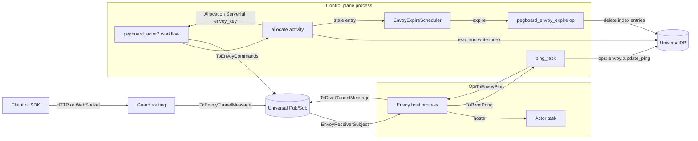
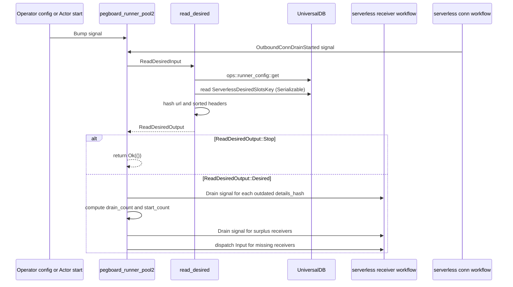
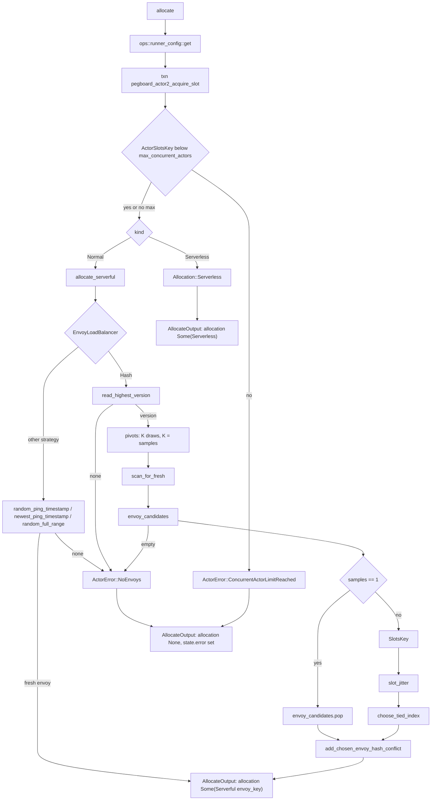
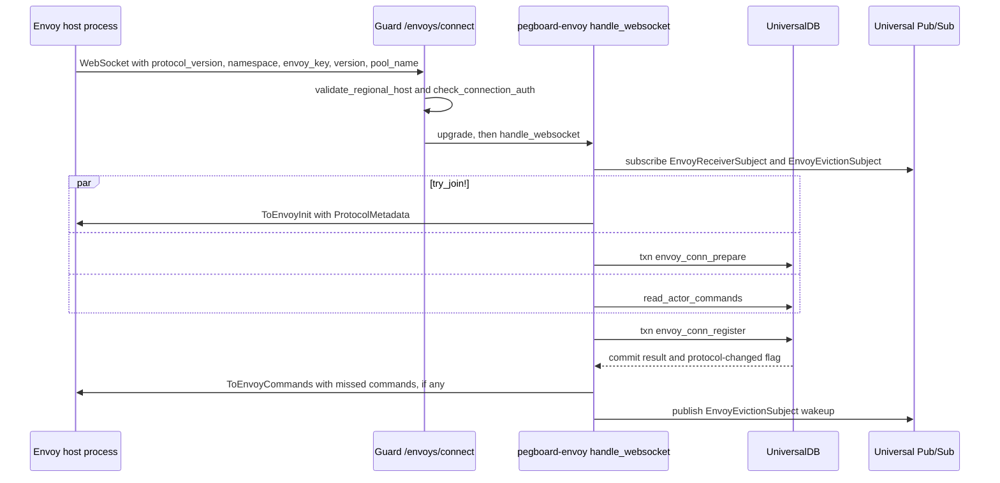
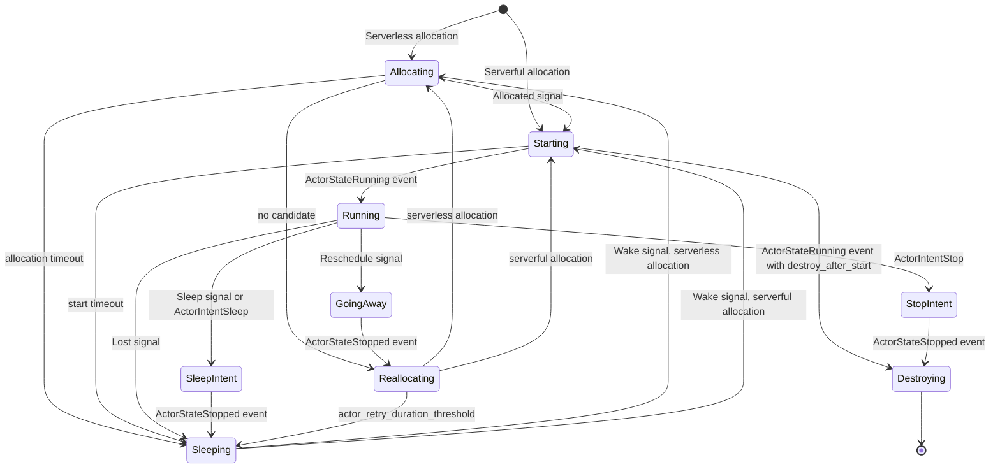
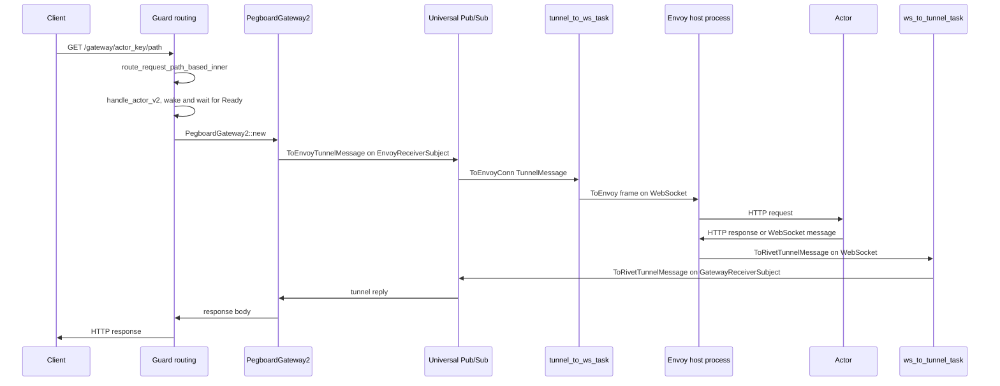

# 04 Pegboard scheduling, runner pools, and envoy

Pegboard decides which process hosts each Actor and carries every command and event between the control plane and that process. It keeps a durable index of runner capacity and envoy connections. It chooses a host inside one UniversalDB (UDB) transaction and speaks one binary protocol to the host over a WebSocket tunnel. A tunnel is an opaque byte stream that the protocol carries between a gateway and the envoy that hosts the Actor. This document follows the placement decision and the transport. It does not describe the Actor state machine, which is in [03 Actors and lifecycle](03-actors-and-lifecycle.md). It does not describe the per-Actor Structured Query Language (SQLite) path, which is in [06 Actor SQLite and Depot](06-actor-sqlite-and-depot.md). Four connection modes exist in this commit, and they use three wire transports. A `Normal` pool without a protocol version uses a runner WebSocket and runner protocol version 3. A `Normal` pool with a protocol version uses an envoy WebSocket and the envoy protocol version of at most 8 that the pool records. These two modes share the WebSocket transport. A `Serverless` pool with a protocol version uses one Hypertext Transfer Protocol (HTTP) request and a stream of Server-Sent Events (SSE). A `Serverless` pool without a protocol version uses one long-lived HTTP SSE connection. The `Serverless` metadata endpoint reports its runner protocol version. A reported value above 3 selects the `ToRunnerClose` message, and any other value selects `ToClientClose`. The pool record selects the mode. Where the modes differ, this document names the path.

## 1. The three questions Pegboard answers

Pegboard answers three questions for every Actor.

1. **Where does the Actor run?** The Actor record names its pool. The `allocate` activity reads that pool. For a `Normal` pool, which the allocation code calls `Serverful`, it picks a host inside it. For a `Serverless` pool it returns `Allocation::Serverless` and picks no host (section 4). The pool is fixed at Actor creation, when `actor/setup.rs` writes `RunnerNameSelectorKey` (`engine/packages/pegboard/src/workflows/actor/setup.rs:97-104`). Section 3.3 covers the backfill for Actors created before that key existed.
2. **How does a request reach the host?** Guard runs a gateway object. The gateway publishes a message to a Universal Pub/Sub (UPS) subject that the host reads. A `Serverless` pool that has a protocol version starts each Actor with an HTTP request instead (section 10).
3. **What happens when the host dies?** The host stops replying to pings. The control plane runs `ping_task`, which sends `ToEnvoyPing` every `envoy_update_ping_interval` and writes `LastPingTsKey` through `update_ping` (`engine/packages/pegboard-envoy/src/ping_task.rs:24-53`; `engine/packages/pegboard/src/ops/envoy/update_ping.rs:105-108`). The same task aborts the connection when the in-memory last pong is older than `envoy_ping_timeout` (`ping_task.rs:36-51`). An allocation scan that meets a stale entry sends the host to `EnvoyExpireScheduler`, which expires it and removes it from the placement index. When the envoy WebSocket closes, the control plane expires the envoy unless a newer connection already replaced it (`engine/packages/pegboard-envoy/src/lib.rs:326-350`). No periodic sweep exists in this commit; section 11.2 states the TODO.

Figure 1 shows the pieces and the two directions of traffic.



The diagram uses real names. `pegboard_actor2` is the Actor workflow. `allocate` is its placement activity. `ping_task` is the per-connection heartbeat task. `pegboard_envoy_expire` is the expiry operation. `EnvoyExpireScheduler` is the process-local queue. `EnvoyReceiverSubject` is the UPS topic that the envoy WebSocket task subscribes to. The operator node runs a host process built with the `rivet-envoy-client` Software Development Kit (SDK) (`engine/sdks/rust/envoy-client/src/lib.rs:1-42`). That process is not the `pegboard-envoy` crate: `pegboard-envoy` is the control-plane side of the connection, and Guard hosts it in process (section 12).

**Aha:** Pegboard puts the placement decision inside the same UDB transaction that reserves a slot. It does not call a separate scheduler service. The obvious alternative is a central placement service with its own state. That alternative adds a second network hop, a second failure domain, and a cache that can disagree with the capacity counter. The cost of the Pegboard choice is one extra read of the load-balancer index and one read conflict on the chosen envoy's hash entry. A concurrent ping, expiry, or registration of that envoy therefore forces the allocation to retry. Two allocations that pick the same envoy do not conflict on that entry alone. They conflict on the shared `ActorSlotsKey` add in the same transaction (`engine/packages/pegboard/src/workflows/actor2/runtime.rs:227-241`). Section 5 shows how the `slot_jitter` field spreads the choices without a second service.

## 2. The runner model: runner, pool, config, envoy, slot

Five terms carry the whole model. Table 1 states each one and where the source defines it.

| Term | Meaning in the source | Source |
|------|----------------------|--------|
| Runner | One host process that serves Actor commands. In the legacy path the process opens a WebSocket to `/runners/connect`. In the newer path the process is an envoy and opens a WebSocket to `/envoys/connect`. | `engine/packages/guard/src/routing/runner.rs:28-39`; `engine/packages/guard/src/routing/envoy.rs:36-39` |
| Runner pool | A named group of runners or envoys inside one namespace. The pool name is a string on the config. The Actor stores the pool name as `runner_name_selector`; the Actor workflow calls the same value `pool_name`. | `engine/packages/types/src/runner_configs.rs:68-115`; `engine/packages/guard/src/routing/pegboard_gateway/mod.rs:735-738` |
| Runner config | The output type of `ops::runner_config::get`. It wraps the stored `rivet_types::runner_configs::RunnerConfig` record and adds `protocol_version: Option<u16>`. The name `RunnerConfig` therefore means two different structs in this document; the text names the module when the difference matters. The stored record's `kind` is either `Normal` or `Serverless`. | `engine/packages/pegboard/src/ops/runner_config/get.rs:14-21`; `engine/packages/types/src/runner_configs.rs:68-115` |
| Envoy | A host process that speaks the envoy protocol. It registers a durable identity, a protocol version, and a slot counter. In this commit an envoy normally serves a `Normal` pool, and the code also accepts a `Serverless` pool (`Conn::is_serverless`). | `engine/packages/pegboard-envoy/src/conn.rs:31-62` |
| Slot | One unit of Actor capacity. The legacy path measures capacity in millislots of a `total_slots` value; one millislot is one thousandth of that capacity. The newer path counts a per-pool `ActorSlotsKey` against `max_concurrent_actors`. | `engine/packages/pegboard/src/keys/ns.rs` `RunnerAllocIdxKey`; `engine/packages/pegboard/src/workflows/actor2/runtime.rs:225-241` |

The two `RunnerConfigKind` variants are not two names for the same thing. A `Normal` pool runs host processes. A `Serverless` pool exposes an HTTP `url` that the control plane calls. The `protocol_version` field selects the Actor version: `None` creates a version 1 Actor and `Some` creates a version 2 Actor (`engine/packages/pegboard/src/ops/actor/create.rs:105-124`). The Actor version then selects the workflow family. Section 15 states the full rule.

```rust
// engine/packages/types/src/runner_configs.rs:84-99
	Serverless {
		url: String,
		headers: HashMap<String, String>,
		/// Seconds.
		request_lifespan: u32,
		max_concurrent_actors: u64,
		/// Seconds.
		drain_grace_period: u32,
		/// Deprecated.
		slots_per_runner: u32,
		/// Deprecated.
		min_runners: u32,
		/// Deprecated.
		max_runners: u32,
		/// Deprecated.
		runners_margin: u32,
```

The variant continues with `metadata_poll_interval`, `drain_on_version_upgrade`, `actor_eviction_delay`, `actor_eviction_period`, and `actor_eviction_rate` (`runner_configs.rs:100-113`).

The `Normal` variant at source lines 71-83 carries four fields: `drain_on_version_upgrade`, `actor_eviction_delay`, `actor_eviction_period`, and `actor_eviction_rate` (`runner_configs.rs:71-83`). Four `Serverless` fields are marked deprecated in the source: `slots_per_runner`, `min_runners`, `max_runners`, and `runners_margin`. The runner pool workflow still reads them, as section 3 shows.

The pool record also carries a protocol version.

```rust
// engine/packages/pegboard/src/ops/runner_config/get.rs:14-21
#[derive(Debug, Serialize, Deserialize)]
pub struct RunnerConfig {
	pub namespace_id: Id,
	pub name: String,
	pub config: rivet_types::runner_configs::RunnerConfig,
	/// Unset if the runner's metadata endpoint has never returned `envoyProtocolVersion`
	pub protocol_version: Option<u16>,
}
```

The comment states the rule. `protocol_version` is `None` until the pool's metadata endpoint reports `envoyProtocolVersion`. Two writers set the field. For a `Normal` pool, envoy registration writes it (`engine/packages/pegboard-envoy/src/conn.rs:498-511`). For a `Serverless` pool, `runner_pool_metadata_poller` calls `refresh_metadata`, which writes it (`engine/packages/pegboard/src/ops/runner_config/refresh_metadata.rs:44-65`). A `None` value marks a pool that speaks the legacy runner protocol. A `Some` value marks a pool that speaks a versioned envoy protocol. The same field selects the Actor workflow family. A version 1 Actor runs `pegboard::workflows::actor`; a version 2 Actor runs `pegboard::workflows::actor2` (`ops/actor/create.rs:105-124`). The field is cached for 5000 milliseconds (`get.rs:35`).

### 2.1 The slot counter

The newer path keeps one counter per namespace and pool. The code builds `ActorSlotsKey::new(namespace_id, pool_name.clone())`. If `max_concurrent_actors` is `Some`, the code reads the counter with a `Snapshot` read. Below the ceiling it adds `1i64` with `MutationType::Add` and returns `true`. At the ceiling it returns `false`. With no ceiling it adds `1i64` and returns `true` without a read (`runtime.rs:225-241`).

The add is the guard, not the read. Every start writes the same key, so two concurrent starts cannot both commit without one of them retrying. The retry re-runs the closure and reads the new value. The source does not comment on this race; the guarantee comes from the transaction model.

`max_concurrent_actors` is a `u64` field of the `Serverless` variant (`runner_configs.rs:89`). The allocation code extracts it as `Option<u64>`; the value is `Some` only for a `Serverless` pool and `None` for a `Normal` pool (`runtime.rs:201-207`). A `Normal` pool therefore increments the counter with no ceiling. The counter is an `i64` little-endian atomic value. A failed start releases the slot, and [03 Actors and lifecycle](03-actors-and-lifecycle.md) follows that path.

The counter protects the pool. It does not measure load for a `Normal` pool. The load signal for a `Normal` pool is `SlotsKey` on each envoy, which section 5 uses. The two names are different keys. `ActorSlotsKey` counts Actors in one pool and is written inside the allocation transaction. `SlotsKey` counts Actors on one envoy and is written later, in `set_connectable` (`runtime.rs:916-920`). Section 5.3 states how the allocator uses each one.

## 3. The runner pool workflow

`pegboard_runner_pool2` manages replica counts. It does not place an Actor. It keeps the number of legacy serverless connection workflows equal to a computed desired count. Those connections are `pegboard_serverless_conn2` workflows, not the `pegboard-outbound` service in section 10. A serverless receiver is a control-plane workflow, `pegboard_serverless_receiver2`, that dispatches one connection workflow (`engine/packages/pegboard/src/workflows/serverless/receiver.rs:23-57`). It is not a separate process.

The connection workflow is `pegboard_serverless_conn2` in `engine/packages/pegboard/src/workflows/serverless/conn.rs`. It runs the `OutboundReq` activity, and that activity dials `GET {url}/start` with a `reqwest_eventsource` client (`serverless/conn.rs:299-320`). The endpoint sends `ToServerlessServerInit` on the stream (`serverless/conn.rs:352-360`). The workflow stores `init.runner_protocol_version`. The value selects the close message family when the connection drains (`serverless/conn.rs:598-599`, `656-661`). The dial direction is control plane to endpoint. The endpoint never connects back.

```rust
// engine/packages/pegboard/src/workflows/runner_pool.rs:27-40
#[workflow]
pub async fn pegboard_runner_pool2(ctx: &mut WorkflowCtx, input: &Input) -> Result<()> {
	// Exit before starting sidecar workflows if there is no serverless runner config to manage.
	if matches!(
		ctx.v(4)
			.activity(ReadDesiredInput {
				namespace_id: input.namespace_id,
				runner_name: input.runner_name.clone(),
			})
			.await?,
		ReadDesiredOutput::Stop
	) {
		return Ok(());
	}
```

The workflow has three version gates. `ctx.v(4)` guards the first `ReadDesired` call, `ctx.v(2)` guards the dispatch of `runner_pool_error_tracker`, and `ctx.v(3)` guards the dispatch of `runner_pool_metadata_poller` (`runner_pool.rs:31-63`). The version gate is a Gasoline mechanism; [05 Gasoline durable execution](05-gasoline-durable-execution.md) explains it.

The workflow state is `LifecycleState { runners: Vec<RunnerState> }`. Each `RunnerState` holds `receiver_wf_id: Id` and `details_hash: u64` (`runner_pool.rs:16-25`). The first field is the workflow identifier that the dispatch returned.

`details_hash` is a hash of the serverless endpoint details. When the operator changes the `url` or the headers, the hash changes. The workflow then drains every runner that holds the old hash (`runner_pool.rs:92-105`).

### 3.1 The desired count

`read_desired` is the activity that computes the target. It has three branches.

```rust
// engine/packages/pegboard/src/workflows/runner_pool.rs:237-257
	let RunnerConfigKind::Serverless {
		url,
		headers,

		slots_per_runner,
		min_runners,
		max_runners,
		runners_margin,
		..
	} = runner_config.config.kind
	else {
		return Ok(ReadDesiredOutput::Stop);
	};

	// Envoys don't need this workflow
	if runner_config.protocol_version.is_some() {
		return Ok(ReadDesiredOutput::Desired {
			desired_count: 0,
			details_hash: 0,
		});
	}
```

1. No runner config exists, or the kind is `Normal`: the activity returns `Stop`. The workflow exits. A `Normal` pool needs no replica manager because its envoys connect on their own.
2. The kind is `Serverless` and `protocol_version` is `Some`: the activity returns a `Desired` value with count 0. The comment says "Envoys don't need this workflow". The serverless outbound path in section 10 serves this pool.
3. The kind is `Serverless` and `protocol_version` is `None`: the activity computes a count from the deprecated slot fields. The control plane then connects out to the endpoint, and the endpoint reports its runner protocol version (`serverless/conn.rs:352-360`).

The count formula is `max(runners_margin + ceil(slots / slots_per_runner), min_runners)`, then `min(max_runners, pool_desired_max_override)`. The first `slots` term is `adjusted_desired_slots`: the stored count, or 0 when the stored count is negative. The final term is the operator-set global cap `pool_desired_max_override`, an `Option<u32>` in the engine config that falls back to `u32::MAX` (`engine/packages/config/src/config/pegboard.rs:66-67`, `276-281`). The code calls `div_ceil` on `adjusted_desired_slots as u32` and `slots_per_runner.max(1)`, so it rounds up and never divides by zero. It then hashes `url` and the sorted headers with `DefaultHasher` to produce `details_hash` (`runner_pool.rs:271-290`).

`desired_slots` comes from one UDB read of `ServerlessDesiredSlotsKey` with `Serializable` isolation (`runner_pool.rs:217-231`). A serverless version 1 Actor allocation adds one to this key (`engine/packages/pegboard/src/workflows/actor/runtime.rs:304-313`). Two paths subtract one. `actor_clear_pending_alloc_tx` subtracts when the pending key still exists and the Actor got a serverless slot (`runtime.rs:1170-1192`). `engine/packages/pegboard/src/workflows/actor/destroy.rs` subtracts when an Actor is destroyed while pending (`destroy.rs:295-306`). The comment at `runtime.rs:1173-1175` gives the reason for the first check: a missing pending key means the Actor was already allocated or destroyed. A negative stored value is an error, and the workflow logs it and scales to 0 (`runner_pool.rs:259-269`).

### 3.2 The reconcile loop

After `ReadDesired`, the loop partitions the runner list by `details_hash` and computes the two counts. The partition happens first, and each runner with an old hash receives a `Drain` signal (`runner_pool.rs:92-105`). The excerpt below starts after that partition.

```rust
// engine/packages/pegboard/src/workflows/runner_pool.rs:107-124
				// These will never both be non-zero
				let drain_count = state.runners.len().saturating_sub(desired_count);
				let start_count = desired_count.saturating_sub(state.runners.len());

				// Drain unnecessary runners
				if drain_count != 0 {
					// TODO: Implement smart logic of draining runners with the lowest allocated actors
					let remaining_runners = state.runners.split_off(drain_count);
					let draining_runners = std::mem::replace(&mut state.runners, remaining_runners);

					// TODO: Spawn sub wf to process these so this is not blocking the loop
					for runner in draining_runners {
						ctx.signal(serverless::receiver::Drain {})
							.to_workflow_id(runner.receiver_wf_id)
							.send()
							.await?;
					}
				}
```

`split_off(drain_count)` keeps the first `drain_count` entries in `state.runners` and returns the tail. `std::mem::replace` then puts the tail back and returns the first entries as the draining set. The drained entries are therefore the oldest entries in insertion order.

The `else` branch dispatches new `serverless::receiver::Input` workflows and pushes one `RunnerState` for each (`runner_pool.rs:126-145`). The source has three TODO comments in this region. Two say that draining blocks the loop. One says that the drain does not prefer runners with low load. This document repeats the limits because the source states them.

The loop then waits for a signal (`runner_pool.rs:147-176`). `Bump {endpoint_config_changed}` wakes the loop when the operator changes the config (`runner_pool.rs:298-303`). `OutboundConnDrainStarted {receiver_wf_id}` records a receiver that started to drain (`runner_pool.rs:305-308`). A pool stop drains all runners and breaks the loop (`runner_pool.rs:80-90`).

Figure 2 shows one reconcile pass.



Every participant is a real workflow, activity, or key. `ReadDesiredInput` and `ReadDesiredOutput` are the activity input and output types. `serverless::receiver::Drain` and `serverless::receiver::Input` are the two messages.

The loop has no timer. `ctx.lupe()` repeats only after `ctx.listen_n::<Main>(256)` returns, and that call waits for at least one signal (`runner_pool.rs:65-68`, `147-176`; `gasoline/src/ctx/workflow.rs:717-720`). `Main` is the signal enum; its members include `Bump` and `OutboundConnDrainStarted` (`runner_pool.rs:310-313`). A pool therefore reconciles when a `Bump` or `OutboundConnDrainStarted` signal arrives. A version 1 Actor allocation and a config change both send `Bump` (`workflows/actor/runtime.rs:916`; `ops/runner_config/upsert.rs:255`). The `serverless_conn` workflow sends `OutboundConnDrainStarted` (`serverless/conn.rs:104`, `474`).

### 3.3 The two backfill workflows

`pegboard_runner_pool2_backfill` scans serverless runner configs and dispatches one pool workflow for each unique pool (`engine/packages/pegboard/src/workflows/runner_pool2_backfill.rs:20-77`). Its constants are `BACKFILL_NAME = "runner_pool2_backfill"` (line 14), `MAX_ENTRIES = 50` (line 15), and `EARLY_TXN_TIMEOUT = 2500 ms` (line 13). The limit of 50 entries bounds one transaction.

`pegboard_actor_runner_name_selector_backfill` writes the `RunnerNameSelectorKey` for Actors created before the key existed (`engine/packages/pegboard/src/workflows/actor_runner_name_selector_backfill.rs:1-2`). Its constants are `BACKFILL_NAME = "actor_runner_name_selector"` (line 14), `EARLY_TXN_TIMEOUT = 2500 ms` (line 17), and `BATCH_SIZE = 256` (line 19). The workflow pages by `after_actor_id`, the last Actor identifier in the previous batch, and stops when a batch returns no last identifier (`lines 30-71`). It then writes `backfill::CompleteKey` (`lines 86-106`).

The selector key matters for placement. A `Normal` pool is addressed by pool name. `ops::actor::get_for_gateway` reads `RunnerNameSelectorKey` to fill `actor.runner_name_selector` (`engine/packages/pegboard/src/ops/actor/get_for_gateway.rs:41`). The gateway uses that field for its pool error check (section 13.4). The backfill exists because an Actor created before the key was added has no stored value.

The bootstrap task starts both workflows. It dispatches a workflow only when `backfill::CompleteKey` is absent, and `.unique()` prevents a duplicate dispatch (`engine/packages/bootstrap/src/backfill.rs:4-16`, `53-64`, `106-121`). Each workflow writes its `CompleteKey` when it finishes (`runner_pool2_backfill.rs:71-74`; `actor_runner_name_selector_backfill.rs:86-106`). Each workflow therefore runs once for each database.

## 4. How the control plane places an Actor

Placement is one activity in the `pegboard_actor2` workflow. That workflow runs for a version 2 Actor, which is every Actor in a pool whose `protocol_version` is `Some`. `AllocateInput` carries one field, `generation`, with `#[serde(default)]` so Gasoline can replay older state (`runtime.rs:164-169`). A generation is an allocation counter. Each successful allocation adds one (`runtime.rs:489-497`). A message or signal that carries an older generation is ignored (`engine/packages/pegboard/src/workflows/actor2/mod.rs:643-646`), so a late message cannot act on the next placement.

```rust
// engine/packages/pegboard/src/workflows/actor2/runtime.rs:184-207
#[activity(Allocate)]
pub async fn allocate(ctx: &ActivityCtx, input: &AllocateInput) -> Result<AllocateOutput> {
	let start = Instant::now();
	let mut state = ctx.state::<State>()?;

	// NOTE: Assuming cache is populated, this is faster than reading the runner config in the fdb txn below
	let pool_res = ctx
		.op(crate::ops::runner_config::get::Input {
			runners: vec![(state.namespace_id, state.pool_name.clone())],
			bypass_cache: false,
		})
		.await?;
	let pool = pool_res.into_iter().next();
	let is_serverless = pool
		.as_ref()
		.map(|pool| matches!(pool.config.kind, RunnerConfigKind::Serverless { .. }))
		.unwrap_or(false);
	let max_concurrent_actors = pool.as_ref().and_then(|pool| match &pool.config.kind {
		RunnerConfigKind::Serverless {
			max_concurrent_actors,
			..
		} => Some(*max_concurrent_actors),
		_ => None,
	});
```

The comment in the excerpt says "fdb txn". FoundationDB (FDB) is the transaction model that UniversalDB follows. The activity opens the transaction with `ctx.udb()?` (`runtime.rs:217-219`). The `Transaction` type is the UniversalDB re-export (`engine/packages/universaldb/src/lib.rs:24`).

The activity reads the pool config from the process cache first. The comment states the reason: the cache is faster than a read inside the UDB transaction. A cache miss falls through to the store. The cache time to live is 5000 milliseconds (`ops/runner_config/get.rs:35`), so a config change can lag by up to that value.

`state` is the workflow `State` at `actor2/mod.rs:36-67`. It holds five identity fields: `actor_id`, `name`, `pool_name`, `key`, and `namespace_id`. It also holds the slot flag `acquired_slot`, the last command index `envoy_last_command_idx`, and a cached `envoy_key`. Eight timestamps follow: `create_ts`, `create_complete_ts`, `allocate_ts`, `start_ts`, `sleep_ts`, `connectable_ts`, `reschedule_ts`, and `destroy_ts`. It ends with `error: Option<ActorError>`. The comment states when `error` clears: on allocation and when the Actor becomes connectable.

`envoy_eligible_threshold` comes from `ctx.config().pegboard().envoy_eligible_threshold()` (`runtime.rs:212`). `pools` is a clone of `ctx.pools()`. Its type is `PoolsHandle`, an alias for `Pools`, a cloneable `Arc` over the configuration, the node identifier, the UDB client, the UPS client, and the ClickHouse client (`engine/packages/pools/src/pools.rs:10-20`; `engine/packages/pools/src/lib.rs:14`).

The output is one of two shapes.

```rust
// engine/packages/pegboard/src/workflows/actor2/runtime.rs:171-182
#[derive(Debug, Serialize, Deserialize)]
#[serde(rename_all = "snake_case")]
pub enum Allocation {
	Serverless,
	Serverful { envoy_key: String },
}

#[derive(Debug, Serialize, Deserialize)]
pub struct AllocateOutput {
	pub allocation: Option<Allocation>,
	pub now: i64,
}
```

`Allocation::Serverless` means the outbound path carries the Actor start. `Allocation::Serverful { envoy_key }` names the chosen envoy. `allocation: None` means the activity failed to place the Actor, and `state.error` holds the reason.

### 4.1 The placement transaction

The activity opens one transaction named `pegboard_actor2_acquire_slot`. It reserves the slot first, then places the Actor.

```rust
// engine/packages/pegboard/src/workflows/actor2/runtime.rs:243-256
				let (allocation, error) = if acquired_slot {
					if is_serverless {
						(Some(Allocation::Serverless), None)
					} else {
						let allocation = super::alloc_serverful::allocate_serverful(
							namespace_id,
							&pool_name,
							&tx,
							&pools,
							now,
							envoy_eligible_threshold,
							&envoy_load_balancer,
						)
						.await?;
```

```rust
// engine/packages/pegboard/src/workflows/actor2/runtime.rs:280-297
						let error = allocation.is_none().then_some(super::ActorError::NoEnvoys);

						(
							allocation.map(|envoy_key| Allocation::Serverful { envoy_key }),
							error,
						)
					}
				} else {
					(None, Some(super::ActorError::ConcurrentActorLimitReached))
				};

				if allocation.is_some() {
					// Set not sleeping
					tx.delete(&keys::actor::SleepTsKey::new(actor_id));
					tx.write(&keys::actor::GenerationKey::new(actor_id), input.generation)?;
				}

				Ok((acquired_slot, allocation, error))
```

The two excerpts omit the debug dump between them. That dump runs only when `RIVET_DEBUG_PEGBOARD_ALLOCATOR` is set (`runtime.rs:333-340`), and it reads with `Snapshot` so it adds no conflict range (`runtime.rs:351-354`).

Three error cases exist in this block and its neighbours.

1. The slot counter is at `max_concurrent_actors`, so `acquired_slot` is false. The error is `ActorError::ConcurrentActorLimitReached`.
2. No fresh envoy exists in the pool. An envoy is fresh when `last_ping_ts >= now - envoy_eligible_threshold` (`engine/packages/pegboard/src/workflows/actor2/alloc_serverful/hash.rs:129`; section 11). The error is `ActorError::NoEnvoys`.
3. The transaction itself fails. The `?` propagates the error, and Gasoline retries the activity.

On success the transaction deletes the `SleepTsKey` and writes the new `GenerationKey`. Both writes commit in the same transaction as the `ActorSlotsKey` add, so two allocations in the same pool conflict on that counter (`runtime.rs:227-241`). The Hash allocator also adds a read conflict on the chosen envoy's hash entry, so a concurrent ping, expiry, or registration of that envoy forces a retry (`hash.rs:558-575`). Two allocations that choose the same envoy do not conflict on that read alone. A conflict key is a key that the transaction reads or writes so that a second transaction on the same key must retry. The activity records a metric with two labels: `serverless` or `serverful`, and `allocated` or `not_allocated` (`runtime.rs:315-328`).

## 5. The Hash allocator: ring membership, power-of-K, and slot jitter

`allocate_serverful` is the dispatch point. It takes seven parameters: `namespace_id: Id`, `pool_name: &str`, `tx: &universaldb::Transaction`, `pools: &rivet_pools::PoolsHandle`, `now: i64`, `envoy_eligible_threshold: i64`, and `envoy_load_balancer: &EnvoyLoadBalancer`. It returns `Result<Option<String>>` (`alloc_serverful/mod.rs:13-21`).

```rust
// engine/packages/pegboard/src/workflows/actor2/alloc_serverful/mod.rs:13-27
pub(super) async fn allocate_serverful(
	namespace_id: Id,
	pool_name: &str,
	tx: &universaldb::Transaction,
	pools: &rivet_pools::PoolsHandle,
	now: i64,
	envoy_eligible_threshold: i64,
	envoy_load_balancer: &EnvoyLoadBalancer,
) -> Result<Option<String>> {
	let start = Instant::now();
	let mut stats = AllocStats::default();
	// `emits_scan_stats` is false for strategies that do not walk the index
	// (newest_ping_timestamp short-reads the head, so scan_depth/wrap_count
	// would always be 0). The cheap stable labels (alloc/no_envoy/duration)
	// still fire for every strategy.
```

The function matches on `envoy_load_balancer` into a `(strategy, emits_scan_stats, allocation)` tuple (`mod.rs:28-43`). The `strategy` label feeds the allocation metrics. `emits_scan_stats` is false for strategies that read one entry instead of walking the index.

Four strategies exist. Table 2 lists them with the rule that each one follows.

| Strategy | Rule | Source |
|----------|------|--------|
| `RandomPingTimestamp` | Read the oldest fresh ping entry, pick a random timestamp between that entry and now, seek to it, skip stale entries | `engine/packages/pegboard/src/workflows/actor2/alloc_serverful/random_ping_timestamp.rs` |
| `NewestPingTimestamp` | Read the newest ping entry in reverse order and return it if it is fresh | `engine/packages/pegboard/src/workflows/actor2/alloc_serverful/newest_ping_timestamp.rs` |
| `RandomFullRange` | Read the full range at the highest version, collect fresh entries, and remove one at random | `engine/packages/pegboard/src/workflows/actor2/alloc_serverful/random_full_range.rs` |
| `Hash` | Power-of-K choices over a virtual-node ring, then minimum slot count with jitter | `engine/packages/pegboard/src/workflows/actor2/alloc_serverful/hash.rs` |

All four read `EnvoyLoadBalancerIdxKey`. That key orders entries by pool version (highest first), then by `last_ping_ts` (oldest first), then by envoy key (`keys/ns.rs:1579-1596`). Only the `Hash` strategy reads `SlotsKey`. The `version` in the key is the pool index version that each connection sends in its handshake query (section 8.1). The `Hash` strategy reads only the first entry of `EnvoyLoadBalancerIdxKey`, to learn the highest version (`hash.rs:531-556`). It then scans `EnvoyHashIdxKey` at that version (`hash.rs:157-183`).

The default is `Hash`, not `RandomPingTimestamp`.

```rust
// engine/packages/config/src/config/pegboard.rs:511-524
impl Default for EnvoyLoadBalancer {
	fn default() -> Self {
		// EnvoyLoadBalancer::RandomPingTimestamp {
		// 	use_snapshot_read: true,
		// }
		EnvoyLoadBalancer::Hash {
			virtual_nodes: 8,
			samples: 2,
			max_scan: 16,
			slot_jitter: 4,
			use_snapshot_read: true,
		}
	}
}
```

The source has a stale comment above the enum. The comment calls `RandomPingTimestamp` the "Current default" (`pegboard.rs:457`). The `Default` implementation disagrees, and it is the code that runs. This document follows the code. The four field defaults are `virtual_nodes = 8` (line 530), `samples = 2` (line 534), `max_scan = 16` (line 538), and `slot_jitter = 4` (line 542).

### 5.1 The ring

Each envoy in a pool that uses the `Hash` strategy writes `virtual_nodes` positions into the UDB key space when it registers. A pool that uses a legacy strategy writes none, and the next paragraph states that test.

Registration writes `VirtualNodesKey` with the count. It then writes one `EnvoyHashIdxKey` for each index from 0 to `virtual_nodes - 1` (`conn.rs:479-496`, shown in section 8.2). The position is a 128-bit `xxh3` hash of the envoy key with the virtual node index as the seed. The value is empty. The key is the record.

```rust
// engine/packages/pegboard/src/keys/ns.rs:1699-1705
pub struct EnvoyHashIdxKey {
	pub namespace_id: Id,
	pub pool_name: String,
	pub version: u32,
	pub hash_pos: [u8; 16],
	pub envoy_key: String,
}
```

The first two tuple components are the subspace prefix `NAMESPACE` and the key tag `ENVOY_HASH_IDX`; the struct fields follow (`keys/ns.rs:1747-1756`). The field order is `namespace_id`, `pool_name`, reverse `version`, `hash_pos`, then `envoy_key`. "Reverse version" means the code stores `(version as i32).wrapping_neg()`, so version 4 sorts before version 3 (`keys/ns.rs:11-13`). The `hash_pos` bytes are a fixed 16-byte string, so tuple order is byte order. A range read that starts at a pivot lands on the first position at or after that pivot. That is the only property the allocator uses. It does not compute a consistent-hash owner, and it does not use the position as a target. Section 5.3 states the exact rule.

`virtual_nodes` is written only when the configured strategy is `Hash` (`conn.rs:141-145`). A pool that uses a legacy strategy writes no hash entries.

### 5.2 The allocator signature and the shared scan budget

```rust
// engine/packages/pegboard/src/workflows/actor2/alloc_serverful/hash.rs:112-147
pub(super) async fn allocate_with_rng(
	namespace_id: Id,
	pool_name: &str,
	tx: &universaldb::Transaction,
	pools: &rivet_pools::PoolsHandle,
	stats: &mut AllocStats,
	now: i64,
	envoy_eligible_threshold: i64,
	samples: u8,
	max_scan: u32,
	slot_jitter: u8,
	use_snapshot_read: bool,
	rng: &mut impl HashAllocatorRng,
	mut read_stats: Option<&mut HashAllocatorReadStats>,
) -> Result<Option<String>> {
	debug_assert!(samples >= 1, "samples must be >= 1");

	let ping_threshold_ts = now - envoy_eligible_threshold;
	let read_isolation = read_isolation(use_snapshot_read);
	let Some(highest_version) =
		read_highest_version(namespace_id, pool_name, tx, read_isolation).await?
	else {
		return Ok(None);
	};

	// One shared stale-entry budget covers every scan_for_fresh call in this
	// allocation: forward + wrap across all K samples. Per-direction or
	// per-sample budgets let pathological pools burn K * 2 * max_scan
	// LastPingTs reads against the same stale entries. AtomicU32 because all
	// K scans run concurrently and decrement the same counter.
	let remaining_scan = AtomicU32::new(max_scan);

	// Pre-draw all K pivots from the RNG before spawning the parallel scans.
	// next_pivot() takes &mut self, and the futures must not retain a mut
	// borrow on the rng across .await points.
	let pivots: Vec<[u8; 16]> = (0..samples).map(|_| rng.next_pivot()).collect();
```

`samples` is K. `max_scan` is the shared budget for stale entries. The budget is one counter for all K scans and both directions. The comment states the reason: a per-sample budget would let a pool with many stale entries read `K * 2 * max_scan` times.

`read_isolation` returns `Snapshot` or `Serializable` (`alloc_serverful/mod.rs:164-170`). The default config sets `use_snapshot_read: true`, so the default is `Snapshot`. A `Snapshot` read does not conflict with the ping writers. The allocator adds one explicit read conflict on the winner instead.

`HashAllocatorRng` has three methods: `next_pivot(&mut self) -> [u8; 16]`, `choose_tied_index(&mut self, len: usize) -> usize`, and `next_slot_jitter(&mut self, max: u8) -> u8` (`hash.rs:313-321`). `ThreadHashAllocatorRng` uses thread-local randomness, and `SeededHashAllocatorRng` takes a seed for tests (`hash.rs:323-377`). `choose_tied_index` is the tiebreak when two candidates have the same jittered value (`hash.rs:286-304`).

### 5.3 The exact selection rule

The rule has six steps.

1. Read the highest version of the pool index.
2. Draw K random 128-bit pivots.
3. For each pivot, scan forward from the pivot to the end of the index subspace for that pool version. If the forward scan finds none and budget remains, scan backward from the pivot to the start (`hash.rs:149-186`). The subspace is built from `(namespace_id, pool_name, version)`, so the scan cannot reach an envoy of another version (`hash.rs:429-454`).
4. Merge the K candidates and remove duplicates.
5. If K is 1, return the single candidate.
6. If K is at least 2, read `SlotsKey` for each candidate with `read_isolation`, add a random jitter, and return the minimum (`hash.rs:241-248`).

A hash index entry has no value; the key carries the envoy identifier. `scan_for_fresh` therefore reads `LastPingTsKey` for each entry and accepts the first entry whose timestamp is at or above `ping_threshold_ts` (`hash.rs:467-481`). An entry below the threshold is stale, and the scan enqueues it for expiry.

Every stale entry met during a scan consumes one unit of the shared budget. When the budget is gone, `scan_for_fresh` logs a warning, increments `ENVOY_LB_SCAN_CIRCUIT_BREAKER_TOTAL`, and returns without a candidate (`hash.rs:512-525`). Other pivots can still return candidates. If every pivot returns none, the candidate list is empty and the allocator returns `Ok(None)`. That value becomes `ActorError::NoEnvoys` in the Actor workflow (section 4.1).

Step 5 pops the single candidate, adds the hash conflict when `use_snapshot_read` is set, and returns `Ok(Some(envoy_key))`. If the candidate list is empty it returns `Ok(None)` (`hash.rs:221-235`). When `use_snapshot_read` is false, the index and slot reads use `Serializable`, so the transaction already conflicts with the writers and the explicit conflict is not needed (`hash.rs:306-308`).

When K is 1, the allocator skips the `SlotsKey` read and returns its only candidate. When K is at least 2, several pivots can land on the same envoy and the deduplicated list removes the repeats before the slot comparison. The candidate is drawn from fresh ring positions, not from envoys. An envoy with more positions would have a higher chance, but every envoy writes the same `virtual_nodes` value, so the positions are equal.

Step 6 is the load-aware branch.

```rust
// engine/packages/pegboard/src/workflows/actor2/alloc_serverful/hash.rs:276-290
	let jittered: Vec<(String, i64, i64)> = candidates
		.into_iter()
		.map(|(envoy_key, slots)| {
			let jitter = rng.next_slot_jitter(slot_jitter) as i64;
			let effective = slots.saturating_add(jitter);
			(envoy_key, slots, effective)
		})
		.collect();

	let effective_min = jittered.iter().map(|(_, _, e)| *e).min().unwrap();
	let tied = jittered
		.iter()
		.filter(|(_, _, e)| *e == effective_min)
		.map(|(k, s, _)| (k.clone(), *s))
		.collect::<Vec<_>>();
```

When more than one candidate ties, the code increments `ENVOY_LB_TIED_MIN_TOTAL`. It then draws `tied_index` from `choose_tied_index(tied_count)`, takes that element with `nth`, and adds the conflict key (`hash.rs:292-308`).

Three properties follow.

1. The comparison is `slots + jitter`, not `slots`. A lightly loaded envoy can lose to a heavily loaded one. That is intended. The jitter breaks the case where a new envoy has the same slot count as an old one.
2. The tie is broken at random. The source requires this. The internal design document says a deterministic tiebreak would send a burst of cold-pool allocations to one envoy (`docs-internal/engine/envoy-load-balancing.md`).
3. The allocator adds a read conflict on the winner's first virtual-node entry, computed with `xxh3_128_with_seed(envoy_key, 0)` (`hash.rs:558-575`). Seed 0 is a fixed position that every registration of the envoy writes. The conflict key is therefore the same for every allocation that chooses that envoy. It is not the pivot that selected the envoy. A read conflict is a `ConflictRangeType::Read` record. The transaction names the key without reading its value, and a concurrent write to that key forces a retry. Separately, every allocation in the pool writes the same `ActorSlotsKey` with `MutationType::Add` (section 2.1). Two allocations in one pool therefore conflict on that counter whether or not they pick the same envoy. The `SlotsKey` on the envoy is not written here.

The choice is neither consistent hashing nor least-loaded placement. It is power-of-K choices over a ring, with additive jitter before the minimum. The ring gives a cheap uniform candidate source. Power-of-K gives an approximate least-loaded result with K reads. The jitter trades a small placement error for less contention.

### 5.4 Why the jitter exists

```rust
// engine/packages/pegboard/src/workflows/actor2/alloc_serverful/hash.rs:68-86
// Why `slot_jitter` exists and how the default was sized.
//
// The hash allocator reads `SlotsKey` snapshot-isolated and picks the
// minimum-slot envoy. `SlotsKey` is not incremented inside the allocator
// transaction; it is bumped later in `set_connectable`. So during a burst,
// many in-flight allocator transactions all observe the same `SlotsKey`
// value for any given envoy, and all decide the same low-slot envoy is
// the minimum. That envoy then gets a thundering herd of new actors all
// at once, even though the load balancer believed it was picking the
// least-loaded one.
//
// Concretely, the number of allocators racing on the same stale snapshot
// of `SlotsKey` for one (namespace, pool) is approximately
//
//   in_flight = allocation_rate * allocator_tx_duration
//
// where allocation_rate is allocations per second into that pool and
// allocator_tx_duration is the time from FDB transaction open to commit.
// Without jitter, all `in_flight` allocators land on the same envoy.
```

`slot_gap` is the difference between the slot counts of the K candidates. The comment continues at lines 88-111. Jitter dominates the comparison when `slot_jitter >= slot_gap`, so candidates inside that range are sampled roughly uniformly. The default is 4. The comment sizes it against three load cases, using `in_flight = allocation_rate * allocator_tx_duration`. About 10 allocations per second with a 5 millisecond transaction gives `in_flight = 0.05`. About 100 per second with a 5 millisecond transaction gives `0.5`. About 1000 per second with a 10 millisecond transaction gives `10`. The accepted range is 0 to 64 (`hash.rs:111`). The comment states that a load above the heavy burst case needs in-transaction slot reservation, not a larger jitter.

### 5.5 The freshness scan

For one pivot, `scan_for_fresh` runs a forward pass from the pivot to the end of the index. It runs a backward pass from the pivot to the start only when the forward pass finds no fresh entry and the shared budget remains (`hash.rs:149-186`). Each stale entry is passed to `EnvoyExpireScheduler::try_enqueue` for background expiry, and the shared budget decreases (`hash.rs:483-491`).

An invariant protects the scan. The allocator never observes an envoy whose `ExpiredTsKey` is set. The expire operation deletes the virtual hash entries in the same transaction that writes `ExpiredTsKey` (`hash.rs:379-402`; `ops/envoy/expire.rs:139-180`). A concurrent snapshot read therefore sees one of two states only: the hash entries are present and `ExpiredTsKey` is absent, or the hash entries are absent and `ExpiredTsKey` is present.

### 5.6 Allocation flowchart



The labels are real functions, variables, keys, errors, and enum variants. `txn pegboard_actor2_acquire_slot` is the transaction name. `read_highest_version`, `scan_for_fresh`, `next_pivot`, `choose_tied_index`, `add_chosen_envoy_hash_conflict`, and `allocate_serverful` are function or method names. `random_ping_timestamp`, `newest_ping_timestamp`, and `random_full_range` are the other strategy modules under `alloc_serverful/`. `envoy_candidates` and `slot_jitter` are variables. `ActorError::ConcurrentActorLimitReached`, `ActorError::NoEnvoys`, `Allocation::Serverless`, and `Allocation::Serverful` are error and allocation variants. The `AllocateOutput` is built in `allocate`, not in `allocate_serverful`; `allocate_serverful` returns `Option<String>` (section 5). The three non-`Hash` strategies do not call `add_chosen_envoy_hash_conflict`. Only the `Hash` path adds that read conflict (`hash.rs:224`, `307`).

### 5.7 A worked example

Take a `Normal` pool named `default` in one namespace. Two envoys are fresh. Envoy `E1` has `SlotsKey = 5`. Envoy `E2` has `SlotsKey = 2`. The pool index version is 3, the `version` query parameter that both envoys sent at registration. The allocator reads only the highest version, so both envoys must report the same value. An envoy that registered with a lower version is invisible to the allocator until it registers again at the highest version. The example uses 3; the value does not affect the mechanism. Each envoy has 8 positions, so the index holds 16 positions.

The allocator draws `K = 2` pivots from `ThreadHashAllocatorRng`. Suppose pivot A lands before a position of `E1` and pivot B lands before a position of `E2`. The candidate list is `[E1, E2]`. The allocator reads both slot counts in parallel.

The jitter draws are 3 for `E1` and 0 for `E2`. The effective values are 8 and 2. The minimum is `E2`, so the allocator returns `E2`.

Now suppose both envoys have `SlotsKey = 2`, and the jitter draws are 1 and 2. The effective values are 3 and 4. The minimum is `E1`. A third allocation in the same tick reads the same stale counts. The new jitter draws are 4 and 0, so the minimum is `E2`. The herd splits.

The exact random values depend on the random number generator. The mechanism does not. The source exposes `SeededHashAllocatorRng` for tests (`hash.rs:343-377`), and `allocate_hash_for_tests` wraps it (`alloc_serverful/mod.rs:127-162`). The test path proves the rule is reproducible.

## 6. The legacy placement path: runner slot scanning

The legacy path does not use the ring. A runner registers a `total_slots` value. The runner workflow fills Actors from a pending queue. The pending entry is `PendingActorByRunnerNameSelectorKey`, with fields `namespace_id: Id`, `runner_name_selector: String`, `ts: i64`, and `actor_id: Id`; the value is the Actor generation (`keys/ns.rs:159-175`).

`CrashPolicy` has three values: `Restart`, `Sleep`, and the default `Destroy` (`engine/packages/types/src/actors.rs:42-47`). The allocation activity writes the pending entry unless the policy is `Sleep`, `force_allocate` is false, and the pool is not `Serverless` (`workflows/actor/runtime.rs:447-476`). A `Sleep` policy with `force_allocate` true still writes the entry.

The legacy workflow hands the Actor to `pegboard_actor2` on the next start after the pool gains a protocol version. The field is written by `refresh_metadata` or by envoy registration (section 2.1). The activity `allocate_actor_v2` reads the cached pool and returns `AllocateActorOutputV2 { status, serverless }` (`workflows/actor/runtime.rs:191-194`, `255-273`). When the pool has a protocol version, `status` is `AllocateActorStatus::MigrateToV2` (line 233). The legacy workflow then dispatches `workflows::actor2::Input` with `from_v1: true` (`engine/packages/pegboard/src/workflows/actor/mod.rs:220-239`). The source does not show a proactive migration of a running Actor. The migration paths run at the next spawn or after the Actor stops (`actor/mod.rs:680-685`, `864-876`). This is a different type from `AllocateOutput` in section 4: the legacy activity has its own status enum, and it never produces the `Allocation` enum. The `serverless` field reports the pool kind. It is true when the config kind is `Serverless` (`workflows/actor/runtime.rs:262-265`, `432-441`).

```rust
// engine/packages/pegboard/src/workflows/runner.rs:1007-1018
			'queue_loop: loop {
				if start.elapsed() > EARLY_TXN_TIMEOUT {
					tracing::warn!("timed out processing pending actors queue");
					break;
				}

				let Some(queue_entry) = queue_stream.try_next().await? else {
					break;
				};

				let (queue_key, generation) =
					tx.read_entry::<keys::ns::PendingActorByRunnerNameSelectorKey>(&queue_entry)?;
```

The pending queue is ordered by `ts` and then by Actor identifier (`keys/ns.rs:202-217`). The rule is: take pending Actors in that order, scan runners in index order, and pair each Actor with the first eligible runner. The runner scan stores the version of its first entry in `highest_version` (`runner.rs:1034-1057`). Three checks control the scan. First, the scan stops when the index version drops below `highest_version`. Second, the scan stops when the runner entry's `remaining_millislots` reaches 0. The entries are ordered by descending remaining slots, so a zero means every later runner in that version is also full. Third, a runner whose `last_ping_ts` is older than `now - runner_eligible_threshold` is skipped and the scan continues (`runner.rs:1042-1067`).

A pair writes six changes in one transaction. It deletes the runner index entry and the pending entry. It writes the runner index again with one fewer slot (`runner.rs:1070-1098`). It writes `RemainingSlotsKey`, `RunnerIdKey`, and `runner::ActorKey` (`runner.rs:1100-1119`). It then returns an `Allocate` signal for that Actor (`runner.rs:1121-1130`).

The scan walks an order that is already best-first and takes the first eligible entry. `RunnerAllocIdxKey` packs the highest version first, then the largest `remaining_millislots`, then the oldest `last_ping_ts`, then `runner_id` (`keys/ns.rs:73-92`). The first fresh entry is therefore the emptiest fresh runner in the highest version. This document therefore calls the scan best-fit: it takes the first entry of an order that is already best-first, and it does not sort again.

The scan stops after 2500 milliseconds to avoid a transaction timeout. The constant is `EARLY_TXN_TIMEOUT` (`runner.rs:19`). The loop breaks or jumps to the queue loop with a warning (`runner.rs:1007-1011`, `1036-1040`).

The loop opens a `get_ranges_keyvalues` stream over the `RunnerAllocIdxKey` subspace with `StreamingMode::Iterator` and `Snapshot` isolation (`runner.rs:1020-1032`). The comment states the reason: the scan must not conflict with every key, only the one it chooses. The chosen runner gets an explicit read conflict.

### 6.1 Legacy runner registration

The legacy runner workflow handles the first message from the runner.

```rust
// engine/packages/pegboard/src/workflows/runner.rs:82-98
				Some(Main::Forward(sig)) => {
					match sig.inner {
						protocol::ToServer::ToServerInit(protocol::ToServerInit {
							last_command_idx,
							prepopulate_actor_names,
							metadata,
							..
						}) => {
							let init_data = ctx
								.activity(ProcessInitInput {
									runner_id: input.runner_id,
									namespace_id: input.namespace_id,
									last_command_idx: last_command_idx.unwrap_or(-1),
									prepopulate_actor_names,
									metadata,
								})
								.await?;
```

`ProcessInitInput` carries `runner_id`, `namespace_id`, `last_command_idx`, `prepopulate_actor_names`, and `metadata` (`runner.rs:732-738`). `ProcessInitOutput` carries `last_event_idx` and `missed_commands` (`runner.rs:740-744`). The handler then calls `SendMessageToRunnerInput` with a `ToClientInit` message. That message carries `runner_id`, `last_event_idx` from the activity output, and a `ProtocolMetadata` with `runner_lost_threshold` (`runner.rs:100-111`). It then sends any `init_data.missed_commands` as a `ToClientCommands` message (`runner.rs:113-122`). Every message to a legacy runner is serialized with `PROTOCOL_MK1_VERSION` in the `send_message_to_runner` activity, so the embedded version prefix is 3 (`runner.rs:1150-1162`).

The runner lost threshold is 15000 milliseconds (`engine/packages/config/src/config/pegboard.rs:268`). The `listen_with_timeout::<Main>(runner_lost_threshold)` call at line 78 uses it. If the runner sends no message in that window, the loop sees `None` and the workflow treats the runner as lost.

The workflow then sends missed commands and inserts the runner into the index, unless the runner is draining (`runner.rs:113-138`). The source has a note at line 136: this workflow does not implement `drain_on_version_upgrade`, because it is the legacy workflow.

Commands leave through one activity.

```rust
// engine/packages/pegboard/src/workflows/runner.rs:1150-1162
#[activity(SendMessageToRunner)]
async fn send_message_to_runner(ctx: &ActivityCtx, input: &SendMessageToRunnerInput) -> Result<()> {
	let receiver_subject = crate::pubsub_subjects::RunnerReceiverSubject::new(input.runner_id);

	let message_serialized = versioned::ToRunner::wrap_latest(input.message.clone())
		.serialize_with_embedded_version(PROTOCOL_MK1_VERSION)?;

	ctx.ups()?
		.publish(&receiver_subject, &message_serialized, PublishOpts::one())
		.await?;

	Ok(())
}
```

The message uses `PROTOCOL_MK1_VERSION`, which is 3. The legacy runner therefore cannot receive a version 7 message, even though the same crate holds the version 7 schema.

## 7. The runner protocol and Binary Application Record Encoding (BARE) versioning

The runner protocol crate exports two families.

```rust
// engine/packages/runner-protocol/src/lib.rs:1-16
pub mod compat;
pub mod generated;
pub mod util;
pub mod uuid_compat;
pub mod versioned;

// Re-export latest
pub use generated::v3::*;
pub use generated::v7 as mk2;

pub const PROTOCOL_MK1_VERSION: u16 = 3;
pub const PROTOCOL_MK2_VERSION: u16 = 7;

pub fn is_mk2(protocol_version: u16) -> bool {
	protocol_version > PROTOCOL_MK1_VERSION
}
```

`generated::v3` is the legacy family. `generated::v7 as mk2` is the newer family. `is_mk2` is a strict greater-than test, so version 3 is the last legacy version and version 4 is the first newer version. A protocol bump must update `PROTOCOL_MK2_VERSION` and the TypeScript runner's `PROTOCOL_VERSION` together (`engine/CLAUDE.md:28-33`). `PROTOCOL_MK1_VERSION` stays at 3 as the legacy ceiling.

The schemas are Binary Application Record Encoding (BARE) files under `engine/sdks/schemas/runner-protocol/`. Files `v1.bare` to `v7.bare` exist. The build script compiles them and the crate includes the generated code (`engine/packages/runner-protocol/src/generated.rs`).

### 7.1 The message families

Table 3 lists every top-level message in version 7, its direction, and its purpose.

| Message | Union and direction | Purpose | Source |
|---------|---------------------|---------|--------|
| `ToServerInit` | `ToServer`, runner to control plane | First message. Carries the last command index, preloaded Actor names, and runner metadata. | `v7.bare:359` |
| `ToServerEvents` | `ToServer`, runner to control plane | Actor events. Each event carries a checkpoint: an Actor identifier, a generation, and an event index. | `v7.bare:360` |
| `ToServerAckCommands` | `ToServer`, runner to control plane | Acknowledges commands up to a checkpoint. | `v7.bare:361` |
| `ToServerStopping` | `ToServer`, runner to control plane | The runner is shutting down. | `v7.bare:362` |
| `ToServerPong` | `ToServer`, runner to control plane | Reply to a ping. | `v7.bare:363` |
| `ToServerKvRequest` | `ToServer`, runner to control plane | Actor key-value request. | `v7.bare:364` |
| `ToServerTunnelMessage` | `ToServer` and `ToGateway`, runner to control plane or gateway | An opaque tunnel message for a gateway request. | `v7.bare:365`, `427` |
| `ToClientInit` | `ToClient`, control plane to runner | Registration reply. Carries `runnerId` and `ProtocolMetadata`. | `v7.bare:375-378` |
| `ToClientCommands` | `ToClient`, control plane to runner | A list of `CommandWrapper`. | `v7.bare:380` |
| `ToClientAckEvents` | `ToClient`, control plane to runner | Acknowledges events up to `lastEventCheckpoints`. | `v7.bare:382-384` |
| `ToClientKvResponse` | `ToClient`, control plane to runner | Reply to a key-value request. | `v7.bare:386-389` |
| `ToClientTunnelMessage` | `ToClient`, control plane to runner | An opaque tunnel message for a gateway request. | `v7.bare:396` |
| `ToClientPing` | `ToClient`, control plane to runner | Connection heartbeat on the runner WebSocket for a version above 3. It carries only `ts`. | `v7.bare:327-329`, `397` |
| `ToRunnerPing` | `ToRunner`, control plane to runner | Gateway tunnel ping. It carries `gatewayId`, `requestId`, and `ts`, so the gateway can match `ToGatewayPong`. | `v7.bare:401-405` |
| `ToRunnerClose` | `ToRunner`, control plane to runner | Closes the runner connection. | `v7.bare:407` |
| `ToGatewayPong` | `ToGateway`, runner to gateway | Ping reply with `requestId` and `ts`. | `v7.bare:420-423` |
| `ToServerlessServerInit` | `ToServerlessServer`, serverless endpoint to control plane | Registration for the serverless server role. Carries `runnerId` and `runnerProtocolVersion`. | `v7.bare:431-434` |

`ToServer` is the family that the runner sends to the control plane. `ToClient` is the family that the control plane sends to the runner. `ToServerlessServer` is the family that the serverless endpoint sends to the control plane. This document states each direction instead of inferring it from the name. `ToRunner` and `ToGateway` are transport wrappers that repeat some members. `ToServerTunnelMessage` appears in both `ToServer` and `ToGateway` (`v7.bare:425-428`). `ProtocolMetadata` carries `runnerLostThreshold`, `actorStopThreshold`, and `serverlessDrainGracePeriod` (`v7.bare:369-373`).

`ToClientPing` is the heartbeat of the runner WebSocket. The control-plane `ping_task` in `pegboard-runner` sends it every `runner_update_ping_interval_ms` plus a jitter of at most 127 milliseconds (`engine/packages/pegboard-runner/src/ping_task.rs:21-29`, `57-68`). The same task updates the allocation index ping on every run. It enforces `runner_ping_timeout_ms` only when `is_mk2` is true (`ping_task.rs:35-53`). The control plane therefore sends no `ToClientPing` to a runner protocol 3 connection. Its eligibility comes from the stored ping timestamp.

Version 3 uses different close and tunnel messages. The version 3 `ToClient` union has `ToClientClose`, and the version 3 tunnel unions have `DeprecatedTunnelAck` (`v3.bare:288-301`, `309-320`, `388-397`). The version 7 `ToRunner` union has `ToRunnerClose` instead, and the version 7 tunnel unions do not have `DeprecatedTunnelAck` (`v7.bare:407-417`).

Version 3 also has a different `ToClientInit`. It carries an extra `lastEventIdx` field, which version 4 removed (`v3.bare:371-375`; `v4.bare:375-378`). The legacy path in section 6 fills that field (`engine/packages/pegboard/src/workflows/runner.rs:100-111`).

The envoy protocol is a separate crate and a separate schema family. Its latest schema is `v8.bare`, and the compiled constant is 8.

```rust
// engine/sdks/rust/envoy-protocol/src/lib.rs:5-13
// Re-export latest
pub use generated::v8::*;

pub use generated::PROTOCOL_VERSION;

/// Initial unacknowledged body bytes allowed in either HTTP stream direction.
/// Receivers return credit with cumulative window-update messages as the body
/// is consumed by the next layer.
pub const HTTP_STREAM_INITIAL_WINDOW_BYTES: u64 = 1024 * 1024;
```

The value 8 is asserted in a test (`engine/sdks/rust/envoy-protocol/src/versioned/mod.rs:1148`). The envoy protocol has its own top-level union, `ToRivet` and `ToEnvoy`. Those unions carry the SQLite messages that the runner protocol does not have (section 8.4).

### 7.2 The versioned wrapper

Each message family has an owned versioned type. The newer client family is `ToClientMk2`.

```rust
// engine/packages/runner-protocol/src/versioned.rs:29-42
	fn deserialize_version(payload: &[u8], version: u16) -> Result<Self> {
		match version {
			4 => Ok(ToClientMk2::V4(rivet_util::serde::bare_from_slice!(
				payload
			)?)),
			5 => Ok(ToClientMk2::V5(rivet_util::serde::bare_from_slice!(
				payload
			)?)),
			6 | 7 => Ok(ToClientMk2::V7(rivet_util::serde::bare_from_slice!(
				payload
			)?)),
			_ => bail!("invalid version: {version}"),
		}
	}
```

`serialize_version` writes the current shape with `bare_to_vec!` (`versioned.rs:44-50`). `deserialize_converters` returns `[Ok, Ok, Ok, v4_to_v5, v5_to_v7, Ok]` and `serialize_converters` returns `[Ok, v7_to_v5, v5_to_v4, Ok, Ok, Ok]` (`versioned.rs:52-58`). Each vector has six entries, so the entries do not map one-to-one onto the three enum variants. The trait that consumes the vectors lives in the external `vbare` crate (`Cargo.toml:418-419`), which this document did not read, so the exact index rule is not stated here. The literal entries name four converters: `v4_to_v5`, `v5_to_v7`, `v7_to_v5`, and `v5_to_v4`. The other entries are `Ok`, which passes the value through unchanged. `deserialize_version` maps 4 to `V4`, 5 to `V5`, and 6 or 7 to `V7` (`versioned.rs:29-42`).

The enum itself is `V4(v4::ToClient)`, `V5(v5::ToClient)`, `V7(v7::ToClient)` with `Latest = v7::ToClient` (`versioned.rs:8-15`). The version 6 arm reuses the version 7 reader. The engine notes permit this only when the bytes did not change (`engine/CLAUDE.md:8-13`). Version 4 to version 5 changed bytes, so `v4_to_v5` converts field by field.

The conversion reads one field at a time. `v4_to_v5` maps `ToClientInit` and `ToClientCommands` into the version 5 shapes (`versioned.rs:62-100`). The engine notes forbid the shortcut of serializing one version and deserializing the other (`engine/CLAUDE.md:25`). The notes give the reason implicitly: the wire layout can change even when the types look the same.

Version 2 has one compatibility rule. `version_needs_tunnel_ack(version: u16)` returns `version == 2` (`engine/packages/runner-protocol/src/compat.rs:1-7`). Only version 2 needs the `DeprecatedTunnelAck` message. The member sits in `ToServerTunnelMessageKind` and `ToClientTunnelMessageKind` (`v3.bare:288-301`, `309-320`). The caller is the runner-side `handle_message_mk1` in `pegboard-runner`, which decodes the version 2 bytes and sends the compatibility acknowledgement before it parses the message (`engine/packages/pegboard-runner/src/ws_to_tunnel_task.rs:500-510`). The comment gives the reason: older protocols have a garbage collection cycle that checks for the tunnel acknowledgement. Version 2 still matters because the protocol parser accepts versions 1, 2, and 3 (`versioned.rs:1578-1585`). The function exists so the sender does not branch on a literal in several places.

## 8. The envoy connection: registration and the tunnel

An envoy connects to Guard at `/envoys/connect`. Guard checks the path in `route_request_path_based` (`engine/packages/guard/src/routing/envoy.rs:36-47`). It then validates the regional host with `validate_regional_host`, checks the connection with `check_connection_auth`, and returns a `PegboardEnvoyWs` object (`envoy.rs:51-62`).

`validate_regional_host` rejects a request whose hostname is not one of the valid hosts of the current datacenter. It returns `MustUseRegionalHost` with the list of valid hosts (`engine/packages/guard/src/routing/mod.rs:374-402`). `check_connection_auth` reads the token from the `Sec-WebSocket-Protocol` header for a WebSocket, or from the `x-rivet-token` header otherwise. It then checks the token against the namespace in the query string, unless the engine runs with `insecure_allow_unauthenticated` (`engine/packages/guard/src/routing/mod.rs:118-181`).

### 8.1 The handshake URL

```rust
// engine/packages/pegboard-envoy/src/utils.rs:23-39
	pub fn parse_url(url: url::Url, max_protocol_version: u16) -> Result<UrlData> {
		// Read protocol version from query parameters
		let protocol_version = url
			.query_pairs()
			.find_map(|(n, v)| (n == "protocol_version").then_some(v))
			.ok_or_else(|| {
				WsError::InvalidRequest("missing `protocol_version` query parameter").build()
			})?
			.parse::<u16>()
			.context(
				WsError::InvalidRequest("invalid `protocol_version` query parameter").build(),
			)?;
		if protocol_version < MIN_PROTOCOL_VERSION || protocol_version > max_protocol_version {
			return Err(
				WsError::InvalidRequest("unsupported `protocol_version` query parameter").build(),
			);
		}
```

`UrlData` holds five fields: `protocol_version: u16`, `namespace: String`, `pool_name: String`, `envoy_key: String`, and `version: u32` (`engine/packages/pegboard-envoy/src/utils.rs:8-15`). Five query parameters are required: `protocol_version`, `namespace`, `pool_name`, `envoy_key`, and `version`. The minimum protocol version is 2 (`utils.rs:6`). The maximum is not the compiled ceiling. It is the fleet-negotiated version, which Guard reads from `ctx.config().protocols().envoy.version()` (`pegboard-envoy/src/lib.rs:89`).

The fleet value comes from `version-management`. That service reads the `version_management::keys::ProtocolVersionKey` entries that each instance writes. It deletes entries older than 30000 milliseconds, then sets the override to the oldest version still present (`engine/packages/version-management/src/lib.rs:10-11`, `106-170`). This key is not `runner_config::ProtocolVersionKey` (the pool's protocol version) or `envoy::ProtocolVersionKey` (the version stored for one envoy registration); section 8.2 describes the latter two. `RuntimeProtocol::version()` returns that override, or the compiled version when no override exists (`engine/packages/config/src/runtime_protocols.rs:38-53`). A mixed fleet therefore accepts the older version until the last old instance stops writing its entry.

The `pool_name` limit is 128 bytes. The `envoy_key` limit is 3 to 128 bytes, and the key must be a valid identifier (`utils.rs:55-74`). A bad parameter returns `WsError::InvalidRequest` before the WebSocket upgrade completes.

The `version` parameter comes from `EnvoyConfig::version`, a required `u32` field of the envoy client configuration (`engine/sdks/rust/envoy-client/src/config.rs:14-15`). The client sends it in `ws_url` (`engine/sdks/rust/envoy-client/src/connection/mod.rs:360-368`). Registration stores it in `VersionKey`, and the allocator reads only the highest value (section 5.3). An envoy that reports a lower value is therefore invisible to placement. The source does not state the intended rollout process.

### 8.2 Registration

`init_conn` creates a new `envoy_conn_id` with `Id::new_v1(dc_label)` and reads `virtual_nodes` from the configured strategy (`conn.rs:137-145`). `dc_label` is the datacenter label that the server-side connection context supplies; it becomes the identifier prefix. It starts three futures in one `tokio::try_join!`: send the init packet, run the `envoy_conn_prepare` transaction, and read the missed commands (`conn.rs:146-194`). The comment states the goal of the first future: "Send init packet as soon as possible". `try_join!` does not order the three, so the init packet can arrive before, during, or after the prepare transaction.

If any one of the three fails, `try_join!` returns the error and drops the other futures. The connection setup then fails. The durable registration `envoy_conn_register` runs after the join (`conn.rs:374`). A failure after that claim (the `envoy_conn_register` transaction) calls `fail_closed_post_claim`, which expires the envoy with a fence and shuts down its Actors (`conn.rs:341-360`). The three metadata values are `envoy_lost_threshold` (15000 milliseconds), `actor_stop_threshold` (1800000 milliseconds), and `envoy_max_response_payload_size` (20 mebibytes). Table 7 in section 11 lists the sources.

The `envoy_conn_prepare` transaction reads `ProtocolVersionKey` with Serializable isolation (`conn.rs:166-186`). It returns true when the stored version differs from the connecting version, and it writes nothing. A true result purges the runner config caches before the claim (`conn.rs:215-222`).

The registration transaction is `envoy_conn_register`; its tracing span is `envoy_register_tx`. It writes the durable identity and the index entries.

Figure 3 shows the order of the handshake. The subscription comes first, and the claim comes after every fallible prepare step.



The `try_join!` runs the prepare transaction, the init packet send, and the missed-command read together (`engine/packages/pegboard-envoy/src/conn.rs:146-194`). The claim follows them (`conn.rs:278-288`). The eviction wakeup follows the claim, in `handle_websocket` (`engine/packages/pegboard-envoy/src/lib.rs:157-171`).

```rust
// engine/packages/pegboard-envoy/src/conn.rs:468-496
		tx.write(
			&pegboard::keys::ns::EnvoyLoadBalancerIdxKey::new(
				namespace_id,
				pool_name.to_string(),
				version,
				last_ping_ts,
				envoy_key.to_string(),
			),
			(),
		)?;

		if let Some(virtual_nodes) = virtual_nodes {
			tx.write(
				&VirtualNodesKey::new(namespace_id, envoy_key.to_string()),
				virtual_nodes,
			)?;
			for i in 0..virtual_nodes {
				tx.write(
					&EnvoyHashIdxKey::new(
						namespace_id,
						pool_name.to_string(),
						version,
						xxh3_128_with_seed(envoy_key.as_bytes(), i as u64).to_be_bytes(),
						envoy_key.to_string(),
					),
					(),
				)?;
			}
		}
```

The transaction also writes `EnvoyConnIdKey`, `PoolNameKey`, `VersionKey`, `SlotsKey`, `CreateTsKey`, `LastPingTsKey`, `envoy::ProtocolVersionKey`, `ActiveEnvoyKey`, and `ActiveEnvoyByNameKey` (`conn.rs:363-467`). Each key has one job. `SlotsKey` is an atomic add of 0 at registration. The add creates the key when it is absent. It also conflicts with any concurrent slot change. Registration and allocation therefore cannot both miss each other (`conn.rs:410-414`). `EnvoyConnIdKey` holds the fencing token. `PoolNameKey` ties the envoy key to its pool. `VersionKey` holds the handshake query version, which is the envoy build's version number, not the wire protocol version. `SlotsKey` counts the Actors on the envoy. `CreateTsKey` holds the first registration time and does not change on reconnect. `LastPingTsKey` holds the latest ping. `envoy::ProtocolVersionKey` holds the wire protocol version that this connection reported. `ActiveEnvoyKey` and `ActiveEnvoyByNameKey` are ordered indexes of the active envoys by namespace and by pool. It clears `ExpiredTsKey` if the key exists. It deletes the old `EnvoyLoadBalancerIdxKey` and adds a read conflict on it. After the excerpt it reads and writes `runner_config::ProtocolVersionKey` (`conn.rs:498-511`). The comment at line 498 gives the reason: a `Normal` pool does not run the metadata poller, so registration is the only writer.

`envoy_conn_id` is a new `Id` with the datacenter label (`conn.rs:138`). Every message from this connection carries the identity implicitly, because the connection state holds it. The expiry operation uses it as a fencing token.

### 8.3 The connection state

`Conn` holds all per-connection state. Table 4 lists every field.

| Field | Type | Purpose |
|-------|------|---------|
| `namespace_id` | `Id` | Namespace of the pool. |
| `namespace_name` | `String` | Namespace name for logging and configuration. |
| `pool_name` | `String` | Pool name. |
| `envoy_key` | `String` | Stable operator-chosen identity. |
| `envoy_conn_id` | `Id` | Identity of this connection, used as a fencing token. |
| `protocol_version` | `u16` | Negotiated version for every message on this connection. |
| `ws_handle` | WebSocket handle | Sends frames to the envoy. |
| `authorized_tunnel_routes` | `HashMap<(GatewayId, RequestId), ()>` | Gateway requests that this envoy may answer. |
| `pending_websocket_opens` | `HashMap<(GatewayId, RequestId), Instant>` | Websocket opens that wait for the envoy. |
| `udb` | UDB handle | Durable store. |
| `node_id` | node identity | The control plane node that owns the connection. |
| `actor_dbs` | `HashMap<String, Arc<Db>>` | Cached SQLite handles per Actor. |
| `remote_sqlite_executors` | `HashMap<(String, u64), Arc<OnceCell<NativeDatabaseHandle>>>` | Native executors for remote Structured Query Language (SQL). |
| `pool` | runner config | The pool config. |
| `connected_at` | `Instant` | Connection start, used for lifetime metrics. |
| `last_rtt` | `AtomicU32` | Last round-trip time. |
| `last_ping_ts` | `AtomicI64` | Last ping timestamp. |
| `reported_stopping` | `AtomicBool` | The envoy sent `ToRivetStopping`. |

Source: `engine/packages/pegboard-envoy/src/conn.rs:31-57`.

`is_current_registration` reads `EnvoyConnIdKey` with `Serializable` and compares it to `envoy_conn_id` (`conn.rs:69-86`). A stale connection fails this test. `tunnel_to_ws_task` uses the test when it receives an eviction message (`tunnel_to_ws_task.rs:63-84`). `ws_to_tunnel_task` uses it when it receives a stopping message (`ws_to_tunnel_task.rs:864-899`).

### 8.4 The envoy message families

Table 5 lists the version 8 top-level messages.

| Union | Variants | Direction |
|-------|----------|-----------|
| `ToRivet` | `ToRivetMetadata`, `ToRivetEvents`, `ToRivetAckCommands`, `ToRivetStopping`, `ToRivetPong`, `ToRivetKvRequest`, `ToRivetTunnelMessage`, eight SQLite request variants | envoy to control plane |
| `ToEnvoy` | `ToEnvoyInit`, `ToEnvoyCommands`, `ToEnvoyAckEvents`, `ToEnvoyKvResponse`, `ToEnvoyTunnelMessage`, `ToEnvoyPing`, eight SQLite response variants | control plane to envoy |
| `ToEnvoyConn` | `ToEnvoyConnPing`, `ToEnvoyConnClose`, `ToEnvoyCommands`, `ToEnvoyAckEvents`, `ToEnvoyTunnelMessage` | control plane to envoy over the tunnel |
| `ToGateway` | `ToGatewayPong`, `ToRivetTunnelMessage` | control plane to gateway |
| `ToOutbound` | `ToOutboundActorStart` | control plane to the outbound handler |

Sources: `engine/sdks/schemas/envoy-protocol/v8.bare:695-830`. The eight SQLite requests are `ToRivetSqliteGetPagesRequest`, `ToRivetSqliteCommitRequest`, `ToRivetSqliteCommitStageBeginRequest`, `ToRivetSqliteCommitStageSegmentRequest`, `ToRivetSqliteCommitFinalizeRequest`, `ToRivetSqliteExecRequest`, `ToRivetSqliteExecuteRequest`, and `ToRivetSqliteExecuteBatchRequest`. The eight responses are the matching `ToEnvoySqliteGetPagesResponse`, `ToEnvoySqliteCommitResponse`, `ToEnvoySqliteCommitStageBeginResponse`, `ToEnvoySqliteCommitStageSegmentResponse`, `ToEnvoySqliteCommitFinalizeResponse`, `ToEnvoySqliteExecResponse`, `ToEnvoySqliteExecuteResponse`, and `ToEnvoySqliteExecuteBatchResponse` (`v8.bare:735-773`). The requests divide into one page read (`GetPages`), a four-message staged commit (`Commit`, `CommitStageBegin`, `CommitStageSegment`, `CommitFinalize`), and three query messages (`Exec`, `Execute`, `ExecuteBatch`). The five page and commit messages use the `actor_sqlite_page_task` queue, and the three query messages use the `actor_remote_sqlite_task` queue (`ws_to_tunnel_task.rs:807-821`, `1012-1014`). [06 Actor SQLite and Depot](06-actor-sqlite-and-depot.md) explains the SQLite messages.

Both `ToGateway` variants travel from a control-plane task to a gateway. `tunnel_to_ws_task` publishes the pong in reply to a gateway ping (`engine/packages/pegboard-envoy/src/tunnel_to_ws_task.rs:141-164`). `ws_to_tunnel_task` publishes the tunnel reply (`ws_to_tunnel_task.rs:1467-1469`).

`ToEnvoyConn` is a control-plane envelope, not a WebSocket frame. A gateway or control-plane task publishes it to `EnvoyReceiverSubject`. `tunnel_to_ws_task` decodes it and maps the command, acknowledgement, and tunnel variants to the matching `ToEnvoy` frame (`tunnel_to_ws_task.rs:118-224`). `ToEnvoy` is the union that the connection serializes to the host. The ping becomes a pong and the close ends the connection; neither becomes a `ToEnvoy` frame (`tunnel_to_ws_task.rs:141-166`).

The envoy metadata has a different shape from the runner metadata.

```rust
// engine/sdks/schemas/envoy-protocol/v8.bare:714-722
type ProtocolMetadata struct {
	envoyLostThreshold: i64
	actorStopThreshold: i64
	maxResponsePayloadSize: u64
}

type ToEnvoyInit struct {
	metadata: ProtocolMetadata
}
```

`maxResponsePayloadSize` is new in the envoy protocol. The runner protocol has no such field. The value is 20 mebibytes (`pegboard.rs:397`).

## 9. One envoy, many Actors: demultiplexing

One WebSocket carries messages for every Actor on the envoy. The connection task, `ws_to_tunnel_task`, demultiplexes the stream into per-entity serial queues. `TaskManager` holds `ctx: StandaloneCtx`, `conn: Arc<Conn>`, five `StdHashMap` queues, and `workers: JoinSet<Result<TaskExit>>`. `TaskExit` names the queue that exited and carries its key: `Kv(key)`, `SqlitePage(key)`, `RemoteSqlite(key)`, `Tunnel(key)`, or `Control` (`engine/packages/pegboard-envoy/src/ws_to_tunnel_task.rs:69-94`). `remove_worker_task` uses that key to remove the map entry (`ws_to_tunnel_task.rs:161-207`).

Five queues exist. Table 6 lists the key and the reason for the key.

| Queue | Key | Reason |
|-------|-----|--------|
| `kv_tasks` | one Actor identifier | Key-value operations for one Actor must stay in order. |
| `sqlite_page_tasks` | Actor identifier and generation | Page operations for one generation must stay in order, and a new generation must not mix with an old one. |
| `remote_sqlite_tasks` | Actor identifier and generation | Same rule for remote SQL execution. |
| `tunnel_tasks` | `GatewayId` and `RequestId` | One gateway request has one ordered stream of tunnel messages. |
| `control_tasks` | unit | Metadata and command acknowledgements are connection-wide. |

The generation segment is important. A stopped Actor can start again with a higher generation. A late SQLite message from the old generation must not touch the new generation. The key includes the generation, so the old task and the new task are different tasks.

The remote queue runs `actor_remote_sqlite_task`. Its `Key` has two fields: `actor_id: String` and `generation: u64` (`engine/packages/pegboard-envoy/src/actor_remote_sqlite_task.rs:12-25`). Its `Message` enum has three variants: `Exec`, `Execute`, and `ExecuteBatch` (`actor_remote_sqlite_task.rs:27-32`). Each variant carries one protocol request. The task calls `handle_remote_sqlite_exec_response`, `handle_remote_sqlite_execute_response`, or `handle_remote_sqlite_execute_batch_response`, and sends the reply on the same WebSocket (`actor_remote_sqlite_task.rs:34-71`). An idle task exits after `TASK_IDLE_TIMEOUT`, which is 30 seconds (`engine/packages/pegboard-envoy/src/ws_to_tunnel_task.rs:67`), and returns `TaskExit::RemoteSqlite` (`actor_remote_sqlite_task.rs:68`).

### 9.1 The dispatch function

```rust
// engine/packages/pegboard-envoy/src/ws_to_tunnel_task.rs:711-733
		// Process KV request
		protocol::ToRivet::ToRivetKvRequest(req) => {
			let key = actor_kv_task::Key::new(req.actor_id.clone());
			task_manager.enqueue_kv(key, actor_kv_task::Message::Request(req))?;
		}
		protocol::ToRivet::ToRivetSqliteGetPagesRequest(req) => {
			let Some(generation) = req.data.expected_generation else {
				send_sqlite_get_pages_response(
					&conn,
					req.request_id,
					protocol::SqliteGetPagesResponse::SqliteErrorResponse(
						sqlite_protocol_error_response(
							"sqlite get_pages missing expectedGeneration",
						),
					),
				)
				.await?;
				return Ok(None);
			};
			let key = actor_sqlite_page_task::Key::new(req.data.actor_id.clone(), generation);
			task_manager
				.enqueue_sqlite_page(key, actor_sqlite_page_task::Message::GetPages(req))?;
		}
```

The excerpt starts at the key-value arm. The match begins one arm earlier, with `ToRivetPong` (`ws_to_tunnel_task.rs:693-710`). It computes `rtt` from `pong.ts`, clamps a future timestamp to `u32::MAX`, stores the value in `last_rtt` and `last_ping_ts`, and records the `ENVOY_PING_LAG_SECONDS` metric. Every SQLite arm tests `expected_generation` first. A missing generation produces a `SqliteErrorResponse` and the connection stays open. The engine notes require the websocket handler to return `SqliteErrorResponse` for unexpected SQLite input instead of failing the shared connection task (`engine/CLAUDE.md:120`). The generation test and the error reply follow that rule.

```rust
// engine/packages/pegboard-envoy/src/ws_to_tunnel_task.rs:846-871
				replace_oversized_payload_with_terminal_message(&mut tunnel_msg.message_kind);
			}
			let key = tunnel_message_task::Key::new(
				tunnel_msg.message_id.gateway_id,
				tunnel_msg.message_id.request_id,
			);
			task_manager.enqueue_tunnel(key, tunnel_message_task::Message::Message(tunnel_msg))?;
		}
		protocol::ToRivet::ToRivetMetadata(metadata) => {
			task_manager.enqueue_control(control_task::Message::Metadata(metadata))?;
		}
		// Forward to demuxer which forwards to actor wf
		protocol::ToRivet::ToRivetEvents(events) => {
			for event in events {
				event_demuxer.ingest(Id::parse(&event.checkpoint.actor_id)?, event);
			}
		}
		protocol::ToRivet::ToRivetAckCommands(ack) => {
			task_manager.enqueue_control(control_task::Message::AckCommands(ack))?;
		}
		protocol::ToRivet::ToRivetStopping => {
			// A stopping message may arrive from a superseded websocket. Do not let that stale
			// connection transition metrics or begin evicting the replacement's actors.
			if !conn.is_current_registration().await? {
				return Ok(Some(LifecycleResult::Evicted));
			}
```

The size test at lines 823-826 compares the payload against `envoy_max_response_payload_size`. The warning at lines 828-844 logs `namespace_id`, `pool_name`, `envoy_key`, `protocol_version`, the gateway and request identifiers, the message index, the message kind, the payload size, and the maximum size. It does not close the connection. The stopping arm then sets `reported_stopping` and records the `Stopping` metric (`ws_to_tunnel_task.rs:873-882`). For a `Normal` (serverful) envoy it calls `ops::envoy::expire` with the connection identifier and `skip_if_fresh: false` (`ws_to_tunnel_task.rs:884-893`). It checks the registration again, then spawns an eviction task after `actor_eviction_delay` (`ws_to_tunnel_task.rs:895-931`).

`ActorEventDemuxer` keeps one channel for each Actor and spawns a handler for each new Actor (`engine/packages/pegboard-envoy/src/actor_event_demuxer.rs`). A garbage collection pass removes idle handlers every 30000 milliseconds. The idle threshold is also 30000 milliseconds. Both values come from `envoy_event_demuxer_gc_interval` and `envoy_event_demuxer_max_last_seen_threshold` (`pegboard.rs:386-392`).

### 9.2 Serial execution and idle timeout

Each queue type runs one task at a time for its key.

```rust
// engine/packages/pegboard-envoy/src/actor_sqlite_page_task.rs:13-17
#[derive(Debug, Clone, PartialEq, Eq, Hash)]
pub(super) struct Key {
	actor_id: String,
	generation: u64,
}
```

The task `Message` enum has five variants: `GetPages`, `Commit`, `StageBegin`, `StageSegment`, and `Finalize` (`actor_sqlite_page_task.rs:28-37`). A comment at lines 32-33 states why staged commits share the task. One Actor's stage, its segments, and its finalize must stay serialized against each other and against its ordinary commits.

The task drains its channel and exits after `TASK_IDLE_TIMEOUT`. The constant is 30 seconds (`ws_to_tunnel_task.rs:67`). When a task exits, `remove_worker_task` removes the map entry for the key that the task reports (`ws_to_tunnel_task.rs:161-207`). The next message creates a new task.

This design gives ordering without a lock per Actor. The cost is one task for each open key. Three queues are keyed by Actor, so an envoy with 1000 active Actors holds about 3000 per-Actor tasks. The idle timeout bounds the count for Actors that stop sending messages.

### 9.3 The outbound tunnel tasks

The control plane also sends messages toward the envoy. Two tasks carry them.

`tunnel_to_ws_task` subscribes to the envoy receiver subject and the eviction subject. It reads `ToEnvoyConn` messages and writes them to the WebSocket.

```rust
// engine/packages/pegboard-envoy/src/tunnel_to_ws_task.rs:141-161
		protocol::ToEnvoyConn::ToEnvoyConnPing(ping) => {
			// Publish pong to UPS
			let gateway_reply_to = GatewayReceiverSubject::new(ping.gateway_id);
			let msg_serialized = versioned::ToGateway::wrap_latest(
				protocol::ToGateway::ToGatewayPong(protocol::ToGatewayPong {
					request_id: ping.request_id,
					ts: ping.ts,
				}),
			)
			.serialize_with_embedded_version(PROTOCOL_VERSION)
			.context("failed to serialize pong message for gateway")?;
			ctx.ups()
				.context("failed to get UPS instance for tunnel message")?
				.publish(&gateway_reply_to, &msg_serialized, PublishOpts::one())
				.await
				.with_context(|| {
					format!(
						"failed to publish tunnel message to gateway reply topic: {}",
						gateway_reply_to
					)
				})?;
```

The ping arm returns `Ok(false)`, so a pong is not sent to the envoy. `ToEnvoyConnClose` returns `Ok(true)`. The returned boolean means "this connection must exit as evicted": the loop maps `true` to `LifecycleResult::Evicted` (`tunnel_to_ws_task.rs:26-44`, `166`). `ToEnvoyConn::ToEnvoyCommands` calls `hibernating_requests::hydrate_command_wrapper` on each wrapper. It calls `actor_lifecycle::stop_actor` when the inner command is `CommandStopActor`, then returns `ToEnvoy::ToEnvoyCommands` (`tunnel_to_ws_task.rs:167-179`).

`hydrate_command_wrapper` fills the `hibernating_requests` field of each start command. A hibernating request is a gateway request that waits across an Actor sleep. The function lists the stored request identifiers for the Actor and copies them into the command (`pegboard-envoy/src/hibernating_requests.rs:5-23`). `actor_lifecycle::stop_actor` handles the opposite direction. It removes the cached SQLite handle and closes any remote SQLite executor for the stopped generation, and it does not touch storage (`engine/packages/pegboard-envoy/src/actor_lifecycle.rs:8-35`).

The tunnel message path records the `(GatewayId, RequestId)` pair in `authorized_tunnel_routes` and arms a pending WebSocket open timer (`tunnel_to_ws_task.rs:181-224`).

`tunnel_to_ws_task` sends a reply after the WebSocket handoff. The flag `reply_after_websocket_handoff` is true only for `ToEnvoyTunnelMessage` (`tunnel_to_ws_task.rs:126-134`). The helper `ordered_handoff` acknowledges the tunnel message only after the send completes (`tunnel_to_ws_task.rs:251-256`). The ordering prevents an acknowledgement for a message that never reached the envoy.

`tunnel_to_ws_task` returns `LifecycleResult::Evicted` when a newer connection owns the registration. `recv_msg` watches `EnvoyEvictionSubject`, whose topic is `pegboard.envoy.eviction.{namespace_id}.{envoy_key}` (`engine/packages/pegboard/src/pubsub_subjects.rs:141-168`). Each new connection publishes a wakeup to that subject after `init_conn`, and the comment at `tunnel_to_ws_task.rs:68-69` says every registration publishes it (`engine/packages/pegboard-envoy/src/lib.rs:157-171`). The task reads `EnvoyConnIdKey` and compares the value with its own `envoy_conn_id`. If the values differ, the task increments `EVICTION_TOTAL` and returns `Evicted` (`tunnel_to_ws_task.rs:56-84`). `handle_message` returns `true` only for `ToEnvoyConnClose`, and that is the only `handle_message` result that makes the loop return `Evicted` (`tunnel_to_ws_task.rs:26-44`, `166`). The eviction subscription returns `Evicted` directly when a newer registration owns the key (`tunnel_to_ws_task.rs:63-84`). A stopping message from a stale connection also returns `Evicted` in the other task (`ws_to_tunnel_task.rs:864-899`).

Eviction means that a newer WebSocket for the same envoy key replaced this one. `handle_websocket` then skips the expire call, because the newer registration must stay in the index (`lib.rs:326-350`). It marks the metric `Disconnected` with reason `evicted` (`lib.rs:508`) and closes with reason `ws.eviction#{ray_id}` (`lib.rs:388-395`). `ray_id` is the trace identifier that the connection assigns to a request for log correlation.

`LifecycleResult` maps to a close frame and a metric label (`lib.rs:368-419`, `497-521`). `Closed` sends close code 1000 with `ws.closed`, and records `Stopped` with `graceful_shutdown_complete` when the envoy reported stopping; otherwise it records `Disconnected` with `websocket_closed`. `Aborted` sends 1000 with `ws.closed` and records `connection_error`. `Evicted` sends 1000 with `ws.eviction#{ray_id}` and records `evicted`. An error sends close code 1000 when it carries a `RivetError` with group `ws` and code `connection_closed` or `eviction`; every other error sends 1011 (`lib.rs:396-418`). A `ws.timed_out` error records `Lost` with `ping_timeout`. `shutdown_conn_actors` still runs for this connection (`lib.rs:352`).

Actor eviction is a separate operation. When an envoy reports `Stopping`, `ws_to_tunnel_task` waits `actor_eviction_delay` seconds and calls `pegboard::ops::envoy::evict_actors` (`ws_to_tunnel_task.rs:895-931`). The operation lists the Actors in the `ActorKey` subspace of the envoy. The entry holds the Actor identifier in the key and the generation in the value (`evict_actors.rs:54-70`). It sends `GoingAway { generation }` to each Actor workflow. The `Throttle` limits the rate to `actor_eviction_rate` Actors per second and the whole run to `actor_eviction_period` seconds (`engine/packages/pegboard/src/ops/envoy/evict_actors.rs:8-24`, `83-135`). The three eviction values are fields of the pool record, not engine constants. `actor_eviction_delay` and `actor_eviction_period` are unsigned integers of seconds, and `actor_eviction_rate` is a float of Actors per second (`engine/packages/types/src/runner_configs.rs:28-66`). The operation rechecks the registration before each signal. A stale connection sends no signal (`evict_actors.rs:44-51`, `97-99`).

`ping_task` runs every `envoy_update_ping_interval` plus a random jitter of 0 to 128 milliseconds (`engine/packages/pegboard-envoy/src/ping_task.rs:20-30`). The jitter spreads pings across the fleet. The task checks `last_ping_ts` against `envoy_ping_timeout`. If the difference exceeds the timeout, the task returns `WsError::TimedOut` and the connection closes (`ping_task.rs:36-51`).

## 10. The serverless outbound connection

A `Serverless` pool with a protocol version has no runner pool capacity to manage. `read_desired` returns a count of 0 for this pool, and the comment says "Envoys don't need this workflow" (`runner_pool.rs:251-257`). The control plane opens one HTTP request to the operator endpoint for each Actor start. A `Serverless` pool without a protocol version is different, and section 3 describes the long-lived connection.

Placement does not select an envoy for this pool. The acquire-slot transaction tests `is_serverless` and returns `Allocation::Serverless` without a call to `allocate_serverful` (`runtime.rs:243-256`). The host process is still an envoy in the code. A `Serverless` pool can register a `pegboard-envoy` WebSocket, and `Conn::is_serverless` tests the stored pool kind (`engine/packages/pegboard-envoy/src/conn.rs:59-62`). The code uses that test to skip the load-balancer refresh on each ping and to skip the expiry when the envoy reports stopping (`ping_task.rs:63`, `ws_to_tunnel_task.rs:884-893`). The start command travels over the outbound request instead of the tunnel. Every later command and every request tunnel message uses the WebSocket, as section 8 describes.

The `envoy_key` reaches the Actor record after the start. `Allocation::Serverless` carries no key. The host reports `ActorStateRunning` through its envoy WebSocket, and the Actor workflow reads `sig.envoy_key` (`engine/packages/pegboard/src/workflows/actor2/mod.rs:772-817`). The event on the wire does not carry the key. `actor_event_demuxer::dispatch_events` reads `envoy_key` from the connection and puts it on the `Events` signal (`engine/packages/pegboard-envoy/src/actor_event_demuxer.rs:154-173`). The workflow writes `EnvoyKeyKey` in `set_connectable` (`runtime.rs:902-914`) and sends `Ready` with the same key. Guard waits for `Ready` before it routes a request (section 13.4).

The host is an envoy that registered a WebSocket. The source does not state whether the host opens that WebSocket before or after the outbound request. The `Ready` message decides when Guard may route a request, so the order does not change routing.

`send_outbound` is the activity that starts this path. It wraps `ToOutboundActorStart` and publishes the payload to `ServerlessOutboundSubject` (`engine/packages/pegboard/src/workflows/actor2/runtime.rs:408-444`). `pegboard-outbound` is a separate service in the control plane process (`engine/packages/engine/src/run_config.rs:24-29`). `start` creates a `StandaloneCtx` named `pegboard_outbound` and runs `inner` (`engine/packages/pegboard-outbound/src/lib.rs:27-99`). `inner` subscribes to the same subject with the `"service"` queue consumer and spawns one `OutboundHandler` for each message (`lib.rs:101-134`).

The handler builds one command.

```rust
// engine/packages/pegboard-outbound/src/lib.rs:238-267
	let protocol_version = pool.protocol_version.unwrap_or(PROTOCOL_VERSION);
	let res = async {
		let payload_body =
			versioned::ToEnvoy::wrap_latest(protocol::ToEnvoy::ToEnvoyCommands(vec![
				protocol::CommandWrapper {
					checkpoint,
					inner: protocol::Command::CommandStartActor(protocol::CommandStartActor {
						config: actor_config,
						hibernating_requests: hibernating_requests
							.into_iter()
							.map(|x| protocol::HibernatingRequest {
								gateway_id: x.gateway_id,
								request_id: x.request_id,
							})
							.collect(),
						preloaded_kv,
					}),
				},
			]))
			.serialize(protocol_version)?;
		let mut payload = Vec::with_capacity(2 + payload_body.len());
		payload.extend_from_slice(&protocol_version.to_le_bytes());
		payload.extend_from_slice(&payload_body);

		// Send ack to actor wf before starting an outbound req
		ctx.signal(pegboard::workflows::actor2::Allocated { generation })
			.to_workflow::<pegboard::workflows::actor2::Workflow>()
			.tag("actor_id", &actor_id)
			.send()
			.await?;
```

The payload has a 2-byte little-endian version prefix, then the BARE body. The version comes from the pool config, not from the compiled constant. The fallback is `PROTOCOL_VERSION`, which is 8. This path serves a version 2 Actor, and a version 2 Actor is created only when the pool reported a protocol version. A version 2 Actor is not wire protocol version 2. The wire version is the pool's envoy protocol version, and the prefix carries that value (`lib.rs:238`, `253-261`). The fallback is defensive, and it never selects the legacy version 3 protocol.

The `Allocated` signal leaves before the HTTP request. The comment states the order. The Actor workflow therefore records the allocation before the network call can fail.

### 10.1 The request

`serverless_outbound_req` builds the request.

| Header | Value | Source |
|--------|-------|--------|
| `x-rivet-endpoint` | `current_dc.public_url` | `lib.rs:419-440` |
| `x-rivet-pool-name` | pool name | `lib.rs:419-440` |
| `x-rivet-namespace-name` | namespace name | `lib.rs:419-440` |
| `x-rivet-token` | admin token, when authentication is configured | `lib.rs:269-273` |

The `url` field of the `Serverless` config provides the base (`engine/packages/types/src/runner_configs.rs:85`). The Universal Resource Locator (URL) is `"{url}/start"`, and `serverless_outbound_req` sends it with `POST` (`lib.rs:442`, `476`). A destination policy check runs before the request. A blocked destination returns `RunnerPoolError::ServerlessDestinationBlocked` (`lib.rs:444-472`).

The policy is `rivet_outbound_guard::Policy`, built from the `outbound` configuration section (`engine/packages/outbound-guard/src/policy.rs:210-239`). `check_url` allows only the `https` scheme. It allows `http` only when `allow_insecure_scheme` is true. It rejects embedded credentials and a missing host. An exact host in `allow_hosts` skips every address rule. An address literal is checked at once, and a domain name is checked when it resolves (`policy.rs:255-294`). `check_addr` applies the deny list first, then the allow list, and then the address class. An address class other than globally routable is blocked unless the matching flag allows it. The flags are `outbound.allow_loopback` (default true), `outbound.allow_private_networks` (default false), and `outbound.allow_insecure_scheme` (default true); `allow_hosts` and `allow_cidrs` are the two allow lists (`engine/packages/config/src/config/outbound.rs:17-65`; `policy.rs:296-348`). A rejection carries one of the ten `BlockReason` variants (`policy.rs:8-31`). The variants are `InvalidUrl`, `UnsupportedScheme`, `InsecureScheme`, `EmbeddedCredentials`, `MissingHost`, `BlockedAddress`, `DeniedAddress`, `NoAllowedAddresses`, `ResolutionFailed`, and `TooManyRedirects`. The same check runs on each redirect hop. The default redirect limit is 4 (`engine/packages/config/src/config/outbound.rs:68-70`; `outbound-guard/src/client.rs:57-61`).

The client uses `reqwest_eventsource::EventSource` (`lib.rs:474-480`). The response is a stream of Server-Sent Events (SSE). The client yields two transport events and a separate error type, and the handler treats them differently.

| Transport event | Handler action | Source |
|-----------------|----------------|--------|
| `Open` | Observe `REQ_SSE_OPEN_DURATION`. Warn when the open took more than `SSE_OPEN_WARN_THRESHOLD`. | `lib.rs:489-509` |
| `Message` with `event = "ping"` | Ignore the message. | `lib.rs:510-512` |
| `Message` with `event = "stopping"` | Return `Ok(Some(DrainReason::Stopping))`. | `lib.rs:513-516` |
| `Message` with any other event name | Log a warning and ignore the message. | `lib.rs:517-523` |

| Stream error | Handler action | Source |
|--------------|----------------|--------|
| `StreamEnded` | Report `ServerlessStreamEndedEarly`. Return `Ok(None)`. | `lib.rs:526-540` |
| `InvalidStatusCode` | Report `ServerlessHttpError` with the status and a 512-byte body slice. Return the error. | `lib.rs:541-562` |
| `InvalidContentType` | Report `ServerlessConnectionError`. Return the error. | `lib.rs:563-579` |
| Any other error | Report `ServerlessDestinationBlocked` when `rivet_outbound_guard::block_reason` matches, else `ServerlessConnectionError` with the full error chain. Return the error. | `lib.rs:580-608` |

The return value decides the reaction. The `tokio::select!` has three branches: the stream handler, a sleep until `request_lifespan - drain_grace_period`, and the termination signal (`lib.rs:620-658`). It sends `Lost { generation, reason: EnvoyConnectionLost }` only when the stream handler returns an error (`lib.rs:622-642`). An early `StreamEnded` returns `Ok(None)`, so the control plane sends no `Lost` signal and the function returns `Ok(())` (`lib.rs:654`). The handler still reports `ServerlessStreamEndedEarly` to the pool error tracker (`lib.rs:526-540`). A `stopping` event also returns without an error. The source does not state why an early stream end is not treated as a loss.

The open warning threshold is `SSE_OPEN_WARN_THRESHOLD = 5 s` (`lib.rs:25`).

### 10.2 Lifespan and drain

The handler keeps the stream open for `request_lifespan - drain_grace_period` (`lib.rs:620-658`). The subtraction saturates at zero (`lib.rs:620-621`). Both values come from the `Serverless` pool config, in seconds.

At the end of the lifespan, the handler signals `GoingAway` to the Actor workflow (`lib.rs:662-673`). It then reads the stream for up to `drain_grace_period` seconds (`lib.rs:675-699`). The drain ends early when the stream closes or the endpoint sends `stopping`. The total lifetime is the first interval plus the drain. The first interval saturates at zero, so a `request_lifespan` shorter than `drain_grace_period` gives a total of one `drain_grace_period`. A stream error sends `Lost { generation, reason: EnvoyConnectionLost }` before the handler returns (`lib.rs:623-642`).

The `DrainReason` values are `LifespanReached`, `GoingAway`, `Stopping`, `ConnectionLost`, and `TermSignal` (`lib.rs:313-321`).

**Aha:** The serverless path reuses the envoy protocol instead of defining a third protocol. The control plane builds the same `ToEnvoyCommands` message that a persistent envoy receives. The cost is an SSE connection per Actor start. The benefit is one Actor start path in the workflow and one command decoder in the operator's server. The obvious alternative is a request-response "start this Actor" call that returns at once. That alternative needs a new message family and a new acknowledgement scheme. The SSE stream also gives the control plane a liveness signal for the whole Actor lifetime: a stream error marks the Actor lost (`lib.rs:622-642`). A clean early close is reported only through the pool error tracker, not as a loss (`lib.rs:526-540`).

## 11. Ping, eligibility, and expiry

Three timestamps describe whether an envoy can receive an Actor. Only `LastPingTsKey` decides eligibility; the other two record expiry and latency.

| Timestamp | Meaning | Written by |
|-----------|---------|------------|
| `LastPingTsKey` | Last successful ping | `engine/packages/pegboard/src/ops/envoy/update_ping.rs` |
| `ExpiredTsKey` | The envoy is expired | `engine/packages/pegboard/src/ops/envoy/expire.rs` |
| `LastRttKey` | Last round-trip time | `engine/packages/pegboard/src/ops/envoy/update_ping.rs` |

The eligibility test is `last_ping_ts >= now - envoy_eligible_threshold` (`hash.rs:129`). The threshold is 10000 milliseconds (`pegboard.rs:405`). A ping every 3000 milliseconds keeps an envoy eligible with three failures of margin.

`update_ping` validates `envoy_conn_id`. A message from a stale connection is rejected. An expired envoy is rejected unless it reports stopping. `is_stopping` is a field on `Input`, and the `Expired` outcome is returned only when `ExpiredTsKey` exists and `is_stopping` is false (`update_ping.rs:16-17`, `79-89`). `ping_task` fills the field from `conn.reported_stopping` (`ping_task.rs:65`). `ToRivetStopping` sets that flag before the expiry removes the envoy from the load balancer, so a planned shutdown keeps its heartbeat and is not reported as a lost connection (`ping_task.rs:87-100`). On success the operation writes `LastPingTsKey` and `LastRttKey`. When `update_lb` is true and the envoy is not expired, it deletes the old `EnvoyLoadBalancerIdxKey` and writes a new one.

Registration writes `EnvoyLoadBalancerIdxKey` for every connection, and the hash entries when the strategy is `Hash` (`engine/packages/pegboard-envoy/src/conn.rs:468-496`). `ping_task` passes `update_lb: !conn.is_serverless()` (`ping_task.rs:57-85`). A serverless envoy therefore writes the index entry once at registration and does not move it on each ping (`update_ping.rs:114-137`). The value in `LastPingTsKey` still advances on each ping. `expire` builds the index key from that value (`engine/packages/pegboard/src/ops/envoy/expire.rs:139-149`), so the delete does not match the entry that registration wrote. The source does not state a cleanup path for the remaining entry. Placement never scans this index for a serverless pool, so the entry cannot receive an Actor (section 10).

### 11.1 Expiry fencing

Expiry is the dangerous operation. A stale connection could delete a fresh registration. The operation fences on `envoy_conn_id`.

```rust
// engine/packages/pegboard/src/ops/envoy/expire.rs:62-81
				match (input.expected_envoy_conn_id, current_envoy_conn_id) {
					(Some(expected), Some(current)) if expected != current => {
						tracing::debug!(
							namespace_id = ?input.namespace_id,
							envoy_key = %input.envoy_key,
							%expected,
							%current,
							"skipping expiry from stale envoy connection",
						);
						return Ok(Output { did_expire: false });
					}
					(Some(expected), None) => {
						tracing::warn!(
							namespace_id = ?input.namespace_id,
							envoy_key = %input.envoy_key,
							%expected,
							"skipping fenced expiry for legacy envoy registration",
						);
						return Ok(Output { did_expire: false });
					}
```

The match has six outcomes. The table lists every combination.

| `expected_envoy_conn_id` | Stored `EnvoyConnIdKey` | `skip_if_fresh` | Outcome |
|--------------------------|-------------------------|-----------------|---------|
| `None` | absent | either | Pass the fence. The later reads find no registration and return `did_expire: false`. |
| `None` | present | `false` | Skip. The log line says "unfenced forced expiry for fenced envoy registration". |
| `None` | present | `true` | Proceed. The read path expires a registration that it found stale. |
| `Some(x)` | absent | either | Skip. The log line says "legacy envoy registration". |
| `Some(x)` | `Some(x)` | either | Proceed to the freshness check. This connection owns the registration. |
| `Some(x)` | `Some(y)` where `x != y` | either | Skip. The log line says "stale envoy connection". |

The `skip_if_fresh` column in the fence match matters only for the unfenced rows (`expire.rs:62-92`). The later freshness check applies whenever `skip_if_fresh` is true, including a fenced caller that owns the registration (`expire.rs:94-105`). An unfenced caller with `skip_if_fresh: false` cannot force an expiry of a fenced registration. An unfenced caller with `skip_if_fresh: true` can expire a fenced registration that it found stale. That is the read-path expiry, and it re-checks freshness. A fenced caller cannot expire a registration that another connection owns. When `skip_if_fresh` is true, the operation also re-reads the ping and expiry keys inside the transaction. A fresh ping or an existing `ExpiredTsKey` cancels the expiry (`expire.rs:94-105`).

The re-read is `Serializable`. It therefore conflicts with a concurrent ping write. A ping that lands during the expiry either wins or loses the conflict, and the transaction retries on a new state.

The delete set is one transaction.

```rust
// engine/packages/pegboard/src/ops/envoy/expire.rs:139-161
				if !expired {
					let idx_key = keys::ns::EnvoyLoadBalancerIdxKey::new(
						input.namespace_id,
						pool_name.clone(),
						version,
						old_last_ping_ts,
						input.envoy_key.clone(),
					);

					tx.add_conflict_key(&idx_key, ConflictRangeType::Read)?;
					tx.delete(&idx_key);

					if let Some(virtual_nodes) = virtual_nodes_entry {
						for i in 0..virtual_nodes {
							tx.delete(&keys::ns::EnvoyHashIdxKey::new(
								input.namespace_id,
								pool_name.clone(),
								version,
								xxh3_128_with_seed(input.envoy_key.as_bytes(), i as u64).to_be_bytes(),
								input.envoy_key.clone(),
							));
						}
					}
```

The same transaction then writes `ExpiredTsKey`, deletes `VirtualNodesKey`, `ActiveEnvoyKey`, and `ActiveEnvoyByNameKey`, and returns `did_expire: !expired` (`expire.rs:163-182`). The load-balancer index entry is deleted with a read conflict. Every virtual hash entry is deleted with the same hash seed that registration used. The `ExpiredTsKey` is written in the same transaction. A snapshot reader therefore never sees an envoy whose hash entries are gone but whose expired key is absent. Section 5.5 states this invariant.

### 11.2 The expire scheduler

The scheduler is a process-local singleton.

```rust
// engine/packages/pegboard/src/envoy_expire_scheduler.rs:23-29
pub struct EnvoyExpireScheduler {
	pending: scc::HashSet<String>,
	pending_empty: Notify,
	semaphore: Arc<Semaphore>,
	max_pending: usize,
	expire: ExpireFn,
}
```

`get(pools)` builds the singleton once with the configured limits: 32 concurrent expires and 1024 pending entries (`pegboard.rs:413-418`). `try_enqueue` rejects a key at capacity, deduplicates the key, and spawns a worker (`envoy_expire_scheduler.rs:106-130`). The worker takes a permit, calls expire with `expected_envoy_conn_id: None` and `skip_if_fresh: true`, and records the outcome (`envoy_expire_scheduler.rs:53-64`, `133-191`).

Five call sites enqueue a stale envoy, and all five are in the allocation scans: `hash.rs:491`, `newest_ping_timestamp.rs:66`, `random_full_range.rs:57`, `random_ping_timestamp.rs:88`, and `random_ping_timestamp.rs:149`. A rejection at capacity returns no error and logs nothing. `try_enqueue` increments `ENVOY_EXPIRE_SCHEDULER_ENQUEUED_TOTAL` with the label `rejected_capacity` and returns immediately (`envoy_expire_scheduler.rs:109-114`). It does not retry. The allocation continues its scan without that expired candidate. The comment at `hash.rs:483-490` states the rule for the stale candidate: "No throw, no error."

The file starts with a TODO comment. The comment says the scheduler should be replaced by a `pegboard_envoy_stale_sweep` workflow (`envoy_expire_scheduler.rs:1-6`). The current design is per-process. Two control plane instances can each hold a queue for the same envoy. The scheduler path passes `expected_envoy_conn_id: None`, so the expiry fence does not apply (`envoy_expire_scheduler.rs:53-64`). Safety comes from `skip_if_fresh`. That flag makes the transaction re-read `LastPingTsKey` and `ExpiredTsKey` with Serializable reads (`expire.rs:12-21`, `94-105`). A heartbeat that commits after the stale observation then conflicts with the transaction instead of being missed (`expire.rs:16-19`). The first expiry writes `ExpiredTsKey`, and the second run then returns `did_expire: false` (`expire.rs:100-103`). The duplicate work is safe, but it is not free.

### 11.3 The constants

Table 7 lists the timers and limits that bear on placement and transport. Every value comes from `engine/packages/config/src/config/pegboard.rs`, and the line is the accessor line. Some rows support a neighbouring section or a cross-reference, and no sentence above names them.

| Constant | Value | Line |
|----------|-------|------|
| `base_retry_timeout` | 2000 ms | 234 |
| `actor_allocation_threshold` | 2000 ms | 238 |
| `actor_start_threshold` | 30000 ms | 242 |
| `actor_stop_threshold` | 1800000 ms | 248 |
| `actor_retry_duration_threshold` | 300000 ms | 252 |
| `retry_reset_duration` | 600000 ms | 256 |
| `reschedule_backoff_max_exponent` | 8 | 260 |
| `runner_eligible_threshold` | 10000 ms | 264 |
| `runner_lost_threshold` | 15000 ms | 268 |
| `hibernating_request_eligible_threshold` | 90000 ms | 273 |
| `default_metadata_poll_interval` | 10000 ms | 295 |
| `min_metadata_poll_interval` | 5000 ms | 299 |
| `actor_allocation_candidate_sample_size` | 100 | 303 |
| `gateway_websocket_open_timeout_ms` | 15000 ms | 307 |
| `gateway_response_start_timeout_ms` | 300000 ms | 312 |
| `gateway_update_ping_interval_ms` | 3000 ms | 320 |
| `gateway_tunnel_ping_timeout_ms` | 30000 ms | 328 |
| `runner_max_response_payload_body_size` | 20 mebibytes | 359 |
| `runner_update_ping_interval_ms` | 3000 ms | 363 |
| `runner_ping_timeout_ms` | 15000 ms | 367 |
| `envoy_lost_threshold` | 15000 ms | 379 |
| `envoy_ping_timeout` | 15000 ms | 383 |
| `envoy_max_response_payload_size` | 20 mebibytes | 397 |
| `envoy_update_ping_interval` | 3000 ms | 401 |
| `envoy_eligible_threshold` | 10000 ms | 405 |
| `envoy_expire_scheduler_max_concurrent_expires` | 32 | 413 |
| `envoy_expire_scheduler_max_pending` | 1024 | 418 |
| `serverless_drain_grace_period` | 10000 ms | 422 |
| `envoy_websocket_rate_limit_requests` | 16384 | 434 |
| `envoy_websocket_rate_limit_drip_rate_us` | 200 µs | 438 |

The rate limiter is a leaky bucket. The connection admits 16384 requests, then refills one request every 200 microseconds (`ws_to_tunnel_task.rs:475-491`).

Two rows need a qualifier. `serverless_drain_grace_period` is the control-plane default for the legacy serverless connection (`serverless/conn.rs:457`, `590`). The serverless outbound path in section 10 reads the per-pool `drain_grace_period` field instead (`pegboard-outbound/src/lib.rs:621`, `697`). `actor_allocation_candidate_sample_size` belongs to the legacy allocator, where it bounds the candidate list (`workflows/actor/runtime.rs:250`; `workflows/runner2.rs:740-819`). It does not set `samples` for the `Hash` allocator; that value comes from the `EnvoyLoadBalancer::Hash` config (section 5).

## 12. Gateways: which component is on the request path

Three crates have "gateway" in the name. A fourth crate, `pegboard-envoy`, is the control-plane side of the envoy WebSocket connection. The operator's host process is a different program, built with the `rivet-envoy-client` SDK. None of the three gateway crates runs as a separate process.

| Crate | Role | Binary target |
|-------|------|---------------|
| `pegboard-gateway` | Legacy gateway for Actor version 1 | None |
| `pegboard-gateway2` | Gateway for Actor version 2, default selection | None |
| `pegboard-gateway3` | Streaming gateway for Actor version 2, feature-gated | None |
| `pegboard-envoy` | Control-plane WebSocket handler for one envoy connection; it demultiplexes commands, tunnel messages, and Actor SQLite traffic | None |

The source confirms the absence of binary targets. Each crate has a `Cargo.toml` with a package section and dependencies, and no `[[bin]]` section. Guard depends on all three gateway crates (`engine/packages/guard/Cargo.toml:34-36`). Guard constructs them in process.

The legacy crate supplies `PegboardGateway`. Guard uses it only for Actor version 1 (`pegboard_gateway/mod.rs:970-977`). `handle_actor_v1` reaches this code after a wake and after a `runner_id` appears on the Actor record (`mod.rs:809-970`). The wake uses the legacy `pegboard::workflows::actor::Wake` workflow and `AllocationOverride::DontSleep`.

For Actor version 2, Guard selects gateway 2 or gateway 3.

`actor.envoy_protocol_version` is one field of the output from `pegboard_actor_get_for_gateway` (`engine/packages/pegboard/src/ops/actor/get_for_gateway.rs:11-26`). The operation reads the Actor's `EnvoyKeyKey`, then reads `envoy::ProtocolVersionKey` for that envoy key in the same transaction (`get_for_gateway.rs:83-91`). An envoy registration writes that key (`conn.rs:425-428`). The field is `None` when the Actor has no envoy key, which is the legacy runner case. The selector then returns `ProtocolUnknown`, and the request goes to gateway 2.

```rust
// engine/packages/guard/src/routing/pegboard_gateway/mod.rs:748-762
	let selection = select_gateway(
		&ctx.config().features().guard_gateway_v3(),
		req_ctx,
		actor.namespace_id,
		actor_id,
		actor.envoy_protocol_version,
	);
	selection.record();
	let request_kind = if req_ctx.is_websocket() {
		rivet_guard_core::metrics::PegboardGatewayRequestKind::WebSocket
	} else {
		rivet_guard_core::metrics::PegboardGatewayRequestKind::Http
	};

	if selection.use_gateway3() {
```

The `if` branch builds `PegboardGateway3::new` with the actor generation (`mod.rs:762-784`). Gateway 3 requires that value. The field is `actor.generation`, an `Option<u32>` (`get_for_gateway.rs:24`). The operation reads `GenerationKey` with `read_opt`, so a record written before that key existed has no generation (`get_for_gateway.rs:48`, `73`, `104`). The `context` call at `mod.rs:763-765` returns the error "gateway3 actor is missing its generation" when the field is `None`. The `else` branch at line 785 builds `pegboard_gateway2::PegboardGateway2::new` with the same actor identity fields and `None` for the generation argument (`mod.rs:785-805`). Both branches receive `actor.envoy_protocol_version` (`mod.rs:768`, `778`, `788`, `798`). Both branches return `RoutingOutput::CustomServe`. The source does not state why gateway 2 receives no generation.

The selection has a strict order.

```rust
// engine/packages/guard/src/routing/pegboard_gateway/gateway3_selector.rs:146-164
	let decision = if config.mode == GuardGatewayV3Mode::Off {
		Decision::Disabled
	} else if request_kind == RequestKind::WebSocket {
		Decision::WebSocket
	} else if protocol_version.is_none() {
		Decision::ProtocolUnknown
	} else if !protocol_version.is_some_and(|version| {
		(MIN_GATEWAY3_PROTOCOL_VERSION..=PROTOCOL_VERSION).contains(&version)
	}) {
		Decision::ProtocolIncompatible
	} else if config.mode == GuardGatewayV3Mode::Opportunistic
		&& !request_kind.is_opportunistic_candidate()
	{
		Decision::NotCandidate
	} else if sampled_in(namespace_id, actor_id, config.percentage) {
		Decision::SampledIn
	} else {
		Decision::SampledOut
	};
```

The minimum version for gateway 3 is 7 (`gateway3_selector.rs:11`). The maximum is `PROTOCOL_VERSION`, which is 8. The order decides which reason wins. `Off` returns `Disabled` before any request-kind or protocol test. A WebSocket returns `WebSocket` before the protocol test. An absent protocol returns `ProtocolUnknown` before the range test. A WebSocket always goes to gateway 2, even when gateway 3 is on. The source states the reason in the code order, not in a comment: gateway 3 is a streaming HTTP gateway, and the selection returns `Decision::WebSocket` for a WebSocket request.

The default configuration is off.

```rust
// engine/packages/config/src/config/features.rs:47-54
#[derive(Debug, Serialize, Deserialize, Clone, Copy, Default, PartialEq, Eq, JsonSchema)]
#[serde(rename_all = "snake_case")]
pub enum GuardGatewayV3Mode {
	#[default]
	Off,
	Opportunistic,
	On,
}
```

A unit test in the same file asserts that the default mode is `Off` and the default percentage is 0 (`features.rs:56-65`).

Therefore gateway 2 is the effective default in this commit. Gateway 3 runs only when an operator sets the mode and the sampling test passes. The sampling bucket is `xxh3_128_with_seed` over a fixed domain, the namespace identifier, a zero byte, and the Actor identifier, modulo 10000 (`gateway3_selector.rs:239-246`). `SAMPLE_BUCKETS` is 10000 (`line 12`).

**Aha:** The gateway is not a network service. It is a Rust object that Guard constructs after it resolves the Actor. This removes one hop and one failure domain from the request path. The cost is that Guard holds the request for the whole tunnel exchange, so a Guard restart drops in-flight requests. The alternative is a separate gateway service behind Guard. That alternative can restart independently, but it needs service discovery, a second connection pool, and a second authorization check.

### 12.1 The routing order

Guard tries path-based routes first, then header- or protocol-based routes.

| Order | Route | Matcher | Source |
|-------|-------|---------|--------|
| 1 | `ws_health` | health path, when enabled | `routing/mod.rs:197-210` |
| 2 | `pegboard_gateway` | path-based Actor route | `routing/mod.rs:215-226` |
| 3 | `runner` | path-based runner route | `routing/mod.rs:229-240` |
| 4 | `envoy` | path `/envoys/connect` | `routing/mod.rs:243-254` |
| 5 | `pegboard_gateway` | target header or protocol `actor` | `routing/mod.rs:283-296` |
| 6 | `runner` | target header or protocol `runner` | `routing/mod.rs:298-311` |
| 7 | `envoy` | target header or protocol `envoy` | `routing/mod.rs:313-324` |
| 8 | `api_public` | target header or protocol `api` | `routing/mod.rs:326-339` |
| 9 | `api_public` | default | `routing/mod.rs:342-355` |

The last resort is `errors::NoRoute`. [09 Guard routing](09-guard-routing.md) covers the full table, the timeouts, and the authentication checks.

## 13. Failure paths

This section follows four failures. Each one names the subsystem that detects the failure and the recovery action.

### 13.1 The envoy WebSocket closes

`handle_websocket` joins three tasks: `tunnel_to_ws_task`, `ws_to_tunnel_task`, and `ping_task` (`pegboard-envoy/src/lib.rs:229-251`). When one task ends, the handler aborts the other two. A ping error aborts `ws_to_tunnel_task` immediately, to preserve the single-writer rule for the key-value store (`lib.rs:301-307`). The rule is that one Actor's key-value store is accessed from one connection at a time (`lib.rs:301-303`). A ping error means the control plane cannot prove that the old connection is alive. The hard abort stops all in-flight key-value requests before another connection can serve the Actor.

An eviction is the superseded-connection case from section 9.3. If the exit is not an eviction, the handler calls expire with a fence.

```rust
// engine/packages/pegboard-envoy/src/lib.rs:331-341
		else {
			// Make envoy immediately ineligible when it disconnects
			let expire_res = self
				.ctx
				.op(pegboard::ops::envoy::expire::Input {
					namespace_id: conn.namespace_id,
					envoy_key: conn.envoy_key.to_string(),
					expected_envoy_conn_id: Some(conn.envoy_conn_id),
					skip_if_fresh: false,
				})
				.await;
```

An error from expire is logged at `error` level with the namespace, the envoy key, and the error (`lib.rs:342-349`). The fence prevents this connection from expiring a newer registration that arrived during the close. `shutdown_conn_actors` then clears the cached SQLite handles (`lib.rs:352`).

`classify_final_envoy_state` maps the exit to a metric label (`lib.rs:497-523`). A timeout maps to `Lost` with reason `ping_timeout`. An eviction maps to `Disconnected` with reason `evicted`.

The close-code mapping runs at `lib.rs:359-419`. Each `LifecycleResult` produces a WebSocket close code and reason.

### 13.2 The runner dies in the legacy path

The legacy runner workflow waits with `listen_with_timeout(runner_lost_threshold)`. The threshold is 15000 milliseconds (`runner.rs:76-80`). A timeout means no message arrived. The workflow then cleans the runner record and signals each hosted Actor.

```rust
// engine/packages/pegboard/src/workflows/runner.rs:406-418
		// Set all remaining actors as going away immediately
		if !actors.is_empty() {
			for (actor_id, generation) in &actors {
				let res = ctx
					.signal(crate::workflows::actor::GoingAway {
						generation: *generation,
						reset_rescheduling: reset_actor_rescheduling,
					})
					.to_workflow::<crate::workflows::actor::Workflow>()
					.tag("actor_id", actor_id)
					.graceful_not_found()
					.send()
					.await?;
```

When the signal finds no workflow, the code logs a warning that the Actor workflow was not found and was likely already stopped (`runner.rs:420-425`).

`handle_stopping` sets `state.draining = true` first. It then runs `ClearDbInput` with `update_state: RunnerState::Draining` and `FetchRemainingActorsInput` (`runner.rs:386-404`). In `runner.rs`, `RunnerState` is a two-variant enum: `Draining` and `Stopped` (`runner.rs:664-667`). It is a different type from the `RunnerState` struct in `runner_pool.rs`. The control plane can send a `Stop` signal for a planned shutdown, and the runner can send `ToServerStopping`. Both paths mark the runner as draining and send `GoingAway` to each hosted Actor. The workflow then sends `ToClientClose` on the runner socket (`runner.rs:370-375`). `ToClientClose` is the close message of runner protocol version 3 (`v3.bare:388-397`). A runner protocol with a version above 3 uses `ToRunnerClose` instead (section 7.1).

The internal design notes give the intended sequence. `docs-internal/engine/RUNNER_LIFECYCLE.md:101-172` draws five shutdown phases, and `docs-internal/engine/RUNNER_SHUTDOWN.md:1-17` gives the same sequence in six steps. The counts group the same events differently; neither count is a code constant. The code agrees on the message order. The runner sends `ToServerStopping`; the workflow drains and sends `ToClientClose`; the socket closes with code 1000 and reason `pegboard.runner_shutdown`. The TypeScript runner waits for its Actors for up to 120000 milliseconds and checks every 100 milliseconds (`engine/sdks/typescript/runner/src/mod.ts:662-705`). It closes with the same reason (`mod.ts:614`). A runner that stops sending messages without this sequence is lost after `runner_lost_threshold`, which is the failure path above.

### 13.3 The Actor start times out

`actor_start_threshold` is 30000 milliseconds (`pegboard.rs:242`). The `Starting` state sets `lost_timeout_ts` to `now + actor_start_threshold` (`mod.rs:656-660`). A timeout produces a `Lost { reason: EnvoyNoResponse }` signal (`mod.rs:480-495`). A `Serverless` allocation enters `Allocating` first. That state sets `lost_timeout_ts` to `now + actor_allocation_threshold`, which is 2000 milliseconds (`runtime.rs:500-507`; `pegboard.rs:238`). The outbound handler sends the `Allocated` signal, and the state then becomes `Starting` (`mod.rs:643-661`).

The retry policy uses `base_retry_timeout = 2000 ms` and `reschedule_backoff_max_exponent = 8` (`pegboard.rs:234`, `260`). The backoff is `base_retry_timeout * 2^min(retry_count, 8)`, so the longest wait is 512000 milliseconds (`engine/packages/util/src/throttle.rs:96-98`). `retry_reset_duration = 600000 ms` clears the backoff after ten minutes of success (`pegboard.rs:256`). `Reallocating` also moves to `Sleeping` when `actor_retry_duration_threshold`, which is 300000 milliseconds, passes (`mod.rs:604-613`; `pegboard.rs:252`).

The placement lifecycle has these states.



The labels are the `Transition` enum variants in `engine/packages/pegboard/src/workflows/actor2/runtime.rs:37-76`: `Allocating`, `Starting`, `Running`, `SleepIntent`, `StopIntent`, `GoingAway`, `Sleeping`, `Reallocating`, and `Destroying`. `destroy_after_start` is a boolean on `Allocating` and `Starting`. A destroy signal sets it in either state (`actor2/mod.rs:1135-1146`). The `Allocated` signal copies the value from `Allocating` into `Starting` (`actor2/mod.rs:649-661`). The destroy action runs from `Starting` after `ActorStateRunning` (`actor2/mod.rs:776-817`). `Reschedule` is the signal `Main::Reschedule` (`actor2/mod.rs:975`, `1343`). `Wake`, `Sleep`, and `Reschedule` are workflow signals (`actor2/mod.rs:1336-1343`). `ActorIntentSleep` and `ActorIntentStop` are the two variants of the `ActorIntent` union (`v8.bare:357-365`). The host sends one inside an `EventActorIntent` event, and the workflow moves from `Running` to `SleepIntent` or `StopIntent` (`actor2/mod.rs:715-769`). `since_ts` is a field of `Transition::Reallocating` (`runtime.rs:69-71`). The workflow sets it when the transition starts (`runtime.rs:712`). The `actor_retry_duration_threshold` edge is taken when the last retry is older than `since_ts + actor_retry_duration_threshold` (`actor2/mod.rs:604-613`).

When the timeout passes, the forged `Lost` signal enters `handle_stopped`. `handle_stopped` is an async function in `runtime.rs` (`558-564`). It takes the workflow context, the workflow input, the lifecycle state, the metrics identifier, and a `StoppedVariant`. `StoppedVariant` has three variants: `FailedAllocation`, `Stopped`, and `Lost` (`runtime.rs:540-550`). It returns `Result<StoppedResult>`, and `StoppedResult` is `Continue` or `Destroy` (`runtime.rs:552-556`, `564`). The function records `ActorError::EnvoyNoResponse`, deallocates the slot, and moves to `Sleeping` (`runtime.rs:585-604`, `607`, `650-661`, `726-730`). The next `Wake` signal reallocates. If an alarm is due, the decision becomes reallocate at once (`runtime.rs:665-673`). An allocation that returns no candidate calls `handle_stopped` with `FailedAllocation` (`runtime.rs:524-535`). The decision is `Backoff`, and the state becomes `Reallocating` (`runtime.rs:650-651`, `719-724`). [03 Actors and lifecycle](03-actors-and-lifecycle.md) explains each transition and its timers.

### 13.4 A request arrives during a start

The gateway does not forward the request to a host that has no Actor yet. It waits.

`handle_actor_v2` wakes the Actor if it is sleeping (`pegboard_gateway/mod.rs:532-561`). It waits for readiness only when the record is not already usable. An Actor record with an `envoy_key` and `actor.connectable` true skips the wait (`pegboard_gateway/mod.rs:563-571`). The caller can request the same bypass with the `x-rivet-skip-ready-wait` header, the `rivet_skip_ready_wait` WebSocket protocol name, or the `skip_ready_wait` query field (`pegboard_gateway/mod.rs:259`, `285`, `1035-1047`; `routing/actor_path.rs:48-56`). The wait selects on six futures: the `Ready` message, the `Stopped` signal, the `Failed` message, the destroy signal, the runner pool error check, and a ready timeout (`pegboard_gateway/mod.rs:615-713`). Guard creates the subscriptions before it fetches the Actor record (`pegboard_gateway/mod.rs:364-405`, `407-428`). The failure stream subscribes to `pegboard::workflows::actor2::Failed` and to the legacy `pegboard::workflows::actor::Failed` (`pegboard_gateway/mod.rs:384-394`). The handler returns the error that the message carries as `msg.error` (`pegboard_gateway/mod.rs:685-689`). The `Ready` message carries an `envoy_key`. The Actor workflow sends it after `SetConnectable` (`actor2/mod.rs:806-817`). If the Actor stops before `Ready`, the handler sends `Wake` again. The counter allows 8 such retries (`pegboard_gateway/mod.rs:626-668`). The next `Stopped` signal returns `ActorWakeRetriesExceeded { wake_retries: 8, reason: "actor_stopped_before_ready" }` (`pegboard_gateway/mod.rs:669-683`). A separate timer, `guard.actor_ready_timeout`, returns `ActorReadyTimeout` (`pegboard_gateway/mod.rs:702-711`). The failure stream returns the error that it carries, and the destroy signal returns `DestroyedWhileWaitingForReady` (`pegboard_gateway/mod.rs:685-694`).

After the wait, the handler re-reads the Actor record. If the Actor is destroyed or its envoy key changed, the handler returns `ActorStoppedWhileWaiting` with phase `route_after_ready` (`pegboard_gateway/mod.rs:716-733`). It does not forward the request to the new envoy.

The gateway also checks the runner pool error state before it waits. `check_runner_pool_error_loop` is one branch of the same `tokio::select!` (`pegboard_gateway/mod.rs:695-700`). It sleeps 1000 milliseconds first and then checks every 2000 milliseconds (`pegboard_gateway/mod.rs:32-34`, `1079-1099`). An active error in the runner config returns `ActorRunnerFailed` (`pegboard_gateway/mod.rs:1088-1095`; `695-700`). The delay gives the Actor time to allocate while the pool status is flapping, as the function comment states (`pegboard_gateway/mod.rs:1060-1066`).

The checked state is the `active_error` field of the `pegboard_runner_pool_error_tracker` workflow (`ops/runner_config/get_error.rs:120-142`). Three producers send `ReportError`: the legacy serverless connection, `refresh_metadata`, and `pegboard-outbound` (`serverless/conn.rs:691`; `refresh_metadata.rs:122`; `pegboard-outbound/src/lib.rs:733`). A `ReportSuccess` signal increments `consecutive_successes`. The error clears only after `runner_pool_error_consecutive_successes_to_clear`, which defaults to 3 (`runner_pool_error_tracker.rs:130-147`; `pegboard.rs:291`).

The request then goes into one of two transforms:

1. `PegboardGateway2` publishes the request to the `EnvoyReceiverSubject` as a `ToEnvoyTunnelMessage`. It subscribes to the Actor `Stopped` signal so it can close the stream if the Actor stops.
2. `PegboardGateway3` keeps a `PreparedHttpRequest` and streams the response body. `PreparedHttpRequest` holds eight fields. They are a tunnel message receiver, a garbage-collection reason receiver, an abort reason receiver, and an in-flight request handle. The other four are a `Stopped` subscription, a client-disconnect guard, a request identifier, and a request-stream flag (`engine/packages/pegboard-gateway3/src/http_stream/handler.rs:40-49`). It is used only when the sampling test selects it. The mode removes only one test. `On` and `Opportunistic` both keep the WebSocket test and the protocol tests. `Opportunistic` adds one more test: the request must be an HTTP Server-Sent Events request or have an unknown-length body (`gateway3_selector.rs:33-35`, `146-164`). The sampling test applies in every mode except `Off`. A percentage of 0 selects no request, and a percentage of 100 selects every request (`gateway3_selector.rs:231-237`). The default percentage is 0 (`features.rs:60-65`). Section 12 states the full order.

If the Actor stops while the request waits, the gateway returns an error. The source does not state the exact status code in the code this document read. [09 Guard routing](09-guard-routing.md) covers the response mapping.

### 13.5 The Actor is hosted on another envoy after the wait

`handle_actor_v2` returns `ActorStoppedWhileWaiting` when the envoy key changed after the wait. The handler does not retry on the new envoy.

The same rule applies on the gateway side. `PegboardGateway2::handle_request_inner` re-fetches the Actor after it subscribes to the `Stopped` signal. A changed envoy key returns `ActorStoppedWhileWaiting` with phase `PHASE_PRE_REQUEST` instead of publishing to the wrong host (`engine/packages/pegboard-gateway2/src/lib.rs:155-183`).

## 14. The request path end to end

This section traces one HTTP request for a version 2 Actor.

1. A client sends `GET /gateway/<actor_key>/<path>` to Guard, which matches the path-based Actor route (`routing/mod.rs:215-226`).
2. `route_request_path_based_inner` parses the path and fetches the Actor record.
3. If the Actor identifier belongs to another datacenter, Guard forwards the request to that datacenter. The forward is a `RoutingOutput::Route` to the peer datacenter's proxy host and port, with the same path (`engine/packages/guard/src/routing/pegboard_gateway/mod.rs:341-361`).
4. Guard runs the authorization check and calls `handle_actor_v2`, because `actor.version == 2`. The `version` field of the Actor record selects the handler: 1 calls `handle_actor_v1`, 2 calls `handle_actor_v2`, and any other value returns "unknown actor version" (`engine/packages/guard/src/routing/pegboard_gateway/mod.rs:469-514`).
5. If the Actor is sleeping, Guard signals a wake and waits for the ready signal.
6. Guard selects gateway 2 or gateway 3. With the default configuration, it selects gateway 2.
7. `PegboardGateway2` re-fetches the Actor, confirms the envoy key, and publishes a `ToEnvoyConn::ToEnvoyTunnelMessage` to `EnvoyReceiverSubject::new(namespace_id, envoy_key)` (`engine/packages/pegboard-gateway2/src/shared_state.rs:648-654`).
8. The control-plane `tunnel_to_ws_task` receives that message from Universal Pub/Sub and converts it to `protocol::ToEnvoy::ToEnvoyTunnelMessage` (`engine/packages/pegboard-envoy/src/tunnel_to_ws_task.rs:181-224`).
9. `tunnel_to_ws_task` writes the serialized `ToEnvoy` frame to the WebSocket whose other end is the envoy host process, with `conn.ws_handle.send` (`tunnel_to_ws_task.rs:227-250`). The gateway receives the acknowledgement only after this write (`lines 126-134`).
10. The envoy host process calls `handle_tunnel_message` on the frame (`engine/sdks/rust/envoy-client/src/tunnel.rs:93-124`). For a `ToEnvoyRequestStart`, which is a variant of `ToEnvoyTunnelMessageKind` (`v8.bare:608-620`), it sends an HTTP request to the Actor.
11. The Actor replies with a `ToRivetTunnelMessage`.
12. `ws_to_tunnel_task` publishes a `ToGateway::ToRivetTunnelMessage` to `GatewayReceiverSubject`. The gateway writes the HTTP response body, and Guard returns the response to the client.

Figure 4 shows the message flow.



Every participant is a real function, type, service, or process. `route_request_path_based_inner` and `handle_actor_v2` are functions in `pegboard_gateway/mod.rs`. `PegboardGateway2` is the struct. `tunnel_to_ws_task` and `ws_to_tunnel_task` are modules. `Envoy host process` is the operator program built with the envoy client SDK. `EnvoyReceiverSubject` and `GatewayReceiverSubject` are the UPS topics.

The request identifier pair is `(GatewayId, RequestId)`. Both types are `data[4]`, so each value is 4 bytes. The tunnel message also carries a `MessageIndex` of type `u16` (`engine/sdks/schemas/envoy-protocol/v8.bare:6-8`). The pair identifies the request, and the index orders the messages inside it.

A tunnel message larger than `envoy_max_response_payload_size`, which is 20 mebibytes, does not close the connection (`pegboard.rs:397`). `pegboard-envoy` logs a warning and replaces the payload with a terminal message (`ws_to_tunnel_task.rs:823-846`). A terminal message ends the stream for that request. For a response stream the replacement is `ToRivetResponseAbort` with `HttpStreamAbortReasonKind::InternalError` and the detail "actor response payload exceeds the maximum size". For a WebSocket message the replacement is `ToRivetWebSocketClose` with code 1009 and the reason "actor WebSocket message exceeds the maximum size". Both are variants of `ToRivetTunnelMessageKind` (`v8.bare:543-545`, `580-584`, `586-600`). The other message kinds return without a change (`ws_to_tunnel_task.rs:1588-1619`).

For a WebSocket request, the gateway holds the connection open and the tunnel carries WebSocket frames. The path is the same up to step 8. The hibernation rules for a WebSocket are in [10 Realtime and hibernation](10-realtime-and-hibernation.md).

## 15. What the operator must provide

The pool kind and the protocol version together select the infrastructure. Table 8 lists the four combinations.

| Kind | Protocol version | Operator provides | Control plane runs |
|------|------------------|-------------------|--------------------|
| `Normal` | `Some` | Envoy processes that open `/envoys/connect` with five query parameters | `pegboard_actor2`, the Hash allocator, and envoy protocol version 8 or lower |
| `Normal` | `None` | Runner processes that open `/runners/connect` and report `total_slots` | `pegboard_runner` and the legacy slot queue, runner protocol 3 |
| `Serverless` | `Some` | An HTTP endpoint for `POST {url}/start` that returns SSE | `pegboard-outbound`, one SSE request for each Actor start, envoy protocol version 8 or lower |
| `Serverless` | `None` | An HTTP endpoint for `GET {url}/start` that returns SSE and reports a runner protocol version | `pegboard_runner_pool2` and `pegboard_serverless_conn2`, one long-lived connection for each receiver, serverless SSE messages, and `ToClientClose` or `ToRunnerClose` in runner protocol 3 or 7 |

Five names in Table 8 are worth separating. `pegboard_runner` is the legacy runner workflow in `engine/packages/pegboard/src/workflows/runner.rs`. `pegboard-outbound` is the service in section 10. `pegboard_runner_pool2` is the pool workflow in section 3. `pegboard_serverless_receiver2` dispatches one legacy serverless connection for each entry in the computed desired count, and `pegboard_serverless_conn2` is that connection workflow (`serverless/receiver.rs:23-57`; `serverless/conn.rs`).

The pool record is the switch. The `kind` field selects `Normal` or `Serverless`. The `protocol_version` field selects the Actor version and the workflow family. A `None` value means a version 1 Actor and the legacy runner machinery. A `Some` value means a version 2 Actor and the envoy machinery (`ops/actor/create.rs:105-109`; `workflows/actor/runtime.rs:267-273`). A `Serverless` pool with a protocol version is not managed by the runner pool workflow, even though its kind is `Serverless`.

The two fields answer different questions from the runner wire version. The pool record selects the Actor version and the start path. The endpoint reports its own runner protocol version in `ToServerlessServerInit`, on every connection (`serverless/conn.rs:352-356`, `566-573`). The connection reads that value once, when it drains, to select the close message family (`serverless/conn.rs:598-599`, `656-661`). The pool record does not store this value.

A `Normal` pool placement that finds no fresh envoy returns `ActorError::NoEnvoys`. The Actor workflow retries with backoff. The source does not retry inside the `allocate` activity.

## 16. What the source does not state

1. **Why the default strategy is `Hash`.** The `Default` implementation selects `Hash` (`pegboard.rs:511-524`). A stale comment above the enum still calls `RandomPingTimestamp` the "Current default" (`pegboard.rs:457`). No source comment explains why the default changed. This document follows the implementation and marks the rationale from `docs-internal/engine/envoy-load-balancing.md` as a design document, not code.
2. **Why the runner pool workflow drains by count, not by load.** The source has a TODO at `runner_pool.rs:113`. It says: "Implement smart logic of draining runners with the lowest allocated actors". The current code keeps the tail of the list and drains the first `drain_count` entries (`runner_pool.rs:108-124`). `split_off(drain_count)` keeps the first `drain_count` entries in `state.runners` and returns the tail; `std::mem::replace` then makes those first entries the draining set. The list order is insertion order.
3. **Why a non-eviction exit forces an expiry.** The comment at `pegboard-envoy/src/lib.rs:331-341` gives one reason: "Make envoy immediately ineligible when it disconnects". The call uses `skip_if_fresh: false`, so it expires the envoy even when a fresh ping exists (`expire.rs:94-105`). The source does not state why a forced expiry is safe at that point.
4. **The exact HTTP status for a request that arrives during a failed start.** The gateway code in this document returns an error. This document did not trace the status mapping, which belongs to [09 Guard routing](09-guard-routing.md).

## What to read next

- [03 Actors and lifecycle](03-actors-and-lifecycle.md) for the Actor state machine that calls `allocate` and reacts to `GoingAway` and `Lost`.
- [09 Guard routing](09-guard-routing.md) for the full routing table, authentication, and the response mapping for a failed request.
- [10 Realtime and hibernation](10-realtime-and-hibernation.md) for WebSocket requests that hibernate while the Actor is asleep.

## Glossary for this document

**Actor slots key.** `ActorSlotsKey`. A per-pool atomic counter of running Actors. It enforces `max_concurrent_actors`, which is set only for a `Serverless` pool.

**Checkpoint.** An Actor identifier, a generation, and an event index. It locates one event in the Actor event stream.

**Conflict key.** A key that a transaction reads or writes so that a second transaction on the same key must retry.

**Envoy.** A host process that speaks the envoy protocol over one WebSocket. In this commit an envoy normally serves a `Normal` pool, and the code also accepts a `Serverless` pool (`Conn::is_serverless`).

**Envoy connection identifier.** A new `Id` created at registration. It is a fencing token: a stale operation with an old identifier does nothing.

**Generation.** An integer that increases by one at each allocation (`actor2/runtime.rs:497`). The workflow writes it to `GenerationKey`, and a message that carries an older value is stale.

**Hash ring position.** A 128-bit `xxh3` hash of the envoy key and a virtual node index. It is a sorting key, not a consistent-hash target.

**Millislot.** A thousandth of a runner's capacity in the legacy path. The stored value is `(remaining_slots * 1000) / total_slots` (`runner.rs:626`). The division is integer division, so the result rounds down.

**Operation (op).** A control-plane request that runs in one UDB transaction and can be retried.

**Power-of-K choices.** Draw K random candidates and pick the best one. The source calls the parameter `samples`, and the default is 2.

**Runner.** A host process in the legacy path. It speaks the versioned runner protocol, not the envoy protocol.

**Serverless receiver.** The workflow `pegboard_serverless_receiver2`. It runs one legacy serverless connection workflow and accepts the drain signal.

**Slot and slot jitter.** One unit of Actor capacity. The newer path counts one slot per running Actor; the legacy path counts millislots of `total_slots`. Slot jitter is a random integer added before the minimum comparison. The default range is 0 to 4, and the accepted maximum is 64.

**Tunnel.** An opaque byte stream that a gateway and the envoy that hosts the Actor exchange inside protocol messages. `MessageIndex` orders its parts.

**Virtual node.** One of the `virtual_nodes` positions that an envoy writes into the hash index. The default count is 8.
