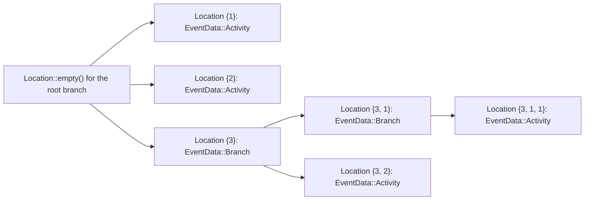
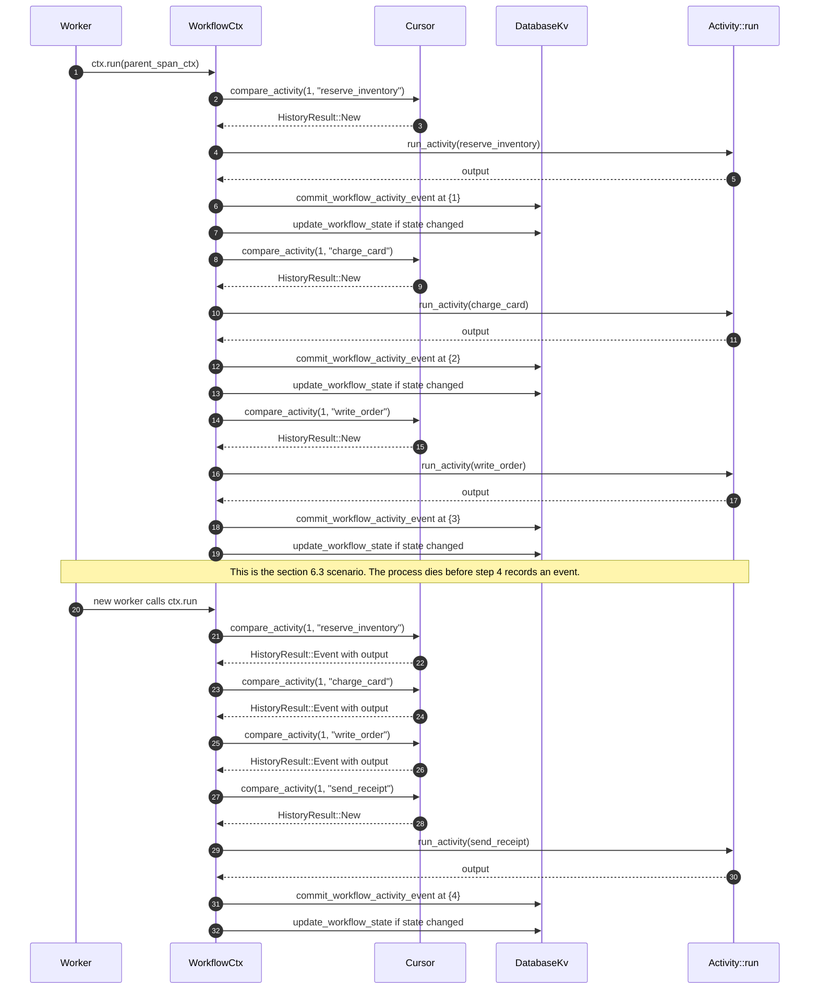
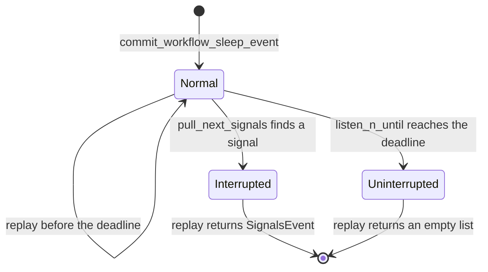
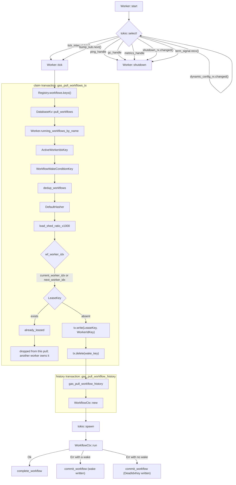

# 05 Gasoline: durable execution by recorded history

Gasoline is a durable execution library. It runs a workflow as an ordinary asynchronous Rust function. A workflow is a named function whose result and progress survive a crash. An activity is one side-effecting step inside it. History is the append-only record of completed steps. Gasoline records every completed step in that history. A new process can then run the same function again and skip the steps that already happened. After a crash, the engine runs the function again from its first statement. Each step compares its position with the recorded history. If the record holds an output, the step returns that output. If the record holds no output, the earlier attempt failed and the activity runs again. If no record exists, the activity runs. This document explains the primitives, the record, the replay algorithm, the failure path, and the worker that drives all of it.

The source of truth is `/Users/darkvoid/GitSources/src.Rivet/rivet` at commit `4a58441c50d1ce20d8803cfb1ab7c3285a5141d6`, version 2.3.31. All paths below are relative to that directory unless the text says otherwise.

## 1. The failure that Gasoline answers

Consider a workflow with five steps. Step 1 reserves stock. Step 2 charges a card. Step 3 writes an order row. Step 4 sends a receipt. Step 5 schedules a pickup. The process stops after step 3. The operator starts the process again.

A plain function cannot help here. Its local variables are gone. The only copy of "step 1 and step 2 are done" was in the memory of the dead process.

A database transaction cannot help either. A transaction can group several writes to one database. It does not record an external effect at the payment network. If it stays open across that call, it holds locks and can time out. A disconnect also loses the progress.

The engineer then has two bad choices. Run all five steps again and risk a second charge. Run no steps again and lose the order. Gasoline removes this choice. The function can run from the start, and each completed step returns its recorded result.

The contract has a sharp edge. Gasoline records the result after the activity returns. Suppose the process dies after the card network applied the charge but before Gasoline wrote the record. The next run sees no record and calls the activity again. The card can be charged twice. Gasoline gives at-least-once activity execution with a recorded result. It does not give exactly-once external effects. The source never claims exactly-once, and this document does not either.

| Event | Process memory | One database transaction held open across steps | Gasoline history |
|-------|----------------|------------------------------------------------|------------------|
| Step 1 result | Lost on crash | Lost on crash, because the write is uncommitted | Kept after the activity record commits |
| Step 2 result | Lost on crash | Lost on crash, because the write is uncommitted | Kept after the activity record commits |
| An in-flight activity | Lost | Not applicable | Re-run, because no record exists |
| An external effect with no record | Lost | Not applicable | Repeated on the next run |
| Progress across a network call | Lost | Only while the transaction stays open | Possible |

A database transaction that commits after each step would keep each result across a crash. It cannot stay open across the external call without holding locks for the whole call. Gasoline commits each step separately, so it can resume across the call.

The important sentence for the rest of this document is this one. Gasoline does not repeat an activity that has a successful record. It can repeat an activity that has no record.

### 1.1. Where the engine runs

The workflow worker runs in the Rivet engine process, which is the control plane. The engine starts it as a service named `workflow_worker` at `engine/packages/engine/src/run_config.rs:18-23`, and the service manager spawns that service as a Rust task at `engine/packages/service-manager/src/lib.rs:162-199`. It is not a separate server process. Gasoline stores its data in the same UniversalDB (UDB) key-value store that the rest of the control plane uses. Document [07 UniversalDB](07-universaldb-and-buckets.md) explains that store and its drivers.

This placement matters for the failure model. If the worker process dies, the UDB transaction either committed or did not commit. A committed activity record is visible to the next worker. An uncommitted record is invisible. The history is therefore a sequence of committed facts, not a best-effort log.

### 1.2. The two guarantees in plain words

Gasoline makes two promises.

1. A workflow function runs at least once for each wake condition. A wake condition is a durable reason to run the workflow.
2. An activity whose success record is in the history does not run again during replay. The call returns the recorded output instead.

The first promise is about the function. The second promise is about the side effect. A workflow can run many times and still perform each recorded activity once. A workflow can also perform an unrecorded activity more than once. The difference is the record.

## 2. The primitives: Workflow, Activity, and Operation

Gasoline has three traits at its base. Two are durable: `Workflow` and `Activity`. A `Workflow` is the durable function. An `Activity` is the unit of side effect that Gasoline records. `Operation` is a non-durable helper that runs inside an activity.

```rust
// engine/packages/gasoline/src/workflow.rs:10-23
#[async_trait]
pub trait Workflow {
	type Input: WorkflowInput;
	type Output: Serialize + DeserializeOwned + Debug + Send;

	const NAME: &'static str;
	const PRUNE_VARIANT: PruneVariant;

	async fn run(ctx: &mut WorkflowCtx, input: &Self::Input) -> Result<Self::Output>;
}

pub trait WorkflowInput: Serialize + DeserializeOwned + Debug + Send {
	type Workflow: Workflow;
}
```

The trait has five parts.

| Part | Type | Purpose |
|------|------|---------|
| `Input` | `WorkflowInput` | The serialized input. Its associated `Workflow` type ties the input to this workflow. |
| `Output` | `Serialize + DeserializeOwned + Debug + Send` | The serialized result. `complete_workflow` writes it when the body returns `Ok` (section 6.5). |
| `NAME` | `&'static str` | The durable name. The registry uses this name as its key. |
| `PRUNE_VARIANT` | `PruneVariant` | What to delete after the workflow completes. |
| `run` | `async fn(&mut WorkflowCtx, &Input) -> Result<Output>` | The function body that runs and replays. |

`PruneVariant` has three values. The source defines them at `engine/packages/gasoline/src/workflow.rs:67-77`.

| Value | Number | Effect after completion and pruning |
|-------|--------|-------------------------------------|
| `All` | 0 | Delete the whole data subspace, which holds input, state, output, tags, and history. This is the default, marked by `#[default]` in the macro enum at `engine/packages/gasoline-macros/src/lib.rs:10-16`. The pruner also deletes pending signals. |
| `History` | 1 | Delete history. Keep input, state, output, and tags. |
| `None` | 2 | Delete nothing. |

The activity trait is smaller. It has the same shape, plus retry controls.

```rust
// engine/packages/gasoline/src/activity.rs:9-24
#[async_trait]
pub trait Activity {
	type Input: ActivityInput;
	type Output: Serialize + DeserializeOwned + Debug + Send;

	const NAME: &'static str;
	/// Seconds.
	const MAX_RETRIES: usize;
	const TIMEOUT: std::time::Duration;

	async fn run(ctx: &ActivityCtx, input: &Self::Input) -> Result<Self::Output>;
}

pub trait ActivityInput: Serialize + DeserializeOwned + Debug + Send {
	type Activity: Activity;
}
```

The comment `/// Seconds.` sits above `MAX_RETRIES` in the source. It is misleading, because `MAX_RETRIES` is a count and `TIMEOUT` carries the seconds. The macro sets `MAX_RETRIES` to a count and `TIMEOUT` to `Duration::from_secs`. The value of `MAX_RETRIES` is compared with a count at `engine/packages/gasoline/src/ctx/workflow.rs:611`.

| Constant | Type | Default | Source of default |
|----------|------|---------|-------------------|
| `NAME` | `&'static str` | The Rust function name | `engine/packages/gasoline-macros/src/lib.rs:177` |
| `MAX_RETRIES` | `usize` | 5 | `engine/packages/gasoline-macros/src/lib.rs:29-35` |
| `TIMEOUT` | `Duration` | 30 seconds | `engine/packages/gasoline-macros/src/lib.rs:37-42` |

The same `OperationConfig` supplies the defaults for `#[activity]` and `#[operation]`. The activity macro reads it at `engine/packages/gasoline-macros/src/lib.rs:131-134`.

`OperationConfig` is a macro-time struct with two optional expressions, `max_retries` and `timeout`. It is at `engine/packages/gasoline-macros/src/lib.rs:23-27`. The defaults are `5` and `30` seconds at `lib.rs:29-43`. An operation is a third macro form. `#[operation]` generates an `Operation` implementation whose `run` takes `&OperationCtx` instead of `&ActivityCtx`. The macro is at `lib.rs:192-259`. The `Operation` trait has `NAME`, `TIMEOUT`, and `run`, and it has no `MAX_RETRIES` (`engine/packages/gasoline/src/operation.rs:9-17`). The macro expansion emits only `TIMEOUT` at `lib.rs:235-254`, so the parsed `max_retries` value is not used. An operation is not written to history. The `op` helper creates an `OperationCtx`, applies `TIMEOUT`, and calls `run` at `engine/packages/gasoline/src/ctx/common.rs:86-151`.

### 2.1. The attribute macros

Engineers do not write these traits by hand. They write a function with an attribute.

```rust
// engine/packages/gasoline-macros/src/lib.rs:100-119
	let expanded = quote! {
		#vis struct #struct_ident;

		impl gas::workflow::WorkflowInput for #input_type {
			type Workflow = #struct_ident;
		}

		#[async_trait::async_trait]
		impl gas::workflow::Workflow for #struct_ident {
			type Input = #input_type;
			type Output = #output_type;

			const NAME: &'static str = #fn_name;
			const PRUNE_VARIANT: gas::workflow::PruneVariant = #prune_variant;

			async fn run(#ctx_ident: #ctx_ty, #input_ident: &Self::Input) -> Result<Self::Output> {
				#fn_body
			}
		}
	};
```

The activity macro has the same shape and adds the two constants.

```rust
// engine/packages/gasoline-macros/src/lib.rs:165-185
	let expanded = quote! {
		#vis struct #struct_ident;

		impl gas::activity::ActivityInput for #input_type {
			type Activity = #struct_ident;
		}

		#[async_trait::async_trait]
		impl gas::activity::Activity for #struct_ident {
			type Input = #input_type;
			type Output = #output_type;

			const NAME: &'static str = #fn_name;
			const MAX_RETRIES: usize = #max_retries;
			const TIMEOUT: std::time::Duration = std::time::Duration::from_secs(#timeout);

			async fn run(#ctx_ident: #ctx_ty, #input_ident: &Self::Input) -> Result<Self::Output> {
				#fn_body
			}
		}
	};
```

The macro rules are strict. `parse_trait_fn` requires an asynchronous function with exactly two parameters. The first parameter must match the type that the macro expects: `&mut WorkflowCtx` for `#[workflow]`, `&ActivityCtx` for `#[activity]`, and `&OperationCtx` for `#[operation]`. The second parameter must be a reference to the input type. The return type must be `Result<T>`. The checks are at `engine/packages/gasoline-macros/src/lib.rs:268-355`.

The function name must match `[a-z0-9_]`. A capital letter causes a compile error. The check is at `engine/packages/gasoline-macros/src/lib.rs:80-89` for workflows and `148-157` for activities.

| Attribute | Attribute argument | Generated item | Durable name | Source |
|-----------|--------------------|----------------|--------------|--------|
| `#[workflow]` | Optional identifier. Default `Workflow`. | A unit struct with that identifier | The function name | `lib.rs:56-120` |
| `#[workflow] #[prune = history]` | `all`, `history`, or `none` | Same struct | The function name | `lib.rs:465-500` |
| `#[activity(Name)]` | Required identifier | A unit struct named `Name` | The function name | `lib.rs:127-190` |
| `#[activity(Name)] #[max_retries = 3]` | Integer expression | Same struct | The function name | `lib.rs:501-530` |
| `#[activity(Name)] #[timeout = 60]` | Integer expression, seconds | Same struct | The function name | `lib.rs:501-530` |
| `#[signal("name")]` | String literal | The struct plus `Signal` and `Listen` implementations | The literal string | `lib.rs:358-412` |
| `#[message("name")]` | String literal | The struct plus a `Message` implementation | The literal string | `lib.rs:415-459` |
| `#[operation]` | Optional identifier | A struct plus an `Operation` implementation | The function name | `lib.rs:192-259` |

The generated struct name is local to Rust. The durable name is the function name. A change to the function name changes the durable name. Old history then has a name that the new registry does not contain. The worker builds its pull filter from the registry keys at `engine/packages/gasoline/src/worker.rs:188-194`. Therefore the renamed workflow is no longer pulled, and it stays in the store with its `HasWakeConditionKey` alive flag set at `engine/packages/gasoline/src/db/kv/keys/workflow.rs:1026-1057`. Section 4 explains that flag. The name filter makes `WorkflowMissingFromRegistry` unreachable on the normal worker path. The lookup is defensive at `engine/packages/gasoline/src/ctx/workflow.rs:167` and `engine/packages/gasoline/src/registry.rs:97-101`.

### 2.2. The executable trait and parallel work

`ctx.join(...)` runs several activities at the same time. It accepts anything that implements `Executable`. The method itself is small. It checks the stop flag and calls `Executable::execute` on its argument at `engine/packages/gasoline/src/ctx/workflow.rs:661-665`.

```rust
// engine/packages/gasoline/src/executable.rs:9-20
/// Signifies a retryable executable entity in a workflow. For example: activity, tuple of activities (join).
#[async_trait]
pub trait Executable: Send + Sized + Sync {
	type Output: Send;

	async fn execute(self, ctx: &mut WorkflowCtx) -> Result<Self::Output>;

	/// Move the context's cursor to where it should be after this executable is executed.
	fn shift_cursor(&self, ctx: &mut WorkflowCtx) -> WorkflowResult<()>;
}

pub type AsyncResult<'a, T> = Pin<Box<dyn Future<Output = Result<T>> + Send + 'a>>;
```

The trait has implementations for a closure, `Option<T>`, `Vec<T>`, and tuples of two to five elements. The tuple implementation uses `tokio::join!`, not `tokio::try_join!`. The source gives the reason in a comment.

```rust
// engine/packages/gasoline/src/executable.rs:106-113
				// We don't use a try_join here because we do not want to short circuit any executables
				#[allow(non_snake_case)]
				let ($($args),*) = tokio::join!(
					$($args.exec.execute(&mut $args.branch)),*
				);

				// Handle errors here instead
				Ok(($($args?),*))
```

The parallel branches are separate `WorkflowCtx` clones. Each clone has its own cursor, but all clones share one `History` and one state mutex. A parallel activity cannot touch state. `ActivityCtx::state` returns `WorkflowStateInaccessible("activity running in parallel")` in that case. The check is at `engine/packages/gasoline/src/ctx/activity.rs:121`.

The shared state is the workflow state. It is one JavaScript Object Notation (JSON) blob in the workflow record, field `state` of `WorkflowData` at `engine/packages/gasoline/src/db/mod.rs:334-341`. After creation, only an activity changes it, through `ActivityCtx::state::<T>()` at `ctx/activity.rs:118-130`. A mutable access marks the blob as dirty in `StateGuard` at `engine/packages/gasoline/src/workflow.rs:53-57`. The workflow body has no state accessor at this commit. On success, `run_activity` writes the new blob in the same `try_join!` as the activity event at `ctx/workflow.rs:338-370`. On failure, the staged blob is dropped. The prune variant decides whether the blob survives completion.

`ctx.join` also accepts an activity. `gas::prelude::activity(input)` wraps the input in `ActivityStub`, which implements `Executable` at `engine/packages/gasoline/src/stub.rs:28-64`. The Pegboard call site uses this form at `engine/packages/pegboard/src/workflows/actor/mod.rs:596`.

`join` reserves a position for each executable before any of them runs. The tuple implementation does these steps for each element in order.

1. It clones the parent context into a branch at `engine/packages/gasoline/src/executable.rs:96-98`.
2. It sets the parallel flag on the branch.
3. It computes the location that this element will use and moves the parent cursor to it at `executable.rs:99`. For an `ActivityStub`, `shift_cursor` compares the event at the parent's current coordinate against the activity name and version, chooses the event location or the next open coordinate, and calls `cursor.update` with that location at `stub.rs:54-63` and `cursor.rs:81-111`.
4. The branch was cloned before step 3, so it keeps the `iter_idx` and `prev_coord` values that step 3 used. The element's first comparison therefore chooses the same location that step 3 chose.
5. The parent cursor is now past that coordinate. The next element in the loop reserves a later coordinate.

`shift_cursor` for a tuple calls the method for each element at `executable.rs:116-125`. For a closure, it calls `cursor.inc()` at `executable.rs:46-49`. `inc` advances `iter_idx` by one and records the consumed coordinate in `prev_coord` at `history/cursor.rs:128-132`. The parent is past all reserved positions when `tokio::join!` returns the tuple of outputs. There is no separate cursor merge. If one element fails, the tuple builds the error after every element completes at `executable.rs:112-113`, so the recorded side effects stay.

The `Vec<T>` implementation reserves the positions in a loop at `executable.rs:152-160` and runs the futures with `join_all` at `171`. The `Option<T>` implementation shifts the parent only when the value is `Some` at `executable.rs:58-77`.

### 2.3. The non-durable operation

An operation is a side effect that runs inside an activity. It has a name, a timeout, and a `run` function. The `Operation` trait has no `MAX_RETRIES` and no history event at `engine/packages/gasoline/src/operation.rs:9-20`. The `#[operation]` macro requires a first parameter of type `&OperationCtx` and emits only the timeout constant at `engine/packages/gasoline-macros/src/lib.rs:192-259`.

The activity calls the operation. `ActivityCtx::op` forwards to `common::op`, which builds an `OperationCtx`, applies the timeout, and calls the operation body at `engine/packages/gasoline/src/ctx/activity.rs:132-152` and `engine/packages/gasoline/src/ctx/common.rs:86-151`.

```rust
// engine/packages/gasoline/src/ctx/activity.rs:133-152
	pub async fn op<I>(
		&self,
		input: I,
	) -> Result<<<I as OperationInput>::Operation as Operation>::Output>
	where
		I: OperationInput,
		<I as OperationInput>::Operation: Operation<Input = I>,
	{
		common::op(
			&self.db,
			&self.config,
			&self.pools,
			&self.cache,
			self.ray_id,
			true,
			input,
		)
		.in_current_span()
		.await
	}
```

The outer activity owns the retry. An operation timeout becomes `OperationTimeout` at `engine/packages/gasoline/src/ctx/common.rs:122-125`. An activity timeout becomes `ActivityTimeout` at `engine/packages/gasoline/src/ctx/workflow.rs:324`. The activity uses its own retry budget. After `MAX_RETRIES` failures, the activity converts either error to `ActivityMaxFailuresReached` at `engine/packages/gasoline/src/ctx/workflow.rs:609-638`. A crash after the operation side effect but before the activity event commits runs the operation again on replay. The operation therefore needs the same idempotence as an activity, and it gets no separate record.

## 3. How a definition becomes a registry entry

The worker must map a durable name to a Rust function. The `Registry` does this map.

```rust
// engine/packages/gasoline/src/registry.rs:14-17
/// Contains a lookup map for workflow run handlers by workflow name.
pub struct Registry {
	pub(crate) workflows: HashMap<String, Arc<RegistryWorkflow>>,
}
```

`RegistryWorkflow` holds one function pointer and one prune value.

```rust
// engine/packages/gasoline/src/registry.rs:112-119
pub struct RegistryWorkflow {
	pub run: for<'a> fn(
		&'a mut WorkflowCtx,
	) -> Pin<
		Box<dyn Future<Output = WorkflowResult<Box<serde_json::value::RawValue>>> + Send + 'a>,
	>,
	pub prune_variant: PruneVariant,
}
```

The function pointer has no captured data. Every workflow with the same `Workflow` type shares one pointer. `register_workflow` builds a monomorphized closure for the type. That closure deserializes input, calls `W::run`, and serializes output.

```rust
// engine/packages/gasoline/src/registry.rs:51-95
	pub fn register_workflow<W: Workflow>(&mut self) -> WorkflowResult<()> {
		// Check for duplicates
		if self.workflows.contains_key(W::NAME) {
			return Err(WorkflowError::DuplicateRegisteredWorkflow(
				W::NAME.to_string(),
			));
		}

		self.workflows.insert(
			W::NAME.to_string(),
			Arc::new(RegistryWorkflow {
				run: |ctx| {
					async move {
						// Deserialize input
						let input = rivet_util::serde::json_from_str!(ctx.input().get())
							.map_err(WorkflowError::DeserializeWorkflowInput)?;

						// Run workflow
						let output = match W::run(ctx, &input).await {
							Ok(x) => x,
							// TODO: This should check .chain() for the error
							// Differentiate between WorkflowError and user error
							Err(err) => match err.downcast::<WorkflowError>() {
								Ok(inner_err) => return Err(inner_err),
								Err(err) => {
									return Err(WorkflowError::WorkflowFailure(W::NAME, err));
								}
							},
						};

						// Serialize output
						let output_val = rivet_util::serde::json_to_raw_value!(&output)
							.map_err(WorkflowError::SerializeWorkflowOutput)?;

						Ok(output_val)
					}
					.in_current_span()
					.boxed()
				},
				prune_variant: W::PRUNE_VARIANT,
			}),
		);

		Ok(())
	}
```

The registry has a small interface.

| Method | Input | Output | Error | Caller |
|--------|-------|--------|-------|--------|
| `new` | none | An empty registry | none | `workflow-worker` |
| `handle` | `self` | `Arc<Registry>` | none | `workflow-worker` |
| `merge` | another `Registry` | `Registry` | `DuplicateRegisteredWorkflow` | `workflow-worker` |
| `register_workflow::<W>` | none | `()` | `DuplicateRegisteredWorkflow` | each package registry |
| `get_workflow` | `&str` name | `&Arc<RegistryWorkflow>` | `WorkflowMissingFromRegistry` | `WorkflowCtx::run` |
| `size` | none | `usize` | none | worker log line |
| `names` | none | `Vec<&str>` | none | not used by the worker tick |

The stable name rule is simple. The registry key is `W::NAME`. The macro sets `W::NAME` to the Rust function name. Two workflows with the same function name cannot be registered together. Two workflows in different modules can have the same function name, but only if they do not meet in one registry.

`merge` does not overwrite. It checks every key first and returns an error on the first duplicate. This prevents a later package from silently replacing a workflow.

### 3.1. The composition of the real registry

The binary that starts the worker is small.

```rust
// engine/packages/workflow-worker/src/lib.rs:4-23
#[tracing::instrument(skip_all)]
pub async fn start(config: rivet_config::Config, pools: rivet_pools::Pools) -> Result<()> {
	let reg = registry(&config)?;
	let db = db::DatabaseKv::new(config.clone(), pools.clone()).await?;
	let worker = Worker::new(reg.handle(), db, config, pools);

	// Start worker
	worker.start(None).await
}

pub fn registry(config: &rivet_config::Config) -> Result<Registry> {
	pegboard::registry()?
		.merge(namespace::registry()?)?
		.merge(epoxy::registry()?)?
		.merge(gasoline_runtime::registry()?)?
		.merge(rivet_auth_jwt::registry()?)?
		.merge(datacenter::registry()?)?
		.merge(depot::registry(config)?)
		.map_err(Into::into)
}
```

The final registry contains every active workflow from those packages. One registration is commented out in the Pegboard list at `engine/packages/pegboard/src/lib.rs:21`. The worker pulls only names that this registry contains. A workflow that is dispatched but not registered is never pulled. It stays in the store until an operator fixes the deployment or deletes it.

## 4. The record that a workflow exists

Gasoline has no "workflow started" event in the history. The start is a set of keys in the workflow record. The dispatch transaction writes the first record.

```rust
// engine/packages/gasoline/src/db/kv/mod.rs:367-386
		// Write input
		let input_key = keys::workflow::InputKey::new(workflow_id);

		for (i, chunk) in input_key.split_ref(input)?.into_iter().enumerate() {
			let chunk_key = input_key.chunk(i);

			tx.set(&self.subspace.pack(&chunk_key), &chunk);
		}

		// Write immediate wake condition
		tx.write(
			&keys::wake::WorkflowWakeConditionKey::new(
				workflow_name.to_string(),
				workflow_id,
				keys::wake::WakeCondition::Immediate,
			),
			(),
		)?;

		tx.write(&keys::workflow::HasWakeConditionKey::new(workflow_id), ())?;
```

The dispatch code uses two transaction methods. `tx.set` takes raw bytes and returns nothing. `tx.set` is at `engine/packages/universaldb/src/transaction.rs:534-538`. `tx.write` takes a typed key, serializes the value, and returns a `Result`. `tx.write` is at `transaction.rs:306-315`. The input chunks use raw `set`, and the typed key structs use `write`.

The full dispatch transaction writes these keys.

| Key | Value | Purpose | Source |
|-----|-------|---------|--------|
| `CreateTsKey` | timestamp | Creation time for metrics and replay | `db/kv/mod.rs:306-309` |
| `NameKey` | workflow name | The durable workflow name | `db/kv/mod.rs:311-314` |
| `RayIdKey` | `Id` | Request correlation identifier | `db/kv/mod.rs:316` |
| `TagKey` | empty | One key per tag for lookup | `db/kv/mod.rs:336-341` |
| `ByNameAndTagKey` | remaining tags | Secondary index for `unique()` and `find_workflow` | `db/kv/mod.rs:350-365` |
| `InputKey` | chunked JSON | The input, split into value chunks | `db/kv/mod.rs:367-374` |
| `WorkflowWakeConditionKey` | empty | One `Immediate` wake condition | `db/kv/mod.rs:376-384` |
| `HasWakeConditionKey` | empty | Alive flag. It is not one of the four wake keys (section 4.1 and section 11.4). | `db/kv/mod.rs:386` |

Tags are an optional JSON object on dispatch. Each key and value becomes a string, and the store writes one `TagKey` per pair at `db/kv/mod.rs:318-341`. It also writes one `ByNameAndTagKey` per tag. That key packs as `(BY_NAME_AND_TAG, workflow_name, tag_key, tag_value, workflow_id)` and stores the remaining tags at `keys/workflow.rs:902-966`. Every workflow also gets a null key. The key packs as `(BY_NAME_AND_TAG, workflow_name, "", "", workflow_id)`, and its value is the full tag list at `keys/workflow.rs:923-966` and `db/kv/mod.rs:361-365`. `find_workflow_inner` uses the first tag to select a subspace. With no tags it selects the null subspace. It then scans that subspace and checks that the stored remaining tags contain every requested tag at `db/kv/mod.rs:412-464`. `unique()` sets a builder flag at `builder/workflow/sub_workflow.rs:79-89`. On dispatch, `dispatch_workflow_inner` calls `find_workflow_inner` and returns the existing identifier without writing when any workflow matches at `db/kv/mod.rs:294-304`. `dispatch()` therefore returns an `Id` that may name an existing workflow, and the caller cannot tell from the value whether this call created it. The builder says `unique()` with no tags always spawns a new workflow at `sub_workflow.rs:79-80`. That comment is wrong for this path. With no tags, the requested remaining tag list is empty, so the check matches every workflow with the same name. The scan returns entries in tuple key order, so the first match is the workflow with the lowest identifier in that order, not the oldest or the newest. It is not a creation-time choice.

The worker loads a workflow with `PulledWorkflowData`. The struct has these fields at `engine/packages/gasoline/src/db/mod.rs:372-382`. `Location` and `Event` are defined in section 5.

| Field | Type | Purpose |
|-------|------|---------|
| `workflow_id` | `Id` | Identity |
| `workflow_name` | `String` | Registry key |
| `create_ts` | `i64` | Creation timestamp |
| `ray_id` | `Id` | Correlation identifier |
| `input` | `Box<RawValue>` | Reassembled JSON input |
| `state` | `Box<RawValue>` | Reassembled JSON state |
| `wake_deadline_ts` | `Option<i64>` | Deadline that caused this pull, if any |
| `events` | `HashMap<Location, Vec<Event>>` | The whole history, grouped by branch |

On a first dispatch the history map is empty. On replay the map holds the loaded events. In both cases `WorkflowCtx::new` builds the top-level cursor at `Location::empty()` over that map. A child workflow branch is different: it copies the same map and builds its cursor at the branch location at `ctx/workflow.rs:488-521`. A parallel tuple branch is also different: it clones the parent context, so it keeps the parent cursor position at that moment at `executable.rs:96-98`.

```rust
// engine/packages/gasoline/src/ctx/workflow.rs:120-125
			input: Arc::from(data.input),
			state: Arc::new(Mutex::new(data.state)),

			event_history: event_history.clone(),
			cursor: Cursor::new(event_history, Location::empty()),
			loop_location: None,
```

The absence of a start event has three consequences.

1. Replay has no "first event" to consume. The workflow body starts at the first statement.
2. The workflow record is the source of input and state, not the history.
3. The creation is not versioned. Versioning applies only to steps.

The `Immediate` wake condition is what makes the workflow runnable at dispatch. `WorkflowData::is_dead` checks the `HasWakeConditionKey` flag, not the presence of one `WorkflowWakeConditionKey`, at `engine/packages/gasoline/src/db/mod.rs:366-368`. A running workflow can have its wake keys cleared on claim and still has the flag. `WorkflowData` is a different struct from `PulledWorkflowData`. It is at `engine/packages/gasoline/src/db/mod.rs:334-341` and holds `workflow_id`, `name`, `input`, `state`, `output`, and `has_wake_condition`.

### 4.1. The four wake conditions

`WakeCondition` has four variants at `engine/packages/gasoline/src/db/kv/keys/wake.rs:7-13`.

| Variant | Payload | Why the workflow runs |
|---------|---------|-----------------------|
| `Immediate` | none | A new dispatch or a workflow evicted from its worker |
| `Deadline` | `deadline_ts: i64` | A sleep or an activity backoff reached its time |
| `SubWorkflow` | `sub_workflow_id: Id` | A child workflow completed |
| `Signal` | `signal_id: Id` | A listened signal was published |

The key packs as `(WAKE, WORKFLOW, workflow_name, ts, workflow_id, variant)` and appends the child or signal identifier for the last two variants at `wake.rs:93-111`. The `variant` is an integer from `WakeConditionVariant` at `wake.rs:33-39`: `Immediate = 0`, `Deadline = 1`, `SubWorkflow = 2`, and `Signal = 3`. The `ts` is the deadline for `Deadline` and the current time for the other three at `wake.rs:50-61`. The stored value is empty at `wake.rs:73-83`.

`complete_workflow` writes the `SubWorkflow` wake conditions. It scans `SubWorkflowWakeKey` for every parent that waits on the child, writes one wake key for each, and deletes the scanned key, at `engine/packages/gasoline/src/db/kv/mod.rs:2096-2121`. Section 5.3 gives the registration path and the child-death path.

### 4.2. Workflow state

Workflow state is a durable JSON value that belongs to the workflow, not to one step. `WorkflowData` and `PulledWorkflowData` both carry a `state: Box<RawValue>` field at `engine/packages/gasoline/src/db/mod.rs:334-341` and `372-382`. The store writes it under a chunked `StateKey`, `(WORKFLOW, DATA, workflow_id, STATE, chunk)`, at `engine/packages/gasoline/src/db/kv/keys/workflow.rs:325-395`. A new workflow has no state chunks, so the loader uses `RawValue::NULL` at `db/kv/mod.rs:2013-2016`. `WorkflowCtx::new` moves the loaded blob into `Arc<Mutex<Box<RawValue>>>` at `ctx/workflow.rs:120-125`.

Only an activity can read or write state. `ActivityCtx::state::<T>()` deserializes the blob into `T` and returns a `StateGuard<T>` at `engine/packages/gasoline/src/ctx/activity.rs:117-130`. A read through `Deref` does not mark the state dirty. A write through `DerefMut` sets the dirty flag at `engine/packages/gasoline/src/workflow.rs:53-57`. When the guard drops, it serializes the value back into the mutex at `workflow.rs:60-64`, but `into_new_workflow_state` returns the blob only when the dirty flag is set at `ctx/activity.rs:168-172`. The workflow body has no state accessor. A parallel activity cannot touch state, and `ActivityCtx::state` returns `WorkflowStateInaccessible` at `ctx/activity.rs:119-122`.

On success, `run_activity` starts two writes in one `try_join!`: the activity event transaction and `update_workflow_state` when the blob is dirty at `ctx/workflow.rs:338-370`. `update_workflow_state` clears the old state subspace and writes the new chunks in its own transaction (`gas_update_workflow_state`) at `db/kv/mod.rs:3000-3037`. The two transactions are not atomic, even though both validate the lease. Section 6.2 gives the two crash windows and their replay results. On failure, the staged blob is dropped.

`PRUNE_VARIANT` decides what survives completion. `History` keeps input, state, output, and tags, and deletes history. `All` deletes the whole data subspace, which contains input, state, output, tags, and history, and also deletes pending signals. `None` keeps everything. Section 14 gives the pruner path.

## 5. The history model

The history is a map from a branch location to an ordered vector of events.

```rust
// engine/packages/gasoline/src/history/mod.rs:8
pub(crate) type History = Arc<HashMap<location::Location, Vec<event::Event>>>;
```

The map is immutable during a run. The source states this at `engine/packages/gasoline/src/history/cursor.rs:14-16`: "Allows history traversal and comparison. This does not modify any history throughout the runtime of the workflow." New events are committed to the store, not inserted into this map. The cursor still tracks them: `iter_idx` advances past consumed events, and `coord_at` synthesizes a coordinate when the index is beyond the loaded branch. It uses the last loaded coordinate plus the offset at `cursor.rs:43-66`. Therefore a `New` event does not leave the map stale for the next comparison.

### 5.1. The Event type

```rust
// engine/packages/gasoline/src/history/event.rs:10-53
/// An event that happened in the workflow run.
///
/// This is used to replay events.
#[derive(Debug)]
pub struct Event {
	/// Position within the root location.
	pub(crate) coordinate: Coordinate,
	pub(crate) version: usize,
	pub(crate) data: EventData,
}

impl Event {
	pub fn coordinate(&self) -> &Coordinate {
		&self.coordinate
	}
}

impl std::fmt::Display for Event {
	fn fmt(&self, f: &mut std::fmt::Formatter<'_>) -> std::fmt::Result {
		write!(f, "{} v{} @ {}", self.data, self.version, self.coordinate)
	}
}

impl Deref for Event {
	type Target = EventData;

	fn deref(&self) -> &Self::Target {
		&self.data
	}
}

#[derive(Debug)]
pub enum EventData {
	Activity(ActivityEvent),
	SignalSend(SignalSendEvent),
	MessageSend(MessageSendEvent),
	SubWorkflow(SubWorkflowEvent),
	Loop(LoopEvent),
	Sleep(SleepEvent),
	Removed(RemovedEvent),
	VersionCheck(VersionCheckEvent),
	Branch,
	Signals(SignalsEvent),
}
```

Every event has three fields.

| Field | Type | Purpose |
|-------|------|---------|
| `coordinate` | `Coordinate` | Position inside the current branch |
| `version` | `usize` | The step version that wrote the event |
| `data` | `EventData` | The payload and the event kind |

The `EventType` numbers are part of the storage format. They are written to the UDB, so they must not change.

```rust
// engine/packages/gasoline/src/history/event.rs:88-102
#[derive(Hash, Debug, Clone, Copy, PartialEq, Eq, FromRepr)]
pub enum EventType {
	Activity = 0,
	/// Deprecated.
	Signal = 1,
	SignalSend = 2,
	MessageSend = 3,
	SubWorkflow = 4,
	Loop = 5,
	Sleep = 6,
	Branch = 7,
	Removed = 8,
	VersionCheck = 9,
	Signals = 10,
}
```

`Signal = 1` is deprecated and has no `EventData` variant. The current signal-receive type is `Signals = 10`. A stored type-1 event is not rejected. That legacy form kept one name in its `NameKey` and one body in the location's input chunks. The history loader converts it to `EventData::Signals` with those two values as the only entry at `engine/packages/gasoline/src/db/kv/mod.rs:3670-3684`. `compare_removed` also maps `EventType::Signal` to `EventData::Signals` at `history/cursor.rs:504`. New code writes `Signals = 10`.

### 5.2. Every event payload

| Variant | Struct | Fields | Meaning |
|---------|--------|--------|---------|
| `Activity` | `ActivityEvent` | `name: String`, `create_ts: i64`, `output: Option<Box<RawValue>>`, `error_count: usize` (derived at load) | One activity step. `output` is `Some` on success. A failed retry rewrites the same event. |
| `SignalSend` | `SignalSendEvent` | `signal_id: Id`, `name: String` | A workflow sent a signal. |
| `MessageSend` | `MessageSendEvent` | `name: String` | A workflow published a message. |
| `SubWorkflow` | `SubWorkflowEvent` | `sub_workflow_id: Id`, `name: String` | A workflow dispatched a child workflow. |
| `Loop` | `LoopEvent` | `state: Box<RawValue>`, `output: Option<Box<RawValue>>`, `iteration: usize` | A bounded loop checkpoint. |
| `Sleep` | `SleepEvent` | `deadline_ts: i64`, `state: SleepState` | A durable timer or a listen deadline. |
| `Removed` | `RemovedEvent` | `event_type: EventType`, `name: Option<String>` | A step that must be skipped on replay. |
| `VersionCheck` | `VersionCheckEvent` | `inner_version: usize` | A marker for `check_version`. |
| `Branch` | none | none | A marker for a nested context. |
| `Signals` | `SignalsEvent` | `names: Vec<String>`, `bodies: Vec<Box<RawValue>>` | Signals received by one listen call. |

The struct definitions are at `engine/packages/gasoline/src/history/event.rs:122-220`.

`ActivityEvent` does have an `error_count` field at `event.rs:129`. The activity event writer does not store that field. The history loader counts the `ErrorKey` entries for the location and sets the field, at `engine/packages/gasoline/src/db/kv/mod.rs:1864-1868`. Therefore the count in a loaded event is the number of stored errors, not a value from the event key.

The event is keyed by location, so a retry overwrites the event at that location instead of adding a second event at a new coordinate. Each failed attempt writes one new `ErrorKey` at the same location. The next attempt keeps the original `create_ts` from the loaded event at `ctx/workflow.rs:602-603`. When an attempt succeeds, the writer writes the output chunks and leaves the old error keys in place at `keys/history.rs:1992-2012`. The event then has `output = Some`, so replay returns the output without reading `error_count`.

`SleepState` has three values at `engine/packages/gasoline/src/history/event.rs:188-193`.

| Value | Number | Meaning |
|-------|--------|---------|
| `Normal` | 0 | The timer has not reached a terminal state. |
| `Uninterrupted` | 1 | The timer expired with no signal. |
| `Interrupted` | 2 | A signal arrived before the timer expired. |

### 5.3. What each workflow action records

This table answers the common question: what does each workflow action record?

| Action | History event | Stored payload | Source |
|--------|---------------|----------------|--------|
| Workflow start | None | Workflow record keys plus an `Immediate` wake condition | `db/kv/mod.rs:306-386` |
| Activity success | `EventData::Activity` | Name, create time, input chunks, output chunks | `keys/history.rs:1954-2015` |
| Activity failure | `EventData::Activity` | Name, create time, no output, an `ErrorKey` entry | `keys/history.rs:2003-2011` |
| Signal send | `EventData::SignalSend` | Signal identifier and name | `keys/history.rs:1834-1887` |
| Signal receive | `EventData::Signals` | One indexed name and body per signal | `keys/history.rs:1779-1832` |
| Sleep or timer | `EventData::Sleep` | Deadline and state | `keys/history.rs:2169-2224` |
| Child workflow dispatch | `EventData::SubWorkflow` | Child identifier and name in the event struct; tags in `TagKey` and input in `InputKey` at the same location | `keys/history.rs:1888-1952` |
| Child workflow wait | None | The parent polls the child record with `wait_for_workflow` | `builder/workflow/sub_workflow.rs:251-297` |
| Loop iteration | `EventData::Loop` | State, optional output, iteration number | `keys/history.rs:2072-2168` |
| Removed step | `EventData::Removed` | The removed event type and optional name | `keys/history.rs:2248-2286` |
| Version check | `EventData::VersionCheck` | The inner version | `keys/history.rs:2287-2315` |

A child workflow does not record a result event in the parent. The application selects the path with the builder method. `.dispatch()` records a `SubWorkflow` event and returns the child identifier without waiting at `builder/workflow/sub_workflow.rs:91-119`. `.output()` on a new input runs the child inline. It calls `custom_branch`, which compares a `Branch` event and writes one if none exists, then runs the child body in that branch at `sub_workflow.rs:231-245` and `ctx/workflow.rs:463-485`. `.output()` on an existing identifier waits for that workflow at `sub_workflow.rs:218-220` and `251-297`. There is no automatic selection between dispatch and inline.

The inline path returns a child `WorkflowCtx` with its own cursor at the branch location. The child is built by `branch_inner`, not by `WorkflowCtx::new`, at `ctx/workflow.rs:488-521`. After the child returns, the parent moves its cursor to the branch root with `cursor_mut().update(branch.cursor().root())` at `builder/workflow/sub_workflow.rs:243`. Here `Cursor::root` returns the cursor's own `root_location` at `history/cursor.rs:69-71`. It is not `Location::root`, which drops the last coordinate.

The polling path subscribes to `BumpSubSubject::WorkflowComplete`, calls `get_sub_workflow`, and returns `SubWorkflowIncomplete` after `max_sub_workflow_poll_retries` tries (`sub_workflow.rs:251-297`). The parent registers for a wake when it commits a `SubWorkflow` wake condition. `commit_workflow` calls `write_sub_workflow_wake_idx` at `db/kv/mod.rs:2395-2403`. That function writes a `SubWorkflowWakeKey` with the parent name as the value at `db/kv/mod.rs:151-164`. This key is the child's waiting list. It lives in the wake subspace and packs as `(WAKE, SUB_WORKFLOW, child_id, ts, parent_id)` at `keys/wake.rs:259-273`. The timestamp orders waiters, and the value is the parent workflow name at `keys/wake.rs:246-256`. The `get_sub_workflow` read also writes the same key when the child has no output yet, to close the race between the read and the parent commit at `db/kv/mod.rs:2799-2815`.

`WakeSubWorkflowKey` is a different key. It would live in the parent's data subspace and pack as `(WORKFLOW, DATA, parent_id, WAKE_SUB_WORKFLOW_ID)`, with the child identifier as the value at `keys/workflow.rs:737-786`. It answers the reverse question: which child does this parent wait on? No code in this checkout writes it. The only reader is the secondary-index cleanup below.

`complete_workflow` is the removal point. It scans the child's `SubWorkflowWakeKey` subspace, writes one `SubWorkflow` wake condition for each waiting parent, and deletes the scanned key at `db/kv/mod.rs:2079-2121`. After the claim, a separate transaction `gas_clear_workflow_secondary_idx` reads the parent's `WakeSubWorkflowKey`. When the key exists, it uses the child identifier in the value to clear the matching `SubWorkflowWakeKey` from the child's subspace at `db/kv/mod.rs:1617-1650`. The purpose is to stop a new waiting-list entry while the parent runs. Because no writer exists, the key is never present, so this cleanup does nothing. The completion scan is the effective removal on the normal path.

A child death does not run `complete_workflow`. The fatal error path calls `commit_workflow`, which writes `DeadIdxKey` and `DeathTsKey` but does not scan `SubWorkflowWakeKey` at `db/kv/mod.rs:2413-2436`. `get_sub_workflow` still returns the dead record with no output at `db/kv/mod.rs:2794-2830`. A parked parent is one that waits on a `SubWorkflow` wake condition. The death does not wake such a parent. A parent that is already polling sees no output and returns `SubWorkflowIncomplete` after its retry budget. A parked parent stays parked.

### 5.4. The location and the coordinate

The history is not one flat list. It is a tree of branches. A `Location` is a path of `Coordinate` values.

```rust
// engine/packages/gasoline/src/history/location.rs:14-46
/// Represents the location of an event in history.
#[derive(Debug, Clone, Hash, PartialOrd, Ord, PartialEq, Eq, Serialize, Deserialize)]
pub struct Location(Box<[Coordinate]>);

impl Location {
	pub fn new(raw: Box<[Coordinate]>) -> Self {
		Location(raw)
	}

	pub fn empty() -> Self {
		Location(Box::new([]))
	}

	pub fn root(&self) -> Location {
		self.0
			.iter()
			.take(self.0.len().saturating_sub(1))
			.cloned()
			.collect()
	}

	pub fn tail(&self) -> Option<&Coordinate> {
		self.0.last()
	}

	pub fn join(&self, coordinate: Coordinate) -> Location {
		self.0
			.iter()
			.cloned()
			.chain(std::iter::once(coordinate))
			.collect()
	}
}
```

A `Coordinate` is a boxed slice of `usize`. It prints as `1.2`, with dots between its parts. A `Location` is a list of coordinates. It prints as `{1, 2}`, with commas between coordinates. The parser splits on commas first, then parses each piece as a coordinate at `engine/packages/gasoline/src/history/location.rs:64-88`. The rule is: braces wrap the whole location, commas separate coordinates, and dots separate parts inside one coordinate.

| Text | Coordinates | Meaning |
|------|-------------|---------|
| `{}` | none | The root branch. `Location::empty()` displays this text, but the text parser rejects it as empty at `location.rs:82-84`. |
| `{2}` | `[2]` | One coordinate with one part. This is event 2 in the root branch. |
| `{2, 1}` | `[2]`, `[1]` | Two coordinates. This is the event at coordinate 1 inside the branch at coordinate 2. |
| `{2, 1.3}` | `[2]`, `[1, 3]` | Two coordinates. The second coordinate has two parts. This is event 1.3 inside the branch at coordinate 2. |

The store does not use this text parser. Event keys pack each coordinate as a tuple element, and the loader rebuilds the `Location` from those elements at `engine/packages/gasoline/src/db/kv/keys/history.rs:29-48` and `location.rs:221-240`. The root branch is a key prefix with no coordinate elements. It never needs a textual form.

The parser accepts braces or no braces. The source comment at `engine/packages/gasoline/src/history/location.rs:64-65` says that braces are optional, so a location can be a command-line interface (CLI) argument without quotes. The CLI takes `Location` values at `engine/packages/engine/src/commands/wf/mod.rs:107` and `engine/packages/engine/src/commands/wf/repair.rs:23`. The repair code also parses a location from an error string at `engine/packages/gasoline/src/db/kv/repair.rs:3059-3070`. Tests call the parser at `engine/packages/gasoline/tests/modules/repair.rs:175-201`. The parser is at `engine/packages/gasoline/src/history/location.rs:64-88`.

`Coordinate` has five methods at `engine/packages/gasoline/src/history/location.rs:133-158`. `new` takes a boxed slice. `simple` makes a one-part coordinate. `head` returns the first part. `tail` returns the last part. `with_tail` replaces the last part. The type derives `PartialOrd` and `Ord`, so two coordinates compare lexicographically, part by part. `Coordinate` holds no fields other than the boxed slice.

The root branch has location `{}`. Its events have one-part coordinates: `1`, `2`, `3`. A nested branch has a longer location. For example, `{2, 1}` is the first event inside the branch that starts at `{2}`.

This tree exists for parallel work, loops, and sub-workflows. Each of them needs a history segment that does not collide with the parent.



The labels use the real `Location` display form and the real `EventData` variants. The real event kinds are `EventData::Activity`, `EventData::Branch`, and the other `EventData` variants. Only a branch-opening event introduces a nested location. `custom_branch` writes `EventData::Branch` at the branch location at `ctx/workflow.rs:463-485`. A loop writes `EventData::Loop` at the loop location and opens its branch at the same location at `builder/workflow/lupe.rs:88-108`. An `Activity` event never owns a child branch.

### 5.5. The serialized shape

UDB stores tuples as packed keys. Every event writes a common set of keys. The `common` function writes the event type, the version, the creation time, and the writer.

```rust
// engine/packages/gasoline/src/db/kv/keys/history.rs:1728-1759
	pub fn common(
		subspace: &universaldb::tuple::Subspace,
		tx: &universaldb::RetryableTransaction,
		worker_id: Id,
		workflow_id: Id,
		location: &Location,
		event_type: EventType,
		version: usize,
		create_ts: i64,
	) -> Result<()> {
		write_worker_id(subspace, tx, worker_id, workflow_id, location)?;

		let event_type_key = super::EventTypeKey::new(workflow_id, location.clone());
		tx.set(
			&subspace.pack(&event_type_key),
			&event_type_key.serialize(event_type)?,
		);

		let version_key = super::VersionKey::new(workflow_id, location.clone());
		tx.set(
			&subspace.pack(&version_key),
			&version_key.serialize(version)?,
		);

		let create_ts_key = super::CreateTsKey::new(workflow_id, location.clone());
		tx.set(
			&subspace.pack(&create_ts_key),
			&create_ts_key.serialize(create_ts)?,
		);

		Ok(())
	}
```

`common` calls `write_worker_id` at `engine/packages/gasoline/src/db/kv/keys/history.rs:1763-1777`. That function writes a history `WorkerIdKey` for the location. The source comment says the key "always reflects the last writer." The value is the `worker_id` of the worker that committed the event. A search of `engine/packages` finds no reader for the history `WorkerIdKey` at this commit. The workflow-level `keys::workflow::WorkerIdKey` is a different key and is used for leases.

An activity adds its name, input, and either output or error.

```rust
// engine/packages/gasoline/src/db/kv/keys/history.rs:1954-2015
	pub fn activity_event(
		subspace: &universaldb::tuple::Subspace,
		tx: &universaldb::RetryableTransaction,
		worker_id: Id,
		workflow_id: Id,
		location: &Location,
		version: usize,
		create_ts: i64,
		activity_name: &str,
		input: &serde_json::value::RawValue,
		res: std::result::Result<&serde_json::value::RawValue, &str>,
	) -> Result<()> {
		common(
			subspace,
			tx,
			worker_id,
			workflow_id,
			location,
			EventType::Activity,
			version,
			create_ts,
		)?;

		let activity_name_key = super::NameKey::new(workflow_id, location.clone());
		tx.set(
			&subspace.pack(&activity_name_key),
			&activity_name_key.serialize(activity_name.to_string())?,
		);

		let input_key = super::InputKey::new(workflow_id, location.clone());

		// Write input
		for (i, chunk) in input_key.split_ref(&input)?.into_iter().enumerate() {
			let chunk_key = input_key.chunk(i);

			tx.set(&subspace.pack(&chunk_key), &chunk);
		}

		match res {
			Ok(output) => {
				let output_key = super::OutputKey::new(workflow_id, location.clone());

				// Write output
				for (i, chunk) in output_key.split_ref(&output)?.into_iter().enumerate() {
					let chunk_key = output_key.chunk(i);

					tx.set(&subspace.pack(&chunk_key), &chunk);
				}
			}
			Err(err) => {
				let error_key = super::ErrorKey::new(
					workflow_id,
					location.clone(),
					rivet_util::timestamp::now(),
					err.to_string(),
				);
				tx.set(&subspace.pack(&error_key), &error_key.serialize(())?);
			}
		}

		Ok(())
	}
```

The `Result` value in the signature is the activity outcome. A successful run passes `Ok(&output_val)`. A failed run passes `Err(&err_str)`. The error path writes an `ErrorKey`, not an `OutputKey`. A replay sees an activity event with no output and knows that the attempt failed.

The `ActivityEvent` struct does not carry the input. The writer stores the input in `InputKey` chunks inside `activity_event` at `history.rs:1983-1990`. Replay does not compare that input. `compare_activity` compares only the version, the event kind, and the name at `cursor.rs:175-219`.

The signal receive event has its own indexed keys. It writes one name and one body per signal at the same location.

```rust
// engine/packages/gasoline/src/db/kv/keys/history.rs:1800-1832
	pub fn signals_event_signal(
		subspace: &universaldb::tuple::Subspace,
		tx: &universaldb::RetryableTransaction,
		workflow_id: Id,
		location: &Location,
		index: usize,
		signal_id: Id,
		signal_name: &str,
		body: &serde_json::value::RawValue,
	) -> Result<()> {
		let signal_id_key = super::IndexedSignalIdKey::new(workflow_id, location.clone(), index);
		tx.set(
			&subspace.pack(&signal_id_key),
			&signal_id_key.serialize(signal_id)?,
		);

		let signal_name_key = super::IndexedNameKey::new(workflow_id, location.clone(), index);
		tx.set(
			&subspace.pack(&signal_name_key),
			&signal_name_key.serialize(signal_name.to_string())?,
		);

		let signal_body_key = super::IndexedInputKey::new(workflow_id, location.clone(), index);

		// Write signal body
		for (i, chunk) in signal_body_key.split_ref(&body)?.into_iter().enumerate() {
			let chunk_key = signal_body_key.chunk(i);

			tx.set(&subspace.pack(&chunk_key), &chunk);
		}

		Ok(())
	}
```

Document [07 UniversalDB](07-universaldb-and-buckets.md) explains the tuple packing and the transaction model. The important point here is that the history is not a blob. It is a set of typed keys that the worker reads into the map.

## 6. Replay: the exact algorithm

Replay is a comparison loop, not a log reader. The `Cursor` holds the history and a position.

```rust
// engine/packages/gasoline/src/history/cursor.rs:14-37
// NOTE: Cheap to clone because History is an `Arc`
/// Allows history traversal and comparison. This does not modify any history throughout the runtime of
/// the workflow.
#[derive(Clone)]
pub struct Cursor {
	events: History,
	root_location: Location,
	iter_idx: usize,

	prev_coord: Coordinate,
}

impl Cursor {
	pub(crate) fn new(events: History, root_location: Location) -> Self {
		Cursor {
			events,
			root_location,
			iter_idx: 0,

			// This is the only place a coordinate of `0` can exist. It is used as a left-most bound for
			// coordinates; no coordinates can come before 0.
			prev_coord: Coordinate::simple(0),
		}
	}
```

The cursor has four fields.

| Field | Type | Purpose |
|-------|------|---------|
| `events` | `History` | The immutable history map |
| `root_location` | `Location` | The branch this cursor reads |
| `iter_idx` | `usize` | The index of the next event in that branch |
| `prev_coord` | `Coordinate` | The previous coordinate, used to insert between events |

The current coordinate comes from the branch and the index.

```rust
// engine/packages/gasoline/src/history/cursor.rs:43-67
	fn coord_at(&self, idx: usize) -> Coordinate {
		let empty_vec = Vec::new();
		let branch = self.events.get(&self.root_location).unwrap_or(&empty_vec);

		// If event exists at the given index, return its coordinate
		if let Some(event) = branch.get(idx) {
			event.coordinate().clone()
		} else {
			// Otherwise, return the head int of the last event's coordinate and add the offset between
			// the iter idx and the end of the list
			let int = if let Some(last_event) = branch.last() {
				let head = last_event.coordinate().head();

				head + idx - branch.len() + 1
			} else {
				// IMPORTANT: We start at 1 so that we can apply version changes before the first event by
				// assigning them a coordinate starting with 0

				// No events, just use iter idx as the coord
				idx + 1
			};

			Coordinate::simple(int)
		}
	}
```

The first event in an empty branch gets coordinate `1`. The value `0` exists only as the initial `prev_coord`. The comment at `cursor.rs:33-34` calls `0` a left-most bound. It says: "no coordinates can come before 0". The comment at `cursor.rs:58-59` says the first event starts at `1` so that a version change can insert a step before it. A step inserted before the first event gets `0.1`: the Equal case takes `prev = 0` and appends `.1`. No event is stored at exactly `0`.

The insertion rule handles three cardinality cases.

```rust
// engine/packages/gasoline/src/history/cursor.rs:81-118
	pub(crate) fn current_location_for<T>(&self, history_res: &HistoryResult<T>) -> Location {
		let curr = self.current_coord();

		let coord = match history_res {
			HistoryResult::Event(_) | HistoryResult::New => curr,
			// Pick a location between the previous and current locations based on cardinality
			HistoryResult::Insertion => {
				let prev = &self.prev_coord;

				match prev.len().cmp(&curr.len()) {
					// 1.1 vs 1.1.1
					Ordering::Less => {
						// prev + .0.1 (2.3 -> 2.3.0.1)
						prev.iter()
							.cloned()
							.chain(std::iter::once(0))
							.chain(std::iter::once(1))
							.collect::<Coordinate>()
					}
					// 1.1 vs 1.2
					Ordering::Equal => {
						// prev + .1 (8 -> 8.1)
						prev.iter()
							.cloned()
							.chain(std::iter::once(1))
							.collect::<Coordinate>()
					}
					// 1.3.1 vs 1.4
					Ordering::Greater => {
						// Increment tail (1.2 -> 1.3)
						prev.with_tail(prev.tail() + 1)
					}
				}
			}
		};

		self.root_location.join(coord)
	}
```

| Case | Previous coordinate | Current coordinate | Inserted coordinate | Example |
|------|---------------------|--------------------|---------------------|---------|
| Previous is shorter | `2.3` | `2.3.1` | `2.3.0.1` | A step added before a nested step |
| Same length | `8` | `9` | `8.1` | A step added after event 8 |
| Same length at the start | `0` | `1` | `0.1` | A step inserted before the first event |
| Previous is longer | `1.3.1` | `1.4` | `1.3.2` | A step added after a nested branch |

The insertion rule gives a total order without renumbering existing events. The alternative is to shift every later coordinate on every code change. That would rewrite history and invalidate every stored event.

### 6.1. Comparing one activity

The activity call does the comparison first.

```rust
// engine/packages/gasoline/src/history/cursor.rs:175-219
	pub fn compare_activity(
		&self,
		version: usize,
		name: &str,
	) -> WorkflowResult<HistoryResult<&ActivityEvent>> {
		let Some(event) = self.current_event() else {
			return Ok(HistoryResult::New);
		};

		if version > event.version {
			return Ok(HistoryResult::Insertion);
		}

		if version < event.version {
			return Err(WorkflowError::HistoryDiverged(format!(
				"expected {} v{} at {}, found activity {:?} v{}",
				event.data,
				event.version,
				self.current_location(),
				name,
				version,
			)));
		}

		// Validate history is consistent
		let EventData::Activity(activity) = &event.data else {
			return Err(WorkflowError::HistoryDiverged(format!(
				"expected {} at {}, found activity {:?}",
				event.data,
				self.current_location(),
				name,
			)));
		};

		if &activity.name != name {
			return Err(WorkflowError::HistoryDiverged(format!(
				"expected activity {:?} at {}, found activity {:?}",
				activity.name,
				self.current_location(),
				name,
			)));
		}

		Ok(HistoryResult::Event(activity))
	}
```

The result has three cases.

```rust
// engine/packages/gasoline/src/history/cursor.rs:604-612
pub enum HistoryResult<T> {
	/// An event for this location in history exists.
	Event(T),
	/// An event for this location in history exists, but it has a lower version. Therefore, an
	/// insertion is allowed.
	Insertion,
	/// No event for this location in history exists.
	New,
}
```

| Result | Condition | What the caller does |
|--------|-----------|---------------------|
| `Event` | The event exists, has the same version, and has the same kind and name | Replay the recorded value |
| `Insertion` | The event exists but the step version is higher | Run the step and insert it at a new coordinate |
| `New` | No event exists at this position | Run the step and append it |

`HistoryDiverged` is the error for a step that does not match the event at its position. The comparison functions that return `HistoryResult` can return it: `compare_activity`, `compare_msg`, `compare_signal_send`, `compare_sub_workflow`, `compare_loop`, `compare_sleep`, `compare_branch`, `compare_loop_branch`, and `compare_signals` at `engine/packages/gasoline/src/history/cursor.rs:175-601`. The comparison checks the step version, the event kind, and the activity, message, or signal name. It does not parse a payload. A payload that does not deserialize produces `DeserializeActivityOutput` at `engine/packages/gasoline/src/history/event.rs:133-139`, not `HistoryDiverged`. `compare_version_check` returns `CheckVersionHistoryResult` and does not produce this error. `compare_removed` returns `RemovedHistoryResult` instead of this error. The end-of-run check returns `LatentHistoryFound` when events remain at the end.

`compare_activity` does not compare the stored input. It checks the version, the event kind, and the activity name at `engine/packages/gasoline/src/history/cursor.rs:175-218`. A deployment that changes the input of an already-recorded activity receives the old output and never runs the new input. Use a new activity name or a version bump when the input meaning changes.

After the step, the cursor moves.

```rust
// engine/packages/gasoline/src/history/cursor.rs:134-148
	/// Advances the cursor based on the given location (should come from `Cursor::current_location_for`).
	pub(crate) fn update(&mut self, location: &Location) {
		let tail = location.tail().expect("empty location");

		// The location passed to this function should be the same one returned by
		// `Cursor::current_location_for`. Therefore, if it matches the current coord, it must be that the
		// last history result was a `HistoryResult::Event` and thus we must increment the cursor to move to
		// the next event. Otherwise, `Cursor::current_location_for` returned an inserted version which does
		// not constitute incrementing the cursor (as it only acts on history).
		if tail == &self.current_coord() {
			self.iter_idx += 1;
		}

		self.prev_coord = tail.clone();
	}
```

The update is conditional. A replayed event advances the index. A newly recorded event also advances it. `current_location_for` maps both `Event` and `New` to the current coordinate at `cursor.rs:84-85`, so the tail matches and `iter_idx` increments. An inserted event does not advance the index, because `current_location_for` returns a new coordinate between `prev_coord` and the current coordinate at `cursor.rs:86-114`. This keeps the cursor aligned with the loaded history. The source comment names only `Event`, but the `New` path takes the same branch.

### 6.2. The activity call path

The public `activity` method ties the comparison to the run.

```rust
// engine/packages/gasoline/src/ctx/workflow.rs:574-656
		let history_res = self
			.cursor
			.compare_activity(self.version, I::Activity::NAME)?;
		let location = self.cursor.current_location_for(&history_res);

		// Activity was ran before
		let output = if let HistoryResult::Event(activity) = history_res {
			tracing::debug!("replaying activity");

			// Activity succeeded
			if let Some(output) = activity.parse_output()? {
				output
			}
			// Activity failed, retry
			else {
				let error_count = activity.error_count;

				// Backoff
				if let Some(wake_deadline_ts) = self.wake_deadline_ts {
					tracing::debug!("sleeping for activity backoff");

					let duration = (u64::try_from(wake_deadline_ts)?)
						.saturating_sub(u64::try_from(rivet_util::timestamp::now())?);
					tokio::time::sleep(Duration::from_millis(duration))
						.instrument(tracing::debug_span!("backoff_sleep"))
						.await;
				}

				match self
					.run_activity::<I::Activity>(&input, &location, activity.create_ts)
					.await
				{
					Err(err) => {
						// Convert error in the case of max retries exceeded. This will only act on retryable
						// errors
						let err = match err {
							WorkflowError::ActivityFailure(name, err, _) => {
								if error_count.saturating_add(1) >= I::Activity::MAX_RETRIES {
									WorkflowError::ActivityMaxFailuresReached(name, err)
								} else {
									// Add error count to the error for backoff calculation
									WorkflowError::ActivityFailure(name, err, error_count)
								}
							}
							WorkflowError::ActivityTimeout(name, _) => {
								if error_count.saturating_add(1) >= I::Activity::MAX_RETRIES {
									WorkflowError::ActivityMaxFailuresReached(name, err.into())
								} else {
									// Add error count to the error for backoff calculation
									WorkflowError::ActivityTimeout(name, error_count)
								}
							}
							WorkflowError::OperationTimeout(op_name, _) => {
								if error_count.saturating_add(1) >= I::Activity::MAX_RETRIES {
									WorkflowError::ActivityMaxFailuresReached(
										I::Activity::NAME,
										err.into(),
									)
								} else {
									// Add error count to the error for backoff calculation
									WorkflowError::OperationTimeout(op_name, error_count)
								}
							}
							_ => err,
						};

						return Err(err.into());
					}
					x => x?,
				}
			}
		}
		// This is a new activity
		else {
			self.run_activity::<I::Activity>(&input, &location, rivet_util::timestamp::now())
				.await?
		};

		// Move to next event
		self.cursor.update(&location);

		Ok(output)
	}
```

There are three paths.

1. `HistoryResult::Event` with `Some(output)`: return the output. Do not run the function.
2. `HistoryResult::Event` with `None`: the previous attempt failed. Sleep if this wake has a deadline, then run the activity again.
3. `HistoryResult::New` or `Insertion`: run the activity and record it.

`run_activity` is where the record is written. It constructs an `ActivityCtx` at `engine/packages/gasoline/src/ctx/workflow.rs:303-318`. It runs the activity under `tokio::time::timeout(A::TIMEOUT, ...)` at `322-324`. A timeout becomes `WorkflowError::ActivityTimeout(A::NAME, 0)`. It then writes one activity event. The event carries `Ok(&output_val)` on success and `Err(&err_str)` on failure.

```rust
// engine/packages/gasoline/src/ctx/workflow.rs:338-370
				tokio::try_join!(
					self.db.commit_workflow_activity_event(
						self.worker_id,
						self.workflow_id,
						location,
						self.version,
						A::NAME,
						create_ts,
						&input_val,
						Ok(&output_val),
						self.loop_location(),
					),
					async {
						// Commit state if it was changed
						if let Some(new_workflow_state) = ctx.into_new_workflow_state() {
							let mut guard = self.state.try_lock().map_err(|_| {
								WorkflowError::WorkflowStateInaccessible("should not be locked")
							})?;

							self.db
								.update_workflow_state(
									self.worker_id,
									self.workflow_id,
									&new_workflow_state,
								)
								.await?;

							*guard = new_workflow_state;
						}

						Ok(())
					},
				)?;
```

The two writes are in one `try_join!`. The activity event and the state update are separate transactions, but both use the workflow lease. A crash between them can leave the event without the state or the state without the event. The source does not claim atomicity across the two.

The two windows have different results on replay. If the event committed and the state did not, the next run finds the activity event and returns its output. It never calls `run_activity`, so the state change is lost. If the state committed and the event did not, the next run gets `New`, calls `run_activity` again, and writes the new state again. A deterministic activity writes the same state. The source does not reconcile either window.

The failure path writes the same event kind with no output.

```rust
// engine/packages/gasoline/src/ctx/workflow.rs:386-398
				self.db
					.commit_workflow_activity_event(
						self.worker_id,
						self.workflow_id,
						location,
						self.version,
						A::NAME,
						create_ts,
						&input_val,
						Err(&err_str),
						self.loop_location(),
					)
					.await?;
```

### 6.3. A five-step trace with a crash after step 3

Take a workflow named `order_flow`. Its body calls five activities in order. Each activity has a deterministic name equal to its Rust function name.

| Step | Activity name | External effect | Recorded location after success |
|------|---------------|-----------------|--------------------------------|
| 1 | `reserve_inventory` | A stock reservation | `{1}` |
| 2 | `charge_card` | A card charge | `{2}` |
| 3 | `write_order` | An order row | `{3}` |
| 4 | `send_receipt` | An email | `{4}` |
| 5 | `schedule_pickup` | A pickup job | `{5}` |

The run starts with an empty history. Step 1 compares and gets `New`. It runs and writes `{1}` with the output. Step 2 gets `New`, runs, and writes `{2}`. Step 3 gets `New`, runs, and writes `{3}`. The process dies before step 4.

The durable store now holds three activity events. It also holds the workflow record and the input. It holds state only if an activity changed the state.

A new worker pulls the workflow. It loads the three events into a map with one branch. It creates a cursor at `Location::empty()` with `iter_idx = 0`.

| Call | Cursor index | Current coordinate | Compare result | Action |
|------|--------------|--------------------|----------------|--------|
| `reserve_inventory` | 0 | `1` | `Event` with output | Return the recorded output |
| `charge_card` | 1 | `2` | `Event` with output | Return the recorded output |
| `write_order` | 2 | `3` | `Event` with output | Return the recorded output |
| `send_receipt` | 3 | `4` | `New` | Run the activity |
| `schedule_pickup` | 4 | `5` | `New` | Run the activity |

The first three steps do not touch the external systems. The last two do. The final output is written by `complete_workflow`, and the workflow is removed from the runnable set.

Now change the crash point. Suppose the process died during step 3, before `commit_workflow_activity_event` returned. Two outcomes are possible. If the transaction did not commit, the store holds `{1}` and `{2}` only. On replay, steps 1 and 2 return recorded outputs. Step 3 gets `New`, so `write_order` runs again. If it had already written the row, the row can be written twice unless the activity is idempotent. If the transaction did commit but the process did not see the return, the store holds `{3}`. On replay, step 3 returns the recorded output and `write_order` does not run. The repeat happens when the external effect occurred before the event commit, not when the commit succeeded. This is the at-least-once boundary. The source does not hide it.

### 6.4. The sequence of a crash and a replay



Every call in the diagram passes version `1`. This workflow never calls `ctx.v`, so `self.version` stays `1`. The cursor's `iter_idx` is what selects the event. The version argument does not change between calls in this trace. Each successful activity starts the event write and the state write in one `try_join!` at `ctx/workflow.rs:338-370`. The `update_workflow_state` line runs only when the activity marked the state dirty. The diagram shows the order, not atomicity: section 6.2 gives the two crash windows between those transactions.

### 6.5. The end-of-history check

Each cursor must consume all events in its own branch. If a cursor finishes with events left in its `root_location`, the run is a divergence, not a success. `check_clear` reads only the cursor's own branch at `cursor.rs:153-169`. The top-level run checks at `ctx/workflow.rs:175`. An inline child workflow checks after its body at `builder/workflow/sub_workflow.rs:240`. A loop iteration checks at `builder/workflow/lupe.rs:288`. A closure executable checks the branch it creates at `executable.rs:41`. The tuple, `Vec<T>`, `Option<T>`, and `ActivityStub` implementations do not call `check_clear` on their own branches. A leftover event in a parallel activity branch is therefore not detected by those wrappers. The root check cannot see a leftover event in another branch either.

```rust
// engine/packages/gasoline/src/history/cursor.rs:151-173
impl Cursor {
	/// Checks that there are no more events in the history.
	pub(crate) fn check_clear(&self) -> WorkflowResult<()> {
		let empty_vec = Vec::new();
		let branch = self.events.get(&self.root_location).unwrap_or(&empty_vec);

		if self.iter_idx < branch.len() {
			let latent = branch.len() - self.iter_idx;
			return Err(WorkflowError::LatentHistoryFound(format!(
				"expected {latent} more event{} in root {}: {}",
				if latent == 1 { "" } else { "s" },
				self.root_location,
				branch
					.iter()
					.skip(self.iter_idx)
					.map(|event| event.to_string())
					.collect::<Vec<_>>()
					.join(", "),
			)));
		};

		Ok(())
	}
```

`WorkflowCtx::run` calls `check_clear` only when the body returned `Ok`. The result selects the next call. An `Ok` output goes to `complete_workflow`. An `Err` goes to `commit_workflow`. The call site is at `engine/packages/gasoline/src/ctx/workflow.rs:173-178`, and the two branches start at `180-219`.

`complete_workflow` takes `worker_id`, `workflow_id`, `workflow_name`, the output `RawValue`, and the `PruneVariant`. Its contract at `engine/packages/gasoline/src/db/mod.rs:125-136` says it is fenced by the workflow lease and writes nothing if the worker no longer holds the lease. `commit_workflow` takes `worker_id`, `workflow_id`, `workflow_name`, `wake_immediate`, `wake_deadline_ts`, `wake_signals`, `wake_sub_workflow_id`, and `error`. Its contract at `db/mod.rs:138-151` also says it is fenced by the lease. It writes the wake condition that makes the workflow runnable again.

This check catches a real class of bug. A new code path removes the last activity call, but old histories still contain that activity. The new run reaches the end early, and `check_clear` finds the leftover event. The workflow fails instead of silently skipping a recorded step. A removal in the middle fails earlier, at the next comparison, with `HistoryDiverged`.

### 6.6. Insertion and version changes

An insertion happens when a new step appears between two recorded steps. The cursor produces a coordinate between them. The step runs and writes to that coordinate. On the next replay, the branch contains the inserted event, so the comparison sees `Event`.

The same mechanism handles a step added before the first event. That step gets a coordinate that starts with `0`, namely `0.1`. The comment at `engine/packages/gasoline/src/history/cursor.rs:58-59` gives this reason. It says, "We start at 1 so that we can apply version changes before the first event by assigning them a coordinate starting with 0."

**Aha:** the history is a positional sequence with gaps that a later version can fill. The author did not need a schema migration for every code change. The obvious alternative is a flat log with rewrite-on-deploy. That alternative costs a rewrite of every running workflow at each deployment, and it risks losing in-flight external effects. The coordinate tree pays a smaller cost: every step carries a version number, and every comparison must check it.

## 7. Determinism: what is enforced and what is not

Replay is only correct if the workflow function makes the same calls in the same order with the same names. Gasoline enforces part of this. It does not enforce all of it.

### 7.1. What the runtime checks

The runtime checks four things.

1. The event kind matches the call. An activity call must find `EventData::Activity`.
2. The activity name matches. The comparison at `cursor.rs:209-216` rejects a different name.
3. The step version is not older than the recorded version. The check at `cursor.rs:188-197` rejects it.
4. The workflow consumes the whole history. `check_clear` rejects leftovers.

These checks catch a changed call order, a renamed activity, and a removed activity. They do not catch a changed calculation inside an activity. They do not catch a changed value inside the workflow body.

### 7.2. What the runtime does not check

The source has no sandbox for the workflow function. It does not intercept `std::time::SystemTime`, `rivet_util::timestamp::now`, `rand`, environment variables, or file system reads. A search of the Gasoline sources for "deterministic" and "nondeterministic" finds no such enforcement. The only related words are "side effect" and "idempotent" in comments.

Four comments give the author's stated constraints.

```rust
// engine/packages/gasoline/src/ctx/versioned_workflow.rs:142-143
	/// Runs workflow steps in a loop. **Ensure that there are no side effects caused by the code in this
	/// callback**. If you need side causes or side effects, use a native rust loop.
```

```rust
// engine/packages/gasoline/src/executable.rs:106
				// We don't use a try_join here because we do not want to short circuit any executables
```

```rust
// engine/packages/gasoline/src/builder/workflow/sub_workflow.rs:299-300
	// TODO: Currently not supported in workflows because it is not idempotent. Requires a history step
	// #[tracing::instrument(skip_all, fields(sub_workflow_name=I::Workflow::NAME))]
```

```rust
// engine/packages/gasoline/src/db/kv/mod.rs:2690-2691
							// causing the workflow to wake up again, but this is not as big of an issue because
							// workflow wakes should be idempotent if no events happen.
```

The first comment is about loop callbacks, not about the whole workflow. The second is about parallel branches. The third says a non-idempotent step needs a history marker. The fourth says a redundant wake must be harmless.

### 7.3. The practical rules

The source does not state a rule that forbids reading the clock. A workflow can call the clock, and replay does not correct the value. The author leaves the burden on the engineer. The following table separates what the source states from what necessarily follows from the algorithm.

| Action | Status | Why |
|--------|--------|-----|
| Call an activity in a fixed order | Required by the comparison | A different order causes `HistoryDiverged` or `LatentHistoryFound` |
| Give an activity a stable function name | Required by the comparison | A rename causes `HistoryDiverged` |
| Put an external effect in an activity | Stated in the activity model | The workflow body is re-run, the activity is skipped when recorded |
| Call an operation inside an activity | Not checked | No operation event exists, so an activity that re-runs calls the operation again. A recorded activity output skips the whole activity, including the operation. |
| Read the clock in the workflow body | Not checked | The value is not part of history, so replay recomputes a new value |
| Use randomness in the workflow body | Not checked | The value is not part of history, so replay recomputes a new value |
| Do side effects in a loop callback | Stated as forbidden | The callback re-runs with no history step of its own |
| Await a non-Gasoline future | Not checked | The runtime cannot record its result, so the await repeats whenever its enclosing function re-runs. A recorded activity output skips the whole activity body. |
| Spawn a task from the workflow body | Not checked | The task is not part of the history and dies with the process |

The rows marked "not checked" are the practical reason for the rule "compute, do not observe". This document uses that rule to mean that workflow code derives control flow from the input and from recorded step outputs, not from the clock, randomness, or the environment. A clock read that changes a branch produces a different call sequence, and then the comparison fails. A clock read that only changes a log line is harmless for replay, but it is still not reproducible.

The source does not state why there is no sandbox. The obvious alternative is a deterministic virtual machine that controls time, randomness, and input. That alternative costs a new runtime and a restricted language. Gasoline uses ordinary Rust and pays with a weaker guarantee: the engineer must keep the control flow stable.

### 7.4. Loops and history growth

A native Rust loop around `ctx.activity` is legal, and it is dangerous. Every iteration appends events. A workflow that loops one million times keeps one million events. Replay must read them.

The `pull_next_signals` halving code is not a loop-history bound. It is about the transaction size limit for one signal pull, and it is unreachable at this commit because `error_is_transaction_too_large` returns `false` at `engine/packages/universaldb/src/utils/mod.rs:35-38`. Do not read it as a mitigation for loop history.

The internal note `docs-internal/engine/GASOLINE/GOTCHAS.md:17` states the real risk from FoundationDB (FDB): "eventually the history range read exceeds the FDB 5s transaction window so `wf history` / `wf get` fail with `transaction too old`". That file is an internal note, not engine source. The source's own answer to unbounded history is the loop helper.

A loop iteration cannot grow history without limit. At each commit interval the loop moves the events of earlier iterations to the forgotten history range and clears them from the active range. Both ranges are under the same workflow history subspace. The active range packs as `(WORKFLOW, DATA, workflow_id, HISTORY, ACTIVE, ...)` and the forgotten range as `(WORKFLOW, DATA, workflow_id, HISTORY, FORGOTTEN, ...)` at `keys/history.rs:52-96`. A commit copies each key with the `ACTIVE` part replaced by `FORGOTTEN`, then clears the active range at `engine/packages/gasoline/src/db/kv/mod.rs:3175-3241`. It keeps only `gasoline_loop_history_iteration_retention_count` forgotten iterations and clears older ones at `3243-3267`.

This movement is local to a loop. History outside a loop is append-only. The loop history is append-only within one active interval, and a commit archives that interval. The retention count then clears the oldest archived intervals.

The loop helpers are methods on `WorkflowCtx`. `ctx.lupe()` returns a `LoopBuilder` with no state (`engine/packages/gasoline/src/ctx/workflow.rs:815-817`). `ctx.repeat(cb)` runs a callback with no state (`795-802`). `ctx.loope(state, cb)` runs a callback with state (`806-813`). They are different methods, not aliases. `repeat` is the shortcut for a loop with unit state and the default commit interval. `lupe` returns the builder, so the caller can call `with_state` or `commit_interval` before `run` at `builder/workflow/lupe.rs:34-48`. The builder is `engine/packages/gasoline/src/builder/workflow/lupe.rs`. The default commit interval is `DEFAULT_LOOP_COMMIT_INTERVAL = 20` at `lupe.rs:17`, and `pegboard_runner_pool2` sets it to 5 at `engine/packages/pegboard/src/workflows/runner_pool.rs:65-67`.

This is a real design trade-off. The loop keeps bounded history. It also means the loop body must not have side effects outside the recorded step. The `repeat` doc comment states it at `engine/packages/gasoline/src/ctx/versioned_workflow.rs:142-143`: "**Ensure that there are no side effects caused by the code in this callback**. If you need side causes or side effects, use a native rust loop."

The recommendation has a cost. A native Rust loop permits side effects and keeps one event for each iteration, so replay grows without bound. The loop helper bounds history and forbids side effects in the callback. The source recommends the native loop when a side effect is necessary. It does not reconcile the two costs.

## 8. Signals and messages

A signal is an event that an external actor sends to one running workflow. A message is an event that a workflow publishes to a subject for any subscriber. Both cross the process boundary through the UDB, and both are recorded in history.

### 8.1. The signal definition

The base trait is in `engine/packages/gasoline/src/signal.rs`. It has one constant and no methods.

```rust
// engine/packages/gasoline/src/signal.rs:1-3
pub trait Signal {
	const NAME: &'static str;
}
```

The same file defines the `join_signal!` macro at `engine/packages/gasoline/src/signal.rs:43`. The macro builds an enum over several signal types and an implementation of `Listen`. The generated `parse` method selects the enum variant by the signal name at `signal.rs:71-80`. The `#[signal]` macro for one type generates a `parse` that ignores the name at `gasoline-macros/src/lib.rs:405-406`, because that type has only one name.

A signal type names itself with a string literal.

```rust
// engine/packages/gasoline-macros/src/lib.rs:386-409
	let expanded = quote! {
		#serde_derive
		#item

		impl gas::signal::Signal for #ident {
			const NAME: &'static str = #name;
		}

		#[async_trait::async_trait]
		impl gas::listen::Listen for #ident {
			async fn listen(ctx: &mut gas::prelude::ListenCtx, limit: usize) -> gas::prelude::WorkflowResult<Vec<Self>> {
				ctx
					.listen_any(&[<Self as gas::signal::Signal>::NAME], limit)
					.await?
					.into_iter()
					.map(|signal| Self::parse(&signal.signal_name, &signal.body))
					.collect()
			}

			fn parse(_name: &str, body: &serde_json::value::RawValue) -> gas::prelude::WorkflowResult<Self> {
				rivet_util::serde::json_from_str!(body.get()).map_err(WorkflowError::DeserializeSignalBody)
			}
		}
	};
```

The macro checks the name against `[a-z0-9_]` at `engine/packages/gasoline-macros/src/lib.rs:360-366`. The body must be JSON serializable.

### 8.2. How a signal reaches a workflow

An external caller writes the signal with `publish_signal`. The function is `publish_signal_inner` at `engine/packages/gasoline/src/db/kv/mod.rs:167-280`. Its signature returns `Result<bool>` at `mod.rs:175`. It first reads the workflow `NameKey` and the `WakeSignalKey` in one `try_join!` at `188-191`. It returns `Ok(true)` when the workflow does not exist at `195-197`. That value means no signal was written. It returns `Ok(false)` when the signal was written. Then it writes the signal name, the body chunks, the pending key, the creation time, the ray identifier, the workflow identifier, and an optional `Signal` wake condition. All writes are in one transaction. The boolean lets a workflow sender skip its `SignalSend` history event when the target is absent. `publish_signal_from_workflow` returns `WorkflowNotFound` after the transaction at `db/kv/mod.rs:2925-2927`.

```rust
// engine/packages/gasoline/src/db/kv/mod.rs:217-261
		// Write pending key
		let pending_signal_key =
			keys::workflow::PendingSignalKey::new(workflow_id, signal_name.to_string(), signal_id);

		tx.set(
			&self.subspace.pack(&pending_signal_key),
			&pending_signal_key.serialize(())?,
		);

		// Write create ts
		let create_ts_key = keys::signal::CreateTsKey::new(signal_id);
		tx.set(
			&self.subspace.pack(&create_ts_key),
			&create_ts_key.serialize(pending_signal_key.ts)?,
		);

		// Write ray id
		let ray_id_key = keys::signal::RayIdKey::new(signal_id);
		tx.set(
			&self.subspace.pack(&ray_id_key),
			&ray_id_key.serialize(ray_id)?,
		);

		// Write workflow id
		let workflow_id_key = keys::signal::WorkflowIdKey::new(signal_id);
		tx.set(
			&self.subspace.pack(&workflow_id_key),
			&workflow_id_key.serialize(workflow_id)?,
		);

		// If the workflow currently has a wake signal key for this signal, wake it
		if wake_signal_entry.is_some() {
			let mut wake_condition_key = keys::wake::WorkflowWakeConditionKey::new(
				workflow_name,
				workflow_id,
				keys::wake::WakeCondition::Signal { signal_id },
			);
			wake_condition_key.ts = pending_signal_key.ts;

			// Add wake condition for workflow
			tx.set(
				&self.subspace.pack(&wake_condition_key),
				&wake_condition_key.serialize(())?,
			);
		}
```

The pending key is the queue. Its tuple layout is `(WORKFLOW, SIGNAL, workflow_id, PENDING, signal_name, ts, signal_id)`. The timestamp is part of the key, so a range scan returns signals in creation order.

The wake signal key is the arm switch. `wake_signal_entry` is the value read from `WakeSignalKey` at `188-191`. It is `Some` when the workflow has armed this signal name. The publish path writes a `Signal` wake condition only when that entry exists. The writer is `write_signal_wake_idxs` at `db/kv/mod.rs:134-149`.

The arm key is written in two places. `commit_workflow` writes it after `listen_n` returns `NoSignalFound` (the call chain is `ctx/workflow.rs:719-786` and `db/kv/mod.rs:134-149`). The last `pull_next_signals` transaction also writes it at `db/kv/mod.rs:2685-2703`. It is not written before the listen starts. If the workflow is not armed, the signal waits in the pending subspace and does not wake anything.

The last pull closes a race. Suppose a signal is published after the empty pending scan but before `commit_workflow` writes the arm key. The publisher would see no arm key and write no wake condition, so the workflow would sleep with a signal waiting. The pull transaction prevents that case in two ways. Its pending-signal scan is a `Serializable` read at `db/kv/mod.rs:2533-2543`, so a publish that commits during the transaction forces a conflict and a retry, and the retry sees the signal. A publish that commits after the transaction sees the arm key that the same transaction wrote. No publish can fall between the scan and the arm write.

The body is written before the pending key in the same transaction. A signal cannot be visible without its body. The name and metadata keys are also in the transaction. The transaction is the unit of visibility.

### 8.3. How a workflow waits

`ctx.listen_n::<T>(limit)` compares the history first. If a `Signals` event exists, it parses the recorded bodies and returns them. It does not touch the pending subspace.

If no event exists, it polls. The poll has two wake sources: a `SignalPublish` bump and a timer interval. It also has a small retry budget. The following block is `ListenCtx::listen_any`, the polling path. `listen_n` compares the history at `ctx/workflow.rs:723-739` and calls this path only when no `Signals` event exists.

```rust
// engine/packages/gasoline/src/ctx/listen.rs:55-91
	pub async fn listen_any(
		&mut self,
		signal_names: &[&'static str],
		limit: usize,
	) -> WorkflowResult<Vec<SignalData>> {
		if self.used {
			return Err(WorkflowError::ListenCtxUsed);
		} else {
			self.used = true;
		}

		// Fetch new pending signals
		let db_pull_started = std::time::Instant::now();
		let signals = self
			.ctx
			.db()
			.pull_next_signals(
				self.ctx.worker_id(),
				self.ctx.workflow_id(),
				self.ctx.name(),
				signal_names,
				self.location,
				self.ctx.version(),
				self.ctx.loop_location(),
				limit,
				self.last_attempt,
				self.related_sleep_location,
			)
			.await?;
		let db_pull_duration = db_pull_started.elapsed();
		metrics::SIGNAL_DB_PULL_SECONDS
			.with_label_values(&[self.ctx.name()])
			.observe(db_pull_duration.as_secs_f64());

		if signals.is_empty() {
			return Err(WorkflowError::NoSignalFound(Box::from(signal_names)));
		}
```

`ListenCtx` has five fields at `engine/packages/gasoline/src/ctx/listen.rs:12-20`. They are `ctx: &WorkflowCtx`, `location: &Location`, `last_attempt: bool`, `used: bool`, and `related_sleep_location: Option<&Location>`. The `used` flag prevents one listen call from pulling twice. The second call returns `ListenCtxUsed`. `last_attempt` is passed to `pull_next_signals`; the store writes the arm key only on that attempt. `related_sleep_location` connects the listen to a sleep event so the sleep can be marked `Interrupted`. `ListenCtx::reset` clears `used` and sets `last_attempt` at `listen.rs:47-50`. `listen_n` calls it at the start of each attempt at `ctx/workflow.rs:760`.

`ctx.listen_n` drives the retry. It subscribes to `BumpSubSubject::SignalPublish`, sets a polling interval, and makes five attempts with four retries. `BumpSubSubject` is an enum with `Worker`, `WorkflowComplete { workflow_id }`, and `SignalPublish { to_workflow_id }` at `engine/packages/gasoline/src/db/mod.rs:391-395`. Each variant has a pub/sub subject string at `397-409`. The `DatabaseKv` implementation sets the poll interval to 1500 milliseconds at `engine/packages/gasoline/src/db/kv/mod.rs:474-476`. The retry count uses the trait default of 4 at `engine/packages/gasoline/src/db/mod.rs:44-46`. The loop is at `engine/packages/gasoline/src/ctx/workflow.rs:719-786`.

The listen family has six public methods. The `Listen` trait method is the per-attempt pull.

| Method | Signature | Purpose | Replay or poll |
|--------|-----------|---------|----------------|
| `listen` | `<T: Listen>(&mut self) -> Result<T>` | Return one signal | Calls `listen_n(1)` at `ctx/workflow.rs:708-715` |
| `listen_n` | `<T: Listen>(&mut self, limit: usize) -> Result<Vec<T>>` | Return up to `limit` signals | Compares the history, then runs the five-attempt poll at `ctx/workflow.rs:720-786` |
| `listen_with_timeout` | `<T: Listen>(&mut self, duration) -> Result<Option<T>>` | Return one signal or `None` | Calls `listen_n_with_timeout(duration, 1)` at `ctx/workflow.rs:892-899` |
| `listen_n_with_timeout` | `<T: Listen>(&mut self, duration, limit) -> Result<Vec<T>>` | Return up to `limit` signals before a deadline | Converts the duration to a timestamp, then calls `listen_n_until` at `ctx/workflow.rs:905-913` |
| `listen_until` | `<T: Listen>(&mut self, time) -> Result<Option<T>>` | Return one signal or `None` | Calls `listen_n_until(time, 1)` at `ctx/workflow.rs:919-923` |
| `listen_n_until` | `<T: Listen>(&mut self, time, limit) -> Result<Vec<T>>` | Return up to `limit` signals before a timestamp | Writes a `Sleep` event, polls once at the deadline, and returns an empty list when no signal exists. A `Signals` event is written only when a signal arrives, at `ctx/workflow.rs:929-1134` |

`last_attempt` is true only on the last try. `listen_n` starts with `retries = max_signal_poll_retries()` (default 4) at `db/kv/mod.rs:44-46`, and calls `ctx.reset(retries == 0)` at the top of each loop at `ctx/workflow.rs:759-760`. The reset sets `last_attempt` at `listen.rs:47-50`. The five attempts therefore pass false, false, false, false, true. `pull_next_signals` writes the arm key only on the true attempt and only when it found no signal, at `db/kv/mod.rs:2683-2703`. The short in-memory timeout path calls `ctx.reset(false)` on every try at `ctx/workflow.rs:1055`, so it never writes the arm key. That path is already awake until its deadline.

If all tries fail, the workflow returns `NoSignalFound`. The error carries the signal names. `WorkflowCtx::run` calls `err.signals()` and passes the names to `commit_workflow`. The commit writes a `WakeSignalKey` for each name. That is the arm switch. The next matching signal will publish a `Signal` wake condition.

The `pull_next_signals` transaction does the work. It reads the pending keys, writes the `Signals` header event, and sorts the keys by timestamp. Then for each signal it writes `AckTsKey`, writes `PruneIdxKey`, clears the pending key, reads the body chunks, and writes an indexed name and body into the `Signals` event. At the end it marks a related sleep event `Interrupted`. All of these writes are in one transaction, so an error rolls back all of them.

```rust
// engine/packages/gasoline/src/db/kv/mod.rs:2562-2575
							// Insert history event
							keys::history::insert::signals_event(
								&self.subspace,
								&tx,
								worker_id,
								workflow_id,
								&location,
								version,
								now,
							)?;

							// Sort by ts after aggregating but before applying limit again. Signals are already
							// in order by ts in their individual streams so this should be cheap
							signals.sort_by_key(|key| key.ts);
```

The ack is an `AckTsKey` write, and the pending key is cleared in the same transaction at `engine/packages/gasoline/src/db/kv/mod.rs:2584-2625`. A signal is therefore either pending or recorded, never both and never neither.

The source calls out one important race at `engine/packages/gasoline/src/db/kv/mod.rs:2685-2703`. A signal can arrive after the last pull and before `commit_workflow`. To close that gap, the last pull writes the signal wake index itself. The comment says a redundant wake is acceptable because "workflow wakes should be idempotent if no events happen."

### 8.4. Replaying a signal

On replay, `compare_signals` reads the `Signals` event. The bodies are in the history. The workflow does not pull again and does not re-arm the signal. The `listen_n` code at `engine/packages/gasoline/src/ctx/workflow.rs:727-739` parses the recorded names and bodies.

This is the same pattern as an activity. The recorded value wins over the live system.

### 8.5. Messages

`Message` has `NAME` and `TAIL_TTL`, where TTL means time to live (`engine/packages/gasoline/src/message.rs:8-15`). The default `TAIL_TTL` is 90 seconds at `engine/packages/gasoline-macros/src/lib.rs:49-53`. The macro emits the constant at `lib.rs:445-454`. The constant has no reader in `engine/packages` at this commit, so this document does not state how the tail applies it. The `MessageCtx::message` doc comment at `engine/packages/gasoline/src/ctx/message.rs:47-56` says a `tail` call reads the most recently sent message and a `subscribe` call consumes messages ephemerally. The `Message` trait defines the subject as `gasoline.msg.{NAME}` at `message.rs:12-14`.

```rust
// engine/packages/gasoline/src/message.rs:8-15
pub trait Message: Debug + Send + Sync + Serialize + DeserializeOwned + 'static {
	const NAME: &'static str;
	const TAIL_TTL: std::time::Duration;

	fn subject() -> String {
		format!("gasoline.msg.{}", Self::NAME)
	}
}
```

A workflow sends a message with `ctx.msg(Message { ... }).topic(...).send()`. The builder records a `MessageSend` event before it publishes. The record is at `engine/packages/gasoline/src/builder/workflow/message.rs:65-109`. On replay, the builder sees the event and does not publish again.

This order has a failure window. If the process dies after the event commits and before the publish call, the message is never published, and replay skips the publish. The source does not compensate for this window.

A workflow signal send has no such window. `publish_signal_from_workflow` writes the target pending signal and the sender's `SignalSend` event in one transaction at `engine/packages/gasoline/src/db/kv/mod.rs:2871-2933`. A crash before commit leaves neither. A crash after commit leaves both, and replay returns the recorded event. The sender therefore commits one send fact, and the target receives one pending signal.

Signals and messages differ in fan-out and in replay.

| Property | Signal | Message |
|----------|--------|---------|
| Destination | One workflow identifier | A pubsub subject |
| Queue | A pending subspace per workflow and name | The pubsub log |
| History event on send | `EventData::SignalSend` | `EventData::MessageSend` |
| History event on receive | `EventData::Signals` | None in the sender |
| Wake mechanism | `WakeCondition::Signal` | Pubsub subscription |
| Record and send | One transaction: the sender event and the target pending key | Two steps: the sender event commits, then the publish call runs |

## 9. Timers and sleep

A durable timer is a `Sleep` event plus a `Deadline` wake condition. It is not a separate timer service.

### 9.1. Recording the timer

`ctx.sleep` turns a duration into a timestamp and calls `sleep_until`.

```rust
// engine/packages/gasoline/src/ctx/workflow.rs:826-886
	#[tracing::instrument(skip_all, fields(duration))]
	pub async fn sleep_until(&mut self, time: impl TsToMillis) -> Result<()> {
		self.check_stop()?;

		let history_res = self.cursor.compare_sleep(self.version)?;
		let location = self.cursor.current_location_for(&history_res);

		// Slept before
		let (deadline_ts, replay) = if let HistoryResult::Event(sleep) = history_res {
			tracing::debug!("replaying sleep");

			(sleep.deadline_ts, true)
		}
		// Sleep
		else {
			let deadline_ts = time.to_millis()?;

			self.db
				.commit_workflow_sleep_event(
					self.worker_id,
					self.workflow_id,
					&location,
					self.version,
					deadline_ts,
					self.loop_location(),
				)
				.await?;

			(deadline_ts, false)
		};

		let duration = deadline_ts.saturating_sub(rivet_util::timestamp::now());
		tracing::Span::current().record("duration", &duration);

		// No-op
		if duration <= 0 {
			if !replay && duration < -25 {
				tracing::warn!(%duration, "tried to sleep for a negative duration");
			}
		}
		// Sleep in memory if duration is shorter than the worker tick
		else if duration < self.db.worker_poll_interval().as_millis() as i64 + 1 {
			tracing::debug!(%deadline_ts, "sleeping in memory");

			tokio::select! {
				_ = tokio::time::sleep(Duration::from_millis(duration.try_into()?)) => {},
				res = self.wait_stop() => res?,
			}
		}
		// Workflow sleep
		else {
			tracing::debug!(%deadline_ts, "sleeping");

			return Err(WorkflowError::Sleep(deadline_ts).into());
		}

		// Move to next event
		self.cursor.update(&location);

		Ok(())
	}
```

There are three cases.

1. The deadline is in the past. The call returns immediately.
2. The deadline is within one worker poll interval. The task sleeps in memory, and a stop signal cancels it.
3. The deadline is further away. The call returns `WorkflowError::Sleep(deadline_ts)` and the workflow yields.

The third case is the durable one. `commit_workflow` receives the timestamp through `err.deadline_ts()` and writes a `Deadline` wake condition. The wake key uses the deadline as its sort timestamp, not the current time. The source states this at `engine/packages/gasoline/src/db/kv/keys/wake.rs:49-62`.

```rust
// engine/packages/gasoline/src/db/kv/keys/wake.rs:49-62
impl WorkflowWakeConditionKey {
	pub fn new(workflow_name: String, workflow_id: Id, condition: WakeCondition) -> Self {
		WorkflowWakeConditionKey {
			workflow_name,
			// NOTE: Override current ts with deadline
			ts: if let WakeCondition::Deadline { deadline_ts } = &condition {
				*deadline_ts
			} else {
				rivet_util::timestamp::now()
			},
			workflow_id,
			condition,
		}
	}
```

`pull_workflows` reads wake keys with a timestamp before `now + worker_poll_interval`. A deadline key is therefore invisible until its time arrives. No timer thread is necessary.

### 9.2. The timer after a restart

The process can die during an in-memory sleep. The `Sleep` event is already committed. The next worker loads it, the cursor returns `Event`, and `sleep_until` reads the original deadline. It computes the remaining duration from the current clock. If the deadline passed while the process was down, the duration is zero and the call returns at once. The workflow does not wait the original duration a second time.

The process can also die after `commit_workflow` wrote the `Deadline` wake condition. The wake condition is durable. The next worker pulls the workflow at the deadline. The `Sleep` event is in history, so the sleep call returns after the remaining wait.

### 9.3. Listen with a timeout

`listen_with_timeout` is a sleep event followed by a signals event when a signal arrives. The source comment describes it as "a sleep event and a signal event" at `engine/packages/gasoline/src/ctx/workflow.rs:888-890`. The code always writes the `Sleep` event on the first run. It writes the `Signals` event only when a signal is pulled during the wait at `db/kv/mod.rs:2559-2571`.

The sleep event records the deadline. A signals event records what arrived when a signal wins. The sleep state tells replay which of the two outcomes happened.

| State | Set by | Replay behavior |
|-------|--------|-----------------|
| `Normal` | The first write of the sleep event at `engine/packages/gasoline/src/db/kv/mod.rs:3308` | The deadline has not resolved yet. Replay re-enters the wait. If the deadline has passed, one poll runs: a signal marks `Interrupted`, and no signal sets `Uninterrupted` at `ctx/workflow.rs:1004-1017`. |
| `Interrupted` | `pull_next_signals` when a signal arrives | Read the following `Signals` event and return the signals |
| `Uninterrupted` | `listen_n_until` when the deadline passes with no signal | Return an empty list |

The transitions are at `engine/packages/gasoline/src/ctx/workflow.rs:1118-1131` and `engine/packages/gasoline/src/db/kv/mod.rs:2669-2679`.

```rust
// engine/packages/gasoline/src/ctx/workflow.rs:1118-1131
		// Update sleep state
		if !signals.is_empty() {
			// Move to next event, sleep state already updated by pull signals tx
			self.cursor.update(&signals_location);
		} else if matches!(state, SleepState::Normal) {
			self.db
				.update_workflow_sleep_event_state(
					self.worker_id,
					self.workflow_id,
					&sleep_location,
					SleepState::Uninterrupted,
				)
				.await?;
		}
```



On restart with `Normal`, replay does not return early. It recomputes the remaining duration at `ctx/workflow.rs:1001`. A passed deadline takes the `duration <= 0` branch and either returns the one poll's signals or sets `Uninterrupted` at `workflow.rs:1004-1017`. `Interrupted` and `Uninterrupted` are terminal once set. A workflow never changes `Interrupted` back to `Normal`. `Normal` is the initial state and resolves on the next run. The state is part of the history, so replay sees the same value.

**Aha:** the timer is a key in the same wake index as signals and child workflows. The author did not add a timer wheel or a scheduler service. The obvious alternative is a dedicated timer service that holds deadlines in memory. That alternative costs a second durable store, a second failure domain, and a reconciliation problem after a restart. The universal wake index pays a smaller cost: a wake scan must sort by timestamp, and the worker poll interval sets the timer resolution.

## 10. Versioning

Versioning answers one question. How does new code run against old history without a rewrite?

The answer is a step version. A workflow enters a versioned context with `ctx.v(n)`. Every step inside that context records `n` (plus the parent offset). A comparison checks the recorded version before it returns a recorded value.

### 10.1. The versioned context

```rust
// engine/packages/gasoline/src/ctx/versioned_workflow.rs:19-33
/// Used to set the version of the inner ctx, execute something, then set it back.
macro_rules! wrap {
	($self:expr, $step:expr, $code:tt) => {{
		// Error for version mismatch
		$self.inner.compare_version($step, $self.version)?;

		let old_version = $self.inner.version();

		$self.inner.set_version($self.version());
		let res = $code;
		$self.inner.set_version(old_version);

		res
	}};
}
```

The macro does four things.

1. It rejects a step version below the current context version.
2. It saves the old version.
3. It sets the effective version.
4. It restores the old version after the step.

The effective version is additive.

```rust
// engine/packages/gasoline/src/ctx/versioned_workflow.rs:50-55
	// Handles version of branches via addition. If the inner workflow ctx is version 2 and this version is 2,
	// the actual stored version will be 3. Not public because it just denotes the version of the context,
	// use `check_version` instead.
	fn version(&self) -> usize {
		self.inner.version() + self.version - 1
	}
```

The offset by one makes a nested `ctx.v(2)` inside `ctx.v(2)` produce version 3. Without the offset, two nested contexts would collapse to one version. The design allows a library workflow to add its own version on top of the caller's version.

`compare_version` is a one-way check.

```rust
// engine/packages/gasoline/src/ctx/workflow.rs:139-155
	/// Errors if the given version is less than the current version.
	pub(crate) fn compare_version(
		&self,
		step: impl std::fmt::Display,
		version: usize,
	) -> WorkflowResult<()> {
		if version < self.version {
			Err(WorkflowError::HistoryDiverged(format!(
				"version of {step} at {} is less than that of the current context (v{} < v{})",
				version,
				self.cursor.current_location(),
				self.version,
			)))
		} else {
			Ok(())
		}
	}
```

A higher step version is allowed. A lower step version is a divergence. That asymmetry is what makes additions safe and removals unsafe.

### 10.2. The comparison matrix

The `compare_*` methods all apply the same rule.

| Recorded version | Step version | Result | Meaning |
|------------------|--------------|--------|---------|
| 1 | 1 | `Event` | Replay the recorded step |
| 1 | 2 | `Insertion` | Run the new step and insert it |
| 2 | 1 | `HistoryDiverged` | The code removed a step that history still has |
| none | any | `New` | Run and append |

The rule is implemented at `cursor.rs:184-197` for activities and at the same shape for messages, signals, sub-workflows, loops, sleeps, branches, and signal receives. A source search for `if version > event.version` finds the same block in each comparison.

### 10.3. check_version

`check_version` is the explicit form. It takes one parameter, `latest_version: usize`, and returns the version that the current code should use. The function is at `engine/packages/gasoline/src/ctx/workflow.rs:1178-1218`.

```rust
// engine/packages/gasoline/src/ctx/workflow.rs:1178-1218
	pub async fn check_version(&mut self, latest_version: usize) -> Result<usize> {
		self.check_stop()?;

		if latest_version == 0 {
			return Err(WorkflowError::InvalidVersion(
				"version for `check_version` must be greater than 0".into(),
			)
			.into());
		}

		let history_res = self.cursor.compare_version_check()?;
		let event_location = self.cursor.current_location_for(&history_res.equivalent());

		let (event_version, checked_version) = match history_res {
			CheckVersionHistoryResult::New => (Some(self.version), latest_version),
			CheckVersionHistoryResult::Event(checked_version) => (None, checked_version),
			CheckVersionHistoryResult::Insertion(next_event_version) => {
				(Some(next_event_version + 1), next_event_version)
			}
		};

		if let Some(event_version) = event_version {
			tracing::debug!("inserting version check");

			self.db
				.commit_workflow_version_check_event(
					self.worker_id,
					self.workflow_id,
					&event_location,
					event_version + self.version - 1,
					checked_version,
					self.loop_location(),
				)
				.await?;
		}

		// Move to next event
		self.cursor.update(&event_location);

		Ok(checked_version + 1 - self.version)
	}
```

The function rejects `latest_version == 0` with `InvalidVersion` at `engine/packages/gasoline/src/ctx/workflow.rs:1181-1186`. The return value is `checked_version + 1 - self.version`. With a root context version of 1, the result is the checked version.

A worked example makes the arithmetic checkable. Take a root workflow with `self.version = 1` and call `ctx.check_version(2)` before a step that has an event at outer version 1.

| Case | `event_version` | `checked_version` | Outer version written | `inner_version` written | Return |
|------|-----------------|-------------------|-----------------------|-------------------------|--------|
| `New` (no event at the position) | `Some(1)` | 2 | `1 + 1 - 1 = 1` | 2 | `2 + 1 - 1 = 2` |
| `Event(inner = 2)` (a previous check) | `None` | 2 | none | none | `2 + 1 - 1 = 2` |
| `Insertion(next_event_version = 1)` (a normal step at version 1) | `Some(2)` | 1 | `2 + 1 - 1 = 2` | 1 | `1 + 1 - 1 = 1` |

For `New`, `event_version` is `self.version`, so the written outer version is `self.version + self.version - 1`. At root, that is 1. The marker records the requested latest version as its inner value, and the call returns that latest value. For `Insertion`, `event_version` is `next_event_version + 1`, so the written outer version is one above the old event's version. The call returns the old version, not the requested version. That tells the caller to run the old branch. The marker is still newer than the old event. On the next replay, the marker is an `Event(inner = 1)`, so the result stays 1.

The outer version is the common event field. The `inner_version` is the payload field at `engine/packages/gasoline/src/history/event.rs:212-214`, stored under `InnerVersionKey` at `db/kv/keys/history.rs:2308-2312`. A nested `ctx.v(n)` sets the inner context version to `1 + n - 1 = n` inside the `wrap!` macro at `ctx/versioned_workflow.rs:20-55`. If a nested call used `self.version = n`, the `New` case would write outer `n + n - 1` and return `latest_version + 1 - n`. The public API does not expose `check_version` on `VersionedWorkflowCtx`, and all call sites use the root context. The nested formula is therefore not in use at this commit.

`history_res.equivalent()` converts the three `CheckVersionHistoryResult` values into the three `HistoryResult` values so that `current_location_for` can accept them. The method is at `engine/packages/gasoline/src/history/cursor.rs:645-655`. `Event` maps to `Event(())`, `Insertion` maps to `Insertion`, and `New` maps to `New`. `compare_version_check` either reads an existing `VersionCheck` event or asks for an insertion with the next event's version at `cursor.rs:558-570`.

The `VersionCheckEvent` is a real marker. The source does store a version marker, contrary to what a simpler design might assume. The marker carries `inner_version`, and the common event fields carry the outer version.

### 10.4. What versioning does not solve

Versioning does not help with a renamed workflow. A rename removes the old name from the pull filter at `engine/packages/gasoline/src/worker.rs:188-194`, so the old history is never loaded. The registry lookup is not reached on the normal worker path. The result is a stored workflow with its alive flag set, not a `WorkflowMissingFromRegistry` error. Section 2.1 gives the full path.

Versioning does not help with a changed activity name either. A renamed activity is a different step. The comparison sees the old name and returns `HistoryDiverged`. The old activity record must stay in history under its old name until the workflow finishes.

Versioning does not rewrite stored data. It only tells the runtime whether a step may insert. The old events keep their old versions.

## 11. Failure and retry

Failure has several shapes. Each shape maps to a different wake condition or to a dead workflow.

### 11.1. Every error variant

`WorkflowError` has 57 variants at `engine/packages/gasoline/src/error.rs:11-191`. The table lists each variant and the condition that produces it.

| Variant | Payload | When it occurs |
|---------|---------|----------------|
| `WorkflowFailure` | name, `anyhow::Error` | The workflow body returns an error that is not a `WorkflowError`. The registry wraps it at `registry.rs:73-77`. |
| `ActivityFailure` | name, error, count | An activity returns an error. The count feeds the backoff. |
| `ActivityMaxFailuresReached` | name, error | A failure makes the count reach `MAX_RETRIES`. No next attempt is made. |
| `OperationFailure` | name, error | An operation returns an error. |
| `WorkflowMissingFromRegistry` | name | The registry has no workflow with that name. |
| `WorkflowNotFound` | none | A workflow record lookup returns nothing. |
| `WorkflowEvicted` | none | The worker sent a stop signal. `check_stop` or `wait_stop` returns it. |
| `HistoryDiverged` | message | A comparison found a different kind, name, or older version. |
| `LatentHistoryFound` | message | The workflow finished with unconsumed events. |
| `SerializeWorkflowInput` | serde error | Input serialization failed. |
| `DeserializeWorkflowInput` | serde error | Input deserialization failed. |
| `SerializeWorkflowOutput` | serde error | Output serialization failed. |
| `DeserializeWorkflowOutput` | serde error | Stored output deserialization failed. |
| `DeserializeWorkflowState` | serde error | Stored state deserialization failed. |
| `WorkflowStateInaccessible` | message | The state lock is held, or an activity runs in parallel. |
| `SerializeActivityInput` | serde error | Activity input serialization failed. |
| `SerializeActivityOutput` | serde error | Activity output serialization failed. |
| `DeserializeActivityOutput` | serde error | Recorded activity output deserialization failed. |
| `SerializeSignalBody` | serde error | Signal body serialization failed. |
| `DeserializeSignalBody` | serde error | Signal body deserialization failed. |
| `SerializeMessageBody` | serde error | Message body serialization failed. |
| `DeserializeMessageBody` | serde error | Message body deserialization failed. |
| `SerializeMessage` | serde error | Message envelope serialization failed. |
| `DeserializeMessage` | serde error | Message envelope deserialization failed. |
| `CjsonSerializeTags` | `cjson::Error` | Canonical JSON serialization of tags failed. |
| `SerializeTags` | serde error | Tag serialization failed. |
| `DeserializeTags` | serde error | Tag deserialization failed. |
| `InvalidTags` | message | Tags are not a JSON object. |
| `SerializeLoopState` | serde error | Loop state serialization failed. |
| `DeserializeLoopState` | serde error | Loop state deserialization failed. |
| `SerializeLoopOutput` | serde error | Loop output serialization failed. |
| `DeserializeLoopOutput` | serde error | Loop output deserialization failed. |
| `CreateSubscription` | error | A pubsub subscription could not be created. |
| `FlushPubsub` | error | A pubsub flush failed. |
| `PublishMessage` | error | A message publish failed. |
| `SubscriptionUnsubscribed` | none | The worker bump stream ended. |
| `MissingMessageData` | none | Declared for a message with missing data. I found no construction site in the engine at this commit. |
| `NoSignalFound` | names | A listen poll found no signal. |
| `SubWorkflowIncomplete` | child identifier | A wait for a child workflow used all poll retries. |
| `IntegerConversion` | none | An integer conversion failed. |
| `MissingEventData` | field | A stored history event is missing a field. |
| `DeserializeEventData` | error | A stored history event could not be decoded. |
| `Udb` | error | A UDB transaction failed. |
| `Pools` | `rivet_pools::Error` | A pool construction or access failed. |
| `PoolsGeneric` | error | A pool access failed with a generic error. |
| `Config` | error | The configuration is invalid for the operation. |
| `ActivityTimeout` | name, count | `tokio::time::timeout(A::TIMEOUT, ...)` expired. |
| `OperationTimeout` | name, count | An operation timeout expired. |
| `DuplicateRegisteredWorkflow` | name | Two registrations used the same name. |
| `Sleep` | deadline | The workflow yielded for a durable timer. |
| `NoSignalFoundAndSleep` | names, deadline | A listen with a timeout reached the deadline with no signal. |
| `ListenCtxUsed` | none | `listen_any` ran twice on one `ListenCtx`. |
| `TryFromIntError` | std error | A `usize` or `i64` conversion failed. |
| `SerializeLocation` | serde error | A location could not be serialized. |
| `InvalidVersion` | message | `check_version` received zero. |
| `FlushChannelClosed` | none | Declared for a closed flush channel. I found no construction site in the engine at this commit. |
| `LeaseFenceMismatch` | workflow, worker, current worker | A write was attempted after the lease moved to another worker. |

Two variants have no construction site in the engine. The source declares them, and no code in `engine/packages/gasoline/src` builds them. This document reports that fact rather than inventing a trigger.

### 11.2. The workflow error path

The workflow body returns `Result<Output>`. `WorkflowCtx::run` receives the result and classifies it.

```rust
// engine/packages/gasoline/src/ctx/workflow.rs:219-247
			Err(err) => {
				let wake_immediate = err.wake_immediate();

				// Retry the workflow if its recoverable
				let wake_deadline_ts = if let Some(deadline_ts) = err.deadline_ts() {
					Some(deadline_ts)
				} else {
					None
				};

				// These signals come from a `listen` call that did not receive any signals. The workflow will
				// be retried when a signal is published
				let wake_signals = err.signals();

				// This sub workflow comes from a `wait_for_workflow` call on a workflow that did not
				// finish. This workflow will be retried when the sub workflow completes
				let wake_sub_workflow = err.sub_workflow();

				let err_str = err.to_string();

				if err.is_recoverable() && !err.is_retryable() {
					tracing::debug!(?err, "workflow sleeping");
				} else {
					tracing::error!(?err, "workflow error");

					metrics::WORKFLOW_ERRORS
						.with_label_values(&[self.name.as_str()])
						.inc();
				}
```

The classification is in three small methods: `is_recoverable`, `is_retryable`, and `signals`. Three more methods build the wake values. `wake_immediate` returns true only for `WorkflowEvicted` at `engine/packages/gasoline/src/error.rs:194-196`. `sub_workflow` returns the child identifier only for `SubWorkflowIncomplete` at `error.rs:271-277`. `deadline_ts` returns a timestamp for three cases. The first case is an activity or operation failure with a backoff. The second case is `Sleep` or `NoSignalFoundAndSleep` with the carried timestamp. The third case is `Udb` with 30 seconds from now, at `error.rs:199-230`.

```rust
// engine/packages/gasoline/src/error.rs:238-269
	/// Any error that the workflow can continue on with its execution from.
	pub(crate) fn is_recoverable(&self) -> bool {
		match self {
			WorkflowError::ActivityFailure(_, _, _)
			| WorkflowError::ActivityTimeout(_, _)
			| WorkflowError::OperationTimeout(_, _)
			| WorkflowError::NoSignalFound(_)
			| WorkflowError::NoSignalFoundAndSleep(_, _)
			| WorkflowError::SubWorkflowIncomplete(_)
			| WorkflowError::Sleep(_)
			| WorkflowError::WorkflowEvicted => true,
			_ => false,
		}
	}

	/// Any error that the workflow can try again on a fixed number of times. Only used for printing.
	pub(crate) fn is_retryable(&self) -> bool {
		match self {
			WorkflowError::ActivityFailure(_, _, _)
			| WorkflowError::ActivityTimeout(_, _)
			| WorkflowError::OperationTimeout(_, _) => true,
			_ => false,
		}
	}

	pub(crate) fn signals(&self) -> &[&'static str] {
		match self {
			WorkflowError::NoSignalFound(signals)
			| WorkflowError::NoSignalFoundAndSleep(signals, _) => signals,
			_ => &[],
		}
	}
```

| Error | Recoverable | Retryable | Wake written |
|-------|-------------|-----------|--------------|
| `ActivityFailure` | Yes | Yes | A deadline from the backoff |
| `ActivityTimeout` | Yes | Yes | A deadline from the backoff |
| `OperationTimeout` | Yes | Yes | A deadline from the backoff |
| `Sleep` | Yes | No | The carried deadline |
| `NoSignalFound` | Yes | No | A signal wake for each name |
| `NoSignalFoundAndSleep` | Yes | No | The carried deadline and the signal names |
| `SubWorkflowIncomplete` | Yes | No | A sub-workflow wake |
| `WorkflowEvicted` | Yes | No | An immediate wake |
| `ActivityMaxFailuresReached` | No | No | None |
| `HistoryDiverged` | No | No | None |
| `WorkflowFailure` | No | No | None |
| `Udb` | No | No | A 30-second deadline, from `deadline_ts` |
| Everything else | No | No | None |

The `Udb` row is a special case. `is_recoverable` returns false, but `deadline_ts` still returns a timestamp. The comment at `engine/packages/gasoline/src/error.rs:226-227` gives the reason. The author expects transient store outages, so the workflow retries after 30 seconds even though the error is not in the recoverable list. The two classifications disagree on purpose.

### 11.3. Activity retry and backoff

An activity failure is recorded, not thrown away. `run_activity` writes an activity event with `Err(&err_str)` at `engine/packages/gasoline/src/ctx/workflow.rs:386-398`. The event has no output. It is a durable fact: this attempt failed.

The retry decision uses the recorded error count.

```rust
// engine/packages/gasoline/src/ctx/workflow.rs:609-638
						let err = match err {
							WorkflowError::ActivityFailure(name, err, _) => {
								if error_count.saturating_add(1) >= I::Activity::MAX_RETRIES {
									WorkflowError::ActivityMaxFailuresReached(name, err)
								} else {
									// Add error count to the error for backoff calculation
									WorkflowError::ActivityFailure(name, err, error_count)
								}
							}
							WorkflowError::ActivityTimeout(name, _) => {
								if error_count.saturating_add(1) >= I::Activity::MAX_RETRIES {
									WorkflowError::ActivityMaxFailuresReached(name, err.into())
								} else {
									// Add error count to the error for backoff calculation
									WorkflowError::ActivityTimeout(name, error_count)
								}
							}
							WorkflowError::OperationTimeout(op_name, _) => {
								if error_count.saturating_add(1) >= I::Activity::MAX_RETRIES {
									WorkflowError::ActivityMaxFailuresReached(
										I::Activity::NAME,
										err.into(),
									)
								} else {
									// Add error count to the error for backoff calculation
									WorkflowError::OperationTimeout(op_name, error_count)
								}
							}
							_ => err,
						};
```

The count in the error is the number of failed attempts before the attempt that just failed. The check adds one to include that attempt. With the default `MAX_RETRIES = 5`, the activity runs five times and then dies. The comparison is `>=`, not `>`.

The cap check runs only in the replay branch. The first failure takes the `New` branch and returns without a check at `ctx/workflow.rs:1184-1188`. Let A be the 1-based attempt number. For A >= 2, the failed event carries `error_count = A - 1`. The check `error_count + 1 >= MAX_RETRIES` at `ctx/workflow.rs:611` is fatal when `A >= MAX_RETRIES`. With the default 5, attempts 1 to 4 retry and attempt 5 dies. With `MAX_RETRIES = 1`, attempt 1 still retries and attempt 2 dies, so the minimum is two attempts. The general total is `max(MAX_RETRIES, 2)`.

`error_count` is not a stored field. Each failed attempt writes one `ErrorKey` at the location, and the history loader increments `error_count` once for each such key at `engine/packages/gasoline/src/db/kv/mod.rs:1864-1868`.

The backoff is exponential with jitter.

```rust
// engine/packages/util/src/throttle.rs:96-98
	pub fn current_duration(&self) -> usize {
		self.wait * 2usize.pow(self.i.min(self.max_exponent) as u32)
	}
```

`deadline_ts` builds the backoff with `Backoff::new_at(8, None, RETRY_TIMEOUT_MS, 500, error_count)`. `new_at` takes `max_exponent`, `max_retries`, `wait`, `randomness`, and the starting iteration `i` at `engine/packages/util/src/throttle.rs:41-56`. In this call the exponent cap is 8, the retry limit is `None`, and the base wait is `RETRY_TIMEOUT_MS`. The jitter bound is 500 milliseconds, and the starting iteration is `error_count`. `RETRY_TIMEOUT_MS` is 1000 at `engine/packages/gasoline/src/ctx/common.rs:8-9`. The base wait is 1000 milliseconds. The jitter is a random value in `0..500` milliseconds, because `gen_range(0..self.randomness)` excludes the upper bound at `throttle.rs:88`.

| Failure | Error count | Base wait | Jitter | Wait before the next attempt |
|---------|-------------|-----------|--------|------------------------------|
| 1 | 0 | 1000 ms | 0 to 499 ms | 1.0 to 1.5 seconds |
| 2 | 1 | 2000 ms | 0 to 499 ms | 2.0 to 2.5 seconds |
| 3 | 2 | 4000 ms | 0 to 499 ms | 4.0 to 4.5 seconds |
| 4 | 3 | 8000 ms | 0 to 499 ms | 8.0 to 8.5 seconds |
| 5 | 4 | 16000 ms | 0 to 499 ms | None. The error becomes `ActivityMaxFailuresReached`. |

The first attempt does not wait, because no failure has occurred. The wait follows each failure. The fifth failure produces `ActivityMaxFailuresReached`, so `deadline_ts` returns `None` and the 16-second value is never used. The exponent is capped at 8, but the default retry count stops the sequence first.

The delay becomes a `Deadline` wake condition. The failed activity event has no deadline field. It stores the name, creation time, input, and output or error at `engine/packages/gasoline/src/history/event.rs:122-130` and `db/kv/keys/history.rs:1954-2015`. It does not store the error count. The loader derives that count from the `ErrorKey` entries at `db/kv/mod.rs:1864-1868`. `commit_workflow` computes the backoff deadline from `err.deadline_ts()` and writes it into a `WorkflowWakeConditionKey::Deadline` at `db/kv/mod.rs:2375-2384` and into `WakeDeadlineKey` at `2386-2390`. The next pull copies the deadline from the wake key into `PulledWorkflowData::wake_deadline_ts` at `db/kv/mod.rs:1366-1395` and `2026`.

On the next run, the activity branch sees the failed event and checks `self.wake_deadline_ts`. It sleeps for the remaining time at `ctx/workflow.rs:1055-1063`, then runs the activity again. It does not read a deadline from the activity event. The workflow sleeps in the store until the wake key is due.

### 11.4. When a workflow dies

A workflow dies when it commits an error with no wake argument. The commit writes the death keys.

`HasWakeConditionKey` is a flag, not one of the four wake keys. Dispatch writes it at `db/kv/mod.rs:386`. `commit_workflow` writes it when any wake argument is present, and it deletes the flag when none is present at `db/kv/mod.rs:2405-2416`. `complete_workflow` deletes it at `db/kv/mod.rs:2170-2171`. The claim transaction clears scanned wake keys but keeps the flag, so a running workflow is not dead at `db/kv/mod.rs:1547-1574`. If another worker already holds the lease, the claim keeps the `Immediate` keys at `db/kv/mod.rs:1547-1559`. `is_dead` reads the flag at `engine/packages/gasoline/src/db/mod.rs:366-368`.

A waiting parent is not notified when a child dies. The death path writes `DeadIdxKey` and `DeathTsKey`, but it does not scan `SubWorkflowWakeKey` at `db/kv/mod.rs:2413-2436`. A parent that is parked on the child (waiting on a `SubWorkflow` wake condition) stays parked. A parent that is already polling gets no output and returns `SubWorkflowIncomplete` at `builder/workflow/sub_workflow.rs:282-288`. Section 5.3 gives the full path.

```rust
// engine/packages/gasoline/src/db/kv/mod.rs:2405-2430
					// Update "has wake condition"
					let has_wake_condition = wake_immediate
						|| wake_deadline_ts.is_some()
						|| !wake_signals.is_empty()
						|| wake_sub_workflow_id.is_some();
					if has_wake_condition {
						tx.write(&keys::workflow::HasWakeConditionKey::new(workflow_id), ())?;
						tx.delete(&keys::workflow::DeathTsKey::new(workflow_id));
					} else {
						// Workflow died

						tx.delete(&keys::workflow::HasWakeConditionKey::new(workflow_id));

						tx.write(
							&keys::workflow::DeadIdxKey::new(
								workflow_name.to_string(),
								error.to_string(),
								workflow_id,
							),
							(),
						)?;
						tx.write(
							&keys::workflow::DeathTsKey::new(workflow_id),
							rivet_util::timestamp::now(),
						)?;
					}
```

The `DeadIdxKey` is indexed by workflow name and error string. An operator can list dead workflows by cause. `WorkflowData::is_dead` returns true when the workflow has no output and no wake condition, at `engine/packages/gasoline/src/db/mod.rs:366-368`.

There is no separate poison-message queue. Death depends on the wake set, not only on the error class. A workflow dies when its commit supplies no wake condition. That happens for a non-recoverable error other than `Udb`, or when an activity exhausts `MAX_RETRIES` and yields `ActivityMaxFailuresReached`. A `Sleep`, a signal wait, a sub-workflow wait, or a lease eviction writes a wake and does not die. The dead index is the place where an operator finds a workflow that has no wake.

### 11.5. The lease and the lost worker

Every write checks the lease. The worker that holds the lease is the only worker that can write the workflow's history, state, and output. The check is `validate_lease`, and the failure is `LeaseFenceMismatch`.

The reason is a slow worker, not a malicious one. A worker can pause for longer than the lost threshold. Another worker then clears its lease and runs the workflow. The paused worker wakes up and tries to write. Without the fence, it would overwrite the new worker's history. With the fence, the write fails and the paused worker stops.

The lost threshold is 30 seconds at `engine/packages/gasoline/src/worker.rs:32-33`. The ping task stops the worker before the threshold is reached, at `engine/packages/gasoline/src/worker.rs:298-316`. The garbage collection (GC) task clears expired leases every 10 seconds at `engine/packages/gasoline/src/worker.rs:330-349`.

A lease fence mismatch is not recoverable. `WorkflowCtx::run` returns the error at `engine/packages/gasoline/src/ctx/workflow.rs:204-208` and `273-277`. The worker logs "workflow lost its lease". Nothing is written, because every write would fail the same check.

## 12. The worker

The worker is the loop that turns wake conditions into running workflows.

### 12.1. The task and its state

The worker struct has eight fields.

| Field | Type | Purpose |
|-------|------|---------|
| `worker_id` | `Id` | Identity for leases and pings |
| `version` | `i64` | Build version, used to keep old workers from pulling new work |
| `registry` | `RegistryHandle` | Name-to-function map |
| `db` | `DatabaseHandle` | Store interface |
| `config` | `rivet_config::Config` | Runtime settings |
| `pools` | `rivet_pools::Pools` | Connection pools |
| `running_workflows` | `HashMap<Id, WorkflowHandle>` | In-flight tasks |
| `running_workflows_by_name` | `HashMap<String, usize>` | Per-name counts for quotas |

The struct is at `engine/packages/gasoline/src/worker.rs:38-50`.

`WorkflowHandle` holds the workflow name, a `watch::Sender<()>` for stop, and the task handle. It is at `engine/packages/gasoline/src/worker.rs:476-480`. There is no type named `WorkerHandle` in the source.

The worker version is a gate for pulling. `pull_workflows` reads the active worker index and takes its highest `version` at `engine/packages/gasoline/src/db/kv/mod.rs:1288-1292`. If the calling worker version is lower, it returns an empty list at `1294-1299`. A newer worker therefore stops an older worker from pulling work. The store does not force an upgrade; the older worker stays alive and idle.

### 12.2. The start loop

`Worker::start` selects on eight arms at `engine/packages/gasoline/src/worker.rs:119-164`. They are the timer tick, the bump stream, a dynamic config change, the ping task exit, the garbage-collection task exit, the metrics task exit, the shutdown channel, and `SIGTERM`. Only the timer tick and the bump stream run a tick. A dynamic config change updates the poll interval and continues the loop. A background task exit or a shutdown signal breaks the loop.

The three background tasks have fixed intervals at `engine/packages/gasoline/src/worker.rs:23-33`. The ping task runs every 10 seconds (`PING_INTERVAL`). Garbage collection runs every 10 seconds (`GC_INTERVAL`). Metrics publishing runs every 20 seconds (`METRICS_INTERVAL`). A worker is lost after 30 seconds without a ping (`WORKER_LOST_THRESHOLD_MS`). The shutdown progress log runs every 7 seconds (`SHUTDOWN_PROGRESS_INTERVAL`).

The bump stream comes from `Database::bump_sub(BumpSubSubject::Worker)` at `worker.rs:85-90`. A bump is a pub/sub message with no payload. `dispatch_workflow`, `dispatch_sub_workflow`, `complete_workflow`, `commit_workflow`, and `publish_signal` send one after they commit at `engine/packages/gasoline/src/db/kv/mod.rs:964`, `2994`, `2288-2289`, `2479`, and `2863-2866`. The subject strings are at `db/mod.rs:391-409`.

```rust
// engine/packages/gasoline/src/worker.rs:187-207
	async fn tick(&mut self, cache: &rivet_cache::Cache) -> Result<()> {
		// Create filter from registered workflow names
		let filter = self
			.registry
			.workflows
			.keys()
			.map(|k| k.as_str())
			.collect::<Vec<_>>();

		// Query awake workflows
		let workflows = tokio::time::timeout(
			PULL_WORKFLOWS_TIMEOUT,
			self.db.pull_workflows(
				self.worker_id,
				self.version,
				&filter,
				&self.running_workflows_by_name,
			),
		)
		.await
		.context("took too long pulling workflows, worker cannot continue")??;
```

The filter is the registry key set. A worker never pulls a workflow that it cannot run. A pull that takes more than 10 seconds stops the worker, because the tx may be stuck. The timeout is `PULL_WORKFLOWS_TIMEOUT` at `engine/packages/gasoline/src/worker.rs:29-30`.

The bump subscription is coalesced. The worker uses `ready_chunks(1024)` so that a burst of bumps becomes one tick. The code is at `engine/packages/gasoline/src/worker.rs:85-90`.

After a pull, the worker prunes finished handles and spawns the new work.

```rust
// engine/packages/gasoline/src/worker.rs:251-272
			let handle = tokio::spawn(
				// NOTE: No .in_current_span() because we want this to be a separate trace
				async move {
					if let Err(err) = ctx.run(current_span_ctx).await {
						tracing::error!(?err, ?workflow_id, "unhandled workflow error");
					}
				},
			);

			*self
				.running_workflows_by_name
				.entry(name.clone())
				.or_default() += 1;
			self.running_workflows.insert(
				workflow_id,
				WorkflowHandle {
					name,
					stop: stop_tx,
					handle,
				},
			);
		}
```

The worker also guards against a duplicate. If the same workflow identifier is already in `running_workflows`, the worker logs an error and skips it. The guard is at `engine/packages/gasoline/src/worker.rs:226-229`. The lease should make this impossible, so the log is a warning about a lease bug.

### 12.3. How pull_workflows claims work

The claim transaction is the most important part of the worker. It has seven stages.

1. Apply the per-name quota to the filter. If the worker is at its quota for a name, it does not even read that name's wake subspace.
2. Read the active worker index. Keep only workers whose last ping is newer than `now - 2 * PING_INTERVAL` at `engine/packages/gasoline/src/db/kv/mod.rs:1191-1192`. `PING_INTERVAL` is 10 seconds at `worker.rs:23-24`, so the cutoff is 20 seconds.
3. Read wake conditions for each name, up to a per-name limit.
4. Deduplicate by workflow identifier.
5. Hash each workflow with `DefaultHasher`. Drop a fraction of candidates when the central processing unit (CPU) is above the load-shedding curve.
6. Map the hash to a worker index. Accept the current worker and the next worker.
7. Check the lease. If the lease is free, write it along with the worker identifier.

The 20-second active cutoff and the 30-second lost threshold have different jobs. The cutoff decides which workers receive new work. The lost threshold decides when another worker may clear a dead worker's leases at `worker.rs:32-33`. A worker removed from the active set at 20 seconds can still hold a lease until garbage collection clears it after 30 seconds. It cannot pull new work in that gap.

The worker index is recomputed on every pull. The code keeps only the highest-version workers, sorts them by worker identifier, and uses the array position of the current worker at `db/kv/mod.rs:1288-1321`. It hashes the workflow's earliest wake timestamp and takes the hash modulo the active worker count. It accepts the result if it equals the current index or the next index at `db/kv/mod.rs:1422-1449`. A change in the active set changes both the count and the positions, so the assignment changes with it.

The quota and the filter are at `engine/packages/gasoline/src/db/kv/mod.rs:1149-1166`.

The hash assignment is at `engine/packages/gasoline/src/db/kv/mod.rs:1419-1452`. The worker accepts its own index and the next index. The comment gives the reason: redundancy reduces orphaned workflows, at the cost of more transaction conflicts.

The lease write is at `engine/packages/gasoline/src/db/kv/mod.rs:1486-1524`.

```rust
// engine/packages/gasoline/src/db/kv/mod.rs:1486-1524
								let lease_key = keys::workflow::LeaseKey::new(wf.workflow_id);

								// Check lease
								if tx.exists(&lease_key, Serializable).await? {
									// Decrement quota on failed lease acquisition as a best-effort attempt
									// to not overconsume quota slots
									if max_concurrent_workflows.contains_key(&wf.workflow_name) {
										if let scc::hash_map::Entry::Occupied(mut entry) =
											running_and_leased_workflows_by_name
												.entry_async(wf.workflow_name.clone())
												.await
										{
											*entry -= 1;
										}
									}

									wf.already_leased = true;

									Result::<_>::Ok(Some(wf))
								} else {
									tx.write(&lease_key, (wf.workflow_name.clone(), worker_id))?;

									tx.write(
										&keys::workflow::WorkerIdKey::new(wf.workflow_id),
										worker_id,
									)?;

									update_metric(
										&tx,
										Some(keys::metric::Metric::WorkflowSleeping(
											wf.workflow_name.clone(),
										)),
										Some(keys::metric::Metric::WorkflowActive(
											wf.workflow_name.clone(),
										)),
									);

									Ok(Some(wf))
								}
```

The lease value is a pair of the workflow name and the worker identifier. The write is in the same transaction as the wake condition clear. If the transaction aborts, the lease does not exist.

If the lease exists, the candidate is marked `already_leased` at `db/kv/mod.rs:2310`. `pull_workflows` filters that candidate out before it returns at `db/kv/mod.rs:1578-1581`. The worker never sees it and does not retry it in this pull. The same transaction clears that candidate's `Deadline`, `Signal`, and `SubWorkflow` wake keys, but it keeps an `Immediate` wake key at `db/kv/mod.rs:1547-1574`. The workflow remains owned by the other worker.

The transaction does not read workflow data. The source states this at `engine/packages/gasoline/src/db/kv/mod.rs:1576-1581`. The reason is contention. A short claim transaction conflicts less with other workers. The history load is a second transaction after the claim.

The second transaction reads the input, state, output presence, and history. It is at `engine/packages/gasoline/src/db/kv/mod.rs:1672-1760`.

### 12.4. Concurrency limits

The worker has six limits. Each one has a source constant.

| Limit | Default | Source |
|-------|---------|--------|
| Workflows per pull | 1,000 | `config/runtime.rs:162-164` |
| Deduplicated workflows per pull | 10,000 | `config/runtime.rs:158-160` |
| Wake keys per workflow name per pull | 20,000 | `config/runtime.rs:140-156` |
| Wake keys for four depot workflows | 5,000 | `config/runtime.rs:149-154` |
| Wake-condition clears per pull | 40,000 | `config/runtime.rs:166-175` |
| Per-name concurrent workflows | 100 for four depot workflows, no limit for others | `config/runtime.rs:177-190` |

The per-name quota is divided by the active worker count. The comment at `engine/packages/gasoline/src/db/kv/mod.rs:1158-1160` says the estimate assumes an even spread. The division uses an exponential moving average (EMA) and the real count. The EMA is `ActiveWorkerCountEma` at `db/kv/mod.rs:3485-3531`. A higher observation replaces the value at once. A lower observation decays toward the new value with a half-life of 30 seconds, set by `ACTIVE_WORKER_COUNT_HALF_LIFE_MS` at `db/kv/mod.rs:50`. The second check at `db/kv/mod.rs:1473-1482` divides by the larger of the smoothed count and the real count.

The four depot workflows are `depot_db_manager3`, `depot_db_hot_compactor3`, `depot_db_cold_compactor3`, and `depot_db_reclaimer3`. Document [06 Depot](06-actor-sqlite-and-depot.md) explains what they do.

Load shedding is a curve from CPU ratio to pull ratio. The default curve is `[(700, 1000), (900, 50)]` at `engine/packages/config/src/config/runtime.rs:123-126`. Both numbers in each pair are per-thousand values. The first number is the CPU ratio times 1000. The second number is the accepted pull ratio times 1000. The CPU ratio is computed at `engine/packages/gasoline/src/db/kv/mod.rs:1194-1199`. `calc_pull_ratio` interpolates between the two points and clamps outside them at `db/kv/mod.rs:3880-3893`. At 70 percent CPU, the worker accepts every candidate (1000 of 1000). At 90 percent, it accepts 5 percent (50 of 1000).

There is also a temporary priority rule. `pull_workflows` sorts `pegboard_actor2` first at `engine/packages/gasoline/src/db/kv/mod.rs:1414-1415`. The source labels it `TEMP HACK`.

### 12.5. Shutdown

Shutdown has five steps.

1. Mark the worker inactive in the active-worker index.
2. Send a stop message on every workflow watch channel.
3. Wait for the tasks to finish.
4. Abort on a second termination signal or after the shutdown duration.
5. Log any workflow that did not exit.

The code is at `engine/packages/gasoline/src/worker.rs:395-473`. The shutdown duration defaults to 30 seconds at `engine/packages/config/src/config/runtime.rs:132-134`.

Step 1 runs the `gas_mark_worker_inactive` transaction. It reads `LastActivePingTsKey` and `VersionKey`, then deletes `ActiveWorkerIdxKey`, at `engine/packages/gasoline/src/db/kv/mod.rs:901-928`. Shutdown does not clear leases directly. A workflow that exits with `WorkflowEvicted` commits an immediate wake condition, and that commit deletes its own `LeaseKey` and `WorkerIdKey` at `db/kv/mod.rs:2438-2440`. A task that does not exit leaves its lease for the garbage-collection task of another worker, which clears it after `WORKER_LOST_THRESHOLD_MS`.

A stopped workflow returns `WorkflowEvicted`. That error produces an immediate wake condition, so another worker picks it up at once. The `wake_immediate` check is at `engine/packages/gasoline/src/error.rs:194-196`.

The shutdown ping task keeps updating the worker ping but does not update the active index. It is at `engine/packages/gasoline/src/worker.rs:372-392`. It starts at the top of `shutdown` at `worker.rs:399` and aborts after the wait at `worker.rs:457`. This keeps the worker alive long enough to finish its tasks without accepting new work.

### 12.6. The worker loop as a flowchart



Most box labels are real type, function, key, or variable names from the source. `already_leased` is a field of `MinimalPulledWorkflow` at `engine/packages/gasoline/src/db/kv/mod.rs:3540`. `gas_pull_workflow_history` is the transaction name at `db/kv/mod.rs:1677`. A label with parentheses names a function and its outcome. Only the tick arm and the bump arm run `Worker::tick`. The dynamic-config arm continues the loop. Every other arm exits the loop. The diagram has eight edges from the select because the shutdown channel and `SIGTERM` are separate arms at `worker.rs:155-163`. `already_leased` leaves the pull at `DROPPED`; the workflow is not returned and is not retried in this pull. The diagram shows the accepted path only. A candidate that the load-shed curve rejects, or whose hash maps to another worker index, is filtered out before the lease check at `db/kv/mod.rs:1429-1450`. The `CLAIM` box ends at `CLEAR`; the history load is the separate `HIST` transaction at `db/kv/mod.rs:1576-1587` and `1672-1770`. An error takes the `DEAD` edge only when it supplies no wake condition. That edge assumes the death commit succeeds. A lease-fence mismatch returns before either commit, so it writes nothing and leaves the diagram at the error branch at `ctx/workflow.rs:204-208` and `272-277`. `Udb` is not recoverable, but it supplies a 30-second deadline, so it takes the `COMMIT` edge at `engine/packages/gasoline/src/error.rs:226-227`.

## 13. How Pegboard uses Gasoline

Pegboard does not have a private job system. Each Pegboard workflow is a Gasoline workflow.

The package registry registers them by type.

```rust
// engine/packages/pegboard/src/lib.rs:14-37
pub fn registry() -> WorkflowResult<Registry> {
	use workflows::*;

	let mut registry = Registry::new();
	registry.register_workflow::<actor::Workflow>()?;
	registry.register_workflow::<actor::metrics::Workflow>()?;
	registry.register_workflow::<actor2::Workflow>()?;
	// registry.register_workflow::<actor2::metrics::Workflow>()?;
	registry.register_workflow::<actor_migration_fix_backfill::Workflow>()?;
	registry.register_workflow::<runner::Workflow>()?;
	registry.register_workflow::<runner2::Workflow>()?;
	registry.register_workflow::<runner_pool::Workflow>()?;
	registry.register_workflow::<runner_pool_error_tracker::Workflow>()?;
	registry.register_workflow::<runner_pool_metadata_poller::Workflow>()?;
	registry.register_workflow::<runner_pool_backfill::Workflow>()?;
	registry.register_workflow::<runner_pool2_backfill::Workflow>()?;
	registry.register_workflow::<serverless::receiver::Workflow>()?;
	registry.register_workflow::<serverless::conn::Workflow>()?;
	registry.register_workflow::<serverless::backfill::Workflow>()?;
	registry.register_workflow::<metrics_aggregator::Workflow>()?;
	registry.register_workflow::<actor_runner_name_selector_backfill::Workflow>()?;

	Ok(registry)
}
```

The registry uses the generated `Workflow` struct. The struct is the local name. The durable name is the function name.

### 13.1. The Actor workflow

The current Actor creation workflow is `pegboard_actor2`.

```rust
// engine/packages/pegboard/src/workflows/actor2/mod.rs:142-181
#[workflow]
#[prune = history] // Don't prune state, required for actor::list_for_ns
pub async fn pegboard_actor2(ctx: &mut WorkflowCtx, input: &Input) -> Result<()> {
	// Actor creation follows a careful sequence to prevent race conditions:
	//
	// 1. **Add actor to UDB with no indexes** This ensures any services attempting on this actor
	//    by ID will find it exists, even before creation is complete.
	//
	// 2. **Reserve the key with Epoxy** This is slow as it traverses datacenters globally to
	//    ensure key is unique across the entire system. We do this before adding to indexes to
	//    prevent showing the actor in API requests before the creation is complete.
	//
	// 3. **Add actor to relevant indexes** Only done after confirming Epoxy key is reserved. If
	//    we added to indexes before Epoxy validation, actors could appear in lists with duplicate
	//    key (since reservation wasn't confirmed yet).

	ctx.activity(InitStateAndUdbInput {
		actor_id: input.actor_id,
		name: input.name.clone(),
		pool_name: input.pool_name.clone(),
		key: input.key.clone(),
		namespace_id: input.namespace_id,
		create_ts: ctx.create_ts(),
		from_v1: input.from_v1,
	})
	.await?;

	if input.from_v1 {
		// When this workflow is dispatched from the v1 actor workflow's migrate-to-v2 path, run the
		// sqlite v1->v2 migration exactly once before any allocation. Skipped for fresh v2 actors.
		ctx.v(2)
			.activity(sqlite::MigrateSqliteV1ToV2Input {
				actor_id: input.actor_id,
				namespace_id: input.namespace_id,
				name: input.name.clone(),
			})
			.await?;
		ctx.v(2).activity(keys::UpdateKeyIndexInput {}).await?;
		ctx.v(2).activity(PopulateIndexesInput {}).await?;
	} else {
```

The `else` branch at line 183 calls `keys::reserve_key`. That function is a chain of activities in `engine/packages/pegboard/src/workflows/actor2/keys.rs`. The first activity is `LookupKeyOptimisticInput`. The Epoxy proposal is `ProposeInput`. The local reservation is `ReserveActorKeyInput`.

```rust
// engine/packages/pegboard/src/workflows/actor2/keys.rs:56-76
			let proposal_result = ctx
				.activity(ProposeInput {
					namespace_id,
					name: name.to_string(),
					key: key.to_string(),
					new_reservation_id,
					actor_id,
					target_replicas,
				})
				.await?;

			match proposal_result {
				ProposalResult::Committed => {
					let output = ctx
						.activity(ReserveActorKeyInput {
							namespace_id,
							name: name.to_string(),
							key: key.to_string(),
							actor_id,
						})
						.await?;
```

Each call is recorded by name and output. The record stops a second proposal only after it commits. A crash after the Epoxy proposal but before the activity event commits repeats `ProposeInput`, as for every activity. That is the at-least-once window. After the record commits, replay returns the recorded `ProposalResult`, so the workflow continues at the reservation step. The ordering in the comment is enforced by history after the record, not only by the code order.

The workflow demonstrates three Gasoline features.

1. `#[prune = history]` keeps state after completion, because the list operation needs it.
2. `ctx.activity` wraps each side effect. The UDB insert, the optimistic lookup, the Epoxy proposal, and the local reservation are separate activities.
3. `ctx.v(2)` marks the migration path. The step version is 2. If the history already holds a version-1 event at that position, `compare_activity` returns `Insertion` because 2 is greater than 1. Gasoline records the migration at a coordinate before the old event. If the position has no event, `compare_activity` returns `New` and Gasoline appends it. Both paths record the migration, and the next replay skips it. The source comment says the migration runs "exactly once". The real guarantee is the normal activity guarantee. A crash after the migration changes the database but before the event commits runs the migration again. The event prevents a second run only after it commits. The migration runs only when `input.from_v1` is true.

The comment in the source explains the ordering. The ordering is a correctness property, not a style choice. If the code added indexes before the key reservation, a list request could see two actors with the same key.

### 13.2. The runner pool workflow

The runner pool workflow is a long-lived controller. It uses a loop.

```rust
// engine/packages/pegboard/src/workflows/runner_pool.rs:27-63
#[workflow]
pub async fn pegboard_runner_pool2(ctx: &mut WorkflowCtx, input: &Input) -> Result<()> {
	// Exit before starting sidecar workflows if there is no serverless runner config to manage.
	if matches!(
		ctx.v(4)
			.activity(ReadDesiredInput {
				namespace_id: input.namespace_id,
				runner_name: input.runner_name.clone(),
			})
			.await?,
		ReadDesiredOutput::Stop
	) {
		return Ok(());
	}

	let error_tracker_wf_id = ctx
		.v(2)
		.workflow(runner_pool_error_tracker::Input {
			namespace_id: input.namespace_id,
			runner_name: input.runner_name.clone(),
		})
		.tag("namespace_id", input.namespace_id)
		.tag("runner_name", &input.runner_name)
		.unique()
		.dispatch()
		.await?;

	ctx.v(3)
		.workflow(runner_pool_metadata_poller::Input {
			namespace_id: input.namespace_id,
			runner_name: input.runner_name.clone(),
		})
		.tag("namespace_id", input.namespace_id)
		.tag("runner_name", &input.runner_name)
		.unique()
		.dispatch()
		.await?;
```

The workflow uses `ctx.v(4)`, `ctx.v(2)`, and `ctx.v(3)` for different steps. Each call sets the step version for the builder chain that follows it. The source does not state why each step has its number.

The loop starts at line 65. It reads the desired runner count, drains extra runners, and starts new ones. The loop state is `LifecycleState { runners: Vec<RunnerState> }` at `engine/packages/pegboard/src/workflows/runner_pool.rs:17-19`. It holds the current runner list.

### 13.3. The legacy path

The source contains three workflow definitions for runner management.

| Workflow name | File | Status |
|---------------|------|--------|
| `pegboard_runner` | `engine/packages/pegboard/src/workflows/runner.rs` | A source comment at line 354 calls it a legacy workflow. |
| `pegboard_runner2` | `engine/packages/pegboard/src/workflows/runner2.rs` | The newer runner workflow. |
| `pegboard_runner_pool2` | `engine/packages/pegboard/src/workflows/runner_pool.rs` | The newer pool workflow. |

The Gasoline mechanics do not differ between the paths. The same activity recording, replay, and wake conditions apply. The difference is in the Pegboard logic around them. A reader who compares the two paths should compare the workflow bodies, not the engine.

The comments that this document read do not connect `pegboard_runner_pool2` to the envoy path. This document therefore does not make that claim. In this document, "envoy path" means the newer runner architecture that [04 Pegboard](04-pegboard-scheduling.md) describes. The name comes from the README of this exploration, not from a claim in the Gasoline source.

The file name `runner_pool.rs` defines the function `pegboard_runner_pool2`. The generated struct is named `Workflow` because the attribute has no identifier. The registry entry is `runner_pool::Workflow`. The durable name is `pegboard_runner_pool2`.

## 14. What the guarantees cost

Gasoline gives durable execution without a separate server. That choice has a price.

| Guarantee | Mechanism | Cost |
|-----------|-----------|------|
| Activity is not repeated after a success record | `compare_activity` reads the recorded output | One UDB transaction per activity event, plus a state transaction when state changes |
| Workflow survives a crash | A wake condition and a workflow record in the UDB | One wake-key scan per pull |
| Timer survives a restart | `Deadline` wake condition | Timer resolution equals the worker poll interval |
| Signal is not lost | Pending key plus `Signals` event in one transaction | One transaction per signal pull |
| Child workflow is not dispatched twice | `SubWorkflow` event with the child identifier | One history read per wait |
| Code can change without a rewrite | Per-step version plus insertion coordinates | Every comparison carries a version check |
| Old worker does not run new work | Worker version in the active index | Every worker of the old version stops pulling while a newer worker is active |

The child dispatch has no gap. `dispatch_sub_workflow` writes the child record and the `SubWorkflow` event in one transaction, `gas_dispatch_sub_workflow`, at `engine/packages/gasoline/src/db/kv/mod.rs:2954-2988`. A crash cannot commit one without the other. On replay, `compare_sub_workflow` returns the recorded identifier, and `dispatch_workflow_inner` returns it without a dispatch at `builder/workflow/sub_workflow.rs:134-144`.

The most important cost is history growth. Every activity, signal, sleep, and loop iteration adds keys. The pruner workflow `gasoline_pruner` removes old data through the `PruneChunk` and `PruneSignalChunk` activities. Each chunk removes at most `MAX_PRUNES = 1000` rows: workflows for `PruneChunk` and signals for `PruneSignalChunk`, at `pruner.rs:7`, `127`, and `165`. The workflow repeats the two loops with a 12-hour sleep between passes at `pruner.rs:84` and `engine/packages/config/src/config/runtime.rs:217-222`. The prune eligibility defaults to 7 days at `runtime.rs:205-215`. The pruner removes completed workflows only. `complete_workflow` writes `PruneIdxKey` for a workflow with `PruneVariant::All` or `PruneVariant::History` at `db/kv/mod.rs:2252-2261`. A running workflow's history grows until a loop commit, and the pruner does not shorten it.

`complete_workflow` writes `PruneIdxKey` with the completion time and the variant at `db/kv/mod.rs:2252-2261`. `gasoline_pruner` calls `prune_workflows` with a cutoff time at `engine/packages/gasoline-runtime/src/workflows/pruner.rs:127`. The function scans the prune index in timestamp order and reads the variant from the key at `engine/packages/gasoline/src/db/kv/debug.rs:1541-1546`. For `All`, it deletes the whole `DataSubspaceKey` for the workflow, which contains input, state, output, tags, and history, and it deletes the pending signal subspace at `debug.rs:1547-1559`. For `History`, it deletes only the history subspace and writes `PruneTsKey` at `debug.rs:1578-1589`; input, state, output, and tags stay. `None` never enters the index, and the `None` arm is unreachable at `debug.rs:1590-1592`.

`gasoline_pruner` also starts with `ctx.removed::<Repeat>()` at `pruner.rs:20`. `Repeat` is a marker type in `engine/packages/gasoline/src/history/removed.rs:60-66`. It maps to `EventType::Loop`. `ctx.removed` writes a `Removed` event when the position has no event, skips a matching event, and ignores a non-matching event at `engine/packages/gasoline/src/ctx/workflow.rs:1138-1173`. A matching event has the same event type, and the same name when the marker has one. The marker tells replay that a loop step left the workflow code. Without the marker, the old `Loop` event would stay in the history, and `check_clear` would return `LatentHistoryFound` with the leftover events at `engine/packages/gasoline/src/history/cursor.rs:153-169`.

The second cost is transaction size. The FoundationDB driver that UDB wraps has a transaction size limit that the source calls 10 MB at `engine/packages/universaldb/src/tx_ops.rs:104-110`. The configuration comment computes with 10 MiB (10 * 1024 * 1024 bytes) at `engine/packages/config/src/config/runtime.rs:167-170`. The two comments use different units for the same limit. The limit counts conflict ranges and per-entry framing, not only key and value bytes. `pull_workflows` caps the number of wake keys and clears. `pull_next_signals` has a branch that halves its limit when the store reports a too-large transaction at `db/kv/mod.rs:2712-2727`. On this checkout the helper `error_is_transaction_too_large` always returns `false` at `engine/packages/universaldb/src/utils/mod.rs:35-38`, so that branch cannot run here. A workflow with a very large history can still fail to load. The loop helpers exist to keep that size bounded.

The third cost is the wake scan. Every worker reads the wake subspace on every tick, even when there is no work. The scan is bounded by the per-name limits. A name that wakes far more often than it can be leased wastes scan capacity. The source gives the four depot workflows a lower limit for this reason at `engine/packages/config/src/config/runtime.rs:147-154`.

**Aha:** the author chose a universal wake index over a scheduler service. Every reason to run a workflow is a key with a timestamp. The worker does not need to know why a workflow is runnable; it only needs to read due keys. The obvious alternative is a separate scheduler that holds deadlines and signal waits in memory. That alternative costs a second state store and a reconciliation protocol after every crash. The wake index pays with scan volume and with one extra read on every tick.

### 14.1. What Gasoline is not

Gasoline is not an exactly-once system. It does not deduplicate an external effect. The activity must be idempotent, or the workflow must record the effect in a place that the activity can check.

Gasoline is not a general-purpose job queue. The unit is a named workflow with an input and an output. The worker pulls by registered name, not by arbitrary payload.

Gasoline is not a separate process. It runs as the `workflow_worker` service inside the Rivet engine process at `engine/packages/engine/src/run_config.rs:18-23`. A crash of that process affects every workflow on it, and the lease mechanism handles the recovery.

Document [18 Comparisons](18-comparisons.md) compares this design with durable promise systems and with Durable Objects.

## What to read next

- [04 Pegboard](04-pegboard-scheduling.md) explains how the Actor and runner workflows fit into scheduling.
- [06 Depot](06-actor-sqlite-and-depot.md) explains the SQLite database engine for each Actor and the depot storage that many Pegboard workflows drive.
- [07 UniversalDB](07-universaldb-and-buckets.md) explains the transactions, tuple keys, and leases that Gasoline uses for history.

## Glossary

> **Activity.** A Rust function that Gasoline records and replays by name. It is the unit of side effect.
>
> **Branch.** A history segment with its own `Location`. The root branch uses `Location::empty()`. A nested branch adds coordinates to the root. Parallel work, loops, and sub-workflows use nested branches.
>
> **Coordinate.** A dot-separated position inside a branch, such as `2.3`.
>
> **Cursor.** The read position over one branch. It holds the history, the branch location, the next index, and `prev_coord`, the last consumed coordinate.
>
> **Dead workflow.** A workflow with no output and no wake condition. It cannot run again without an operator.
>
> **Event.** One recorded step. It has a `Coordinate`, a step `version`, and an `EventData` payload. The branch that holds it supplies the `Location`.
>
> **Executable.** The trait for work that `ctx.join` can run in parallel. Implementations exist for a closure, `ActivityStub`, `Option<T>`, `Vec<T>`, and tuples of two to five elements.
>
> **History.** The map from `Location` to a vector of `Event` values. It is loaded once per run. New events are written to the store, not to this map.
>
> **Lease.** A key that names the one worker allowed to write a workflow. All writes check it.
>
> **Location.** The path to one branch. `Location::empty()` is the root of the workflow.
>
> **Operation.** A side-effect function with a timeout. Gasoline does not record an operation in history, so an operation can repeat after a crash.
>
> **Prune variant.** The rule for deleting data after completion. `All` deletes the whole data subspace and pending signals. `History` deletes only history. `None` deletes nothing.
>
> **Registry.** The map from a durable workflow name to a `RegistryWorkflow` handler that the worker can run.
>
> **Replay.** Running the workflow body again and returning recorded values for steps that already have events.
>
> **Signal.** A named event delivered to one workflow. It is stored in a pending key until a listen consumes it.
>
> **Wake condition.** A durable key that makes a workflow runnable. The variants are `Immediate`, `Deadline`, `SubWorkflow`, and `Signal`.
>
> **Workflow.** The trait for a durable function. The `#[workflow]` macro generates a unit struct and implements `Workflow` for it, with `type Input`, `type Output`, `const NAME`, `const PRUNE_VARIANT`, and `run`.
>
> **Workflow state.** A JSON blob that belongs to one workflow. Only an activity can change it, through `ActivityCtx::state`. It commits in a separate transaction from the activity event.
