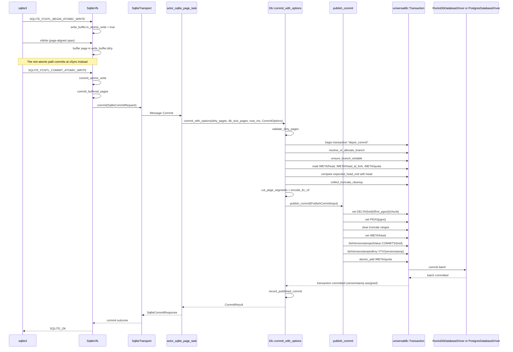
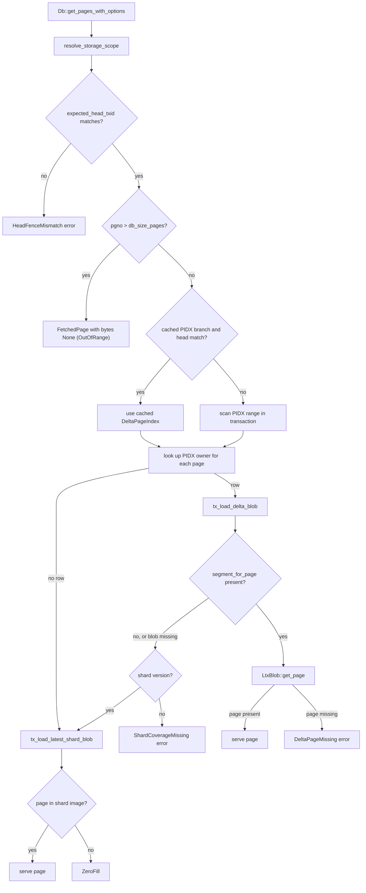

# 06 Actor SQLite and Depot

Depot turns one Actor's SQLite database into versioned records in UniversalDB. SQLite is a Structured Query Language (SQL) database engine. An Actor is the keyed durable process that Rivet runs; [03 Actors and lifecycle](03-actors-and-lifecycle.md) defines it in full. A committed SQLite transaction becomes durable, and any node can read the database later. A commit of at most 320 pages is one UniversalDB transaction. A larger commit is a staged sequence, and its finalize transaction is the atomic point that makes it visible. Depot does this with a native SQLite Virtual File System (VFS), a log of delta blobs grouped by 64-page shards, a page index, and a per-Actor branch identity. This document follows one page from the SQLite pager to the storage driver. It also follows the same page back on a read, and it explains compaction, garbage collection, quota, and the failure paths. The source of truth is commit `4a58441c50d1ce20d8803cfb1ab7c3285a5141d6`, version 2.3.31 of the Rivet workspace (`Cargo.toml`, `[workspace.package]`). All paths below are relative to `/Users/darkvoid/GitSources/src.Rivet/rivet`.

One correction shapes the whole document. In this open-source commit, the object storage bucket is not on the write path. UniversalDB has only two drivers, `RocksDbDatabaseDriver` and `PostgresDatabaseDriver` (`engine/packages/universaldb/src/driver/mod.rs:14-18`). The cold tier that writes SQLite pages to object storage is Enterprise-only (`docs-internal/engine/oss-to-ee-upgrade.md:9-20`). The open-source build keeps the cold-tier key layout and encoders, but no open-source workflow writes cold rows. This document describes the write path from SQLite through the VFS and the Depot conveyer into UniversalDB and its local driver. It names object storage only as the Enterprise cold tier.

A reader who looks for the Actor SQLite handle in `engine/packages/pegboard/src/actor_sqlite.rs` will not find it. That file is the migration module from the legacy storage layout to the branch layout. The real connection handle is the `NativeDatabase` that the VFS opens in `engine/packages/depot-client/`. Its page and commit calls reach the `Db` object in `engine/packages/depot/src/conveyer/`. This document calls the first object the connection and the second object `Db`. It cites the migration module only for the identity mapping.

## 1. What one Actor database is

An Actor has one logical SQLite database. The database has no file on a local disk. Its pages live as records under a branch identity in UniversalDB. The SQLite engine still runs a normal pager, and the pager still believes it writes a file. A VFS intercepts every file operation and converts pages into Depot reads and commits.

The storage unit is a **database branch**. A database branch has a random 16-byte identifier, `DatabaseBranchId`. The Actor identifier is the database name. A fork creates a second database whose name is `fork-{uuid}`; section 15 explains it. The namespace identifier from the request selects a bucket identifier. The rule is `BucketId::from_gas_id(namespace_id)`. Here `recipient` is the request envelope, `namespace_id` is its namespace field, and `gas_id` is the numeric namespace identifier. The bucket identifier then resolves to a bucket branch, which is the root branch that holds that bucket's database pointers. The mapping is:

| Concept | Source value | Code |
|---------|--------------|------|
| Database name | `actor_id.to_string()` | `engine/packages/pegboard/src/actor_sqlite.rs:318` |
| Bucket | `BucketId::from_gas_id(recipient.namespace_id)` | `engine/packages/pegboard/src/actor_sqlite.rs:319` |
| Depot `Db` object | `Db::new(conn.udb.clone(), conn.namespace_id, actor_id, conn.node_id)` | `engine/packages/pegboard-envoy/src/ws_to_tunnel_task.rs:2392-2397` |
| Database branch | Allocated on first commit, then resolved by pointer | `engine/packages/depot/src/conveyer/branch/resolve.rs:101-120` |
| Data prefix | `[0x02, 0x30, b'/', branch_uuid]` (subspace byte, branch partition) | `engine/packages/depot/src/conveyer/keys.rs:146-151` |

The source calls the storage layer Depot and the write coordinator the **conveyer**. The conveyer is not a separate service. It is the module `engine/packages/depot/src/conveyer/`, and its entry type is `Db`.

Read the chain in order: the `sqlite3` pager calls `SqliteVfs`, which calls a `SqliteTransport`, which calls `Db`, which opens a `universaldb::Transaction`, which the driver commits. UniversalDB is the transaction layer. `RocksDbDatabaseDriver` or `PostgresDatabaseDriver` is the durable store. The `conn` values in the table above are the envoy connection state; `conn.udb` is its UniversalDB handle.

The bucket identifier resolves through `[0x02,0x11,'/',bucket_id]/cur`. The value is a `BucketPointer { current_branch, last_swapped_at_ms }` (`engine/packages/depot/src/conveyer/types/branch.rs:41-45`). The first resolve allocates a random `BucketBranchId` (`engine/packages/depot/src/conveyer/branch/resolve.rs:35-38`).

The product documentation claims that storage is bottomless, and that a background process moves pages to a bucket. The open-source code does not do the second part. The write path ends at the UniversalDB driver. A default open-source deployment therefore has a hard storage bound: the local RocksDB disk, or the PostgreSQL database. The quota default is 10 gibibytes (GiB) for each branch before the burst rule of section 7 (`engine/packages/config/src/config/sqlite.rs:207-210`). A forked branch has its own counter, so a database with a fork can use more than 10 GiB in total. The "bottomless" property holds only in the Enterprise build, where the cold tier writes pages to object storage.

### 1.1 The two runtime paths

Two paths open an Actor database in this commit.

| Path | Where the VFS runs | Transport | Code |
|------|--------------------|-----------|------|
| Envoy path | In the Actor process, which may be a separate machine | WebSocket messages through `actor_sqlite_page_task` | `engine/packages/pegboard-envoy/src/ws_to_tunnel_task.rs:1621-1651` |
| Embedded path | In the engine process | Direct Rust calls to `Db` | `engine/packages/depot-client-embedded/src/lib.rs:29-44` |

The embedded path serves the command line interface and in-process SQL execution (`engine/packages/engine/src/commands/depot.rs:346-354`). The envoy path serves a running Actor. Both paths use the same `Db` methods and the same UniversalDB transaction. The difference is only the transport.

## 2. The SQLite connection and its settings

The SQLite connection is opened by `open_database` in `engine/packages/depot-client/src/vfs.rs:4025-4039`. That function opens the connection with the custom VFS, configures the connection, and then proves that batch atomic writes are active. The proof is a separate function. `open_database` calls `verify_batch_atomic_writes` (`vfs.rs:4104-4128`), and that function calls `assert_batch_atomic_probe` (`vfs.rs:2449-2490`).

```rust
// engine/packages/depot-client/src/vfs.rs:4025-4039
pub fn open_database(
	vfs: SqliteVfs,
	file_name: &str,
) -> std::result::Result<NativeDatabase, String> {
	open_connection(
		Arc::new(vfs),
		file_name,
		SQLITE_OPEN_READWRITE | SQLITE_OPEN_CREATE,
	)
	.and_then(|connection| {
		configure_connection_for_database(connection.as_ptr(), &connection._vfs, file_name)?;
		verify_batch_atomic_writes(connection.as_ptr(), &connection._vfs, file_name)?;
		Ok(connection)
	})
}
```

The code does not use write-ahead logging. It sets `journal_mode = DELETE`. The VFS also supports an auxiliary file, which it keeps in memory. SQLite uses that file for the rollback journal and for temporary files. The main database does not depend on that journal, because the batch atomic write groups the whole transaction and the VFS sends it as one commit.

```rust
// engine/packages/depot-client/src/vfs.rs:4079-4087
	let pragmas = [
		"PRAGMA page_size = 4096;",
		"PRAGMA journal_mode = DELETE;",
		"PRAGMA synchronous = NORMAL;",
		"PRAGMA temp_store = MEMORY;",
		"PRAGMA auto_vacuum = NONE;",
		"PRAGMA locking_mode = EXCLUSIVE;",
		cache_size_pragma.as_str(),
	];
```

| Setting | Value | Why it matters |
|---------|-------|----------------|
| `page_size` | 4096 bytes | Fixes the unit of every key and every delta frame. Defined again as `PAGE_SIZE` (`keys.rs:30`) and `DEFAULT_PAGE_SIZE` (`vfs.rs:36`). |
| `journal_mode` | `DELETE` | SQLite names its rollback journal mode this way. The VFS keeps any auxiliary file, including the rollback journal, in memory and never stores it in Depot (`vfs.rs:2627-2630`, `3398-3400`). With batch atomic writes active, the main database commit does not depend on the journal file. |
| `synchronous` | `NORMAL` | The name comes from SQLite. `NORMAL` lets SQLite skip some flushes that `FULL` would force. The code relies on the Depot commit reply for durability instead (`vfs.rs:3391-3393`). The source does not restate SQLite's definition, so this document does not claim which flush `NORMAL` skips. |
| `temp_store` | `MEMORY` | Temporary tables stay in memory and never reach Depot. |
| `auto_vacuum` | `NONE` | SQLite never rewrites the file to shrink it. Shrinking is explicit. |
| `locking_mode` | `EXCLUSIVE` | One process owns the database. The VFS lock callbacks are no-ops for this reason (`vfs.rs:3439-3463`). |
| `cache_size` | `-8192` by default, `-262144` at maximum | The configuration value `cache_size_kib` is positive, and the code writes it as `PRAGMA cache_size = -{cache_size_kib}` (`vfs.rs:4070-4077`). The negative pragma value makes SQLite treat the number as a kibibyte budget, not a page count. The default budget is 8,192 kibibytes (KiB), which is 8 mebibytes (MiB). The 262,144 KiB (256 MiB) value is the maximum that the runtime optimization settings, `SqliteOptimizationFlags`, allow (`engine/packages/depot-client/src/optimization_flags.rs:38-39`). |

The VFS name includes the Actor identifier and the generation: `format!("envoy-sqlite-{actor_id}-g{generation}")` (`engine/packages/depot-client/src/database.rs:28-30`). The caller supplies the generation when it opens the database (`engine/packages/depot-client/src/database.rs:80-84`). The generation is also fenced on every request. `GenerationFencedTransport` fills `expected_generation` when the caller leaves it empty (`database.rs:32-77`). A stale process therefore cannot write on behalf of an older generation.

### 2.1 Batch atomic writes

The VFS advertises `SQLITE_IOCAP_BATCH_ATOMIC` (`vfs.rs:3522-3537`). SQLite then groups the writes of one transaction between three file-control calls. The VFS buffers the dirty pages and sends them as one commit at the end.

```rust
// engine/packages/depot-client/src/vfs.rs:3478-3513
				match op {
					SQLITE_FCNTL_BEGIN_ATOMIC_WRITE => {
						let mut state = ctx.state.write();
						state.write_buffer.in_atomic_write = true;
						state.write_buffer.saved_db_size = state.db_size_pages;
						state.write_buffer.dirty.clear();
						SQLITE_OK
					}
					SQLITE_FCNTL_COMMIT_ATOMIC_WRITE => match ctx.commit_atomic_write() {
						Ok(()) => {
							ctx.commit_atomic_count.fetch_add(1, Ordering::Relaxed);
							SQLITE_OK
						}
						Err(err) => {
							tracing::error!(
								actor_id = %ctx.actor_id,
								last_error = ?ctx.clone_last_error(),
								?err,
								"sqlite atomic write file control failed"
							);
							if let CommitBufferError::Other(message) = &err {
								ctx.defer_transient_commit_error(message.clone());
							}
							handle_finalize_fence_error(ctx, &err);
							SQLITE_IOERR
						}
					},
					SQLITE_FCNTL_ROLLBACK_ATOMIC_WRITE => {
						let mut state = ctx.state.write();
						state.write_buffer.dirty.clear();
						state.write_buffer.in_atomic_write = false;
						state.db_size_pages = state.write_buffer.saved_db_size;
						SQLITE_OK
					}
					_ => SQLITE_NOTFOUND,
				}
```

The open path checks this behaviour with a real transaction. `assert_batch_atomic_probe` runs `BEGIN IMMEDIATE`, creates a table, inserts a row, deletes it, drops the table, and commits. It then compares the atomic-commit counter before and after. If the counter did not move, the open fails with "batch atomic writes not active for sqlite" (`vfs.rs:2450-2490`). This is a hard requirement, not an optimization.

## 3. The Virtual File System

`SqliteVfs` holds a registration handle and a boxed `VfsContext` (`vfs.rs:813-817`). Each open file is a `VfsFile` with a pointer to the context and an optional auxiliary-file handle (`vfs.rs:785-790`). The auxiliary handle is not the main database. It is an in-memory `AuxFileHandle` for a second file that SQLite opens, such as the rollback journal or a temporary file (`vfs.rs:3576-3587`). The context owns the page state, the write buffer, the transport, the page cache, and the metrics.

| Callback | Behaviour | Source |
|----------|-----------|--------|
| `xRead` | Asks the context to resolve pages, then copies bytes. A read past the file size returns `SQLITE_IOERR_SHORT_READ`. A page inside the size with no source returns zeros. | `vfs.rs:3071-3202` |
| `xWrite` | Splits the write into page-aligned spans and stores them in `write_buffer.dirty`. A full-page aligned write does not read the old page. | `vfs.rs:3205-3389` |
| `xSync` | Flushes dirty pages unless an atomic write is open. | `vfs.rs:3391-3421` |
| `xFileSize` | Returns `db_size_pages * page_size` without a round trip. | `vfs.rs:3423-3437` |
| `xLock` and `xUnlock` | Intentional no-ops. | `vfs.rs:3439-3463` |
| `xFileControl` | Implements the three atomic-write operations. | `vfs.rs:3465-3516` |
| `xDeviceCharacteristics` | Advertises `SQLITE_IOCAP_BATCH_ATOMIC`. | `vfs.rs:3522-3537` |

`xRead` reports at the file level. It returns `SQLITE_IOERR_SHORT_READ` when it can supply fewer bytes than SQLite asked for (`vfs.rs:3071-3202`). The Depot read path in section 11 decides what a missing page means. The VFS then turns that answer into bytes, zeros, or a short read.

The dirty buffer is the centre of the design. `xWrite` never sends a page to the engine. It records the page and returns. A partial-page write first loads the current page, merges the new bytes, and stores the result, so the buffer always holds a full 4096-byte page. The engine sees the pages only when the transaction ends. One SQLite transaction therefore maps to one logical Depot commit. A commit above 320 pages is sent as several UniversalDB transactions with one finalize, and section 8 explains that case.

```rust
// engine/packages/depot-client/src/vfs.rs:2132-2161
	fn flush_dirty_pages(
		&self,
	) -> std::result::Result<Option<BufferedCommitOutcome>, CommitBufferError> {
		match self.flush_dirty_pages_with_timeout(None)? {
			CommitWait::Completed(outcome) => Ok(outcome),
			CommitWait::TimedOut => Err(CommitBufferError::Other(
				"sqlite commit timed out".to_string(),
			)),
		}
	}

	fn flush_dirty_pages_with_timeout(
		&self,
		timeout: Option<Duration>,
	) -> std::result::Result<CommitWait<Option<BufferedCommitOutcome>>, CommitBufferError> {
		let total_start = Instant::now();
		let request_build_start = Instant::now();
		let request = {
			let state = self.state.read();
			if state.dead {
				return Err(CommitBufferError::Other(
					"sqlite actor lost its fence".to_string(),
				));
			}
			if state.write_buffer.in_atomic_write
				|| (state.write_buffer.dirty.is_empty()
					&& state.db_size_pages == state.committed_db_size_pages)
			{
				return Ok(CommitWait::Completed(None));
			}
```

The early return is important. When `in_atomic_write` is true, `xSync` sends nothing. The commit already happened at `SQLITE_FCNTL_COMMIT_ATOMIC_WRITE`. A main-database write always takes that path, because the open fails when the atomic probe fails. The `xSync` commit branch therefore serves a call that SQLite makes outside an atomic write. The source does not name the SQLite call that reaches this branch when batch atomic writes are active. FoundationDB (FDB) is the database whose transaction model UniversalDB follows. For an auxiliary file, `xSync` returns `SQLITE_OK` at once, because that file is memory only (`vfs.rs:3398-3400`).

```rust
// engine/packages/depot-client/src/vfs.rs:3391-3421
/// xSync returns once `ctx.flush_dirty_pages()` resolves. Durability of those
/// bytes is delegated to depot's `sqlite_commit` reply. If pegboard-envoy ever
/// pre-acks before the FDB tx commit, xSync's durability contract is broken.
unsafe extern "C" fn io_sync(p_file: *mut sqlite3_file, _flags: c_int) -> c_int {
	unsafe {
		vfs_catch_unwind!(SQLITE_IOERR_FSYNC, {
			let file = get_file(p_file);
			if get_aux_state(file).is_some() {
				return SQLITE_OK;
			}
			let ctx = &*file.ctx;
			if let Some(message) = ctx.take_transient_commit_error() {
				ctx.set_last_error(message);
				return SQLITE_IOERR_FSYNC;
			}
			match ctx.flush_dirty_pages() {
				Ok(_) => SQLITE_OK,
				Err(err) => {
					tracing::error!(
						actor_id = %ctx.actor_id,
						last_error = ?ctx.clone_last_error(),
						?err,
						"sqlite sync failed"
					);
					handle_finalize_fence_error(ctx, &err);
					SQLITE_IOERR_FSYNC
				}
			}
		})
	}
}
```

[07 UniversalDB and buckets](07-universaldb-and-buckets.md) explains how UniversalDB applies that model over its RocksDB and PostgreSQL drivers.

After a successful commit, the VFS updates its local head and copies the committed pages into its page cache (`vfs.rs:2239-2249`). SQLite can then reread its own writes without another round trip. The cache is not permanent. `cache_committed_page` keeps a page only when `staging_cache_ttl_ms` (the page time to live, TTL, in milliseconds) is not zero. The page cache mode must not be `Off`; the modes are `Off`, `Target`, `Startup`, `Prefetch`, and `All` (`optimization_flags.rs:48-55`, `vfs.rs:1306-1311`).

**Aha:** The VFS buffers the whole transaction and sends it once. The obvious alternative is a write-through VFS that sends each page when SQLite writes it. That alternative costs one network round trip for each page, and it makes a torn transaction visible to other readers. The buffer costs memory for one transaction, which is bounded by `MAX_COMMIT_DIRTY_PAGES` (32,768 pages). The buffer itself is `WriteBuffer.dirty`, a `BTreeMap` keyed by page number (`vfs.rs:664-668`).

## 4. The transport: envoy and embedded

The embedded transport is a thin adapter. Each VFS request becomes one `Db` call.

```rust
// engine/packages/depot-client-embedded/src/lib.rs:19-44
pub struct EmbeddedDepotSqliteTransport {
	db: Arc<depot::conveyer::Db>,
}

impl EmbeddedDepotSqliteTransport {
	pub fn new(db: Arc<depot::conveyer::Db>) -> Self {
		Self { db }
	}
}

pub async fn open_database_from_embedded_depot(
	db: Arc<depot::conveyer::Db>,
	actor_id: String,
	generation: u64,
	rt_handle: Handle,
	metrics: Option<Arc<dyn SqliteVfsMetrics>>,
) -> Result<NativeDatabaseHandle> {
	open_database_from_transport(
		Arc::new(EmbeddedDepotSqliteTransport::new(db)),
		actor_id,
		generation,
		rt_handle,
		metrics,
	)
	.await
}
```

The transport trait has five methods, and the embedded implementation maps each one to one `Db` method (`engine/packages/depot-client-embedded/src/lib.rs:47-227`): `get_pages`, `commit`, `commit_stage_begin`, `commit_stage_segment`, and `commit_finalize`.

The envoy transport sends protocol messages over the Actor tunnel. `actor_sqlite_page_task` serializes all page and commit work for one `(actor_id, generation)` pair. The task handles five message kinds.

```rust
// engine/packages/pegboard-envoy/src/actor_sqlite_page_task.rs:28-37
#[derive(Debug)]
pub(super) enum Message {
	GetPages(protocol::ToRivetSqliteGetPagesRequest),
	Commit(protocol::ToRivetSqliteCommitRequest),
	// Staged commits share this task with the single-shot path so one actor's stage, its segments
	// and its finalize are serialized against each other and against its ordinary commits.
	StageBegin(protocol::ToRivetSqliteCommitStageBeginRequest),
	StageSegment(protocol::ToRivetSqliteCommitStageSegmentRequest),
	Finalize(protocol::ToRivetSqliteCommitFinalizeRequest),
}
```

The serialization is a correctness condition, not a performance choice. A staged commit is three or more messages. If another commit could run between them, two writers could allocate the same txid (the commit number of one branch, defined in section 5) or finalize the wrong stage. The task key includes the Actor generation, so a new generation gets a new task (`engine/packages/pegboard-envoy/src/actor_sqlite_page_task.rs:13-26`). A new generation is not a process restart. It is a new open of the same Actor database, and section 15 explains the identity.

The engine side resolves one `Db` for each Actor and keeps it in a connection map. The entry is created with a compaction signaler unless compaction is disabled.

```rust
// engine/packages/pegboard-envoy/src/ws_to_tunnel_task.rs:2384-2397
async fn actor_db(ctx: &StandaloneCtx, conn: &Conn, actor_id: String) -> Result<Arc<Db>> {
	let compaction_disabled = ctx.config().sqlite().unstable_disable_compaction();
	let config = ctx.config().clone();
	let db = conn
		.actor_dbs
		.entry_async(actor_id.clone())
		.await
		.or_insert_with(|| {
			if compaction_disabled {
				return Arc::new(
					Db::new(conn.udb.clone(), conn.namespace_id, actor_id, conn.node_id)
						.with_config(config),
				);
			}
```

The rest of the closure, at `ws_to_tunnel_task.rs:2399-2434`, builds a compaction signaler and calls `Db::new_with_compaction_signaler`. The signaler dispatches a `DbManagerInput` workflow with the `unique()` tag.

Read the early `return` inside the closure. When compaction is disabled, the closure returns `Db::new` at `ws_to_tunnel_task.rs:2392-2397`. The signaler code below that `return` runs only when compaction is enabled.

Note the default. `unstable_disable_compaction()` returns `true` unless the operator sets it to `false` (`engine/packages/config/src/config/sqlite.rs:216-219`). A default open-source deployment therefore runs **no compaction workflows**. The read and commit paths still work. The database keeps every delta forever, until the quota refuses new writes.

## 5. The Depot data model

All Depot keys start with the database subspace byte `0x02`. The next byte is a partition.

The short names in the key space come from the source. `PIDX` is the page index. `LTX` is the page-container format, and the source does not expand that name. `SHARD` holds a complete image of one 64-page shard. `DELTA` holds the pages one commit wrote. `DBPTR` is the database pointer. `BRANCHES` (partition `0x20`) holds branch records, and `BR` (partition `0x30`) is the data prefix of one branch. `CMP` is compaction state. `VTX` is the versionstamp-to-txid index. `META` is metadata. The document expands each one again where it first uses it.

The constants block also shows partitions that this document does not trace: `CTR`, `CMPC`, `DB_PIN`, `BUCKET_FORK_PIN`, `BUCKET_CHILD`, `BUCKET_CATALOG_BY_DB`, `BUCKET_PROOF_EPOCH`, `SQLITE_CMP_DIRTY`, and `CMP_THROTTLE`. They belong to other Depot paths. Section 15 traces `DB_BRANCH_OWNER` with the owner index.

Four more terms are used throughout. A `txid` is the monotonic commit number of one branch. A versionstamp is the 16-byte commit version that the underlying driver supplies for a commit. A shard is 64 consecutive pages (`SHARD_SIZE`, `engine/packages/depot-client-types/src/lib.rs:13`). A `vbare-versioned` value starts with a 2-byte version number and then holds a record in the BARE binary encoding. `vbare` is the project's versioned wrapper around that encoding (`engine/packages/depot/src/conveyer/types/storage.rs:37-57`). The source does not expand BARE; this document treats it as an opaque format name.

In the key tables, `beN` means N bytes in big-endian order. A bare number in braces, such as `{versionstamp:16}`, means that many raw bytes.

```rust
// engine/packages/depot/src/conveyer/keys.rs:9-30
pub const SQLITE_SUBSPACE_PREFIX: u8 = 0x02;
pub const DBPTR_PARTITION: u8 = 0x10;
pub const BUCKET_PTR_PARTITION: u8 = 0x11;
pub const BUCKET_CATALOG_PARTITION: u8 = 0x12;
pub const BRANCHES_PARTITION: u8 = 0x20;
pub const BUCKET_BRANCH_PARTITION: u8 = 0x21;
pub const BR_PARTITION: u8 = 0x30;
pub const CTR_PARTITION: u8 = 0x40;
pub const RESTORE_POINT_PARTITION: u8 = 0x50;
pub const CMPC_PARTITION: u8 = 0x60;
pub const DB_PIN_PARTITION: u8 = 0x70;
pub const BUCKET_FORK_PIN_PARTITION: u8 = 0x71;
pub const BUCKET_CHILD_PARTITION: u8 = 0x72;
pub const BUCKET_CATALOG_BY_DB_PARTITION: u8 = 0x73;
pub const BUCKET_PROOF_EPOCH_PARTITION: u8 = 0x74;
pub const SQLITE_CMP_DIRTY_PARTITION: u8 = 0x75;
/// Retired: the compaction throttle's window counters moved into UniversalDB's own keyspace. Kept so
/// the byte is not reused, and because the last few windows written before the move are ephemeral
/// residue nothing clears any more.
pub const CMP_THROTTLE_PARTITION: u8 = 0x76;
pub const DB_BRANCH_OWNER_PARTITION: u8 = 0x77;
pub const PAGE_SIZE: u32 = 4096;
```

The database branch base is the prefix of every per-database record.

```rust
// engine/packages/depot/src/conveyer/keys.rs:146-160
fn database_branch_base(branch_id: DatabaseBranchId) -> Vec<u8> {
	let mut key = partition_prefix(BR_PARTITION);
	key.push(b'/');
	append_uuid(&mut key, branch_id.as_uuid());
	key
}

fn database_pointer_base(bucket_branch_id: BucketBranchId, database_id: &str) -> Vec<u8> {
	let mut key = partition_prefix(DBPTR_PARTITION);
	key.push(b'/');
	append_uuid(&mut key, bucket_branch_id.as_uuid());
	key.push(b'/');
	append_database_id(&mut key, database_id);
	key
}
```

The database name is appended as raw bytes. It is not length-prefixed and it is not escaped. That is safe for these keys when the identifier has no `/`. Every key under a database branch starts with a `/` from the branch base. Every key under a pointer continues with the fixed suffix `/cur` (`keys.rs:197-202`). The source does not reject a `/` or another separator in the identifier, so this document does not claim key uniqueness for such an identifier.

| Record | Key | Value encoding | Purpose |
|--------|-----|----------------|---------|
| Database pointer | `[0x02,0x10,'/',bucket_branch_uuid,'/',database_id,'/cur']` | vbare-versioned `DatabasePointer` | Current branch for an Actor database |
| Bucket pointer | `[0x02,0x11,'/',bucket_id]/cur` | vbare-versioned `BucketPointer` | Current bucket branch, allocated on first resolve (`branch/resolve.rs:35-38`) |
| Branch record | `[0x02,0x20]/list/{uuid}` | vbare-versioned `DatabaseBranchRecord` | Lifecycle state, generation, parent. `list` is a literal path segment (`LIST_PATH`, `keys.rs:69`). |
| Head | `[0x02,0x30,'/',branch_uuid]/META/head` | vbare-versioned `DBHead` | Current txid and size |
| Head at fork | `[0x02,0x30,'/',branch_uuid]/META/head_at_fork` | vbare-versioned `DBHead` | Fork snapshot until the first local commit |
| Quota | `[0x02,0x30,'/',branch_uuid]/META/quota` | 8-byte little-endian `i64` | Billable bytes |
| Commit row | `[0x02,0x30,'/',branch_uuid]/COMMITS/{txid:be8}` | vbare-versioned `CommitRow` | Wall clock, versionstamp, size, checksum |
| Versionstamp index | `[0x02,0x30,'/',branch_uuid]/VTX/{versionstamp:16}` | 8-byte big-endian `u64` | Versionstamp to txid |
| Page index | `[0x02,0x30,'/',branch_uuid]/PIDX/{pgno:be4}` | 8-byte big-endian `u64` | Owning txid for a page |
| Delta segment | `[0x02,0x30,'/',branch_uuid]/DELTA/{txid:be8}/{first_pgno:be4}/{chunk:be4}` | LTX bytes | Compressed pages of one range |
| Shard version | `[0x02,0x30,'/',branch_uuid]/SHARD/{shard:be4}/{as_of_txid:be8}/{chunk:be4}` | LTX bytes | Folded image of 64 pages |
| Compaction root | `[0x02,0x30,'/',branch_uuid]/CMP/root` | vbare-versioned `CompactionRoot` | Watermarks and generation |
| Fold index | `[0x02,0x30,'/',branch_uuid]/CMP/fold/{as_of_txid:be8}` | vbare-versioned `FoldIndexEntry` | Shard identifiers and versionstamp of one fold (`keys.rs:50`, `564-588`; `db_hot_compactor.rs:1281-1288`) |
| Staged hot shard | `[0x02,0x30,'/',branch_uuid]/CMP/stage/{job_id}/hot_shard/...` | LTX bytes, chunked | Work written by a hot job before install (`keys.rs:47`, `653-686`); section 13 defines the job. |

The page index key is the clearest example of the style.

```rust
// engine/packages/depot/src/conveyer/keys.rs:840-848
pub fn branch_pidx_key(branch_id: DatabaseBranchId, pgno: u32) -> Vec<u8> {
	let mut key = with_suffix(database_branch_base(branch_id), BR_PIDX_PATH);
	key.extend_from_slice(&pgno.to_be_bytes());
	key
}

pub fn branch_pidx_prefix(branch_id: DatabaseBranchId) -> Vec<u8> {
	with_suffix(database_branch_base(branch_id), BR_PIDX_PATH)
}
```

A big-endian page number keeps key order equal to page order. A range scan over `PIDX` therefore returns pages in ascending order. The hot compaction planner (section 13) can then cut a slice at a page boundary without sorting. A slice is one drain batch of deltas.

### 5.1 DELTA keys and the two layouts

A delta is an LTX blob that holds the pages one commit wrote. A commit now stores one blob for each shard-aligned page range. The source still reads the older layout, where one commit had one blob split directly into chunks.

```rust
// engine/packages/depot/src/conveyer/keys.rs:869-903
pub fn branch_delta_prefix(branch_id: DatabaseBranchId) -> Vec<u8> {
	with_suffix(database_branch_base(branch_id), DELTA_PATH)
}

pub fn branch_delta_chunk_prefix(branch_id: DatabaseBranchId, txid: u64) -> Vec<u8> {
	let mut key = branch_delta_prefix(branch_id);
	key.extend_from_slice(&txid.to_be_bytes());
	key.push(b'/');
	key
}

pub fn branch_delta_chunk_key(branch_id: DatabaseBranchId, txid: u64, chunk_idx: u32) -> Vec<u8> {
	let mut key = branch_delta_chunk_prefix(branch_id, txid);
	key.extend_from_slice(&chunk_idx.to_be_bytes());
	key
}

/// Prefix of one delta segment's chunk rows.
///
/// A segment is a self-contained LTX blob covering a shard-aligned page range of one commit, keyed
/// by the first page number it carries. Keying by first page rather than by an ordinal is what makes
/// the segment holding page `P` findable with a single reverse range read over
/// `[branch_delta_chunk_prefix(txid), branch_delta_segment_prefix(txid, P + 1))`: segments are
/// ascending and disjoint, so the last one at or below `P` is the only one that can hold it. An
/// ordinal would need a manifest, or a scan that grows with segment count.
pub fn branch_delta_segment_prefix(
	branch_id: DatabaseBranchId,
	txid: u64,
	first_pgno: u32,
) -> Vec<u8> {
	let mut key = branch_delta_chunk_prefix(branch_id, txid);
	key.extend_from_slice(&first_pgno.to_be_bytes());
	key.push(b'/');
	key
}
```

The reader tells the layouts apart by suffix width. A bare 4-byte suffix is a legacy chunk index. A suffix with a 4-byte first page, a separator, and a 4-byte chunk index is a segment. A txid is written in exactly one layout (`keys.rs:965-977`).

A segment's key carries the start of the shard-aligned page range it covers, not the lowest dirty page in the commit. The source comment's phrase "the first page number it carries" means the first page of that covered range; the blob may not contain that page. The function below is the precise rule. `segment_first_pgno` rounds down to a multiple of `SHARD_SIZE` (`engine/packages/depot/src/conveyer/delta_blob.rs:72-76`). Two commits that dirty different pages of the same shard run therefore use the same key boundary. That is what lets compaction fold any prefix of a commit's segments into complete shard images. The boundary can name a page the commit does not carry, and section 7.1 shows one such case.

### 5.2 The record types

```rust
// engine/packages/depot/src/conveyer/types/storage.rs:16-35
#[derive(Debug, Clone, PartialEq, Eq, Serialize, Deserialize)]
pub struct CommitRow {
	pub wall_clock_ms: i64,
	pub versionstamp: [u8; 16],
	pub db_size_pages: u32,
	pub post_apply_checksum: u64,
}

#[derive(Debug, Clone, PartialEq, Eq, Serialize, Deserialize)]
pub struct DBHead {
	pub head_txid: u64,
	pub db_size_pages: u32,
	pub post_apply_checksum: u64,
	pub branch_id: DatabaseBranchId,
}

#[derive(Debug, Clone, PartialEq, Eq, Serialize, Deserialize)]
pub struct MetaCompact {
	pub materialized_txid: u64,
}
```

| Field | Type | Purpose |
|-------|------|---------|
| `CommitRow.wall_clock_ms` | `i64` | Commit time in milliseconds, used by restore-point and point-in-time recovery (PITR) selection. |
| `CommitRow.versionstamp` | `[u8; 16]` | UniversalDB commit version, filled by `SetVersionstampedValue`. |
| `CommitRow.db_size_pages` | `u32` | Database size after this commit. |
| `CommitRow.post_apply_checksum` | `u64` | Checksum after the commit. The current code copies the previous value; it does not compute a new one. |
| `DBHead.head_txid` | `u64` | Latest committed txid. |
| `DBHead.db_size_pages` | `u32` | Page count at the head. A read above this value returns no bytes. |
| `DBHead.post_apply_checksum` | `u64` | Checksum carried from the previous head into the new head and the commit row. The commit path does not compute a new value (`publish.rs:109-120`). |
| `DBHead.branch_id` | `DatabaseBranchId` | Branches the head to its branch record. |
| `MetaCompact.materialized_txid` | `u64` | Legacy compaction marker at `BR/{uuid}/META/compact` (`keys.rs:451-453`). No open-source workflow reads or writes it; workflow compaction uses `CompactionRoot` instead. |

**Aha:** The head does not store a page list. The page index does. The obvious alternative is to store the page list in the head. That would make every commit rewrite a value whose size grows with the database, and it would turn the head into the hottest key in the system. The separate `PIDX` rows spread the write across one key per page. The head stays one fixed-size value: two 64-bit integers, one 32-bit integer, and one 16-byte identifier, plus the version prefix. The cost is that a reader must fetch `PIDX` rows in a second range read.

## 6. The head and the write fence

Every commit carries `expected_head_txid` when the caller supplies it, and every read may carry one. The engine compares it with the head it read inside its own transaction. A mismatch returns `SqliteStorageError::HeadFenceMismatch` and logs an error that names the cause: two Actor instances touched one database (`engine/packages/depot/src/conveyer/commit/apply.rs:210-223`).

The fence is optimistic. There is no lock and no lease on the write path. Pegboard, the scheduler that document 04 explains, guarantees one Actor process for one Actor identifier. The generation fence has two halves. `GenerationFencedTransport` fills `expected_generation` on the client when the caller leaves it empty. The storage layer records that number in the stage row, compares it at finalize, and rejects a stale generation. If that guarantee breaks, the head fence turns silent corruption into a visible error.

A staged commit uses a different fence. `commit_stage_begin` allocates `txid = head + 1`, and `commit_finalize` requires `txid == head + 1` at finalize time (`engine/packages/depot/src/conveyer/commit/stage.rs:439-448`). A second writer that advanced the head makes the finalize fail. The stage row also carries the Actor generation, and finalize rejects a stage from a different generation (`stage.rs:459-467`).

## 7. The single-shot commit

`Db::commit_with_options` is the entry point (`engine/packages/depot/src/conveyer/commit/apply.rs:48-410`). It takes the dirty pages, the new database size, the wall-clock time, and `CommitOptions { expected_head_txid, disable_size_cap }`.

The first step validates the page set.

```rust
// engine/packages/depot/src/conveyer/commit/apply.rs:475-516
fn validate_dirty_pages(dirty_pages: &[DirtyPage], disable_size_cap: bool) -> Result<()> {
	let mut seen = BTreeSet::new();
	let mut actual_size_bytes = 0_u64;
	for page in dirty_pages {
		ensure!(page.pgno > 0, "sqlite commit does not accept page 0");
		ensure!(
			page.bytes.len() == keys::PAGE_SIZE as usize,
			"sqlite commit page {} had {} bytes, expected {}",
			page.pgno,
			page.bytes.len(),
			keys::PAGE_SIZE
		);
		ensure!(
			seen.insert(page.pgno),
			"sqlite commit duplicated page {} in a single request",
			page.pgno
		);
		actual_size_bytes =
			actual_size_bytes.saturating_add(u64::try_from(page.bytes.len()).unwrap_or(u64::MAX));
	}

	if dirty_pages.len() > MAX_SINGLE_SHOT_COMMIT_DIRTY_PAGES
		|| actual_size_bytes > MAX_SINGLE_SHOT_COMMIT_RAW_DIRTY_BYTES as u64
	{
		tracing::warn!(
			dirty_pages = dirty_pages.len(),
			actual_size_bytes,
			max_dirty_pages = MAX_SINGLE_SHOT_COMMIT_DIRTY_PAGES,
			max_size_bytes = MAX_SINGLE_SHOT_COMMIT_RAW_DIRTY_BYTES,
			"sqlite commit exceeds the engine-side single-shot size cap"
		);
		if !disable_size_cap {
			return Err(SqliteStorageError::CommitTooLarge {
				actual_size_bytes,
				max_size_bytes: MAX_SINGLE_SHOT_COMMIT_RAW_DIRTY_BYTES as u64,
			}
			.into());
		}
	}

	Ok(())
}
```

`MAX_SINGLE_SHOT_COMMIT_DIRTY_PAGES` is 320, and `MAX_SINGLE_SHOT_COMMIT_RAW_DIRTY_BYTES` is 320 × 4096 = 1,310,720 bytes (`engine/packages/depot/src/conveyer/constants.rs:186-188`). The engine enforces the cap even when the client also enforces it, because an envoy is not trusted (`constants.rs:183-185`).

The commit then runs one UniversalDB transaction with the name `depot_commit`. Inside it:

1. Charge the actor throttle on both budgets, reads and writes (`apply.rs:136-141`). The throttle is a UniversalDB limiter for one Actor, not for one branch. `ThrottleCharge::Both` is correct because a commit reads the branch, head, and truncate range and also writes. The engine waits at most 1,000 milliseconds (ms) in 25 ms steps before it opens the transaction (`engine/packages/depot/src/conveyer/db.rs:143-146`).
2. Resolve or allocate the branch (`apply.rs:143-144`).
3. Check that the branch is writable (`apply.rs:154-159`).
4. Load or reuse the branch ancestry (`apply.rs:160-168`). The ancestry is the chain from this branch back through its forks to the root; section 15 explains forks.
5. Read the head, the head-at-fork value, and the quota (`apply.rs:175-202`).
6. Compare the head fence (`apply.rs:204-223`).
7. Collect truncate cleanup (`apply.rs:278-284`).
8. Cut the pages into shard-aligned segments, encode each as LTX V3, and split it into chunk rows (`apply.rs:301-325`).
9. Publish the commit (`apply.rs:346-376`).
10. Measure the transaction size with `tx.approximate_size()` and record it in the `SQLITE_COMMIT_TRANSACTION_BYTES` metric (`apply.rs:382-390`). `approximate_size` is a calibrated model of what FoundationDB would charge, not an accounting (`engine/packages/universaldb/src/tx_ops.rs:101-130`). It adds 44 bytes of framing to each mutation, which is one set or clear operation in the transaction. It adds 32 bytes to each conflict range, which is the key range UniversalDB records to detect a conflicting write. UniversalDB applies this model for drivers that have no transaction accounting of their own (`tx_ops.rs:107-128`). The model is calibrated against the finalize transaction: the source records that 60,146 pages publishes and 62,152 fails with `transaction_too_large` (`engine/packages/depot-client-types/src/lib.rs:18-33`, `engine/packages/universaldb/src/tx_ops.rs:112-116`). Those sizes are above the 32,768-page commit cap. They measure the driver ceiling, not a commit the cap admits, and the source does not say how the test bypassed the cap. The 32,768-page cap is half of that measured ceiling; the 320-page cap is the separate single-shot limit.
11. After the transaction commits, update the caches and signal compaction (`apply.rs:401-404`).

The sequence below shows the same commit as it crosses each layer. This is the envoy path. The embedded path in section 1.1 replaces `SqliteTransport` and `actor_sqlite_page_task` with one direct `Db` call. The participant names are the real types and functions in the path. `sqlite3` is the C library that runs the pager. `SqliteCommitRequest` is the protocol payload type; the envoy enum wraps it as `ToRivetSqliteCommitRequest`. The VFS builds it from the `BufferedCommitRequest` of section 7.1.



The driver applies the batch. Each driver supplies a versionstamp from its commit version, and the two versionstamped rows receive it before the transaction returns. The caller writes an incomplete marker and does not choose the value (`engine/packages/universaldb/src/driver/rocksdb/transaction_task.rs:329-342`, `engine/packages/universaldb/src/driver/postgres/resolver/apply.rs:147-160`). The diagram shows the layer crossings; it omits three steps that stay inside one participant: the actor throttle, the branch ancestry cache reuse, and the access touch inside `publish_commit`.

Step 9 is the shared publish sequence. The single-shot path and the staged path both call `publish_commit`, so they write the same row set through the same code. The one input that differs is `delta_chunks`. The single-shot path passes the encoded chunks. The staged path passes an empty list, because its segments already wrote and charged those chunks in earlier transactions. `publish_commit` then writes the PIDX rows, the head, the commit and versionstamp rows, and the quota change for both paths.

```rust
// engine/packages/depot/src/conveyer/commit/publish.rs:184-226
	let phase_start = Instant::now();
	for (key, value) in &delta_chunks {
		tx.informal().set(key, value);
	}
	metrics::observe_commit_phase(&phase_node_id, "write_delta_chunks", phase_start, "ok");
	#[cfg(feature = "test-faults")]
	maybe_fire_commit_fault(
		&fault_controller,
		&database_id,
		CommitFaultPoint::BeforePidxWrites,
		Some(branch_id),
	)
	.await?;
	let phase_start = Instant::now();
	for pgno in &dirty_pgnos {
		tx.informal()
			.set(&keys::branch_pidx_key(branch_id, *pgno), &txid_bytes);
	}
	for row in &truncate_cleanup.pidx_clears {
		fence_truncate_cleanup_row(tx, row).await?;
		tx.informal().clear(&row.key);
	}
	for row in &truncate_cleanup.shard_clears {
		fence_truncate_cleanup_row(tx, row).await?;
		tx.informal().clear(&row.key);
	}
	for (key, value) in &truncate_cleanup.shard_writes {
		tx.informal().set(key, value);
	}
	metrics::observe_commit_phase(&phase_node_id, "write_page_index", phase_start, "ok");
	#[cfg(feature = "test-faults")]
	maybe_fire_commit_fault(
		&fault_controller,
		&database_id,
		CommitFaultPoint::BeforeHeadWrite,
		Some(branch_id),
	)
	.await?;
	let phase_start = Instant::now();
	tx.informal().set(&head_key, &encoded_head);
	if head_at_fork_bytes.is_some() {
		tx.informal().clear(&head_at_fork_key);
	}
```

The rest of `publish_commit`, which takes a `PublishCommitInput`, writes the bucket-branch record and the database-branch record on first use, then the two versionstamped rows (`publish.rs:228-266`).

The two versionstamped rows must be in the same transaction. The `COMMITS` row and the `VTX` row use UniversalDB versionstamps. A versionstamp is assigned at commit time, so the code writes an incomplete marker and asks UniversalDB to fill it. `VTX` uses `SetVersionstampedKey`, so the versionstamp is in the key. `COMMITS` uses `SetVersionstampedValue`, so the same versionstamp is in the value. Because both writes share one commit, both rows agree without a second round trip.

The quota add comes last, together with the access touch (`publish.rs:275-289`). The quota value is a fixed-width little-endian `i64`, changed by an atomic add. An access touch records the last 60-second time bucket that touched the branch. A time bucket is the index `now_ms / 60_000`, not the storage bucket. The touch writes `/META/manifest/last_access_bucket` with that index and `/META/manifest/last_access_ts_ms` with the time. It writes only when the bucket advances, so a busy branch writes about one touch per minute (`ACCESS_TOUCH_THROTTLE_MS`, `constants.rs:16`, `keys.rs:492`, `db.rs:296-331`). The key helper `ctr_eviction_index_key` exists, but no open-source writer fills that index at this commit (`keys.rs:1230-1240`). `/META/manifest/` is a key path for access records, not a manifest object. The touch does not change the quota.

```rust
// engine/packages/depot/src/conveyer/quota.rs:26-36
pub fn atomic_add_branch(
	tx: &universaldb::Transaction,
	branch_id: DatabaseBranchId,
	delta_bytes: i64,
) {
	tx.informal().atomic_op(
		&keys::branch_meta_quota_key(branch_id),
		&delta_bytes.to_le_bytes(),
		MutationType::Add,
	);
}
```

The default cap is 10 GiB (`engine/packages/config/src/config/sqlite.rs:207-210`). This is the base cap. The commit path calls this value the hot cap: it is the limit that `cap_check_with_cap` compares with the new total (`publish.rs:167-174`).

Burst mode doubles the hot cap when the head is at least 2048 txids above the cold watermark (`engine/packages/depot/src/conveyer/constants.rs:18-22`, `engine/packages/depot/src/burst_mode.rs:20-28`). The cold watermark is the txid below which the cold tier has published every page; section 13.1 defines it with the other compaction terms.

In the open-source build no workflow publishes a cold tier, so the cold watermark stays at zero. After 2048 commits the lag condition is therefore always true, and the effective cap is 20 GiB. The source does not discuss this consequence. Burst mode is not gated by the compaction setting; it reads the watermark, and that watermark stays zero when compaction is disabled.

### 7.1 A concrete commit

Take an Actor with identifier `actor-a`. It has an allocated branch with a universally unique identifier (UUID) `9f3c...`. The head is at txid 6, and the database has 2 pages. SQLite commits 3 dirty pages: page 1, page 2, and page 3. The new database size is 3 pages.

The VFS learned head 6 from the `get_pages` reply during open (`engine/packages/depot-client/src/vfs.rs:1431`, `2002-2004`). It advances its copy after each commit (`vfs.rs:2243-2245`). The VFS buffers the three pages. `SQLITE_FCNTL_COMMIT_ATOMIC_WRITE` calls `commit_atomic_write`, which builds `BufferedCommitRequest { actor_id: "actor-a", new_db_size_pages: 3, expected_head_txid: Some(6), dirty_pages: [1, 2, 3] }`. Because the count is 3 and the threshold is 320, the request takes the fast path (`engine/packages/depot-client/src/vfs.rs:2647-2649`).

The engine resolves `DBPTR/{bucket_branch}/actor-a/cur` to branch `9f3c...`. It reads `/META/head` and finds `head_txid = 6`. The fence passes. The txid is `7`.

All three pages fall in shard 0, because `1 / 64 = 2 / 64 = 3 / 64 = 0`. Shard 0 covers pages 0 to 63. `cut_page_segments` therefore produces one segment whose key boundary is `first_pgno = 0`. The boundary is the start of the shard-aligned range, so it names page 0 even though the commit does not carry page 0 and page 0 is never stored. The segment is one LTX blob. The blob has a 100-byte header, three page frames, one sentinel, a three-entry varint index, an index size, and a zero trailer. The blob is split into values of `CHUNK_SIZE` = 10,000 bytes under `DELTA/7/0/{chunk}` (`engine/packages/universaldb/src/utils/mod.rs:15`).

The transaction then writes:

| Key | Value |
|-----|-------|
| `.../DELTA/7/0/0` (and later chunks) | LTX bytes |
| `.../PIDX/1`, `.../PIDX/2`, `.../PIDX/3` | `7` as 8-byte big-endian |
| `.../META/head` | `DBHead { head_txid: 7, db_size_pages: 3, post_apply_checksum: (copied from head 6), branch_id: 9f3c... }` |
| `.../COMMITS/7` | `CommitRow { wall_clock_ms, versionstamp: [incomplete], db_size_pages: 3, ... }` |
| `.../VTX/{versionstamp}` | `7` as 8-byte big-endian |
| `.../META/quota` | previous value plus the new bytes |

If the process dies before the transaction commits, UniversalDB applies none of these rows. The next commit reads head 6 and tries txid 7 again. If the transaction commits and the reply is lost while the VFS survives, the VFS may retry the same commit because it never saw the reply, with `expected_head_txid = 6`. The engine rejects it with a head fence error. The client treats that error as fatal for the Actor instance, not as a retryable write. If the process itself died, the next owner reads head 7 and never sends the old expected value.

### 7.2 The cached page index

After the UniversalDB transaction, `record_published_commit` updates the in-process caches (`publish.rs:311-382`). The rule is strict: a cached page index is trusted only when the commit advances the head it was built at. Any other txid means another writer published in between, and the cache is reset.

The source states why this is not an optional optimization. A commit that advanced the head without touching the cache would leave a snapshot that the next commit adopts and stamps with its own txid. That would hide the pages in between from every read that trusts the cache (`publish.rs:305-310`).

## 8. The staged commit

A commit above 320 dirty pages cannot take the single-shot path. The VFS then stages it in segments and finalizes it.

```rust
// engine/packages/depot-client/src/vfs.rs:2631-2649
/// Dirty pages above which a commit is staged in segments rather than sent as one message.
///
/// Matches the engine's single-shot cap. A commit at or under it fits one FDB transaction with its
/// page bytes included, so it takes the single round trip; anything larger has to be staged because
/// the engine would reject it, not merely because staging is faster.
///
/// Kept as its own value rather than imported, since the engine is free to lower its cap and this
/// side must keep working against an engine on either side of that change. Sending a single-shot
/// commit the engine refuses fails the commit, while staging one it would have accepted only costs
/// extra round trips.
const COMMIT_STAGE_THRESHOLD_PAGES: usize = 320;

async fn commit_buffered_pages(
	transport: &dyn SqliteTransport,
	request: BufferedCommitRequest,
) -> std::result::Result<(BufferedCommitOutcome, CommitTransportMetrics), CommitBufferError> {
	if request.dirty_pages.len() > COMMIT_STAGE_THRESHOLD_PAGES {
		return commit_staged_pages(transport, request).await;
	}
```

The staged path sends `StageBegin`, then one `StageSegment` for each segment, then `Finalize`.

```rust
// engine/packages/depot-client/src/vfs.rs:2695-2756
async fn commit_staged_pages(
	transport: &dyn SqliteTransport,
	request: BufferedCommitRequest,
) -> std::result::Result<(BufferedCommitOutcome, CommitTransportMetrics), CommitBufferError> {
	// Refused before begin rather than discovered partway through. The engine enforces the same cap
	// and is the authority, but finding out from it means staging up to 128 MiB of segments first,
	// and the bytes already staged are only reclaimed when some later commit reopens the txid.
	if request.dirty_pages.len() > depot_client_types::MAX_COMMIT_DIRTY_PAGES {
		return Err(CommitBufferError::Other(format!(
			"commit of {} dirty pages exceeds the {} page maximum",
			request.dirty_pages.len(),
			depot_client_types::MAX_COMMIT_DIRTY_PAGES,
		)));
	}

	let mut metrics = CommitTransportMetrics::default();
	let serialize_start = Instant::now();
	let mut dirty_pages = request.dirty_pages;
	// Cutting segments needs ascending pages, and sorting once here keeps the per-segment work to a
	// slice.
	dirty_pages.sort_by_key(|page| page.pgno);
	metrics.serialize_ns += serialize_start.elapsed().as_nanos() as u64;

	let transport_start = Instant::now();
	let txid = match transport
		.commit_stage_begin(protocol::SqliteCommitStageBeginRequest {
			actor_id: request.actor_id.clone(),
			expected_generation: None,
			expected_head_txid: request.expected_head_txid,
		})
		.await
		.map_err(|err| CommitBufferError::Other(err.to_string()))?
	{
		protocol::SqliteCommitStageBeginResponse::SqliteCommitStageBeginOk(ok) => ok.txid,
		protocol::SqliteCommitStageBeginResponse::SqliteErrorResponse(error) => {
			return Err(staged_commit_error(error));
		}
	};

	let mut segment_first_pgnos = Vec::new();
	for (first_pgno, segment) in
		depot_client_types::cut_page_segments(&dirty_pages, |page| page.pgno)
	{
		match transport
			.commit_stage_segment(protocol::SqliteCommitStageSegmentRequest {
				actor_id: request.actor_id.clone(),
				expected_generation: None,
				txid,
				first_pgno,
				dirty_pages: segment.to_vec(),
			})
			.await
			.map_err(|err| CommitBufferError::Other(err.to_string()))?
		{
			protocol::SqliteCommitStageSegmentResponse::SqliteCommitStageSegmentOk(_) => {
				segment_first_pgnos.push(first_pgno);
			}
			protocol::SqliteCommitStageSegmentResponse::SqliteErrorResponse(error) => {
				return Err(staged_commit_error(error));
			}
		}
	}
```

After the loop, the VFS sends `Finalize` with the txid, the new database size, the wall-clock time, and the segment first page numbers (`engine/packages/depot-client/src/vfs.rs:2758-2766`). The finalize transaction `depot_commit_finalize` checks the head and the generation, rebuilds the page set from the stage row, and calls `publish_commit` (`engine/packages/depot/src/conveyer/commit/stage.rs:387-567`). The `expected_generation: None` in each request is filled by `GenerationFencedTransport` before the message leaves the process (`database.rs:32-77`).

The staged path refuses a commit above `MAX_COMMIT_DIRTY_PAGES` = 32,768 pages. That is 32,768 × 4096 = 134,217,728 bytes of raw pages, or 128 mebibytes (MiB).

Each segment is at most 5 shards, which is 320 pages (`engine/packages/depot-client-types/src/lib.rs:15-16`). That number matches the single-shot cap on purpose. A segment is therefore always small enough for one compaction batch, and compaction can fold a large commit in pieces.

`cut_page_segments` sorts the pages and opens a segment at the shard of its first page. It closes the segment when the next page falls 5 or more shard numbers above that first shard (`engine/packages/depot-client-types/src/lib.rs:48-65`). A gap inside that span stays in one segment. A jump across 5 shard numbers starts a new segment. For example, pages 1, 2, 3, and 400 form two segments: shard 0 holds 1 to 3, and shard 6 holds 400.

The stage is invisible. A segment writes DELTA rows and updates the stage row and the quota counter. It does not write a PIDX row, a COMMITS row, or a head. A reader resolves pages through PIDX and never looks above the head, so a half-written stage is indistinguishable from no commit (`engine/packages/depot/src/conveyer/commit/stage.rs:1-11`).

The stage row records each segment as a fixed-width bitmap over 320 page slots (`engine/packages/depot/src/conveyer/types/storage.rs:74-91`). Finalize rebuilds the commit's page set from those bitmaps. It never reads the staged blobs back. Reading them back would pull the whole payload into the one transaction that has to stay small (`storage.rs:136-145`).

Finalize writes the PIDX rows, the head, the commit row, the versionstamp row, and a quota delta. It passes an empty delta chunk list, because the staged chunks are already written and already charged (`stage.rs:534-554`). The quota delta it writes therefore covers the new PIDX rows, the head replacement, the commit and versionstamp rows, and any truncate cleanup. It does not cover the staged chunk bytes. Each segment charges its own bytes to quota when it is staged (`stage.rs:342`), and the stage row records the total so an abandoned stage can be refunded exactly (`engine/packages/depot/src/conveyer/types/storage.rs:132-134`). Finalize then deletes the stage row (`stage.rs:569-571`). It also refuses a client that lost a stage reply and finalized with a different segment list (`stage.rs:479-503`).

### 8.1 Abandoned stages

An abandoned stage sits at `head + 1`. That is exactly the txid the next commit will publish. Every path that hands out or publishes that txid must clear the old stage first.

```rust
// engine/packages/depot/src/conveyer/commit/stage.rs:57-70
pub(crate) fn clear_abandoned_commit_stage(
	tx: &universaldb::Transaction,
	branch_id: DatabaseBranchId,
	txid: u64,
	stage: &CommitStageRow,
) {
	let (delta_begin, delta_end) = keys::branch_delta_txid_range(branch_id, txid);
	tx.informal().clear_range(&delta_begin, &delta_end);
	tx.informal()
		.clear(&keys::branch_commit_stage_key(branch_id, txid));
	if stage.accounted_bytes != 0 {
		quota::atomic_add_branch(tx, branch_id, stage.accounted_bytes.saturating_neg());
	}
}
```

The whole txid range is cleared, not only the rows the new commit will overwrite. A replacement segment shares the same `first_pgno`, so it overwrites chunk rows `0..n` and leaves the older chunks `n+1..` as a tail. That tail fails to decode, because the new blob ends before the index those chunks expect. A segment that covers pages the replacement never touches survives whole and decodes cleanly, so it would serve the dead attempt's pages as the new commit's (`stage.rs:44-56`).

The quota refund is exact because the stage row recorded what it charged in `CommitStageRow.accounted_bytes`, an `i64` (`engine/packages/depot/src/conveyer/types/storage.rs:130-134`). Begin is the primary cleanup. The manager is the backstop for a branch whose Actor never returns. Its refresh scans commit-stage rows, selects a row whose txid is above the head and older than 15 minutes (`COMMIT_STAGE_ORPHAN_GRACE_MS`, `constants.rs:132`), and clears it with `clear_abandoned_commit_stage` (`engine/packages/depot/src/compaction/shared.rs:3030-3060`).

Three states exist. **Open** means a stage row exists at `head + 1` and some segments may be written. **Visible** means finalize committed and the rows became a live commit. **Cleared** means the stage rows were deleted and their bytes refunded. The orphan sweep leaves the branch in this state; begin passes through it inside one transaction and writes a fresh stage.

```mermaid
stateDiagram-v2
    [*] --> Open: commit_stage_begin allocates txid = head + 1
    Open --> Open: commit_stage_begin clears old rows, then reopens
    Open --> Open: commit_stage_segment adds rows
    Open --> Open: commit_finalize fails (row stays; the retry)
    Open --> Visible: commit_finalize commits
    Open --> Cleared: manager orphan sweep clears the stage
    Cleared --> Open: next StageBegin allocates a fresh stage
    Visible --> [*]
```



The third self-loop is the retry: a failed finalize leaves `Open`, and the client may retry. The first self-loop is what begin does when a stage already sits at `head + 1`. It calls `clear_abandoned_commit_stage` internally and writes a fresh stage row in the same transaction (`stage.rs:179-199`). The branch therefore stays `Open`; the helper clears rows, it does not publish a state. The `Open -> Cleared -> Open` cycle is the orphan sweep followed by the next begin, and it is the only path where `Cleared` is observable between transactions.

Every transition has a precondition. `commit_stage_begin` requires a writable branch. It checks the head fence when the caller supplies `expected_head_txid`; the client passes `None` when it has no head to compare. `commit_stage_segment` requires an open stage at the same txid and generation. `commit_finalize` requires `txid == head + 1`, the same generation, and a segment list that matches the stage row. `clear_abandoned_commit_stage` requires the caller to have proved the stage is abandoned.

## 9. The LTX log

LTX is the container for the pages of one commit segment or one shard image. The source does not expand the name. The constants are:

```rust
// engine/packages/depot/src/conveyer/ltx.rs:7-30
pub const LTX_MAGIC: &[u8; 4] = b"LTX1";
pub const LTX_VERSION: u32 = 3;
pub const LTX_HEADER_SIZE: usize = 100;
pub const LTX_PAGE_HEADER_SIZE: usize = 6;
pub const LTX_TRAILER_SIZE: usize = 16;
pub const LTX_HEADER_FLAG_NO_CHECKSUM: u32 = 1 << 1;
pub const LTX_PAGE_HEADER_FLAG_SIZE: u16 = 1 << 0;
pub const LTX_RESERVED_HEADER_BYTES: usize = 28;

#[derive(Debug, Clone, PartialEq, Eq)]
pub struct LtxHeader {
	pub flags: u32,
	pub page_size: u32,
	pub commit: u32,
	pub min_txid: u64,
	pub max_txid: u64,
	pub timestamp_ms: i64,
	pub pre_apply_checksum: u64,
	pub wal_offset: i64,
	pub wal_size: i64,
	pub wal_salt1: u32,
	pub wal_salt2: u32,
	pub node_id: u64,
}
```

The header is 100 bytes. The first four bytes are the magic `LTX1`. The next fields are big-endian (`ltx.rs:53-66`):

| Offset | Size | Field | Value in a delta blob |
|--------|------|-------|------------------------|
| 0 | 4 | Magic | `LTX1` |
| 4 | 4 | `flags` | `LTX_HEADER_FLAG_NO_CHECKSUM` |
| 8 | 4 | `page_size` | 4096 |
| 12 | 4 | `commit` | The new database size in pages |
| 16 | 8 | `min_txid` | The commit txid |
| 24 | 8 | `max_txid` | The commit txid |
| 32 | 8 | `timestamp_ms` | The commit wall-clock time |
| 40 | 8 | `pre_apply_checksum` | 0 |
| 48 | 8 | `wal_offset` | 0 |
| 56 | 8 | `wal_size` | 0 |
| 64 | 4 | `wal_salt1` | 0 |
| 68 | 4 | `wal_salt2` | 0 |
| 72 | 8 | `node_id` | 0 |
| 80 | 20 | Padding | 0 |

The encoder fills bytes 0 to 80 and leaves 80 to 100 zero (`ltx.rs:53-66`). The decoder calls the last 28 bytes reserved and requires them to be zero (`ltx.rs:14`, `610-614`). That check starts at byte 72, so it also covers `node_id`. A non-zero `node_id` fails the check.

The mapping comes from `LtxHeader::delta(txid, commit, timestamp_ms)` (`ltx.rs:32-51`). The constructor sets `min_txid` and `max_txid` from `txid`, and it sets `commit` from the second argument. The commit path passes `db_size_pages` as that argument (`engine/packages/depot/src/conveyer/commit/apply.rs:309-312`). The field name and the value do not match. The document reports the code as written and does not infer a different meaning.

The write-ahead log (WAL) fields are present but unused. The constructor sets all four to zero. The validator accepts a non-zero `wal_offset` only when `wal_size`, `wal_salt1`, and `wal_salt2` are consistent with it (`ltx.rs:71-104`). No code in this crate sets a non-zero WAL field. The fields remain in the 100-byte layout for a producer that captures a WAL segment, and this commit has no such producer.

The header does not store a version number, even though the constant `LTX_VERSION = 3` exists. A search of the crate finds that constant only at its definition and in a test assertion (`ltx.rs:8`, `tests/inline/conveyer_ltx.rs:47`). The encoder and the decoder never read it. The magic `LTX1` is the only version marker in the blob, and the name "V3" comes from the constant and the source comments. The flags field uses `LTX_HEADER_FLAG_NO_CHECKSUM` (`ltx.rs:12`), and the encoder always sets it (`ltx.rs:35`), so the trailer stays zeroed.

The page section is a sequence of frames. `LTX_PAGE_HEADER_SIZE` is 6, and it counts only the fixed part. The encoder always sets `LTX_PAGE_HEADER_FLAG_SIZE`, so it also writes a 4-byte length. A frame header in this code is therefore 10 bytes. Each frame is:

| Bytes | Field |
|-------|-------|
| 4 | Page number, big-endian `u32` |
| 2 | Flags, big-endian `u16`; the value is `LTX_PAGE_HEADER_FLAG_SIZE` |
| 4 | Compressed payload length, big-endian `u32` (present because the flag is set) |
| N | LZ4 block of one 4096-byte page. LZ4 is a block compression algorithm; the code uses `lz4_flex` (`ltx.rs:285`, `337`). |

After the last frame comes a 6-byte zero sentinel. The sentinel is not a page frame, so the page-number rule does not apply to it. It is a frame with page number zero and zero flags, and it must end the page section (`ltx.rs:538-545`). Then comes the page index. Each entry has three unsigned variable-length integers: page number, offset, and size. The offset is measured from the start of the blob, not from the start of the page section (`ltx.rs:336`). A zero varint ends the list. Then comes the 8-byte big-endian index size and a 16-byte zero trailer.

```rust
// engine/packages/depot/src/conveyer/ltx.rs:336-367
			let offset = encoded.len() as u64;
			let compressed = lz4_flex::block::compress(&page.bytes);

			encoded.extend_from_slice(&page.pgno.to_be_bytes());
			encoded.extend_from_slice(&LTX_PAGE_HEADER_FLAG_SIZE.to_be_bytes());
			encoded.extend_from_slice(&(compressed.len() as u32).to_be_bytes());
			encoded.extend_from_slice(&compressed);

			page_index.push(LtxPageIndexEntry {
				pgno: page.pgno,
				offset,
				size: encoded.len() as u64 - offset,
			});
			prev_pgno = page.pgno;
		}

		// A zero page header terminates the page section before the page index.
		encoded.extend_from_slice(&[0u8; LTX_PAGE_HEADER_SIZE]);

		let index_start = encoded.len();
		for entry in &page_index {
			append_uvarint(&mut encoded, entry.pgno as u64);
			append_uvarint(&mut encoded, entry.offset);
			append_uvarint(&mut encoded, entry.size);
		}
		append_uvarint(&mut encoded, 0);

		let index_size = (encoded.len() - index_start) as u64;
		encoded.extend_from_slice(&index_size.to_be_bytes());

		// We explicitly opt out of rolling checksums, so the trailer stays zeroed.
		encoded.extend_from_slice(&[0u8; LTX_TRAILER_SIZE]);
```

The encoder rejects three bad inputs. A page number must be greater than zero. Page numbers must be strictly increasing. The page bytes must equal the declared page size (`ltx.rs:322-334`).

The decoder does not trust the footer alone. It parses the index, parses every page frame, and recomputes the index from the frames. It then requires the two indexes to be equal. The index size in the footer counts the whole index, and each index entry covers the whole frame, header included, so the two indexes can agree exactly.

```rust
// engine/packages/depot/src/conveyer/ltx.rs:390-441
	pub fn decode(&self) -> Result<DecodedLtx> {
		ensure!(
			self.bytes.len()
				>= LTX_HEADER_SIZE
					+ LTX_PAGE_HEADER_SIZE
					+ std::mem::size_of::<u64>()
					+ LTX_TRAILER_SIZE,
			"ltx blob too small: {} bytes",
			self.bytes.len()
		);

		let header = LtxHeader::decode(&self.bytes[..LTX_HEADER_SIZE])?;
		let trailer_start = self.bytes.len() - LTX_TRAILER_SIZE;
		let footer_start = trailer_start - std::mem::size_of::<u64>();
		ensure!(
			self.bytes[trailer_start..].iter().all(|byte| *byte == 0),
			"ltx trailer checksums must be zeroed"
		);

		let index_size = u64::from_be_bytes(
			self.bytes[footer_start..trailer_start]
				.try_into()
				.expect("ltx page index footer should be 8 bytes"),
		) as usize;
		let page_section_start = LTX_HEADER_SIZE;
		ensure!(
			footer_start >= page_section_start + LTX_PAGE_HEADER_SIZE,
			"ltx footer overlaps page section"
		);
		ensure!(
			index_size <= footer_start - page_section_start - LTX_PAGE_HEADER_SIZE,
			"ltx page index size {} exceeds available bytes",
			index_size
		);

		let index_start = footer_start - index_size;
		let page_section = &self.bytes[page_section_start..index_start];
		let page_index = decode_page_index(&self.bytes[index_start..footer_start])?;
		let (pages, computed_index) =
			decode_pages(page_section_start, page_section, header.page_size)?;

		ensure!(
			page_index == computed_index,
			"ltx page index did not match encoded page frames"
		);

		Ok(DecodedLtx {
			header,
			page_index,
			pages,
		})
	}
```

A lighter decoder, `LtxBlob::decode_index`, parses only the header and the index. It still checks that every index entry points inside the page section and is large enough for a frame header (`ltx.rs:153-218`). The read path uses this decoder to answer "does this blob carry page P?" without decompressing any page.

These rules are also stated as project rules. The quote uses `UDB`, an abbreviation for UniversalDB, and `V3`, the third version of the LTX format.

```text
// engine/CLAUDE.md:97-99
- `depot` LTX V3 files end the page section with a zeroed 6-byte page-header sentinel before the varint page index, and the index offsets/sizes refer to the full on-wire page frame.
- `depot` LTX decoders should validate the varint page index against the actual page-frame layout instead of trusting footer offsets alone.
- `depot` `get_pages(...)` should keep `/META/head`, cold PIDX loads, and DELTA/SHARD blob fetches inside one UDB transaction, then decode each unique blob once and evict stale cached PIDX rows that now need SHARD fallback.
```

The sentinel is what makes the index and the frames agree. Without it, the decoder could not tell where the last frame ends and the index begins. The cost is 6 bytes for each blob. The alternative is a trusted footer, which the code explicitly rejects because a corrupt footer could point into a page.

`LtxBlob::get_page` decompresses one frame. It reads the offset and size from the index, checks the frame bounds, decompresses the block, and returns the page bytes (`ltx.rs:236-295`). A page that the index does not list returns `None`. The caller then decides whether that is a miss or a defect.

## 10. DELTA and SHARD storage

A DELTA blob holds the pages one commit wrote. A SHARD blob holds a complete image of one 64-page shard at the txid of one fold. A fold is one compaction pass that materializes shard images; section 13.3 defines its record. Both are LTX blobs. Both are chunked into UniversalDB values of `CHUNK_SIZE` bytes. A dense shard image is 262,144 bytes (256 KiB). A single FoundationDB value has a 100 kilobytes (KB) cap (`engine/packages/depot/src/conveyer/shard_blob.rs:1-9`). `CHUNK_SIZE` is 10,000 bytes (`engine/packages/universaldb/src/utils/mod.rs:15`).

| Property | DELTA | SHARD |
|----------|-------|-------|
| Key | `DELTA/{txid}/{first_pgno}/{chunk}` | `SHARD/{shard_id}/{as_of_txid}/{chunk}` |
| Covers | Pages one commit wrote in one shard-aligned range | All pages of one shard at one fold |
| Writer | `commit_stage_segment` in the staged path, `Db::commit_with_options` in the single-shot path | Hot compaction install |
| Reader | History walk for a page | Fallback when the delta is absent |
| Legacy layout | `DELTA/{txid}/{chunk}`, read-only | Bare `SHARD/{shard_id}/{as_of_txid}` value, read-only. The decoder reads it as one chunk (`keys.rs:1119-1160`). |

A shard is 64 pages (`engine/packages/depot-client-types/src/lib.rs:13`). A version is keyed by `as_of_txid`, and a read selects the newest version at or below its cap. The cap is the upper txid bound of the read: the head for a current read, or the target txid of a historical read (`shard_blob.rs:88-96`). The read rule is strict: the newest version wins outright, and any page it omits is zero-filled (`shard_blob.rs:88-96`). For this reason the writer must publish a complete image. A version that omitted a page would erase that page, so a sparse image limited to one slice is never acceptable (`engine/packages/depot/src/compaction/shared.rs:2851-2856`). The legacy bare layout cannot hold a dense image above the value cap, so new code always writes chunk rows.

## 11. The read path

`Db::get_pages_with_options` is the entry point (`engine/packages/depot/src/conveyer/read.rs:70-74`). It returns `GetPagesResult { pages, head_txid, db_size_pages, provenance, read_stats }` (`engine/packages/depot/src/conveyer/types/pages.rs:16-22`). Each `FetchedPage` has a page number and `Option<Vec<u8>>`. A `None` means the page does not exist at the head. `provenance` is a list of `PageSourceProvenance`, one entry for each page, that names the winning source and the candidates (`engine/packages/depot/src/conveyer/types/pages.rs:67-83`). `read_stats` is a set of counters that never change the result, such as the number of delta chunk rows scanned (`engine/packages/depot/src/conveyer/types/pages.rs:24-37`).

The read runs one UniversalDB transaction. Inside it, the code:

1. Resolves the storage scope, which reads the branch and the head (`read.rs:186-202`).
2. Checks the head fence, when the caller supplied one (`read.rs:242-257`).
3. Filters pages above `db_size_pages` (`read.rs:259-262`).
4. Reads PIDX rows for the pages in range (`read.rs:338-382`).
5. Groups the pages by delta prefix and loads each unique delta once (`read.rs:443-516`).
6. Finds pages whose delta is absent or missing, groups them by shard, and loads the latest shard version (`read.rs:518-561`).
7. Decodes each unique blob once, then serves the pages (`read.rs:762-838`).

The PIDX lookup is the first source. A PIDX row lives under one branch prefix and names the txid of the commit that owns the page. The read asks the current branch first, then each ancestor, so the key prefix tells it which branch owns the page. It loads one delta blob for each unique owner. A page with no PIDX row falls to the shard image; if the shard has no version, the read zero-fills the page, because the page never existed. A page with a PIDX row whose delta is missing also falls to the shard image. The same applies when the delta has no segment for that page. If the shard has no version there, the read raises `ShardCoverageMissing`, because a PIDX row says the page must exist. A page whose delta segment does cover it must be in that segment. If the segment does not carry the page, the read is a hard error. For an ancestor source, the walk visits the current branch first, then each ancestor in order. Each ancestor has a fork cap, `parent_versionstamp_cap`, which is the source branch's commit versionstamp at the fork. The cap resolves to the newest txid that ancestor may serve. A PIDX owner above the cap is ignored, and the read tries the next older source (`read.rs:1462-1472`). If no delta within the cap carries the page, the read loads that ancestor's shard image. The ordered list is `BranchAncestry` (`db.rs:73-93`). `read_stats` counts the work. Continue the example commit from section 7.1. A read of page 1 at head 7 finds `PIDX/1` with value 7, loads `DELTA/7/0/*`, decodes the blob, and serves page 1. A read of page 3 at head 6 fails the range filter, because `db_size_pages` is 2 at that txid.

The cache protects the same property as the commit cache, from the other side. A cached page index is used only when its branch matches and its head txid matches the head resolved in this transaction (`read.rs:186-202`). The commit cache carries a snapshot forward only when its stored head is `txid - 1`, which means this commit advances the head the snapshot was built at (`publish.rs:330-336`). A foreign writer that advanced the head forces a fresh scan.



The failure path is deliberate. Two cases look similar but have different answers. The snippet starts at the second branch of the match. The first branch handles a blob that carries the page. The second branch runs when the selected source key is a delta. The third branch runs when the selected source key is a shard. `DeltaPageIndex` is the cached index from section 7.2. `ZeroFill` and `OutOfRange` are the `PageSourceKind` values in the table below. The diagram shows the current-branch path; the ancestry walk is not drawn.

```rust
// engine/packages/depot/src/conveyer/read.rs:849-880
				} else if source_key.starts_with(&keys::branch_delta_prefix(tx_result.branch_id)) {
					// A PIDX row names this delta as the page's owner, so the delta must carry the
					// page. Zero-filling here would hand SQLite a blank page in place of committed
					// data, which is exactly how a compaction defect becomes a malformed database.
					// Fail the read instead so the defect is visible where it happened.
					let txid =
						keys::decode_branch_delta_chunk_txid(tx_result.branch_id, source_key)
							.ok()
							.or_else(|| selected.and_then(|x| x.txid))
							.unwrap_or_default();
					tracing::error!(
						database_id = %database_id_for_log,
						pgno,
						txid,
						"pidx-owned delta does not carry its page"
					);
					return Err(SqliteStorageError::DeltaPageMissing { pgno, txid }.into());
				} else {
					// The read resolved to a shard image, and every shard image is required to be a
					// complete image of its shard, so this is a compaction defect. The page is still
					// served as zeros rather than failing the whole batch, because the open-time
					// preload fetches many pages at once and a hard error here would make an already
					// damaged database unopenable rather than merely wrong. The metric and log are
					// what make the state visible.
					let shard_id = selected.and_then(|x| x.shard_id);
					tracing::warn!(
						database_id = %database_id_for_log,
						pgno,
						shard_id,
						"shard image does not carry a page it should cover; serving zeros"
					);
					metrics::SQLITE_READ_SHARD_PAGE_MISSING_TOTAL
```

A page that a delta segment covers but does not carry is a hard `DeltaPageMissing` error. A page whose delta is missing and whose shard has no version is a hard `ShardCoverageMissing` error (`read.rs:891-895`). A page that a shard image should cover but omits is a warning and a zero fill. The source explains the choices. A blank page in place of committed data is a malformed database, so it must stop. A shard miss during open preload must not make the Actor unopenable, so it is logged and counted.

In the default open-source build no compaction workflow runs, so no shard image is written. A page with no PIDX row therefore finds no shard version and is served as zeros. A page with a PIDX row whose delta is missing fails with `ShardCoverageMissing`. The read treats the missing delta as stale index state, and it will not invent a blank page. A normal database does not reach either state for a live page in the default build, because every live page has a PIDX row and a delta that carries it. With hot compaction enabled, a folded page loses its PIDX row and is served from the shard image.

The `PageSourceKind` enum lists every possible answer (`engine/packages/depot/src/conveyer/types/pages.rs:85-95`):

| Variant | Meaning |
|---------|---------|
| `PidxDelta` | The page came from the delta its PIDX row names. |
| `HistoricalDelta` | The page came from an older txid found by the ancestry walk. |
| `MissingDelta` | The preferred delta was absent. The page fell to a shard image or to an error. |
| `HotShard` | The page came from a shard image. |
| `Cold` | The Enterprise cold tier. |
| `ZeroFill` | No source carried the page. |
| `OutOfRange` | The page is above `db_size_pages`. |

`Cold` is declared but never produced in this commit. The read source enum has one variant, `Branch` (`engine/packages/depot/src/conveyer/read/plan.rs:40-43`), and the two cold counters in the read statistics are declared but never incremented (`read.rs:1282-1283`, `1073-1074`). The document does not describe a cold read that the code does not contain.

## 12. Recovery and takeover

There is no separate recovery log. Recovery is a property of the UniversalDB transaction.

| Failure | What is durable | What the next owner reads |
|---------|-----------------|---------------------------|
| Process dies before commit | Nothing from the transaction | The old head and the old PIDX rows |
| Process dies after commit, before reply | All rows of the transaction | The new head and the new PIDX rows |
| Process dies during a staged commit | Stage row and some DELTA rows | The old head. The stage is invisible. The next begin or the next single-shot commit clears the rows and refunds their bytes. |
| Process dies between finalize and reply | All rows of finalize | The new head |
| A new Actor generation starts | The old generation is fenced | The new generation's requests pass; the old ones fail |

The code has a `takeover` module, but it does almost nothing in this commit. The file is compiled only in debug builds (`engine/packages/depot/src/takeover.rs:1`), and its inner function is a no-op.

```rust
// engine/packages/depot/src/takeover.rs:76-84
async fn reconcile_inner(
	_udb: &Database,
	database_id: &str,
	_node_id: Option<NodeId>,
) -> Result<()> {
	maybe_pause_reconcile_for_test(database_id).await;
	// Current depot writes branch-scoped storage, so the old database-scoped takeover scan is v1-only compatibility state.
	Ok(())
}
```

The comment states the reason. Branch-scoped storage needs no takeover scan. The old scan repaired database-scoped version 1 keys, and those keys are compatibility state now. A reader might expect a recovery mechanism here; the source shows that it was retired.

`recovery.rs` is also not a write-recovery path. It is a local diagnostic and repair tool for a partial shard history. A fold is required to write a complete image of its shard. A defect can leave the newest shard version with fewer pages than an older version had, and a read then zero-fills the missing pages. The tool scans the installed hot shard versions and the cold shard-reference rows of a branch (`branch_compaction_cold_shard_prefix`). In the open-source build no workflow writes cold objects, so the tool has no cold source to use and can repair only from an older hot shard version. It reports each suspect shard, the missing page numbers, and a hash of the repair input. It can restore the missing pages when the older version or the cold object supplies them, and it leaves the history unchanged when it cannot prove that. The scan options default to a 2-second transaction bound, a 4 mebibyte (MiB) read bound, and 4 concurrent databases (`engine/packages/depot/src/recovery.rs:53-75`). The file header calls it "Local-only diagnostics and proof-based repair" (`recovery.rs:1`).

The real crash-safety argument is in the VFS, and it has two cases. On the atomic path, `SQLITE_FCNTL_COMMIT_ATOMIC_WRITE` does not return success until the Depot commit reply arrives, and the durability of the bytes is delegated to that reply (`vfs.rs:3391-3393`, `3478-3511`). `xSync` sends nothing on that path. On the path where SQLite calls `xSync` outside an atomic write, `xSync` returns only after `flush_dirty_pages` resolves. For a staged commit, `flush_dirty_pages` returns only after `Finalize` commits, so the same contract holds across the larger transaction count. The source comment adds a warning: if the envoy ever acknowledged before the UniversalDB transaction committed, the `xSync` contract would break. That is the condition to check in any future change.

**Aha:** The design avoids a write-ahead log for durability by making the database transaction the log. The obvious alternative is a local write-ahead log plus a background uploader. That alternative has two failure points: the local log can be lost with the node, and the uploader can lag. One UniversalDB transaction has one atomic boundary, and a reader never sees half of it. The cost is a transaction size limit. The single-shot path keeps one commit inside one transaction and accepts 320 pages. The staged path splits a larger commit into segment transactions and one finalize transaction, and finalize is the only atomic point. That is why the 320-page and 32,768-page caps exist.

## 13. Workflow compaction

Compaction is a Gasoline workflow subsystem. Gasoline is the workflow engine; [05 Gasoline](05-gasoline-durable-execution.md) explains it. The compaction workflows are registered in the Depot workflow registry.

```rust
// engine/packages/depot/src/lib.rs:23-36
pub fn registry(config: &rivet_config::Config) -> WorkflowResult<Registry> {
	use workflows::*;

	let mut registry = Registry::new();

	if !config.sqlite().unstable_disable_compaction() {
		registry.register_workflow::<compaction_backfill::CompactionBackfillWorkflow>()?;
		registry.register_workflow::<db_hot_compactor::DbHotCompactorWorkflow>()?;
		registry.register_workflow::<db_manager::DbManagerWorkflow>()?;
		registry.register_workflow::<db_reclaimer::DbReclaimerWorkflow>()?;
	}

	Ok(registry)
}
```

The default is to disable compaction.

```rust
// engine/packages/config/src/config/sqlite.rs:216-219
	pub fn unstable_disable_compaction(&self) -> bool {
		// TODO: Re-enable compaction by default after thorough testing is complete.
		self.unstable_disable_compaction.unwrap_or(true)
	}
```

This is the most important operational fact in the document. In a default open-source build, the four workflows are not registered. The engine creates `Db` without a compaction signaler. The commit path still writes deltas and PIDX rows, and the read path still serves them. No shard images are written, no history is reclaimed, and the database grows until the quota stops it. An operator who wants compaction must set `sqlite.unstable_disable_compaction = false`.

When compaction is enabled, one manager workflow controls each database branch. It dispatches two companions.

```rust
// engine/packages/depot/src/workflows/db_manager.rs:849-872
async fn dispatch_companion_workflows(
	ctx: &mut WorkflowCtx,
	database_branch_id: DatabaseBranchId,
) -> Result<CompanionWorkflowIds> {
	let tag_value = database_branch_tag_value(database_branch_id);

	let hot_compactor_workflow_id = ctx
		.workflow(DbHotCompactorInput { database_branch_id })
		.tag(DATABASE_BRANCH_ID_TAG, &tag_value)
		.unique()
		.dispatch()
		.await?;
	let reclaimer_workflow_id = ctx
		.workflow(DbReclaimerInput { database_branch_id })
		.tag(DATABASE_BRANCH_ID_TAG, &tag_value)
		.unique()
		.dispatch()
		.await?;

	Ok(CompanionWorkflowIds::new(
		hot_compactor_workflow_id,
		reclaimer_workflow_id,
	))
}
```

The source has a `DbColdCompactorInput` type, but no open-source workflow uses it. The manager sets `planned_cold_job = None` (`engine/packages/depot/src/workflows/db_manager.rs:1021`). The upgrade document says the same thing: the Enterprise manager dispatches three companions, and the open-source manager dispatches two (`docs-internal/engine/oss-to-ee-upgrade.md:29-31`).

There is no compactor lease in this commit. A compactor lease is a single-holder lock that would stop two jobs from compacting one branch at the same time. The key `/META/compactor_lease` exists and has a builder, and `engine/CLAUDE.md:95` states a rule for it. No open-source workflow acquires it. Uniqueness comes from the Gasoline `unique()` dispatch and the `database_branch_id` tag. The internal compaction flow document names `db_hot_compactor2`, but the registered hot compactor workflow is `DbHotCompactorWorkflow`, whose entry function is `depot_db_hot_compactor3` (`db_hot_compactor.rs:19-20`). The manager workflow is separate, and its entry function is `depot_db_manager3`. The number at the end of an entry function is the revision of that function, not a count of workflows. The code wins.

| Workflow | Entry function | Input | Responsibility |
|----------|----------------|-------|----------------|
| `DbManagerWorkflow` | `depot_db_manager3` | `DbManagerInput` | Plan hot and reclaim jobs, dispatch companions |
| `DbHotCompactorWorkflow` | `depot_db_hot_compactor3` | `DbHotCompactorInput` | Fold deltas into shard images |
| `DbReclaimerWorkflow` | `depot_db_reclaimer3` | `DbReclaimerInput` | Delete dead deltas, commits, and shard versions |
| `CompactionBackfillWorkflow` | `depot_compaction_backfill` | `compaction_backfill::Input` (empty) | Scan the catalog and start a manager for each database |

Only the manager dispatches the hot compactor and the reclaimer (`db_manager.rs:849-872`). The backfill workflow is separate. The bootstrap process dispatches it at start, but only when `unstable_disable_compaction()` returns false and the backfill has not already completed (`engine/packages/bootstrap/src/backfill.rs:81-88`). It scans the database-pointer partition in chunks of up to 32 (`MAX_DATABASES_PER_CHUNK`, `engine/packages/depot/src/workflows/compaction_backfill.rs:43-44`). It sleeps 1,000 ms between chunks. For each live database it calls `start_manager` and sends a `DeltasAvailable` wake (`compaction_backfill.rs:90-119`).

### 13.1 The manager

The manager is a durable `lupe` loop (`engine/packages/depot/src/workflows/db_manager.rs:13-27`). `lupe` is the Gasoline workflow loop primitive, and the manager calls `ctx.lupe()` (`db_manager.rs:19`); [05 Gasoline](05-gasoline-durable-execution.md) explains the primitive. Each iteration listens for signals, refreshes a snapshot of the branch, applies the effects, and arms the next wake (`db_manager.rs:35-79`).

Six terms recur in this section. A **live branch** is a branch whose record has `state = BranchState::Live` (`engine/packages/depot/src/conveyer/types/branch.rs:9-13`). The **hot watermark** is `hot_watermark_txid` in `CompactionRoot`: every commit at or below it can be served from shard images. The **cold watermark** is `cold_watermark_txid` in the same record; it is the txid below which the cold tier has published every page. A **fold** is one `CMP/fold/{as_of_txid}` entry that names the shards materialized at that txid. The **coverage set** is the set of fold txids. **Manifest generation** is `manifest_generation`, a counter in `CompactionRoot` that a job compares before and after install (`engine/packages/depot/src/conveyer/types/compaction.rs:10-16`).

The wake intervals come from configuration. The reclaim interval defaults to 10 minutes. The idle poll defaults to 12 hours (`engine/packages/config/src/config/sqlite.rs:275-282`). The source explains the idle poll. Reads never signal the manager, so a branch that stops being written would otherwise park on a deadline-less listen and strand every reclaim lane (`db_manager.rs:104-110`).

The manager plans a hot job only when the branch is live and the head is above the hot watermark (`db_manager.rs:1007-1020`, `compaction/shared.rs:2310-2312`). It plans a reclaim job only when the branch is live (`db_manager.rs:1022-1036`). The hot drain head is the live head, capped to one drain window past the watermark, then rounded down to a 16-txid grid (`constants.rs:24-42`, `compaction/shared.rs:2245-2264`). A drain window is the largest txid span one drain may cover; it defaults to 512 txids (`engine/packages/config/src/config/sqlite.rs:284-286`). A pin or a point-in-time recovery representative above the grid point raises the head (`compaction/shared.rs:2266-2298`). A pin is a versionstamp that a fork or restore point must keep readable, and section 14 defines it. A representative is the newest fold txid at or below that pin, so the drain must reach it. This rounding makes an abandoned job's successor pick the same boundaries and overwrite its predecessor's images instead of stranding them.

### 13.2 Hot compaction

A hot job has two phases. Staging folds deltas into shard images under `CMP/stage/{job_id}/hot_shard/`. Install copies the staged images into the live `SHARD` tier, clears the folded PIDX rows, and advances the watermark.

The PIDX clear is a compare-and-clear, so a commit that raced the compaction wins. A compare-and-clear reads the value, checks that it still equals the expected value, and then deletes it in the same transaction.

```rust
// engine/packages/depot/src/workflows/db_hot_compactor.rs:1313-1323
	for (key, value) in &hot_inputs.pidx_entries {
		udb::compare_and_clear(tx, key, value);
	}

	for selection in &hot_inputs.pitr_interval_coverage {
		tx.informal().set(
			&keys::branch_pitr_interval_key(input.database_branch_id, selection.bucket_start_ms),
			&encode_pitr_interval_coverage(selection.coverage.clone())
				.context("encode sqlite PITR interval coverage for hot install")?,
		);
	}
```

Install finalizes in a separate transaction. It reads the `CompactionRoot`, requires `root.manifest_generation` to equal the job's `base_manifest_generation`, advances `hot_watermark_txid`, and bumps `manifest_generation` by one (`db_hot_compactor.rs:1347-1434`). The root record has no separate manifest object; `manifest_generation` is only a compare value and a retry marker. A retry that sees the bumped generation and an advanced watermark treats the work as done.

The reason for a separate finalize is atomicity of the watermark. The watermark is the promise that every commit at or below it can be served from shard images. If the watermark advanced before the images and PIDX clears were durable, a read could resolve a page to a shard that does not have it.

### 13.3 Reclaim

The reclaimer runs a windowed sweep. Each window is one transaction. It scans `COMMITS`, `VTX`, and `DELTA` rows in a txid range, classifies them, and clears the dead rows with compare-and-clear. The work for one window is a `ReclaimJobInputRange`: `txids`, `delta_reclaim_segments`, `commit_reclaim_txids`, `cold_objects`, `shard_cache_evictions`, `stale_hot_job_ids`, and `stale_commit_stage_txids` (`engine/packages/depot/src/compaction/types.rs:155-180`). The planner fills the window from the scan and keeps it within one transaction (`engine/packages/depot/src/compaction/shared.rs:1103-1144`). The bound is a `CompactionBatchBudget`: at most 500 keys and 2 MiB of value bytes (`constants.rs:79-82`). There is no single window-size constant. The window ends when the budget is full or the scan reaches the end of the range. The scan also stops at a wall-clock deadline when the caller can resume from a cursor (`compaction/shared.rs:872-874`).

A delta is droppable only when every page it owns has a materialized shard version.

```rust
// engine/packages/depot/src/compaction/shared.rs:1328-1360
/// Shard-materialization gate for a folded delta at `txid` (#1). The delta is safe to drop only if,
/// for the smallest coverage fold `F0 >= txid`, every shard it touched has a materialized version in
/// `[txid, F0]`. The reduction to the single smallest fold is sound: if the newest version `<= F0` is
/// `>= txid`, every larger coverage fold `F1 > F0` is automatically covered because its newest version
/// `<= F1` is `>= V >= txid`.
///
/// A delta at or below the cold watermark is always covered: cold compaction has published its pages
/// (or they were dead and skipped via watermark-only publish), so a read refills from the cold tier.
///
/// Soundness (#6): every fork/restore target is either head or already carries a live pin/rep at that
/// exact txid (fork points self-pin a `DB_PIN` in the same tx; `Latest` resolves to a self-pinned capped
/// parent, never an arbitrary txid). So a future reader can only land on a txid already in the coverage
/// set, and a delta whose gate passes now stays droppable: the materialization that covers `F0` keeps
/// covering it as new (necessarily higher) folds appear.
pub(crate) fn delta_materialization_gate_passes(
	txid: u64,
	shards: &BTreeSet<u32>,
	coverage: &BTreeSet<u64>,
	shard_fold_versions: &BTreeMap<u32, BTreeSet<u64>>,
	cold_watermark_txid: u64,
) -> bool {
	if txid <= cold_watermark_txid {
		return true;
	}
	let Some(f0) = coverage.range(txid..).next().copied() else {
		// Head is always a coverage fold and `txid <= hot_watermark <= head`, so this is unreachable in
		// practice; fail closed (retain the delta) rather than drop it.
		return false;
	};
	shards.iter().all(|shard_id| {
		shard_fold_versions
			.get(shard_id)
			.is_some_and(|versions| versions.range(txid..=f0).next().is_some())
```

The markers `(#1)` and `(#6)` are item numbers in the source comment's own argument. They are not defined in this document. In plain terms, `coverage` is the coverage set. `F0` is the smallest fold txid at or above the delta. `shard_fold_versions` maps each shard to the fold txids that materialized it. The gate passes when every shard the delta touched has a fold in the range `[txid, F0]`. A delta at or below the cold watermark passes at once. A watermark-only publish is a cold pass that advances the watermark without writing new images, because every delta in its range was already dead. In the open-source build no cold job runs, so `cold_watermark_txid` stays 0 and that first branch applies only to txid 0.

The gate is conservative. It keeps a delta when it cannot prove coverage. The cost is space. The alternative is to drop a delta on a guess, which can lose committed pages.

The reclaimer classifies each delta segment on its own. A large commit has several segments, and their pages can become droppable at different times (`engine/packages/depot/src/compaction/types.rs:155-163`). Commit metadata is a separate input, `commit_reclaim_txids` (`engine/packages/depot/src/compaction/types.rs:164-167`). The reclaim transaction clears each candidate with compare-and-clear, then credits the freed bytes back to quota (`engine/packages/depot/src/workflows/db_reclaimer.rs:868-892`). The source calls `COMMITS` and `VTX` non-billable keys and takes no quota credit for them (`db_reclaimer.rs:843-844`). The commit path still includes their bytes in the quota charge, so the charge is never refunded; section 14 reports the difference.

The sweep also repairs stale PIDX rows. A hot slice is one batch of deltas that a hot job folds in one drain pass. A slice that folded a page but did not clear its PIDX row leaves the row owned by a txid below the watermark, where the planner never looks again. The repair sweep walks the PIDX prefix once and clears a row only when a shard version covers the page at or above the owner txid. If it retains a row it could not confirm, it does not write the repair marker, so a later job walks again (`engine/packages/depot/src/workflows/db_reclaimer.rs:1124-1228`). The marker key and its one-shot rule are in `keys.rs:850-859`.

### 13.4 Dead shard versions

The reclaimer deletes shard versions that no reader can reach. It clears each version's rows with compare-and-clear, credits the bytes, and removes the shard from the fold index at that txid (`engine/packages/depot/src/compaction/shared.rs:2097-2125`).

A shard version is keyed by `(shard_id, as_of_txid)` with no job identity. That is why the drain head is rounded to a fixed grid. An abandoned job's successor writes the same keys and overwrites the abandoned images. If the boundary moved, the abandoned image would sit at a txid that no later fold revisits. The dead-shard sweep would never see it, because the sweep only considers txids present in `CMP/fold` (`constants.rs:24-42`).

### 13.5 Shrink

A SQLite `VACUUM` or a truncating transaction lowers `db_size_pages`. The commit path then deletes every PIDX row above the new end and every shard version that is fully above it. This happens in the same commit transaction (`engine/CLAUDE.md:101`). With compaction enabled, a fold considers only pages at or below `db_size_pages` at the fold txid (`engine/packages/depot/src/compaction/shared.rs:3263-3280`). The source rule explains why: a shrink that left rows above the end would let a later read resolve a page that no longer exists.

### 13.6 Metrics

The metric module is flat, `depot::metrics`. Commit and read phases are timed with `observe_commit_phase` and `observe_get_pages_phase` (`engine/packages/depot/src/metrics.rs:660-700`). The commit phases are `cache_snapshot`, `resolve_branch`, `head_read`, `encode_delta`, `encode_head`, `write_delta_chunks`, `write_page_index`, `write_manifest`, and `cache_update`. `write_manifest` is a label only. It times the head, branch metadata, `COMMITS`, `VTX`, quota, and access writes, and this commit has no separate manifest record (`engine/packages/depot/src/conveyer/commit/publish.rs:290`). The read phases are `cache_snapshot`, `resolve_scope`, `pidx_lookup`, and `source_load`.

Compaction pass names are `hot_stage`, `hot_install`, `reclaim`, `cold`, and `manager` (`metrics.rs:136-142`). The metrics are recorded from the bodies of the Gasoline `#[activity]` functions, not from the `#[workflow]` functions (`engine/CLAUDE.md:103`). An activity is one durable step inside a workflow. Gasoline may re-run it after a crash, so the counter must live in the step body that does the work. The internal metrics document lists phase names that the code does not emit, such as `decode_request`, `ltx_encode`, and `udb_write`. The code wins.

## 14. Garbage collection and quota

UniversalDB holds branches that no Actor references. Garbage collection decides which history a branch may keep. The decision is a pin.

```rust
// engine/packages/depot/src/gc/mod.rs:204-228
async fn read_branch_gc_pin_from_record_tx(
	tx: &universaldb::Transaction,
	record: &DatabaseBranchRecord,
) -> Result<BranchGcPin> {
	let branch_id = record.branch_id;
	let refcount = read_i64_le(tx, &keys::branches_refcount_key(branch_id)).await?;
	let root_pin = if refcount > 0 {
		record.root_versionstamp
	} else {
		VERSIONSTAMP_INFINITY
	};
	let desc_pin = read_versionstamp_pin(tx, &keys::branches_desc_pin_key(branch_id)).await?;
	let restore_point_pin =
		read_versionstamp_pin(tx, &keys::branches_restore_point_pin_key(branch_id)).await?;
	let gc_pin = root_pin.min(desc_pin).min(restore_point_pin);

	Ok(BranchGcPin {
		branch_id,
		refcount,
		root_pin,
		desc_pin,
		restore_point_pin,
		gc_pin,
	})
}
```

The pin is the minimum of three values: the root versionstamp while the branch is referenced, the descendant pin from child forks, and the restore-point pin. A zero pin gives no txid floor, so no history is deleted. An infinite pin gives floor `u64::MAX`, so all history may be deleted. Any other pin is looked up in `VTX` to get a txid floor (`engine/packages/depot/src/gc/mod.rs:277-290`).

| Pin | Set by | Meaning |
|-----|--------|---------|
| `root_pin` | The branch record's `root_versionstamp`, used while the refcount is greater than zero | Keep history from the branch root while any child references it |
| `desc_pin` | The fork transaction, by `history_pin::write_database_fork_pin` and a `ByteMin` write to `BR/{uuid}/desc_pin` (`engine/packages/depot/src/conveyer/branch/fork.rs:274-285`). `ByteMin` is a UniversalDB mutation that keeps the smaller of the stored and new bytes (`engine/packages/universaldb/src/atomic.rs:108-119`). | Keep history a child fork may read |
| `restore_point_pin` | The restore-point transaction, by `history_pin::write_restore_point_pin` (`engine/packages/depot/src/conveyer/restore_point/pinned.rs:194-210`) | Keep history a restore point names |
| `gc_pin` | Minimum of the three | The single delete floor |

A refcount at `BR/{uuid}/refcount` tracks the pointers and forks that reference the branch (`engine/packages/depot/src/gc/mod.rs:209-219`). When the refcount is zero, the root pin is infinity. When the descendant pin and the restore-point pin are also infinity, `sweep_unreferenced_branch_tx` deletes every key under the branch prefix. It then deletes the branch record, the refcount, and the two pin keys. It also releases the parent fork pin: it deletes the child's fork-pin entry from the parent and recomputes the parent's descendant pin (`engine/packages/depot/src/gc/mod.rs:149-200`, `230-243`). Whole-branch deletion is therefore a prefix clear, not a per-page delete.

Quota is separate from garbage collection (GC). GC removes dead data. Quota refuses new data. The counter is `BR/{uuid}/META/quota`, a fixed-width little-endian `i64` changed by an atomic add. The default cap is 10 GiB per branch, before the burst rule of section 7. A commit computes the bytes it will add and remove, adds them to the cached usage, and refuses the commit if the result exceeds the cap (`engine/packages/depot/src/conveyer/commit/publish.rs:136-174`). The cached usage is the in-process copy of the quota counter in `Db.storage_used`. It is updated after each successful commit. The authoritative value is read from UniversalDB when a path needs it, for example when a commit refunds an abandoned stage (`apply.rs:259-265`). The error is `SqliteStorageQuotaExceeded`.

The project rule and the commit code disagree on which rows are billable. `engine/CLAUDE.md:104` says only `/META/head`, `SHARD`, `DELTA`, and `PIDX` keys are billable. The commit code adds the `COMMITS` row, the `VTX` row, the new head, the PIDX rows, and any truncate rows (`publish.rs:136-148`). The reclaimer credits DELTA and SHARD bytes and does not credit `COMMITS` or `VTX` (`db_reclaimer.rs:843-892`). The counter therefore rises with commit metadata and does not fall when that metadata is reclaimed. This document reports both behaviours and does not resolve the difference. The source at this commit is the code.

## 15. Multi-Actor isolation

Two Actors never share a branch. The chain from an Actor to its data has four links:

1. The namespace identifier becomes the bucket identifier.
2. The bucket identifier resolves to a bucket branch.
3. `DBPTR/{bucket_branch}/{actor_id}/cur` resolves to a database branch.
4. Every data key starts with `[0x02,0x30,'/',database_branch_uuid]`.

The branch record is written with its owner index in one place, so the reverse index cannot drift.

```rust
// engine/packages/depot/src/conveyer/branch/shared.rs:20-45
pub(crate) fn write_database_pointer(
	tx: &universaldb::Transaction,
	bucket_id: BucketId,
	bucket_branch_id: BucketBranchId,
	database_id: &str,
	pointer: DatabasePointer,
) -> Result<()> {
	let branch_id = pointer.current_branch;
	let encoded_pointer =
		encode_database_pointer(pointer).context("encode sqlite database pointer")?;
	tx.informal().set(
		&keys::database_pointer_cur_key(bucket_branch_id, database_id),
		&encoded_pointer,
	);

	let encoded_owner = encode_database_branch_owner(DatabaseBranchOwner {
		bucket_id,
		bucket_branch_id,
		database_id: database_id.to_string(),
	})
	.context("encode sqlite database branch owner")?;
	tx.informal()
		.set(&keys::database_branch_owner_key(branch_id), &encoded_owner);

	Ok(())
}
```

The isolation is by prefix, not by access control. The storage layer does not check that a caller owns an Actor identifier. The caller is the engine, and the engine has already authorized the request. The storage layer enforces one writer through the head fence. The generation fence is client-side: `GenerationFencedTransport` fills `expected_generation` on each request, and the storage layer records and compares that number in the stage row and at finalize. A bug in either layer would be a cross-Actor bug, so both fences log a message that names the condition.

A fork adds one link. `fork_database(udb, source_bucket, source_database_id, target, target_bucket)` creates a new database identifier `fork-{uuid}` and a new branch UUID, all in the transaction `depot_branch_fork` (`engine/packages/depot/src/conveyer/branch/fork.rs:44-136`). `target` is either a resolved versionstamp or a `SnapshotSelector`. A `SnapshotSelector` is a named target that resolves to one versionstamp: `Latest`, `AtTimestamp { timestamp_ms }`, or `RestorePoint { restore_point }` (`engine/packages/depot/src/conveyer/types/restore_points.rs:93-97`). `derive_branch_at` checks `MAX_FORK_DEPTH` = 16 (`constants.rs:4`) and the source GC pin. It writes the new record with `parent` and `parent_versionstamp`, where `parent_versionstamp` is the source commit version that the fork reads (`engine/packages/depot/src/conveyer/branch/fork.rs:194-261`). It also writes `/META/head_at_fork` from the source commit row at that versionstamp. No page is copied. Until the first local commit, `read_head` takes the head from `head_at_fork` (`engine/packages/depot/src/conveyer/commit/stage.rs:83-99`). The first local commit clears `head_at_fork` (`engine/packages/depot/src/conveyer/commit/publish.rs:224-226`). A fork therefore costs one small transaction, not a database copy.

**Aha:** A database branch identifier is a random UUID, not the Actor identifier. The obvious alternative is to use the Actor identifier as the data prefix. That alternative would make every key human-readable, but it would also make a fork impossible without rewriting every key, and it would leak the Actor identifier into every key. The UUID costs one pointer read on the first request, and after that the pointer is cached.

Legacy version 1 keys are still readable. They are the layout from before database branches. The data prefix is `[0x02] + database_id` with no length prefix, and the head key is `META/head` under that prefix (`engine/packages/depot/src/conveyer/keys.rs:183-189`). These keys are compatibility-only. New writes go to branch-scoped keys. The normal read and commit paths do not use the version 1 keys. The `doctor` diagnostic reads the version 1 head key (`doctor.rs:2846`), and the `takeover` comment in section 12 calls the old database-scoped layout the v1-only compatibility state.

## 16. Limits and measurements

Every number in the table comes from the source at the pinned commit. The benchmark figures near the end of this section are a project note, not source.

| Limit | Value | Source |
|-------|-------|--------|
| SQLite page size | 4096 bytes | `engine/packages/depot/src/conveyer/keys.rs:30` |
| Shard size | 64 pages | `engine/packages/depot-client-types/src/lib.rs:13` |
| Shards per commit segment | 5 | `engine/packages/depot-client-types/src/lib.rs:16` |
| Pages per commit segment | 320 (5 × 64) | `engine/packages/depot/src/conveyer/constants.rs:147-152` |
| Single-shot commit page cap | 320 pages | `engine/packages/depot/src/conveyer/constants.rs:186` |
| Single-shot commit raw byte cap | 1,310,720 bytes | `engine/packages/depot/src/conveyer/constants.rs:187-188` |
| Staged commit page cap | 32,768 pages | `engine/packages/depot-client-types/src/lib.rs:33` |
| Staged commit raw byte cap | 134,217,728 bytes | `engine/packages/depot/src/conveyer/constants.rs:172-173` |
| Pages per `get_pages` request | 8192 maximum | `engine/packages/pegboard-envoy/src/ws_to_tunnel_task.rs:57` |
| Concurrent page-source fetches | 32 maximum | `engine/packages/depot/src/conveyer/read.rs:50` |
| Delta history scan batch | 500 keys for one range call | `engine/packages/depot/src/conveyer/read.rs:56` |
| Compaction transaction budget | 500 keys and 2 MiB of value bytes | `engine/packages/depot/src/conveyer/constants.rs:79-82` |
| Default storage cap | 10 GiB per branch (base cap) | `engine/packages/config/src/config/sqlite.rs:207-210` |
| Hot compaction trigger lag (head minus hot watermark) | 128 txids | `engine/packages/depot/src/conveyer/quota.rs:14` |
| Cold lag for burst mode | 2048 txids | `engine/packages/depot/src/conveyer/constants.rs:22` |
| Compaction signal throttle | 15,000 ms minimum interval | `engine/packages/depot/src/conveyer/quota.rs:15` |
| Actor throttle maximum wait | 1,000 ms | `engine/packages/depot/src/conveyer/db.rs:143` |
| Actor throttle backoff step | 25 ms | `engine/packages/depot/src/conveyer/db.rs:146` |
| Manager reclaim interval | 10 minutes | `engine/packages/config/src/config/sqlite.rs:280-282` |
| Manager idle poll | 12 hours | `engine/packages/config/src/config/sqlite.rs:275-278` |
| Hot drain head grid | 16 txids | `engine/packages/depot/src/conveyer/constants.rs:42` |
| Hot drain span cap | 512 txids | `engine/packages/config/src/config/sqlite.rs:284-286` |
| Hot retention floor | 7 days for `COMMITS`/`VTX` history (constant only) | `engine/packages/depot/src/conveyer/constants.rs:13` |
| Maximum fork depth | 16 | `engine/packages/depot/src/conveyer/constants.rs:4` |
| Maximum restore points per bucket | 1024 | `engine/packages/depot/src/conveyer/constants.rs:10` |
| LTX header | 100 bytes | `engine/packages/depot/src/conveyer/ltx.rs:9` |
| LTX page header | 6 bytes | `engine/packages/depot/src/conveyer/ltx.rs:10` |
| LTX trailer | 16 bytes | `engine/packages/depot/src/conveyer/ltx.rs:11` |
| LTX page index size field | 8 bytes | `engine/packages/depot/src/conveyer/ltx.rs:409-413` |
| VFS default page size | 4096 bytes | `engine/packages/depot-client/src/vfs.rs:36` |
| VFS default prefetch depth | 64 pages | `engine/packages/depot-client/src/vfs.rs:28` |
| VFS adaptive prefetch depth | 256 pages | `engine/packages/depot-client/src/vfs.rs:31` |

The table gives upper bounds and defaults, not throughput. `8192` is the maximum page count one `get_pages` request may ask for. The source comment calls observed production batches about 1024 pages (`ws_to_tunnel_task.rs:50-57`). `32` is the maximum number of delta or shard loads one read runs at once (`read.rs:50`). `500 keys` is the batch budget for one delta history range call (`read.rs:56`). The compaction planner uses a different budget of 500 keys and 2 MiB of value bytes (`constants.rs:79-82`). `15,000 ms` is the minimum interval between compaction signals for one branch (`quota.rs:15`). A restore point is a named snapshot that a fork or a read may target. The limit of 1024 per bucket bounds the pin recomputation work (`constants.rs:9-10`). The 7-day retention floor is a constant with a value test, and no workflow enforces it.

The 32,768-page cap is not a storage limit. The source calls it "half of that measured ceiling" for this access pattern. It records that its calibration test published 60,146 pages and failed at 62,152 with `transaction_too_large` (`engine/packages/depot-client-types/src/lib.rs:18-33`). Both test sizes are above the cap, so they measure the driver ceiling; the source does not say how the test bypassed the cap. The ceiling is near 61,000 pages at roughly 170 bytes of conflict range per page. A conflict range is the key range that UniversalDB records so that it can detect a conflicting write. The source does not define the term. The arithmetic does not match the word "half": 32,768 is a little over half of 61,000. The document reports both the name and the arithmetic.

The 10 GiB cap is per branch, not per node. It is the base cap; section 7 shows that burst mode doubles it to 20 GiB in the open-source build. It counts the head, live shards, unfolded deltas, and the page index. Section 14 shows that the commit code also counts commit and versionstamp rows, so the counter is not limited to those four kinds. The source rule and the code differ on this point.

The 128-txid hot trigger, measured as head minus the hot watermark, does not force a commit. It only decides whether a commit sends a `DeltasAvailable` signal (`engine/packages/depot/src/conveyer/commit/dirty.rs:63-76`). `DeltasAvailable` is the signal struct, and it carries `database_branch_id`, `observed_head_txid`, and `dirty_updated_at_ms` (`engine/packages/depot/src/compaction/types.rs:436-439`). With compaction disabled by default, the signal path does not exist, because `Db` has no compaction signaler.

The other limits act as follows. The VFS starts with a prefetch depth of 64 pages and an adaptive depth of 256 pages; the read-ahead mode selects which depth applies. The default batch is limited to 256 KiB, and the adaptive batch to 1 MiB (`vfs.rs:28-32`). One hot job drains at most 512 txids past the watermark (`engine/packages/config/src/config/sqlite.rs:284-286`).

The source gives no measurement for read latency, write latency, or compaction throughput at this commit. The benchmark in `docs-internal/engine/SQLITE_OPTIMIZATIONS.md:5` reports a 50 MiB full scan with no warm page cache at 20.14 seconds end to end. It records 1,249 VFS `get_pages` calls and 19.33 seconds of VFS transport time. That is a project note, not a measurement that this document reproduces.

## 17. Where the internal documents are stale

The internal documents are useful maps, but several of them describe a design that the code has moved past. The code wins in every case.

| Claim in `docs-internal` | Code at this commit |
|--------------------------|---------------------|
| `BR/{database_id_be:16}` in key paths (`sqlite/storage-structure.md:89-105`) | The segment is a branch UUID, not a big-endian database identifier (`keys.rs:146-151`). |
| One DELTA blob per txid, `DELTA/{txid}/{chunk}` (`sqlite/storage-structure.md:101-102`) | One blob per shard-aligned page range, `DELTA/{txid}/{first_pgno}/{chunk}` (`keys.rs:886-914`). |
| The compaction flow names `db_hot_compactor2` (`sqlite/compaction-flow.md:71`) | The registered workflow is `DbHotCompactorWorkflow` (`engine/packages/depot/src/lib.rs:30`). |
| The commit writes `DELTA` chunks "at 10 KB" (`sqlite/compaction-flow.md:59`) | The chunk size is `universaldb::utils::CHUNK_SIZE = 10_000` bytes (`delta_blob.rs:93`, `engine/packages/universaldb/src/utils/mod.rs:15`). The value is 10 KB decimal, not 10 kibibytes (KiB). |
| The metrics document lists `decode_request`, `ltx_encode`, `udb_write` (`SQLITE_METRICS.md:3-5`) | The commit phases are `cache_snapshot`, `resolve_branch`, `head_read`, `encode_delta`, `encode_head`, `write_delta_chunks`, `write_page_index`, `write_manifest`, `cache_update`. |
| `sqlite-vfs.md:10` gives `journal_mode`, `locking_mode`, and `auto_vacuum`, but not `page_size` or `synchronous` | The code sets all seven values: `page_size = 4096`, `journal_mode = DELETE`, `synchronous = NORMAL`, `temp_store = MEMORY`, `auto_vacuum = NONE`, `locking_mode = EXCLUSIVE`, and a cache size (`vfs.rs:4079-4087`). |
| Hot compaction is "always on" (`sqlite/compaction-flow.md:70`) | The compaction workflows are registered only when `unstable_disable_compaction` is false, and the default is true (`engine/packages/depot/src/lib.rs:28-33`, `engine/packages/config/src/config/sqlite.rs:216-219`). |
| The bucket is the only external store | Open-source UniversalDB has two drivers, RocksDB and PostgreSQL. The cold tier is Enterprise-only (`oss-to-ee-upgrade.md:9-20`). |

Two documents are correct on the points they cover. `docs-internal/engine/oss-to-ee-upgrade.md` matches the code on the cold tier. `docs-internal/engine/sqlite/vfs-brief.md:22` correctly says that one commit writes DELTA, PIDX, COMMITS, VTX, and the head in one FoundationDB (FDB) transaction. That statement is exact for the single-shot path. A staged commit writes its DELTA rows in segment transactions and the rest in finalize.

The internal documents carry no commit identifier or date in the text quoted here. This table therefore compares their claims with the code at the pinned commit, and it does not state when each claim became stale.

## What to read next

- [04 Pegboard](04-pegboard-scheduling.md) explains how the engine chooses the envoy that hosts the Actor and how the page task is created.
- [07 UniversalDB and buckets](07-universaldb-and-buckets.md) explains the transaction layer under Depot, the key space, and the two open-source drivers.
- [05 Gasoline](05-gasoline-durable-execution.md) explains the workflow engine that runs the manager, the hot compactor, and the reclaimer.

---

## Glossary

| Term | Meaning here |
|------|--------------|
| Actor | The keyed durable process that Rivet runs. It owns one logical SQLite database. |
| BARE | The binary encoding that a `vbare-versioned` value carries. |
| Branch | A random 16-byte identity that owns one SQLite database's records. A branch may have a parent; the chain of parents is its ancestry. |
| Cold tier | The Enterprise path that writes pages to object storage. The open-source build never writes it. |
| Cold watermark | The txid below which the cold tier has published every page. It stays 0 in the open-source build. |
| Conflict range | The key range UniversalDB records to detect a conflicting write. |
| Delta | An LTX blob that holds the pages one commit wrote in one shard-aligned range. |
| Depot | The per-Actor storage layer in `engine/packages/depot/`. |
| Envoy | The process that hosts Actor tasks and the SQLite VFS on the Actor side. |
| Fold | One `CMP/fold/{as_of_txid}` entry that names the shards materialized at that txid. |
| FoundationDB | The database whose transaction and key-space model UniversalDB follows. The code and comments also call it FDB. |
| Gasoline | The workflow engine in `engine/packages/gasoline/`; document 05 explains it. |
| Generation | A number the caller supplies when it opens an Actor database. Stale generations are fenced. |
| Head | The record that names the latest committed txid and the database size. |
| Hot watermark | The txid at or below which every commit can be served from shard images. |
| LTX | The page-container format. The source does not expand the name. |
| `lupe` | The Gasoline workflow loop primitive. The manager calls `ctx.lupe()`. |
| Page index (`PIDX`) | The record that maps a page number to the txid that owns it. |
| Pegboard | The scheduler that places an Actor on a runner. Document 04 explains it. |
| Pin | A versionstamp that a fork or restore point must keep readable, so GC cannot delete below it. |
| Restore point | A named snapshot that a fork or a read may target. |
| Shard | A group of 64 consecutive pages. |
| Staged commit | A commit above 320 pages, sent as begin, segments, and finalize. |
| Txid | A monotonic commit number for one branch. |
| Versionstamp | The 16-byte commit version that the underlying driver supplies for a commit. |
| UniversalDB | The transaction and key-value layer that stores every Depot record. |
| VFS | A Virtual File System for SQLite. The one here sends pages to Depot. |
