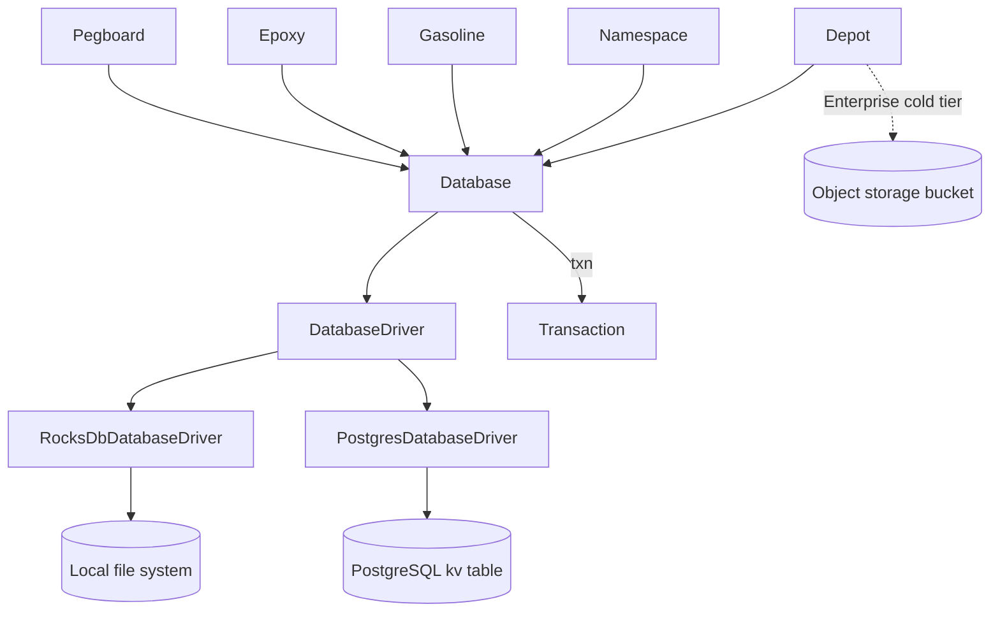
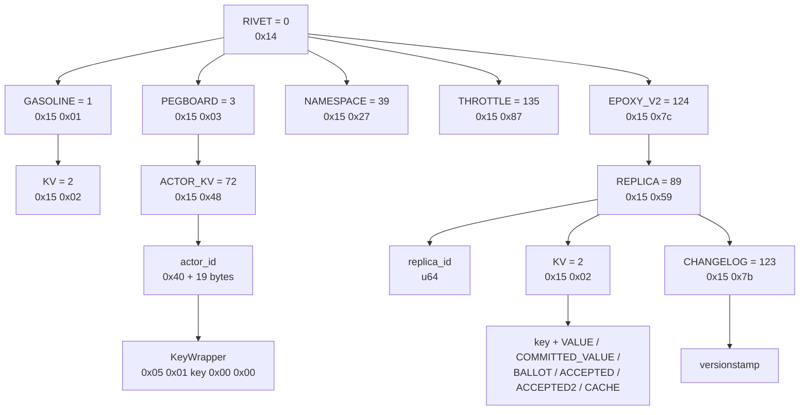
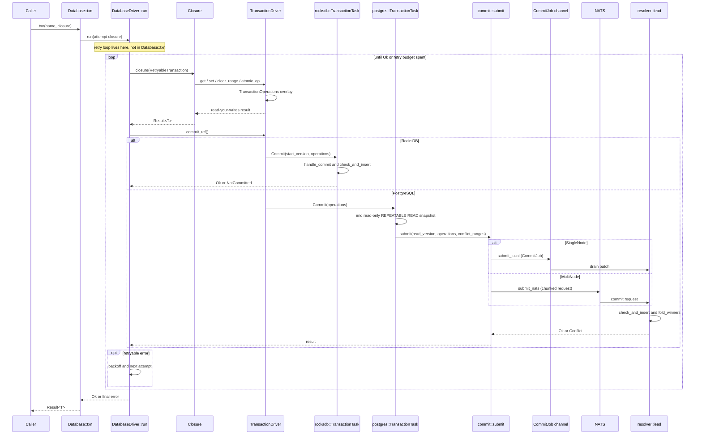
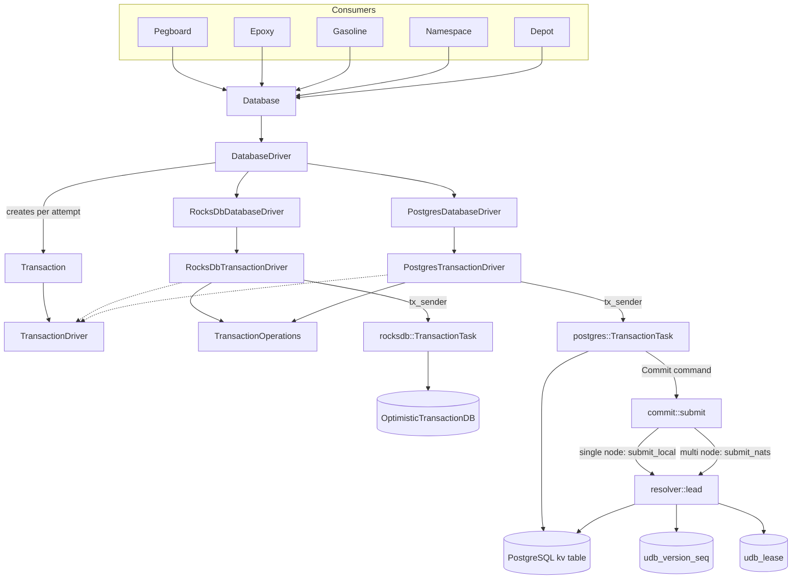

# 07 UniversalDB and Buckets

UniversalDB (UDB) is the transactional key-value (KV) layer that stores every durable Rivet record. It gives one byte-oriented interface to five consumers: Pegboard (Actor and runner scheduling), Depot (SQLite pages), Epoxy (replicated consensus records), Gasoline (workflow history and state), and namespaces (tenant records). Depot reaches UDB through its engine; the Depot client does not use UDB. UDB supplies ordering, conflict detection, atomic mutations, chunked scans, and byte-rate throttling. At commit `4a58441c50d1ce20d8803cfb1ab7c3285a5141d6`, UDB has two drivers: a local RocksDB driver and a PostgreSQL driver. It has no object storage bucket driver. Object storage belongs to the Enterprise cold tier, an Enterprise-only path for large shard objects. The open-source build keeps the cold row schema but never writes cold rows, the rows that reference cold tier objects. This document explains the two real drivers and states where the Enterprise boundary sits.

## 1. Where UniversalDB sits in the durable stack

UDB is a Rust library, not a database server. A caller links the crate, opens a `Database`, and runs a closure inside a transaction. The crate then talks to one of two storage backends through the `DatabaseDriver` trait. The interface is deliberately close to FoundationDB (FDB). The crate re-exports the `foundationdb-tuple` crate as `universaldb::tuple`. It also uses the FDB method names: `get`, `set`, `clear`, `get_ranges_keyvalues`, and a commit after the closure returns.

```rust
// engine/packages/universaldb/src/lib.rs:1-28
pub(crate) mod atomic;
pub mod chunk;
pub(crate) mod conflict_tracker;
mod database;
pub mod driver;
pub mod error;
pub mod key_selector;
mod metrics;
pub mod options;
pub mod prelude;
pub mod range_option;
pub mod throttle;
mod transaction;
pub(crate) mod tx_ops;
pub mod utils;
pub mod value;
pub mod versionstamp;

pub use database::Database;
pub use driver::DatabaseDriverHandle;
pub use key_selector::KeySelector;
pub use range_option::RangeOption;
pub use throttle::{ThrottleCharge, ThrottleClass, ThrottleConfig, ThrottleDecision, ThrottleKind};
pub use transaction::{RetryableTransaction, Transaction};
pub use utils::{Subspace, calculate_tx_retry_backoff};

// Re-export FDB types
pub use foundationdb_tuple as tuple;
```

The workspace pins `foundationdb-tuple` version `0.9.1` in `Cargo.toml:119` and `Cargo.lock:1976-1981`. UDB does not link an FDB client. It uses the tuple encoding and the FDB transaction vocabulary, and it implements the transaction rules itself.

### 1.1 The subsystems that call UDB

Each durable subsystem imports `universaldb::prelude::*` and scopes its keys with a `Subspace`. The following imports show the dependency directly.

```rust
// engine/packages/epoxy/src/keys/mod.rs:13-19
pub fn subspace(replica_id: ReplicaId) -> universaldb::utils::Subspace {
	universaldb::utils::Subspace::new(&(RIVET, EPOXY_V2, REPLICA, replica_id))
}

pub fn legacy_subspace(replica_id: ReplicaId) -> universaldb::utils::Subspace {
	universaldb::utils::Subspace::new(&(RIVET, EPOXY_V1, REPLICA, replica_id))
}
```

```rust
// engine/packages/pegboard/src/keys/actor_kv.rs:6-8
pub fn subspace(actor_id: Id) -> universaldb::utils::Subspace {
	universaldb::utils::Subspace::new(&(RIVET, PEGBOARD, ACTOR_KV, actor_id))
}
```

```rust
// engine/packages/namespace/src/keys/mod.rs:7-9
pub fn subspace() -> universaldb::utils::Subspace {
	universaldb::utils::Subspace::new(&(RIVET, NAMESPACE))
}
```

```rust
// engine/packages/gasoline/src/db/kv/mod.rs:478-490
	async fn new(
		config: rivet_config::Config,
		pools: rivet_pools::Pools,
	) -> anyhow::Result<Arc<Self>> {
		metrics::DB_INSTANCE.inc();
		Ok(Arc::new(DatabaseKv {
			config,
			pools,
			subspace: universaldb::utils::Subspace::new(&(RIVET, GASOLINE, KV)),
			system: system::SystemInfo::get(),
			active_worker_count: ActiveWorkerCountEma::new(1),
		}))
	}
```

Depot is different. Depot stores pages for SQLite, the embedded Structured Query Language (SQL) database engine, in UDB. The design note states this in one line: "Depot stores SQLite pages in UDB. UDB is the durable source of truth." (`docs-internal/engine/depot.md:9`). The Depot client, `engine/packages/depot-client`, is a native SQLite virtual file system (VFS). It does not link UDB in its normal dependency list. `universaldb` appears only in `dev-dependencies` in `engine/packages/depot-client/Cargo.toml:30-40`. The client sends page traffic to the engine over its own transport. The engine writes the page rows to UDB. The [06 Depot](06-actor-sqlite-and-depot.md) document covers the page layout and the commit path. This matters for the bucket section: the client does not talk to a bucket, and it does not talk to UDB directly.

The pool layer chooses the driver and constructs the one `Database` that the rest of the engine shares. The code comment in the block uses `UPS`, the short form of UniversalPubSub (UPS), the publish-subscribe layer. It also uses `NATS`, the message system.

```rust
// engine/packages/pools/src/db/udb.rs:20-68
pub async fn setup(config: &Config) -> Result<Option<UdbPool>> {
	let db_driver = match config.database() {
		config::Database::Postgres(pg) => {
			// A NATS config (set directly or inherited from the UPS config in
			// `validate_and_set_defaults`) selects UniversalDB multi-node mode.
			let nats = pg
				.nats
				.as_ref()
				.map(|nats| universaldb::driver::postgres::NatsConfig {
					addresses: nats.addresses.clone(),
					username: nats.username.clone(),
					password: nats.password.as_ref().map(|p| p.read().clone()),
					client_capacity: nats.client_capacity,
					subscription_capacity: nats.subscription_capacity,
				});

			let postgres_config = universaldb::driver::postgres::PostgresConfig {
				connection_string: pg.url.read().clone(),
				ssl_config: pg.ssl.as_ref().map(|ssl| {
					universaldb::driver::postgres::PostgresSslConfig {
						ssl_root_cert_path: ssl.root_cert_path.clone(),
						ssl_client_cert_path: ssl.client_cert_path.clone(),
						ssl_client_key_path: ssl.client_key_path.clone(),
					}
				}),
				nats,
				pool_max_size: None,
			};

			Arc::new(
				universaldb::driver::PostgresDatabaseDriver::new_with_config(
					config.clone(),
					postgres_config,
				)
				.await?,
			) as universaldb::DatabaseDriverHandle
		}
		config::Database::FileSystem(fs) => {
			Arc::new(universaldb::driver::RocksDbDatabaseDriver::new(fs.path.clone()).await?)
				as universaldb::DatabaseDriverHandle
		}
	};

	tracing::debug!("udb started");

	let db = universaldb::Database::new(db_driver).with_throttle(throttle_config(config));

	Ok(Some(UdbPool { db }))
}
```

The configuration enum has exactly these two cases (`engine/packages/config/src/config/db/mod.rs:12-15`):

```rust
// engine/packages/config/src/config/db/mod.rs:12-15
pub enum Database {
	Postgres(Postgres),
	FileSystem(FileSystem),
}
```

The default is `FileSystem`, with a local data directory (`engine/packages/config/src/config/db/mod.rs:18-35`). A default deployment therefore runs RocksDB on local disk. A deployment that selects `Postgres` can be one process with an in-process resolver. It can also be several nodes with a leader elected through a lease, with commits sent over the NATS message system.

The dependency graph is:



The last edge is not a UDB driver. Depot writes page rows through a `Transaction`. Separately, the Enterprise cold tier writes shard objects to the bucket. The open-source build never writes cold rows. UDB itself has no edge to the bucket.

### 1.2 What each subsystem stores

| Subsystem | Root tuple | Stored content | Source |
|---|---|---|---|
| Epoxy, version 2 | `(RIVET, EPOXY_V2, REPLICA, replica_id)` (per replica) | Committed values, ballots (proposal terms), accepted proposals, optimistic cache (`CACHE`), changelog | `engine/packages/epoxy/src/keys/mod.rs:13-15` |
| Epoxy, legacy | `(RIVET, EPOXY_V1, REPLICA, replica_id)` | Legacy committed values | `engine/packages/epoxy/src/keys/mod.rs:17-19` |
| Pegboard | `(RIVET, PEGBOARD)` | Runner, Actor, and scheduling records | `engine/packages/types/src/keys/pegboard/mod.rs:5-7` |
| Pegboard Actor KV | `(RIVET, PEGBOARD, ACTOR_KV, actor_id)` | Actor key-value entries | `engine/packages/pegboard/src/keys/actor_kv.rs:6-8` |
| Gasoline | `(RIVET, GASOLINE, KV)` | Workflow history, signals, workers, leases, metrics | `engine/packages/gasoline/src/db/kv/mod.rs:486` |
| Namespace | `(RIVET, NAMESPACE)` | Namespace names, display names, creation time, token records | `engine/packages/namespace/src/keys/mod.rs:7-9` |
| UDB throttle | `(RIVET, THROTTLE)` | Per-window byte counters | `engine/packages/universaldb/src/throttle.rs:776-781` |
| Depot | Raw byte `0x02` prefix | SQLite pages, deltas, shards, commit metadata, pins | `engine/packages/depot/src/conveyer/keys.rs:9` |

Depot does not use a tuple root. Its first byte is the literal `SQLITE_SUBSPACE_PREFIX = 0x02`. This is safe because every engine tuple key starts with the packed integer zero, which is the byte `0x14`. The two key families cannot collide at the first byte. In open source, Depot writes only hot rows. On Enterprise, Depot also writes cold reference rows. The table above describes the open-source build.

## 2. The data model: database, transaction, key, value, subspace

UDB has several central types. `Database` owns the driver handle and the throttle state. `Transaction` is a cloneable handle to one attempt's driver, its subspace, its byte counters, and its throttle context. `Subspace` is a byte prefix with metric wrappers. `Slice` and `Value` are byte containers. `Values` is one chunk of a range result.

```rust
// engine/packages/universaldb/src/database.rs:40-54
#[derive(Clone)]
pub struct Database {
	driver: DatabaseDriverHandle,
	throttle: Arc<ThrottleState>,
}

impl Database {
	pub fn new(driver: DatabaseDriverHandle) -> Self {
		tokio::spawn(last_tx_age_heartbeat());

		Database {
			driver,
			throttle: Arc::new(ThrottleState::new(None)),
		}
	}
```

```rust
// engine/packages/universaldb/src/transaction.rs:72-91
#[derive(Clone)]
pub struct Transaction {
	pub(crate) driver: Arc<dyn TransactionDriver>,
	subspace: Subspace,
	name: &'static str,
	counters: Arc<TxnCounters>,
	/// Throttle bookkeeping, attached by the [`crate::Database`] this transaction came from.
	throttle: Option<Arc<ThrottleTxn>>,
}

impl Transaction {
	pub(crate) fn new(driver: Arc<dyn TransactionDriver>) -> Self {
		Transaction {
			driver: driver,
			subspace: tuple::Subspace::all().into(),
			name: DEFAULT_TXN_NAME,
			counters: Arc::new(TxnCounters::default()),
			throttle: None,
		}
	}
```

| Type | Fields | Purpose |
|---|---|---|
| `Database` | `driver: DatabaseDriverHandle`, `throttle: Arc<ThrottleState>` | Owns the backend and the cluster-wide throttle bookkeeping. |
| `Transaction` | `driver: Arc<dyn TransactionDriver>`, `subspace: Subspace`, `name: &'static str`, `counters: Arc<TxnCounters>`, `throttle: Option<Arc<ThrottleTxn>>` | One attempt. Clones share counters and throttle state. |
| `TxnCounters` | `read: AtomicU64`, `write: AtomicU64`, `manual_write: AtomicU64`, `read_charge: OnceLock<Arc<AtomicU64>>` | Byte accounting for throttling and diagnostics. `manual_write` holds bytes a caller reported with `charge_throttle_bytes`. `read_charge` is the shared read counter resolved at opt-in. |
| `Subspace` | `inner: tuple::Subspace` | A byte prefix. It prepends the prefix on `pack` and rejects keys outside the prefix on `unpack`. |
| `Slice` | `Slice(Vec<u8>)` | Raw read result. A newtype around `Vec<u8>`. |
| `Value` | `KeyValue` | One key-value pair with accessors. |
| `Values` | `values: Vec<KeyValue>`, `more: bool`, `last_db_key: Option<Vec<u8>>` | One database fetch, with continuation state. |
| `KeyValue` | `key: Vec<u8>`, `value: Vec<u8>` | One raw pair. |
| `Stream<'a, T>` | Boxed stream | Chunked scan output. |

The byte containers are thin wrappers:

```rust
// engine/packages/universaldb/src/value.rs:43-74
#[derive(Debug, Clone)]
pub struct Value(KeyValue);

impl Value {
	pub fn new(key: Vec<u8>, value: Vec<u8>) -> Self {
		Value(KeyValue::new(key, value))
	}

	pub fn from_keyvalue(kv: KeyValue) -> Self {
		Value(kv)
	}

	pub fn key(&self) -> &[u8] {
		self.0.key()
	}

	pub fn value(&self) -> &[u8] {
		self.0.value()
	}

	pub fn into_parts(self) -> (Vec<u8>, Vec<u8>) {
		self.0.into_parts()
	}
}

// Values wraps a Vec<KeyValue> to match FoundationDB API
#[derive(Debug, Clone)]
pub struct Values {
	values: Vec<KeyValue>,
	more: bool,
	last_db_key: Option<Vec<u8>>,
}
```

### 2.1 Subspaces

A `Subspace` is a prefix. The high-level methods on a `Transaction` pack the tuple, then prepend the prefix. The low-level methods take raw bytes. Section 2.2 gives the two sets of methods.

```rust
// engine/packages/universaldb/src/utils/subspace.rs:11-52
/// Wrapper type around `universaldb::tuple::Subspace` that records metrics.
#[derive(Clone)]
pub struct Subspace {
	inner: tuple::Subspace,
}

impl Subspace {
	/// Creates a subspace with the given tuple.
	pub fn new<T: TuplePack>(t: &T) -> Self {
		Self {
			inner: tuple::Subspace::all().subspace(t),
		}
	}

	pub fn all() -> Self {
		Self {
			inner: tuple::Subspace::all(),
		}
	}

	/// Returns a new Subspace whose prefix extends this Subspace with a given tuple encodable.
	pub fn subspace<T: TuplePack>(&self, t: &T) -> Self {
		Self {
			inner: self.inner.subspace(t),
		}
	}

	pub fn join(&self, s: &Subspace) -> Self {
		Self {
			inner: tuple::Subspace::from_bytes([self.inner.bytes(), s.bytes()].concat()),
		}
	}

	/// Returns the key encoding the specified Tuple with the prefix of this Subspace
	/// prepended.
	pub fn pack<T: TuplePack>(&self, t: &T) -> Vec<u8> {
		metrics::KEY_PACK_COUNT
			.with_label_values(&[std::any::type_name::<T>()])
			.inc();

		self.inner.pack(t)
	}
```

`Transaction::with_subspace` replaces the prefix for a clone. It does not mutate the original:

```rust
// engine/packages/universaldb/src/transaction.rs:113-122
	/// Creates a new transaction instance with the provided subspace.
	pub fn with_subspace(&self, subspace: Subspace) -> Self {
		Transaction {
			driver: self.driver.clone(),
			subspace,
			name: self.name,
			counters: self.counters.clone(),
			throttle: self.throttle.clone(),
		}
	}
```

The project rule warns about this mix. The low-level methods `get`, `set`, `clear`, and `get_ranges_keyvalues` take raw bytes and do not apply the transaction subspace. The rule is in `engine/CLAUDE.md:35-43`. It says: "UniversalDB low-level `Transaction::get`, `set`, `clear`, and `get_ranges_keyvalues` do not apply the transaction subspace automatically; pack subspace bytes yourself or use the higher-level range helpers." (`engine/CLAUDE.md:38`). Epoxy relies on the low-level path when it calls `keys::subspace(replica_id).pack_with_versionstamp(...)` directly.

### 2.2 Formal keys and raw keys

UDB has two key styles.

A **formal key** implements `FormalKey` and `TuplePack`. `FormalKey` supplies value serialization. `Transaction::write` and `Transaction::read` use both traits.

```rust
// engine/packages/universaldb/src/utils/formal_key.rs:5-23
pub trait FormalKey {
	type Value;

	fn deserialize(&self, raw: &[u8]) -> Result<Self::Value>;

	fn serialize(&self, value: Self::Value) -> Result<Vec<u8>>;
}

pub trait FormalChunkedKey {
	type Value;
	type ChunkKey;

	fn chunk(&self, chunk: usize) -> Self::ChunkKey;

	/// Assumes chunks are in order.
	fn combine(&self, chunks: Vec<Value>) -> Result<Self::Value>;

	fn split(&self, value: Self::Value) -> Result<Vec<Vec<u8>>>;
}
```

```rust
// engine/packages/universaldb/src/transaction.rs:291-328
	pub fn pack<T: TuplePack>(&self, t: &T) -> Vec<u8> {
		self.subspace.pack(t)
	}

	/// Unpacks a key based on the subspace of this transaction.
	pub fn unpack<'de, T: TupleUnpack<'de>>(&self, key: &'de [u8]) -> Result<T> {
		self.subspace.unpack(key).with_context(|| {
			format!(
				"failed unpacking key {} as {}",
				hex::encode(key),
				std::any::type_name::<T>(),
			)
		})
	}

	pub fn write<T: FormalKey + TuplePack>(&self, key: &T, value: T::Value) -> Result<()> {
		self.set(
			&self.subspace.pack(key),
			&key.serialize(value).with_context(|| {
				format!(
					"failed serializing key value of {}",
					std::any::type_name::<T>(),
				)
			})?,
		);

		Ok(())
	}

	pub async fn read<'de, T: FormalKey + TuplePack + TupleUnpack<'de>>(
		&self,
		key: &'de T,
		isolation_level: IsolationLevel,
	) -> Result<T::Value> {
		self.get(&self.subspace.pack(key), isolation_level)
			.await?
			.read(key)
	}
```

`write` serializes the value with `FormalKey::serialize`, then calls `set`. `read` packs the key, calls `get`, then deserializes the bytes with `FormalKey::deserialize`. `unpack` rejects a key outside the transaction subspace. The error includes the hexadecimal key and the target type name.

A **chunked formal key** implements `FormalChunkedKey`. It adds `chunk`, `combine`, and `split`. A large value is split into chunks, and each chunk is a separate formal key. Section 6.2 shows a real implementation.

A **subspace key** implements only `TuplePack`. It defines a prefix for range scans. `docs-internal/engine/universaldb/KEYS.md:65-67` states this rule: "Subspace keys define a prefix for range queries. They only implement `TuplePack` (no `FormalKey` or `TupleUnpack`)."

A **raw key** is a byte vector. The caller must pack it with a subspace, or accept the transaction subspace. UDB does not infer the prefix.

### 2.3 Keys, values, and the 100 kilobyte (KB) value limit

UDB stores bytes. It does not store relational rows and it does not store typed columns. A value is a serialized byte string. `docs-internal/engine/universaldb/TRANSACTIONS.md:154-164` gives the stated limits:

| Limit | Value |
|---|---|
| Time limit | 5 seconds |
| Transaction size | 10 megabytes (MB) total for keys and values |
| Key size | 10 kilobytes (KB) maximum |
| Value size | 100 KB maximum |

The source has a native maximum in one place. `apply_append_if_fits` uses `MAX_VALUE_SIZE: usize = 100_000` and comments that FoundationDB has a 100 KB value limit (`engine/packages/universaldb/src/atomic.rs:65-72`). Here 100 KB means 100,000 bytes. The time limit is enforced as `TXN_TIMEOUT`, and it covers only the closure, not the commit (section 4.2). The three size limits come from the internal document. The source does not contain a key-size check or a total-size check in either driver. The unit for the 10 KB key limit is not stated in the source. A caller that exceeds a backend limit sees a backend error, not a UDB validation error.

`error_is_transaction_too_large` returns `false` on every input (`engine/packages/universaldb/src/utils/mod.rs:35-38`). The comment says "Only implemented with fdb". This is a direct signal that the transaction-too-large classification is not active for either driver at this commit.

## 3. Tuple keys: from a typed tuple to ordered bytes

This is the core of the storage model. A key is a tuple of typed values. The tuple layer packs the values into one byte string. UDB stores that byte string. Lexicographic byte order is the only order the database knows. Range scans are byte ranges. A prefix is a byte prefix.

UDB does not implement the tuple layer. It re-exports the `foundationdb-tuple` crate. The encoding rules below come from that crate's public specification and from the repo's own constants.

### 3.1 The root constants

The key roots are generated by a macro. Each root is a `usize` constant. The macro also builds two lookup functions for diagnostics.

```rust
// engine/packages/universaldb/src/utils/keys.rs:1-25
macro_rules! define_keys {
	($(($value:literal, $const_name:ident, $str_name:literal)),* $(,)?) => {
		$(
			pub const $const_name: usize = $value;
		)*

		pub fn key_from_str(key: &str) -> Option<usize> {
			match key {
				$(
					$str_name => Some($const_name),
				)*
				_ => None,
			}
		}

		pub fn str_from_key(key: usize) -> Option<&'static str> {
			match key {
				$(
					$const_name => Some($str_name),
				)*
				_ => None,
			}
		}
	};
}
```

The first constants are:

```rust
// engine/packages/universaldb/src/utils/keys.rs:27-41
define_keys! {
	(0, RIVET, "rivet"),
	(1, GASOLINE, "gasoline"),
	(2, KV, "kv"),
	(3, PEGBOARD, "pegboard"),
	(4, DATA, "data"),
	(5, WORKFLOW, "workflow"),
	(6, SIGNAL, "signal"),
	(7, BODY, "body"),
	(8, LEASE, "lease"),
	(9, TAG, "tag"),
	(10, INPUT, "input"),
	(11, OUTPUT, "output"),
	(12, WAKE_SIGNAL, "wake_signal"),
	(13, WAKE_DEADLINE, "wake_deadline"),
```

The table continues to `(143, PRIVATE_KEY, "private_key")` (`engine/packages/universaldb/src/utils/keys.rs:171`). The string names are not stored in the database. They are input to `key_from_str` and output of `str_from_key` for tools and logs. The byte encoding uses the integer value.

### 3.2 Type codes

The repo defines the few tuple codes that it needs to reason about directly:

```rust
// engine/packages/universaldb/src/utils/codes.rs:1-9
// === Copied from foundationdbrs ===
pub const NIL: u8 = 0x00;
pub const NESTED: u8 = 0x05;
pub const ESCAPE: u8 = 0xff;

// FDB defines a range (0x40-0x4f) of user type codes for use with its tuple encoding system.
// https://github.com/apple/foundationdb/blob/main/design/tuple.md#user-type-codes

pub const ID: u8 = 0x40;
```

The FoundationDB tuple specification assigns the full set (`https://github.com/apple/foundationdb/blob/main/design/tuple.md`). The entries that matter here are:

| Type | Code | Encoding |
|---|---|---|
| Null | `0x00` | No payload. |
| Byte string | `0x01` | Payload, then `0x00`; each `0x00` byte in the payload becomes `0x00 0xff`. |
| Unicode string | `0x02` | Unicode Transformation Format 8-bit (UTF-8) payload, then `0x00`; each `0x00` byte becomes `0x00 0xff`. |
| Nested tuple | `0x05` | Packed elements, then `0x00`; a null element is `0x00 0xff`. |
| Integer | `0x0c` to `0x1c` | Big-endian positive values; big-endian one's complement for negative values. The code selects the width. |
| Zero | `0x14` | No payload. |
| 1-byte positive | `0x15` | One byte. |
| 2-byte positive | `0x16` | Two bytes. |
| 4-byte positive | `0x18` | Four bytes. |
| 8-byte positive | `0x1c` | Eight bytes. |
| 96-bit versionstamp | `0x33` | A key stores ten bytes: an 8-byte timestamp and a 2-byte counter. The 2-byte user version belongs to the 12-byte `Versionstamp` value but is not stored in the key (section 10). |
| User type | `0x40` to `0x4f` | User-defined payload. |

Inside a nested tuple, a bare `0x00` marks the end of the tuple. The encoder therefore writes a null element as `0x00 0xff`. The reader treats that pair as null. `NIL` and `ESCAPE` in `codes.rs` are the two bytes of that pair.

The integer codes run from `0x0c` to `0x1c`. The code is `0x14` for zero. A positive integer with a payload of `n` bytes uses `0x14 + n`. Every width from 1 to 8 has a code: `0x15`, `0x16`, `0x17`, `0x18`, `0x19`, `0x1a`, `0x1b`, and `0x1c`. The table lists 1, 2, 4, and 8 as examples only. A negative integer with a payload of `n` bytes uses `0x14 - n`: `0x13` for 1 byte through `0x0c` for 8 bytes. The width is the minimal byte count of the value within the Rust integer type, so the code records that width. The `foundationdb-tuple` crate 0.9.1 implements this rule in the `impl_ux!` and `impl_ix!` macros in its `pack.rs`: it computes the width as `size_of::<T>() - leading_zeros() / 8`. The repo does not contain this table. This document walks only `0x14` and `0x15`.

The table is from the FoundationDB tuple specification. The repo's `codes.rs` confirms `NIL`, `NESTED`, `ESCAPE`, and `ID`. The repo does not contain the integer code table. The integer rule above is checked against the `foundationdb-tuple` 0.9.1 `pack.rs` implementation. The byte walk below uses the specification and marks that dependency.

Rivet uses exactly one user type: `0x40` for `Id`.

```rust
// engine/packages/util-id/src/lib.rs:76-87
	/// Convert the ID to its byte representation.
	pub fn as_bytes(&self) -> Vec<u8> {
		match self {
			Id::V1(data) => {
				let mut bytes = [0; 19];
				bytes[0] = 1; // Version byte
				bytes[1..].copy_from_slice(data);

				bytes.to_vec()
			}
		}
	}
```

```rust
// engine/packages/util-id/src/lib.rs:225-246
#[cfg(feature = "universaldb")]
impl TuplePack for Id {
	fn pack<W: std::io::Write>(
		&self,
		w: &mut W,
		_tuple_depth: TupleDepth,
	) -> std::io::Result<VersionstampOffset> {
		let mut offset = VersionstampOffset::None { size: 0 };

		w.write_all(&[universaldb::utils::codes::ID])?;

		let bytes = self.as_bytes();

		let len = u32::try_from(bytes.len())
			.map_err(|err| std::io::Error::new(std::io::ErrorKind::InvalidData, err))?;
		offset += len;

		w.write_all(&bytes)?;

		Ok(offset)
	}
}
```

An `Id::V1` value holds 18 bytes: a 16-byte Universally Unique Identifier (UUID) followed by a 2-byte big-endian label (`engine/packages/util-id/src/lib.rs:41-46`). `as_bytes` prepends the version byte `0x01`, so it returns 19 bytes. `TuplePack::pack` writes the user-type code `0x40` and then those 19 bytes. The tuple therefore consumes the 19-byte `Id` payload, and the complete segment is 20 bytes.

`Id` is a user type, so the tuple specification gives no ordering guarantee for it. Rivet compares the packed bytes lexicographically like any other key. In practice the UUID bytes dominate and the label is the final two bytes. The source does not state an ordering contract for `Id`.

### 3.3 The ordering rule

The database orders keys by unsigned byte comparison. The tuple layer is designed so that this byte order matches tuple order for the standard types. Three properties produce that result:

1. The type code comes first. Values of different standard types sort by type code before any payload byte.
2. Integers use a width code and big-endian payload. A larger integer gets a larger code or a larger first payload byte. Negative values use one's complement so that more negative values sort first.
3. Strings escape `0x00` as `0x00 0xff` and terminate with `0x00`. A string that is a prefix of another sorts first, because its terminator `0x00` is less than the next string byte.

The consequence for Rivet is simple. A subspace range is a byte range. A scan over `(RIVET, PEGBOARD, ACTOR_KV, actor_id)` returns Actor Key-Value keys in lexicographic order of the packed `actor_id` suffix. A caller that needs creation-time order puts `CREATE_TS` after `actor_id`, as the Pegboard keys do (`engine/packages/universaldb/src/utils/keys.rs:43`, `engine/packages/pegboard/src/keys/actor.rs:50`).

### 3.4 One key, byte by byte

Take an Actor key-value key. The subspace is `(RIVET, PEGBOARD, ACTOR_KV, actor_id)` (`engine/packages/pegboard/src/keys/actor_kv.rs:6-8`). Let the Actor identifier be:

- UUID: `8f0f4c1d-2e7a-4b3b-9c4d-5e6f708192a3`
- Label: `1`

The tuple is `(0usize, 3usize, 72usize, Id)`. Each segment packs as follows.

| Segment | Packed bytes | Why |
|---|---|---|
| `RIVET = 0` | `14` | Zero is tuple code `0x14`. |
| `PEGBOARD = 3` | `15 03` | One-byte positive integer: code `0x15`, then `0x03`. |
| `ACTOR_KV = 72` | `15 48` | One-byte positive integer: code `0x15`, then `0x48` (72 decimal). |
| `actor_id` | `40 01 8f 0f 4c 1d 2e 7a 4b 3b 9c 4d 5e 6f 70 81 92 a3 00 01` | Code `0x40`, then the 19-byte `Id` payload. |

The `Id` payload breaks down as:

| Part | Bytes | Meaning |
|---|---|---|
| Version | `01` | `Id::V1`. |
| UUID | `8f 0f 4c 1d 2e 7a 4b 3b 9c 4d 5e 6f 70 81 92 a3` | The 16 UUID bytes in network order. |
| Label | `00 01` | Label 1, big-endian. |

The complete key is 25 bytes:

```text
14 15 03 15 48 40 01 8f 0f 4c 1d 2e 7a 4b 3b
9c 4d 5e 6f 70 81 92 a3 00 01
```

This is the exact prefix that `Subspace::new(&(RIVET, PEGBOARD, ACTOR_KV, actor_id))` places before every key in the store (`engine/packages/universaldb/src/utils/subspace.rs:16-21`). A key for one entry inside the Actor store appends a nested wrapper. `KeyWrapper` writes `NESTED` (`0x05`). It then packs the user key as a byte string, so the bytes are escaped. It then writes the nested-tuple terminator `NIL` (`0x00`) (`engine/packages/pegboard/src/keys/actor_kv.rs:27-44`). The wire form is `05 01 <escaped key> 00 00`: the first `00` ends the byte string, and the second `00` ends the nested tuple. `ListKeyWrapper` writes `NESTED` and the byte string, with no final `NIL`, for prefix scans (`engine/packages/pegboard/src/keys/actor_kv.rs:68-84`).

A `KeyWrapper` user key that contains `0x00` is escaped by the tuple encoder as `0x00 0xff`. The final `NIL` is therefore unambiguous. `ListKeyWrapper` is not a complete tuple. It is a prefix, so a scan over it also matches longer keys that begin with the same bytes.

The key tree is:



Every engine tuple key starts with `0x14`, because `RIVET = 0` is the first tuple element. Depot keys start with `0x02` and are outside this tree.

The `KV` leaves map to these key types:

| Leaf | Key type | Stored value type | Role | Source |
|---|---|---|---|---|
| `VALUE` | `KvValueKey` | `protocol::CommittedValue` | Current committed value and version. | `engine/packages/epoxy/src/keys/keys.rs:27-80` |
| `COMMITTED_VALUE` | `LegacyCommittedValueKey` | `Vec<u8>` | Legacy committed value, read-only. | `engine/packages/epoxy/src/keys/keys.rs:109-118` |
| `BALLOT` | `KvBallotKey` | `protocol::Ballot` | Proposal ballot for the key. | `engine/packages/epoxy/src/keys/keys.rs:163-172` |
| `ACCEPTED` | `KvAcceptedKey` | `KvAcceptedValue` | First accepted-proposal slot. | `engine/packages/epoxy/src/keys/keys.rs:218-227` |
| `ACCEPTED2` | `KvAccepted2Key` | `protocol::AcceptedValue` | Second accepted-proposal slot. | `engine/packages/epoxy/src/keys/keys.rs:273-282` |
| `CACHE` | `KvOptimisticCacheKey` | `protocol::CachedValue` | Optimistic cache for the fast path. | `engine/packages/epoxy/src/keys/keys.rs:327-336` |

`ACCEPTED` and `ACCEPTED2` are the two accepted-proposal slots of the Epoxy protocol. The [08 Epoxy](08-epoxy-multi-region.md) document explains their roles.

### 3.5 Unpacking and validation

A key struct validates its own tuple on unpack. `KvValueKey` has one field, `key: Vec<u8>` (`engine/packages/epoxy/src/keys/keys.rs:27-30`). Its tuple is `(KV, key, VALUE)`. `KV` is 2 and `VALUE` is 79 (`engine/packages/universaldb/src/utils/keys.rs:107`). The Epoxy subspace is `(RIVET, EPOXY_V2, REPLICA, replica_id)`. A full key is therefore `14 15 7c 15 59 <replica_id> 15 02 <key> 15 4f`. For `replica_id = 1` and key `foo`, the bytes are `14 15 7c 15 59 15 01 15 02 01 66 6f 6f 00 15 4f`. The unpack runs after the subspace removes that prefix. `KvValueKey` checks the root and the leaf:

```rust
// engine/packages/epoxy/src/keys/keys.rs:66-80
impl<'de> TupleUnpack<'de> for KvValueKey {
	fn unpack(input: &[u8], tuple_depth: TupleDepth) -> PackResult<(&[u8], Self)> {
		let (input, (root, key, leaf)) = <(usize, Vec<u8>, usize)>::unpack(input, tuple_depth)?;
		if root != KV {
			return Err(PackError::Message("expected KV root".into()));
		}
		if leaf != VALUE {
			return Err(PackError::Message("expected VALUE leaf".into()));
		}

		let v = KvValueKey { key };

		Ok((input, v))
	}
}
```

This check is essential for a scan. A range over a broad prefix can return a key of a different leaf type. The unpack rejects it instead of deserializing the wrong value. `Transaction::unpack` wraps the error with the hex key and the target type name (`engine/packages/universaldb/src/transaction.rs:295-304`).

Both `Transaction::unpack` and `Transaction::pack` call the methods on the transaction's `Subspace`:

```rust
// engine/packages/universaldb/src/utils/subspace.rs:54-73
	/// Returns the key encoding the specified Tuple with the prefix of this Subspace
	/// prepended, with a versionstamp.
	pub fn pack_with_versionstamp<T: TuplePack>(&self, t: &T) -> Vec<u8> {
		metrics::KEY_PACK_COUNT
			.with_label_values(&[std::any::type_name::<T>()])
			.inc();

		self.inner.pack_with_versionstamp(t)
	}

	/// `unpack` returns the Tuple encoded by the given key with the prefix of this Subspace
	/// removed.  `unpack` will return an error if the key is not in this Subspace or does not
	/// encode a well-formed Tuple.
	pub fn unpack<'de, T: TupleUnpack<'de>>(&self, key: &'de [u8]) -> PackResult<T> {
		metrics::KEY_UNPACK_COUNT
			.with_label_values(&[std::any::type_name::<T>()])
			.inc();

		self.inner.unpack(key)
	}
```

`Subspace::pack` prepends the prefix. `Subspace::unpack` removes the prefix, then unpacks the tuple. It returns an error when the key is outside the prefix or the tuple is malformed. `pack_with_versionstamp` prepends the prefix and leaves the versionstamp placeholder in place. Section 10 explains the placeholder bytes.

## 4. Transactions: retry loop, read-your-writes, commit

A UDB transaction has one entry point for automatic retry: `Database::txn`. It takes a name and a closure. The closure receives a `RetryableTransaction` and returns a future with a result.

```rust
// engine/packages/universaldb/src/database.rs:110-180
	/// Run a closure with automatic retry logic and a name.
	#[tracing::instrument(skip_all)]
	pub async fn txn<'a, F, Fut, T>(&'a self, name: &'static str, closure: F) -> Result<T>
	where
		F: Fn(RetryableTransaction) -> Fut + Send + Sync,
		Fut: Future<Output = Result<T>> + Send,
		T: Send + 'a + 'static,
	{
		if let Some(delay) = simulated_latency() {
			tokio::time::sleep(delay).await;
		}

		let start = Instant::now();
		let attempts = AtomicUsize::new(0);
		metrics::TRANSACTION_TOTAL.with_label_values(&[name]).inc();
		let _pending_guard = metrics::TRANSACTION_PENDING
			.with_label_values(&[name])
			.inc_guard();

		// Shared across every attempt: reads charge per attempt, writes charge once if the transaction
		// commits, and only the loop out here knows whether it did.
		let throttle = Arc::new(ThrottleTxn::new(self.throttle.clone(), true));

		let closure = &closure;
		let res = self
			.driver
			.run(Box::new(|tx| {
				attempts.fetch_add(1, Ordering::AcqRel);

				let tx = tx.with_name(name).with_throttle(throttle.clone());
				let guard = ThrottleAttemptGuard::new(tx.deref().clone());
				async move {
					let _guard = guard;
					closure(tx).await.map(|value| Box::new(value) as Erased)
				}
				.custom_instrument(tracing::debug_span!("txn_attempt"))
				.boxed()
			}))
			.await
			.and_then(|res| {
				res.downcast::<T>()
					.map(|x| *x)
					.map_err(|_| anyhow!("failed to downcast `run` return type"))
			})
			.context("transaction failed");

		let final_attempts = attempts.load(Ordering::Acquire);
		let duration = start.elapsed();
		metrics::TRANSACTION_ATTEMPTS
			.with_label_values(&[name])
			.observe(final_attempts as f64);
		metrics::TRANSACTION_DURATION
			.with_label_values(&[name])
			.observe(duration.as_secs_f64());

		if res.is_ok() {
			// The transaction committed, so what its final attempt wrote is real load. Attempts that
			// were discarded wrote nothing and are not charged.
			throttle.commit();

			// Update the global "last successful tx" timestamp consumed by the heartbeat ticker.
			// Stores epoch ms; ticker observes age as a gauge.
			let epoch_ms = std::time::SystemTime::now()
				.duration_since(std::time::UNIX_EPOCH)
				.map(|d| d.as_millis() as u64)
				.unwrap_or(0);
			metrics::LAST_TX_COMPLETED_EPOCH_MS.store(epoch_ms, Ordering::Release);
		}

		res
	}
```

The retry loop itself lives in the driver, not in `Database::txn`. `Database::txn` wraps one driver `run` call and counts attempts across all retries. The driver builds a fresh `Transaction` and a fresh `RetryableTransaction` for each attempt. The closure runs again from the start. This is why the closure must be free of external side effects until commit.

`RetryableTransaction` is a thin wrapper with a `maybe_committed` flag:

```rust
// engine/packages/universaldb/src/transaction.rs:709-722
/// Retryable transaction wrapper
#[derive(Clone)]
pub struct RetryableTransaction {
	pub(crate) inner: Transaction,
	pub(crate) maybe_committed: MaybeCommitted,
}

impl RetryableTransaction {
	pub fn new(transaction: Transaction) -> Self {
		RetryableTransaction {
			inner: transaction,
			maybe_committed: MaybeCommitted(false),
		}
	}
```

`MaybeCommitted` is false for every error path. `DatabaseError::is_maybe_committed` returns `false` unconditionally (`engine/packages/universaldb/src/error.rs:32-34`). The field has no effect in these two drivers. The source does not state why it is kept.

### 4.1 Read-your-writes

Every write enters a local operation list before it reaches the backend. Every read first consults that list. This gives read-your-writes without waiting for the commit. The list is `TransactionOperations`:

```rust
// engine/packages/universaldb/src/tx_ops.rs:168-187
pub struct TransactionOperations {
	operations: Mutex<Vec<Operation>>,
	conflict_ranges: Mutex<Vec<(Vec<u8>, Vec<u8>, ConflictRangeType)>>,
}

impl TransactionOperations {
	pub fn consume(&self) -> (Vec<Operation>, Vec<(Vec<u8>, Vec<u8>, ConflictRangeType)>) {
		(
			std::mem::take(&mut self.operations.lock().unwrap()),
			std::mem::take(&mut self.conflict_ranges.lock().unwrap()),
		)
	}

	pub fn add_operation(&self, operation: Operation) {
		self.operations.lock().unwrap().push(operation);
	}

	pub fn operations(&self) -> MutexGuard<'_, Vec<Operation>> {
		self.operations.lock().unwrap()
	}
```

`operations` holds the pending writes. `conflict_ranges` holds the `(begin, end, type)` triples that the commit checks. `consume` takes both vectors and leaves empty ones. `Operation` has four variants: `SetValue`, `Clear`, `ClearRange`, and `AtomicOp` (`engine/packages/universaldb/src/tx_ops.rs:76-94`).

```rust
// engine/packages/universaldb/src/tx_ops.rs:231-287
	pub fn get(&self, key: &[u8], isolation_level: IsolationLevel) -> GetOutput {
		if let IsolationLevel::Serializable = isolation_level {
			self.add_conflict_range(key, &end_of_key_range(key), ConflictRangeType::Read);
		}

		let mut atomic_ops: Vec<(Vec<u8>, MutationType)> = Vec::new();

		// Iterate through operations in reverse order to find the most recent operation for this key
		for op in self.operations().iter().rev() {
			match op {
				Operation::SetValue {
					key: set_key,
					value,
				} if set_key.as_slice() == key => {
					let mut result_value = Some(value.clone());

					// If we found atomic ops after this set, apply them to this value
					if !atomic_ops.is_empty() {
						// Apply atomic operations in forward order (reverse of how we collected them)
						for (param, op_type) in atomic_ops.into_iter().rev() {
							result_value =
								apply_atomic_op(result_value.as_deref(), &param, op_type);
						}
					}

					return result_value
						.map(GetOutput::Value)
						.unwrap_or(GetOutput::Cleared);
				}
				Operation::Clear { key: cleared_key } if cleared_key.as_slice() == key => {
					return GetOutput::Cleared;
				}
				Operation::ClearRange { begin, end }
					if key >= begin.as_slice() && key < end.as_slice() =>
				{
					return GetOutput::Cleared;
				}
				Operation::AtomicOp {
					key: atomic_key,
					param,
					op_type,
				} if atomic_key.as_slice() == key => {
					atomic_ops.push((param.clone(), *op_type));
				}
				_ => {}
			}
		}

		// If we found atomic operations but no set/clear, we need the database value
		if !atomic_ops.is_empty() {
			// Reverse to get operations in forward order
			atomic_ops.reverse();
			GetOutput::ApplyAtomicOps(atomic_ops)
		} else {
			GetOutput::None
		}
	}
```

The `isolation_level` argument is either `Serializable` or `Snapshot`. Section 5.1 defines both. The result enum has four cases: `Value`, `Cleared`, `None`, and `ApplyAtomicOps`. `None` means "no local fact"; the driver reads the database. `ApplyAtomicOps` means "read the database value, then apply these mutations in order".

```rust
// engine/packages/universaldb/src/tx_ops.rs:289-325
	pub async fn get_with_callback<F, Fut>(
		&self,
		key: &[u8],
		isolation_level: IsolationLevel,
		get_from_db: F,
	) -> Result<Option<Slice>>
	where
		F: FnOnce() -> Fut,
		Fut: std::future::Future<Output = Result<Option<Slice>>>,
	{
		// Check local operations first
		match self.get(key, isolation_level) {
			GetOutput::Value(value) => Ok(Some(value.into())),
			GetOutput::Cleared => Ok(None),
			GetOutput::None => {
				// Fall back to database
				get_from_db().await
			}
			GetOutput::ApplyAtomicOps(atomic_ops) => {
				// Get the current value from database and apply atomic operations
				let db_value = get_from_db().await?;
				let mut result_value = db_value;

				// Apply all atomic operations in order
				for (param, op_type) in atomic_ops {
					result_value = apply_atomic_op(
						result_value.as_ref().map(|x| x.as_slice()),
						&param,
						op_type,
					)
					.map(Into::into);
				}

				Ok(result_value)
			}
		}
	}
```

Range reads merge local writes into the database chunk. The merge window is clamped to the last key the database returned. This detail prevents pagination from skipping keys. The query is a `RangeOption`:

```rust
// engine/packages/universaldb/src/range_option.rs:21-41
/// `RangeOption` represents a query parameters for range scan query.
#[derive(Debug, Clone)]
pub struct RangeOption<'a> {
	/// The beginning of the range.
	pub begin: KeySelector<'a>,
	/// The end of the range.
	pub end: KeySelector<'a>,
	/// If non-zero, indicates the maximum number of key-value pairs to return.
	pub limit: Option<usize>,
	/// If non-zero, indicates a (soft) cap on the combined number of bytes of keys and values to
	/// return for each item.
	pub target_bytes: usize,
	/// One of the options::StreamingMode values indicating how the caller would like the data in
	/// the range returned.
	pub mode: options::StreamingMode,
	/// If true, key-value pairs will be returned in reverse lexicographical order beginning at
	/// the end of the range.
	pub reverse: bool,
	#[doc(hidden)]
	pub __non_exhaustive: std::marker::PhantomData<()>,
}
```

Each end is a `KeySelector`:

```rust
// engine/packages/universaldb/src/key_selector.rs:24-29
#[derive(Clone, Debug)]
pub struct KeySelector<'a> {
	key: Bytes<'a>,
	or_equal: bool,
	offset: i32,
}
```

`key` is the anchor. `offset` moves that many keys from the anchor. `or_equal` decides whether the anchor itself is a candidate. A selector with `offset == 1` and `or_equal == true` resolves to the first key strictly past the anchor. `RangeOption::next_range` builds the next chunk from the previous `Values` (`engine/packages/universaldb/src/range_option.rs:50-76`).

```rust
// engine/packages/universaldb/src/tx_ops.rs:17-74
/// The key window a read-your-writes merge may inject pending writes into.
///
/// This is not simply the requested range. A chunked scan asks the database for one chunk at a time,
/// and the merge for that chunk has to stop where the chunk stopped: a pending write past the end of
/// the chunk would otherwise be returned early, and pagination would then advance past it and skip
/// every key in between.
struct MergeWindow {
	lo: Vec<u8>,
	lo_inclusive: bool,
	hi: Vec<u8>,
	hi_inclusive: bool,
}

impl MergeWindow {
	fn new(opt: &RangeOption<'_>, more: bool, last_db_key: Option<&[u8]>) -> Self {
		// A selector with offset 1 and `or_equal` set resolves to the first key strictly past its
		// anchor, which is how a continuation excludes the previous chunk's last key. This mirrors how
		// the drivers turn the same selectors into comparisons.
		let lo_inclusive = !(opt.begin.offset() == 1 && opt.begin.or_equal());
		let hi_inclusive = opt.end.offset() == 1 && opt.end.or_equal();

		let mut window = MergeWindow {
			lo: opt.begin.key().to_vec(),
			lo_inclusive,
			hi: opt.end.key().to_vec(),
			hi_inclusive,
		};

		// Clamp the open end of the window to the last key the database actually returned. Only a
		// partial fetch needs this: a fetch that reached the end of the range already covers it.
		if more && let Some(last_db_key) = last_db_key {
			if opt.reverse {
				window.lo = last_db_key.to_vec();
				window.lo_inclusive = true;
			} else {
				window.hi = last_db_key.to_vec();
				window.hi_inclusive = true;
			}
		}

		window
	}

	fn contains(&self, key: &[u8]) -> bool {
		let above_lo = if self.lo_inclusive {
			key >= self.lo.as_slice()
		} else {
			key > self.lo.as_slice()
		};
		let below_hi = if self.hi_inclusive {
			key <= self.hi.as_slice()
		} else {
			key < self.hi.as_slice()
		};

		above_lo && below_hi
	}
}
```

### 4.2 The commit sequence

The two drivers share the retry loop and the read-your-writes overlay. They differ in snapshot timing, read path, and commit transport.



`TXN_TIMEOUT` is `Duration::from_secs(5)` (`engine/packages/universaldb/src/transaction.rs:30`). In both drivers, the timeout wraps the closure only. The commit call is outside the timeout:

```rust
// engine/packages/universaldb/src/driver/rocksdb/database.rs:90-99
				// Execute transaction
				let error =
					match tokio::time::timeout(TXN_TIMEOUT, closure(retryable.clone())).await {
						Ok(Ok(res)) => match retryable.inner.driver.commit_ref().await {
							Ok(_) => return Ok(res),
							Err(e) => e,
						},
						Ok(Err(e)) => e,
						Err(_) => anyhow::Error::from(DatabaseError::TransactionTooOld),
					};
```

The PostgreSQL driver has the same structure (`engine/packages/universaldb/src/driver/postgres/database.rs:350-359`). A closure that runs for 4.9 seconds and then commits has no commit deadline from `TXN_TIMEOUT`. The backend still has its own limits.

The retry loop lives in `DatabaseDriver::run`. After a retryable error, the driver compares the attempt counter with a retry budget (`engine/packages/universaldb/src/driver/rocksdb/database.rs:116-123`). The budget is the database-wide `max_retries`, unless the closure called `Transaction::retry_limit`. The driver creates one `Arc<AtomicI32>` for the whole `run` call, so a limit set during one attempt bounds the next attempt (`engine/packages/universaldb/src/driver/rocksdb/database.rs:76-78`). `RETRY_LIMIT_UNSET` means that the closure did not set a limit.

### 4.3 Retry and backoff

The driver retries a retryable error a bounded number of times. The database-wide default is 10 for both drivers (`engine/packages/universaldb/src/driver/rocksdb/database.rs:55`, `engine/packages/universaldb/src/driver/postgres/database.rs:212`). A closure can set a per-transaction limit with `Transaction::retry_limit`. The limit is copied into the driver through an `Arc<AtomicI32>` that survives attempts.

The backoff is exponential with jitter:

```rust
// engine/packages/universaldb/src/utils/mod.rs:40-62
/// Calculate exponential backoff based on attempt.
///
/// Ours:
///   0 -> 10ms + 0-1ms jitter
///   1 -> 20ms + 0-2ms jitter
///   2 -> 40ms + 0-4ms jitter
///   ...
///   7 (max) -> 1280ms + 0-128ms jitter
/// FDB (see https://github.com/apple/foundationdb/blob/b1fbbd87a794b7c6c2f456925c45d8af339a8ae0/fdbclient/NativeAPI.actor.cpp#L4333 and https://github.com/apple/foundationdb/blob/b1fbbd87a794b7c6c2f456925c45d8af339a8ae0/fdbclient/ClientKnobs.cpp#L74-L76):
///   0 -> 10ms
///   1 -> 20ms
///   2 -> 40ms
///   ...
///   X -> max 1s
pub fn calculate_tx_retry_backoff(attempt: usize) -> u64 {
	let base = 2_u64.pow((attempt as u32).min(7));
	let base_backoff_ms = base * 10;

	// Jitter is 0-10% of backoff ms
	let jitter_ms = rand::random::<u64>() % base;

	base_backoff_ms + jitter_ms
}
```

The `jitter_ms` term is `0` to `base - 1` milliseconds. The backoff is `10 * base` milliseconds, so the jitter is 0 to just under 10 percent of the backoff. The comment states the last row as "0-128ms jitter". The code gives `0` to `127` ms, because `rand::random::<u64>() % 128` cannot return 128. At attempt 0, `base = 1`, so jitter is always `0`. At attempt 7, `base = 128`, so the backoff is 1,280 ms, the jitter is `0` to `127` ms, and the maximum is 1,407 ms.

The error type defines what is retryable:

```rust
// engine/packages/universaldb/src/error.rs:1-35
#[derive(thiserror::Error, Debug)]
pub enum DatabaseError {
	#[error("transaction not committed due to conflict with another transaction")]
	NotCommitted,

	// TODO: Implement in rocksdb and postgres drivers
	#[error("transaction is too old to perform reads or be committed")]
	TransactionTooOld,

	// Stores the last error. The alternate format prints the whole context chain, so the cause the
	// context names is reported alongside the underlying variant.
	#[error("max number of transaction retries reached, last error: {0:#}")]
	MaxRetriesReached(anyhow::Error),

	#[error("operation issued while a commit was outstanding")]
	UsedDuringCommit,

	#[error("driver does not support a per-transaction retry limit")]
	RetryLimitUnsupported,
}

impl DatabaseError {
	pub fn is_retryable(&self) -> bool {
		use DatabaseError::*;

		match self {
			NotCommitted | TransactionTooOld | MaxRetriesReached(_) => true,
			_ => false,
		}
	}

	pub fn is_maybe_committed(&self) -> bool {
		false
	}
}
```

`MaxRetriesReached` is marked retryable, but the driver returns it only after it stops retrying. A caller that sees `MaxRetriesReached` will not get an internal retry. The flag is inconsistent with the driver loop, and the source does not explain it.

`TransactionTooOld` has a related conflict. The enum comment says `TODO: Implement in rocksdb and postgres drivers` (`engine/packages/universaldb/src/error.rs:6`). Both drivers do construct the variant when the closure times out (`driver/rocksdb/database.rs:98`, `driver/postgres/database.rs:358`). The comment is stale against the call sites. The source does not say which one is intended.

## 5. Conflicts, isolation, and the leader

UDB uses optimistic concurrency. A transaction reads without locks. At commit, the database checks whether another committed transaction wrote a key that this transaction read. If it did, this transaction aborts with `NotCommitted`.

The conflict tracker is an in-process map:

```rust
// engine/packages/universaldb/src/conflict_tracker.rs:19-47
#[derive(Debug)]
struct PreviousTransaction {
	insert_instant: Instant,
	start_version: u64,
	/// Only the write ranges are retained. Conflicts are directional: a transaction aborts when
	/// something it read was written under it, so a retained transaction's reads can never abort
	/// anyone.
	write_ranges: Vec<(Vec<u8>, Vec<u8>)>,
}

/// In-process FoundationDB-style resolver. Holds the last `TXN_CONFLICT_TTL` of committed
/// transactions and rejects a committing transaction if any retained transaction has both an
/// overlapping version window and a write range overlapping one of the committing transaction's
/// read ranges.
///
/// Used by the rocksdb driver (single process) and by the postgres leader-resolver. The two
/// differ only in where the commit version comes from: rocksdb generates it from the in-process
/// `global_version` counter, while the postgres leader assigns it from the durable
/// `udb_version_seq` so it survives leader failover and matches the versionstamp. For that reason
/// `check_and_insert` takes the commit version from the caller instead of generating it.
#[derive(Clone)]
pub struct TransactionConflictTracker {
	// Keyed by commit version, which is unique per committed transaction (unlike start version, which
	// concurrent transactions can share). The ordering lets the conflict scan skip transactions whose
	// commit version cannot overlap the committing transaction, and lets pruning drop expired entries
	// from the front since commit versions grow with commit time.
	txns: Arc<Mutex<BTreeMap<u64, PreviousTransaction>>>,
	global_version: Arc<AtomicU64>,
}
```

The check has three conditions:

1. The retained transaction must have committed after this transaction started. The `BTreeMap` range starts at `Bound::Excluded(txn1_start_version)`.
2. The version windows must overlap: `txn2.start_version < txn1_commit_version`.
3. A read range of this transaction must overlap a write range of the retained transaction.

The first condition comes from the map range. The second is the explicit `if` at `engine/packages/universaldb/src/conflict_tracker.rs:95`. The third is the `cr1_start < cr2_end && cr2_start < cr1_end` test at `engine/packages/universaldb/src/conflict_tracker.rs:106`. All three must hold.

```rust
// engine/packages/universaldb/src/conflict_tracker.rs:64-147
	/// Returns `true` on conflicts. The caller
	/// supplies `commit_version` (e.g. `nextval('udb_version_seq')` on the postgres leader, or
	/// `next_global_version()` on rocksdb) so version assignment stays the caller's responsibility.
	///
	/// Conflicts are directional, matching FoundationDB: only this transaction's reads are checked,
	/// and only against writes retained from transactions that committed inside its version window.
	/// Blind write-vs-write does not conflict because neither transaction read what the other wrote.
	pub async fn check_and_insert(
		&self,
		txn1_start_version: u64,
		txn1_commit_version: u64,
		txn1_conflict_ranges: Vec<(Vec<u8>, Vec<u8>, ConflictRangeType)>,
	) -> bool {
		let mut txns = self.txns.lock().await;

		// Prune old entries. Commit versions grow with commit time, so expired entries are
		// contiguous at the front of the map.
		while let Some((_, txn)) = txns.first_key_value() {
			if txn.insert_instant.elapsed() < TXN_CONFLICT_TTL {
				break;
			}

			txns.pop_first();
		}

		// A retained transaction can only conflict if its commit version is greater than this
		// transaction's start version, so skip everything at or below it.
		for (txn2_commit_version, txn2) in
			txns.range((Bound::Excluded(txn1_start_version), Bound::Unbounded))
		{
			// Check txn versions overlap (intersection or encapsulation)
			if txn2.start_version < txn1_commit_version {
				for (cr1_start, cr1_end, cr1_type) in &txn1_conflict_ranges {
					// Reads are never the aggressor, so this transaction's own writes are checked
					// against nothing.
					match cr1_type {
						ConflictRangeType::Read => {}
						ConflictRangeType::Write => continue,
					}

					for (cr2_start, cr2_end) in &txn2.write_ranges {
						// Check conflict ranges overlap
						if cr1_start < cr2_end && cr2_start < cr1_end {
							tracing::debug!(
								read_start=%hex::encode(cr1_start),
								read_end=%hex::encode(cr1_end),
								write_start=%hex::encode(cr2_start),
								write_end=%hex::encode(cr2_end),
								txn1_start_version,
								txn1_commit_version,
								txn2_start_version = txn2.start_version,
								txn2_commit_version = %txn2_commit_version,
								"transaction conflict detected"
							);
							return true;
						}
					}
				}
			}
		}

		// Only writes can abort a later transaction, so a transaction that wrote nothing leaves no
		// trace here.
		let write_ranges = txn1_conflict_ranges
			.into_iter()
			.filter_map(|(begin, end, conflict_type)| match conflict_type {
				ConflictRangeType::Write => Some((begin, end)),
				ConflictRangeType::Read => None,
			})
			.collect::<Vec<_>>();

		if !write_ranges.is_empty() {
			txns.insert(
				txn1_commit_version,
				PreviousTransaction {
					insert_instant: Instant::now(),
					start_version: txn1_start_version,
					write_ranges,
				},
			);
		}

		false
	}
```

The time to live (TTL) is 10 seconds:

```rust
// engine/packages/universaldb/src/conflict_tracker.rs:15-17
// Transactions cannot live longer than 5 seconds so we don't need to store transaction conflicts longer than
// that.
const TXN_CONFLICT_TTL: Duration = Duration::from_secs(10);
```

The TTL is twice the closure timeout. The comment gives the reason: a transaction cannot live longer than 5 seconds, so no conflict check can need a record older than that. Ten seconds adds margin. Section 4.2 shows that `TXN_TIMEOUT` wraps only the closure. A commit can finish after that deadline, so the full life of a transaction is longer than 5 seconds. The source does not state why 10 seconds was chosen.

The 10-second TTL does not bound the commit phase. The PostgreSQL commit path can wait 5 seconds for a leader (`engine/packages/universaldb/src/driver/postgres/commit.rs:23`). Each request has a 5-second timeout (`commit.rs:27`). The client makes up to 8 submit attempts (`commit.rs:31`). A commit can therefore take much longer than 5 seconds after the closure returns. The comment's premise is weaker than the code. The source does not reconcile the two values.

The TTL can also lose a conflict. The tracker prunes each record ten seconds after insertion (`engine/packages/universaldb/src/conflict_tracker.rs:79-87`). The check then scans only the records that remain (`conflict_tracker.rs:89-123`). A conflicting record that was pruned is invisible. A PostgreSQL transaction can reach that state when its leader submit is delayed past the TTL. The closure still has its 5-second deadline. The submit phase has none. The source does not state this consequence.

**Aha:** The tracker keeps only write ranges. This is the FoundationDB rule: a transaction aborts only when something it read was written under it. The check compares the committing transaction's read ranges against retained write ranges. A retained transaction's own read ranges never enter the tracker, so they cannot abort anyone. The obvious alternative is to keep both read and write ranges for every transaction. That doubles the memory and the pruning work. The extra ranges have no use in this directional check. A symmetric check would abort a transaction that never observed an inconsistent state. The source states the directional rule in the comment quoted above. The source does not state the memory trade-off.

### 5.1 The two isolation choices

UDB exposes an enum, not an American National Standards Institute (ANSI) name:

```rust
// engine/packages/universaldb/src/utils/mod.rs:17-21
#[derive(Debug, Clone, Copy)]
pub enum IsolationLevel {
	Serializable,
	Snapshot,
}
```

The names describe what the read does to the conflict tracker. They do not request a database isolation level from the backend.

- `Serializable` adds a read conflict range for the key or range. A later write to that range aborts this transaction at commit.
- `Snapshot` adds no read conflict range. The read still observes a fixed snapshot, but a later write does not abort this transaction. The transaction may commit on stale data.

The difference is visible in the overlay:

```rust
// engine/packages/universaldb/src/tx_ops.rs:231-234
	pub fn get(&self, key: &[u8], isolation_level: IsolationLevel) -> GetOutput {
		if let IsolationLevel::Serializable = isolation_level {
			self.add_conflict_range(key, &end_of_key_range(key), ConflictRangeType::Read);
		}
```

A range read adds one read conflict range over the whole requested range (`engine/packages/universaldb/src/tx_ops.rs:462-464`). This is a range conflict, not a per-row conflict. A write anywhere inside the range aborts the reader.

The exact guarantee is:

1. If every read that affects a write uses `Serializable`, the transaction aborts when any of those keys or ranges changed after its start version.
2. If a read uses `Snapshot`, or the transaction never reads before writing, no read conflict is recorded. A concurrent write does not abort it.
3. Two blind writers to the same key do not conflict. The later commit wins. The source states this in the tracker comment: "Blind write-vs-write does not conflict because neither transaction read what the other wrote."
4. A read-only transaction commits nothing and runs no conflict check. RocksDB returns before the check (`engine/packages/universaldb/src/driver/rocksdb/transaction_task.rs:276-281`). PostgreSQL returns before it submits the request to the leader (`engine/packages/universaldb/src/driver/postgres/commit.rs:48-50`).

The source does not claim a formal isolation level beyond these rules. The enum names `Serializable` and `Snapshot` describe the read behavior. They are not a proof of ANSI serializable isolation. A caller that needs serializable behavior must mark every read that informs a write.

A concrete timeline shows the difference:

| Step | Transaction 1 | Transaction 2 | Tracker state |
|---|---|---|---|
| 1 | starts, `start_version = 10` | | empty |
| 2 | reads `k` with `Serializable`, writes `w` | | T1 has read range `[k, k+1)` and write range `[w, w+1)` |
| 3 | | starts, `start_version = 11` | |
| 4 | | writes `k`, commits at version 12 | T2 stored with write range `[k, k+1)` |
| 5 | commits at version 13 | | scan from 10 sees T2, read and write ranges overlap, T1 returns `NotCommitted` |

If step 2 uses `Snapshot`, no read range enters the tracker. Steps 3 to 5 then let T1 commit. T1 does not observe that T2 changed `k`. This is the stated cost of `Snapshot`.

### 5.2 RocksDB versions and the pinned snapshot

The RocksDB driver allocates a start version when the transaction driver is created. The version is a process-local counter. The snapshot is separate: it is taken at the first read and held until the commit.

```rust
// engine/packages/universaldb/src/driver/rocksdb/transaction.rs:58-74
	pub fn with_retry_limit(
		db: Arc<OptimisticTransactionDB>,
		txn_conflict_tracker: TransactionConflictTracker,
		retry_limit: Arc<AtomicI32>,
	) -> Self {
		let start_version = txn_conflict_tracker.next_global_version();

		RocksDbTransactionDriver {
			db,
			operations: TransactionOperations::default(),
			committed: AtomicBool::new(false),
			tx_sender: OnceCell::new(),
			txn_conflict_tracker,
			start_version,
			retry_limit,
		}
	}
```

```rust
// engine/packages/universaldb/src/driver/rocksdb/transaction_task.rs:98-103
	pub async fn run(mut self) {
		// One pinned snapshot per UDB transaction, taken at the first read. FDB pins a read version at
		// the first read so every read in a transaction observes the same point in time; without this
		// a commit landing mid-transaction would be partially visible. It is released on commit so a
		// reused task takes a fresh snapshot for the next transaction.
		let mut snapshot: Option<SnapshotWithThreadMode<'_, OptimisticTransactionDB>> = None;
```

The start version is allocated before the snapshot exists. The conflict window therefore starts a little earlier than the snapshot. This is conservative: the tracker may scan a few extra committed transactions, but it cannot miss a conflicting commit that landed after the start version.

At commit, the driver applies the operations, allocates a commit version, runs the conflict check, and commits the RocksDB transaction:

```rust
// engine/packages/universaldb/src/driver/rocksdb/transaction_task.rs:270-281
	async fn handle_commit(
		&self,
		start_version: u64,
		operations: Vec<Operation>,
		conflict_ranges: Vec<(Vec<u8>, Vec<u8>, ConflictRangeType)>,
	) -> Result<()> {
		// A read-only transaction is never committed, matching FDB. Its reads all came from one pinned
		// snapshot, so there is nothing to validate, and running the conflict check anyway would abort
		// a transaction that cannot have observed anything inconsistent.
		if tx_ops::is_read_only(&operations, &conflict_ranges) {
			return Ok(());
		}
```

```rust
// engine/packages/universaldb/src/driver/rocksdb/transaction_task.rs:369-397
		// rocksdb generates both start and commit versions from the in-process counter.
		let commit_version = self.txn_conflict_tracker.next_global_version();
		if self
			.txn_conflict_tracker
			.check_and_insert(start_version, commit_version, conflict_ranges)
			.await
		{
			return Err(DatabaseError::NotCommitted.into());
		}

		// Commit the transaction (this consumes txn)
		match txn.commit() {
			Ok(_) => Ok(()),
			Err(e) => {
				// If the txn failed due to a rocksdb error, remove it from the conflict tracker
				self.txn_conflict_tracker.remove(commit_version).await;

				let err_str = e.to_string();

				// Check if this is a conflict error
				if err_str.contains("conflict") || err_str.contains("Resource busy") {
					// Return retryable error
					Err(DatabaseError::NotCommitted.into())
				} else {
					Err(e).context("rocksdb commit error")
				}
			}
		}
	}
```

The order is important. The driver inserts the transaction into the tracker before the RocksDB commit. If the RocksDB commit fails, it removes the entry. A process crash between these steps leaves no durable trace, because the tracker is in memory.

### 5.3 PostgreSQL versions, the leader, and the cold window

The PostgreSQL driver splits reads from commits. Reads run on a local `REPEATABLE READ` read-only snapshot. Commits go to the elected leader. A node does not apply its own writes to PostgreSQL. It sends a commit request and waits for the result. In multi-node mode the request travels over NATS request/reply (`engine/packages/universaldb/src/driver/postgres/commit.rs:97-98`). The leader publishes its own lease address, so its own commits also route over NATS to itself (`engine/packages/universaldb/src/driver/postgres/resolver/mod.rs:253-257`). In single-node mode, `commit::submit` calls `submit_local`, which sends the job on an in-process channel (`commit.rs:52-54`). The leader assigns commit versions from a durable sequence and runs the conflict check. The `read_version` comes from a cached watermark. The watermark is the highest commit version that the leader has applied to the `kv` table.

```rust
// engine/packages/universaldb/src/driver/postgres/transaction_task.rs:57-102
/// TransactionTask runs in a separate tokio task to own a single pinned PostgreSQL `REPEATABLE READ`
/// snapshot connection for the lifetime of a follower transaction.
///
/// Reads go directly against this snapshot (they never involve the leader). Commits delegate to
/// [`commit::submit`], which enqueues the request on the leader and awaits the result. The
/// `read_version` is captured from the cached watermark before the snapshot is opened, so no write
/// with `commit_version <= read_version` can be invisible to the snapshot.
pub struct TransactionTask {
	shared: Arc<PostgresShared>,
	receiver: mpsc::UnboundedReceiver<TransactionCommand>,
}

impl TransactionTask {
	pub fn new(
		shared: Arc<PostgresShared>,
		receiver: mpsc::UnboundedReceiver<TransactionCommand>,
	) -> Self {
		Self { shared, receiver }
	}

	pub async fn run(mut self) {
		// Capture the read version BEFORE opening the snapshot so the snapshot reflects every write
		// with commit_version <= read_version.
		let read_version = self.shared.read_version();

		let mut conn = match self.shared.pool.get().await {
			Ok(conn) => conn,
			Err(_) => {
				self.fail_receiver().await;
				return;
			}
		};

		let tx = match conn
			.build_transaction()
			.isolation_level(IsolationLevel::RepeatableRead)
			.read_only(true)
			.start()
			.await
		{
			Ok(tx) => tx,
			Err(_) => {
				self.fail_receiver().await;
				return;
			}
		};
```

The transaction ends its snapshot before it waits for the leader. The comment gives a resource reason: a parked commit that holds a follower connection can consume a slot that the leader drain loop needs.

```rust
// engine/packages/universaldb/src/driver/postgres/transaction_task.rs:194-201
		// The read snapshot is read-only, so end it and hand the pooled connection back before awaiting
		// the leader. Holding it across the submit lets parked commits occupy every slot in the pool the
		// leader drain loop draws from, so the commits they are waiting on can never be applied.
		let _ = tx.commit().await;
		drop(conn);

		let result = commit::submit(&self.shared, read_version, operations, conflict_ranges).await;
		let _ = response.send(result);
```

`commit::submit` sends a read-only transaction home without a leader call:

```rust
// engine/packages/universaldb/src/driver/postgres/commit.rs:37-60
/// Submit a follower transaction's commit to the leader and await the result.
///
/// `read_version` is the watermark captured when this transaction opened its read snapshot. A
/// read-only transaction submits nothing: its reads already came from one pinned snapshot, so there
/// is nothing to order or validate and nothing for a later transaction to conflict against.
pub async fn submit(
	shared: &Arc<PostgresShared>,
	read_version: i64,
	operations: Vec<Operation>,
	conflict_ranges: Vec<(Vec<u8>, Vec<u8>, ConflictRangeType)>,
) -> Result<()> {
	if tx_ops::is_read_only(&operations, &conflict_ranges) {
		return Ok(());
	}

	match &shared.transport {
		Transport::SingleNode { commit_tx } => {
			submit_local(commit_tx, read_version, operations, conflict_ranges).await
		}
		Transport::MultiNode(_) => {
			submit_nats(shared, read_version, operations, conflict_ranges).await
		}
	}
}
```

The leader is chosen by an epoch compare-and-swap (CAS) on a singleton lease row. An epoch is a leadership generation number. Each successful acquisition increments it:

```rust
// engine/packages/universaldb/src/driver/postgres/resolver/lease.rs:6-42
/// Lease time-to-live. A leader renews well within this; a candidate may take over only after it
/// expires.
pub const LEASE_TTL_SECS: i64 = 10;

/// Outcome of a leadership acquisition attempt.
pub struct Acquired {
	pub epoch: i64,
}

/// Attempt to acquire or take over the leader lease via an epoch CAS. Succeeds if there is no lease
/// row yet, or the existing lease has expired. Bumps `epoch` on every successful acquisition so a
/// superseded old leader is fenced out.
pub async fn try_acquire(pool: &Pool, node_id: &str) -> Result<Option<Acquired>> {
	let conn = pool
		.get()
		.await
		.context("failed to get connection for lease acquire")?;

	// Take over an expired (or absent) lease. The INSERT seeds the singleton row on first ever
	// election; thereafter the UPDATE path runs.
	let row = conn
		.query_opt(
			"INSERT INTO udb_lease (id, epoch, leader_addr, durable_version, expires_at)
			 VALUES ($1, 1, $2, 0, now() + ($3 || ' seconds')::interval)
			 ON CONFLICT (id) DO UPDATE
			   SET epoch = udb_lease.epoch + 1,
			       leader_addr = EXCLUDED.leader_addr,
			       expires_at = now() + ($3 || ' seconds')::interval
			   WHERE udb_lease.expires_at < now()
			 RETURNING epoch",
			&[&LEASE_ID, &node_id, &LEASE_TTL_SECS.to_string()],
		)
		.await
		.context("failed to run lease acquire query")?;

	Ok(row.map(|row| Acquired { epoch: row.get(0) }))
}
```

A new leader has an empty conflict tracker. It cannot see conflicts against a previous leader's committed transactions. The resolver closes this gap with a recovery floor and a cold window.

```rust
// engine/packages/universaldb/src/driver/postgres/resolver/mod.rs:258-267
	// The recovery floor: a freshly elected leader has a cold conflict window, so reject commits whose
	// read_version predates the floor until the window warms (one TXN_TIMEOUT), forcing those
	// followers to take a fresh read_version.
	let recovery_version = recovery_floor(shared).await?;
	let recovery_deadline = Instant::now() + TXN_TIMEOUT;

	// Seed our read-version cache to the durable floor so our own follower reads are not cold-window
	// rejected (a read at `read_version < recovery_version` is rejected during the cold window, and the
	// cache otherwise starts at 0). Followers learn the floor from the watermark broadcast / lease poll.
	shared.advance_durable_version(recovery_version as i64);
```

```rust
// engine/packages/universaldb/src/driver/postgres/resolver/mod.rs:381-388
/// The cold-window rejection floor for a freshly elected leader: the durable watermark at election
/// time. A new leader's tracker is empty, so it cannot detect a conflict against a previous leader's
/// winner; every such winner has `commit_version <= durable_version` (applied and folded into
/// `durable_version` in one txn), so a commit is safe if `read_version >= durable_version`.
async fn recovery_floor(shared: &Arc<PostgresShared>) -> Result<u64> {
	let durable = lease::current_durable_version(&shared.leader_pool).await?;
	Ok(durable.max(0) as u64)
}
```

The leader processes commits in batches. It sorts the sequence values and assigns them in arrival order, because PostgreSQL does not promise `nextval` order. The code comment names point-in-time recovery (PITR), a use that needs the monotonic order:

```rust
// engine/packages/universaldb/src/driver/postgres/resolver/mod.rs:510-575
	// Postgres does not guarantee nextval is evaluated in row order, so the versions are sorted and
	// assigned to to-resolve jobs in arrival order to keep versionstamps monotonic with commit order
	// (load-bearing for epoxy changelog catch-up + depot PITR).
	versions.sort_unstable();

	// Classify each job: a dedup hit resolves immediately; everything else needs version assignment
	// and conflict resolution.
	let mut outcomes: Vec<Option<CommitOutcome>> = vec![None; jobs.len()];
	let mut resolve_indices: Vec<usize> = Vec::with_capacity(jobs.len());
	for (i, job) in jobs.iter().enumerate() {
		if let Some(key) = &job.dedup_key {
			if let Some(&cv) = applied.get(&(key.client_node_id.clone(), key.client_seq)) {
				outcomes[i] = Some(CommitOutcome::Committed { commit_version: cv });
				continue;
			}
		}
		resolve_indices.push(i);
	}

	let resolve_start = Instant::now();
	let cold_window = Instant::now() < recovery_deadline;
	let mut winners: Vec<apply::Winner> = Vec::new();
	let mut winner_dedup_nids: Vec<Vec<u8>> = Vec::new();
	let mut winner_dedup_seqs: Vec<i64> = Vec::new();
	let mut winner_dedup_cvs: Vec<i64> = Vec::new();
	let mut max_winner_cv: i64 = 0;
	let mut committed_count = 0u32;
	let mut conflict_count = 0u32;
	let mut cold_reject_count = 0u32;

	for (slot, &i) in resolve_indices.iter().enumerate() {
		let commit_version = versions[slot];
		let job = &mut jobs[i];
		let start_version = job.read_version;
		let conflict_ranges = std::mem::take(&mut job.conflict_ranges);

		let cold_rejected = cold_window && start_version < recovery_version;
		let conflicted = if cold_rejected {
			cold_reject_count += 1;
			true
		} else {
			tracker
				.check_and_insert(start_version, commit_version.max(0) as u64, conflict_ranges)
				.await
		};

		if conflicted {
			if !cold_rejected {
				conflict_count += 1;
			}
			outcomes[i] = Some(CommitOutcome::Conflict);
		} else {
			committed_count += 1;
			outcomes[i] = Some(CommitOutcome::Committed { commit_version });
			max_winner_cv = max_winner_cv.max(commit_version);
			if let Some(key) = &job.dedup_key {
				winner_dedup_nids.push(key.client_node_id.clone());
				winner_dedup_seqs.push(key.client_seq);
				winner_dedup_cvs.push(commit_version);
			}
			winners.push(apply::Winner {
				commit_version: commit_version.max(0) as u64,
				operations: std::mem::take(&mut job.operations),
			});
		}
	}
```

A concrete example: three jobs arrive in order A, B, C. The `nextval` call returns 7, 5, 6. The leader sorts them to 5, 6, 7 and assigns 5 to A, 6 to B, and 7 to C. A batch therefore commits in arrival order, and its versionstamps increase with that order.

The source comment at `resolver/mod.rs:512` says the ordering is "load-bearing for epoxy changelog catch-up + depot PITR." PITR means point-in-time restore. This is a direct cross-subsystem dependency. A versionstamp on a committed record must increase with commit order. Epoxy reads the changelog in versionstamp order. Depot uses versions for point-in-time restore. The sort is what makes that true when PostgreSQL returns sequence values out of order.

### 5.4 What happens on leader loss

The leader renews its lease every 3 seconds (`RENEW_INTERVAL`, `engine/packages/universaldb/src/driver/postgres/resolver/mod.rs:29`). The lease TTL is 10 seconds (`LEASE_TTL_SECS`, `resolver/lease.rs:8`). The election retry is 2 seconds (`ELECTION_RETRY`, `resolver/mod.rs:32`). The startup gate waits up to `LEASE_TTL_SECS * 2 + 5 = 25` seconds (`GATE_TOTAL`, `resolver/mod.rs:36`).

A follower waits up to 5 seconds for a known leader. It polls every 50 milliseconds (`engine/packages/universaldb/src/driver/postgres/commit.rs:22-25`). If no leader appears, the commit returns a retryable `NotCommitted`.

An **epoch fence** is a guard on the leader's apply statement. The statement updates the lease row only when `id` matches and `epoch` still equals the leader's epoch (`engine/packages/universaldb/src/driver/postgres/resolver/mod.rs:639-642`). A newer leader has incremented the epoch. The old leader's update then matches no row, so the resolver rolls back and returns `LostLease` (`resolver/mod.rs:657-662`). No write from the old leader becomes visible.

The watermark advances only after the apply transaction commits. The apply transaction writes the point deletes, the upserts, and the dedup rows, and advances `durable_version` in the same commit. After the commit returns, the leader calls `advance_durable_version(new_durable)` (`resolver/mod.rs:667-673`). A reader that is handed this read version therefore cannot miss a write with `commit_version <= read_version`.

A multi-node commit has a dedup key `(client_node_id, client_seq)`. The leader records it in `udb_applied` with the commit version. A resend after a failover hits the dedup row and returns the recorded version without applying the operations again. `MAX_SUBMIT_ATTEMPTS` is 8 (`engine/packages/universaldb/src/driver/postgres/commit.rs:31`). The `for attempt in 0..MAX_SUBMIT_ATTEMPTS` loop sends at most 8 times in total (`engine/packages/universaldb/src/driver/postgres/commit.rs:124`). The first send is attempt 0. The error string calls these "resend attempts", but the count includes the first send (`engine/packages/universaldb/src/driver/postgres/commit.rs:206`). The delay between attempts is 100 milliseconds (`engine/packages/universaldb/src/driver/postgres/commit.rs:33`). The dedup rows are kept for 120 seconds (`engine/packages/universaldb/src/driver/postgres/database.rs:48`). A background task deletes older rows (`engine/packages/universaldb/src/driver/postgres/database.rs:265-286`).

The PostgreSQL schema is:

```rust
// engine/packages/universaldb/src/driver/postgres/database.rs:50-77
/// The schema every node applies on startup. `kv` is the durable latest-value store; the rest is the
/// leader lease, commit version allocation, and failover dedup.
pub(super) const SCHEMA: &str = "CREATE TABLE IF NOT EXISTS kv (
		key BYTEA PRIMARY KEY,
		value BYTEA NOT NULL
	);

	CREATE TABLE IF NOT EXISTS udb_lease (
		id              INT PRIMARY KEY DEFAULT 1 CHECK (id = 1),
		epoch           BIGINT NOT NULL,
		leader_addr     TEXT   NOT NULL,
		durable_version BIGINT NOT NULL DEFAULT 0,
		expires_at      TIMESTAMPTZ NOT NULL
	);

	CREATE SEQUENCE IF NOT EXISTS udb_version_seq AS BIGINT
		START WITH 1 INCREMENT BY 1 MINVALUE 1;

	CREATE TABLE IF NOT EXISTS udb_applied (
		client_node_id BYTEA  NOT NULL,
		client_seq     BIGINT NOT NULL,
		commit_version BIGINT NOT NULL,
		created_at     TIMESTAMPTZ NOT NULL DEFAULT now(),
		PRIMARY KEY (client_node_id, client_seq)
	);

	CREATE INDEX IF NOT EXISTS udb_applied_created_at_idx
		ON udb_applied (created_at);";
```

The `kv` table stores only the latest value for each key. It has no version column and no history. Version history lives in the consumers: Epoxy keeps a changelog, and Depot keeps commit and delta rows.

## 6. Atomic operations, value chunking, and scan chunking

UDB has three different mechanisms that are easy to confuse. Atomic operations mutate a value on the server side. Value chunking splits one large value across several keys. Scan chunking splits one large range read into several fetch calls. They solve different problems.

### 6.1 Atomic operations

An atomic operation is a write that names a mutation, not a final value. The driver applies the mutation to the current value at commit time. This avoids a read-modify-write conflict in the caller.

```rust
// engine/packages/universaldb/src/atomic.rs:1-29
use crate::options::MutationType;

/// Apply an atomic operation to a value
pub fn apply_atomic_op(
	current: Option<&[u8]>,
	param: &[u8],
	op_type: MutationType,
) -> Option<Vec<u8>> {
	match op_type {
		MutationType::Add => Some(apply_add(current, param)),
		MutationType::BitAnd => Some(apply_bit_and(current, param)),
		MutationType::BitOr => Some(apply_bit_or(current, param)),
		MutationType::BitXor => Some(apply_bit_xor(current, param)),
		MutationType::AppendIfFits => Some(apply_append_if_fits(current, param)),
		MutationType::Max => Some(apply_max(current, param)),
		MutationType::Min => Some(apply_min(current, param)),
		MutationType::ByteMin => Some(apply_byte_min(current, param)),
		MutationType::ByteMax => Some(apply_byte_max(current, param)),
		MutationType::CompareAndClear => apply_compare_and_clear(current, param),
		MutationType::SetVersionstampedKey | MutationType::SetVersionstampedValue => {
			// TODO: impl versionstamps
			Some(param.to_vec())
		}
		// Deprecated operations (fallback to bitwise operations)
		MutationType::And => Some(apply_bit_and(current, param)),
		MutationType::Or => Some(apply_bit_or(current, param)),
		MutationType::Xor => Some(apply_bit_xor(current, param)),
	}
}
```

| Operation | Behavior | Edge case |
|---|---|---|
| `Add` | Adds little-endian two's complement integers. | Wraps on overflow. The helper assumes at most 8 bytes. A longer parameter panics. |
| `BitAnd`, `BitOr`, `BitXor` | Byte-wise bit operation. The result has the length of the parameter. | A missing current value gives the parameter. A shorter current value is zero-padded. A longer current value is truncated. |
| `AppendIfFits` | Appends only if the result is at most 100,000 bytes. | A too-large append is silently skipped. With no current value, the parameter is stored without the size check. |
| `Max`, `Min` | Compare as little-endian integers. | Missing current value takes the parameter. |
| `ByteMin`, `ByteMax` | Compare as lexicographic byte strings. | Missing current value takes the parameter. |
| `CompareAndClear` | Clears the key if the current value equals the parameter. | Returns `None` when the value matches or the key is absent. The driver turns `None` into a delete. |
| `SetVersionstampedKey` | Replaces a key placeholder with a versionstamp. | Not implemented. `apply_atomic_op` returns the parameter unchanged (TODO at `atomic.rs:20-23`). |
| `SetVersionstampedValue` | Replaces a value placeholder with a versionstamp. | Not implemented. `apply_atomic_op` returns the parameter unchanged (TODO at `atomic.rs:20-23`). |
| `And`, `Or`, `Xor` | Deprecated aliases for the bit operations. | Kept for compatibility. |

A `None` result means a delete. The RocksDB commit path deletes the key (`engine/packages/universaldb/src/driver/rocksdb/transaction_task.rs:355-364`). The PostgreSQL fold clears the key in its overlay (`engine/packages/universaldb/src/driver/postgres/resolver/apply.rs:176-180`).

The helpers share one normalizer, `extend_current` (`engine/packages/universaldb/src/atomic.rs:152-169`). It copies the current value up to `param.len()` bytes. It truncates a longer current value. It pads a shorter one with zeros. The result always has the length of the parameter. `apply_add`, `apply_max`, `apply_min`, and the three bitwise helpers use this normalizer. The parameter therefore sets the result width. The byte-comparison helpers do not use it.

`Add` is the operation with the clearest hidden limit:

```rust
// engine/packages/universaldb/src/atomic.rs:31-40
fn apply_add(current: Option<&[u8]>, param: &[u8]) -> Vec<u8> {
	let current = extend_current(&current, param).collect::<Vec<_>>();

	// Convert to little-endian integers
	let current_int = bytes_to_i64_le(&current);
	let param_int = bytes_to_i64_le(param);

	let result = current_int.wrapping_add(param_int);
	i64_to_bytes_le(result, param.len().max(current.len()))
}
```

```rust
// engine/packages/universaldb/src/atomic.rs:171-190
fn bytes_to_i64_le(bytes: &[u8]) -> i64 {
	if bytes.is_empty() {
		return 0;
	}

	let mut padded = [0u8; 8];
	let len = bytes.len();
	padded[..len].copy_from_slice(&bytes[..len]);

	i64::from_le_bytes(padded)
}

fn i64_to_bytes_le(value: i64, min_len: usize) -> Vec<u8> {
	let bytes = value.to_le_bytes();

	let mut result = vec![0u8; min_len];
	result.copy_from_slice(&bytes[..min_len]);

	result
}
```

`bytes_to_i64_le` copies `bytes.len()` bytes into an 8-byte array. The extended current value and the parameter both pass through it. The extended current value always has the parameter length. A parameter longer than 8 bytes makes this copy panic. `i64_to_bytes_le` copies `min_len` bytes from an 8-byte array. Its `min_len` is also the parameter length. A parameter length above 8 makes that copy panic. A stored value longer than 8 bytes is first truncated to the parameter length, so the stored value alone does not cause a panic. The source does not state a supported width. A caller that uses these operations should keep every parameter at 8 bytes or less.

`AppendIfFits` and `CompareAndClear` are exact:

```rust
// engine/packages/universaldb/src/atomic.rs:59-73
fn apply_append_if_fits(current: Option<&[u8]>, param: &[u8]) -> Vec<u8> {
	// If no current value, return param
	let Some(current) = current else {
		return param.to_vec();
	};

	// FoundationDB has a 100KB value limit
	const MAX_VALUE_SIZE: usize = 100_000;

	let mut result = current.to_vec();
	if result.len() + param.len() <= MAX_VALUE_SIZE {
		result.extend_from_slice(param);
	}
	result
}
```

```rust
// engine/packages/universaldb/src/atomic.rs:134-140
fn apply_compare_and_clear(current: Option<&[u8]>, param: &[u8]) -> Option<Vec<u8>> {
	if current == Some(param) {
		None // Clear the key
	} else {
		current.map(|x| x.to_vec()) // Keep current value
	}
}
```

The versionstamped cases in `apply_atomic_op` return the parameter unchanged. Both drivers intercept those operation types before they call this function. The RocksDB driver substitutes the key or value and writes it directly (`engine/packages/universaldb/src/driver/rocksdb/transaction_task.rs:329-345`). The PostgreSQL resolver folds them with the commit version (`engine/packages/universaldb/src/driver/postgres/resolver/apply.rs:110-129`). The TODO in `atomic.rs` is therefore not a live defect on the two drivers, but the function is not correct if a future driver calls it without the special case.

### 6.2 Value chunking

The FoundationDB model caps a value at 100 KB. `FormalChunkedKey` splits a larger value across several keys and combines the parts on read.

```rust
// engine/packages/universaldb/src/utils/mod.rs:15
pub const CHUNK_SIZE: usize = 10_000; // 10 KB, not KiB, see https://apple.github.io/foundationdb/blob.html
```

The trait has three methods: `chunk(chunk: usize)` returns the key for one chunk, `split(value)` returns the chunk payloads, and `combine(chunks)` rebuilds the value. `docs-internal/engine/universaldb/TRANSACTIONS.md:196-226` shows the pattern. The caller must read every chunk in order. The trait assumes the chunks are in order.

The 10 KB chunk size is below the 100 KB value limit. `CHUNK_SIZE` is 10,000 bytes, so this is the decimal kilobyte, not the 1,024-byte kibibyte. A value of 1,000,000 bytes (1 megabyte in decimal) becomes 100 chunk keys. The chunk keys must be inside the same logical prefix so a single range scan finds them. The source does not provide an automatic chunk writer. The caller implements `FormalChunkedKey` and calls it.

No code inside `universaldb` calls `CHUNK_SIZE`. The constant is a shared convention. Gasoline and Depot import it. Gasoline uses it for workflow state and output. Depot uses it for commit deltas and shard images (`engine/packages/gasoline/src/db/kv/keys/workflow.rs:247-254`, `engine/packages/depot/src/conveyer/delta_blob.rs:35`).

Gasoline's `OutputKey` is one real implementation:

```rust
// engine/packages/gasoline/src/db/kv/keys/workflow.rs:257-282
impl FormalChunkedKey for OutputKey {
	type ChunkKey = OutputChunkKey;
	type Value = Box<serde_json::value::RawValue>;

	fn chunk(&self, chunk: usize) -> Self::ChunkKey {
		OutputChunkKey {
			workflow_id: self.workflow_id,
			chunk,
		}
	}

	fn combine(&self, chunks: Vec<Value>) -> Result<Self::Value> {
		serde_json::value::RawValue::from_string(String::from_utf8(
			chunks
				.iter()
				.map(|x| x.value().iter().map(|x| *x))
				.flatten()
				.collect(),
		)?)
		.context("failed to combine `OutputKey`")
	}

	fn split(&self, value: Self::Value) -> Result<Vec<Vec<u8>>> {
		self.split_ref(value.as_ref())
	}
}
```

The base key and the chunk key differ by one final tuple element:

```rust
// engine/packages/gasoline/src/db/kv/keys/workflow.rs:284-309
impl TuplePack for OutputKey {
	fn pack<W: std::io::Write>(
		&self,
		w: &mut W,
		tuple_depth: TupleDepth,
	) -> std::io::Result<VersionstampOffset> {
		let t = (WORKFLOW, DATA, self.workflow_id, OUTPUT);
		t.pack(w, tuple_depth)
	}
}

pub struct OutputChunkKey {
	workflow_id: Id,
	chunk: usize,
}

impl TuplePack for OutputChunkKey {
	fn pack<W: std::io::Write>(
		&self,
		w: &mut W,
		tuple_depth: TupleDepth,
	) -> std::io::Result<VersionstampOffset> {
		let t = (WORKFLOW, DATA, self.workflow_id, OUTPUT, self.chunk);
		t.pack(w, tuple_depth)
	}
}
```

`split` uses the shared chunk size:

```rust
// engine/packages/gasoline/src/db/kv/keys/workflow.rs:247-254
	pub fn split_ref(&self, value: &serde_json::value::RawValue) -> Result<Vec<Vec<u8>>> {
		Ok(value
			.get()
			.as_bytes()
			.chunks(universaldb::utils::CHUNK_SIZE)
			.map(|x| x.to_vec())
			.collect())
	}
```

The base tuple `(WORKFLOW, DATA, workflow_id, OUTPUT)` is a strict prefix of every chunk tuple `(WORKFLOW, DATA, workflow_id, OUTPUT, chunk)`. A range scan from the base key finds every chunk. The `chunk` integer orders the rows, so `combine` can concatenate them. The implementer chooses the chunk key shape. UDB does not enforce a shape. A caller that picks a non-monotonic chunk element breaks the "chunks are in order" assumption in the trait comment (`engine/packages/universaldb/src/utils/formal_key.rs:22`).

### 6.3 Scan chunking

A range scan is not one database call. The client asks for a chunk, receives `more`, and continues from the last key. `chunk.rs` supplies the loop and the per-fetch budget.

```rust
// engine/packages/universaldb/src/chunk.rs:24-85
/// Row and byte ceilings for a single fetch.
#[derive(Debug, Clone, Copy, PartialEq, Eq)]
pub struct ChunkBudget {
	pub rows: usize,
	/// `0` means no byte ceiling, matching `RangeOption::target_bytes`.
	pub bytes: usize,
}

const KIB: usize = 1024;

/// Per-fetch budget for `iteration` of a scan in `mode`, where the first fetch is iteration 1.
///
/// The budgets mirror the shape of FoundationDB's client batching rather than its exact tables.
/// `Exact` delivers the caller's whole row limit in one fetch. `Iterator` starts small and grows, so
/// a caller that reads a handful of rows and stops does not pay for a large fetch, while a caller
/// that drains a large range reaches an efficient batch size within a few round trips. The remaining
/// modes are fixed, sized by how much the caller said it was willing to over-read.
pub fn chunk_budget(mode: StreamingMode, iteration: usize, limit: Option<usize>) -> ChunkBudget {
	// Iteration is 1-based, so index 0 is the first fetch.
	let step = iteration.saturating_sub(1);

	match mode {
		// A row limit is required for this mode. Treat a missing one as `Large` rather than
		// returning the whole range, since the point of chunking is that no mode does that.
		StreamingMode::Exact => match limit {
			Some(limit) => ChunkBudget {
				rows: limit,
				bytes: 0,
			},
			None => ChunkBudget {
				rows: usize::MAX,
				bytes: 1024 * KIB,
			},
		},
		StreamingMode::Small => ChunkBudget {
			rows: 256,
			bytes: 32 * KIB,
		},
		StreamingMode::Medium => ChunkBudget {
			rows: 4_096,
			bytes: 256 * KIB,
		},
		StreamingMode::Large | StreamingMode::WantAll => ChunkBudget {
			rows: 16_384,
			bytes: 1024 * KIB,
		},
		StreamingMode::Serial => ChunkBudget {
			rows: 65_536,
			bytes: 4096 * KIB,
		},
		StreamingMode::Iterator => {
			const ROWS: [usize; 5] = [256, 1_024, 4_096, 16_384, 65_536];
			const BYTES: [usize; 5] = [32 * KIB, 128 * KIB, 512 * KIB, 1024 * KIB, 4096 * KIB];

			let step = step.min(ROWS.len() - 1);
			ChunkBudget {
				rows: ROWS[step],
				bytes: BYTES[step],
			}
		}
	}
}
```

The byte column uses kibibytes (KiB). One KiB is 1,024 bytes.

The comment on the `Exact` branch says a missing limit is treated "as `Large`". The code does not match that comment. `Large` is 16,384 rows and 1,024 KiB. The fallback is `usize::MAX` rows and 1,024 KiB (`engine/packages/universaldb/src/chunk.rs:46-56`). Only the byte ceiling matches. The code is authoritative here. The same ceiling bounds the fetch in practice.

| Mode | First fetch rows | First fetch bytes | Growth |
|---|---|---|---|
| `WantAll` | 16,384 | 1,024 KiB | Fixed. |
| `Iterator` | 256 | 32 KiB | 256, 1,024, 4,096, 16,384, 65,536 rows over five fetches. |
| `Exact` | Caller limit | No byte ceiling | One fetch. A missing limit falls back to `usize::MAX` rows and 1,024 KiB. |
| `Small` | 256 | 32 KiB | Fixed. |
| `Medium` | 4,096 | 256 KiB | Fixed. |
| `Large` | 16,384 | 1,024 KiB | Fixed. |
| `Serial` | 65,536 | 4,096 KiB | Fixed. |

The loop drives the fetches and stops on an error:

```rust
// engine/packages/universaldb/src/chunk.rs:87-137
/// Drive `fetch` over successive chunks of `opt` until the range is drained, yielding each row as it
/// arrives.
///
/// `fetch` receives the range for one chunk, already narrowed to that chunk's budget, plus the
/// 1-based iteration. The caller's own `limit` is tracked across chunks and is what bounds the
/// total number of rows yielded, so the budget only decides how the work is split up.
pub fn stream_range<'a, F, Fut>(opt: RangeOption<'a>, fetch: F) -> Stream<'a, Value>
where
	F: Fn(RangeOption<'a>, usize) -> Fut + Send + 'a,
	Fut: Future<Output = Result<Values>> + Send + 'a,
{
	// `None` marks the scan as finished, which is how a fetch error terminates the stream after
	// yielding the error rather than retrying the same chunk forever. The fetch itself rides in the
	// state so the loop owns it outright, rather than borrowing it out of the closure.
	let init = (fetch, Some((opt, 1usize)));

	let chunks = stream::unfold(init, |(fetch, state)| async move {
		let Some((opt, iteration)) = state else {
			return None;
		};

		let budget = chunk_budget(opt.mode, iteration, opt.limit);
		let mut chunk_opt = opt.clone();
		chunk_opt.limit = Some(match opt.limit {
			Some(limit) => limit.min(budget.rows),
			None => budget.rows,
		});
		chunk_opt.target_bytes = budget.bytes;

		let values = match fetch(chunk_opt, iteration).await {
			Ok(values) => values,
			Err(err) => return Some((Err(err), (fetch, None))),
		};

		let next = opt.next_range(&values).map(|opt| (opt, iteration + 1));

		Some((Ok(values), (fetch, next)))
	});

	Box::pin(
		chunks
			.map(|chunk| match chunk {
				Ok(values) => values
					.into_iter()
					.map(|kv| Ok(Value::from_keyvalue(kv)))
					.collect::<Vec<_>>(),
				Err(err) => vec![Err(err)],
			})
			.flat_map(stream::iter),
	)
}
```

Continuation uses the last key the database returned, not the last key in the merged result:

```rust
// engine/packages/universaldb/src/range_option.rs:50-76
	pub fn next_range(mut self, kvs: &Values) -> Option<Self> {
		if !kvs.more() {
			return None;
		}

		// Advance from the last key the database returned rather than the last key in `kvs`. See
		// `Values::chunk`.
		let last_key = match kvs.last_db_key() {
			Some(last_db_key) => last_db_key.to_vec(),
			None => kvs.iter().last()?.key().to_vec(),
		};
		let last_key = last_key.as_slice();

		if let Some(limit) = self.limit.as_mut() {
			*limit = limit.saturating_sub(kvs.len());
			if *limit == 0 {
				return None;
			}
		}

		if self.reverse {
			self.end.make_first_greater_or_equal(last_key);
		} else {
			self.begin.make_first_greater_than(last_key);
		}
		Some(self)
	}
```

The reason is in `Values::chunk`:

```rust
// engine/packages/universaldb/src/value.rs:85-104
	/// One fetch of a chunked range scan. `last_db_key` is the last key the database itself returned,
	/// which is what pagination has to advance from. It is not always the last key in `values`:
	/// read-your-writes merging can append a pending write that sits past the end of this fetch, and a
	/// pending clear can empty the fetch entirely. Advancing from the merged rows would skip the keys
	/// in between in the first case and stop the scan early in the second.
	pub fn chunk(values: Vec<KeyValue>, more: bool, last_db_key: Option<Vec<u8>>) -> Self {
		Values {
			values,
			more,
			last_db_key,
		}
	}

	pub fn more(&self) -> bool {
		self.more
	}

	pub fn last_db_key(&self) -> Option<&[u8]> {
		self.last_db_key.as_deref()
	}
```

This is a subtle correctness point. A caller that writes key `Z` during a scan and then reads a chunk ending at `M` would otherwise continue at `Z` and skip `N` through `Y`. The split between `values` and `last_db_key` prevents that.

## 7. Throttling

UDB has a cluster-wide byte-rate throttle for background work. The throttle exists because the database is a shared bottleneck. A large compaction backlog can saturate it and slow every foreground request. A per-process semaphore cannot bound a cluster-wide rate. The throttle therefore stores window counters in UDB itself and lets every process read the same estimate.

The module documentation states the whole design:

```rust
// engine/packages/universaldb/src/throttle.rs:1-47
//! Cluster-wide byte-rate throttling for background work.
//!
//! A transaction opts in with [`crate::Transaction::charge_throttle`], and everything it reads and
//! writes is charged against a named budget automatically. Callers that want to yield to that budget
//! call [`crate::Transaction::check_throttle`], which answers from process-local state without
//! touching the database. The budget itself is a cluster-wide byte rate, so the limiter has to
//! coordinate across every worker: charges accumulate in this process and a background flusher folds
//! them into windowed counters in the database, which every process reads back to form its estimate.
//!
//! This exists because the database is the shared bottleneck. A large background backlog (for example
//! compaction enabled on a cluster that accumulated big databases) can saturate it and slow everything
//! else down, and no per-process semaphore can bound that.
//!
//! ## Charging is automatic because measuring by hand does not survive contact
//!
//! Load on the database is what a transaction pulls out of storage and what it commits, not what it
//! decides to keep. A charge derived from the candidate set a pass assembled makes every read that
//! does not land in that set free: the probes, the scans that reject rows, the proofs, and everything
//! read after the charge. Those are unbounded in database size while a candidate set is capped, so the
//! gap grows with exactly the workloads a throttle exists to protect against. Charging what the
//! transaction actually did makes the charge correct by construction and keeps it correct as the reads
//! change.
//!
//! Automatic charging covers the bytes of the operations a transaction issues. That is the whole cost
//! for reads, and for `set` and atomic mutations (including `COMPARE_AND_CLEAR`, which carries the
//! value it clears). It is not the whole cost for a range clear, which submits two keys and removes an
//! unbounded amount of data. A caller that clears ranges must add the removed volume with
//! [`crate::Transaction::charge_throttle_bytes`].
//!
//! ## Reads charge as they happen, writes charge once on commit
//!
//! An attempt that conflicts, ages out, or is dropped still pulled its bytes out of storage, so reads
//! are charged as each operation returns, against a counter the transaction resolved when it opted in.
//! A pass that keeps failing reads continuously, which is precisely when the throttle most needs to
//! see it, and an in-transaction charge would be discarded along with the attempt that made it.
//!
//! Charging per operation rather than per attempt also means a long scan is visible to the gate while
//! it is still running. Since the counter is already in hand, the cost is one atomic add on a path
//! that was incrementing an atomic anyway.
//!
//! Writes are the opposite. An aborted attempt commits nothing and costs storage nothing, so charging
//! per attempt would count a retried write once per try and silently strangle the budget. Write bytes
//! are therefore held from the most recent attempt and folded in only after the transaction commits.
//!
//! One case is charged short by design: a commit the client never hears back from is retried by the
//! driver, and if the original did land, only the retry's writes are charged. Undercounting a rare
//! duplicate is the right side to err on, because the alternative overcharges every ordinary retry.
```

### 7.1 Charge and check are separate

Four public value types describe the throttle:

| Type | Fields or variants | Purpose | Source |
|---|---|---|---|
| `ThrottleKind` | `Read`, `Write` | Selects one of the two separate budgets. | `throttle.rs:153-156` |
| `ThrottleCharge` | `Read`, `Write`, `Both` | Says which kinds the transaction charges automatically. `covers` tests a kind. | `throttle.rs:169-184` |
| `ThrottleClass` | `budget_multiplier: f64`, `admit_soft_util: f64` | Scales the budget and sets the utilization below which every check admits. | `throttle.rs:190-205` |
| `ThrottleDecision` | `allowed: bool`, `estimate_bytes: i64`, `budget_bytes: i64`, `admit_probability: f64` | The outcome of one gate sample. | `throttle.rs:209-222` |

`check_throttle(name, kind, class)` returns `Result<ThrottleDecision>`. It reads only process-local state. It returns an error when the transaction has no throttle context (`engine/packages/universaldb/src/transaction.rs:205-217`). The main consumer is Depot compaction. `db_reclaimer` calls `charge_throttle(DEPOT_COMPACTION_THROTTLE, ThrottleCharge::Both)` and `check_throttle` (`engine/packages/depot/src/workflows/db_reclaimer.rs:57`, `202`).

A transaction opts in with `charge_throttle(name, charge)`. This registers one throttle and enables automatic byte counting. It does not make the transaction wait. A transaction that must not be denied can charge without checking. Its bytes still count toward the cluster estimate, and other callers yield on its behalf.

```rust
// engine/packages/universaldb/src/transaction.rs:166-186
	pub fn charge_throttle(&self, name: &'static str, charge: ThrottleCharge) -> Result<()> {
		let throttle = self
			.throttle
			.as_ref()
			.context("transaction has no throttle context; it was not created by a `Database`")?;
		throttle.register(name, charge)?;

		if charge.covers(ThrottleKind::Read)
			&& let Some(counter) = throttle.read_bucket(name)
		{
			// Reads issued before this call are charged here, so where the opt-in sits in the body
			// cannot silently drop volume.
			counter.fetch_add(
				self.counters.read.load(Ordering::Relaxed),
				Ordering::Relaxed,
			);
			let _ = self.counters.read_charge.set(counter);
		}

		Ok(())
	}
```

If the `Database` has no throttle configuration, `ThrottleState::bucket` returns `None` (`engine/packages/universaldb/src/throttle.rs:482-493`). `charge_throttle` still registers the name. The read counter is then not attached. Reads appear in the transaction counter and the metric, but they do not reach a shared window. `check_throttle` returns `ThrottleDecision::unconfigured()`, which sets `allowed` to true (`engine/packages/universaldb/src/throttle.rs:224-231`). The pool setup always supplies a configuration (`engine/packages/pools/src/db/udb.rs:65`, `70-80`). This path belongs to a manually constructed `Database`.

The read path charges one atomic at a time after opt-in:

```rust
// engine/packages/universaldb/src/transaction.rs:252-285
	/// Records read volume for one operation, against both the process-wide metric and this
	/// transaction's own counter, which [`Transaction::read_bytes`] reads back.
	fn observe_read_bytes(&self, op: &'static str, bytes: usize) {
		if bytes == 0 {
			return;
		}

		let bytes = bytes as u64;
		metrics::OPERATION_BYTES
			.with_label_values(&[op, "read", self.name])
			.inc_by(bytes);
		self.counters.read.fetch_add(bytes, Ordering::Relaxed);

		// One atomic add against the counter resolved at opt-in. Reads are charged as they happen
		// rather than at the end of the attempt, so a long scan is visible to the gate while it is
		// still running rather than only once it finishes.
		if let Some(counter) = self.counters.read_charge.get() {
			counter.fetch_add(bytes, Ordering::Relaxed);
		}
	}

	/// Records write volume for one operation, against both the process-wide metric and this
	/// transaction's own counter, which [`Transaction::write_bytes`] reads back.
	fn observe_write_bytes(&self, op: &'static str, bytes: usize) {
		if bytes == 0 {
			return;
		}

		let bytes = bytes as u64;
		metrics::OPERATION_BYTES
			.with_label_values(&[op, "write", self.name])
			.inc_by(bytes);
		self.counters.write.fetch_add(bytes, Ordering::Relaxed);
	}
```

The attempt end records what the attempt read and remembers the last write size:

```rust
// engine/packages/universaldb/src/throttle.rs:864-908
	/// Reports what the attempt read and remembers what it wrote. Called as the attempt ends, on every
	/// path including a dropped future.
	///
	/// The reads are already charged, one atomic add at a time, against the counter the transaction
	/// holds. What happens here is only reporting them: once per attempt, rather than paying for a
	/// metric label lookup on every read.
	pub(crate) fn end_attempt(&self, read_bytes: u64, write_bytes: u64) {
		let Some((name, charge)) = self.registration() else {
			return;
		};

		let at_ms = self.state.now_ms();
		if charge.covers(ThrottleKind::Read) {
			record_charge(name, ThrottleKind::Read, read_bytes);
		}
		if charge.covers(ThrottleKind::Write) {
			self.last_write_bytes.store(write_bytes, Ordering::Relaxed);
			self.last_write_window_ms.store(at_ms, Ordering::Relaxed);
		}
	}

	/// Charges what the committed attempt wrote. Called only after the transaction commits.
	pub(crate) fn commit(&self) {
		let Some((name, charge)) = self.registration() else {
			return;
		};
		if !charge.covers(ThrottleKind::Write) {
			return;
		}

		let bytes = self.last_write_bytes.swap(0, Ordering::Relaxed);
		if bytes == 0 {
			return;
		}

		// Stamped with the window the attempt ended in, not the one it commits in, so a transaction
		// that straddles a boundary charges where the work happened.
		let at_ms = self.last_write_window_ms.load(Ordering::Relaxed);
		let Some(counter) = self.state.bucket(name, ThrottleKind::Write, at_ms) else {
			return;
		};

		counter.fetch_add(bytes, Ordering::Relaxed);
		record_charge(name, ThrottleKind::Write, bytes);
	}
```

`ThrottleAttemptGuard` guarantees that the attempt end runs even when the future is dropped:

```rust
// engine/packages/universaldb/src/database.rs:221-242
/// Closes out one transaction attempt: reports what it read and remembers what it wrote.
///
/// This is a guard rather than a line after the `await` because an attempt whose future is dropped
/// (an outer timeout, a cancelled task) has still charged everything it read. Reporting from here
/// keeps the metric and the observer agreeing with the counter on every path, including that one.
struct ThrottleAttemptGuard {
	tx: Transaction,
}

impl ThrottleAttemptGuard {
	fn new(tx: Transaction) -> Self {
		ThrottleAttemptGuard { tx }
	}
}

impl Drop for ThrottleAttemptGuard {
	fn drop(&mut self) {
		if let Some(throttle) = self.tx.throttle() {
			throttle.end_attempt(self.tx.read_bytes(), self.tx.throttled_write_bytes());
		}
	}
}
```

The design rule for callers is in `engine/CLAUDE.md:107-113`. It says: "Bulk background transactions bound their load with `tx.charge_throttle(name, kind)` at the top of the transaction body; UniversalDB then charges what the transaction reads and writes automatically." (`engine/CLAUDE.md:109`). It also says: "Automatic write bytes only cover what an operation submits, so a `clear_range` must report the removed volume with `tx.charge_throttle_bytes(...)`." (`engine/CLAUDE.md:111`). So call `tx.charge_throttle(name, charge)` at the top of the transaction. The position is a recommendation, not a correctness requirement. The method charges reads that happened before the call, so no volume is lost (see the code comment at `transaction.rs:176-177`). The top is still best, because every later read is then charged as it happens. Reads charge per attempt, including attempts that never commit. Writes charge once on commit. A range clear must report the removed volume with `tx.charge_throttle_bytes(...)`. A `COMPARE_AND_CLEAR` carries its value automatically. `tx.check_throttle(...)` answers from process-local state and reads nothing. Budgets are per `(throttle name, read|write)`.

### 7.2 Windows and admission

Charges accumulate in a process. A flusher folds them into a counter key once per second. A counter key covers a 10-second window. The check reads the current and previous windows and forms a sliding estimate.

```rust
// engine/packages/universaldb/src/throttle.rs:141-148
pub const DEFAULT_WINDOW_MS: i64 = 10_000;

/// Default interval between flushes of locally accumulated bytes into the shared counters.
///
/// This bounds how stale one process's view of another's charges can be, and how much accumulated
/// volume a crashing process drops. Both are well inside what a windowed average tolerates at
/// [`DEFAULT_WINDOW_MS`].
pub const DEFAULT_FLUSH_INTERVAL: Duration = Duration::from_millis(1_000);
```

```rust
// engine/packages/universaldb/src/throttle.rs:713-749
/// The cluster-wide bytes charged to one axis over the trailing window, as this process knows it.
///
/// The previous window is weighted by the fraction of the current one that has not yet elapsed, so the
/// estimate is a smooth trailing sum rather than one that snaps to zero at each boundary.
fn sliding_estimate(axis: &AxisState, config: &ThrottleConfig, now_ms: i64) -> i64 {
	let index = window_index(now_ms, config.window_ms);
	let curr = axis.estimate(index);
	let prev = match index.checked_sub(1) {
		Some(prev_index) => axis.estimate(prev_index),
		None => 0,
	};

	let elapsed_ms = now_ms.rem_euclid(config.window_ms);
	let prev_weighted =
		(prev as i128) * ((config.window_ms - elapsed_ms) as i128) / (config.window_ms as i128);

	i64::try_from(prev_weighted + curr as i128).unwrap_or(i64::MAX)
}

/// Linearly ramps the admit probability from 1 down to 0 as the estimate climbs from `soft_util` of
/// the budget up to the full budget. Below the soft mark everything is admitted; at or above budget
/// nothing is. A non-positive budget admits nothing, so callers must treat an unconfigured axis as
/// unthrottled before reaching here.
pub fn admit_probability(estimate_bytes: i64, budget_bytes: i64, soft_util: f64) -> f64 {
	if budget_bytes <= 0 {
		return 0.0;
	}

	let util = estimate_bytes as f64 / budget_bytes as f64;
	if util <= soft_util {
		1.0
	} else if util >= 1.0 {
		0.0
	} else {
		(1.0 - util) / (1.0 - soft_util)
	}
}
```

`LIVE_WINDOWS` is `3` (`engine/packages/universaldb/src/throttle.rs:344-349`). `AxisState` keeps that many `WindowSlot` values in a fixed array (`engine/packages/universaldb/src/throttle.rs:381-394`). Each slot holds one window's pending counter. `window_index(now_ms, window_ms)` is `(now_ms / max(window_ms, 1)).max(0)` as a `u64` (`engine/packages/universaldb/src/throttle.rs:769-771`). `ThrottleConfig` carries `budget: ThrottleBudgetFn`, `window_ms: i64`, `flush_interval: Option<Duration>`, and `clock: ThrottleClock` (`engine/packages/universaldb/src/throttle.rs:264-273`). A `None` flush interval disables the background flusher.

The counter key is a normal UDB tuple under `(RIVET, THROTTLE)`:

```rust
// engine/packages/universaldb/src/throttle.rs:773-781
/// The counter key one axis uses for one window. Exposed so tests and diagnostics can read what a
/// flush wrote.
#[doc(hidden)]
pub fn window_counter_key(name: &str, kind: ThrottleKind, window_index: u64) -> Vec<u8> {
	static SUBSPACE: std::sync::LazyLock<crate::utils::Subspace> =
		std::sync::LazyLock::new(|| crate::utils::Subspace::new(&(RIVET, THROTTLE)));

	SUBSPACE.pack(&(name, kind.as_str(), window_index))
}
```

The budget is resolved on every check by a function, not a fixed map. This lets an operator change a rate while transactions are in flight:

```rust
// engine/packages/pools/src/db/udb.rs:70-80
/// Resolves throttle budgets from the dynamic config on every check, so an operator retuning a budget
/// reaches transactions already in flight.
fn throttle_config(config: &Config) -> universaldb::ThrottleConfig {
	let config = config.clone();

	universaldb::ThrottleConfig::new(Arc::new(move |name, kind| {
		config
			.dynamic()
			.udb_throttle_bytes_per_second(name, kind.as_str())
	}))
}
```

The default class is neutral:

```rust
// engine/packages/universaldb/src/throttle.rs:187-205
/// How much of the shared budget one caller tolerates before it starts backing off. The configured
/// rate is unchanged by this; a boosted class simply measures the same estimate against a larger
/// denominator.
#[derive(Debug, Clone, Copy, PartialEq)]
pub struct ThrottleClass {
	/// Multiplier applied to the configured per-window budget before the admission ramp is evaluated.
	pub budget_multiplier: f64,
	/// Utilization of this class's budget below which every check admits.
	pub admit_soft_util: f64,
}

impl Default for ThrottleClass {
	fn default() -> Self {
		ThrottleClass {
			budget_multiplier: 1.0,
			admit_soft_util: 0.5,
		}
	}
}
```

The module constants and the struct defaults are:

| Name | Value | Meaning | Source |
|---|---|---|---|
| `DEFAULT_WINDOW_MS` | 10,000 | Window length in milliseconds. | `throttle.rs:141` |
| `DEFAULT_FLUSH_INTERVAL` | 1 second | Local charge flush period. | `throttle.rs:148` |
| `LIVE_WINDOWS` | 3 | Slots kept per axis. Two carry the estimate; the third is slack. | `throttle.rs:344-349` |
| `ThrottleClass::budget_multiplier` | 1.0 | Default class scaling. | `throttle.rs:198-204` |
| `ThrottleClass::admit_soft_util` | 0.5 | Default soft mark. | `throttle.rs:198-204` |

**Aha:** The counter is charge-only. Every charge is an `Add` atomic operation. Adds commute, so concurrent chargers never conflict, and the flusher reads with `Snapshot`, so it adds no read conflict range either. The source explains the alternative: an earlier design used a serializable read of the counter to serialize charges. That design "enforces the limit exactly and is a hot-key contention pattern by construction: under real concurrency roughly half of all commits conflicted and retried" (`throttle.rs:56-60`). Sharding the counter only divides the collision probability. The charge-only windowed counter gives up exact per-instant enforcement. It keeps the average rate bounded and removes the hot-key conflicts. A reserve/release counter would also be exact, but a lost decrement would pin the limiter shut. The source states that failure mode at `throttle.rs:62-66`.

## 8. The drivers

The driver boundary is two traits. `DatabaseDriver` creates transactions and runs the retry loop. `TransactionDriver` executes reads and writes for one attempt.

```rust
// engine/packages/universaldb/src/driver/mod.rs:14-124
pub mod postgres;
pub mod rocksdb;

pub use postgres::PostgresDatabaseDriver;
pub use rocksdb::RocksDbDatabaseDriver;

pub type BoxFut<'a, T> = Pin<Box<dyn Future<Output = T> + Send + 'a>>;
pub type Erased = Box<dyn Any + Send>;

pub type DatabaseDriverHandle = Arc<dyn DatabaseDriver>;

pub trait DatabaseDriver: Send + Sync {
	fn create_txn(&self) -> Result<Transaction>;
	fn run<'a>(
		&'a self,
		closure: Box<dyn Fn(RetryableTransaction) -> BoxFut<'a, Result<Erased>> + Send + Sync + 'a>,
	) -> BoxFut<'a, Result<Erased>>;
	fn txn_retry_limit(&self, limit: i32) -> Result<()>;

	/// Create a consistent point-in-time snapshot of the database at the given path.
	fn checkpoint(&self, _path: &Path) -> Result<()> {
		bail!("checkpoint not supported by this database driver")
	}

	/// Gracefully release any process-wide resources before shutdown. The Postgres driver hands off
	/// its leader lease here so a standby node takes over immediately instead of waiting out the
	/// lease TTL. Default is a no-op.
	fn shutdown<'a>(&'a self) -> BoxFut<'a, ()> {
		Box::pin(async {})
	}
}

pub trait TransactionDriver: Send + Sync {
	fn atomic_op(&self, key: &[u8], param: &[u8], op_type: MutationType);

	// Read operations
	fn get<'a>(
		&'a self,
		key: &[u8],
		isolation_level: IsolationLevel,
	) -> Pin<Box<dyn Future<Output = Result<Option<Slice>>> + Send + 'a>>;
	fn get_key<'a>(
		&'a self,
		selector: &KeySelector<'a>,
		isolation_level: IsolationLevel,
	) -> Pin<Box<dyn Future<Output = Result<Slice>> + Send + 'a>>;
	fn get_range<'a>(
		&'a self,
		opt: &RangeOption<'a>,
		iteration: usize,
		isolation_level: IsolationLevel,
	) -> Pin<Box<dyn Future<Output = Result<Values>> + Send + 'a>>;
	fn get_ranges_keyvalues<'a>(
		&'a self,
		opt: RangeOption<'a>,
		isolation_level: IsolationLevel,
	) -> crate::value::Stream<'a, Value>;

	// Write operations
	fn set(&self, key: &[u8], value: &[u8]);
	fn clear(&self, key: &[u8]);
	fn clear_range(&self, begin: &[u8], end: &[u8]);

	// Transaction management
	fn commit(self: Box<Self>) -> Pin<Box<dyn Future<Output = Result<()>> + Send>>;
	fn reset(&mut self);
	fn cancel(&self);
	fn add_conflict_range(
		&self,
		begin: &[u8],
		end: &[u8],
		conflict_type: ConflictRangeType,
	) -> Result<()>;
	fn get_estimated_range_size_bytes<'a>(
		&'a self,
		begin: &'a [u8],
		end: &'a [u8],
	) -> Pin<Box<dyn Future<Output = Result<i64>> + Send + 'a>>;

	/// Bytes this transaction would carry if it committed now, measured the way the database's own
	/// transaction size limit is.
	fn approximate_size<'a>(&'a self) -> Pin<Box<dyn Future<Output = Result<i64>> + Send + 'a>>;

	fn tag(&self, _tag: &str) -> Result<()> {
		// No-op unless implemented
		Ok(())
	}

	fn priority(&self, _priority: Priority) -> Result<()> {
		// No-op unless implemented
		Ok(())
	}

	/// Caps how many times [`DatabaseDriver::run`] re-runs this transaction's closure, overriding the
	/// database-wide limit for this transaction only. A limit of `0` means the first error is
	/// returned rather than retried, matching FoundationDB's `TransactionRetryLimit`.
	///
	/// Drivers that cannot honor a per-transaction limit must return an error rather than silently
	/// accepting one: a caller setting this is bounding how long something stays unobserved, and a
	/// no-op leaves that bound off with no way to tell.
	fn retry_limit(&self, _limit: i32) -> Result<()> {
		Err(crate::error::DatabaseError::RetryLimitUnsupported.into())
	}

	// Helper for committing without consuming self (for database drivers that need it)
	fn commit_ref(&self) -> Pin<Box<dyn Future<Output = Result<()>> + Send + '_>> {
		Box::pin(async move {
			bail!("`commit_ref` unimplemented");
		})
	}
}
```

There are exactly two drivers. There is no FoundationDB driver and no bucket driver in this commit. PostgreSQL is the multi-instance path. RocksDB is the local path. The configuration selects between them (`engine/packages/pools/src/db/udb.rs:20-68`). The `driver` module exports only `PostgresDatabaseDriver` and `RocksDbDatabaseDriver`.

| Property | RocksDB driver | PostgreSQL driver |
|---|---|---|
| Backend | `OptimisticTransactionDB` on a local path | PostgreSQL `kv` table |
| Location | Embedded, local file system | PostgreSQL server, local or remote |
| Consistency source | Local snapshot plus in-process conflict tracker | `REPEATABLE READ` snapshot plus leader resolver |
| Commit ordering | In-process `global_version` counter | Durable `udb_version_seq` sequence |
| Multi-node | No | Yes, through NATS and a leader lease |
| Transaction size | Not enforced by UDB. RocksDB and memory set the real bound. | Not enforced by UDB. PostgreSQL sets the real bound. |
| Checkpoint | `checkpoint(path)` creates a RocksDB checkpoint | Default method returns an error |
| Shutdown | No-op | Releases the leader lease |
| Default retry cap | 10 | 10 |
| Intended use | Single process, development, tests, embedded | Shared cluster, several engine instances |

### 8.1 Driver state

The driver types hold the state that the traits hide. The table lists the fields of the main driver types. Transport details such as `NatsConfig` are omitted.

| Struct | Fields | Purpose |
|---|---|---|
| `RocksDbDatabaseDriver` | `db: Arc<OptimisticTransactionDB>`, `max_retries: AtomicI32`, `txn_conflict_tracker: TransactionConflictTracker` | Process-wide RocksDB handle, retry cap, and in-memory conflict map. |
| `RocksDbTransactionDriver` | `db: Arc<OptimisticTransactionDB>`, `operations: TransactionOperations`, `committed: AtomicBool`, `tx_sender: OnceCell<mpsc::UnboundedSender<TransactionCommand>>`, `txn_conflict_tracker: TransactionConflictTracker`, `start_version: u64`, `retry_limit: Arc<AtomicI32>` | One attempt. `operations` is the read-your-writes overlay. |
| `PostgresDatabaseDriver` | `shared: Arc<PostgresShared>`, `max_retries: AtomicI32`, `resolver_handle: JoinHandle<()>`, `gc_handle: JoinHandle<()>`, `pool_metrics_handle: JoinHandle<()>` | Process handles and retry cap. |
| `PostgresTransactionDriver` | `shared: Arc<PostgresShared>`, `operations: TransactionOperations`, `committed: AtomicBool`, `tx_sender: OnceCell<mpsc::UnboundedSender<TransactionCommand>>`, `retry_limit: Arc<AtomicI32>` | One attempt. |
| `PostgresShared` | `config: Config`, `pool: Pool`, `leader_pool: Pool`, `node_id: String`, `transport: Transport`, `durable_version: AtomicI64`, `watermark_notify: Notify`, `commit_seq: AtomicU64`, `lease_tx: watch::Sender<Option<LeaseInfo>>`, `lease_rx: watch::Receiver<Option<LeaseInfo>>` | Per-process state shared by followers and the leader resolver. |
| `PostgresConfig` | `connection_string: String`, `ssl_config: Option<PostgresSslConfig>`, `nats: Option<NatsConfig>`, `pool_max_size: Option<usize>` | Startup configuration. `nats` selects multi-node mode. |
| `PostgresSslConfig` | `ssl_root_cert_path: Option<PathBuf>`, `ssl_client_cert_path: Option<PathBuf>`, `ssl_client_key_path: Option<PathBuf>` | Transport security paths. |
| `TransactionConflictTracker` | `txns: Arc<Mutex<BTreeMap<u64, PreviousTransaction>>>`, `global_version: Arc<AtomicU64>` | Retained commits and the local version counter. |
| `PreviousTransaction` | `insert_instant: Instant`, `start_version: u64`, `write_ranges: Vec<(Vec<u8>, Vec<u8>)>` | One retained commit. Only its writes are kept. |
| `TxnCounters` | `read: AtomicU64`, `write: AtomicU64`, `manual_write: AtomicU64`, `read_charge: OnceLock<Arc<AtomicU64>>` | Byte accounting for one attempt. |
| `ThrottleTxn` | `state: Arc<ThrottleState>`, `registration: OnceLock<(&'static str, ThrottleCharge)>`, `managed: bool`, `last_write_bytes: AtomicU64`, `last_write_window_ms: AtomicI64` | Throttle context shared across attempts. |

The `managed` flag on `ThrottleTxn` is the reason a manual transaction cannot charge. A manual transaction is one created without `Database::txn`, so it has no retry loop and no commit outcome to charge against. `ThrottleTxn::register` bails when `managed` is false; the error says a `charge_throttle` call requires a transaction run by `Database::txn` (`engine/packages/universaldb/src/throttle.rs:830-835`).

The layering is:



A solid arrow means "calls or creates". A dotted arrow means "implements". Depot reaches the same `Database` through the pool, like the other consumers.

### 8.2 The RocksDB driver

The driver opens one process-wide `OptimisticTransactionDB` and tunes it for a large write buffer:

```rust
// engine/packages/universaldb/src/driver/rocksdb/database.rs:24-59
/// Sentinel for "the transaction closure set no per-transaction retry limit", so the database-wide
/// limit applies.
pub const RETRY_LIMIT_UNSET: i32 = -1;

pub struct RocksDbDatabaseDriver {
	db: Arc<OptimisticTransactionDB>,
	max_retries: AtomicI32,
	txn_conflict_tracker: TransactionConflictTracker,
}

impl RocksDbDatabaseDriver {
	pub async fn new(db_path: PathBuf) -> Result<Self> {
		tracing::info!(db_path=%db_path.display(), "starting file system driver");

		// Create directory if it doesn't exist
		std::fs::create_dir_all(&db_path).context("failed to create database directory")?;

		// Configure RocksDB options
		let mut opts = Options::default();
		opts.create_if_missing(true);
		opts.set_max_open_files(10000);
		opts.set_keep_log_file_num(10);
		opts.set_max_total_wal_size(64 * 1024 * 1024); // 64MiB
		opts.set_write_buffer_size(256 * 1024 * 1024); // 256MiB for conflict detection

		// Open the OptimisticTransactionDB
		tracing::debug!(path=%db_path.display(), "opening rocksdb");
		let db = OptimisticTransactionDB::open(&opts, db_path).context("failed to open rocksdb")?;

		Ok(RocksDbDatabaseDriver {
			db: Arc::new(db),
			max_retries: AtomicI32::new(10),
			txn_conflict_tracker: TransactionConflictTracker::new(),
		})
	}
}
```

| Option | Value | Source |
|---|---|---|
| `max_open_files` | 10,000 | `driver/rocksdb/database.rs:44` |
| `keep_log_file_num` | 10 | `driver/rocksdb/database.rs:45` |
| `max_total_wal_size` | 64 mebibytes (MiB) | `driver/rocksdb/database.rs:46` |
| `write_buffer_size` | 256 MiB | `driver/rocksdb/database.rs:47` |
| Default `max_retries` | 10 | `driver/rocksdb/database.rs:55` |

The comment says the write buffer is "for conflict detection". The code does not support that reason. UDB conflict detection uses the in-process `TransactionConflictTracker`, not a RocksDB write buffer. `write_buffer_size` is a RocksDB memtable setting. It changes write performance and memory use. The source does not explain the comment. The option value is still real.

The transaction driver sends commands to a separate task. The task owns the pinned snapshot. Reads go through the local overlay first. A read that reaches the backend sends a `TransactionCommand::Get` and waits on a one-shot channel. The task takes the snapshot at the first read and drops it before commit, so the commit sees the latest committed state (`driver/rocksdb/transaction_task.rs:149-162`).

The two drivers pin their snapshots at different moments. RocksDB opens the snapshot at the first read (`transaction_task.rs:98-108`). PostgreSQL captures `read_version` and opens its `REPEATABLE READ` snapshot when the transaction task starts, before any read (`postgres/transaction_task.rs:77-80`). Both give one fixed read point for the whole attempt. The PostgreSQL read version is fixed earlier relative to the first read, so its conflict window is slightly wider.

A range scan is materialized in the task. The task walks the RocksDB iterator, respects the reverse flag, applies the row limit and target byte limit, and stops at the first key past the end. `handle_get_range` and `range_budget_spent` are the relevant functions (`driver/rocksdb/transaction_task.rs:399-491`, `493-507`). The `get_ranges_keyvalues` stream wraps repeated fetches through `chunk.rs`.

`clear_range` has no native RocksDB operation. The task iterates the range, collects the keys, drops the iterator, and deletes each key. The comment explains the order: mutate the write batch only after the iterator is gone (`driver/rocksdb/transaction_task.rs:298-322`). A very large range clear therefore costs memory proportional to the number of keys. The UDB transaction size limit is not enforced.

### 8.3 The PostgreSQL driver

The PostgreSQL driver has two modes. In single-node mode, the commit channel is an in-process Tokio channel and the resolver runs in the same process. In multi-node mode, commits travel over NATS to the elected leader. The mode is selected by the presence of a NATS configuration in `PostgresConfig` (`driver/postgres/database.rs:79-89`).

The driver uses two pools. A third background task samples pool metrics.

| Pool | Size | Purpose | Source |
|---|---|---|---|
| Follower pool | 64 by default | Ordinary transactions, dedup garbage collection, lease cache refresh | `driver/postgres/database.rs:36-38` |
| Leader pool | 2 | Drain batch and lease renewal | `driver/postgres/database.rs:39-42` |

The leader pool is deliberately small. The comment says two slots are enough: one for the drain batch and one for lease renewal. A larger leader pool would let follower traffic consume connections that the leader needs.

The background tasks are:

| Task | Period | Purpose | Source |
|---|---|---|---|
| Resolver | Continuous | Acquire or renew the lease, drain commits, advance the durable version | `resolver/mod.rs` |
| Garbage collection | 30 seconds | Delete old `udb_applied` dedup rows | `driver/postgres/database.rs:35` |
| Pool metrics | 1 second | Sample pool occupancy | `driver/postgres/database.rs:44` |

The resolver drain loop takes up to 256 jobs per batch (`resolver/mod.rs:26`). It allocates commit versions in one query and checks dedup in the same round trip. It then resolves conflicts in arrival order and folds all winners into one write set. It applies the write set in one PostgreSQL transaction. The fold reproduces serial semantics in memory.

```rust
// engine/packages/universaldb/src/driver/postgres/resolver/apply.rs:10-38
/// A winning commit's Postgres-resolved version and its decoded operations. Winners are folded in id
/// order.
pub struct Winner {
	pub commit_version: u64,
	pub operations: Vec<Operation>,
}

/// The materialized result of folding a batch of winners over the current `kv` state. Each distinct
/// key appears at most once across `upserts` and `point_deletes`, so the batch's point writes
/// collapse to a fixed number of statements regardless of batch size.
pub struct WriteSet {
	pub upserts: Vec<(Vec<u8>, Vec<u8>)>,
	pub point_deletes: Vec<Vec<u8>>,
	pub range_deletes: Vec<(Vec<u8>, Vec<u8>)>,
}

/// In-memory working state layered over the pre-batch `kv` snapshot. Folding the batch's winners
/// through this overlay in id order reproduces the exact serial semantics of applying each commit
/// one at a time: a later commit's atomic read observes an earlier commit's write because the
/// overlay is the live working state.
struct Overlay<'a> {
	/// Pre-batch values for every key read by an atomic op in the batch. The only base read.
	base: &'a HashMap<Vec<u8>, Vec<u8>>,
	/// Point writes layered over the base. `Some` is a set, `None` is a point tombstone.
	points: BTreeMap<Vec<u8>, Option<Vec<u8>>>,
	/// Range tombstones in fold order. A key with no overlaying point write that falls in any range
	/// reads as absent.
	ranges: Vec<(Vec<u8>, Vec<u8>)>,
}
```

The fold reads a base value only for keys that an atomic operation needs. It does not read the whole affected range. This keeps the batch cost proportional to the atomic operations, not to the range size.

`fold_atomic` handles the versionstamped operations and every read-modify-write operation. The versionstamp counter starts at zero for each winner. It increments for each versionstamped operation inside that winner, so two operations in one commit get distinct stamps but share the same 8-byte commit version (`resolver/apply.rs:110-129`).

`fold_winners` is the entry point (`engine/packages/universaldb/src/driver/postgres/resolver/apply.rs:106-136`). It creates an `Overlay` over the base map. It visits each winner in ascending `commit_version` order. The `Winner` comment calls this "id order", although the struct has no `id` field. The resolver pushes winners in that order after it sorts the sequence values (`resolver/mod.rs:510-513`, `570-573`). It visits each operation in the winner's own order. `SetValue`, `Clear`, and `ClearRange` write to the overlay directly. `AtomicOp` goes to `fold_atomic`. At the end, `Overlay::into_write_set` collapses the overlay into one `WriteSet` with `upserts`, `point_deletes`, and `range_deletes`. Each key appears at most once across the set. The point writes therefore become two Structured Query Language (SQL) statements: one array delete and one array upsert (`resolver/mod.rs:626-663`). Each range delete adds one more statement (`resolver/mod.rs:405-415`). The source comment claims a fixed count for point writes only. The full count is fixed only when the number of ranges is fixed.

### 8.4 Commit transport and chunking

A multi-node commit is encoded, then split if it exceeds the NATS maximum payload:

```rust
// engine/packages/universaldb/src/driver/postgres/commit.rs:22-35
/// How long to wait for a leader to be elected before giving up a submit as retryable.
const LEADER_WAIT_TIMEOUT: Duration = Duration::from_secs(5);
/// Poll cadence while waiting for a leader to appear in the cache.
const LEADER_POLL_INTERVAL: Duration = Duration::from_millis(50);
/// Per-attempt timeout for a NATS commit request.
const REQUEST_TIMEOUT: Duration = Duration::from_secs(5);
/// How many times a multi-node commit resends the same request (same dedup key) across leader
/// failover / indeterminate failures before giving up as retryable. The dedup table makes the
/// resends exactly-once.
const MAX_SUBMIT_ATTEMPTS: usize = 8;
/// Backoff between multi-node resends.
const RESEND_BACKOFF: Duration = Duration::from_millis(100);
/// The NATS server's `max_payload` when it is not configured.
const NATS_DEFAULT_MAX_PAYLOAD: usize = 1024 * 1024;
```

The comment explains why chunking exists: `async-nats` does not check a request against the server maximum, and the server closes the whole connection on an oversized message. The driver splits the request and sends all but the last chunk as a publish, then the last chunk as a request. The reply arrives only after the leader holds the whole commit (`commit.rs:221-241`).

A chunked request has a 30-second idle limit. `PENDING_CHUNK_MAX_IDLE` is `Duration::from_secs(30)` (`engine/packages/universaldb/src/driver/postgres/chunks.rs:9`). `CommitChunk` carries `client_node_id: Vec<u8>`, `client_seq: u64`, `attempt: u32`, `index: u32`, `count: u32`, and `data: Vec<u8>` (`engine/packages/universaldb/src/driver/postgres/chunks.rs:12-19`). `ChunkAssembler::push` returns the complete payload only when the last piece arrives (`engine/packages/universaldb/src/driver/postgres/chunks.rs:42-90`). A missing piece, a different attempt, or a different count discards the partial request. `ChunkAssembler::evict_idle` drops an incomplete request after the idle limit (`engine/packages/universaldb/src/driver/postgres/chunks.rs:94-97`). A follower that times out resends from the first piece under a new attempt (`engine/packages/universaldb/src/driver/postgres/chunks.rs:6-8`).

### 8.5 The role of FoundationDB

FoundationDB is a design reference, not a component. The repo uses the name in comments, copies the tuple encoding, and copies the transaction shape. It does not include an FDB client, an FDB server, or an FDB driver. A search of `engine/packages/universaldb/src` for a bucket or FDB client returns no such driver. The `driver` module exports only the two drivers listed above. The only FoundationDB artifact in the build is the `foundationdb-tuple` crate.

The source README answers the question "Do I still need Postgres, FoundationDB, or NATS?" with: "No. An object storage bucket is the only dependency: there is no database to run and no message bus, and control plane instances find each other through the bucket." (`README.md:259-262`). That claim conflicts with the code at this commit. The configuration enum has only PostgreSQL and a local file system, and the local file system driver is RocksDB. The document reports the code.

## 9. The bucket: what object storage does here

This document is titled "UniversalDB and Buckets." The honest finding is that UDB has no bucket driver at this commit. The bucket is an Enterprise cold-tier feature. The open-source build contains the cold row schema and constants but not the cold writers.

### 9.1 The evidence

1. The driver module exports only `PostgresDatabaseDriver` and `RocksDbDatabaseDriver` (`engine/packages/universaldb/src/driver/mod.rs:14-18`).
2. The configuration enum has only `Postgres` and `FileSystem` (`engine/packages/config/src/config/db/mod.rs:12-15`).
3. The pool setup maps those two cases to those two drivers (`engine/packages/pools/src/db/udb.rs:21-61`).
4. A search for object-storage names (`s3`, `gcs`, `azure`), the word `bucket`, or the `object_store` crate in `engine/packages/universaldb/src` finds no storage backend. The only `bucket` matches are the throttle's internal window counters.
5. The workspace has no Amazon Simple Storage Service (S3) client dependency in any crate `Cargo.toml`. The only `aws` token in the root workspace manifest is the `aws_lc_rs` cryptography backend (`Cargo.toml:135`), not a storage client.
6. The upgrade document states that "The cold storage subsystem is Enterprise-only" and that "An OSS cluster simply never writes cold rows" (`docs-internal/engine/oss-to-ee-upgrade.md:9-20`). OSS means the open-source build.

The source README describes a deployment with no database and a bucket as the only dependency:

> "The control plane replicates writes to the disks of several instances before acknowledging them, then moves data to object storage in the background. Storage never runs out and the bucket never sits on the write path." (`README.md:68`)

> "Rivet works with Amazon S3, Google Cloud Storage, Azure Blob Storage, and any S3-compatible store such as MinIO, Cloudflare R2, or Hetzner Object Storage." (`README.md:262`)

The code at the pinned commit does not match that description. It has two database drivers and no bucket driver. The README is a product description. The code is the source of truth for this document.

### 9.2 The cold tier is Enterprise-only

The open-source build never writes cold rows. The upgrade document states this directly. The open-source tree keeps the cold row schema so that an Enterprise build can read an upgraded cluster. It does not run the cold writers. The upgrade document puts it this way: "An Enterprise build reading OSS storage finds an empty cold tier rather than a missing one" (`docs-internal/engine/oss-to-ee-upgrade.md:18-19`).

The two editions differ in four verified ways (`docs-internal/engine/oss-to-ee-upgrade.md:9-20`, `29-34`, `44-46`):

1. The cold storage subsystem is Enterprise-only. The open-source build keeps the key builders, the row codecs, and the cold watermark fields, but never writes cold rows.
2. `db_manager` dispatches three companion workflows on Enterprise (hot, cold, and reclaim) and two on open source. The two open-source companions are `DbHotCompactor` and `DbReclaimer`. They are the two fields of `CompanionWorkflowIds` (`engine/packages/depot/src/compaction/types.rs:841-845`, `engine/packages/depot/src/workflows/db_manager.rs:849-872`).
3. `db_reclaimer` runs a cold-object lane on Enterprise, with a recorded delete grace sleep, that open source does not run.
4. `sqlite.workflow_cold_storage` is an Enterprise-only config key. Without it, Enterprise is hot tier only. The hot tier is the data that stays in UDB. The cold watermark stays at zero.

`db_manager` and `db_reclaimer` are Depot workflow services. A companion workflow is a child workflow that the manager dispatches. A lane is one workflow path that handles one storage tier: hot, cold, or reclaim. The hot companion writes hot-tier output. The cold companion writes cold objects. The reclaim companion deletes objects that are no longer referenced. A cold watermark is a transaction identifier. Data at or below the watermark may live in the cold tier. The open-source build keeps `cold_watermark_txid` and `cold_watermark_versionstamp` but never advances them (`docs-internal/engine/oss-to-ee-upgrade.md:15-16`, `44-46`).

The compaction throttle documentation in the open-source tree describes the Enterprise cold path:

```rust
// engine/packages/depot/src/compaction/throttle.rs:40-45
//! Two callers sit in `Install` that a lane-shaped reading would put in `Stage`. Cold staging uploads
//! to object storage and writes only light metadata to FDB, so it creates no duplicate to bound.
//! And a hot slice folding directly into the shard tier
//! (`sqlite.compaction_hot_fold_direct_to_shard`) writes the authoritative image once, which is the
//! pipeline's real work rather than an amplification of it. [`hot_slice_class`] makes that second
//! choice per slice, from the same flag the fold itself reads.
```

This comment describes the Enterprise cold path. The comment uses `Install` and `Stage` as the two phases of the compaction pipeline. `Stage` produces candidate output. `Install` makes output authoritative. It says the cold upload and the direct hot fold belong in `Install`. The open-source build keeps the comment and the caller classification. It dispatches only two of the three companions, so the cold upload path is dormant in open source. The comment uses FoundationDB (FDB) as the name of the transactional layer. This document calls that layer UDB. The source does not state why the comment keeps the older name.

The key space keeps the row schema for the upgrade. The `/CMP/cold_shard/` suffix is a literal (`engine/packages/depot/src/conveyer/keys.rs:44`). `branch_compaction_cold_shard_prefix` appends that suffix to the database-branch base (`engine/packages/depot/src/conveyer/keys.rs:529-531`). `branch_compaction_cold_shard_key` appends the big-endian `shard_id`, a slash, and the big-endian `as_of_txid` (`engine/packages/depot/src/conveyer/keys.rs:554-561`). These rows are UDB record shapes. The value carries an object key (the bucket path string) and a generation identifier. `ReclaimColdObjectRef` is the reclaim reference:

```rust
// engine/packages/depot/src/compaction/types.rs:217-225
#[derive(Debug, Clone, PartialEq, Eq, Hash, Serialize, Deserialize)]
pub struct ReclaimColdObjectRef {
	pub object_key: String,
	pub object_generation_id: Id,
	pub content_hash: [u8; 32],
	pub expected_publish_generation: u64,
	pub shard_id: u32,
	pub as_of_txid: u64,
}
```

The upload limits are source constants. They belong to the Enterprise cold lane:

| Constant | Value | Meaning | Source |
|---|---|---|---|
| `CMP_S3_UPLOAD_MAX_OBJECTS` | 256 | Maximum objects per upload activity. | `engine/packages/depot/src/conveyer/constants.rs:194` |
| `CMP_S3_UPLOAD_LIMIT_BYTES` | 64 MiB | Maximum bytes per upload activity. | `engine/packages/depot/src/conveyer/constants.rs:197` |
| `CMP_S3_DELETE_MAX_OBJECTS` | 100 | Maximum objects per delete activity. | `engine/packages/depot/src/conveyer/constants.rs:200` |
| `CMP_COLD_OBJECT_DELETE_GRACE_MS` | 500 | Grace period before a cold object delete. | `engine/packages/depot/src/conveyer/constants.rs:203` |

The upload activity and the S3 client are not in this workspace. The Enterprise build supplies them. The open-source tree keeps the constants, row codecs, and key builders so that an Enterprise build can read an upgraded cluster. The source at this commit does not contain the upload call graph. This document records that as an Enterprise boundary, not an open-source gap.

What UDB sees in the open-source build is hot data: page rows, deltas, shard versions, and metadata. On Enterprise, UDB also sees light cold reference rows. An object key is a path string inside the bucket. An object handle is a live client object that performs uploads and reads. UDB stores object key strings. In neither edition does UDB see an object handle, a presigned Universal Resource Locator (URL), or a multipart upload. The bucket is behind Depot's cold tier, not behind UDB's `get` and `set`.

### 9.3 What a bucket driver would have to do

This section asks how object storage can provide transactional KV semantics. No such driver is present, so this subsection describes the required mechanism in general terms and does not claim that this repository implements it.

Object storage gives three useful primitives: a whole-object put, a whole-object get, and a conditional put in some services. It does not give a small in-place write, a range lock, or a multi-key transaction. A transactional KV layer on a bucket therefore uses a log-structured design:

1. **Write-ahead log.** A commit appends a record to a log object. The record holds the key, the value, and a sequence number. The append is a new object or a new part, because in-place append is not portable across providers.
2. **Manifest.** A small manifest object names the current log segments and their sequence ranges. A commit publishes by replacing the manifest with a compare-and-swap, if the provider supports one. If it does not, a separate lock service or a lease object is required.
3. **Memtable and overlay.** Recent writes stay in memory or in a local file. A read checks the overlay first, then the manifest's segments, then the compacted base.
4. **Compaction.** A background job merges segments and writes a new base object. It then publishes a new manifest. Old segments are deleted only after the new manifest is durable.
5. **Read path.** A read resolves the manifest, checks the sequence number against its snapshot, scans the newest segment first, and falls back to the base.

The cost is visible. Every commit needs at least one object write and one manifest update. Every read may need several object reads. A manifest compare-and-swap is a single hot object, so the design needs sharding or a lease to scale. Compaction rewrites large objects. This is why a bucket is a good place for cold, large, write-once data and a poor place for a hot transactional write path. The source does not state why the author did not build this driver. The open-source code puts the hot path on PostgreSQL or RocksDB. The Enterprise cold tier can put large shard objects on the bucket. Neither edition makes the bucket the UDB commit path.

**Aha:** The source's throttle module states the reason the database is treated as the shared bottleneck. A large background backlog can saturate it. No per-process semaphore can bound a cluster-wide rate. That reasoning applies with more force to a bucket-backed UDB. A bucket commit would add object round trips and a manifest hot spot to a path that already needs a cluster-wide rate limit. The open-source design keeps the transactional path local or on PostgreSQL. The Enterprise cold tier moves bulk shard images out of the transaction path. The README's "bucket only" claim describes a deployment goal that the checked-out code does not implement.

### 9.4 What Depot stores in UDB, and why

Depot's design note is the clearest statement of the boundary:

```markdown
<!-- docs-internal/engine/depot.md:9-24 -->
Depot stores SQLite pages in UDB. UDB is the durable source of truth.

| Row family | Holds | Owner |
|---|---|---|
| `DBPTR` / `BUCKET_PTR` | Current database and bucket branch pointers | Conveyer branch APIs |
| `BUCKET_CATALOG` | Database membership facts in bucket branches | Conveyer branch APIs |
| `BRANCHES` / `BUCKET_BRANCH` | Branch records, refcounts, pin floors, lifecycle generations | Conveyer, GC, workflow checks |
| `BR/{branch}/META/head` | Current database head | Commit path |
| `BR/{branch}/COMMITS` and `BR/{branch}/VTX` | Commit metadata and versionstamp-to-txid lookup | Commit path |
| `BR/{branch}/PIDX` and `BR/{branch}/DELTA` | Recent page-owner index and LTX delta chunks | Commit path |
| `BR/{branch}/SHARD` | Reader-visible shard versions | Workflow manager, reclaimer |
| `BR/{branch}/CMP/*` | Workflow manifest and staged hot output | Workflow manager and companions |
| `BR/{branch}/PITR_INTERVAL` | Automatic PITR interval coverage rows | Workflow hot install and reclaim |
| `RESTORE_POINT` and `DB_PIN` | User retained restore points and exact history pins | Restore point APIs and workflow proof |

The main invariant is simple: **commits write deltas directly to UDB; workflow compaction is the only publish/delete authority for compaction output.**
```

This table describes the shared storage model. In open source, the cold rows are absent. The open-source build never writes them. Enterprise adds them when `sqlite.workflow_cold_storage` is set.

The quote uses several short forms. GC means garbage collection. LTX is the label that the Depot source gives its delta chunks. VTX is the versionstamp index. It maps a versionstamp to a transaction identifier. PIDX is the page-owner index. It maps a page to the shard version that owns it. CMP labels compaction rows. PITR means point-in-time restore. Section 5.3 uses PITR with the same meaning. `DBPTR` is the current database branch pointer row. `BR` is the per-branch row prefix. `RESTORE_POINT` and `DB_PIN` are the row families for user retained restore points and exact history pins.

The word "bucket" in `BUCKET_PTR` and `BUCKET_CATALOG` is Depot's logical bucket, not object storage. A Depot bucket groups databases and branches. It is a namespace in UDB. This is a naming collision that a reader must not confuse with the S3 bucket.

Depot's key prefix confirms the physical layout:

```rust
// engine/packages/depot/src/conveyer/keys.rs:9-30
pub const SQLITE_SUBSPACE_PREFIX: u8 = 0x02;
pub const DBPTR_PARTITION: u8 = 0x10;
pub const BUCKET_PTR_PARTITION: u8 = 0x11;
pub const BUCKET_CATALOG_PARTITION: u8 = 0x12;
pub const BRANCHES_PARTITION: u8 = 0x20;
pub const BUCKET_BRANCH_PARTITION: u8 = 0x21;
pub const BR_PARTITION: u8 = 0x30;
pub const CTR_PARTITION: u8 = 0x40;
pub const RESTORE_POINT_PARTITION: u8 = 0x50;
pub const CMPC_PARTITION: u8 = 0x60;
pub const DB_PIN_PARTITION: u8 = 0x70;
pub const BUCKET_FORK_PIN_PARTITION: u8 = 0x71;
pub const BUCKET_CHILD_PARTITION: u8 = 0x72;
pub const BUCKET_CATALOG_BY_DB_PARTITION: u8 = 0x73;
pub const BUCKET_PROOF_EPOCH_PARTITION: u8 = 0x74;
pub const SQLITE_CMP_DIRTY_PARTITION: u8 = 0x75;
/// Retired: the compaction throttle's window counters moved into UniversalDB's own keyspace. Kept so
/// the byte is not reused, and because the last few windows written before the move are ephemeral
/// residue nothing clears any more.
pub const CMP_THROTTLE_PARTITION: u8 = 0x76;
pub const DB_BRANCH_OWNER_PARTITION: u8 = 0x77;
pub const PAGE_SIZE: u32 = 4096;
```

The retired `CMP_THROTTLE_PARTITION` comment is a useful cross-check. `0x76` is a partition byte inside the Depot space, so a key in that family starts `02 76`. Depot used to keep its own throttle counters there. It moved them into UDB's `(RIVET, THROTTLE)` keyspace. This is a direct migration from a Depot-local key family to the shared UDB throttle. It also confirms that the two key families coexist by first byte.

The Depot client is a SQLite VFS. Its crate documentation states its scope:

```rust
// engine/packages/depot-client/src/lib.rs:1-15
//! Depot-backed SQLite client.
//!
//! Provides the native SQLite VFS used by Rivet actors.
//!
//! This is a pure Rust library. N-API bindings and transport clients
//! live in separate crates that compose this one.
//!
//! The SQLite implementation used by `rivetkit-napi` is defined in this crate.
//! Keep its storage layout and behavior in sync with the internal SQLite
//! data-channel spec.
//!
//! Key invariants:
//! - PRAGMA settings
//! - Delete and truncate behavior
//! - Journal and BATCH_ATOMIC behavior
```

It names no UDB type, no bucket type, and no object store. It is a file-system shim. The engine on the other side owns the durable writes.

## 10. Versionstamps and watch notification

A versionstamp is a 12-byte value: an 8-byte timestamp, a 2-byte counter, and a 2-byte user version. UDB uses it in tuple keys to give a committed record a monotonic position. The key stores only the first ten bytes. The user version stays outside the key (`engine/packages/universaldb/src/versionstamp.rs:64-65`, `112-114`).

```rust
// engine/packages/universaldb/src/versionstamp.rs:8-58
static TRANSACTION_COUNTER: AtomicU16 = AtomicU16::new(0);
static LAST_TIMESTAMP: AtomicU64 = AtomicU64::new(0);

pub fn generate_versionstamp(user_version: u16) -> Versionstamp {
	// HACK: Using SystemTime::now() for versionstamp generation is problematic because:
	// (a) System time can go backwards due to NTP adjustments, daylight savings, etc.
	// (b) System time is not synchronized across machines, so versionstamps generated
	//     on different machines may not be correctly ordered
	//
	// This implementation tries to mitigate issue (a) by using max(current_time, last_time)
	// but cannot solve issue (b)
	let current_timestamp = SystemTime::now()
		.duration_since(UNIX_EPOCH)
		.unwrap()
		.as_micros() as u64;

	// Check if we've moved to a new microsecond to reset the transaction counter
	//
	// NOTE: Time can go backwards, so we use the max of current and last timestamp
	let last_ts = LAST_TIMESTAMP.load(Ordering::Acquire);
	let timestamp = current_timestamp.max(last_ts);

	if timestamp > last_ts {
		// Reset counter for new microsecond
		LAST_TIMESTAMP.store(timestamp, Ordering::Release);
		TRANSACTION_COUNTER.store(0, Ordering::Release);
	}

	let counter = TRANSACTION_COUNTER.fetch_add(1, Ordering::SeqCst);

	// Handle counter overflow: if we've generated 65,536 versionstamps in the same
	// microsecond, increment the timestamp and reset the counter
	let final_timestamp = if counter == u16::MAX {
		// Counter overflowed, increment timestamp
		let new_timestamp = timestamp + 1;
		LAST_TIMESTAMP.store(new_timestamp, Ordering::Release);
		TRANSACTION_COUNTER.store(0, Ordering::Release);
		new_timestamp
	} else {
		timestamp
	};

	let mut bytes = [0u8; 12];

	bytes[0..8].copy_from_slice(&final_timestamp.to_be_bytes());
	bytes[8..10].copy_from_slice(&counter.to_be_bytes());

	bytes[10..12].copy_from_slice(&user_version.to_be_bytes());

	Versionstamp::from(bytes)
}
```

The source's own comment calls the wall-clock source a hack. It mitigates a backward clock with `max(current, last)`. It cannot fix a clock that is not synchronized across machines. A versionstamp generated by `generate_versionstamp` is monotonic only within one process. This matters for Epoxy, which uses it for the changelog, and for any code that compares stamps from different machines.

A tuple key can reserve 10 bytes for a versionstamp with the `0x33` marker and an `0xff` placeholder. Substitution finds the marker, replaces the placeholder, and removes the trailing 4-byte offset:

```rust
// engine/packages/universaldb/src/versionstamp.rs:60-117
pub fn substitute_versionstamp(
	packed_data: &mut Vec<u8>,
	versionstamp: Versionstamp,
) -> Result<(), String> {
	const VERSIONSTAMP_MARKER: u8 = 0x33;
	const VERSIONSTAMP_SIZE: usize = 10;

	if packed_data.len() < 4 {
		return Err("Packed data too short to contain versionstamp offset".to_string());
	}

	let data_len = packed_data.len() - 4;
	let offset_bytes = &packed_data[data_len..];
	let offset = u32::from_le_bytes([
		offset_bytes[0],
		offset_bytes[1],
		offset_bytes[2],
		offset_bytes[3],
	]) as usize;

	if offset >= data_len {
		return Err(format!(
			"Invalid versionstamp offset: {} exceeds data length {}",
			offset, data_len
		));
	}

	// The offset might point to the marker or the first byte of the versionstamp
	let versionstamp_start = if packed_data.get(offset) == Some(&VERSIONSTAMP_MARKER) {
		offset + 1
	} else if offset > 0 && packed_data.get(offset - 1) == Some(&VERSIONSTAMP_MARKER) {
		// The offset points to the first byte of the versionstamp data
		offset
	} else {
		return Err(format!(
			"No versionstamp marker (0x33) found at or before offset {}",
			offset
		));
	};

	let versionstamp_end = versionstamp_start + VERSIONSTAMP_SIZE;

	if versionstamp_end > data_len {
		return Err("Versionstamp extends beyond data bounds".to_string());
	}

	let existing_bytes = &packed_data[versionstamp_start..versionstamp_end];
	if existing_bytes[0..10] != [0xff; 10] {
		packed_data.truncate(data_len);
		return Ok(());
	}

	let versionstamp_bytes = versionstamp.as_bytes();
	packed_data[versionstamp_start..versionstamp_end].copy_from_slice(&versionstamp_bytes[..10]);
	packed_data.truncate(data_len);

	Ok(())
}
```

The key receives only the first 10 bytes: the 8-byte timestamp and the 2-byte counter. The final 2 bytes, the user version, stay outside the key. The check `existing_bytes[0..10] != [0xff; 10]` means substitution is a no-op if the placeholder was already replaced. This makes the call idempotent. It also means a caller cannot detect a double substitution by inspecting the result.

### 10.1 Three ways a versionstamp reaches a key

| Producer | Source of the stamp | Where it is substituted | Source |
|---|---|---|---|
| Epoxy changelog append | `generate_versionstamp(0)`, local wall clock plus counter | `substitute_versionstamp` on the packed key | `engine/packages/epoxy/src/replica/changelog.rs:26-32` |
| RocksDB commit | `generate_versionstamp(0)` in `handle_commit` | `substitute_raw_versionstamp` for a versionstamped key or value | `driver/rocksdb/transaction_task.rs:285`, `329-345` |
| PostgreSQL commit | `commit_version` from `udb_version_seq`, plus a per-commit counter | `fold_atomic` builds a versionstamp from the commit version | `driver/postgres/resolver/apply.rs:110-129` |

The RocksDB path and the PostgreSQL path are not identical. RocksDB uses the local clock. PostgreSQL uses the durable sequence. The source does not unify them. A record written on RocksDB and a record written on PostgreSQL can have unrelated versionstamp values. A deployment uses one driver, so the mix is not expected in one database.

`substitute_raw_versionstamp` is the helper for a versionstamped value (`engine/packages/universaldb/src/versionstamp.rs:119-151`). It takes the raw value by value. It reads the trailing little-endian offset, checks that 10 bytes fit before the offset, writes the first 10 stamp bytes at the offset, and truncates the trailing 4-byte offset. It does not look for the `0x33` marker or the `0xff` placeholder. It writes unconditionally. The key helper `substitute_versionstamp` checks both. A caller must use the right helper for the right target.

The [08 Epoxy](08-epoxy-multi-region.md) document covers the consensus protocol that produces these entries. Epoxy appends the changelog with a local stamp:

```rust
// engine/packages/epoxy/src/replica/changelog.rs:17-44
#[tracing::instrument(level = "debug", skip_all, fields(%replica_id, key=hex::encode(&key)))]
pub fn append(
	replica_id: protocol::ReplicaId,
	tx: &Transaction,
	key: Vec<u8>,
	value: Option<Vec<u8>>,
	version: u64,
	mutable: bool,
) -> Result<()> {
	let changelog_key = ChangelogKey::new(Versionstamp::incomplete(0));
	let mut packed_key = keys::subspace(replica_id).pack_with_versionstamp(&changelog_key);
	let versionstamp = generate_versionstamp(0);

	substitute_versionstamp(&mut packed_key, versionstamp)
		.map_err(anyhow::Error::msg)
		.context("failed substituting changelog versionstamp")?;

	let serialized = changelog_key.serialize(protocol::ChangelogEntry {
		key,
		value,
		version,
		mutable,
	})?;
	tx.set(&packed_key, &serialized);
	metrics::record_changelog_append();

	Ok(())
}
```

The changelog key is `(CHANGELOG, versionstamp)` inside the replica subspace (`engine/packages/epoxy/src/keys/keys.rs:383-391`). A range scan over the changelog therefore returns entries in versionstamp order.

### 10.2 No watches in UDB

UDB has no watch, listen, or change-feed method. The `TransactionDriver` trait has no such method. A search for `watch` in `engine/packages/universaldb/src` finds only the Tokio `watch` channel in the PostgreSQL lease cache. That channel is internal to the driver. It is not a database watch.

Notification is a different subsystem. Epoxy consumers poll the changelog through a range read, with a cursor:

```rust
// engine/packages/epoxy/src/replica/changelog.rs:46-85
#[tracing::instrument(level = "debug", skip_all, fields(%replica_id, count))]
pub async fn read(
	tx: &Transaction,
	replica_id: protocol::ReplicaId,
	req: protocol::ChangelogReadRequest,
) -> Result<protocol::ChangelogReadResponse> {
	let replica_subspace = keys::subspace(replica_id);
	let changelog_subspace = replica_subspace.subspace(&(CHANGELOG,));
	let mut range: RangeOption<'static> = (&changelog_subspace).into();
	range.limit =
		Some(usize::try_from(req.count).context("changelog read count does not fit in usize")?);
	range.mode = StreamingMode::WantAll;

	let mut last_versionstamp = req.after_versionstamp.clone().unwrap_or_default();
	if let Some(after_versionstamp) = req.after_versionstamp {
		let after_key = replica_subspace.pack(&ChangelogKey::new(decode_versionstamp(
			&after_versionstamp,
		)?));
		range.begin = KeySelector::first_greater_than(after_key);
	}

	let mut entries = Vec::new();
	let mut stream = tx.get_ranges_keyvalues(range, Serializable);
	while let Some(entry) = stream.try_next().await? {
		let changelog_key = replica_subspace
			.unpack::<ChangelogKey>(entry.key())
			.context("failed to unpack changelog key")?;
		let changelog_entry = changelog_key
			.deserialize(entry.value())
			.context("failed to deserialize changelog entry")?;

		last_versionstamp = changelog_key.versionstamp().as_bytes().to_vec();
		entries.push(changelog_entry);
	}

	Ok(protocol::ChangelogReadResponse {
		entries,
		last_versionstamp,
	})
}
```

The read is `Serializable`, so it adds a read conflict range. This transaction only reads, so it commits nothing and runs no conflict check (section 5.1). A concurrent append cannot abort it. A later transaction that writes and repeats the read would conflict. A caller that retries resumes from the returned `last_versionstamp`.

The default page size is 1,000 entries:

```rust
// engine/packages/epoxy/src/consts.rs:6-10
/// Number of changelog entries to fetch in a single catch-up page.
///
/// This keeps learner range reads bounded while still making steady progress through the
/// immutable per-key commit history.
pub const CHANGELOG_READ_COUNT: u64 = 1_000;
```

Epoxy sends this request over its own Hypertext Transfer Protocol (HTTP) client (`engine/packages/epoxy/src/http_client.rs:108-131`). The route is `changelog_read` (`engine/packages/epoxy/src/http_routes.rs:21`, `51-59`). This is an Epoxy protocol call, not a UDB push. The follower polls; UDB does not send a notification.

Other subsystems use UniversalPubSub (UPS) for wakeups. Gasoline publishes a bump message when a signal arrives:

```rust
// engine/packages/gasoline/src/db/kv/mod.rs:106-132
	/// Spawns a new thread and gracefully publishes a bump message to pubsub.
	fn bump(&self, subject: BumpSubSubject) {
		let Ok(pubsub) = self.pools.ups() else {
			tracing::debug!("failed to acquire pubsub pool");
			return;
		};

		let spawn_res = tokio::task::Builder::new().name("bump").spawn(
			async move {
				// Fail gracefully
				if let Err(err) = pubsub
					.publish(
						subject,
						&Vec::new(),
						universalpubsub::PublishOpts::broadcast(),
					)
					.await
				{
					tracing::warn!(?err, "failed to publish bump message");
				}
			}
			.instrument(tracing::debug_span!("bump_worker_publish")),
		);
		if let Err(err) = spawn_res {
			tracing::error!(?err, "failed to spawn bump task");
		}
	}
```

The PubSub trait has no UDB dependency:

```rust
// engine/packages/universalpubsub/src/driver/mod.rs:46-69
#[async_trait]
pub trait PubSubDriver: Send + Sync {
	async fn subscribe(
		&self,
		subject: &str,
		reply_id: Option<Uuid>,
	) -> Result<Box<dyn SubscriberDriver>>;
	async fn queue_subscribe(
		&self,
		subject: &str,
		queue: &str,
	) -> Result<Box<dyn SubscriberDriver>>;
	async fn publish(
		&self,
		subject: &str,
		message: &[u8],
		reply_subject: Option<&str>,
	) -> Result<()>;
	async fn flush(&self) -> Result<()>;
	fn max_message_size(&self) -> usize;
	fn new_inbox(&self) -> InboxSubject {
		InboxSubject::new()
	}
}
```

The two PubSub drivers are `memory` and `nats` (`engine/packages/universalpubsub/src/driver/mod.rs:9-10`). Neither stores data in UDB. The NATS driver uses core `publish` and `subscribe` (`engine/packages/universalpubsub/src/driver/nats/mod.rs:88`, `116-125`). This file contains no JetStream durable consumer. JetStream is the persistence layer of NATS. It adds durable streams and durable consumers. These are NATS product properties, not claims from this repository. A core NATS message reaches only the subscribers that are connected when it is published. The durable record remains in UDB, and the consumer reads it on the next poll or on restart. This is the same pattern as the Epoxy changelog: UDB is the durable log, and the notification is only a hint to look now.

## 11. Key-space conventions

The key space is a tree of integer roots. All Rivet engine tuple keys start at `RIVET = 0`, which packs as `0x14`. Depot keys are the exception. They start at raw byte `0x02` and are not tuple keys. The second segment names the subsystem for tuple keys. Deeper segments name the record type and the identifiers. The table lists only subspaces that this document opened and verified.

| Subspace | Packed prefix | Owner | Records | Source |
|---|---|---|---|---|
| `(RIVET)` | `14` | All engine subsystems | Common root. | `engine/packages/universaldb/src/utils/keys.rs:28` |
| `(RIVET, GASOLINE, KV)` | `14 15 01 15 02` | Gasoline | Workflow history, signals, leases, workers, metrics. | `engine/packages/gasoline/src/db/kv/mod.rs:486` |
| `(RIVET, PEGBOARD)` | `14 15 03` | Pegboard | Runner and Actor scheduling records. | `engine/packages/types/src/keys/pegboard/mod.rs:5-7` |
| `(RIVET, PEGBOARD, ACTOR_KV, actor_id)` | `14 15 03 15 48 <id>` | Pegboard | Actor key-value entries. | `engine/packages/pegboard/src/keys/actor_kv.rs:6-8` |
| `(RIVET, NAMESPACE)` | `14 15 27` | Namespace | Names, display names, creation time, token records. | `engine/packages/namespace/src/keys/mod.rs:7-9` |
| `(RIVET, EPOXY_V2, REPLICA, replica_id)` | `14 15 7c 15 59 <replica_id>` | Epoxy | Replica prefix. The record roots are below it. | `engine/packages/epoxy/src/keys/mod.rs:13-15` |
| `(RIVET, EPOXY_V1, REPLICA, replica_id)` | `14 15 46 15 59 <replica_id>` | Epoxy | Legacy committed values. | `engine/packages/epoxy/src/keys/mod.rs:17-19` |
| `(RIVET, EPOXY_V2, REPLICA, replica_id, KV)` | `14 15 7c 15 59 <replica_id> 15 02` | Epoxy | Committed values and other per-key records. | `engine/packages/epoxy/src/keys/keys.rs:27-80` |
| `(RIVET, EPOXY_V2, REPLICA, replica_id, CHANGELOG)` | `14 15 7c 15 59 <replica_id> 15 7b` | Epoxy | Changelog entries, ordered by versionstamp. | `engine/packages/epoxy/src/keys/keys.rs:383-391` |
| `(RIVET, THROTTLE)` | `14 15 87` | UDB throttle | Per-window byte counters. | `engine/packages/universaldb/src/throttle.rs:776-781` |
| Raw `0x02` | `02` | Depot | SQLite pages, deltas, shards, commit metadata, pins. | `engine/packages/depot/src/conveyer/keys.rs:9` |

The prefix column uses `14` for the packed integer zero and `15 xx` for one-byte positive integers. The root values are: `GASOLINE` 1, `PEGBOARD` 3, `ACTOR_KV` 72, `NAMESPACE` 39, `EPOXY_V1` 70, `EPOXY_V2` 124, `REPLICA` 89, `KV` 2, `CHANGELOG` 123, and `THROTTLE` 135. The constant table at `engine/packages/universaldb/src/utils/keys.rs:27-172` is the authority.

Two placeholders need a rule. `<replica_id>` is a `u64`. It uses the smallest integer code that holds the value. A value of 1 is `15 01`. Larger values use the code for their width, from `16` for 2 bytes through `1c` for 8 bytes. `<id>` is a 20-byte `Id`: code `40`, the version byte `01`, 16 UUID bytes, and a 2-byte label (section 3.4). The byte length of `<replica_id>` therefore depends on the value, while `<id>` is fixed.

The table is not the full key space. It does not list every record type inside Gasoline, Pegboard, Epoxy, or Depot. Each subsystem owns its inner layout. The table lists the roots that a reader can verify from a single import or constant.

The key tree diagram in section 3.4 shows the main branches as a tree. The first byte separates the two physical families: `0x14` for tuple keys, `0x02` for Depot.

## 12. Failure paths and limits

UDB has a small set of failure outcomes. The table maps each one to its detection point and its effect.

| Failure | Detected by | Result | Retryable | Source |
|---|---|---|---|---|
| Read-write conflict | `TransactionConflictTracker::check_and_insert` | `DatabaseError::NotCommitted` | Yes | `conflict_tracker.rs:71-147` |
| Closure timeout | `tokio::time::timeout(TXN_TIMEOUT, ...)` | `DatabaseError::TransactionTooOld` | Yes | `driver/rocksdb/database.rs:92-98` |
| Retry budget exhausted | Driver retry loop | `DatabaseError::MaxRetriesReached` | Marked yes, but the loop has stopped | `error.rs:12-29` |
| No leader | `wait_for_leader` | `NotCommitted` with context | Yes | `commit.rs:243-259` |
| Leader lost during drain | Epoch fence on apply | The leader stops; the follower's resend reaches the new leader | Yes | `resolver/mod.rs:363-366` |
| Resend budget exhausted | `MAX_SUBMIT_ATTEMPTS` | `NotCommitted` with context | Yes | `commit.rs:200-208` |
| Read snapshot failure | PostgreSQL connection or transaction start | The task fails its receiver, so every command already in the queue gets the error | Yes at the caller | `transaction_task.rs:82-102` |
| RocksDB commit error | `txn.commit()` | Conflict if the message contains "conflict" or "Resource busy"; otherwise the raw error | No for the raw error; yes for the conflict cases | `rocksdb/transaction_task.rs:380-395` |
| Per-transaction retry limit unsupported | `TransactionDriver::retry_limit` default | `DatabaseError::RetryLimitUnsupported` | No | `driver/mod.rs:114-116` |
| Checkpoint unsupported | `DatabaseDriver::checkpoint` default | Error from `bail!` | No | `driver/mod.rs:33-36` |
| Transaction too large | Backend | Backend error; `error_is_transaction_too_large` does not classify it | No | `utils/mod.rs:35-38` |

Three behaviors deserve a closer statement.

**The 5-second timeout covers the closure, not the commit.** Both drivers call `commit_ref().await` outside the timeout. A slow commit is bounded by the backend and by the PostgreSQL leader wait, not by `TXN_TIMEOUT`.

**The retry cap counts retries, not attempts.** The comment says the check runs after an attempt failed, so both values bound retries (`engine/packages/universaldb/src/driver/rocksdb/database.rs:112-123`). The counter starts at 0. After a failed attempt, the code returns `MaxRetriesReached` when `attempt >= retry_budget`; otherwise it increments `attempt` and loops (`database.rs:122-129`). A budget of 10 therefore runs attempt 0, then 10 more attempts, for 11 attempts total.

**The empty read-only transaction still reaches the commit path.** Both drivers call `commit_ref`, and both commit paths call `is_read_only` and return `Ok(())`. The PostgreSQL path does not send a request to the leader. The RocksDB path does not open a RocksDB transaction. This is an optimization, not a correctness rule.

A caller that wants a fixed retry count uses `retry_limit`. The bound is a count of retries, not a time limit. A caller that must not be throttled still calls `charge_throttle` and skips `check_throttle`. A caller that clears a range must report the removed bytes. A caller that wants a conflict on a read must use `Serializable`. These four rules cover most of the UDB contract.

## What to read next

- [06 Depot](06-actor-sqlite-and-depot.md) for the SQLite page layout, the commit path, and the Enterprise cold shard objects that the bucket holds.
- [08 Epoxy](08-epoxy-multi-region.md) for the consensus protocol that uses the `(RIVET, EPOXY_V2, REPLICA, replica_id)` subspace and the changelog.
- [04 Pegboard](04-pegboard-scheduling.md) for the Actor and runner keys that sit under `(RIVET, PEGBOARD)`.

## Glossary

| Term | Meaning in this document |
|---|---|
| UDB | UniversalDB, the transactional KV library under every durable Rivet record. |
| Tuple | A typed sequence packed into one byte key by `foundationdb-tuple`. |
| Subspace | A byte prefix that every key in a family shares. |
| Formal key | A key struct that defines both its tuple layout and its value serialization. |
| Subspace key | A key struct that defines only a tuple prefix for range scans. |
| Read conflict range | The key or range a `Serializable` read registers for commit-time validation. |
| Write conflict range | The key or range a mutation registers as changed. |
| Cold window | The period after leader election when commits with an old read version are rejected. |
| Versionstamp | A 12-byte value with a timestamp, a counter, and a user version. |
| Manual transaction | A transaction created without `Database::txn`; it cannot charge throttle. |
| Throttle axis | One budget pair, for one name and one direction: read or write. |
| Changelog | Epoxy's append-only, versionstamped record of committed values. |
| Depot bucket | A logical group of databases and branches; not an object storage bucket. |
| Hot tier | Data that stays in UDB after compaction. |
| Cold tier | Enterprise-only storage for large shard objects outside UDB. |
| Shard | A compacted page image that Depot publishes as one unit. |
| Epoch | The leadership generation number in the PostgreSQL lease. |
| Bucket | Object storage, such as Amazon S3, Google Cloud Storage, or Azure Blob Storage. |
| NATS | The message system that carries multi-node commit requests. |
| UPS | UniversalPubSub, the publish and subscribe layer used for wakeup hints. |
| JetStream | The persistence layer of NATS. This tree does not use it for UDB or UPS. |
| PITR | Point-in-time restore. Depot uses commit versions to restore a past state. |
| FDB | FoundationDB, the design reference for the tuple layer and the transaction rules. No FDB component is linked. |
| OSS | The open-source build of this repository at the pinned commit. |
| Watermark | The durable commit version that a PostgreSQL follower may read up to. |
| Companion workflow | A child workflow that `db_manager` dispatches for a database branch. |
| `manual_write` | The `TxnCounters` field for bytes a caller reports by hand, such as the data a range clear removes. |
| LTX | The Depot label for a delta chunk. |
| VTX | The Depot versionstamp index: versionstamp to transaction identifier. |
| PIDX | The Depot page-owner index: page to shard version. |
| VFS | Virtual file system. The Depot client is a SQLite VFS. |
