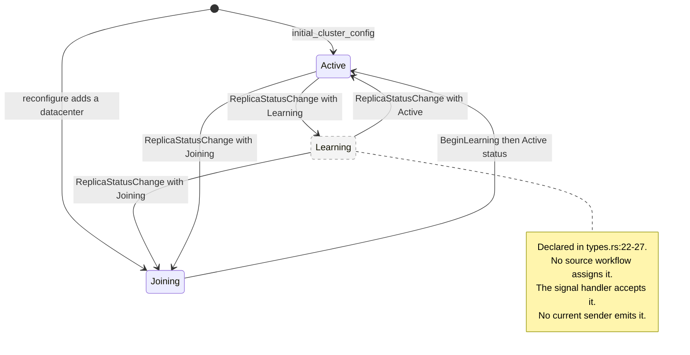
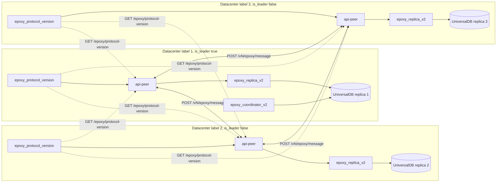
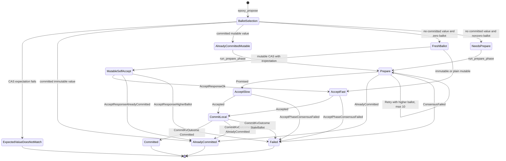

# 08 Epoxy and Multi-Datacenter Replication

Epoxy is the per-key replicated key-value (KV) layer that makes a control-plane write durable in more than one datacenter. It keeps a small set of control-plane records, such as Actor key reservations, runner configuration, and the JSON Web Token (JWT) signing key ring. Each datacenter runs its own UniversalDB (UDB) and its own Epoxy replica. The replicas exchange Binary Application Record Encoding (BARE) messages over Hypertext Transfer Protocol (HTTP). The source at commit `4a58441c50d1ce20d8803cfb1ab7c3285a5141d6` implements a per-key single-decree Fast Paxos variant. It is not EPaxos, and it is not Multi-Paxos. This document derives the protocol from the source, including the parts that are incomplete.

A decree is one decision slot for one key. Single-decree means each key gets one independent decision and no shared log. Fast Paxos lets a proposer skip Phase 1 when the key has no prior ballot. It uses a larger fast quorum so that a fast quorum and a slow quorum always intersect (`README.md:3`, `utils.rs:86-101`).

The exploration plan calls document 08 “EPaxos, replicas, ballots, commit” (`spec.md:72` and `spec.md:103`). The source does not use that label for the current protocol. The Epoxy README says the protocol is “single-decree Fast Paxos (Lamport, 2006), run independently per key” (`engine/packages/epoxy/README.md:3`). The README mentions EPaxos only as ancestry for the old `PreAccept` name and as a reference for cross-key ordering (`README.md:27` and `README.md:42`). In this document, a bare `README.md` citation means `engine/packages/epoxy/README.md`. This document follows the source.

## 1. The problem Epoxy answers

A Rivet deployment can run the same control-plane binary in several availability zones or regions. The topology lists each datacenter, its label, its leader flag, its public Universal Resource Locator (URL), and its Application Programming Interface (API) peer URL. Every field is in `Datacenter` (`engine/packages/config/src/config/topology.rs:155-179`). Each process has its own local UDB. A local UDB transaction cannot see a write in another datacenter (`protocol_version.rs:3-6`; see [07 UniversalDB and Buckets](07-universaldb-and-buckets.md)).

The control plane still needs one agreed value for a small number of keys. Three examples appear in the source:

| Record | Writer | Why agreement matters | Source |
|---|---|---|---|
| Actor key reservation | Pegboard | Two datacenters must not reserve the same namespace, name, and key for different Actors. | `engine/packages/pegboard/src/workflows/actor2/keys.rs:211-245` |
| Runner configuration | Pegboard | A runner configuration must be visible in every enabled datacenter with one version. | `engine/packages/pegboard/src/ops/runner_config/upsert.rs:162-181` |
| JWT signing key ring | auth-jwt | Every datacenter must use one signing ring generation. | `engine/packages/auth-jwt/src/ops/key_ring/compare_and_set.rs:33-95` |

The assignment for this document is a separate exploration brief, not a file in this repository. The brief states that a single object storage bucket has no low-latency compare-and-set (CAS). The source does not contain a design note that compares a bucket with Epoxy. The source does show that Epoxy does not use a bucket. It stores consensus state in UDB and sends messages to peer replicas. The bucket is not in the Epoxy write path. See [07 UniversalDB and Buckets](07-universaldb-and-buckets.md) for the storage drivers and the Enterprise cold tier.

This document reduces the problem to five requirements:

1. A write must survive the loss of one control-plane instance.
2. Concurrent writes to the same key must get one order.
3. Writes to different keys do not need one global order.
4. A read must be able to request a strong guarantee, or accept a weaker one explicitly.
5. A key can be scoped to a subset of datacenters when the workload is regional.

Epoxy answers requirements 1 to 4 with per-key consensus. It answers requirement 5 with `target_replicas`. The scope is not a general-purpose database. It is a small, high-value control-plane KV layer.

## 2. What the source says Epoxy is

The README gives the protocol identity in three short statements:

- “The consensus protocol is single-decree Fast Paxos (Lamport, 2006), run independently per key.” (`engine/packages/epoxy/README.md:3`)
- “Each key only needs agreement on one value, so each key gets its own independent single-decree Paxos instance.” (`README.md:19`)
- “There is no shared log” and “No leader election” (`README.md:21-22`).

The code agrees. `epoxy_propose` reads one key and selects a ballot for that key. It runs one Accept round, or one Prepare plus Accept round, and commits one value (`engine/packages/epoxy/src/ops/propose.rs:320-518`). There is no sequence number across keys. There is no dependency graph. There is no leader election loop.

The following table separates the labels.

| Label | Does the source use it? | What the source actually implements |
|---|---|---|
| EPaxos | Only as ancestry and as a cross-key reference (`README.md:27`, `README.md:42`). | No. There is no dependency graph and no cross-key ordering. |
| Multi-Paxos | No. | No. There is no elected leader and no shared log. |
| Fast Paxos | Yes (`README.md:3`). | Yes, per key, with an optional Prepare phase. |
| Single-decree Paxos | Yes (`README.md:19`). | Yes. One key gets one decided value per round. |
| Leader | The README table uses the word loosely (`README.md:29-35`). | No elected leader role. Any replica can propose. |
| Ballot | Yes (`README.md:265-271` and `replica/ballot.rs:9-38`). | A per-key pair `(counter, replica_id)`. |
| Epoch | Yes (`types.rs:10`). | A configuration membership generation. It is not in the ballot. |

The `PreAccept` message still exists in the version 4 BARE schema and in the request union. The wire handler rejects it:

```rust
// engine/packages/epoxy/src/replica/message_request.rs:52-54
			protocol::RequestKind::PreAcceptRequest(_) => {
				bail!("unreachable: pre accept is not sent over the wire")
			}
```

The old leader errors also remain. The `Kv` enum in `engine/packages/epoxy/src/errors.rs:4-21` declares `NoLeaderElected`, `LeaderForwardingFailed`, `ResponseChannelClosed`, and `NotLeader`. A repository search finds these four variants only in `errors.rs` inside Epoxy. Pegboard and auth-jwt do not use them. This is evidence that the current path has no leader role, even though the names survive.

### 2.1 Fast path and slow path

`BallotSelection` has four outcomes (`engine/packages/epoxy/src/replica/ballot.rs:61-72`):

| Outcome | Condition | Path | Quorum |
|---|---|---|---|
| `AlreadyCommitted` | A committed value exists and either the value or the request is immutable. | No network. Map the result. | None |
| `AlreadyCommittedMutable` | A committed mutable value exists and the request is mutable. | Prepare, then Accept. | Slow for both |
| `FreshBallot` | No committed value and the local ballot is zero or absent. | Accept only. | Fast |
| `NeedsPrepare` | No committed value and the local ballot is nonzero. | Prepare, then Accept. | Slow for both |

The fast path skips Phase 1. The slow path runs Phase 1 and Phase 2. The code selects the path from the local key state only. The source does not ask a quorum whether the key is fresh. This is why the fast quorum size matters. For a three-replica cluster, the fast quorum is three. One slow or down replica makes the first fast attempt fail. The caller must retry, and the retry sees the ballot that the failed attempt wrote, so it takes the slow path.

## 3. Roles and terms

Epoxy has no fixed role assignment. One replica can be the proposer for one key, an acceptor for another key, and a learner for a third key at the same time. The roles below describe one proposal.

| Role | Code name | Function | Source |
|---|---|---|---|
| Proposer | `from_replica_id` in `epoxy_propose` | Reads the local config, selects the ballot, sends Prepare and Accept, commits locally, and broadcasts Commit. | `propose.rs:320-518` |
| Acceptor or voter | `prepare`, `accept`, `read_state` | Promises a ballot, accepts a value, or returns committed state in one serializable transaction. | `replica/messages/prepare.rs`, `accept.rs`, `read_state.rs` |
| Learner | `commit_kv`, `changelog::apply_entry` | Writes a committed value and appends a changelog entry. | `replica/commit_kv.rs:81-97`, `replica/changelog.rs:88-149` |
| Configuration coordinator | `epoxy_coordinator_v2` workflow | Adds replicas, changes status, increments the epoch, and broadcasts config. | `workflows/coordinator/mod.rs:27-100` |
| Configuration coordinator replica | `coordinator_replica_id` | Receives status updates and config messages. It is not a consensus leader. | `types.rs:9`, `setup.rs:118-140` |
| Version probe | `epoxy_protocol_version` service | Probes peer replicas for their agreed protocol version. | `protocol_version.rs:62-155` |

The `coordinator_replica_id` field is easy to misread. It is set to the local replica identifier of the leader datacenter (`workflows/coordinator/mod.rs:96`). The source uses it for configuration and status messages, not for key proposals. The proposal path uses `target_replicas` and the active replica list. The README’s use of “leader” in its terminology table refers to the replica that runs a proposal, not to an elected key leader.

`ReplicaStatus` has three values (`types.rs:22-27`):

| Status | BARE comment | Actual source behavior |
|---|---|---|
| `Joining` | “Receives nothing” (`v4.bare:33-34`) | Added by `reconfigure` (`reconfigure.rs:205-209`). `broadcast_commits` sends commits to every replica, including Joining (`propose.rs:1070-1075`). The comment is stale. |
| `Learning` | “Receives commits, cannot propose, cannot vote” (`v4.bare:35-36`) | Declared in `types.rs:22-27`. No workflow assigns it. A search of `engine/packages/epoxy/src` finds no `ReplicaStatus::Learning` assignment. The replica workflow sends only `Active` after its catch-up loop (`setup.rs:57-61`, `:118-140`). The status signal type can carry any status (`coordinator/mod.rs:128-132`), but its only sender passes `Active`. |
| `Active` | “Receives commits, can propose, can vote” (`v4.bare:37-38`) | The only status in the initial cluster config (`coordinator/mod.rs:87-92`). It is the only status in quorum helpers (`utils.rs:27-34`). |

`BeginLearning` is a Gasoline signal on the replica workflow (`workflows/replica/mod.rs:34-37`). `ReplicaStatusChange` is a coordinator signal (`workflows/coordinator/mod.rs:128-132`). The Joining to Active path runs through `setup.rs:24-63`. The state machine below shows the transitions that the source permits. The dashed state is declared but unused (`types.rs:22-27`).



The epoch increments only when a replica moves from a non-Active status to Active (`replica_status_change.rs:78-84` and `:100-104`). Adding a Joining replica does not increment the epoch. The source comment says this is intentional and refers to the README (`reconfigure.rs:213-214`). The README says the epoch versions cluster membership changes and is not part of the per-key ballot (`README.md:579`). No ballot path reads the epoch. The `Ballot` comparison uses only `counter` and `replica_id` (`ballot.rs:32-38`). `ballot_selection` reads the committed value, the legacy values, and the ballot, but not the config (`ballot.rs:74-158`).

## 4. The replica set and the datacenter mapping

Epoxy does not have a configured replica count. It has one replica for each datacenter in the topology. The current datacenter identifier is the datacenter label cast to a 64-bit unsigned integer.

```rust
// engine/packages/config/src/config/mod.rs:345-353
	/// Alias of `dc_label`. This is for convenience & clarify when reading code.
	pub fn epoxy_replica_id(&self) -> u64 {
		self.dc_label() as u64
	}

	/// Current datacenter's label.
	pub fn dc_label(&self) -> u16 {
		self.topology().datacenter_label
	}
```

`epoxy_read_cluster_config` reads the local replica’s `ConfigKey` through `utils::read_config` in one UDB transaction (`ops/read_cluster_config.rs:15-26`). The replica identifier in that read is `ctx.config().epoxy_replica_id()`, so each datacenter reads its own subspace. `utils::read_config` returns an error when the replica has no stored config (`utils.rs:121-138`).

The default topology has one datacenter. Its name is “default”, its label is 1, and it is the leader (`engine/packages/config/src/config/topology.rs:47-75`). A default deployment therefore has one Epoxy replica. The fast and slow quorum sizes for one replica are both one (`utils.rs:86-101`). A one-replica cluster is not multi-datacenter durable. It is a valid development shape, not the shape that answers the assignment’s durability problem.

The coordinator builds the first cluster config from every topology datacenter:

```rust
// engine/packages/epoxy/src/workflows/coordinator/mod.rs:81-100
fn initial_cluster_config(ctx: &ActivityCtx) -> types::ClusterConfig {
	let replicas = ctx
		.config()
		.topology()
		.datacenters
		.iter()
		.map(|dc| types::ReplicaConfig {
			replica_id: dc.datacenter_label as u64,
			status: types::ReplicaStatus::Active,
			api_peer_url: dc.peer_url.to_string(),
			guard_url: dc.public_url.to_string(),
		})
		.collect();

	types::ClusterConfig {
		coordinator_replica_id: ctx.config().epoxy_replica_id(),
		epoch: 0,
		replicas,
	}
}
```

The Rust types in `engine/packages/epoxy/src/types.rs:7-27` mirror the schema. `ClusterConfig` holds `coordinator_replica_id`, `epoch`, and `replicas`. `ReplicaConfig` holds `replica_id`, `status`, `api_peer_url`, and `guard_url`. `ReplicaStatus` has `Joining`, `Learning`, and `Active`. The following table lists every field and its purpose.

| Type | Field | Type | Purpose | Source |
|---|---|---|---|---|
| `ClusterConfig` | `coordinator_replica_id` | `ReplicaId` (`u64`) | The replica that receives configuration and status messages. | `types.rs:9` |
| `ClusterConfig` | `epoch` | `u64` | Membership generation. Incremented on a transition to Active. | `types.rs:10`, `replica_status_change.rs:83-104` |
| `ClusterConfig` | `replicas` | `Vec<ReplicaConfig>` | Every replica known to the cluster, including Joining and Learning. | `types.rs:11` |
| `ReplicaConfig` | `replica_id` | `ReplicaId` | The datacenter label as a `u64`. | `types.rs:16`, `coordinator/mod.rs:88` |
| `ReplicaConfig` | `status` | `ReplicaStatus` | Membership and voting state. | `types.rs:17` |
| `ReplicaConfig` | `api_peer_url` | `String` | The peer API base URL. Consensus messages go here. | `types.rs:18`, `http_client.rs:11-21` |
| `ReplicaConfig` | `guard_url` | `String` | The datacenter public URL. The source stores it and compares it during reconfiguration. Consensus does not use it. | `types.rs:19`, `reconfigure.rs:319-331` |

The source does not state why `guard_url` is in the cluster config. It is not in the consensus send path. `find_replica_address` reads `api_peer_url` and nothing else (`http_client.rs:11-21`). The coordinator compares both URLs during a configuration change (`reconfigure.rs:319-331`). This document does not infer a further purpose.

The source also does not show a check that two datacenters have different labels. `initial_cluster_config` maps each datacenter to `datacenter_label as u64` with no uniqueness test (`coordinator/mod.rs:81-100`). A duplicate label would create two replicas with the same identifier. The source does not state a guard for this case.

The topology diagram below shows one replica per datacenter. The control-plane process hosts the API peer routes, the replica workflow, the coordinator workflow in the leader datacenter, and the protocol version service.



The solid peer links carry consensus messages at the negotiated version. `N` in the label is that version. The dotted links carry the unversioned version probe. Each replica probes every other replica, so the diagram shows two probes per datacenter (`protocol_version.rs:104-124`). The coordinator runs only in the leader datacenter (`bootstrap/src/lib.rs:53-57`). Each datacenter runs its own replica workflow (`bootstrap/src/lib.rs:77-88`). Bootstrap creates the replica before the coordinator (`bootstrap/src/lib.rs:17-22`).

## 5. Durable state and key layout

All Epoxy state lives under a per-replica subspace. The v2 subspace is `(RIVET, EPOXY_V2, REPLICA, replica_id)`. The legacy subspace is `(RIVET, EPOXY_V1, REPLICA, replica_id)` and is read-only except for the backfill migration.

```rust
// engine/packages/epoxy/src/keys/mod.rs:13-19
pub fn subspace(replica_id: ReplicaId) -> universaldb::utils::Subspace {
	universaldb::utils::Subspace::new(&(RIVET, EPOXY_V2, REPLICA, replica_id))
}

pub fn legacy_subspace(replica_id: ReplicaId) -> universaldb::utils::Subspace {
	universaldb::utils::Subspace::new(&(RIVET, EPOXY_V1, REPLICA, replica_id))
}
```

The tuple constants come from UDB. The numbers matter because they are durable bytes.

| Symbol | Value | Source |
|---|---:|---|
| `RIVET` | 0 | `engine/packages/universaldb/src/utils/keys.rs:28` |
| `KV` | 2 | `keys.rs:30` |
| `EPOXY_V1` | 70 | `keys.rs:98` |
| `VALUE` | 79 | `keys.rs:107` |
| `COMMITTED_VALUE` | 80 | `keys.rs:108` |
| `REPLICA` | 89 | `keys.rs:117` |
| `CONFIG` | 90 | `keys.rs:118` |
| `BALLOT` | 120 | `keys.rs:148` |
| `ACCEPTED` | 121 | `keys.rs:149` |
| `CACHE` | 122 | `keys.rs:150` |
| `CHANGELOG` | 123 | `keys.rs:151` |
| `EPOXY_V2` | 124 | `keys.rs:152` |
| `ACCEPTED2` | 127 | `keys.rs:155` |

The full tuple path for a key is:

```text
/rivet/epoxy_v2/replica/{replica_id}/kv/{key}/value
/rivet/epoxy_v2/replica/{replica_id}/kv/{key}/ballot
/rivet/epoxy_v2/replica/{replica_id}/kv/{key}/accepted
/rivet/epoxy_v2/replica/{replica_id}/kv/{key}/accepted2
/rivet/epoxy_v2/replica/{replica_id}/kv/{key}/cache
/rivet/epoxy_v2/replica/{replica_id}/changelog/{versionstamp}
/rivet/epoxy_v2/replica/{replica_id}/config
/rivet/epoxy/replica/{replica_id}/kv/{key}/committed_value
/rivet/epoxy/replica/{replica_id}/kv/{key}/value
```

The last two paths are the read-only legacy layout. A raw legacy `committed_value` is version 0 and immutable. A legacy `value` uses the same versioned `KvValueKey` encoding as v2, but it lives under the old `(RIVET, EPOXY_V1, REPLICA, replica_id)` subspace (`ballot.rs:82-91`, `read_state.rs:34-50`).

The `{key}` bytes are the caller’s packed key. For a Pegboard reservation, the caller packs a namespace key first (`actor2/keys.rs:214-227`). Epoxy treats the result as opaque bytes. The UDB tuple encoder writes the length and the bytes. The document shows the symbolic path, not a byte offset for every field.

The following table lists every shared key type and its value encoding.

| Key type | Tuple | Value type | Encoding | Source |
|---|---|---|---|---|
| `ConfigKey` | `(CONFIG,)` under the replica subspace | `protocol::ClusterConfig` | BARE, unversioned. The source has a TODO that says this is “mistakenly not versioned.” | `keys/replica.rs:5-29` |
| `KvValueKey` | `(KV, key, VALUE)` | `protocol::CommittedValue` | Versioned BARE with embedded `STORAGE_VERSION = 3`. | `keys/keys.rs:42-63` |
| `KvValueKey` (legacy placement) | `(KV, key, VALUE)` under the legacy subspace | `protocol::CommittedValue` | Same versioned BARE. Read as the second legacy fallback. | `ballot.rs:85,90,110-117`, `read_state.rs:39-42` |
| `LegacyCommittedValueKey` | `(KV, key, COMMITTED_VALUE)` under the legacy subspace | `Vec<u8>` | Raw bytes. Read as version 0 and immutable. | `keys/keys.rs:97-118` |
| `KvBallotKey` | `(KV, key, BALLOT)` | `protocol::Ballot` | Bare BARE, no version. | `keys/keys.rs:151-172` |
| `KvAcceptedKey` | `(KV, key, ACCEPTED)` | `KvAcceptedValue` | Raw `serde_bare`. Deprecated. | `keys/keys.rs:190-243` |
| `KvAccepted2Key` | `(KV, key, ACCEPTED2)` | `protocol::AcceptedValue` | Versioned BARE. Current accepted state. | `keys/keys.rs:245-298` |
| `KvOptimisticCacheKey` | `(KV, key, CACHE)` | `protocol::CachedValue` | Versioned BARE. | `keys/keys.rs:300-352` |
| `ChangelogKey` | `(CHANGELOG, versionstamp)` | `protocol::ChangelogEntry` | Bare BARE, unversioned. The source has a TODO that says this is “mistakenly not versioned.” | `keys/keys.rs:354-404` |

The accepted value is transient. It is cleared on every commit. The source explains why it uses raw `serde_bare` instead of the versioned path:

```rust
// engine/packages/epoxy/src/keys/keys.rs:8-25
// v4 adds only read RPCs. Keep the unchanged persisted layouts readable by v3 binaries
// throughout a rolling upgrade; wire-version negotiation must not advance storage formats.
const STORAGE_VERSION: u16 = 3;

/// In-flight accepted proposal state stored under `kv/{key}/accepted`.
///
/// This uses raw `serde_bare` serialization rather than the versioned protocol path because
/// accepted state is transient. It is cleared on every commit and never survives a full
/// consensus round, so forward-compatible deserialization is not needed.
#[derive(Debug, Clone, Serialize, Deserialize, PartialEq)]
pub struct KvAcceptedValue {
	pub value: Vec<u8>,
	pub ballot: protocol::Ballot,
	#[serde(default)]
	pub version: u64,
	#[serde(default)]
	pub mutable: bool,
}
```

The committed value is versioned. The storage version stays 3 even though the runtime protocol is 4.

```rust
// engine/packages/epoxy/src/keys/keys.rs:42-64
impl FormalKey for KvValueKey {
	type Value = protocol::CommittedValue;

	fn deserialize(&self, raw: &[u8]) -> Result<Self::Value> {
		versioned::CommittedValue::deserialize_with_embedded_version(raw)
	}

	fn serialize(&self, value: Self::Value) -> Result<Vec<u8>> {
		versioned::CommittedValue::wrap_latest(value)
			.serialize_with_embedded_version(STORAGE_VERSION)
	}
}

impl TuplePack for KvValueKey {
	fn pack<W: std::io::Write>(
		&self,
		w: &mut W,
		tuple_depth: TupleDepth,
	) -> std::io::Result<VersionstampOffset> {
		let t = (KV, &self.key, VALUE);
		t.pack(w, tuple_depth)
	}
}
```

The changelog key uses a versionstamp. A versionstamp is a version that UDB assigns at commit time. UDB orders entries by it, and every reader sees the same value. The tuple is `(CHANGELOG, versionstamp)` (`keys/keys.rs:383-392`). The value is `protocol::ChangelogEntry` in raw BARE. The source TODO says it is “mistakenly not versioned” (`keys/keys.rs:372-373`). The changelog is per replica, not global. See [07 UniversalDB and Buckets](07-universaldb-and-buckets.md) for the versionstamp mechanics.

The config key is stored outside the `KV` segment but under the same replica subspace. Its value is `protocol::ClusterConfig`, encoded as raw BARE with no version. The source has a TODO that calls this a mistake (`keys/replica.rs:11-12`). The tuple is `(CONFIG,)` (`keys/replica.rs:22-29`).

The subspace rule is in the engine instructions. It is a common source of key bugs.

All Epoxy durable state lives under per-replica subspaces (`engine/CLAUDE.md:37`). The v2 space is `keys::subspace(replica_id)`. The legacy space is `keys::legacy_subspace(replica_id)` and is read-only. Shared key types live in `engine/packages/epoxy/src/keys/keys.rs`. New tuple constants go in `engine/packages/universaldb/src/utils/keys.rs`.

UniversalDB low-level `Transaction::get`, `set`, `clear`, and `get_ranges_keyvalues` do not apply the transaction subspace automatically (`engine/CLAUDE.md:38`). Pack the subspace bytes yourself, or use the higher-level range helpers.

The code follows two styles. The message handlers call `tx.with_subspace(keys::subspace(replica_id))` and then `read_opt` or `write` (`prepare.rs:16`, `accept.rs:16`, `commit_kv.rs:32`). The ballot selection and local read paths pack the subspace manually with `subspace.pack(&key)` before a low-level `tx.get` (`ballot.rs:88-91`, `get_local.rs:58-62`). Both styles address the same bytes.

## 6. Ballots and epochs

A ballot is a pair of a counter and a replica identifier. The ordering is counter first, then replica identifier.

```rust
// engine/packages/epoxy/src/replica/ballot.rs:32-38
impl Ord for Ballot {
	fn cmp(&self, other: &Self) -> Ordering {
		self.counter
			.cmp(&other.counter)
			.then_with(|| self.replica_id.cmp(&other.replica_id))
	}
}
```

The BARE schema states the same shape: `Ballot { counter: u64, replicaId: ReplicaId }` (`v4.bare:4-7`). A ballot is per key. It is not global. The `KvBallotKey` is `(KV, key, BALLOT)` under the replica subspace (`keys/keys.rs:151-172`). Two keys can hold the same ballot without conflict.

Ballot selection reads the committed value, the legacy committed value, the legacy versioned value, and the current ballot in one serializable transaction (`ballot.rs:93-126`). It then chooses one of the four outcomes.

```rust
// engine/packages/epoxy/src/replica/ballot.rs:128-157
	if let Some(value) = committed_value
		.or_else(|| {
			legacy_committed_value.map(|value| CommittedValue {
				value: Some(value),
				version: 0,
				mutable: false,
			})
		})
		.or_else(|| legacy_v2_committed_value)
	{
		if !value.mutable || !mutable {
			return Ok(BallotSelection::AlreadyCommitted(value.value));
		}

		let ballot = reserve_next_ballot(
			tx,
			replica_id,
			ballot_key,
			current_ballot.unwrap_or_else(|| Ballot::zero(replica_id)),
		)?;
		return Ok(BallotSelection::AlreadyCommittedMutable { value, ballot });
	}

	let current_ballot = current_ballot.unwrap_or_else(|| Ballot::zero(replica_id));
	let ballot = reserve_next_ballot(tx, replica_id, ballot_key, current_ballot)?;
	if current_ballot.is_zero() {
		Ok(BallotSelection::FreshBallot(ballot))
	} else {
		Ok(BallotSelection::NeedsPrepare { ballot })
	}
```

`reserve_next_ballot` increments the counter with `checked_add` and writes `(next_counter, local_replica_id)` before the network round (`ballot.rs:174-189`). A counter overflow is an error. The only ceiling is `u64::MAX`, enforced by `checked_add` in `reserve_next_ballot` (`ballot.rs:180-183`) and in `next_ballot` (`propose.rs:1165-1173`).

The ballot rules differ by message. The table below gives the exact comparison and the effect.

| Message | Condition | Response | Source | Purpose |
|---|---|---|---|---|
| Prepare | `request_ballot < current_ballot` | `HigherBallot(current_ballot)` | `prepare.rs:47-56` | Fence a stale proposer. |
| Prepare | `request_ballot == current_ballot` | Promise and return accepted state. | `prepare.rs:48-61` | Idempotent retry. This lets the proposer include itself in the quorum. |
| Prepare | `request_ballot > current_ballot` | Write the ballot and return accepted state. | `prepare.rs:59-107` | Promise not to accept a lower ballot. |
| Accept | `current_ballot > request_ballot` | `HigherBallot(current_ballot)` | `accept.rs:48-56` | Fence a stale proposer. |
| Accept | Equal ballot and same value, version, and mutability | `Ok` | `accept.rs:58-69` | Idempotent retry. |
| Accept | Equal ballot and different value, version, or mutability | `HigherBallot(existing_ballot)` | `accept.rs:70-76` | Reject a same-ballot conflict. |
| Accept | Equal ballot and stored accepted state at a lower ballot | Write the ballot and the new accepted2 value. | `accept.rs:58-110` | Adopt the value at the new ballot after Prepare. |
| Accept | `current_ballot < request_ballot` | Write the ballot and the accepted value. | `accept.rs:101-114` | Normal Phase 2a. |
| Commit | `request_ballot < current_ballot` and the accepted state does not match the request | `StaleBallot` | `commit_kv.rs:70-78` | Do not learn through a higher promise. |
| Commit | `request_ballot < current_ballot` but the accepted state matches the request | Commit. | `commit_kv.rs:70-79` | Finish a value that this replica already accepted. |
| Read-state promise | Current promise is absent or `<= request_ballot` | Write the request ballot. | `read_state.rs:59-68` | Establish a read promise. |

Two details are easy to miss.

First, Prepare rejects only a strictly lower ballot. The README says it rejects `request.ballot <= current_ballot` (`README.md:358`). The source rejects only `<` (`prepare.rs:50`). An equal ballot is idempotent. The source comment explains why: the proposer may already have reserved the ballot locally and must be able to include itself in the quorum (`prepare.rs:48-49`). The source wins.

Second, Accept rejects an equal-ballot conflict, but it does not preserve a lower-ballot accepted value. If `current_ballot < request_ballot`, the code writes the new ballot and the new accepted value (`accept.rs:101-110`). The equal-ballot branch only compares the accepted value when the existing accepted ballot equals the request ballot (`accept.rs:58-77`). The test suite has a regression test for the equal-ballot case (`tests/consensus_regressions.rs:54-111`). This document does not find a test for the lower-ballot replacement case. A full safety proof is outside the source-reading scope. The code path is stated here so a reviewer can check it.

The ballot state machine for one proposal is:



`MutableSelfAccept` is the local self-accept for a mutable CAS (`propose.rs:579-608`). The diagram uses `Promised` for `PrepareRoundOutcome::Promised`. `ExpectedValueDoesNotMatch` is the early result from `expectation_failure` (`propose.rs:360-371`, `:183-197`).

The epoch is separate. It is a `u64` in `ClusterConfig` (`types.rs:10`). The coordinator increments it only when a replica becomes Active from a non-Active status (`replica_status_change.rs:78-84`). It does not increment when a replica is added as Joining (`reconfigure.rs:205-216`). The read-state message carries the epoch and rejects a mismatch:

```rust
// engine/packages/epoxy/src/replica/messages/read_state.rs:13-21
	let config = crate::utils::read_config(tx, replica_id).await?;
	ensure!(
		config.epoch == request.epoch,
		"Epoxy read configuration changed"
	);
	ensure!(
		crate::utils::get_quorum_members(&config).contains(&replica_id),
		"Epoxy read replica is inactive"
	);
```

The source does not use the epoch in Prepare, Accept, or Commit. It does not fence a proposal with an epoch. A stale membership config can still propose if its replica is Active in its local config. The source does not state a reason for this split. The README says the epoch is not part of the per-key ballot (`README.md:579`).

`update_config` stores the supplied cluster config with no epoch comparison (`replica/update_config.rs:8-26`). The next config broadcast can overwrite a newer local config with an older one if messages arrive out of order. The source does not show an epoch check at this point. This document reports the code path and does not infer a guarantee.

## 7. The proposal input and result

The public proposal type is a wrapper around one command. The current path rejects more than one command with `bail!("epoxy v2 only supports single-command proposals")` (`propose.rs:150-154`).

```rust
// engine/packages/epoxy/src/ops/propose.rs:19-39
#[derive(Debug, Serialize, Deserialize, PartialEq, Eq, Clone, Hash)]
pub struct Proposal {
	pub commands: Vec<Command>,
}

#[derive(Debug, Serialize, Deserialize, PartialEq, Eq, Clone, Hash)]
pub struct Command {
	pub kind: CommandKind,
}

#[derive(Debug, Serialize, Deserialize, PartialEq, Eq, Clone, Hash)]
pub enum CommandKind {
	SetCommand(SetCommand),
	CheckAndSetCommand(CheckAndSetCommand),
}

#[derive(Serialize, Deserialize, PartialEq, Eq, Clone, Hash)]
pub struct SetCommand {
	pub key: Vec<u8>,
	pub value: Option<Vec<u8>>,
}
```

The CAS command carries an expected predecessor set. Its comment is a design constraint, not just documentation.

```rust
// engine/packages/epoxy/src/ops/propose.rs:50-67
#[derive(Serialize, Deserialize, PartialEq, Eq, Clone, Hash)]
pub struct CheckAndSetCommand {
	pub key: Vec<u8>,
	/// Mutable CAS is coordinator-authoritative: the coordinator checks this against its local
	/// committed value before proposing, while consensus prevents overlapping proposals from
	/// choosing different successors. A loser can observe either a value mismatch or a retryable
	/// consensus failure, depending on whether it sees the winner before ballot contention rejects
	/// it. This is sufficient only while one authoritative coordinator replica owns the key, as the
	/// JWT key ring does in the leader datacenter.
	///
	/// TODO(epoxy): Before allowing independent coordinators to mutate the same key, make the
	/// condition part of a new protocol version. Carry the expected predecessor through
	/// prepare/accept/commit and evaluate it against the value selected during recovery, including
	/// accepted-but-not-yet-learned values; do not compare each replica's potentially stale local
	/// snapshot independently. The versioned transport must also encode the negotiated schema.
	pub expect_one_of: Vec<Option<Vec<u8>>>,
	pub new_value: Option<Vec<u8>>,
}
```

This is a real limitation. A mutable CAS is safe only when one authoritative coordinator owns the key. The JWT key ring meets that condition: writes are leader-only (`auth-jwt/src/ops/key_ring/compare_and_set.rs:38-41`). A caller that runs CAS from several datacenters at the same time is outside the current design. The TODO says the condition must become part of the protocol version first.

The operation input carries the scope and two behavioral flags.

```rust
// engine/packages/epoxy/src/ops/propose.rs:128-140
#[derive(Debug)]
pub struct Input {
	pub proposal: Proposal,
	pub mutable: bool,
	pub purge_cache: bool,
	/// Optional active-replica scope for this proposal.
	///
	/// Epoxy only validates that the supplied replicas are active and include the local
	/// replica. Callers are responsible for ensuring a given key stays on a stable scope over
	/// time, or that any scope change is handled as an explicit reconfiguration at a higher
	/// layer.
	pub target_replicas: Option<Vec<ReplicaId>>,
}
```

The result has two variants: `Committed` and `ConsensusFailed { reason }` (`propose.rs:79-83`). The table expands the four reasons of `ConsensusFailed` into their own rows.

| Result | Meaning | Source |
|---|---|---|
| `Committed` | The local commit succeeded. | `propose.rs:79-83` |
| `ConsensusFailed { reason: PreparePhaseConsensusFailed }` | Prepare could not reach a slow quorum, or the expected-value retry limit expired. | `propose.rs:91-93`, `:420-424`, `:502-506` |
| `ConsensusFailed { reason: AcceptPhaseConsensusFailed }` | Accept could not reach its target quorum. | `propose.rs:94-96`, `:626-632` |
| `ConsensusFailed { reason: StaleBallot }` | A higher ballot fenced the local commit or the CAS self-accept. | `propose.rs:97`, `:600-606`, `:702-706` |
| `ConsensusFailed { reason: ExpectedValueDoesNotMatch { current_value } }` | The CAS expectation did not match, or an immutable set found a different value. | `propose.rs:98-100`, `:183-197`, `:232-236` |

`ProposalResult::resolve()` converts every failure to an error (`propose.rs:85-104`). Most callers match on the result instead. The tests import a `CommandError` type (`tests/kv.rs:3`). The current source has no such type, so those tests are stale against this result enum.

One result mapping is subtle. `result_for_chosen_value` returns `Committed` for every plain `SetCommand`, even when the chosen value differs, because `expect_one_of` is `None` (`propose.rs:199-202`). It returns `ExpectedValueDoesNotMatch` only when `expect_one_of` is `Some` and the chosen value differs (`propose.rs:204-208`).

A separate function, `result_for_already_committed`, handles a value that is already committed. It returns `Committed` for an identical value or a mutable overwrite. It returns `RetryExpectedCommit` for a mutable CAS whose expectation matches. It returns `ExpectedValueDoesNotMatch` otherwise (`propose.rs:211-236`). A plain Set therefore means “commit some value for this key,” not “commit exactly my value, or fail.” The set-if-absent behavior comes from this earlier branch, not from the chosen-value comparison. A CAS checks equality because `expect_one_of` is `Some`.

## 8. The write path from proposal to commit

The write path has seven stages. The table names each stage, its message, and the durable key it touches.

| Stage | Function | Message | Durable key | Source |
|---|---|---|---|---|
| 1. Read config | `epoxy_propose` | None | `ConfigKey` | `propose.rs:327-334` |
| 2. Resolve scope | `resolve_active_quorum_members` | None | `ConfigKey` | `propose.rs:336-340`, `utils.rs:45-79` |
| 3. Select ballot | `ballot_selection` | None | `KvValueKey`, `KvBallotKey`, legacy keys | `propose.rs:350-359`, `ballot.rs:74-158` |
| 4. Prepare (slow only) | `run_prepare_phase` | `PrepareRequest` / `PrepareResponse` | `KvBallotKey`, `KvAccepted2Key` | `propose.rs:710-779`, `prepare.rs` |
| 5. Accept | `run_fast_path` or `run_slow_path`, then `run_accept_path` | `AcceptRequest` / `AcceptResponse` | `KvBallotKey`, `KvAccepted2Key` | `propose.rs:520-633`, `accept.rs` |
| 6. Local commit | `commit_kv` | None | `KvValueKey`, `ChangelogKey`; deletes accepted and accepted2; deletes ballot and cache only if mutable | `propose.rs:635-652`, `commit_kv.rs:47-97` |
| 7. Broadcast | `broadcast_commits` | `CommitRequest` / `CommitResponse` | `KvValueKey`, `ChangelogKey` at peers | `propose.rs:655-697`, `:1062-1118` |

`run_fast_path` and `run_slow_path` are thin wrappers. Both call `run_accept_path` and differ only in the `QuorumType` argument, `Fast` or `Slow` (`propose.rs:520-566`).

### 8.1 Read config and resolve the scope

The proposer reads its own replica’s config from its own UDB. A replica that the coordinator has not configured yet has no config, and `read_config` returns an error with a startup hint (`utils.rs:121-138`). The proposer then resolves the quorum members.

```rust
// engine/packages/epoxy/src/utils.rs:45-79
pub fn resolve_active_quorum_members(
	config: &protocol::ClusterConfig,
	replica_id: ReplicaId,
	target_replicas: Option<&[ReplicaId]>,
) -> Result<Vec<ReplicaId>> {
	match target_replicas {
		Some(target_replicas) => {
			let active = get_quorum_members(config)
				.into_iter()
				.collect::<HashSet<_>>();
			let validated = target_replicas.iter().copied().collect::<BTreeSet<_>>();

			if validated.is_empty() {
				bail!("target_replicas cannot be empty");
			}

			if !validated.contains(&replica_id) {
				bail!("target_replicas must include the local replica");
			}

			if !validated.iter().all(|replica| active.contains(replica)) {
				bail!("target_replicas contains an inactive or unknown replica");
			}

			Ok(validated.into_iter().collect())
		}
		None => {
			let replicas = get_quorum_members(config);
			if !replicas.contains(&replica_id) {
				bail!("local replica is not active in the current epoxy config");
			}
			Ok(replicas)
		}
	}
}
```

The scope rules are strict:

- The scope must not be empty.
- The scope must include the local replica.
- Every scope member must be Active in the current config.
- The function returns a sorted, deduplicated list.
- A scope is not persisted. The caller must keep the same key on the same scope. The function comment says this explicitly (`utils.rs:42-44`).
- `engine/CLAUDE.md:42` adds the caller rule: validate the local replica is in scope or forward to an in-scope datacenter first.

The scope changes the quorum denominator. A key scoped to two replicas needs a fast quorum of two and a slow quorum of two. A key scoped to one replica needs one. The source does not enforce that two different scopes never write the same key. That is the caller’s invariant.

### 8.2 Select the ballot

Ballot selection is one serializable transaction. It reads the v2 committed value, the legacy raw committed value, the legacy versioned value, and the current ballot in parallel (`ballot.rs:93-126`). It then chooses the path from the table in section 2.1. The function writes the reserved ballot before any network call. That write is the durable trace of an in-flight proposal.

### 8.3 Prepare

Prepare is Phase 1. `send_prepare_round` computes the slow quorum from all members, sends `PrepareRequest` to every member including itself, and applies the 10-second `REQUEST_TIMEOUT` to each request (`propose.rs:781-816`). It stops counting when it has enough responses. It records the highest accepted value and the highest rejected ballot. If the target becomes impossible, it either retries with a higher ballot or returns `ConsensusFailed` (`propose.rs:887-908`).

```rust
// engine/packages/epoxy/src/ops/propose.rs:887-909
		if ok_responses + remaining < target {
			return if let Some(rejected_ballot) = highest_rejected_ballot {
				Ok(PrepareRoundOutcome::Retry {
					next_ballot: next_ballot(rejected_ballot, from_replica_id)?,
				})
			} else {
				Ok(PrepareRoundOutcome::ConsensusFailed)
			};
		}
	}

	if ok_responses >= target {
		Ok(PrepareRoundOutcome::Promised {
			accepted_value: highest_accepted,
		})
	} else if let Some(rejected_ballot) = highest_rejected_ballot {
		Ok(PrepareRoundOutcome::Retry {
			next_ballot: next_ballot(rejected_ballot, from_replica_id)?,
		})
	} else {
		Ok(PrepareRoundOutcome::ConsensusFailed)
	}
}
```

The Prepare handler on each replica is one serializable transaction. It reads committed, ballot, accepted, and accepted2 state. It returns `AlreadyCommitted` for a committed value that the request cannot replace. It fences a lower ballot. It permits an equal ballot. It writes the promise and returns the highest accepted value.

```rust
// engine/packages/epoxy/src/replica/messages/prepare.rs:47-61
	if let Some(current_ballot) = current_ballot.map(Ballot::from) {
		// Equal-ballot Prepare is idempotent. This allows a proposer that has already
		// reserved a ballot locally to include itself in the prepare quorum.
		if request_ballot < current_ballot {
			return Ok(protocol::PrepareResponse::PrepareResponseHigherBallot(
				protocol::PrepareResponseHigherBallot {
					ballot: current_ballot.into(),
				},
			));
		}
	}

	// Promise not to accept lower ballots by persisting the request ballot.
	// After this write, highest_ballot == request.ballot by construction.
	tx.write(&ballot_key, ballot.clone())?;
```

The proposer chooses the highest accepted value if any replica returns one. Otherwise it keeps the proposed value. `send_prepare_round` names this outcome `PrepareRoundOutcome::Promised` (`propose.rs:657-660`, `:862-864`). `run_prepare_phase` converts it to `PreparePhaseOutcome::Prepared` (`propose.rs:734-741`). This is the Paxos safety rule that prevents a previously accepted value from being lost (`README.md:374`). The retry delay is exponential with jitter: initial 10 milliseconds, cap 1,000 milliseconds, maximum 10 retries (`propose.rs:310-313` and `:1190-1212`).

### 8.4 Accept

Accept is Phase 2a. The fast path uses a fast quorum. The slow path uses a slow quorum. `send_accept_round` sends `AcceptRequest` to every member, including itself (`propose.rs:911-983`). An `AlreadyCommitted` response short-circuits the round. A `HigherBallot` or a failed request counts as not-ok. If the remaining responses cannot reach the target, the round fails immediately (`propose.rs:284-307`).

The Accept handler returns `AlreadyCommitted` for a value that the request cannot replace. It fences a higher current ballot. It rejects an equal-ballot conflict. Otherwise it writes the ballot and the accepted value in one transaction.

```rust
// engine/packages/epoxy/src/replica/messages/accept.rs:48-77
	if let Some(current_ballot) = current_ballot.map(Ballot::from) {
		if current_ballot > request_ballot {
			return Ok(protocol::AcceptResponse::AcceptResponseHigherBallot(
				protocol::AcceptResponseHigherBallot {
					ballot: current_ballot.into(),
				},
			));
		}
	}

	if let Some(existing_accepted) = accepted2_value {
		let existing_ballot = Ballot::from(existing_accepted.ballot.clone());
		if existing_ballot == request_ballot {
			let same_value = existing_accepted.value == value;
			let same_version = existing_accepted.version == version;
			let same_mutability = existing_accepted.mutable == mutable;
			if same_value && same_version && same_mutability {
				tx.write(&ballot_key, ballot.clone())?;
				return Ok(protocol::AcceptResponse::AcceptResponseOk(
					protocol::AcceptResponseOk { ballot },
				));
			}

			return Ok(protocol::AcceptResponse::AcceptResponseHigherBallot(
				protocol::AcceptResponseHigherBallot {
					ballot: existing_ballot.into(),
				},
			));
		}
	}
```

A current ballot equal to the request does not block. If the stored accepted2 value is at a lower ballot, the handler falls through to `accept.rs:101-110`. It writes the request ballot and the new accepted2 value. That is the branch the retry in section 9 uses.

There is one extra step for a mutable CAS. The proposer writes a local self-accept before it contacts peers. The comment explains why: the owner read must see an unresolved write.

```rust
// engine/packages/epoxy/src/ops/propose.rs:579-608
	if proposal.mutable && proposal.expect_one_of.is_some() {
		// Mutable CAS is owned by its coordinator (including the JWT ring). Record acceptance
		// locally before peers can choose a successor, so the owner read sees unresolved writes.
		match tokio::time::timeout(
			crate::consts::REQUEST_TIMEOUT,
			send_accept_request(
				ctx,
				config,
				replica_id,
				replica_id,
				proposal.key.clone(),
				chosen_value.clone(),
				ballot.clone(),
			),
		)
		.await??
		{
			protocol::AcceptResponse::AcceptResponseOk(_) => {}
			protocol::AcceptResponse::AcceptResponseAlreadyCommitted(value) => {
				return Ok(proposal.result_for_already_committed(&value.value));
			}
			protocol::AcceptResponse::AcceptResponseHigherBallot(_) => {
				return Ok(ProposalAttemptResult::Complete(
					ProposalResult::ConsensusFailed {
						reason: ConsensusFailedReason::StaleBallot,
					},
				));
			}
		}
	}
```

`send_accept_request` takes a `CommittedValue`, not separate `mutable` and `version` arguments. It destructures the value at `propose.rs:1030-1034`. It encodes both fields in the `AcceptRequest` at `propose.rs:1041-1047`. The block above passes `chosen_value`, which already carries them.

### 8.5 Local commit

After the Accept quorum, the proposer commits locally in one UDB transaction named `epoxy_propose_commit_kv`. The transaction calls `commit_kv::commit_kv`. On `CommitKvOutcome::Committed`, the proposer maps the result and spawns a fire-and-forget `broadcast_commits`. It also spawns `broadcast_cache_purges` when `purge_cache` is true and the proposal is mutable. On `AlreadyCommitted`, it maps the existing value. On `StaleBallot`, it returns `ConsensusFailedReason::StaleBallot` (`propose.rs:635-707`). The broadcast is outside the commit transaction and cannot fail the proposal.

`commit_kv` performs the durable write. It reads committed, ballot, accepted, and accepted2 in one transaction. It returns `AlreadyCommitted` for a value that the request cannot replace. It checks whether the accepted state exactly matches the request. A lower request ballot is stale only when the accepted state does not match. It writes the committed value, deletes accepted and accepted2, deletes the ballot and cache for a mutable value, and appends a changelog entry.

```rust
// engine/packages/epoxy/src/replica/commit_kv.rs:47-97
	if let Some(committed_value) = committed_value {
		if !committed_value.mutable || !mutable || version <= committed_value.version {
			return Ok(CommitKvOutcome::AlreadyCommitted {
				value: committed_value.value,
				version: committed_value.version,
			});
		}
	}

	let accepted_matches_request = if let Some(accepted_value) = accepted2_value {
		accepted_value.ballot == ballot
			&& accepted_value.value == value
			&& accepted_value.version == version
			&& accepted_value.mutable == mutable
	} else if let Some(accepted_value) = accepted_value {
		accepted_value.ballot == ballot
			&& Some(accepted_value.value) == value
			&& accepted_value.version == version
			&& accepted_value.mutable == mutable
	} else {
		false
	};

	if let Some(current_ballot) = current_ballot.map(Ballot::from) {
		// Once a replica has accepted this exact value at this ballot, a later prepare can raise
		// the promise without invalidating the already-chosen value. Allow the commit to finish in
		// that case so quorum acceptance can still become learned state.
		if request_ballot < current_ballot && !accepted_matches_request {
			return Ok(CommitKvOutcome::StaleBallot {
				current_ballot: current_ballot.into(),
			});
		}
	}

	tx.write(
		&value_key,
		CommittedValue {
			value: value.clone(),
			version,
			mutable,
		},
	)?;
	tx.delete(&accepted_key);
	tx.delete(&accepted2_key);
	if mutable {
		tx.delete(&ballot_key);
		tx.delete(&cache_key);
	}
	crate::replica::changelog::append(replica_id, &tx, key, value, version, mutable)?;

	Ok(CommitKvOutcome::Committed)
```

The immutable path keeps the ballot. The mutable path deletes it. A fresh mutable key can use the fast path. A mutable overwrite cannot. The next ballot selection sees a committed mutable value and enters `AlreadyCommittedMutable`. That branch always runs Prepare in this source (`propose.rs:377-425`). The README says a mutable overwrite can use the fast path after the previous mutable commit clears the ballot (`README.md:329`). The source contradicts that sentence. The code always runs Prepare for a mutable overwrite because the branch calls `run_prepare_phase` before any path choice. The test suite also expects a fast path for a second mutable write (`tests/proposal.rs:107-122`), so that test is stale against the current source. The source wins.

### 8.6 Broadcast

The commit broadcast is fire-and-forget. The local commit is already durable. A failed broadcast does not fail the proposal. `broadcast_commits` sends `CommitRequest { key, value, ballot, mutable, version }` to `utils::get_all_replicas`, which returns every replica, not only Active replicas (`propose.rs:1062-1118`, `utils.rs:81-84`). The fanout target is `QuorumType::All`, but `fanout_to_replicas` is best-effort and does not fail the caller on a per-replica miss (`http_client.rs:23-31`). In practice, the broadcast returns after it collects the target number of successful responses or exhausts the list. A Joining replica receives commits despite the BARE comment that says it receives nothing.

The peer path uses the negotiated protocol version in the URL: `/v{version}/epoxy/{endpoint}` (`http_client.rs:167-172`). The code sets that path after `protocol_version::negotiate` returns the lower of the local and peer versions. The routes are versioned except for the version probe:

```rust
// engine/packages/epoxy/src/http_routes.rs:14-26
pub fn mount_routes(
	router: axum::Router<rivet_api_builder::GlobalApiCtx>,
) -> axum::Router<rivet_api_builder::GlobalApiCtx> {
	router
		.route("/v{version}/epoxy/message", bin::post(message))
		.route(
			"/v{version}/epoxy/changelog-read",
			bin::post(changelog_read),
		)
		// Deliberately unversioned: a peer probes this to find out which versions we speak, so it
		// has to stay reachable by a replica that shares no protocol version with us.
		.route("/epoxy/protocol-version", get(protocol_version))
}
```

## 9. A concrete three-replica write with one failure

This example uses three datacenters with labels 1, 2, and 3. The replica identifiers are therefore 1, 2, and 3. Replica 1 (A) is the proposer. Replica 3 (C) is down. The key is a fresh immutable key K, and the requested value is V1. The key is not scoped, so the quorum members are all three Active replicas.

The first attempt:

1. A reads its config and resolves members `[1, 2, 3]` (`propose.rs:327-340`).
2. `ballot_selection` finds no committed value and no ballot. It reserves `(1, 1)` and returns `FreshBallot` (`ballot.rs:151-156`).
3. A calls `run_fast_path` with `QuorumType::Fast` (`propose.rs:427-444`).
4. The fast quorum for three members is three (`utils.rs:93-101`).
5. A sends `AcceptRequest { key: K, value: Some(V1), ballot: (1,1), mutable: false, version: 1 }` to A, B, and C (`propose.rs:1021-1059`).
6. A’s self-handler writes ballot `(1,1)` and accepted2 `{ value: Some(V1), ballot: (1,1), version: 1, mutable: false }` (`accept.rs:101-110`).
7. B’s handler writes the same state and returns `AcceptResponseOk`.
8. C does not answer. The request times out after 10 seconds (`consts.rs:3-4`, `propose.rs:930-932`).
9. A has two Ok responses and one failure. The target is three. `apply_accept_observation` sees that `ok_responses + remaining < target` and returns `AcceptPhaseConsensusFailed` (`propose.rs:303-307`).
10. A returns `ProposalResult::ConsensusFailed { reason: AcceptPhaseConsensusFailed }`. No commit occurs. The accepted state remains at A and B.

The caller must retry. Pegboard’s `actor2` proposal activity has `#[max_retries = 10]`, and it bails on a consensus failure to trigger the activity retry (`actor2/keys.rs:211-245`). A generic caller must implement its own retry.

The second attempt, as a new `epoxy_propose` call:

1. A reads the config again.
2. `ballot_selection` finds no committed value and a current ballot of `(1,1)`. It reserves `(2,1)` and returns `NeedsPrepare` (`ballot.rs:151-156`).
3. A calls `run_prepare_phase` with ballot `(2,1)`.
4. The slow quorum for three members is two (`utils.rs:86-91`).
5. A sends `PrepareRequest { key: K, ballot: (2,1), mutable: false, version: 1 }` to A, B, and C (`propose.rs:1001-1006`).
6. A’s handler sees current ballot `(2,1)` equal to the request. It treats the Prepare as idempotent and promises. It also returns A’s own accepted value V1 at ballot `(1,1)` (`prepare.rs:63-107`).
7. B’s handler sees current ballot `(1,1)`, which is lower. It writes `(2,1)` and returns the accepted value V1 at ballot `(1,1)` (`prepare.rs:59-107`).
8. A has two promises, which is the slow quorum. Both promises carry V1. It chooses the highest accepted value, V1 (`propose.rs:734-741`, `:830-851`).
9. A calls `run_slow_path` with ballot `(2,1)` and value V1.
10. A sends `AcceptRequest { key: K, value: Some(V1), ballot: (2,1), mutable: false, version: 1 }` to every member: A, B, and C. A and B return Ok. The round returns at the slow quorum of two, so C’s request is dropped. C is still down.
11. A calls `commit_kv` locally. It writes `KvValueKey { value: Some(V1), version: 1, mutable: false }`. It deletes accepted and accepted2. It keeps the ballot because the value is immutable, and it appends a changelog entry (`commit_kv.rs:81-97`).
12. A returns `Committed` and spawns `broadcast_commits` (`propose.rs:655-697`).
13. The broadcast sends `CommitRequest` to B and C. B commits. C fails. The failure is logged inside the spawned task and does not change A’s result (`propose.rs:1062-1118`).

The sequence diagram shows both attempts.

```mermaid
sequenceDiagram
    autonumber
    participant Caller
    participant A as Replica 1 (A)
    participant B as Replica 2 (B)
    participant C as Replica 3 (C, down)
    Caller->>A: epoxy_propose with key K and value V1
    A->>A: read_config and resolve_active_quorum_members
    A->>A: ballot_selection returns FreshBallot (1,1)
    A->>A: AcceptRequest value V1 ballot (1,1) handled locally
    A->>B: AcceptRequest value V1 ballot (1,1)
    A->>C: AcceptRequest value V1 ballot (1,1)
    Note over C: no response, 10 s timeout
    B-->>A: AcceptResponseOk
    Note over A: 2 of fast quorum 3, so AcceptPhaseConsensusFailed
    A-->>Caller: ProposalResult ConsensusFailed
    Caller->>A: retry epoxy_propose
    A->>A: ballot_selection returns NeedsPrepare (2,1)
    A->>A: PrepareRequest ballot (2,1) handled locally
    A->>B: PrepareRequest ballot (2,1)
    A->>C: PrepareRequest ballot (2,1)
    A-->>A: PrepareResponseOk with accepted V1 at (1,1)
    B-->>A: PrepareResponseOk with accepted V1 at (1,1)
    Note over C: no response; A and B reach slow quorum 2
    A->>A: choose V1 and handle AcceptRequest (2,1) locally
    A->>B: AcceptRequest value V1 ballot (2,1)
    A->>C: AcceptRequest value V1 ballot (2,1)
    Note over C: no response; round returns at quorum 2
    B-->>A: AcceptResponseOk
    A->>A: commit_kv writes KvValueKey and ChangelogKey
    A-->>B: CommitRequest value V1 ballot (2,1)
    A-->>C: CommitRequest value V1 ballot (2,1)
    Note over C: commit broadcast fails and is logged
    A-->>Caller: ProposalResult Committed
```

The first attempt writes accepted state even though it fails. That state is not a commit. It is the evidence the retry uses to choose V1. If the retry chose a different value, the Prepare response from B would force it to re-propose V1. This is the Paxos safety rule in action.

The first attempt also shows the cost of the design. For three replicas, the fast path is not a “two of three” path. It is a “three of three” path. A single slow datacenter turns the one-round path into a failed attempt plus a two-round retry. A five-replica cluster has a fast quorum of four and a slow quorum of three, so it tolerates one slow replica on the fast path (`README.md:482-487`). The source’s formula gives that result (`utils.rs:93-101`).

## 10. The read path

Epoxy exposes four read modes. Each mode states its guarantee. The module comment says no mode silently falls back to a weaker one (`ops/kv/get.rs:1`).

A linearizable read returns the value of the latest completed write. It acts as if all operations ran in one global order, and the read takes effect after it starts. UniversalDB’s `Serializable` isolation makes one transaction read a consistent snapshot (`read_state.rs:7`). See [07 UniversalDB and Buckets](07-universaldb-and-buckets.md) for the transaction model.

```rust
// engine/packages/epoxy/src/ops/kv/get.rs:11-28
#[derive(Debug, Clone)]
pub enum ReadMode {
	/// Committed state at one replica. `pending_write` prevents an owner read from hiding
	/// an unfinished proposal. This mode alone makes no freshness guarantee.
	LocalCommitted { replica_id: ReplicaId },
	/// Newest committed value among reachable replicas, possibly stale.
	LatestReachable,
	/// Resolve accepted state through consensus. Scope must match the key's write scope.
	Linearizable {
		target_replicas: Option<Vec<ReplicaId>>,
	},
	/// Only for values that never change after creation.
	OptimisticImmutable {
		caching_behavior: protocol::CachingBehavior,
		target_replicas: Option<Vec<ReplicaId>>,
		save_empty: bool,
	},
}
```

The table gives the answer for “which replica answers” and “what happens when no leader is known.”

| Mode | Which replica answers | Freshness | If no quorum or no leader | Source |
|---|---|---|---|---|
| `LocalCommitted` | The named replica only. | None. The value can be stale. | It still returns the local state. `pending_write` is true when an accepted value exists. | `get.rs:64-74` |
| `LatestReachable` | Every reachable Active replica. The newest committed version wins. | Best effort. It can return stale data. | If no replica is reachable, it errors. | `get_latest.rs:18-23`, `:87-89` |
| `Linearizable` | Any replica can coordinate. It asks the scope members for promises. | Linearizable if it succeeds. | It retries up to 8 times, then errors. There is no leader to find. | `linearizable.rs:21-34`, `:184` |
| `OptimisticImmutable` | The local replica first, then any replica with `QuorumType::Any`. | Only valid for values that never change. | One member returns `None` without fanout. All holders offline can return `None`. | `get_optimistic.rs:34-58`, `:97-99` |

There is no leader to discover. A linearizable read does not forward to a leader. It runs the read-promise protocol from the local replica. If the local replica is outside a scoped key’s replica set, the caller must forward first, exactly as for a write (`engine/CLAUDE.md:42`).

The local read path is a cascade across storage generations. The first value wins (`get_local.rs:34-45`):

1. V2 `kv/{key}/value`, the current write path.
2. Legacy `kv/{key}/committed_value`, read as raw bytes with version 0 and mutable false.
3. Legacy `kv/{key}/value`.
4. V2 `kv/{key}/cache`, only when `include_cache` is true.

The whole `epoxy_kv_get` operation has a 10-second bound (`get.rs:57-60`). Each remote read-state request has a 2-second timeout (`get.rs:126-142`). These two limits matter: a linearizable read can make several rounds inside the 10-second budget.

## 11. Linearizable read, step by step

A linearizable read is a read-promise quorum. The quorum intersects every write quorum. Each voter inspects committed and accepted state in the same transaction that installs the promise. The reader may need to finish an accepted value before it returns.

```rust
// engine/packages/epoxy/src/ops/kv/get/linearizable.rs:17-34
/// A read promise quorum intersects every write quorum. Inspect accepted *and* committed
/// state atomically at each voter; then complete acceptance of an unresolved value before
/// returning it. A majority of ordinary KvGet responses cannot establish this guarantee.
/// Like proposals, this requires a stable replica scope for the lifetime of the key.
pub(super) async fn read(
	ctx: &OperationCtx,
	key: &[u8],
	scope: Option<&[ReplicaId]>,
) -> Result<Option<CommittedValue>> {
	let config = ctx
		.op(crate::ops::read_cluster_config::Input {})
		.await?
		.config;
	let replica_id = ctx.config().epoxy_replica_id();
	let members = utils::resolve_active_quorum_members(&config, replica_id, scope)?;
	let quorum = utils::calculate_quorum(members.len(), utils::QuorumType::Slow);
	let mut minimum_counter = 0;
	for _ in 0..8 {
```

The read performs these steps:

1. Read the cluster config and resolve the scope. The local replica must be in scope.
2. Reserve a local ballot `(max(current.counter, minimum_counter) + 1, local_replica_id)` and store it (`linearizable.rs:35-51`).
3. Send `KvReadStateRequest { key, ballot, epoch }` to every member with a 2-second timeout (`get.rs:119-142`).
4. For each response, update `minimum_counter` if the voter promised a higher ballot. Mark the read preempted if that promise is higher than the read ballot.
5. Count a vote only when the response promise equals the read ballot. Select the highest committed value and the highest accepted value.
6. Stop at the slow quorum. If votes are short, retry if preempted; otherwise error (`linearizable.rs:92-97`).
7. If the selected value is accepted-only, send Accept to the members and require a slow quorum of Ok responses (`linearizable.rs:101-137`). If it cannot reach the quorum, retry.
8. Commit the value locally with `commit_kv`. Accept `AlreadyCommitted` only when the version and value match; otherwise retry (`linearizable.rs:140-165`).
9. Broadcast the commit best-effort and return the value (`linearizable.rs:166-182`).
10. After 8 attempts, error with “Epoxy read contention exceeded retry limit” (`linearizable.rs:184`).

The re-accept step is the part that makes the read a possible write.

```rust
// engine/packages/epoxy/src/ops/kv/get/linearizable.rs:101-120
		if !latest_committed {
			// Re-propose the selected accepted value at this read's ballot. AlreadyCommitted
			// responses omit the version, so retry the read instead of counting them as votes.
			let mut accepts = members
				.iter()
				.map(|&member| {
					tokio::time::timeout(
						std::time::Duration::from_secs(2),
						propose::send_accept_request(
							ctx,
							&config,
							replica_id,
							member,
							key.to_vec(),
							value.clone(),
							ballot.into(),
						),
					)
				})
				.collect::<FuturesUnordered<_>>();
```

It counts only `AcceptResponseOk` votes, and a short count retries the read (`linearizable.rs:122-137`).

A value is chosen when a fast or slow quorum has accepted it at one ballot. A value is committed, or learned, when a replica writes it as final with `commit_kv`. A chosen value can exist before any replica commits it, because the commit broadcast can still be in flight.

**Aha:** A linearizable read is not read-only. If the promise quorum finds an accepted value with no committed value, the reader sends Accept and then commits the value locally. This finishes a crashed proposer’s work and returns a value that a write quorum already accepted. The cost is that read latency can include a write round and a local serializable transaction. The alternative is to return only committed values. That alternative can hide an already-chosen value and break the promise intersection, because a write can be chosen while its commit broadcast is still in flight. Source: `linearizable.rs:17-20` and `:101-165`.

The read-state voter is one serializable transaction. It reads the local config and checks the epoch. It checks that the local replica is Active. It reads v2 committed, accepted2, legacy accepted, and the ballot in one `try_join!`. If the v2 committed value is absent, it reads the legacy raw committed value and the legacy v2 value (`read_state.rs:34-50`). It writes the promise when the stored promise is absent or not higher than the request ballot (`read_state.rs:59-71`).

```rust
// engine/packages/epoxy/src/replica/messages/read_state.rs:7-33
/// Read both learned and in-flight state in the transaction that installs the promise.
pub async fn read_state(
	tx: &Transaction,
	replica_id: protocol::ReplicaId,
	request: protocol::KvReadStateRequest,
) -> Result<protocol::KvReadStateResponse> {
	let config = crate::utils::read_config(tx, replica_id).await?;
	ensure!(
		config.epoch == request.epoch,
		"Epoxy read configuration changed"
	);
	ensure!(
		crate::utils::get_quorum_members(&config).contains(&replica_id),
		"Epoxy read replica is inactive"
	);
	let local = tx.with_subspace(keys::subspace(replica_id));
	let key = request.key;
	let value_key = keys::KvValueKey::new(key.clone());
	let accepted_key = keys::KvAccepted2Key::new(key.clone());
	let legacy_accepted_key = keys::KvAcceptedKey::new(key.clone());
	let ballot_key = keys::KvBallotKey::new(key.clone());
	let (committed, accepted, legacy_accepted, promised) = tokio::try_join!(
		local.read_opt(&value_key, Serializable),
		local.read_opt(&accepted_key, Serializable),
		local.read_opt(&legacy_accepted_key, Serializable),
		local.read_opt(&ballot_key, Serializable),
	)?;
```

The promise write is conditional. The voter writes the request ballot only when the current promise is absent or `<=` the request ballot; otherwise it returns the higher promise (`read_state.rs:59-71`). The response returns committed, accepted, and promised state (`read_state.rs:72-76`). The read-state request is gated on runtime protocol version 4. The handler checks the local negotiated version, not the compiled constant.

```rust
// engine/packages/epoxy/src/replica/message_request.rs:126-132
		protocol::RequestKind::KvReadStateRequest(req) => {
			// This also gates direct/local dispatch. An old writer in this datacenter may
			// still omit coordinator acceptance, so its local state cannot certify freshness.
			ensure!(
				ctx.config().protocols().epoxy.version() >= 4,
				epoxy_protocol::READ_STATE_REQUIRES_V4_ERROR
			);
```

The source comment states that version 4 adds only read remote procedure calls (`keys/keys.rs:8-9`). This gate is the behavior that enforces it. The storage formats remain version 3 (`keys/keys.rs:8-10`). The auth-jwt cache detects the specific error and treats it as a version gate (`auth-jwt/src/key_ring_cache/refresh.rs:26`). The source does not show a fallback to a weaker read mode. It returns the error.

## 12. Protocol version agreement

Rivet has a runtime protocol version mechanism that is fleet-wide within one UDB. Every process that shares a datacenter’s UDB writes a heartbeat for each protocol kind. The key is `(RIVET, VERSION, PROTOCOL, kind, version)`, and the value is a little-endian timestamp (`version-management/src/keys.rs:49-140`). The version manager scans the protocol subspace in ascending version order. It deletes entries older than 30 seconds. It refuses a rollback when the compiled version is lower than a live entry. It sets the override to the oldest live version. It then writes its own heartbeat with `MutationType::Max` and a little-endian timestamp.

```rust
// engine/packages/version-management/src/lib.rs:124-167
		while let Some(entry) = stream.try_next().await? {
			let (existing_key, update_ts) = tx.read_entry::<keys::ProtocolVersionKey>(&entry)?;

			// Check expired and delete
			if update_ts < now - PROTOCOL_VERSION_ENTRY_EXPIRED_THRESHOLD_MS {
				tracing::debug!(
					kind = %protocol.kind,
					version = existing_key.version,
					last_update_ts = update_ts,
					age_ms = now - update_ts,
					"deleting expired protocol version entry"
				);

				tx.delete(&existing_key);
				continue;
			}

			if protocol.compiled_version() < existing_key.version {
				bail!(
					"{}",
					formatdoc!(
						"
						Rivet Engine has been rolled back to a previous version:
						- Last Used `{0}` Protocol Version: {1}
						- Current `{0}` Protocol Version:   {2}
						Cannot proceed without potential data corruption.
						",
						protocol.kind,
						existing_key.version,
						protocol.compiled_version(),
					)
				);
			}

			protocol.set_override_version(existing_key.version);
			break;
		}

		// NOTE: Must write after reading to prevent RYOW
		tx.atomic_op(
			&keys::ProtocolVersionKey::new(protocol.kind, protocol.compiled_version()),
			&now.to_le_bytes(),
			MutationType::Max,
		);
```

The constants are 30 seconds for expiry and 15 seconds for the check interval (`version-management/src/lib.rs:10-11`). The admission check runs before the services start and serializes on `EngineVersionKey` (`start.rs:73-76`, `version-management/src/lib.rs:54-104`). The new process holds back to the oldest live version because the scan stops at the first live entry and sets that as the override. The compiled `PROTOCOL_VERSION` is a ceiling, not the agreed fleet version (`engine/CLAUDE.md:78-80`). The timestamp codec must be little-endian because `MutationType::Max` compares values as little-endian integers (`engine/CLAUDE.md:79`).

Epoxy cannot use this datacenter-local heartbeat for peer versions. Its peers are in other datacenters with separate databases. A peer’s heartbeat is never in the local UDB subspace. The two descriptions agree. The heartbeat is fleet-wide for every process on one UDB, and it is datacenter-local because each datacenter has its own UDB. The module comment states this directly:

> Every other runtime protocol negotiates a fleet-wide version through the datacenter's UniversalDB heartbeat subspace. Epoxy cannot: its peers are replicas in *other* datacenters, which write to their own databases, so a peer's version is never in our subspace. Instead each replica publishes the version its own datacenter agreed on over HTTP, and we take the minimum of that and ours. (`protocol_version.rs:3-6`)

The `epoxy_protocol_version` core service probes every other replica every 60 seconds, with a 5-second timeout (`protocol_version.rs:21-28`). It stores the result in `PEER_VERSIONS`, keyed by the peer URL (`protocol_version.rs:35-40`). A probe failure keeps the old entry. The source says a datacenter never moves its version backwards, so the old entry remains safe (`protocol_version.rs:131-133`). A peer that the service has not reached falls back to the local version (`protocol_version.rs:47-49`). The negotiation itself does no I/O.

```rust
// engine/packages/epoxy/src/protocol_version.rs:50-60
pub async fn negotiate(config: &rivet_config::Config, replica_url: &str) -> u16 {
	let local_version = config.protocols().epoxy.version();

	match PEER_VERSIONS
		.read_async(replica_url, |_, version| *version)
		.await
	{
		Some(peer_version) => local_version.min(peer_version),
		None => local_version,
	}
}
```

The probe endpoint is deliberately unversioned. A peer that shares no protocol version with the local replica must still be able to answer it (`http_routes.rs:23-25`). The response is the datacenter’s agreed Epoxy version, not the compiled constant (`http_routes.rs:31-39`). A new process therefore holds back in two steps. The local datacenter holds it back to the oldest live local process. Peer negotiation holds it back to the lower of the two datacenter versions. The code takes the minimum at request time (`protocol_version.rs:50-60`).

## 13. Recovery, backfill, replay, and a far-behind replica

Four different mechanisms are easy to confuse. Three are implemented in this commit: lazy recovery, local backfill, and manual local replay. New-replica catch-up is not implemented. Backfill and replay are not substitutes for catch-up. Backfill migrates legacy data on the same replica. Replay re-applies the local changelog.

| Mechanism | What it does | Implemented? | Source |
|---|---|---|---|
| Lazy crash recovery | Another proposer or a linearizable read finds an accepted value and finishes it. | Yes | `propose.rs:710-779`, `linearizable.rs:101-165` |
| Legacy-to-v2 backfill | Scans the legacy per-replica keys and rebuilds v2 values and changelog entries. | Yes, local only | `workflows/backfill.rs:33-60`, `:213-246` |
| New-replica catch-up | Copies a peer’s changelog into a new replica before it becomes Active. | No. The activity is a stub. | `workflows/replica/setup.rs:101-110` |
| Manual local replay | Reads the local changelog and re-applies entries with `apply_entry`. | Yes, as a CLI repair command | `engine/src/commands/udb/cli.rs:641-756` |

### 13.1 Lazy crash recovery

There is no failure detector and no background recovery scan. The README states this design (`README.md:23` and `:58-64`). A search of `engine/packages/epoxy/src` finds no failure-detector task and no recovery loop. The only recovery entry points are `run_prepare_phase` inside a proposal (`propose.rs:389`, `:449`) and the re-accept inside a linearizable read (`linearizable.rs:101-136`). A proposal that crashes after Accept but before Commit leaves a nonzero ballot and an accepted value at the replicas that answered. The next proposer for that key sees the nonzero ballot and enters Prepare. Prepare collects the highest accepted value. The proposer re-proposes that value. This is why the retry in section 9 is safe.

A linearizable read can also perform recovery. If the promise quorum finds an accepted value with no committed value, the reader accepts and commits it (`linearizable.rs:101-165`). This means a read can repair a key even if no writer retries. The source does not run a background repair.

### 13.2 Legacy-to-v2 backfill

The backfill workflow is `epoxy_backfill_v2`. Its name is `epoxy_backfill_v2`, and its default chunk size is 2,000 (`backfill.rs:18-19`). It scans the legacy `(KV,)` range under `legacy_subspace`. For each legacy key, it builds a v2 committed value. A raw legacy committed value becomes version 0 and immutable. A legacy versioned value keeps its version and mutability. It skips a key that already has a v2 value. It writes the v2 value and appends a v2 changelog entry.

```rust
// engine/packages/epoxy/src/workflows/backfill.rs:213-233
async fn migrate_legacy_key(
	tx: &universaldb::Transaction,
	replica_id: protocol::ReplicaId,
	key: Vec<u8>,
	legacy_value: Option<Vec<u8>>,
	legacy_committed_value: Option<Vec<u8>>,
) -> Result<bool> {
	let Some(committed_value) =
		build_legacy_committed_value(key.clone(), legacy_value, legacy_committed_value)?
	else {
		return Ok(false);
	};

	let v2_tx = tx.with_subspace(keys::subspace(replica_id));
	if v2_tx
		.read_opt(&KvValueKey::new(key.clone()), Serializable)
		.await?
		.is_some()
	{
		return Ok(false);
	}
```

It then writes `KvValueKey` and appends a changelog entry (`backfill.rs:235-245`). This backfill runs on each replica against its own legacy data. It does not fetch a peer’s history. Bootstrap dispatches it once per replica if the backfill name is not complete (`bootstrap/src/backfill.rs:31-38`). The README says “There is no background migration” (`README.md:604`). That sentence is stale for this commit. The source has a background workflow for legacy-to-v2 migration. The workflow does not solve new-replica catch-up.

### 13.3 New-replica catch-up is a stub

The replica workflow waits for `BeginLearning`. It stores the config, records a removed-step marker for the old `CatchUpReplica` activity, runs a loop, and then sends `Active` to the coordinator. The removed-step marker keeps older workflow histories replayable (`setup.rs:31`; Gasoline `removed` at `gasoline/src/ctx/workflow.rs:1136-1157`). The loop then calls the new `CatchUpReplica` activity (`setup.rs:33-55`). That activity is a stub:

```rust
// engine/packages/epoxy/src/workflows/replica/setup.rs:101-110
#[activity(CatchUpReplica)]
async fn catch_up_replica(
	_ctx: &ActivityCtx,
	_input: &CatchUpReplicaInput,
) -> Result<CatchUpReplicaOutput> {
	Ok(CatchUpReplicaOutput {
		last_versionstamp: None,
		applied_entries: 0,
	})
}
```

The loop breaks when `last_versionstamp` is `None` (`setup.rs:47-49`). The stub returns `None` on the first call. The replica therefore sends `Active` without copying any history (`setup.rs:57-61`). This is the most important accuracy finding in this document.

The consequences are concrete:

- A datacenter added after the cluster has data becomes Active with an empty local KV store.
- It counts in quorums because `get_quorum_members` returns Active replicas (`utils.rs:27-34`).
- A local read from that replica can return `None` for a key that exists elsewhere. `LocalCommitted` makes no freshness guarantee.
- A linearizable read can recover the value from the other replicas if the promise quorum succeeds.
- A fast write in a three-replica cluster now needs the empty replica to answer. It can accept a value even if it has no history, because Accept only writes accepted state.
- The changelog at the new replica is empty. A later manual replay cannot reconstruct history from it.
- `http_client::read_changelog` exists, and `CHANGELOG_READ_COUNT` is declared as 1,000 (`consts.rs:6-10`). `changelog::read` uses the request’s `count`, not the constant (`changelog.rs:47-57`). A repository search finds no production call site for `read_changelog` and no read of `CHANGELOG_READ_COUNT`. The catch-up path is not wired.

The README describes a full learner flow: choose a source replica, page its changelog, apply entries, advance the cursor, and promote to Active (`README.md:541-579`). That flow is not in this commit. The stub is the proof. The README also describes changelog garbage collection and learner tracking (`README.md:581-589`). The source contains a changelog read handler (`changelog.rs:47-85`) and the `CHANGELOG_READ_COUNT` constant (`consts.rs:6-10`). A search of `engine/packages/epoxy/src` finds no learner cursor state, no garbage-collection watermark, and no changelog truncation code. The coordinator has a reconfigure path and a status path, but the replica-side catch-up is absent.

### 13.4 Manual local replay

The `rivet-engine udb` command line interface (CLI) has a `RepairEpoxyChangelog` subcommand. It scans the local v2 changelog, decodes each entry, and applies it with `apply_entry`. The command applies each entry with `apply_entry(&*tx, replica_id, entry, false, true, true)` (`cli.rs:743-756`). The signature is `apply_entry(tx, replica_id, entry, append_new_entry, ignore_version, ignore_immutable)` (`changelog.rs:87-95`). The call therefore clears `append_new_entry`, sets `ignore_version = true`, and sets `ignore_immutable = true`. The call runs with `buffer_unordered(64)`, so order is not preserved. `apply_entry` is idempotent and version-aware by default. It skips an immutable key with the same value. It warns on an immutable key with a different value. It skips a version that is not newer unless `ignore_version` is true. It writes the value, deletes accepted and accepted2, deletes ballot and cache for a mutable entry, and optionally appends a new changelog entry (`changelog.rs:88-149`).

The CLI passes `ignore_version = true` and `ignore_immutable = true`. It passes `append_new_entry = false`, so it does not append a second changelog entry. It also applies entries with `buffer_unordered(64)`, so it does not preserve changelog order. The source does not document this as a safe repair for a divergent replica. It is a local replay tool, not a peer catch-up tool. A far-behind replica that has an empty changelog has nothing to replay.

## 14. Integration call sites

The assignment for this document asks for Depot, Pegboard, and the namespace service. The exploration plan also covers the durable write path and namespaces (`spec.md:66-69`, `spec.md:108`). The source supports Pegboard. It does not support direct Epoxy calls from Depot or the namespace service in this commit.

| Package | Direct Epoxy call? | Evidence |
|---|---|---|
| Pegboard | Yes. Actor key reservation, runner configuration, reservation lookup, runner pool backfill. | `pegboard/src/workflows/actor2/keys.rs`, `actor/keys.rs`, `ops/runner_config/*`, `ops/runner/*`, `workflows/runner_pool_backfill.rs` |
| auth-jwt | Yes. Linearizable read and mutable CAS for the signing key ring. | `auth-jwt/src/ops/key_ring/get_latest.rs:10-35`, `compare_and_set.rs:33-95` |
| api-peer | Yes, for debug and internal endpoints. | `api-peer/src/internal.rs:582-704` |
| bootstrap | Yes, for workflow creation and backfill dispatch. | `bootstrap/src/lib.rs:17-88`, `bootstrap/src/backfill.rs:31-38` |
| engine CLI | Yes, for manual changelog repair. | `engine/src/commands/udb/cli.rs:641-756` |
| workflow-worker | Yes, it merges the Epoxy workflow registry. | `workflow-worker/src/lib.rs:14-23` |
| Depot | No. A repository search finds no `epoxy` reference in `depot/src` and no Epoxy dependency in `depot/Cargo.toml`. | Source search |
| namespace | No direct call. `namespace/Cargo.toml:11-12` lists `epoxy` and `epoxy-protocol`, but `namespace/src` contains no `epoxy` reference. The dependencies are unused in this commit. | Source search |
| test-snapshot-gen | Yes, in a test scenario. | `test-snapshot-gen/src/scenarios/epoxy_keys.rs` |

The source has two Pegboard Actor key workflows. The older `actor::keys` path uses an optimistic read with `target_replicas: None`, which means all Active replicas (`actor/keys.rs:166-173`). Its proposal uses `target_replicas: Some(input.target_replicas)` (`actor/keys.rs:243-258`). It forwards when the local replica is outside the scope (`actor/keys.rs:52-58`). It has no activity retry annotation, and it returns the proposal result to its caller (`actor/keys.rs:234-260`). The newer `actor2::keys` path uses a scope. It forwards when the local replica is outside the scope. It puts a 10-attempt retry on the proposal activity (`actor2/keys.rs:45-54` and `:211-245`). This document does not map these two paths to the runner or envoy scheduling paths. See [04 Pegboard](04-pegboard-scheduling.md) for that distinction.

### 14.1 A Pegboard call site with scope and error handling

The scope comes from the runner configuration. If the local replica is not in the scope, the workflow forwards to the first target datacenter instead of calling Epoxy.

```rust
// engine/packages/pegboard/src/workflows/actor2/keys.rs:45-54
		LookupKeyOptimisticOutput::NotFound(new_reservation_id, target_replicas) => {
			if !target_replicas.contains(&ctx.config().epoxy_replica_id()) {
				let replica_id = target_replicas
					.into_iter()
					.next()
					.context("target_replicas is empty")?;
				let dc_label = u16::try_from(replica_id)?;

				return Ok(ReserveKeyOutput::ForwardToDatacenter { dc_label });
			}
```

The proposal activity uses `mutable: false`, `purge_cache: false`, a scoped `target_replicas`, and a CAS that expects `None`. It treats a mismatch as a normal result. It bails on every other failure so the activity retry can run.

```rust
// engine/packages/pegboard/src/workflows/actor2/keys.rs:211-245
#[activity(Propose)]
#[max_retries = 10]
pub async fn propose(ctx: &ActivityCtx, input: &ProposeInput) -> Result<ProposalResult> {
	let reservation_key = keys::epoxy::ns::ReservationByKeyKey::new(
		input.namespace_id,
		input.name.clone(),
		input.key.clone(),
	);
	let reservation_value = reservation_key.serialize(input.new_reservation_id)?;

	let proposal_result = ctx
		.op(epoxy::ops::propose::Input {
			proposal: Proposal {
				commands: vec![Command {
					kind: CommandKind::CheckAndSetCommand(CheckAndSetCommand {
						key: keys::subspace().pack(&reservation_key),
						expect_one_of: vec![None],
						new_value: Some(reservation_value),
					}),
				}],
			},
			mutable: false,
			purge_cache: false,
			target_replicas: Some(input.target_replicas.clone()),
		})
		.await?;

	// Error inside the activity to invoke a retry
	match &proposal_result {
		ProposalResult::Committed
		| ProposalResult::ConsensusFailed {
			reason: ConsensusFailedReason::ExpectedValueDoesNotMatch { .. },
		} => {}
		res => bail!("proposal failed: {res:?}"),
	}
```

The workflow handles `ExpectedValueDoesNotMatch` by deserializing the current value and returning the existing reservation (`actor2/keys.rs:84-107`). This is the correct behavior for a set-if-absent race: the other writer won, and the caller learns the winner. A consensus failure is retryable because no value was committed.

### 14.2 The auth-jwt call site

The JWT key ring is the clean example of a mutable CAS with explicit error mapping. The operation is leader-only. It reads the ring through a linearizable read before it plans a mutation (`auth-jwt/src/ops/key_ring/get_latest.rs:10-35`). It then proposes a mutable CAS with `purge_cache: true` and `target_replicas: None`.

```rust
// engine/packages/auth-jwt/src/ops/key_ring/compare_and_set.rs:63-94
	match ctx
		.op(epoxy::ops::propose::Input {
			proposal: epoxy::ops::propose::Proposal {
				commands: vec![epoxy::ops::propose::Command {
					kind: epoxy::ops::propose::CommandKind::CheckAndSetCommand(
						epoxy::ops::propose::CheckAndSetCommand {
							key,
							expect_one_of: vec![input.expected.clone()],
							new_value: Some(new_value.clone()),
						},
					),
				}],
			},
			mutable: true,
			purge_cache: true,
			target_replicas: None,
		})
		.await?
	{
		epoxy::ops::propose::ProposalResult::Committed => {
			Ok(Output::Committed(Box::new(key_ring::Snapshot {
				encoded: new_value,
				ring: input.successor.clone(),
			})))
		}
		epoxy::ops::propose::ProposalResult::ConsensusFailed {
			reason: epoxy::ops::propose::ConsensusFailedReason::ExpectedValueDoesNotMatch { .. },
		} => Ok(Output::Conflict),
		epoxy::ops::propose::ProposalResult::ConsensusFailed { reason } => {
			bail!("JWT signing-ring proposal failed: {reason:?}")
		}
	}
```

The `Conflict` result is not an error. The caller learns that another writer changed the ring. A prepare, accept, or stale-ballot failure is an error. This matches the semantics of the two result classes.

The scope rule still applies even when `target_replicas` is `None`. `None` means “all Active replicas,” not “no scope.” The local replica must be Active (`utils.rs:71-76`). The JWT code relies on the default full-cluster scope.

`get_reservation_for_key` shows the caller-side scope check without forwarding. It errors when the local replica is outside the runner scope:

```rust
// engine/packages/pegboard/src/ops/actor/get_reservation_for_key.rs:37-42
		ensure!(
			res.replicas.contains(&ctx.config().epoxy_replica_id()),
			"get_reservation_for_key called outside the scoped runner replica set"
		);

		Some(res.replicas)
```

The caller must forward before it calls this operation. The operation does not forward. This is exactly the rule in `engine/CLAUDE.md:42`.

## 15. Failure cases

The table maps each failure to its detection point and its effect. The source citations are the basis for each row.

| Failure | Detection | Effect | Recovery | Source |
|---|---|---|---|---|
| One replica down in a three-replica fast path | Accept timeout or missing response | Fast quorum 3 cannot be reached. `AcceptPhaseConsensusFailed`. | Caller retries. The retry sees the ballot and uses Prepare plus slow Accept. | `propose.rs:911-984`, `consts.rs:3-4` |
| One replica down in a three-replica slow path | Prepare or Accept response count | Slow quorum 2 can still succeed if the other two answer. | The write commits with two of three. | `utils.rs:86-91` |
| Minority network partition (unscoped three-replica cluster) | Prepare or Accept response count below the slow quorum | No proposal can commit. A linearizable read cannot get a promise quorum and errors after 8 attempts. | Heal the partition. Lazy recovery on the next write or linearizable read. | `propose.rs:887-908`, `linearizable.rs:92-97`, `:184` |
| Majority network partition (unscoped three-replica cluster) | Two of three answer | Slow path can commit. Fast path cannot, because it needs three. | The majority side commits. The minority side is stale after heal. | `utils.rs:86-101` |
| Proposer crash after Accept quorum, before Commit | No direct detection | Accepted state remains at the replicas. No committed value. | Another proposer’s Prepare adopts the accepted value. A linearizable read can also finish it. | `README.md:58-64`, `propose.rs:710-779` |
| Proposer crash after local Commit, before broadcast | No direct detection | One replica has the committed value. Other replicas may not. | A read from the committed replica sees it. A write on another replica takes the slow path and can learn it if the quorum intersects. The source does not run a repair scan. | `propose.rs:655-697`, `:1062-1118` |
| Commit broadcast fails to one replica | Per-replica error inside the fanout | The proposal still returns `Committed`. The missed replica stays stale. | No automatic repair. A later write or linearizable read can repair the key. | `propose.rs:655-697`, `http_client.rs:23-31` |
| Epoxy propose succeeds, local UDB write fails | A later read or list sees the two stores disagree | The two writes are not one transaction, so the local Pegboard copy can diverge from the Epoxy value. | The next write or list can observe the divergence. The source has a TODO. | `pegboard/src/ops/runner_config/upsert.rs:183-185` |
| Leader datacenter fails | The coordinator workflow is absent | Configuration changes stop. Key proposals continue on any Active replica. | Start the leader datacenter again. The source does not elect a new configuration coordinator. | `bootstrap/src/lib.rs:53-57` |
| Clock skew | No clock comparison in the ballot | No effect on ballots or commits. Ballots use counters, not wall-clock time. | None needed for safety. Version heartbeats use timestamps and are a separate mechanism. | `ballot.rs:32-38`, `version-management/src/lib.rs:10-11` |
| New replica joins with no history | No detection | It becomes Active with an empty store and counts in quorums. | No automatic catch-up in this commit. A manual replay of its own empty changelog cannot help. | `setup.rs:101-110`, `utils.rs:27-34` |
| Stale config update | No epoch check in `update_config` | An older config can overwrite a newer local config. | A later config broadcast can correct it. The source does not show an epoch fence here. | `update_config.rs:8-26` |
| Same ballot, different Accept value | Accept handler | `HigherBallot(existing_ballot)`. The conflicting value is rejected. | The proposer retries with a higher ballot. | `accept.rs:58-76` |
| Higher-ballot Accept arrives after a lower-ballot accepted value | Accept handler | The higher ballot overwrites the lower accepted2 value. The source does not preserve the lower-ballot accepted value. | The next Prepare collects from a slow quorum. This document does not prove safety for every interleaving. | `accept.rs:101-110` |

Clock skew deserves a separate note. The ballot is a counter and a replica identifier, not a timestamp. Wall-clock time does not order proposals. The version heartbeat uses timestamps and a 30-second expiry, but that mechanism controls protocol versions, not key order. A clock skew can delay or advance a version heartbeat. It cannot reorder a key commit.

The leader datacenter failure is also narrow. The source’s “leader” is the topology leader that runs the coordinator workflow. It is not a consensus leader. Key writes continue in other datacenters because any Active replica can propose. The coordinator’s absence blocks membership changes, not key agreement. The source does not elect a new coordinator.

## 16. Constants and limits

| Constant or value | Value | Meaning | Source |
|---|---:|---|---|
| `REQUEST_TIMEOUT` | 10 seconds | Timeout for one peer HTTP request. | `consts.rs:3-4` |
| `CHANGELOG_READ_COUNT` | 1,000 | Declared page size for catch-up. No call site in this commit. | `consts.rs:6-10` |
| Slow quorum | `floor(n/2)+1` | Majority. | `utils.rs:86-91` |
| Fast quorum | `n - floor((slow-1)/2)` | Fast Paxos quorum. Special cases: `n=0 -> 0`, `n=1 -> 1`. | `utils.rs:93-101` |
| `All` quorum | `n` | Every replica. | `utils.rs:104-110` |
| `Any` quorum | 1 if `n > 0`, else 0 | First successful response. | `utils.rs:104-110` |
| Sender-excluded fanout | Quorum minus one for Fast, Slow, All; Any stays 1 | Fanout target after excluding the sender. | `utils.rs:113-119` |
| Prepare retry initial delay | 10 milliseconds | First backoff base. | `propose.rs:310` |
| Prepare retry maximum delay | 1,000 milliseconds | Backoff cap. | `propose.rs:311` |
| Prepare retry maximum attempts | 10 | Retries after contention. | `propose.rs:312` |
| Expected-commit retry maximum | 3 | Retries after `RetryExpectedCommit`. | `propose.rs:313` |
| Linearizable read attempts | 8 | Promise-quorum attempts. | `linearizable.rs:34`, `:184` |
| Whole get timeout | 10 seconds | Bounds the entire read operation. | `get.rs:57-60` |
| Read-state request timeout | 2 seconds | One voter request. | `get.rs:126-142` |
| Protocol version refresh | 60 seconds | Peer probe interval. | `protocol_version.rs:21-26` |
| Protocol version probe timeout | 5 seconds | One peer probe. | `protocol_version.rs:28` |
| Protocol version heartbeat expiry | 30,000 milliseconds | Entries older than this are deleted. | `version-management/src/lib.rs:10` |
| Protocol version check interval | 15 seconds | Version manager loop. | `version-management/src/lib.rs:11` |
| Backfill chunk size | 2,000 | Default legacy migration chunk. | `backfill.rs:19` |
| Ballot counter limit | `u64::MAX` | `checked_add` fails on overflow; there is no other ceiling. | `ballot.rs:174-189`, `propose.rs:1165-1173` |
| Actor2 proposal activity retries | 10 | Pegboard retry on consensus failure. | `actor2/keys.rs:212` |
| Reconfigure health check retries | `usize::MAX` | Retries forever. | `reconfigure.rs:147` |
| Notify-all retries | `usize::MAX` | Retries forever. | `replica_status_change.rs:150-151` |
| CLI early transaction timeout | 2,500 milliseconds | Manual replay batch time budget. | `cli.rs:652` |
| CLI transaction size cap | 1 MiB | Manual replay batch size cap. | `cli.rs:655` |

The quorum table for small clusters follows from the formulas:

| n | Slow quorum | Fast quorum | One failure on fast path? | One failure on slow path? |
|---:|---:|---:|---|---|
| 1 | 1 | 1 | No | No |
| 2 | 2 | 2 | No | No |
| 3 | 2 | 3 | No, the fast path fails | Yes, the slow path succeeds |
| 4 | 3 | 3 | Yes | Yes |
| 5 | 3 | 4 | Yes | Yes |
| 6 | 4 | 5 | Yes | Yes |
| 7 | 4 | 6 | Yes | Yes |

The source’s tests assert the three-replica values: fast 3, slow 2 (`utils.rs:147-160`). The README table matches for n=3, 4, 5, and 7 (`README.md:482-487`). The source formulas also give n=2 fast 2 and slow 2. The README does not list n=2.

There is no overall proposal timeout. Each peer request has a 10-second timeout (`consts.rs:3-4`). Prepare can retry 10 times with exponential backoff (`propose.rs:310-313`, `:746-772`). The expected-commit loop can retry 3 times (`propose.rs:490-506`). The proposal loop itself has no wall-clock deadline (`propose.rs:348-508`). A single `epoxy_propose` call can therefore take longer than 10 seconds. The caller’s activity or operation timeout is the outer bound.

## 17. Accuracy ledger

This section records where the source, the README, the tests, and the exploration plan disagree. The source wins.

| Claim | Source of claim | What the source shows | Status |
|---|---|---|---|
| Epoxy is EPaxos. | `spec.md:72`, `spec.md:103` | Per-key single-decree Fast Paxos. EPaxos is ancestry and a cross-key reference only. | The plan label is wrong for this commit. |
| A mutable overwrite can use the fast path after the ballot is cleared. | `README.md:329` | `AlreadyCommittedMutable` always calls `run_prepare_phase` and then the slow Accept path (`propose.rs:377-425`). | README is stale. |
| Prepare rejects `request.ballot <= current_ballot`. | `README.md:358` | Prepare rejects only `<`; equal is idempotent (`prepare.rs:47-61`). | README is stale. |
| A higher replica identifier wins a same-ballot conflict in Accept. | `README.md:182` and the ballot ordering in `ballot.rs:32-38`. | A higher ballot is `(same counter, higher replica_id)`. Accept rejects only a lower stored ballot (`accept.rs:48-56`). A higher ballot overwrites a lower accepted2 value (`accept.rs:101-110`). At exactly the same ballot with a different value, it returns `HigherBallot` (`accept.rs:58-76`). | The code follows ballot order in both phases. |
| Peer traffic uses fixed `/v2/epoxy/...` endpoints. | `README.md:593-596` | `http_client` sets `/v{version}/epoxy/{endpoint}` from the negotiated version (`http_client.rs:167-172`). | README is stale. |
| There is no background migration. | `README.md:604` | There is an `epoxy_backfill_v2` workflow (`backfill.rs:33-60`). | README is stale. |
| Learner catch-up pages a peer’s changelog. | `README.md:541-565` | `CatchUpReplica` is a stub (`setup.rs:101-110`). `read_changelog` has no production call site. | Not implemented in this commit. |
| Changelog garbage collection tracks learners. | `README.md:581-589` | The source has a changelog read handler (`changelog.rs:47-85`) and a stub catch-up (`setup.rs:101-110`). A search finds no learner cursor state, no GC watermark, and no truncation code. | Not implemented in this commit. |
| The second mutable write takes the fast path. | `tests/proposal.rs:107-122` | The source always runs Prepare for `AlreadyCommittedMutable` (`propose.rs:377-425`). | Test is stale. |
| `CommandError` is part of the proposal result. | `tests/kv.rs:3`, `tests/backfill_snapshot.rs:8`. | The current result type has `Committed` and `ConsensusFailed { reason }` (`propose.rs:79-112`). | Tests are stale. |
| `ReplicaStatus::Learning` is used for catch-up. | `README.md:543-587` describes learners catching up and a learner cursor. | The BARE comment says only “Receives commits, cannot propose, cannot vote” (`v4.bare:35-36`). No source workflow assigns `Learning`; the replica goes Joining to Active (`setup.rs:57-61`). | Declared, not used; the catch-up flow is not implemented. |
| Joining replicas receive nothing. | `v4.bare:33-34` | `broadcast_commits` uses `get_all_replicas`, which includes Joining (`propose.rs:1070-1075`, `utils.rs:81-84`). | Comment is stale. |
| Depot and namespace call Epoxy. | This document’s assignment. | Depot has no reference or dependency. Namespace has unused dependencies and no source reference. | Not supported by this commit. |

Two claims in this document are source observations that a running system could contradict:

- The document says a new replica becomes Active with an empty store because `CatchUpReplica` returns `None`. This follows from the stub and the loop break. It assumes no other code path copies history. A repository search finds no such path.
- The document says a lower-ballot accepted value can be replaced by a higher-ballot Accept. The code path is visible in `accept.rs:101-110`, but this document does not run a full model check of every interleaving. It reports the path, not a proof of a bug.

## What to read next

- [04 Pegboard](04-pegboard-scheduling.md) for the Actor key reservation workflow, the runner configuration scope, and the runner and envoy scheduling paths that call Epoxy.
- [07 UniversalDB and Buckets](07-universaldb-and-buckets.md) for the transaction model, the tuple subspace, the versionstamp, and the storage drivers under Epoxy.
- [13 Auth and Namespaces](13-auth-and-namespaces.md) for the JWT key ring that uses a linearizable read and a mutable CAS.

## Glossary

> **Glossary box.** These terms have the meanings below in this document.

| Term | Meaning in this document |
|---|---|
| Ballot | A per-key pair `(counter, replica_id)`. Higher counter wins; equal counter is ordered by replica identifier. |
| Decree | One decision slot for one key. Single-decree means one slot per key, with no shared log. |
| Chosen | A value that a fast or slow quorum has accepted at one ballot. It may not yet be committed on any replica. |
| Fast quorum | The quorum for an Accept round that skips Prepare. For n=3 it is 3; for n=5 it is 4. |
| Slow quorum | The majority quorum for Prepare and for the Accept round after Prepare. `floor(n/2)+1`. |
| Promise | A replica’s durable statement that it will not accept a lower ballot. Stored in `KvBallotKey`. |
| Accepted | A value written by Phase 2a but not yet learned. Stored in `KvAccepted2Key`. |
| Committed | A value written as final. Stored in `KvValueKey`. |
| Linearizable read | A read that returns the latest completed write and takes effect after it starts. |
| Serializable | A UDB transaction mode that reads one consistent snapshot and rejects conflicts. See document 07. |
| Coordinator replica | The replica identified by `coordinator_replica_id`. It handles configuration and status messages, not key consensus. |
| Epoch | A membership generation in `ClusterConfig`. It increments when a replica becomes Active. It is not in the ballot. |
| Scope | The `target_replicas` list for a key. It must be non-empty, Active, and include the local replica. |
| Storage version | The version embedded in persisted values. It is 3 in this commit. |
| Runtime protocol version | The version negotiated for wire messages. It is 4 in this commit. |
| Changelog | A per-replica, versionstamped append-only record of committed values. |
| Versionstamp | A version that UDB assigns at commit time. It orders changelog entries. |
| Learning | A declared replica status. No source workflow assigns it in this commit. |
| Catch-up | The process of copying a peer’s changelog into a new replica. It is a stub in this commit. |
| Backfill | The local legacy-to-v2 migration. It is implemented and is not the same as catch-up. |
