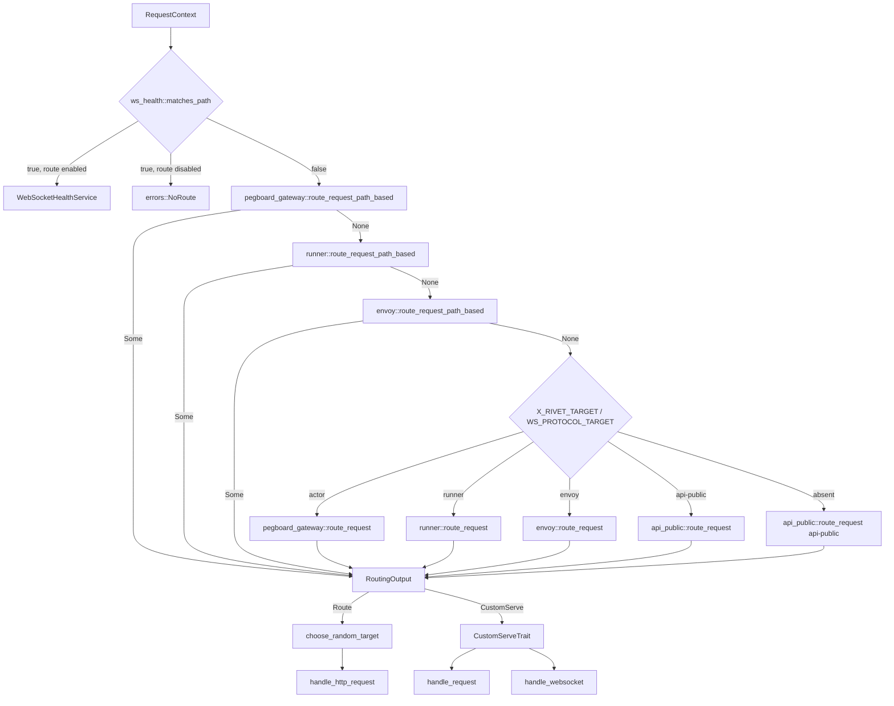
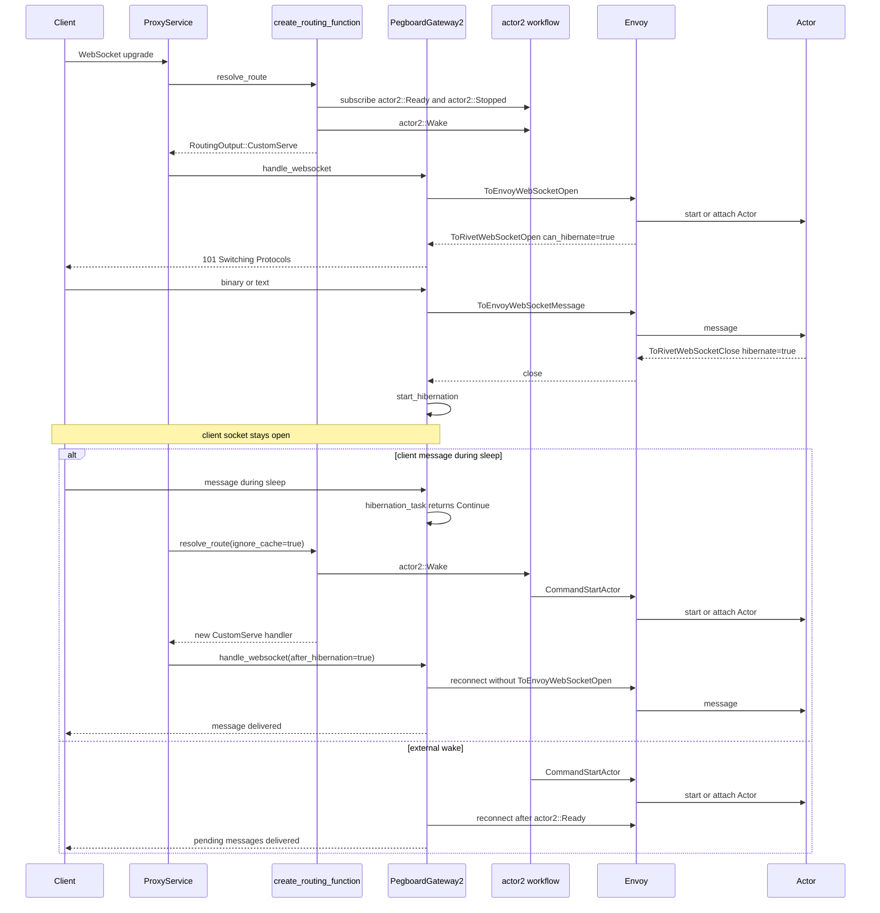
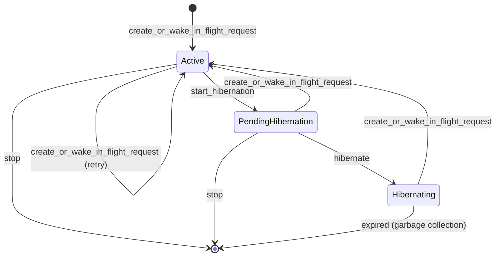

# 09 Guard: HTTP and WebSocket routing, TLS, and the reverse proxy

Guard is the public edge of Rivet. It accepts Hypertext Transfer Protocol (HTTP)
requests and WebSocket connections. It decides which internal service receives a
request, wakes a sleeping Actor when necessary, and then serves the request
through a custom gateway handler or a reverse proxy. Guard also terminates
Transport Layer Security (TLS) when an operator configures it. The certificate
resolver in this commit is a stub. This document follows the call graph from
`rivet_guard::start` to the point where Guard writes a response to the client.
It explains the path grammar, the header grammar, the WebSocket subprotocols,
the reverse proxy, the hibernation handshake, and the wake protocol. It also
explains the cache that is never filled, and the exact status that a client sees
for each failure. It states which behavior belongs to the legacy runner path and
which behavior belongs to the newer envoy path.

Three names recur in this document. An Actor is a keyed process that Pegboard
schedules on a host. It keeps its state when it sleeps or moves. Pegboard is the
scheduling service that owns the Actor workflows and allocates them to hosts;
[04 Pegboard](04-pegboard-scheduling.md) describes it. The source has two host
paths. The legacy runner path uses a runner process, `runner_id`, and the
version 1 Actor workflow. The newer envoy path uses an envoy process,
`envoy_key`, and the version 2 Actor workflow. Both paths exist in this commit.

The source of truth is commit
`4a58441c50d1ce20d8803cfb1ab7c3285a5141d6`, version 2.3.31. All paths are
relative to `/Users/darkvoid/GitSources/src.Rivet/rivet` unless the text says
otherwise.

## 1. What Guard is and where it listens

Guard is one service in the engine binary. The engine registers it under the
name `"guard"`, with `ServiceKind::ApiPublic`, and marks it critical.

```rust
// engine/packages/engine/src/run_config.rs:12-17
Service::new(
    "guard",
    ServiceKind::ApiPublic,
    |config, pools| Box::pin(rivet_guard::start(config, pools)),
    true,
),
```

`rivet_guard::start` runs in the `rivet-guard` package. The package name is
`rivet-guard` and the library name is `rivet_guard`
(`engine/packages/guard/Cargo.toml:1-10`). The lower-level server, proxy, and
WebSocket code lives in the `rivet-guard-core` package.

Guard binds a plain HTTP listener on the configured host and port. The default
host is the unspecified Internet Protocol version 6 (IPv6) address `::`. The
default port is 6420.

```rust
// engine/packages/config/src/defaults.rs:1-14
pub mod hosts {
    use std::net::{IpAddr, Ipv6Addr};

    pub const GUARD: IpAddr = IpAddr::V6(Ipv6Addr::UNSPECIFIED);
    pub const API_PEER: IpAddr = IpAddr::V6(Ipv6Addr::UNSPECIFIED);
    pub const METRICS: IpAddr = IpAddr::V6(Ipv6Addr::UNSPECIFIED);
}

pub mod ports {
    pub const GUARD: u16 = 6420;
    pub const API_PEER: u16 = 6421;

    pub const METRICS: u16 = 6430;
}
```

The Kubernetes manifest confirms the public port. The container exposes port
6420 with the name `guard` and the Transmission Control Protocol (TCP)
(`self-host/control-plane/kubernetes/03-rivet-engine-deployment.yaml:37-43`).
The Application Programming Interface (API) peer service uses port 6421. The
metrics endpoint uses port 6430.

Guard can also bind a second listener for HTTPS (Hypertext Transfer Protocol
Secure). That listener exists only when the configuration contains a `guard.https`
block. Its address is always `0.0.0.0` and its port comes from `Https.port`
(`engine/packages/guard-core/src/server.rs:42-52`).

```rust
// engine/packages/guard-core/src/server.rs:33-73
	// Set up HTTP server
	let http_addr: std::net::SocketAddr = (config.guard().host(), config.guard().port()).into();
	let http_factory = Arc::new(ProxyServiceFactory::new(
		config.clone(),
		routing_fn.clone(),
		cache_key_fn.clone(),
	));
	let http_listener = tokio::net::TcpListener::bind(http_addr).await?;

	// Set up HTTPS server (if configured)
	let (https_addr, https_factory, https_listener, https_acceptor) = if let Some(https) =
		&config.guard().https
	{
		let https_addr: std::net::SocketAddr = ([0, 0, 0, 0], https.port).into();
		let https_factory = Arc::new(ProxyServiceFactory::new(
			config.clone(),
			routing_fn.clone(),
			cache_key_fn.clone(),
		));
		let listener = tokio::net::TcpListener::bind(https_addr).await?;

		// Configure TLS if resolver function is provided
		let acceptor = if let Some(resolver_fn) = cert_resolver_fn {
			// Create a TLS server config using our certificate resolver
			let server_config = create_tls_config(resolver_fn);

			Some(TlsAcceptor::from(Arc::new(server_config)))
		} else {
			tracing::warn!("No TLS certificate resolver provided, HTTPS will not work properly");
			None
		};

		(
			Some(https_addr),
			Some(https_factory),
			Some(listener),
			acceptor,
		)
	} else {
		(None, None, None, None)
	};
```

The `Https` type has two fields. `port` is the listen port. `tls` is a `Tls`
value with four paths: `actor_cert_path`, `actor_key_path`, `api_cert_path`, and
`api_key_path` (`engine/packages/config/src/config/guard.rs:353-369`). Section 19
shows that the current resolver does not read these fields.

| Listener | Default address | Port source | Protocol | State in this commit |
|----------|-----------------|-------------|----------|----------------------|
| Public HTTP | `::` | `guard.port()`, default 6420 | HTTP/1.1, HTTP/2, WebSocket | Always started |
| HTTPS | `0.0.0.0` | `guard.https.port` | TLS then HTTP | Only if `guard.https` is set |
| Metrics | `::` | 6430 | HTTP | Separate metrics service |
| API peer | `::` | 6421 | Internal HTTP | Separate service |

Each accepted TCP connection gets one `ProxyService` instance from
`ProxyServiceFactory::create_service(remote_addr)`. The connection uses
`hyper_util`'s automatic HTTP/1 and HTTP/2 server builder with upgrade support
(`engine/packages/guard-core/src/server.rs:86-135`). When the connection ends,
Guard cancels the connection's `client_disconnect` token. A request handler can
watch that token and stop work when the client goes away.

## 2. Startup and shared state

`rivet_guard::start` creates a standalone context, one `SharedState`, the
routing function, the cache-key function, and the certificate resolver.
`PubSub` is the Publish-Subscribe (PubSub) service. It carries tunnel messages
and workflow signals. The `ups` handle is the PubSub pool that `ctx.ups()`
returns.

```rust
// engine/packages/guard/src/lib.rs:11-42
#[tracing::instrument(skip_all)]
pub async fn start(config: rivet_config::Config, pools: rivet_pools::Pools) -> Result<()> {
	let cache = rivet_cache::CacheInner::from_env(&config, pools.clone())?;
	let ctx = StandaloneCtx::new(
		db::DatabaseKv::new(config.clone(), pools.clone()).await?,
		config.clone(),
		pools,
		cache,
		"guard",
		Id::new_v1(config.dc_label()),
		Id::new_v1(config.dc_label()),
	)?;

	// Share shared context
	let shared_state = shared_state::SharedState::new(&ctx, ctx.ups()?)?;
	shared_state.start().await?;

	// Create handlers
	let routing_fn = routing::create_routing_function(&ctx, shared_state.clone());
	let cache_key_fn = cache::create_cache_key_function();
	let cert_resolver = tls::create_cert_resolver(&ctx).await?;

	if let Some(_) = &cert_resolver {
		tracing::info!("TLS certificate resolver configured");
	} else {
		tracing::info!("No TLS configuration found, HTTPS will not be enabled");
	}

	// Start the server
	tracing::info!("starting proxy server");
	rivet_guard_core::run_server(config, routing_fn, cache_key_fn, cert_resolver).await
}
```

`SharedState` is a cloneable wrapper around `Arc<SharedStateInner>`. It holds
three gateway state objects and an optional JavaScript Object Notation (JSON) Web
Token (JWT) key-ring cache.

```rust
// engine/packages/guard/src/shared_state.rs:5-53
#[derive(Clone)]
pub struct SharedState(Arc<SharedStateInner>);

impl SharedState {
	pub fn new(ctx: &gas::prelude::StandaloneCtx, pubsub: PubSub) -> Result<SharedState> {
		let config = ctx.config();
		let jwt_key_ring_cache =
			config
				.auth
				.as_ref()
				.filter(|auth| auth.jwt.enabled())
				.map(|auth| {
					rivet_auth_jwt::key_ring_cache::KeyRingCache::new(
						ctx.clone(),
						if auth.jwt.issuance_enabled() {
							rivet_auth_jwt::key_ring_cache::KeyRingCacheMode::SignAndVerify
						} else {
							rivet_auth_jwt::key_ring_cache::KeyRingCacheMode::VerifyOnly
						},
					)
				});
		let jwt_key_ring_cache = jwt_key_ring_cache.transpose()?;
		Ok(SharedState(Arc::new(SharedStateInner {
			pegboard_gateway: pegboard_gateway::shared_state::SharedState::new(
				config,
				pubsub.clone(),
			),
			pegboard_gateway2: pegboard_gateway2::shared_state::SharedState::new(
				config,
				pubsub.clone(),
			),
			pegboard_gateway3: pegboard_gateway3::shared_state::SharedState::new(config, pubsub),
			jwt_key_ring_cache,
		})))
	}

	pub async fn start(&self) -> Result<()> {
		tokio::try_join!(
			self.pegboard_gateway.start(),
			self.pegboard_gateway2.start(),
			self.pegboard_gateway3.start(),
		)?;
		if let Some(jwt_key_ring_cache) = &self.jwt_key_ring_cache {
			jwt_key_ring_cache.start().await?;
		}

		Ok(())
	}
}
```

The three gateways are different implementations of the same tunnel:

| Field | Type | Purpose |
|-------|------|---------|
| `pegboard_gateway` | `pegboard_gateway::shared_state::SharedState` | Legacy runner path, version 1 Actor workflows |
| `pegboard_gateway2` | `pegboard_gateway2::shared_state::SharedState` | Envoy path, non-streaming HTTP and all WebSocket traffic |
| `pegboard_gateway3` | `pegboard_gateway3::shared_state::SharedState` | Envoy path with streaming HTTP responses |
| `jwt_key_ring_cache` | `Option<Arc<KeyRingCache>>` | Key cache for token verification |

`start()` joins all three gateway start functions in one `tokio::try_join!`. A
failure in any one gateway stops Guard startup. The JWT cache starts after the
gateways and only when authentication is enabled.

The `SharedState` object is passed by clone into every routing call. It carries
no per-request data. Per-request data lives in `RequestContext`.

## 3. The request object and the proxy state

`ProxyState` is shared by all connections. `RequestContext` is created once for
each request.

```rust
// engine/packages/guard-core/src/proxy_service.rs:70-89
// State shared across all request handlers
pub struct ProxyState {
	config: rivet_config::Config,
	routing_fn: RoutingFn,
	cache_key_fn: CacheKeyFn,
	// NOTE: Using the hyper legacy client is the only option currently.
	// This is what reqwest uses under the hood. Eventually we'll migrate to h3 once it's ready.
	client: Client<
		hyper_rustls::HttpsConnector<hyper_util::client::legacy::connect::HttpConnector>,
		Full<Bytes>,
	>,
	route_cache: RouteCache,
	// We use moka::Cache instead of scc::HashMap because it automatically handles TTL and capacity
	client_states: Option<Cache<std::net::IpAddr, Arc<parking_lot::Mutex<ClientState>>>>,
	// Entries are owned by an InFlightPermit for the lifetime of each active request, so live IDs
	// cannot be evicted and handed out to a second concurrent request.
	in_flight_requests: Arc<scc::HashSet<protocol::RequestId>>,

	tasks: Arc<TaskGroup>,
}
```

| `ProxyState` field | Type | Purpose |
|--------------------|------|---------|
| `config` | `rivet_config::Config` | Guard, Pegboard, and feature configuration |
| `routing_fn` | `RoutingFn` | The routing function from `routing::create_routing_function` |
| `cache_key_fn` | `CacheKeyFn` | The cache-key function from `cache::create_cache_key_function` |
| `client` | hyper legacy `Client` over `hyper_rustls` | Outbound HTTP client |
| `route_cache` | `RouteCache` | Lookup cache with no inserts in this commit |
| `client_states` | `Option<Cache<IpAddr, Arc<Mutex<ClientState>>>>` | Per-address admission counters, created only when rate limiting or a maximum in-flight limit is configured |
| `in_flight_requests` | `Arc<scc::HashSet<RequestId>>` | Unique protocol request identifiers |
| `tasks` | `Arc<TaskGroup>` | Background tasks owned by Guard |

The HTTP client is built with native trust roots first. If the native store
fails to load, Guard falls back to the bundled webpki roots. It does not merge the
two stores (`engine/packages/guard-core/src/proxy_service.rs:98-116`). The idle
pool timeout is 30,000 milliseconds by default
(`engine/packages/config/src/config/guard.rs:16`).

`RequestContext` carries every input that the routing and proxy layers need.

```rust
// engine/packages/guard-core/src/request_context.rs:16-45
#[derive(Clone)]
pub struct RequestContext {
	pub(crate) remote_addr: SocketAddr,
	pub(crate) ray_id: Id,
	pub(crate) external_ray_id: String,
	pub(crate) req_id: Id,
	/// Entire host including port (if present)
	pub(crate) host: String,
	/// Only hostname, no port.
	pub(crate) hostname: String,
	/// Includes path and query.
	pub(crate) path: String,
	pub(crate) method: Method,
	pub(crate) headers: HeaderMap,
	pub(crate) is_websocket: bool,
	pub(crate) client_ip: IpAddr,
	pub(crate) start_time: Instant,
	pub(crate) request_body_exact_size: Option<u64>,
	pub(crate) request_body_is_end_stream: bool,
	pub(crate) client_disconnect: CancellationToken,

	pub(crate) retry: RetryConfig,
	pub(crate) timeout: TimeoutConfig,

	/// Holds the client's in-flight slot and this request's unique request id. Released when the
	/// last clone of the context is dropped.
	pub(crate) in_flight_permit: Option<Arc<InFlightPermit>>,
	pub(crate) cors: Option<CorsConfig>,
	pub(crate) auth_state: rivet_auth::RequestAuthState,
}
```

| `RequestContext` field | Type | Purpose |
|------------------------|------|---------|
| `remote_addr` | `SocketAddr` | Peer address of the TCP connection |
| `ray_id` | `Id` | Internal trace identifier for this request. Rivet calls this identifier a ray |
| `external_ray_id` | `String` | Client-supplied ray identifier from `x-rivet-ray-id`, bounded to 30 characters. The default is `ray_id` (`proxy_service.rs:46-60` and `381-390`) |
| `req_id` | `Id` | Internal request identifier |
| `host` | `String` | Full `Host` header value, including the port |
| `hostname` | `String` | Host value without the port |
| `path` | `String` | Path plus query string |
| `method` | `Method` | HTTP method |
| `headers` | `HeaderMap` | Cloned request headers |
| `is_websocket` | `bool` | Result of `hyper_tungstenite::is_upgrade_request` |
| `client_ip` | `IpAddr` | First address in `x-forwarded-for`, or the peer address |
| `start_time` | `Instant` | Request arrival time |
| `request_body_exact_size` | `Option<u64>` | Exact body size when known |
| `request_body_is_end_stream` | `bool` | True when the body is already complete |
| `client_disconnect` | `CancellationToken` | Cancelled when the connection drops |
| `retry` | `RetryConfig` | `max_attempts` and `initial_interval` |
| `timeout` | `TimeoutConfig` | `request_timeout` for the upstream request |
| `in_flight_permit` | `Option<Arc<InFlightPermit>>` | Admission slot and request-id ownership |
| `cors` | `Option<CorsConfig>` | Cross-Origin Resource Sharing (CORS) response settings set by a routing module |
| `auth_state` | `RequestAuthState` | Per-request authentication state. It caches the credential for each token and publishes the token expiry as a watch value (`engine/packages/auth/src/check.rs:112-131`) |

`RequestContext::new` copies the retry and timeout defaults from the Guard
configuration. The default maximum attempt count is 7. The default initial retry
interval is 150 milliseconds. The default upstream request timeout is 30,000
milliseconds (`engine/packages/config/src/config/guard.rs:9-11` and `259-274`).

`ProxyService::process` creates the context and records the request identifiers
(`engine/packages/guard-core/src/proxy_service.rs:376-469`). It reads the
external ray identifier, sets tracing fields, extracts the host, path, method,
user agent, and client address, and detects a WebSocket upgrade. It then stores
the body size hints on the context.

## 4. The route resolution call graph

`ProxyService::handle_request` resolves the route before it applies admission
control (`engine/packages/guard-core/src/proxy_service.rs:748-769`). Route
resolution runs inside `race_request_authorization_deadline`. That function
subscribes to the token deadline that authentication publishes. If the deadline
passes first, it returns `auth.token_expired` and drops the route future. The
route work therefore stops even if it has not finished
(`engine/packages/guard-core/src/utils.rs:634-692`). The request fails with
status 401.

Admission runs after the route and before the handler. `admit_request` gets or
creates a `ClientState` for the client address. `ClientState` holds an optional
`RateLimiter` with a fixed window and an optional `InFlightCounter`. `try_admit`
takes a rate token first and an in-flight slot second. A rate token is still
spent when the in-flight limit rejects the request.
`AdmissionRejection::RateLimit` returns `guard.rate_limit` and status 429.
`AdmissionRejection::MaxInFlight` returns `guard.max_in_flight` and status 400,
because the pair is not in the status map
(`engine/packages/guard-core/src/utils.rs:28-74` and `proxy_service.rs:766-801`).
On success, Guard generates a unique 4-byte `protocol::RequestId` and stores an
`InFlightPermit` on the context. The permit owns the slot, the request
identifier, and the `guard_in_flight_request_count` gauge. `Drop` releases all
three, so a cancelled request cannot leak them
(`engine/packages/guard-core/src/utils.rs:76-143`).

The route resolution itself is `ProxyService::resolve_route`.

```rust
// engine/packages/guard-core/src/proxy_service.rs:145-242
	async fn resolve_route(
		&self,
		req_ctx: &mut RequestContext,
		ignore_cache: bool,
	) -> Result<ResolveRouteOutput> {
		tracing::debug!(
			hostname = %req_ctx.hostname,
			path = %req_ctx.path_for_logs(),
			method = %req_ctx.method,
			"Resolving route for request"
		);

		let cache_key = (self.cache_key_fn)(req_ctx)?;

		// Check cache first
		let cache_res = if !ignore_cache {
			self.route_cache.get(&cache_key).await
		} else {
			None
		};

		let res = if let Some(res) = cache_res {
			res
		} else {
			// Not in cache, call routing function with a configured backstop timeout.
			// Primary timeout signals live in per-phase fences inside each routing module.
			let route_timeout = self.config.guard().route_timeout();
			tracing::debug!(
				hostname = %req_ctx.hostname,
				path = %req_ctx.path_for_logs(),
				cache_hit = false,
				timeout_seconds = route_timeout.as_secs(),
				"Cache miss, calling routing function"
			);

			let routing_res = timeout(route_timeout, (self.routing_fn)(req_ctx))
				.await
				.map_err(|_| {
					errors::RequestTimeout {
						phase: "route_resolution".to_owned(),
						timeout_seconds: route_timeout.as_secs(),
					}
					.build()
				})??;

			// TODO: Disable route caching for now, determine edge cases with gateway
			// // Cache the result
			// self.route_cache
			// 	.insert(cache_key, routing_res.clone())
			// 	.await;
			// tracing::debug!("Added route to cache");

			routing_res
		};

		match res {
			RoutingOutput::Route(result) => {
				tracing::debug!(
					hostname = %req_ctx.hostname,
					path = %req_ctx.path_for_logs(),
					targets_count = result.targets.len(),
					"Received routing result"
				);

				// Choose a random target
				if let Some(target) = choose_random_target(&result.targets) {
					tracing::debug!(
						hostname = %req_ctx.hostname,
						path = %req_ctx.path_for_logs(),
						target_host = %target.host,
						target_port = target.port,
						target_path = %utils::redact_path_for_logs(&target.path),
						"Selected target for request"
					);
					Ok(ResolveRouteOutput::Target(target.clone()))
				} else {
					tracing::warn!(
						hostname = %req_ctx.hostname,
						path = %req_ctx.path_for_logs(),
						"No route targets available from result"
					);
					Err(errors::NoRouteTargets {
						hostname: req_ctx.hostname.clone(),
						path: req_ctx.path_for_logs(),
					}
					.build())
				}
			}
			RoutingOutput::CustomServe(handler) => {
				tracing::debug!(
					hostname = %req_ctx.hostname,
					path = %req_ctx.path_for_logs(),
					"Routing returned custom serve handler"
				);
				Ok(ResolveRouteOutput::CustomServe(handler))
			}
		}
	}
```

`RoutingOutput` has two variants. `Route(RouteConfig)` contains a list of
`RouteTarget` values. Guard chooses one target at random. `choose_random_target`
uses `rand::thread_rng` and `SliceRandom::choose`, so each target has the same
chance. The source does not state a load rule beyond this choice
(`engine/packages/guard-core/src/proxy_service.rs:347-350`).
`CustomServe(Arc<dyn CustomServeTrait>)` returns a handler object that owns the
request or the WebSocket. Actor traffic normally uses `CustomServe`.
Cross-datacenter traffic uses `Route`.

| Type | Fields | Meaning |
|------|--------|---------|
| `RouteTarget` | `host: String`, `port: u16`, `path: String` | One upstream address |
| `RouteConfig` | `targets: Vec<RouteTarget>` | Candidate addresses for a proxied request |
| `RoutingOutput::Route` | `RouteConfig` | Send the request through the reverse proxy |
| `RoutingOutput::CustomServe` | `Arc<dyn CustomServeTrait>` | Run a custom handler |
| `ResolveRouteOutput::Target` | `RouteTarget` | The chosen proxy target |
| `ResolveRouteOutput::CustomServe` | `Arc<dyn CustomServeTrait>` | The custom handler |

`RoutingFn` is `Arc<dyn Fn(&mut RequestContext) -> BoxFuture<Result<RoutingOutput>>>`.
`CacheKeyFn` is `Arc<dyn Fn(&mut RequestContext) -> Result<u64>>`
(`engine/packages/guard-core/src/route.rs:37-43`). The key function turns the
routing inputs into a 64-bit key for the route cache. It runs for every request,
even though no entry is inserted. Section 16 gives the key grammar.

## 5. The routing order

`routing::create_routing_function` is the single entry point for all route
decisions. The order is fixed. Path routes run before header routes. This order
is the opposite of the order in `docs-internal/engine/GUARD.md`.

```rust
// engine/packages/guard/src/routing/mod.rs:197-254
				if ws_health::matches_path(req_ctx.path()) {
					if ctx.config().guard().enable_websocket_health_route() {
						metrics::ROUTE_TOTAL.with_label_values(&["ws_health"]).inc();
						return Ok(ws_health::route_request());
					}

					metrics::ROUTE_TOTAL.with_label_values(&["none"]).inc();

					return Err(errors::NoRoute {
						host: req_ctx.hostname().to_string(),
						path: req_ctx.path_for_logs(),
					}
					.build());
				}

				// MARK: Path-based routing

				// Route actor
				if let Some(routing_output) = phase_timeout(
					route_dispatch_phase("pegboard_path"),
					ctx.config().guard().route_dispatch_timeout(),
					pegboard_gateway::route_request_path_based(&ctx, &shared_state, req_ctx),
					|elapsed, timeout| route_dispatch_timeout("pegboard_path", elapsed, timeout),
				)
				.await?
				{
					metrics::ROUTE_TOTAL.with_label_values(&["gateway"]).inc();

					return Ok(routing_output);
				}

				// Route runner
				if let Some(routing_output) = phase_timeout(
					route_dispatch_phase("runner_path"),
					ctx.config().guard().route_dispatch_timeout(),
					runner::route_request_path_based(&ctx, &shared_state, req_ctx),
					|elapsed, timeout| route_dispatch_timeout("runner_path", elapsed, timeout),
				)
				.await?
				{
					metrics::ROUTE_TOTAL.with_label_values(&["runner"]).inc();

					return Ok(routing_output);
				}

				// Route envoy
				if let Some(routing_output) = phase_timeout(
					route_dispatch_phase("envoy_path"),
					ctx.config().guard().route_dispatch_timeout(),
					envoy::route_request_path_based(&ctx, &shared_state, req_ctx),
					|elapsed, timeout| route_dispatch_timeout("envoy_path", elapsed, timeout),
				)
				.await?
				{
					metrics::ROUTE_TOTAL.with_label_values(&["envoy"]).inc();

					return Ok(routing_output);
				}
```

The full order has ten steps:

1. `/health/ws` and `/health/ws/`. If the health route is disabled, Guard
   returns `guard.no_route`.
2. Path-based Pegboard Actor route.
3. Path-based runner route, `/runners/connect` and `/runners/connect/`.
4. Path-based envoy route, `/envoys/connect` and `/envoys/connect/`.
5. Header or WebSocket-protocol target. For HTTP this is `x-rivet-target`. For
   WebSocket this is `rivet_target.<value>` in `sec-websocket-protocol`.
6. Header target `"actor"` through `pegboard_gateway::route_request`.
7. Header target `"runner"` through `runner::route_request`.
8. Header target `"envoy"` through `envoy::route_request`.
9. Header target `"api-public"` through `api_public::route_request`.
10. No target. Guard sends the request to api-public by default.

If no step returns a route, Guard increments `guard_route_total` with the label
`"none"` and returns `guard.no_route` (`engine/packages/guard/src/routing/mod.rs:358-365`).

Every dispatch call is wrapped in `phase_timeout`. The default dispatch budget
is 55,000 milliseconds. The outer route budget is 60,000 milliseconds
(`engine/packages/config/src/config/guard.rs:189-199`).



The `Route` branch enters `handle_http_request` and the reverse proxy. The
`CustomServe` branch enters the handler's `handle_request` for HTTP
(`engine/packages/guard-core/src/proxy_service.rs:1005-1060`) or
`handle_websocket` for an upgrade
(`engine/packages/guard-core/src/proxy_service.rs:1800-1830`).

`phase_timeout` records the phase duration. It wraps the future with
`tokio::time::timeout`, maps a timeout through the supplied closure, and emits a
`perf_start!` measurement (`engine/packages/guard/src/routing/mod.rs:69-99`).
`route_dispatch_phase(router)` builds a `Phase::new("route_dispatch",
&ROUTE_DISPATCH_DURATION)` with the router name. `Phase` also carries optional
namespace and actor identifiers. `perf_start!` and `perf_finish!` record the
`guard_route_phase` measurement with `phase`, `actor_id`, and `router` fields
(`engine/packages/guard/src/routing/mod.rs:69-115`).

## 6. Path grammar for the Actor gateway

Guard accepts two families of Actor path: direct and query.

| Shape | Example | Actor source | Token source |
|-------|---------|--------------|--------------|
| Direct | `/gateway/{actor_id}/{...path}` | First segment after `gateway` | None |
| Direct with token | `/gateway/{actor_id}@{token}/{...path}` | Text before `@` | Text after `@` |
| Query `get` | `/gateway/{name}/{...path}?rvt-namespace=...&rvt-method=get` | Name and key lookup | `rvt-token` or header |
| Query `getOrCreate` | `/gateway/{name}/{...path}?rvt-namespace=...&rvt-method=getOrCreate` | Key lookup or create | `rvt-token` or header |

`parse_actor_path` first splits the path and the raw query without a Uniform
Resource Locator (URL) parser.
This preserves the query bytes exactly. A path with `//` is not a gateway path.
The parser returns `Ok(None)`, so routing continues to the next step. A path
whose first segment is not `gateway` also returns `Ok(None)`.

```rust
// engine/packages/guard/src/routing/actor_path.rs:104-156
/// Parse actor routing information from path.
/// Matches patterns:
/// - /gateway/{actor_id}/{...path}
/// - /gateway/{actor_id}@{token}/{...path}
/// - /gateway/{name}/{...path}?rvt-namespace=...&rvt-method=...
///
/// Returns `Ok(None)` for paths that are not gateway paths or for malformed
/// direct paths (backwards-compatible silent fallthrough). Returns `Err` for
/// malformed query paths so clients receive actionable error messages.
pub fn parse_actor_path(path: &str) -> Result<Option<ParsedActorPath>> {
	// Extract base path and raw query from the original path string directly,
	// without running through a URL parser, to preserve actor query params
	// byte-for-byte (no re-encoding of %20, +, etc.).
	let (base_path, raw_query) = split_path_and_query(path);

	if base_path.contains("//") {
		return Ok(None);
	}

	let segments: Vec<&str> = base_path
		.split('/')
		.filter(|segment| !segment.is_empty())
		.collect();
	if segments.first().copied() != Some("gateway") {
		return Ok(None);
	}

	let raw_query_str = raw_query.unwrap_or("");

	// Check if any raw query param key starts with rvt-.
	let has_rvt = !raw_query_str.is_empty()
		&& raw_query_str
			.split('&')
			.any(|part| part.split('=').next().unwrap_or("").starts_with(RVT_PREFIX));

	if has_rvt {
		let rvt_params = extract_rvt_params_from_raw_query(raw_query_str)?;
		let actor_query_string = strip_rvt_query_params(raw_query_str);
		return parse_query_actor_path(base_path, &segments, &rvt_params, &actor_query_string)
			.map(|path| Some(ParsedActorPath::Query(path)));
	}

	// Direct path: pass the raw query string through unchanged.
	let raw_query_string = match raw_query {
		Some(q) => format!("?{q}"),
		None => String::new(),
	};
	Ok(parse_direct_actor_path(
		base_path,
		&segments,
		&raw_query_string,
	))
}
```

A direct path splits the Actor segment at the first `@`. Both sides must be
non-empty. Both sides are percent-decoded. The remaining path is built from the
segments after the Actor segment plus the original query
(`engine/packages/guard/src/routing/actor_path.rs:158-193`).

The test file gives a concrete direct parse. The input is
`/gateway/actor%2D123@tok%40en/api/v1/endpoint?foo=bar#section`. The parsed
values are Actor identifier `actor-123`, token `tok@en`, and stripped path
`/api/v1/endpoint?foo=bar` (`engine/packages/guard/tests/parse_actor_path.rs:8-21`).
The fragment is dropped because `split_path_and_query` cuts the string at the
first `#` before it looks for `?`
(`engine/packages/guard/src/routing/actor_path.rs:369-378`).

| Query parameter | Serde field | Meaning |
|-----------------|-------------|---------|
| `rvt-namespace` | `namespace` | Namespace name |
| `rvt-method` | `method` | `get` or `getOrCreate` |
| `rvt-token` | `token` | Gateway token |
| `rvt-runner` | `runner` | Legacy pool selector |
| `rvt-pool` | `pool` | Pool selector |
| `rvt-key` | `key` | Comma-separated Actor key parts |
| `rvt-input` | `input` | Base64url-encoded Concise Binary Object Representation (CBOR) value |
| `rvt-region` | `region` | Region constraint |
| `rvt-crash-policy` | `crash-policy` | `restart`, `sleep`, or `destroy` |
| `rvt-skip-ready-wait` | `skip-ready-wait` | Boolean |

`rvt-` is the reserved query prefix. The constant is `RVT_PREFIX = "rvt-"`
(`engine/packages/guard/src/routing/actor_path.rs:11`). A query path rejects `@`
in the Actor name. It requires `rvt-namespace` and
`rvt-method`. It removes all `rvt-*` parameters from the stripped path. A
duplicate parameter returns `guard.query_duplicate_param`
(`engine/packages/guard/src/routing/actor_path.rs:195-269`).

`get` rejects `rvt-input`, `rvt-region`, `rvt-crash-policy`, and `rvt-runner`.
The error text for that case says `rvt-pool`, but the code checks `rvt.runner`
(`engine/packages/guard/src/routing/actor_path.rs:284-291`). The code wins.
`getOrCreate` requires `rvt-pool` or `rvt-runner`. The input decoder accepts
base64url CBOR bytes. The crash-policy decoder accepts `restart`, `sleep`, and
`destroy` (`engine/packages/guard/src/routing/actor_path.rs:280-340`).

A direct path with a malformed shape returns `None`. This is a deliberate
backward-compatibility fallthrough. The request then continues to the next
routing step. A query path with a malformed shape returns an error, because the
client asked for a feature that must fail with a message
(`engine/packages/guard/src/routing/actor_path.rs:110-112`).

## 7. Header and WebSocket-protocol grammar

The header names are exact lower-case constants. Hypertext Transfer Protocol
(HTTP) header matching is case-insensitive, so `X-Rivet-Target` matches
`x-rivet-target`. Header values are case-sensitive.

```rust
// engine/packages/guard/src/routing/mod.rs:20-29
pub(crate) const X_RIVET_TARGET: HeaderName = HeaderName::from_static("x-rivet-target");
pub(crate) const X_RIVET_TOKEN: HeaderName = HeaderName::from_static("x-rivet-token");
pub(crate) const X_RIVET_SKIP_READY_WAIT: HeaderName =
	HeaderName::from_static("x-rivet-skip-ready-wait");
pub(crate) const SEC_WEBSOCKET_PROTOCOL: HeaderName =
	HeaderName::from_static("sec-websocket-protocol");
pub(crate) const WS_PROTOCOL_TARGET: &str = "rivet_target.";
pub(crate) const WS_PROTOCOL_ACTOR: &str = "rivet_actor.";
pub(crate) const WS_PROTOCOL_TOKEN: &str = "rivet_token.";
pub(crate) const WS_PROTOCOL_SKIP_READY_WAIT: &str = "rivet_skip_ready_wait";
```

The table also lists `x-rivet-actor`. That name is not in the block above. It is
a separate constant in the proxy layer, because the reverse proxy also removes
it (`engine/packages/guard-core/src/utils.rs:24-26`).

| Purpose | HTTP header | WebSocket subprotocol |
|---------|-------------|-----------------------|
| Target service | `x-rivet-target` | `rivet_target.{value}` |
| Actor identifier | `x-rivet-actor` | `rivet_actor.{actor_id}` |
| Token | `x-rivet-token` | `rivet_token.{token}` |
| Skip ready wait | `x-rivet-skip-ready-wait` | `rivet_skip_ready_wait` |

The WebSocket header is a comma-separated list. Guard trims each item and finds
the item with the exact prefix. The suffix is the value. For the Actor
identifier, Guard percent-decodes the suffix
(`engine/packages/guard/src/routing/pegboard_gateway/mod.rs:222-261`).

The header Actor route accepts only two kinds of request:

- A WebSocket upgrade.
- An HTTP request whose path is `/request` or starts with `/request/` or
  `/request?`.

An HTTP request to another path returns `None` and continues down the routing
order (`engine/packages/guard/src/routing/pegboard_gateway/mod.rs:307-313`).
`is_actor_http_request_path` implements the test. The TypeScript engine client
repeats the same test in `isActorHttpRequestPath`, so the two sides agree on the
shape
(`rivetkit-typescript/packages/rivetkit/src/engine-client/mod.ts:631-638`).
The source does not state why the prefix is `/request`.

For an `OPTIONS` request to a gateway path or with target `"actor"`, Guard
returns `CorsPreflight`. The preflight handler does not look up the Actor and does
not check authentication. The source explains that browsers cannot attach
credentials to a preflight. The real request that follows is still authenticated
(`engine/packages/guard/src/routing/pegboard_gateway/cors.rs:33-65`).

| CORS field | Non-preflight value | Preflight value |
|------------|---------------------|-----------------|
| `allow_origin` | Mirror `origin`, or `*` | Mirror `origin`, or `*` |
| `allow_credentials` | `true` | `true` |
| `expose_headers` | `*` | `*` |
| `allow_methods` | Not set | `GET, POST, PUT, DELETE, OPTIONS, PATCH` |
| `allow_headers` | Not set | Mirror `access-control-request-headers`, or `*` |
| `max_age` | Not set | 86,400 seconds |

## 8. The Actor gateway: subscribe, fetch, authorize, wake

All Actor routes converge on `route_request_inner`. The function receives the
Actor identifier, the stripped path, the token, and the skip-ready-wait flag.

The first check is the datacenter label. A Rivet `Id` carries a label. If the
Actor label differs from the current datacenter label, Guard calls
`config.dc_for_label`. That call returns the peer entry. `proxy_url_host` and
`proxy_url_port` on the entry give the address. A missing label returns the
datacenter-not-found error from `rivet_api_util`. Guard returns a
`RoutingOutput::Route` to that address with the original request path. In this
commit, this is the only use of the reverse proxy for Actor traffic
(`engine/packages/guard/src/routing/pegboard_gateway/mod.rs:341-362`).

Next, Guard creates subscriptions before it fetches the Actor. This order avoids
a race where the Actor becomes ready between the fetch and the subscription.

```rust
// engine/packages/guard/src/routing/pegboard_gateway/mod.rs:364-405
	// Create subs before checking if actor exists/is not destroyed
	let (
		ready_sub,
		stopped_sub,
		fail_sub,
		destroy_sub,
		migrate_sub,
		ready_sub2,
		stopped_sub2,
		fail_sub2,
		destroy_sub2,
	) = phase_timeout(
		Phase::new(
			"route_pegboard_subscribe",
			&metrics::ROUTE_PEGBOARD_SUBSCRIBE_DURATION,
		)
		.with_actor_id(actor_id),
		ctx.config().guard().route_pegboard_subscribe_timeout(),
		async {
			tokio::try_join!(
				ctx.subscribe::<pegboard::workflows::actor::Ready>(("actor_id", actor_id)),
				ctx.subscribe::<pegboard::workflows::actor::Stopped>(("actor_id", actor_id)),
				ctx.subscribe::<pegboard::workflows::actor::Failed>(("actor_id", actor_id)),
				ctx.subscribe::<pegboard::workflows::actor::DestroyStarted>(("actor_id", actor_id)),
				ctx.subscribe::<pegboard::workflows::actor::MigratedToV2>(("actor_id", actor_id)),
				ctx.subscribe::<pegboard::workflows::actor2::Ready>(("actor_id", actor_id)),
				ctx.subscribe::<pegboard::workflows::actor2::Stopped>(("actor_id", actor_id)),
				ctx.subscribe::<pegboard::workflows::actor2::Failed>(("actor_id", actor_id)),
				ctx.subscribe::<pegboard::workflows::actor2::DestroyStarted>((
					"actor_id", actor_id
				)),
			)
		},
		|elapsed, timeout| {
			pegboard::errors::RouteSubscribeTimeout {
				elapsed_ms: elapsed.as_millis() as u64,
				timeout_ms: timeout.as_millis() as u64,
			}
			.build()
		},
	)
	.await?;
```

The subscription budget is 2,000 milliseconds by default
(`engine/packages/config/src/config/guard.rs:213-215`).

Guard then fetches the Actor through
`pegboard::ops::actor::get_for_gateway`. The fetch budget is 5,000 milliseconds.
If the Actor does not exist, Guard returns `actor.not_found`
(`engine/packages/guard/src/routing/pegboard_gateway/mod.rs:407-428`).

Authentication runs next, unless the configuration field
`auth.insecure_allow_unauthenticated` is true. The token comes from the path, the
`x-rivet-token` header, or the WebSocket subprotocol. A missing token returns
`auth.invalid_token`. `rivet_auth::check` verifies the token with the JWT
key-ring cache in `SharedState`, and it caches the credential in
`RequestAuthState` (`engine/packages/auth/src/check.rs:112-131`). The check uses
the Actor's namespace identifier, `ResourceKind::ActorGateway`, the target Actor
identifier, and `OperationKind::Read`. The budget is 5,000 milliseconds
(`engine/packages/guard/src/routing/pegboard_gateway/mod.rs:430-463`).

A destroyed Actor returns `actor.not_found`. The Actor `version` field then
selects the workflow family. Version 2 calls `handle_actor_v2`. Version 1 calls
`handle_actor_v1`. Any other value returns a plain `anyhow` error with the text
`unknown actor version` (`engine/packages/guard/src/routing/pegboard_gateway/mod.rs:465-514`).

## 9. Waking a sleeping Actor

The version 2 path is the current path. It sends `pegboard::workflows::actor2::Wake`
to the Actor workflow. The signal has no fields. The send budget is 5,000
milliseconds.

```rust
// engine/packages/guard/src/routing/pegboard_gateway/mod.rs:540-560
		phase_timeout(
			Phase::new(
				"route_pegboard_wake_signal",
				&metrics::ROUTE_PEGBOARD_WAKE_SIGNAL_DURATION,
			)
			.with_namespace_id(actor.namespace_id)
			.with_actor_id(actor_id),
			ctx.config().guard().route_pegboard_wake_signal_timeout(),
			ctx.signal(pegboard::workflows::actor2::Wake {})
				.to_workflow_id(actor.workflow_id)
				.send(),
			|elapsed, timeout| {
				pegboard::errors::RouteWakeSignalTimeout {
					actor_id: actor_id.to_string(),
					elapsed_ms: elapsed.as_millis() as u64,
					timeout_ms: timeout.as_millis() as u64,
				}
				.build()
			},
		)
		.await?;
```

Guard does not always wait. It skips the wait when the Actor has an
`envoy_key` and either `connectable` is true or the client sent the
skip-ready-wait flag. In that case Guard uses the current `envoy_key`
immediately (`engine/packages/guard/src/routing/pegboard_gateway/mod.rs:563-571`).
`envoy_key` names the envoy host that holds the Actor, and it addresses that
host's PubSub subject. `connectable` is a stored flag in the Actor gateway
record. It says that the Actor can accept a tunnel connection now
(`engine/packages/pegboard/src/ops/actor/get_for_gateway.rs:20` and `44`).
If `envoy_key` is `None`, Guard waits even when `connectable` is true. The
source does not state why this skip is safe. A tunnel error is retryable, and
the retry re-resolves the route, so a stale key becomes a retry
(`engine/packages/guard-core/src/utils.rs:505-520` and
`engine/packages/guard-core/src/proxy_service.rs:1942-1945`).

The wait loop listens to four events and two timers.

```rust
// engine/packages/guard/src/routing/pegboard_gateway/mod.rs:615-624
		// Wait for ready, fail, or destroy
		loop {
			tokio::select! {
				res = ready_sub.next() => {
					let envoy_key = res?.into_body().envoy_key;
					record_ready_wait("ready", wake_retries);
					break envoy_key;
				}
				res = stopped_sub.next() => {
					res?;
```

`pegboard::workflows::actor2::Ready` has one field, `envoy_key: String`
(`engine/packages/pegboard/src/workflows/actor2/mod.rs:1321-1324`). Guard uses
that key, not a runner address, to select the envoy. The waiter function names
its parameter `ready_sub`. The caller passes the `actor2` subscription to that
parameter (`engine/packages/guard/src/routing/pegboard_gateway/mod.rs:477-489`).

| Event | Guard action | Final error |
|-------|--------------|-------------|
| `Ready` | Use `envoy_key` and continue | None |
| `Stopped` before 8 retries | Send `actor2::Wake` again | None if a later `Ready` arrives |
| `Stopped` after 8 retries | Stop | `guard.actor_wake_retries_exceeded`, 503 |
| `Failed` | Stop and carry the workflow error | The carried error |
| `DestroyStarted` | Stop | `actor.destroyed_while_waiting_for_ready`, 400 |
| Pool error check returns true | Stop | `guard.actor_runner_failed`, 400 |
| 30,000 milliseconds elapse | Stop | `guard.actor_ready_timeout`, 503 |

The rewake signal uses `graceful_not_found()`. That option makes a missing
workflow return `None` instead of a send error. If the workflow no longer
exists, Guard returns `actor.not_found`
(`engine/packages/guard/src/routing/pegboard_gateway/mod.rs:636-668`).

The pool error check waits 1,000 milliseconds before the first check. It then
checks every 2,000 milliseconds. It returns true when the pool has an active
error (`engine/packages/guard/src/routing/pegboard_gateway/mod.rs:31-34` and
`1068-1101`).

After a successful wait, Guard fetches the Actor again. If the Actor is now
destroyed, or if the `envoy_key` changed, Guard returns
`guard.actor_stopped_while_waiting` with status 503
(`engine/packages/guard/src/routing/pegboard_gateway/mod.rs:716-733`).

The version 1 path uses `pegboard::workflows::actor::Wake` with
`AllocationOverride::DontSleep` and a pending timeout of 60,000 milliseconds.
`DontSleep` forces an Actor with `CrashPolicy::Sleep` to pend instead of sleep
(`engine/packages/pegboard/src/workflows/actor/runtime.rs:621-629`).
The wait loop is the same shape: 8 rewakes, a 30,000 millisecond ready timeout,
a pool error check, and a `MigratedToV2` event that switches to
`handle_actor_v2`. The ready message carries `runner_id: Id`, not `envoy_key`
(`engine/packages/guard/src/routing/pegboard_gateway/mod.rs:808-978` and
`engine/packages/pegboard/src/workflows/actor/mod.rs:1347-1350`).

The client sees the result of the wait as an HTTP status or as a WebSocket close
frame. Section 17 lists every status.

## 10. Gateway selection: legacy runner, envoy, and streaming envoy

After the Actor is ready, Guard chooses one of three gateway implementations.

| Implementation | Type | Transport | Used for |
|----------------|------|-----------|----------|
| Legacy runner gateway | `PegboardGateway` | Runner WebSocket protocol | Actor version 1 |
| Envoy gateway 2 | `PegboardGateway2` | Envoy tunnel over PubSub | All WebSocket traffic; non-streaming HTTP |
| Envoy gateway 3 | `PegboardGateway3` | Envoy tunnel over PubSub with streaming HTTP | Server-Sent Events (SSE) and HTTP with unknown length, when sampled |

The choice between gateway 2 and gateway 3 is `select_gateway`. It is a feature
flag with a deterministic sample.

```rust
// engine/packages/guard/src/routing/pegboard_gateway/gateway3_selector.rs:146-164
	let decision = if config.mode == GuardGatewayV3Mode::Off {
		Decision::Disabled
	} else if request_kind == RequestKind::WebSocket {
		Decision::WebSocket
	} else if protocol_version.is_none() {
		Decision::ProtocolUnknown
	} else if !protocol_version.is_some_and(|version| {
		(MIN_GATEWAY3_PROTOCOL_VERSION..=PROTOCOL_VERSION).contains(&version)
	}) {
		Decision::ProtocolIncompatible
	} else if config.mode == GuardGatewayV3Mode::Opportunistic
		&& !request_kind.is_opportunistic_candidate()
	{
		Decision::NotCandidate
	} else if sampled_in(namespace_id, actor_id, config.percentage) {
		Decision::SampledIn
	} else {
		Decision::SampledOut
	};
```

The constants are exact:

| Constant | Value | Meaning |
|----------|-------|---------|
| `MIN_GATEWAY3_PROTOCOL_VERSION` | 7 | Lowest Envoy protocol for gateway 3 |
| `SAMPLE_BUCKETS` | 10,000 | Sampling bucket count |
| `SAMPLE_DOMAIN` | `b"pegboard-gateway3-rollout-v1\0"` | Sampling domain separator |
| `PROTOCOL_VERSION` | 8 | Generated from `v8.bare`, the highest schema |

`GuardGatewayV3Mode` has three values: `Off`, `Opportunistic`, and `On`. `Off`
sends every request to gateway 2. `Opportunistic` samples only Server-Sent
Events (SSE) and unknown-length HTTP requests. `On` samples every non-WebSocket
request that has a compatible protocol version. `RequestKind` classifies a
request as `WebSocket`, `HttpSse`, `HttpUnknownLength`, or `HttpOther`
(`engine/packages/guard/src/routing/pegboard_gateway/gateway3_selector.rs:15-35`
and `174-198`). The default mode is `Off`. The default percentage is 0. The
`Off` value is the default of `GuardGatewayV3Mode`
(`engine/packages/config/src/config/features.rs:47-54`). With the default
configuration, every request uses gateway 2.

The seven `Decision` values map to the final choice as follows.

| `Decision` | `use_gateway3()` | Cause |
|------------|------------------|-------|
| `Disabled` | false | Mode is `Off` |
| `WebSocket` | false | The request is a WebSocket upgrade |
| `ProtocolUnknown` | false | The Actor has no envoy protocol version |
| `ProtocolIncompatible` | false | The version is outside 7 through 8 |
| `NotCandidate` | false | Mode is `Opportunistic` and the kind is not SSE or unknown length |
| `SampledOut` | false | The hash bucket is at or above the threshold |
| `SampledIn` | true | The hash bucket is below the threshold |

A WebSocket always produces `Decision::WebSocket`, before the sample. Therefore
a WebSocket never uses gateway 3 in this commit, even when the mode is `On`.
The selector records the decision with `selection.record()`
(`engine/packages/guard/src/routing/pegboard_gateway/mod.rs:748-755`).

`sample_bucket` concatenates the domain, the namespace identifier string, a NUL
byte, and the Actor identifier string. `xxh3_128_with_seed` with seed 0 returns
128 bits. The modulo 10,000 reduces that value to one of 10,000 buckets.
`sampled_in` compares the bucket with `percentage * 100`. A percentage of 0 is
always false. A percentage of 100 is always true
(`engine/packages/guard/src/routing/pegboard_gateway/gateway3_selector.rs:231-246`).

Gateway 3 requires an Actor generation. The generation is the `u32` that the
actor2 workflow returns in the `Allocated` signal when it places the Actor on an
envoy. It identifies one placement
(`engine/packages/pegboard/src/workflows/actor2/mod.rs:1345-1349`). A missing
generation returns a plain `anyhow` error with the text
`gateway3 actor is missing its generation`. Gateway 3 gets the generation, the
`envoy_key`, the protocol version, the Actor identifier, the Actor key, the
path, and one gateway-3 `SharedState`
(`engine/packages/guard/src/routing/pegboard_gateway/mod.rs:762-784`).

## 11. The reverse proxy

The reverse proxy path handles `RoutingOutput::Route`. In this commit, the only
`Route` outputs in `rivet-guard` are the two cross-datacenter handoffs, one for a
direct Actor path and one for a query path. Actor traffic normally uses
`CustomServe` and the tunnel.

`handle_http_request` buffers the request body first. The body is wrapped in
`Limited` with the Guard body limit. The default limit is 20 Mebibytes (MiB),
which is 20 × 1024 × 1024 bytes. A larger body returns
`guard.invalid_request_body`, status 413
(`engine/packages/guard-core/src/proxy_service.rs:843-856` and
`engine/packages/config/src/config/guard.rs:323-325`).

```rust
// engine/packages/guard-core/src/proxy_service.rs:844-856
				// Read the request body before proceeding with retries
				let (req_parts, body) = req.into_parts();
				let req_body =
					Limited::new(body, self.state.config.guard().http_max_request_body_size())
						.collect()
						.await
						.map_err(|err| {
							errors::InvalidRequestBody {
								reason: err.to_string(),
							}
							.build()
						})?
						.to_bytes();
```

Guard then loops up to `max_attempts` times. The default is 7. Each attempt
builds a new upstream request from the stored parts and a clone of the buffered
bytes. The clone is cheap because the type is `Bytes`
(`engine/packages/guard-core/src/proxy_service.rs:858-873`).

The upstream request has a per-attempt timeout. The default is 30,000
milliseconds. A timeout produces `guard.request_timeout` with the phase
`upstream_request` (`engine/packages/guard-core/src/proxy_service.rs:875-884`).

A response is retryable when its status is 503 or 504 and its
`x-rivet-error` header has the group `guard` and a retryable code
(`engine/packages/guard-core/src/utils.rs:495-502`). The retryable codes are
`service_unavailable`, `actor_ready_timeout`, `actor_wake_retries_exceeded`,
`actor_stopped_while_waiting`, `tunnel_request_aborted`,
`tunnel_message_timeout`, `tunnel_response_closed`, and
`gateway_response_start_timeout` (`engine/packages/guard-core/src/utils.rs:480-492`).
On a retry, Guard reads the
last status and last error code, sleeps for `initial_interval × 2^(attempt - 1)`,
and resolves the route again with `ignore_cache = true`
(`engine/packages/guard-core/src/proxy_service.rs:886-920`).

| Retry constant | Default | Source |
|----------------|---------|--------|
| Maximum attempts | 7 | `engine/packages/config/src/config/guard.rs:9` |
| Initial interval | 150 milliseconds | `engine/packages/config/src/config/guard.rs:10` |
| First retry sleep | 150 milliseconds | `150 × 2^0` |
| Second retry sleep | 300 milliseconds | `150 × 2^1` |
| Third retry sleep | 600 milliseconds | `150 × 2^2` |
| Upstream request timeout | 30,000 milliseconds | `engine/packages/config/src/config/guard.rs:11` |

A connection error is retried while attempts remain. `err.is_connect()` is true
only when the Transmission Control Protocol (TCP) or TLS connection attempt
failed. Any other error stops the loop and becomes `guard.upstream_error` or
`guard.retry_attempts_exceeded`
(`engine/packages/guard-core/src/proxy_service.rs:957-1010`).

The response streaming decision is hardcoded. The code comments show a
content-type test, but the test is disabled and `is_streaming` is `true` for every
successful response.

```rust
// engine/packages/guard-core/src/proxy_service.rs:922-937
							let (parts, body) = resp.into_parts();

							// Check if this is a streaming response by examining headers
							// let is_streaming = parts.headers.get("content-type")
							// 	.and_then(|ct| ct.to_str().ok())
							// 	.map(|ct| ct.contains("text/event-stream") || ct.contains("application/stream"))
							// 	.unwrap_or(false);
							let is_streaming = true;

							if is_streaming {
								// For streaming responses, pass through the body without buffering
								tracing::debug!("Detected streaming response, preserving stream");

								let streaming_body = ResponseBody::Incoming(body);
								return Ok(Response::from_parts(parts, streaming_body));
							} else {
```

The non-streaming branch is therefore unreachable in this commit. The branch
still exists and would buffer with the same 20 MiB limit and return
`guard.invalid_response_body` on failure
(`engine/packages/guard-core/src/proxy_service.rs:937-955`).

`proxied_request_builder` builds an empty header map, then calls `headers.remove`
for `x-rivet-target`, `x-rivet-actor`, and `x-rivet-token`. The map is empty at
that moment, so the three calls remove nothing. The builder then calls
`add_proxy_headers_with_addr`, which copies the client headers into the same map.
The copy skips three groups:

- `Host`.
- Eight hop-by-hop headers from the HTTP specification: `Connection`,
  `keep-alive`, `Proxy-Authenticate`, `Proxy-Authorization`, `TE`, `Trailer`,
  `Transfer-Encoding`, and `Upgrade`.
- Two client handshake headers: `Sec-WebSocket-Key` and `Sec-WebSocket-Version`.

The filter checks only those groups. It does not list the three routing headers.
A client that sends `x-rivet-target`, `x-rivet-actor`, or `x-rivet-token`
therefore has them forwarded to the upstream service on this path
(`engine/packages/guard-core/src/utils.rs:181-190` and `297-313`). The source
does not state whether this is intended.

Guard appends `x-forwarded-for` with the peer address unless the chain already
contains that address (`engine/packages/guard-core/src/utils.rs:315-332`). The
builder sets the Uniform Resource Locator (URL) scheme to `https` when
`target.port == 443`. It sets `http` for every other port
(`engine/packages/guard-core/src/utils.rs:157`).

```rust
// engine/packages/guard-core/src/utils.rs:244-265
/// Headers that are scoped to a single connection and must not be forwarded to the upstream
/// service. See RFC 9110 section 7.6.1. The outgoing request generates its own versions of these
/// where they are needed, including the `Connection` and `Upgrade` headers of a websocket
/// handshake.
const HOP_BY_HOP_HEADERS: [HeaderName; 8] = [
	hyper::header::CONNECTION,
	HeaderName::from_static("keep-alive"),
	hyper::header::PROXY_AUTHENTICATE,
	hyper::header::PROXY_AUTHORIZATION,
	hyper::header::TE,
	hyper::header::TRAILER,
	hyper::header::TRANSFER_ENCODING,
	hyper::header::UPGRADE,
];

/// Headers belonging to the client's websocket handshake with guard. Guard terminates that
/// handshake and opens its own to the upstream service, so the outgoing request keeps the key it
/// generated for itself rather than echoing the client's.
const CLIENT_HANDSHAKE_HEADERS: [HeaderName; 2] = [
	hyper::header::SEC_WEBSOCKET_KEY,
	hyper::header::SEC_WEBSOCKET_VERSION,
];
```

The reverse proxy does not remove `Authorization`. It does not remove cookies. It
does not rewrite the path except to add a leading slash when the configured
target path lacks one.

A `CustomServe` HTTP handler has a different retry shape. Guard calls
`prepare_streaming_request` once before it gives the body to the handler. That
phase is retryable. After `handle_streaming_request` starts, the body and side
effects belong to the selected handler, so Guard does not retry
(`engine/packages/guard-core/src/custom_serve.rs:21-48`).

## 12. One concrete request, step by step

This walk uses a query path from the parser test. The path is exact.

```
/gateway/lobby/inspect?rvt-namespace=prod&rvt-method=get&rvt-key=region-west%2F1,shard-2,alpha%40beta&rvt-token=guard%2Ftoken&watch=1
```

Assume the client sends this as `GET` to `api.example.com:6420` with no
`x-rivet-target` header.

1. `ProxyService::process` creates a `RequestContext`. The host is
   `api.example.com:6420`. The hostname is `api.example.com`. The path is the
   full string above. The method is `GET`. `is_websocket` is false. The body
   size is 0 and the body is already complete.
2. `handle_request` calls `resolve_route` with `ignore_cache = false`.
3. `create_cache_key_function` calls `parse_actor_path`. The query contains
   `rvt-*` keys, so the query parser runs before the cache key is built.
4. `parse_query_actor_path` decodes the name `lobby`. It extracts the token
   `guard/token`. It splits the key into `region-west/1`, `shard-2`, and
   `alpha@beta`. It builds a `QueryActorQuery::Get` with namespace `prod`,
   name `lobby`, and `skip_ready_wait = false`. The stripped path is
   `/inspect?watch=1` (`engine/packages/guard/tests/parse_actor_path.rs:40-65`).
5. The cache key uses the query builder. For this `Get` query the builder hashes
   the string `get`, the namespace, the name, the key, the stripped path, and the
   HTTP method. The `GetOrCreate` variant also hashes the pool name, the input,
   the region, and the crash policy. The token is excluded, because the token
   does not change the Actor choice
   (`engine/packages/guard/src/cache/pegboard_gateway.rs:104-143`).
6. The route cache lookup misses. Insertion is disabled, so every request misses.
7. `create_routing_function` runs `/health/ws` first. The path is not a health
   path.
8. Path-based Actor routing sees `gateway`. `parse_actor_path` returns a query
   path. `auth_query_actor_path` checks the token for namespace `prod` with
   `OperationKind::Read` and `ResourceKind::Actor`. The budget is 5,000
   milliseconds. This is a name-level check. It runs before the Actor exists, so
   it cannot use the Actor identifier.
9. `resolve_query` resolves the namespace name `prod` to a namespace identifier.
   It looks up the Actor by name `lobby` and the serialized key. If no Actor
   exists, it returns `actor.not_found`, status 404
   (`engine/packages/guard/src/routing/pegboard_gateway/resolve_actor_query.rs:60-117`).
10. `route_request_inner` compares the Actor label with the current datacenter
    label. If they differ, Guard returns a `Route` to the peer proxy URL and the
    reverse proxy takes over. If they match, Guard continues.
11. Guard subscribes to the nine workflow messages. The budget is 2,000
    milliseconds.
12. Guard fetches the Actor. The budget is 5,000 milliseconds.
13. Guard checks authentication again with `ResourceKind::ActorGateway`, the
    Actor identifier, and `OperationKind::Read`. The budget is 5,000
    milliseconds. Step 8 could not name the Actor. This step checks the gateway
    resource for the resolved Actor identifier.
14. Guard sends `actor2::Wake` with a 5,000 millisecond budget. It does not test
    the sleep flag first. It then decides whether to wait for
    `pegboard::workflows::actor2::Ready`.
15. The `Ready` message supplies `envoy_key`. Guard re-fetches the Actor and
    confirms the key did not change.
16. `select_gateway` sees an HTTP request, the default mode `Off`, and returns
    `Decision::Disabled`. Guard builds `PegboardGateway2`.
17. `RoutingOutput::CustomServe` returns the gateway. `ProxyService::handle_request`
    calls the gateway's `handle_request`, not `handle_http_request`.
18. `PegboardGateway2` sends the request over the tunnel to the envoy that owns
    `envoy_key`. The envoy sends it to the Actor.
19. The Actor response returns over the tunnel. The gateway converts it to a
    `Response<ResponseBody>`. `err_into_response` is not used on success.
20. If any phase times out, Guard returns the error listed in section 17. The
    response body is JSON with `x-rivet-error: group.code`.

Step 3 and step 8 both call `parse_actor_path`. The cache-key callback and the
routing callback are separate functions, so Guard parses the path twice. The
source does not state a reason for the second parse.

The token value in this example is `guard/token`. It is percent-encoded in the
path as `guard%2Ftoken`. The parser decodes it. The token is not part of the
cache key.

## 13. WebSocket upgrade and message forwarding

A WebSocket request first passes through the same routing function. The
difference is the upgrade at the end.

`handle_websocket_upgrade` calls `hyper_tungstenite::upgrade` with Guard's
WebSocket configuration. The default maximum message size is 32 MiB. The default
maximum frame size is 32 MiB (`engine/packages/config/src/config/guard.rs:6-7`).

```rust
// engine/packages/guard-core/src/proxy_service.rs:1119-1137
		// Handle WebSocket upgrade properly with hyper_tungstenite
		tracing::debug!(path=%req_ctx.path_for_logs(), "Upgrading client connection to WebSocket");
		let (client_response, client_ws) = match hyper_tungstenite::upgrade(
			req,
			Some(websocket_config(self.state.config.guard())),
		) {
			Ok(x) => {
				tracing::debug!("Client WebSocket upgrade successful");
				x
			}
			Err(err) => {
				tracing::error!(?err, "Failed to upgrade client WebSocket");
				return Err(errors::ConnectionError {
					error_message: format!("Failed to upgrade client WebSocket: {}", err),
					remote_addr: req_ctx.remote_addr.to_string(),
				}
				.build());
			}
		};
```

Guard adds `sec-websocket-protocol: rivet` to every successful upgrade response.
The comment says many clients, including node-ws and Cloudflare, require a
protocol in the response (`engine/packages/guard-core/src/proxy_service.rs:2036-2041`).

For a `Route` target, Guard opens its own upstream WebSocket with
`tokio_tungstenite::connect_async_with_config`. The connect attempt timeout is
5,000 milliseconds. The attempt count is the same maximum of 7. Guard copies the
proxy headers, including `x-forwarded-for`, but not the client handshake key
(`engine/packages/guard-core/src/proxy_service.rs:1216-1320`).

After both sides are open, Guard splits the client stream and the upstream
stream. A `tokio::sync::watch` channel coordinates shutdown. Guard forwards in
both directions manually, converts between the two tungstenite message types,
and sends each message with a 5,000 millisecond timeout. Each flush has a 2,000
millisecond timeout. A close frame from either side signals the other direction
to stop (`engine/packages/guard-core/src/proxy_service.rs:1482-1560`).

| WebSocket constant | Default | Source |
|--------------------|---------|--------|
| Maximum message size | 33,554,432 bytes (32 MiB) | `engine/packages/config/src/config/guard.rs:6` |
| Maximum frame size | 33,554,432 bytes (32 MiB) | `engine/packages/config/src/config/guard.rs:7` |
| Setup timeout | 30,000 milliseconds | `engine/packages/config/src/config/guard.rs:12` |
| Connect attempt timeout | 5,000 milliseconds | `engine/packages/config/src/config/guard.rs:13` |
| Send timeout | 5,000 milliseconds | `engine/packages/config/src/config/guard.rs:14` |
| Flush timeout | 2,000 milliseconds | `engine/packages/config/src/config/guard.rs:15` |

When the upstream WebSocket closes, Guard maps the close frame and forwards it.
The mapping is:

| Upstream condition | Client close code |
|--------------------|-------------------|
| `ws.connection_closed` or `ws.eviction` | `CloseCode::Normal` |
| Any error in group `auth` | `CloseCode::Policy` |
| Any other error | `CloseCode::Error` |

The close reason is `group.code#ray_id`. Guard truncates it to 123 bytes, which
is the WebSocket protocol limit (`engine/packages/guard-core/src/utils.rs:530-588`).

If Guard cannot open the upstream WebSocket after all attempts, it sends a close
frame to the client. The error is `guard.retry_attempts_exceeded` or the last
connection error (`engine/packages/guard-core/src/proxy_service.rs:1400-1465`).

For a `CustomServe` handler, Guard creates one `WebSocketHandle` and calls
`handle_websocket(req_ctx, ws_handle.clone(), after_hibernation)`. If the handler
returns a close frame, Guard sends it, flushes, sleeps for
`WEBSOCKET_CLOSE_LINGER` (5 milliseconds,
`engine/packages/guard-core/src/proxy_service.rs:45`), and stops. If the handler returns an error, Guard checks `is_ws_hibernate`. A
hibernation error sets the attempt count to 0 and calls
`handle_websocket_hibernation`. Any other retryable error increments the count,
backs off, and resolves the route again. A non-retryable error or an exhausted
count sends a close frame
(`engine/packages/guard-core/src/proxy_service.rs:1800-1998`). A hibernation is
not a failure, so it must not spend the retry budget. The source does not state
this reason; it only sets `attempts = 0`
(`engine/packages/guard-core/src/proxy_service.rs:1868-1874`).

The `CustomServeTrait` contract is small.

```rust
// engine/packages/guard-core/src/custom_serve.rs:13-76
pub enum HibernationResult {
	Continue,
	Close,
}

/// Trait for custom request serving logic that can handle both HTTP and WebSocket requests
#[async_trait]
pub trait CustomServeTrait: Send + Sync {
	/// Returns true when this service wants the original request body stream.
	/// The default buffered path keeps retry semantics for existing custom routes.
	fn streams_request_body(&self) -> bool {
		false
	}

	/// Revalidate a streaming route while Guard still owns the untouched body.
	/// Only this phase is retryable; once `handle_streaming_request` begins, the
	/// body and any upstream side effects belong to that selected handler.
	async fn prepare_streaming_request(&self, _req_ctx: &mut RequestContext) -> Result<()> {
		Ok(())
	}

	/// Handle a regular HTTP request
	async fn handle_request(
		&self,
		req: Request<Full<Bytes>>,
		req_ctx: &mut RequestContext,
	) -> Result<Response<ResponseBody>>;

	/// Handle a regular HTTP request with the original inbound body stream.
	async fn handle_streaming_request(
		&self,
		_req: Request<BodyIncoming>,
		_req_ctx: &mut RequestContext,
	) -> Result<Response<ResponseBody>> {
		bail!("service does not support streaming request bodies");
	}

	/// Handle a WebSocket connection after upgrade. Supports connection retries.
	async fn handle_websocket(
		&self,
		_req_ctx: &mut RequestContext,
		_websocket: WebSocketHandle,
		// True if this websocket is reconnecting after hibernation.
		_after_hibernation: bool,
	) -> Result<Option<CloseFrame>> {
		Err(errors::WebSocketNotSupported.build())
	}

	/// Terminate downstream state after Guard drops an in-flight WebSocket handler.
	/// Implementations that register a downstream request must keep this operation bounded.
	async fn terminate_websocket(&self, _req_ctx: &RequestContext) -> Result<()> {
		Ok(())
	}

	// TODO: Combine into handle_websocket, remove hibernation from guard
	/// Returns true if the websocket should close.
	async fn handle_websocket_hibernation(
		&self,
		_req_ctx: &mut RequestContext,
		_websocket: WebSocketHandle,
	) -> Result<HibernationResult> {
		Err(errors::WebSocketHibernationNotSupported.build())
	}
}
```

## 14. Hibernatable WebSockets

A hibernatable WebSocket keeps the client connection open while the Actor sleeps.
The gateway keeps the tunnel request identifier. The Actor runtime keeps no live
handler. The next client message or the next Actor wake restores the request.



The diagram uses the envoy-path names. `R` is the routing function, not a
separate service. `R` creates the subscriptions and sends the wake before `P`
selects a gateway. On the client-message branch, `P` runs `resolve_route` again
with `ignore_cache = true`. That second resolution sends the second
`actor2::Wake`. `W` is the actor2 workflow runtime that builds
`CommandStartActor`. The envoy hydrates that command with the active hibernating
request identifiers (section 14.5). `G` sends the open message only when its
in-flight entry does not exist. A reconnect after hibernation sends no open
message.

The source document `docs-internal/engine/HIBERNATING_WS.md` gives the intended
lifecycle in nine steps. The message names in that document belong to the legacy
runner protocol; section 20 compares the names.

| Step | Action in `HIBERNATING_WS.md` |
|------|------------------------------|
| 1 | The client opens a WebSocket through Guard |
| 2 | Guard checks whether the Actor is awake |
| 3 | If not, Guard sends a wake signal to the Actor workflow |
| 4 | Guard sends `ToClientWebSocketOpen` on the runner protocol |
| 5 | The runner replies `ToServerWebSocketOpen` with `canHibernate = true` |
| 6 | The connection is open and Guard proxies messages |
| 7 | The Actor sleeps and the runner sends `ToServerWebSocketClose` with `hibernate = true` |
| 8 | Guard starts hibernation |
| 9 | An external wake, a client message, or a client close ends hibernation |

The source of these steps is `docs-internal/engine/HIBERNATING_WS.md:3-17`.

### 14.1 The exact close condition

This subsection describes how hibernation starts. Section 14.8 describes the
result after the hibernation task ends. The envoy sends
`ToRivetWebSocketClose` with `hibernate = true`. The gateway's
`tunnel_to_ws_task` checks `can_hibernate` and the close flag.

```rust
// engine/packages/pegboard-gateway2/src/tunnel_to_ws_task.rs:73-82
						protocol::ToRivetTunnelMessageKind::ToRivetWebSocketClose(close) => {
							tracing::debug!(?close, "server closed websocket");

							if can_hibernate && close.hibernate {
								return Err(WebSocketServiceHibernate.build());
							} else {
								// Successful closure
								return Ok(LifecycleResult::ServerClose(close));
							}
						}
```

`WebSocketServiceHibernate` is a guard error with the code
`websocket_service_hibernate` (`engine/packages/guard-core/src/errors.rs:283-289`).
Guard detects it with `is_ws_hibernate` and calls
`handle_websocket_hibernation` instead of closing the client
(`engine/packages/guard-core/src/utils.rs:522-528`).

If the Actor stops while the WebSocket handler is active, the gateway does the
same. It returns `WebSocketServiceHibernate` when `can_hibernate` is true.
Otherwise it returns a normal close with code 1000 and reason `actor.stopped`
(`engine/packages/pegboard-gateway2/src/tunnel_to_ws_task.rs:93-105`).

### 14.2 State machine

The gateway stores each in-flight request in one of three states.



The transitions are exact:

1. A new request enters `Active` from `create_or_wake_in_flight_request`.
2. `start_hibernation` moves `Active` to `PendingHibernation`.
3. `hibernate` moves `PendingHibernation` to `Hibernating`.
4. `create_or_wake_in_flight_request` moves `PendingHibernation` or `Hibernating`
   back to `Active`.
5. A retry on `Active` keeps `Active` and replaces the channels.
6. `stop(result)` removes an `Active` or `PendingHibernation` entry.
7. The garbage collector removes an expired entry directly with
   `retain_async`. It sends `MsgGcReason` on `drop_tx` first
   (`engine/packages/pegboard-gateway3/src/shared_state.rs:570-615`).

There is no `delete` method on the state object. The `hibernating_request::delete`
operation in section 14.8 deletes the UniversalDB record, not the state enum.

A retry can call `create_or_wake_in_flight_request` on an `Active` request. The
function replaces the channels, keeps `hibernation_state`, and resets `last_pong`
(`engine/packages/pegboard-gateway3/src/shared_state.rs:2229-2237`). The same
function moves `PendingHibernation` or `Hibernating` back to `Active`
(`engine/packages/pegboard-gateway3/src/shared_state.rs:2239-2255`).

| State | Stored data with types | Meaning |
|-------|------------------------|---------|
| `Active` | `msg_tx: mpsc::UnboundedSender<InFlightTunnelMessage>`, `drop_tx: watch::Sender<Option<MsgGcReason>>`, `http_response_queue_budget: Option<Arc<HttpResponseQueueBudget>>`, `last_pong: i64`, `hibernation_state: Option<HibernationState>` | A live handler owns the request. `last_pong` is a millisecond timestamp, and `hibernation_state` exists only for a hibernatable request |
| `PendingHibernation` | `hibernation_state: HibernationState` | The handler stopped and hibernation has not started |
| `Hibernating` | `msg_tx`, `drop_tx`, `http_response_queue_budget`, `hibernation_state: HibernationState` | No live handler; the client socket is open. `msg_tx` and `drop_tx` serve the hibernation task |

The type source is `engine/packages/pegboard-gateway3/src/shared_state.rs:2390-2410`.

`HibernationState` holds four fields:

| Field | Type | Purpose |
|-------|------|---------|
| `total_pending_ws_msgs_size` | `u64` | Total bytes of unacknowledged client messages |
| `pending_ws_msgs` | `Vec<PendingWebsocketMessage>` | Client messages that the envoy has not acknowledged |
| `pending_tunnel_msgs` | `Vec<protocol::ToRivetTunnelMessage>` | Envoy messages that cannot reach the client yet |
| `last_ping` | `Instant` | Last keepalive time, used by garbage collection |

`PendingWebsocketMessage` has `payload: Vec<u8>`, `send_instant: Instant`, and
`message_index: protocol::MessageIndex`. The acknowledgement deadline uses
`send_instant`. The cumulative acknowledgement uses `message_index`
(`engine/packages/pegboard-gateway3/src/shared_state.rs:2422-2426`).

The gateway 3 source shows the same state types and transitions
(`engine/packages/pegboard-gateway3/src/shared_state.rs:2390-2426`). Gateway 2
uses the same design for the WebSocket path.

### 14.3 Starting hibernation

`start_hibernation` moves `Active` to `PendingHibernation`. It fails with
`request not in flight` when the request is absent. If the request is already
`PendingHibernation` or `Hibernating`, it logs a warning and does nothing
(`engine/packages/pegboard-gateway3/src/shared_state.rs:1518-1544`).

`hibernate` moves `PendingHibernation` to `Hibernating`. It takes the pending
tunnel messages from the hibernation state and stores the new channels. An
`Active` request or an already `Hibernating` request causes a warning
(`engine/packages/pegboard-gateway3/src/shared_state.rs:2280-2316`).

### 14.4 The hibernation task

`hibernation_task` does five things:

1. Subscribes to `pegboard::workflows::actor2::Ready`.
2. Fetches the Actor after the subscription. If the Actor already has an
   `envoy_key`, it returns `Continue`.
3. Peeks the client WebSocket.
4. Forwards tunnel messages to the client and processes acknowledgements.
5. Watches for the Actor `Ready` event, the drop channel, and the abort channel.

```rust
// engine/packages/pegboard-gateway3/src/hibernation_task.rs:130-150
#[tracing::instrument(level = "debug", skip_all)]
async fn peek_ws_during_hibernation(
	ws_rx: &mut Pin<&mut WebSocketReceiver>,
) -> Result<HibernationLifecycleResult> {
	loop {
		if let Some(msg) = ws_rx.as_mut().peek().await {
			match msg {
				Ok(Message::Binary(_)) | Ok(Message::Text(_)) => {
					return Ok(HibernationLifecycleResult::Continue);
				}
				Ok(Message::Close(_)) => return Ok(HibernationLifecycleResult::Close),
				// Ignore rest
				_ => {
					ws_rx.try_next().await?;
				}
			}
		} else {
			return Ok(HibernationLifecycleResult::Close);
		}
	}
}
```

| Client event during hibernation | Result |
|---------------------------------|--------|
| Text or binary message | `Continue` |
| Close frame | `Close` |
| Stream ends | `Close` |
| Ping or pong | Consumed and ignored |

A `Continue` means the gateway must reconnect to the Actor so it can deliver the
message. A `Close` means the gateway must reconnect to the Actor so the Actor
learns that the client closed. `PegboardGateway2::handle_websocket_hibernation`
returns the result to `handle_websocket`. That caller sets
`after_hibernation = true`. On `Close` it also sets `ws_hibernation_close = true`
(section 14.8).

### 14.5 Keepalive and the Actor start command

The keepalive task runs only for hibernating requests. The source uses `hws` as
the short prefix for a hibernating WebSocket, as in `hws_message_ack_timeout`
and `hws_max_pending_size`. The task writes a keepalive record so that
`hibernating_request::list` can find the connection. Its interval is half of
`hibernating_request_eligible_threshold`. The default threshold is 90,000
milliseconds, so the interval is 45,000 milliseconds. The task adds a random
jitter from 0 to 127 milliseconds to avoid synchronized writes
(`engine/packages/pegboard-gateway3/src/keepalive_task.rs:24-43` and
`engine/packages/config/src/config/pegboard.rs:271-274`).

```rust
// engine/packages/pegboard-gateway3/src/keepalive_task.rs:24-61
	let mut ping_interval = tokio::time::interval(Duration::from_millis(
		(ctx.config()
			.pegboard()
			.hibernating_request_eligible_threshold()
			/ 2)
		.try_into()?,
	));
	ping_interval.set_missed_tick_behavior(tokio::time::MissedTickBehavior::Skip);

	loop {
		tokio::select! {
			_ = ping_interval.tick() => {}
			_ = keepalive_abort_rx.changed() => {
				return Ok(LifecycleResult::Aborted);
			}
		}

		// Jitter sleep to prevent stampeding herds
		let jitter = { rand::thread_rng().gen_range(0..128) };
		tokio::time::sleep(Duration::from_millis(jitter)).await;

		tracing::debug!(
			%actor_id,
			gateway_id=%protocol::util::id_to_string(&gateway_id),
			request_id=%protocol::util::id_to_string(&request_id),
			"updating hws keepalive"
		);

		tokio::try_join!(
			ctx.op(pegboard::ops::actor::hibernating_request::upsert::Input {
				actor_id,
				gateway_id,
				request_id
			}),
			// Keep alive in flight req during hibernation
			in_flight_req.keepalive_hws(),
		)?;
	}
```

`hibernating_request::upsert` deletes the old timestamp key, writes the new
timestamp key, and writes the Actor hibernating-request key. The ping key stores
the current timestamp as its value. The Actor hibernating-request key uses the
current timestamp as a key component
(`engine/packages/pegboard/src/ops/actor/hibernating_request/upsert.rs:19-51`).

`hibernating_request::list` reads keys newer than the configured threshold. The
query cutoff is `now - hibernating_request_eligible_threshold`. The default
threshold is 90,000 milliseconds. The function returns the gateway identifier and
the request identifier
(`engine/packages/pegboard/src/ops/actor/hibernating_request/list.rs:25-65`).

When Pegboard sends `CommandStartActor`, the envoy hydrates the command with the
active hibernating requests. The code does this immediately before the command
reaches the envoy.

```rust
// engine/packages/pegboard-envoy/src/hibernating_requests.rs:5-27
/// Hydrates ephemeral hibernating request ids before a start command reaches envoy.
/// Stored serverful commands keep this empty because request ids can change while
/// queued commands wait for envoy reconnect.
pub(crate) async fn hydrate_command_wrapper(
	ctx: &StandaloneCtx,
	command_wrapper: &mut protocol::CommandWrapper,
) -> Result<()> {
	if let protocol::Command::CommandStartActor(start) = &mut command_wrapper.inner {
		let actor_id =
			Id::parse(&command_wrapper.checkpoint.actor_id).context("invalid command actor id")?;
		start.hibernating_requests = ctx
			.op(pegboard::ops::actor::hibernating_request::list::Input { actor_id })
			.await?
			.into_iter()
			.map(|request| protocol::HibernatingRequest {
				gateway_id: request.gateway_id,
				request_id: request.request_id,
			})
			.collect();
	}

	Ok(())
}
```

The comment states why stored serverful commands keep the list empty. A queued
command can wait for an envoy reconnect, and the request identifiers can change
in that time. The source does not define the word "serverful". The mechanism is
clear: the list is filled at send time, not at store time.

### 14.6 Reconnect and `on_open`

The gateway 2 open path shows the reconnect rule. `resumed_from_hibernation` is
true only when `after_hibernation` is true and the in-flight request already
exists. In that case Guard does not send `ToEnvoyWebSocketOpen`. It sends the
open message only when the envoy has no record of the request.

```rust
// engine/packages/pegboard-gateway2/src/lib.rs:408-462
		// Start listening for WebSocket messages
		let InFlightRequestCtx {
			mut msg_rx,
			mut drop_rx,
			created,
			handle: in_flight_req,
		} = self
			.shared_state
			.create_or_wake_in_flight_request(
				self.namespace_id,
				self.pool_name.as_str(),
				self.actor_key.clone(),
				self.actor_generation,
				self.envoy_protocol_version,
				RequestProtocol::WebSocket,
				tunnel_subject.clone(),
				request_id,
				self.lifecycle.clone(),
				after_hibernation,
			)
			.await?;

		// Guard keeps `after_hibernation` set for the rest of the connection, so a retry that
		// happens after a hibernation can land here once the in flight entry is already gone. The
		// envoy has no record of the request in that case, so the websocket has to be opened again.
		let resumed_from_hibernation = after_hibernation && !created;

		let res = async {
			// If we are reconnecting after hibernation, don't send an open message
			let can_hibernate = if resumed_from_hibernation {
				true
			} else {
				// Send WebSocket open message
				let open_message = protocol::ToEnvoyTunnelMessageKind::ToEnvoyWebSocketOpen(
					protocol::ToEnvoyWebSocketOpen {
						actor_id: self.actor_id.to_string(),
						actor_generation: None,
						path: self.path.clone(),
						headers: request_headers,
					},
				);

				tokio::select! {
					// Prefer quick stop path
					biased;
					_ = stopped_sub.next() => {
						tracing::debug!("actor stopped while waiting for websocket open");
						return Err(ActorStoppedWhileWaitingForWebSocketOpen {
							actor_id: self.actor_id.to_string(),
							phase: PHASE_PRE_WEBSOCKET_OPEN.to_owned(),
						}
						.build());
					}
					res = in_flight_req.send_message(open_message, false) => res?,
				}
```

The `async` block then waits on `msg_rx`. A `ToRivetWebSocketOpen` message
returns the message to the caller. The caller reads `can_hibernate` from it. A
`ToRivetWebSocketClose` message returns `WebSocketClosedBeforeOpen`. Any other
message is logged and ignored
(`engine/packages/pegboard-gateway2/src/lib.rs:477-545`). `created` is false when
`create_or_wake_in_flight_request` finds an existing entry, so
`resumed_from_hibernation` is true only for an existing entry on a reconnect.

The envoy replies with `ToRivetWebSocketOpen`. The message carries
`can_hibernate`. The gateway stores that flag with `toggle_hibernatable`. That
method adds or removes `hibernation_state` on an `Active` request. It does
nothing on a request that is already hibernating
(`engine/packages/pegboard-gateway2/src/shared_state.rs:931-963` and
`engine/packages/pegboard-gateway2/src/lib.rs:664-670`).

On the runtime side, the exact rule is in `engine/CLAUDE.md`. NAPI is the
Node-API (NAPI) interface that the TypeScript runtime uses to call Rust.

> Restored hibernatable WebSockets must rebuild runtime WebSocket handlers from
> callbacks and call `on_open`; pre-sleep NAPI callbacks are not reusable after
> actor wake.
>
> `engine/CLAUDE.md:119`

The rule has two parts. The runtime must rebuild the handler from callbacks. The
old NAPI callback objects from before sleep are not valid after wake. The rebuilt
handler then calls `on_open`. The source states the rule but not the reason.

This runtime `on_open` is not the same as the client-visible TypeScript
`onOpen` event. The TypeScript hibernation test is named "onOpen is not emitted
again after hibernation wake" (`rivetkit-typescript/packages/rivetkit/tests/driver/actor-conn-hibernation.test.ts:100`).
The runtime callback rebuilds server state. The client connection does not emit a
second open event.

### 14.7 Garbage collection

The gateway garbage-collects hibernating requests on two conditions. The first is
an unacknowledged client message older than `hws_message_ack_timeout`. The
default is 30,000 milliseconds. The second is a `last_ping` older than
`hibernation_timeout`, which comes from
`hibernating_request_eligible_threshold`, default 90,000 milliseconds.

```rust
// engine/packages/pegboard-gateway3/src/shared_state.rs:2340-2378
	fn expired(
		&self,
		hws_message_ack_timeout: &Duration,
		now: &Instant,
		hibernation_timeout: &Duration,
	) -> Option<MsgGcReason> {
		match &self.state {
			InFlightRequestState::Active {
				hibernation_state: Some(hibernation_state),
				..
			}
			| InFlightRequestState::PendingHibernation { hibernation_state }
			| InFlightRequestState::Hibernating {
				hibernation_state, ..
			} => {
				if let Some(earliest_pending_ws_msg) = hibernation_state.pending_ws_msgs.first() {
					if &now.duration_since(earliest_pending_ws_msg.send_instant)
						> hws_message_ack_timeout
					{
						return Some(MsgGcReason::WebSocketMessageNotAcked {
							first_msg_index: earliest_pending_ws_msg.message_index,
							last_msg_index: self.message_index,
						});
					}
				}

				let hs_elapsed = hibernation_state.last_ping.elapsed();
				tracing::debug!(
					hs_elapsed=%hs_elapsed.as_secs_f64(),
					timeout=%hibernation_timeout.as_secs_f64(),
					"checking hibernating state elapsed time"
				);

				if &hs_elapsed > hibernation_timeout {
					return Some(MsgGcReason::HibernationTimeout);
				}

				None
			}
```

The garbage collection (GC) interval is 15,000 milliseconds
(`engine/packages/config/src/config/pegboard.rs:323-325`). The GC task calls
`expired` for each in-flight request. `message_index` in the GC reason is the
`protocol::MessageIndex` of the oldest unacknowledged client message. The
maximum pending size is not a GC condition. It is a separate admission check.
`gateway_hws_max_pending_size` defaults to 128 MiB. The gateway returns
`WebsocketPendingLimitReached` when the pending buffer is too large
(`engine/packages/config/src/config/pegboard.rs:335-338` and
`engine/packages/pegboard-gateway3/src/lib.rs:49-55`).

### 14.8 Closing during hibernation

This subsection starts after the hibernation task and the keepalive task return.
`PegboardGateway2` joins the two results at
`engine/packages/pegboard-gateway2/src/lib.rs:1181-1219`. `Continue` keeps the
request. `Close` or an error stops it. The close code 1000 in section 14.1 is the
Actor-stop path when hibernation is not allowed. It is not the client-close path
here.

If the hibernation task returns `Close`, the gateway reconnects to the Actor and
then closes. The gateway 2 code sets `ws_hibernation_close = true` when
`handle_websocket_hibernation` returns `Close`. The next handler iteration
reconnects and sends the close through the tunnel. The source comment says this
reconnect is necessary so the Actor knows that the connection closed
(`engine/packages/guard-core/src/proxy_service.rs:1897-1903`).

If `handle_websocket_hibernation` returns `Continue`, the gateway does not stop
the in-flight request. It reconnects and keeps the same request identifier. If it
returns `Close` or an error, the gateway calls `in_flight_req.stop(...)` and
deletes the UniversalDB (UDB) hibernating-request entry
(`engine/packages/pegboard-gateway2/src/lib.rs:1195-1214`).

## 15. Gateway 3 and streaming HTTP

Gateway 3 is the streaming Envoy gateway. In this commit the selector sends only
SSE and unknown-length HTTP requests to it, and only when sampled and when the
Envoy protocol is 7 or 8. It never receives a WebSocket.

`PegboardGateway3` has these fields:

| Field | Type | Purpose |
|-------|------|---------|
| `ctx` | `StandaloneCtx` | Database, PubSub, and configuration context |
| `shared_state` | `SharedState` | In-flight requests, tunnel subjects, limits |
| `lifecycle` | `PegboardGatewayLifecycle` | Metrics lifecycle |
| `namespace_id` | `Id` | Namespace identifier |
| `pool_name` | `String` | Pool name, or `"unknown"` |
| `envoy_key` | `String` | Envoy tunnel key |
| `envoy_protocol_version` | `Option<u16>` | Protocol version |
| `actor_id` | `Id` | Actor identifier |
| `actor_key` | `Option<String>` | Actor key |
| `actor_generation` | `u32` | Actor generation |
| `path` | `String` | Stripped request path |
| `prepared_http_request` | `Mutex<Option<PreparedHttpRequest>>` | Prepared streaming request |

The source is `engine/packages/pegboard-gateway3/src/lib.rs:71-84`.
`PreparedHttpRequest` holds the channels and handles for one streaming exchange:
`msg_rx: mpsc::UnboundedReceiver<InFlightTunnelMessage>`,
`drop_rx: watch::Receiver<Option<MsgGcReason>>`,
`http_response_abort_rx: watch::Receiver<Option<protocol::HttpStreamAbortReason>>`,
`in_flight_req: InFlightRequestHandle`,
`stopped_sub: message::SubscriptionHandle<actor2::Stopped>`,
`client_disconnect_guard: HttpClientDisconnectGuard`,
`request_id: protocol::RequestId`, and `request_stream: bool`.
`prepare_http_exchange` builds it before the response starts
(`engine/packages/pegboard-gateway3/src/http_stream/handler.rs:40-52`).

`SharedStateInner` for gateway 3 holds the PubSub handle (`ups`), `gateway_id`,
`receiver_subject`, `in_flight_requests`, `hibernation_timeout`, four
configuration values (`gc_interval`, `tunnel_ping_timeout`,
`hws_message_ack_timeout`, `hws_max_pending_size`), and three response queue
limits: `buffered_http_response_max_bytes`,
`http_response_queue_max_messages`, and
`streaming_http_response_queue_max_bytes`
(`engine/packages/pegboard-gateway3/src/shared_state.rs:185-199`).
`receiver_subject` is the `GatewayReceiverSubject` for this gateway. The envoy
sends replies there. `tunnel_ping_timeout` defaults to 30,000 milliseconds. The
gateway closes a tunnel whose `last_pong` is older than that value
(`engine/packages/config/src/config/pegboard.rs:327-329` and
`engine/packages/pegboard-gateway3/src/shared_state.rs:1346-1360`).

The HTTP stream handler checks the body size hint against the 20 MiB limit. It
waits up to 300,000 milliseconds for the response to start. That value is
`gateway_response_start_timeout_ms`, default 5 minutes
(`engine/packages/config/src/config/pegboard.rs:310-313`). It streams response
chunks through a channel. It selects on client disconnect. A disconnect sends
`protocol::HttpStreamAbortReasonKind::Cancelled` to the Actor and stops the
in-flight request with `RequestStopResult::ClientDisconnect`
(`engine/packages/pegboard-gateway3/src/http_stream/handler.rs:230-427`).
`Cancelled` is an abort reason, not a `RequestStopResult` value.

`RequestStopResult` has five values: `Success`, `ClientDisconnect`,
`ActorReadyTimeout`, `RequestTimeout`, and `EnvoyError`
(`engine/packages/pegboard-gateway3/src/shared_state.rs:153-160`).

Gateway 3 uses the same hibernation task and keepalive task as gateway 2. The
difference is the HTTP streaming path, not the WebSocket path.

## 16. The routing cache and cache keys

The cache key function is always called. It runs before the cache lookup and
before the routing function. The key precedence is:

1. Direct Actor path.
2. Query Actor path.
3. Target-based Actor key.
4. Host, path, and method fallback.

```rust
// engine/packages/guard/src/cache/mod.rs:20-45
		// MARK: Path-based cache key
		// Check for path-based actor routing
		if let Some(actor_path_info) = actor_path::parse_actor_path(req_ctx.path())? {
			match actor_path_info {
				actor_path::ParsedActorPath::Direct(actor_path_info) => {
					tracing::debug!("using path-based cache key for actor");

					if let Ok(cache_key) =
						pegboard_gateway::build_cache_key_path_based(req_ctx, &actor_path_info)
					{
						return Ok(cache_key);
					}
				}
				actor_path::ParsedActorPath::Query(query_path_info) => {
					// Hash only the routing-relevant query fields (namespace,
					// name, method, key, input, region, crashPolicy). The token
					// is excluded because it does not affect which actor the
					// request routes to.
					tracing::debug!("using query-path cache key for actor");
					return Ok(pegboard_gateway::build_cache_key_query_based(
						&query_path_info,
						req_ctx,
					));
				}
			}
		}
```

| Key builder | Hashes | Excludes |
|-------------|--------|----------|
| Direct path | `"actor"`, Actor identifier, stripped path, method | Token |
| Query path | `get` or `getOrCreate`, namespace, name, key, stripped path, HTTP method; the `GetOrCreate` variant also hashes pool, input, region, and crash policy | Token |
| Target path | Target, Actor identifier, path, method | Token |
| Fallback | Hostname, path, method | Headers |

`build_cache_key_target_based` implements the target row. The cache-key function
calls it only when it finds a target value. For an HTTP request, the value comes
from the `x-rivet-target` header. For a WebSocket request, the value comes from
the `rivet_target.` subprotocol
(`engine/packages/guard/src/cache/pegboard_gateway.rs:38-99` and
`engine/packages/guard/src/cache/mod.rs:47-79`).

The cache type is a `moka::future::Cache<u64, RoutingOutput>`. Its capacity is
10,000. Its time to live (TTL) comes from `guard.route_cache_ttl()`. The default
TTL is
`60 * 10 * 1000` milliseconds, which is 600,000 milliseconds
(`engine/packages/guard-core/src/route.rs:50-58` and
`engine/packages/config/src/config/guard.rs:189-191`).

The critical finding is that `insert` is never called. The comment in the
resolution function says `TODO: Disable route caching for now, determine edge
cases with gateway`, and the insert call is commented out
(`engine/packages/guard-core/src/proxy_service.rs:190-195`, shown in the section
4 excerpt). The insert method
itself is marked `#[allow(dead_code)]` and has the same TODO
(`engine/packages/guard-core/src/route.rs:65-72`).

Consequences:

- Every request performs a cache lookup that misses.
- The TTL never matters because the cache is empty.
- There is no invalidation code, because there are no entries to invalidate.
- Retry re-resolution with `ignore_cache = true` cannot hit a cached route.
- `guard_route_cache_count` is only set when `insert` runs, so it stays 0.

The code still uses the cache key for a possible future cache. The key work is a
few hash operations and one path parse. The source does not state a reason for
the disablement beyond the TODO text.

## 17. Failure cases and the status the client sees

`err_into_response` first searches the error chain for a `RivetError`. It maps
the `(group, code)` pair to an HTTP status. If no pair matches, the status is 400.
If the error is not a `RivetError` and not a `RawErrorResponse`, the status is
500.

```rust
// engine/packages/guard-core/src/utils.rs:391-451
pub(crate) fn err_into_response(err: anyhow::Error) -> Result<Response<ResponseBody>> {
	let (status, error_response) =
		if let Some(rivet_err) = err.chain().find_map(|x| x.downcast_ref::<RivetError>()) {
			let status = match (rivet_err.group(), rivet_err.code()) {
				("api", "not_found") => StatusCode::NOT_FOUND,
				("api", "unauthorized") => StatusCode::UNAUTHORIZED,
				("api", "forbidden") => StatusCode::FORBIDDEN,
				("auth", "invalid_token") => StatusCode::UNAUTHORIZED,
				("auth", "token_expired") => StatusCode::UNAUTHORIZED,
				("auth", "insufficient_permissions") => StatusCode::FORBIDDEN,
				("auth", "verification_unavailable") => StatusCode::SERVICE_UNAVAILABLE,
				("auth", "issuance_unavailable") => StatusCode::SERVICE_UNAVAILABLE,
				("auth", "issuance_disabled") => StatusCode::SERVICE_UNAVAILABLE,
				("guard", "rate_limit") => StatusCode::TOO_MANY_REQUESTS,
				("guard", "upstream_error") => StatusCode::BAD_GATEWAY,
				("guard", "routing_error") => StatusCode::BAD_GATEWAY,
				("guard", "request_timeout") => StatusCode::GATEWAY_TIMEOUT,
				("guard", "route_dispatch_timeout") => StatusCode::GATEWAY_TIMEOUT,
				("guard", "route_api_public_timeout") => StatusCode::GATEWAY_TIMEOUT,
				("guard", "route_compute_timeout") => StatusCode::GATEWAY_TIMEOUT,
				("guard", "route_auth_check_timeout") => StatusCode::GATEWAY_TIMEOUT,
				("guard", "retry_attempts_exceeded") => StatusCode::BAD_GATEWAY,
				("pegboard", "route_subscribe_timeout") => StatusCode::GATEWAY_TIMEOUT,
				("pegboard", "route_fetch_actor_timeout") => StatusCode::GATEWAY_TIMEOUT,
				("pegboard", "route_auth_check_timeout") => StatusCode::GATEWAY_TIMEOUT,
				("pegboard", "route_wake_signal_timeout") => StatusCode::GATEWAY_TIMEOUT,
				("pegboard", "route_resolve_query_timeout") => StatusCode::GATEWAY_TIMEOUT,
				("guard", "service_unavailable") => StatusCode::SERVICE_UNAVAILABLE,
				("guard", "actor_wake_retries_exceeded") => StatusCode::SERVICE_UNAVAILABLE,
				("guard", "actor_stopped_while_waiting") => StatusCode::SERVICE_UNAVAILABLE,
				("guard", "tunnel_request_aborted") => StatusCode::SERVICE_UNAVAILABLE,
				("guard", "tunnel_message_timeout") => StatusCode::GATEWAY_TIMEOUT,
				("guard", "request_delivery_unconfirmed") => StatusCode::SERVICE_UNAVAILABLE,
				("guard", "tunnel_response_closed") => StatusCode::SERVICE_UNAVAILABLE,
				("guard", "gateway_response_start_timeout") => StatusCode::GATEWAY_TIMEOUT,
				("guard", "actor_ready_timeout") => StatusCode::SERVICE_UNAVAILABLE,
				("guard", "no_route") => StatusCode::NOT_FOUND,
				("guard", "invalid_request_body") => StatusCode::PAYLOAD_TOO_LARGE,
				("guard", "invalid_response_body") => StatusCode::BAD_GATEWAY,
				("actor", "creation_rate_limit") => StatusCode::TOO_MANY_REQUESTS,
				("actor", "not_found") => StatusCode::NOT_FOUND,
				_ => StatusCode::BAD_REQUEST,
			};

			(status, ErrorResponse::from(rivet_err))
		} else if let Some(raw_err) = err
			.chain()
			.find_map(|x| x.downcast_ref::<RawErrorResponse>())
		{
			(raw_err.0, raw_err.1.clone())
		} else {
			(
				StatusCode::INTERNAL_SERVER_ERROR,
				ErrorResponse::from(&RivetError {
					kind: rivet_error::RivetErrorKind::Static(&rivet_error::INTERNAL_ERROR),
					meta: None,
					message: None,
					actor: None,
				}),
			)
		};
```

The response headers are `content-type: application/json` and
`x-rivet-error: group.code`. The body is the JSON form of `ErrorResponse`
(`engine/packages/guard-core/src/utils.rs:453-462`). `RawErrorResponse` is
`pub struct RawErrorResponse(pub StatusCode, pub ErrorResponse)` in
`engine/packages/api-builder/src/error_response.rs:105`. A handler that already
knows the status returns it, so Guard does not map the group and code again.

The following table lists each required failure case. A row that says "Not in
the status map" matches the `_ => StatusCode::BAD_REQUEST` arm in the code
above.

| Failure case | Error and code | HTTP status | Notes |
|--------------|----------------|-------------|-------|
| No route matches | `guard.no_route` | 404 | Returned at the end of `create_routing_function` |
| Actor not found | `actor.not_found` | 404 | Fetch returned `None`, or Actor is destroyed |
| Actor failed to start | The error carried by `actor2::Failed` | Depends on the carried error | Guard returns the carried error unchanged, and `err_into_response` maps it |
| Actor ready timeout | `guard.actor_ready_timeout` | 503 | 30,000 millisecond wait |
| Wake retries exceeded | `guard.actor_wake_retries_exceeded` | 503 | 8 `Stopped` events |
| Actor stopped after ready | `guard.actor_stopped_while_waiting` | 503 | Destroyed or `envoy_key` changed |
| Actor destroyed while waiting | `actor.destroyed_while_waiting_for_ready` | 400 | Not in the status map |
| Runner pool error | `guard.actor_runner_failed` | 400 | Not in the status map |
| Runner lost mid-request | `guard.tunnel_response_closed` | 503 | Tunnel closed before a response |
| Tunnel message timeout | `guard.tunnel_message_timeout` | 504 | No message within the phase timeout |
| Request delivery unconfirmed | `guard.request_delivery_unconfirmed` | 503 | No response to request start |
| Upstream connect failure | `guard.upstream_error` | 502 | Non-retryable connect error |
| Upstream request timeout | `guard.request_timeout` | 504 | 30,000 milliseconds |
| Retry attempts exhausted | `guard.retry_attempts_exceeded` | 502 | 7 attempts |
| Response start timeout | `guard.gateway_response_start_timeout` | 504 | 300,000 milliseconds |
| Request body too large | `guard.invalid_request_body` | 413 | 20 MiB limit |
| Response body too large | `guard.invalid_response_body` | 502 | Non-stream branch only |
| Rate limit | `guard.rate_limit` | 429 | Per-client-address fixed window |
| Maximum in flight | `guard.max_in_flight` | 400 | Not in the status map |
| Missing routing header | `guard.missing_header` | 400 | Not in the status map |
| Invalid token | `auth.invalid_token` | 401 | |
| Expired token | `auth.token_expired` | 401 | |
| Insufficient permissions | `auth.insufficient_permissions` | 403 | |
| Auth verifier unavailable | `auth.verification_unavailable` | 503 | |
| Invalid Actor identifier in path or header | Plain `anyhow` error from `Id::parse(...).context(...)` | 500 | No `RivetError` in the chain |
| No route targets | `guard.no_route_targets` | 400 | Not in the status map |
| Invalid regional host | `guard.must_use_regional_host` | 400 | Not in the status map |

A client disconnect has no HTTP status. Guard cancels `client_disconnect`, the
request future is dropped, and the connection ends. The gateway metrics record
`client_disconnect`. For a WebSocket, the close frame may not reach the client
because the client is gone.

A WebSocket failure does not use the HTTP status table after the upgrade. Guard
sends a close frame with a code from `err_to_close_frame`. It also uses the close
path when the upgrade itself fails. In that case Guard builds a mock request
from the original parts and calls `hyper_tungstenite::upgrade` on it. It then
sends the mapped close frame from a spawned task, so the client receives a
WebSocket close instead of an HTTP error
(`engine/packages/guard-core/src/proxy_service.rs:524-585`).

## 18. Shared state, metrics, and health

Guard has two metric registries in practice: the routing metrics in
`rivet-guard` and the connection and proxy metrics in `rivet-guard-core`. All use
the shared `rivet_metrics::REGISTRY`.

### 18.1 `guard/src/metrics.rs`

| Metric | Type | Labels | Meaning |
|--------|------|--------|---------|
| `guard_route_total` | counter | `router` | Routing results by router: `ws_health`, `gateway`, `runner`, `envoy`, `api`, `none`. The `api` value covers both the `api-public` target and the default target (`routing/mod.rs:336` and `352`) |
| `pegboard_gateway_route_total` | counter | `gateway`, `envoy_protocol`, `request_kind`, `mode`, `decision` | Gateway 2 or 3 selection decisions |
| `guard_route_dispatch_duration` | histogram | `namespace_id` | Time to dispatch to one routing module |
| `guard_route_api_public_duration` | histogram | `namespace_id` | Time to build the api-public router |
| `guard_route_compute_duration` | histogram | `namespace_id` | Registered, but no call site found in this commit |
| `guard_route_auth_check_duration` | histogram | `namespace_id` | Time to check route authorization |
| `guard_route_pegboard_subscribe_duration` | histogram | `namespace_id` | Time to create Actor workflow subscriptions |
| `guard_route_pegboard_fetch_actor_duration` | histogram | `namespace_id` | Time to fetch Actor routing state |
| `guard_route_pegboard_auth_check_duration` | histogram | `namespace_id` | Time to check Actor gateway authorization |
| `guard_route_pegboard_wake_signal_duration` | histogram | `namespace_id` | Time to send a wake signal |
| `guard_route_pegboard_resolve_query_duration` | histogram | `namespace_id` | Time to resolve a query Actor path |
| `guard_route_pegboard_ready_wait_duration` | histogram | `namespace_id`, `pool_name`, `was_sleeping`, `wake_retries_bucket`, `outcome` | Time spent waiting for `actor2::Ready` |

The ready-wait outcome values are `ready`, `stopped`, `failed`, `destroyed`,
`pool_error`, `timeout`, and `rewake_not_found`. The retry bucket is `0`, `1`,
`2`, or `3+` (`engine/packages/guard/src/routing/pegboard_gateway/mod.rs:589-605`).

### 18.2 `guard-core/src/metrics.rs`

| Metric | Type | Labels | Meaning |
|--------|------|--------|---------|
| `guard_route_cache_count` | gauge | none | Entries in the route cache; stays 0 because insert is dead |
| `guard_rate_limiter_count` | gauge | none | Active rate limiters |
| `guard_in_flight_counter_count` | gauge | none | Active in-flight counters |
| `guard_in_flight_request_count` | gauge | none | Active in-flight requests |
| `pegboard_gateway_request_total` | counter | `gateway`, `envoy_protocol`, `request_kind`, `result` | Completed gateway requests |
| `pegboard_gateway_request_duration_seconds` | histogram | same | Full gateway request duration |
| `guard_tcp_connection_total` | counter | none | TCP connections ever accepted |
| `guard_tcp_connection_pending` | gauge | none | Open TCP connections |
| `guard_tcp_connection_duration` | histogram | none | TCP connection lifetime |
| `guard_resolve_route_duration` | histogram | none | Route resolution time |
| `guard_proxy_request_total` | counter | none | Requests to an upstream target |
| `guard_proxy_request_pending` | gauge | none | Pending upstream requests |
| `guard_proxy_request_duration` | histogram | `status` | Upstream request duration |
| `guard_proxy_request_errors_total` | counter | `error` | Upstream request errors |
| `guard_websocket_active` | gauge | none | Open client WebSocket connections |
| `guard_websocket_close_errors_total` | counter | `error` | WebSocket closes caused by an error |
| `guard_websocket_send_duration` | histogram | `message_kind` | Time to send through a shared `WebSocketHandle` |
| `guard_core_websocket_send_lock_wait_duration_seconds` | histogram | `message_kind` | Time waiting for the send mutex |
| `guard_core_websocket_send_write_duration_seconds` | histogram | `message_kind` | Time inside the network write |
| `guard_websocket_write_would_block_total` | counter | `message_kind` | Write or flush attempts that hit `WouldBlock` |
| `guard_websocket_write_buffer_full_total` | counter | `message_kind` | Messages rejected because the write buffer was full |
| `guard_websocket_write_backpressure_events_total` | counter | `message_kind` | Transitions from write-ready to write-backpressured |

The last three WebSocket pressure metrics are never incremented. The method
`record_write_pressure_metrics` takes the message kind and discards it:
`let _ = message_kind;` (`engine/packages/guard-core/src/websocket_handle.rs:83-85`).
The metrics are registered so that dashboards can exist, but the code does not
update them in this commit.

The gateway result labels are `success`, `client_disconnect`,
`actor_ready_timeout`, `request_timeout`, `envoy_error`, and
`pre_dispatch_failure`. The last one is recorded by the `Drop` implementation if
the lifecycle is dropped before `finish`
(`engine/packages/guard-core/src/metrics.rs:51-106`).

### 18.3 Health

Guard has a WebSocket health route at `/health/ws` and `/health/ws/`. It is
disabled by default. The configuration field is
`enable_websocket_health_route`, default false
(`engine/packages/config/src/config/guard.rs:29-31` and `185-187`).

When enabled, an HTTP request receives status 426 with the body
`WebSocket-only endpoint`. A WebSocket text message `"ping"` receives `"pong"`.
A WebSocket ping frame receives a pong frame. A close frame ends the handler
(`engine/packages/guard/src/routing/ws_health.rs:14-60`).

The source comment says the route is for debug and latency testing and should
stay disabled in normal deployments
(`engine/packages/config/src/config/guard.rs:29-30`).

## 19. TLS and trust roots

Inbound TLS is configured but not implemented in this commit.

`create_cert_resolver` has a long doc comment. The comment says the resolver
serves an Actor certificate for Actor hostnames and an API certificate for all
other hostnames. The body returns `Ok(None)`. The loading and Server Name
Indication (SNI) selection code in the resolver body is commented out from line
89 to line 224. The separate certificate loader at lines 5 through 73 is also
commented out. `CertResolverFn` is a function from a server name to a
`CertifiedKey`
(`engine/packages/guard-core/src/cert_resolver.rs:5-9`).

```rust
// engine/packages/guard/src/tls.rs:75-87
/// Create a certificate resolver function for TLS
///
/// This function sets up a certificate resolver that will serve:
/// - Actor certificate for hostnames that match the actor routing logic
/// - API certificate for all other hostnames
///
/// It follows the same routing logic as the main routing function to ensure
/// consistent behavior between routing and certificate selection.
#[tracing::instrument(level = "debug", skip_all)]
pub async fn create_cert_resolver(
	_ctx: &gas::prelude::StandaloneCtx,
) -> Result<Option<CertResolverFn>> {
	return Ok(None);
```

The four certificate paths in `Tls` are therefore unused
(`engine/packages/config/src/config/guard.rs:361-369`). Guard logs "No TLS
configuration found, HTTPS will not be enabled" even when an `https` block is
present, because the resolver is always `None`
(`engine/packages/guard/src/lib.rs:33-37`).

The server still binds the HTTPS port when `guard.https` is set. It then takes
the fallback branch: it logs "HTTPS port configured but no TLS acceptor
available" and calls `process_connection` with the label `"HTTPS (unsecured)"`.
The byte stream on that port is plain HTTP
(`engine/packages/guard-core/src/server.rs:232-245`).

No self-signed certificate path exists in Guard or in the Guard configuration in
this commit. The `Tls` type has only the four file paths. A search of the Guard
and configuration packages finds no self-signed generator.

| TLS concern | State in this commit | Source |
|-------------|----------------------|--------|
| Inbound certificate resolver | Stub, always `None` | `engine/packages/guard/src/tls.rs:83-87` |
| Actor certificate selection | Commented out | `engine/packages/guard/src/tls.rs:89-224` |
| Certificate file loading | Commented out | `engine/packages/guard/src/tls.rs:1-73` |
| HTTPS listener | Created when `guard.https` is set | `engine/packages/guard-core/src/server.rs:42-73` |
| HTTPS without resolver | Plaintext fallback with a warning | `engine/packages/guard-core/src/server.rs:232-245` |
| Self-signed path | Not found | Guard and `rivet-config` search |

Outbound TLS uses two different client stacks.

The HTTP proxy uses `hyper-rustls`. It calls `with_native_roots()` first. On a
load error it calls `with_webpki_roots()`. The two stores are alternatives, not a
union (`engine/packages/guard-core/src/proxy_service.rs:98-113`). `webpki` means
Web Public Key Infrastructure. The `webpki-roots` crate is a compiled copy of
the Mozilla root certificate set.

The workspace enables both root features for `tokio-tungstenite` and `reqwest`.
The `hyper-rustls` dependency lists `native-tokio`, `webpki-tokio`, and `ring`
(`Cargo.toml:197-200`, `206-208`, and `351-354`).

The internal document `docs-internal/engine/tls-trust-roots.md` makes three
claims. The code agrees with one and disagrees with two.

| Internal document claim | Code in this commit | Verdict |
|-------------------------|---------------------|---------|
| rustls clients always union native and webpki roots | `tokio-tungstenite` and `reqwest` enable both features; the exact runtime union is inside those crates and was not opened | Not verified here |
| The Guard HTTP proxy stays on OpenSSL through `hyper-tls` or `native-tls` | Guard uses `hyper-rustls`, not `hyper-tls` or `native-tls` | Contradicted by code |
| Engine clients run in operator containers and use the system trust store | The HTTP proxy uses native roots when they load, otherwise webpki | Partly supported |

The source does not state why the resolver is a stub. This document does not
invent a reason.

## 20. Documentation versus code

`docs-internal/engine/GUARD.md` is a useful map, but several details are stale.
The code wins.

| Topic | `GUARD.md` claim | Code in this commit |
|-------|------------------|---------------------|
| Retry attempts | 3 total attempts | 7 total attempts (`guard.rs:9`) |
| Initial backoff | 100 milliseconds | 150 milliseconds (`guard.rs:10`) |
| Backoff formula | `100ms × 2^(attempt-2)` | `initial × 2^(attempt-1)` (`utils.rs:147-149`) |
| Routing priority | Target header first | Path routes first, then target header (`routing/mod.rs:212-340`) |
| Cache use | Cache-first routing with invalidation on failure | Lookup runs, insert is disabled (`proxy_service.rs:190-195`) |
| Actor address header | `x-rivet-addr` | No such header in the source |
| Upstream runner target | `pegboard.lan_host:pegboard.port` | Actor traffic uses a tunnel handler, not a host and port |
| Upstream API target | `api_public.lan_host:api_public.port` | api-public is an in-process `ApiPublicService` handler |

The retry semantics in the document also say a retry ignores the cache. That
statement matches the code, but the cache is empty, so the effect is the same as
a normal resolution.

`docs-internal/engine/HIBERNATING_WS.md` is closer to the code. It names the
open messages `ToClientWebSocketOpen` and `ToServerWebSocketOpen`. Those names
belong to the legacy runner protocol. The envoy path uses
`ToEnvoyWebSocketOpen` and `ToRivetWebSocketOpen`. Its step 8 says "During
hibernation nothing happens". In the code, the hibernation task is active. It
peeks the client socket, forwards tunnel messages, and processes
acknowledgements. The document describes the intended external behavior, not the
task structure.

`docs-internal/engine/tls-trust-roots.md` is stale for Guard, as section 19
shows.

## 21. What the design costs

**Aha:** Guard routes path-first and keeps the Actor location out of the client.
The client sends `/gateway/{actor_id}/...` or a query path. Guard looks up the
Actor, waits for readiness, and then hands the request to a gateway object that
owns a tunnel request identifier. The obvious alternative is to return the
runner address to the client, or to put the runner address in a redirect. That
alternative would remove the wake wait and the tunnel lookup from Guard. It
would also make the client responsible for retries, for the Actor move, and for
the sleep state. Every client would need the scheduling logic. The cost of the
Guard design is that Guard holds the request during a cold start. The wait can
last 30,000 milliseconds, and the whole route has a 60,000 millisecond backstop.
A sleeping Actor therefore costs a held connection and a long tail. The source
does not state a reason for the path-first order. The order is visible in the
call graph.

The second cost is the tunnel. Guard does not connect to the Actor directly. It
publishes to `EnvoyReceiverSubject::new(namespace_id, envoy_key)`. It subscribes
to its own `GatewayReceiverSubject::new(gateway_id)`. The envoy replies on that
subject. The `protocol::RequestId` selects the in-flight entry, so many requests
share one gateway subscription
(`engine/packages/pegboard-gateway2/src/lib.rs:185-190` and
`engine/packages/pegboard-gateway2/src/shared_state.rs:236-300`). A lost envoy
becomes a tunnel error, not a TCP reset. The client sees 503 or 504. The benefit
is that the Actor can move between envoys without a new client address.

## 22. What to read next

- [04 Pegboard](04-pegboard-scheduling.md) explains the Actor workflow, the
  `Ready` and `Stopped` messages, and the envoy allocation that Guard waits for.
- [10 Realtime and hibernation](10-realtime-and-hibernation.md) explains the
  connection model, the hibernation restore, and the runtime callback rebuild in
  more detail.
- [13 Auth and namespaces](13-auth-and-namespaces.md) explains the token
  scopes, `ResourceKind::ActorGateway`, and the namespace resolution that Guard
  calls.

## Glossary for this document

| Term | Meaning in this document |
|------|--------------------------|
| Actor | A keyed Rivet process that Pegboard schedules on a host and that keeps its state across sleep and move |
| Actor gateway | The Guard route family under `/gateway/...` or the `"actor"` target |
| `connectable` | A stored flag that says the Actor can accept a tunnel connection now |
| CustomServe | A `RoutingOutput` variant that returns a handler object instead of an address |
| Envoy | The newer host process that runs Actor tasks and answers on a PubSub tunnel |
| `envoy_key` | The string that names the envoy host and addresses its `EnvoyReceiverSubject` |
| Envoy path | The newer Actor host path, with `envoy_key`, gateway 2, and gateway 3 |
| Gateway | The route family in prose. A capitalized `PegboardGateway*` name means one tunnel implementation |
| Gateway 2 | `PegboardGateway2`, the envoy gateway for WebSocket and non-streaming HTTP |
| Gateway 3 | `PegboardGateway3`, the envoy gateway for streaming HTTP |
| Generation | The `u32` placement identifier that the actor2 workflow returns in `Allocated` |
| Hibernation | The state where the client WebSocket stays open and the Actor is asleep |
| `hws` | The source's short prefix for a hibernating WebSocket |
| Legacy runner path | The version 1 Actor path with `runner_id` and `PegboardGateway` |
| Pegboard | The scheduling service that owns Actor workflows and allocates them to hosts |
| Pool | The runner pool name that selects hosts for an Actor |
| PubSub | The Publish-Subscribe message service. The `ups` handle is its pool |
| Ray | Rivet's name for a request trace identifier |
| Route target | A `RouteTarget` with a host, a port, and a path |
| Runner | The legacy host process that speaks the version 1 runner WebSocket protocol |
| Tunnel | The PubSub message path between Guard and an envoy |
| Wake | The `actor2::Wake` signal, or `actor::Wake` on the legacy path |
