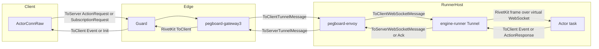
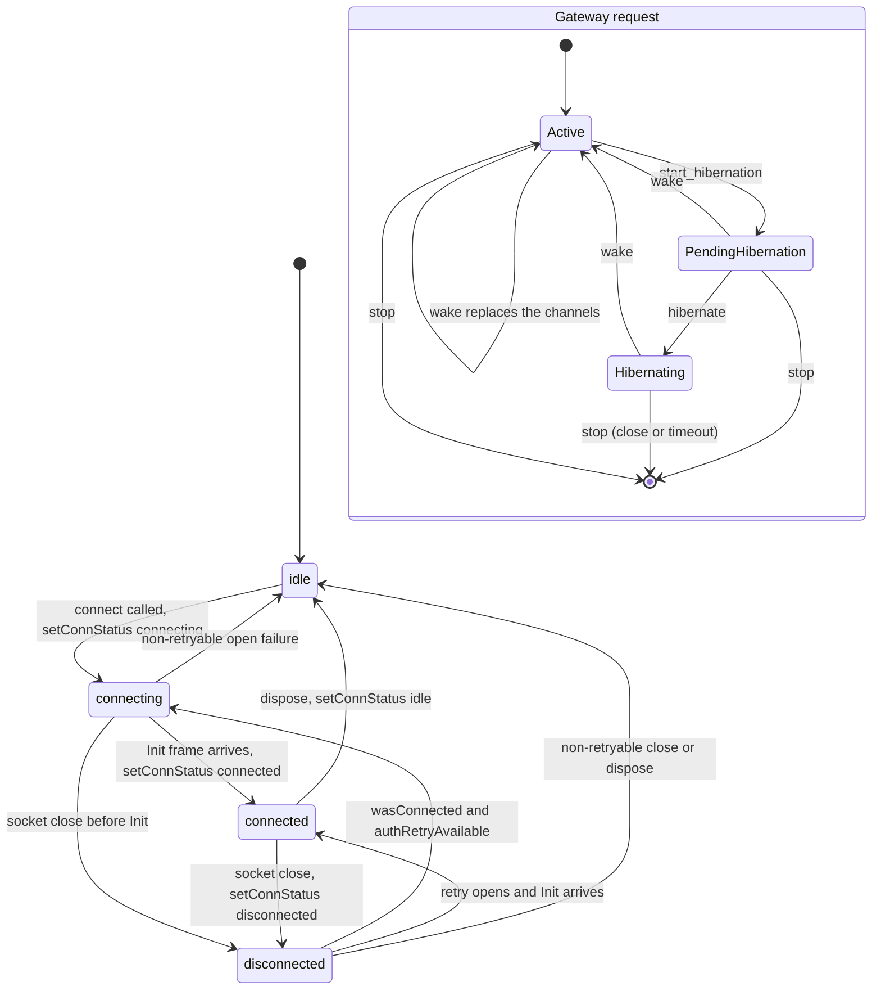

# 10 Realtime connections and hibernation

A Rivet Actor keeps a persistent WebSocket open to each client, sends named events to the clients that subscribed, and parks that socket at the gateway when the Actor sleeps. This document follows one frame in each direction. It starts at the TypeScript client, goes through Guard and the gateway, reaches the runner and the Actor task, and returns as a broadcast. It then follows the same connection through sleep and wake, and it states what the code keeps and what the code drops. The source of truth is commit `4a58441c50d1ce20d8803cfb1ab7c3285a5141d6`, version 2.3.31. Every path is relative to `/Users/darkvoid/GitSources/src.Rivet/rivet`. A citation with only a file name uses the path given for that file earlier in this document.

The code runs in three places. The client is TypeScript. Guard, the gateway, and the control plane are Rust services. The runner process hosts a Rust core and a JavaScript runtime for user handlers. The core owns `ConnHandle`, the embedded Structured Query Language (SQL) database, subscriptions, and the sleep timer. `Conn` is the TypeScript view of a `ConnHandle`, and Node-API (NAPI) calls connect the two. Two runner paths exist: the TypeScript `engine-runner` and the Rust `envoy-client` runner.

**Aha:** The code treats a WebSocket as two separate things. One thing is the transport that Guard holds. The other thing is the connection record inside the Actor. The transport can sleep and die. A hibernatable record survives in the embedded SQL database with its identifier, its path, its headers, its subscriptions, and its state. A close, a failed restore, or the 90-second hibernation timeout removes it. This separation is why a client can keep one logical connection across an Actor restart. The obvious alternative is to close every socket at sleep and make the client reconnect. That alternative is simpler, but it loses subscriptions and connection state, and it forces every client to notice the Actor lifecycle.

## 1. The two realtime surfaces

An Actor has two network surfaces. A client can call an action over the Hypertext Transfer Protocol (HTTP), and a client can hold a WebSocket open. The two surfaces share actions and events, but they differ in lifetime.

| Surface | Entry point | Lifetime | Server state per client |
|---------|-------------|----------|--------------------------|
| HTTP action | The `/request` endpoint, or an action call through the client | One request and one response | No connection record |
| WebSocket | `PATH_CONNECT`, the value `"/connect"` | Long lived, across sleep and wake | A `ConnHandle` with an identifier, parameters, state, and subscriptions |

The table shows the `/connect` value. The constant file also defines `PATH_WEBSOCKET_BASE` and `PATH_WEBSOCKET_PREFIX`. The connection flow in this document does not use those two constants.

```typescript
// rivetkit-typescript/packages/rivetkit/src/common/actor-router-consts.ts:3-6
// MARK: Paths
export const PATH_CONNECT = "/connect";
export const PATH_WEBSOCKET_BASE = "/websocket";
export const PATH_WEBSOCKET_PREFIX = "/websocket/";
```

The document uses these terms with these meanings.

| Term | Meaning in this source |
|------|------------------------|
| Connection | One WebSocket transport plus one server-side connection record |
| Connection ID | A string that names the record. `ConnHandle::connect_with_state_and_prepare` makes it with `Uuid::new_v4().to_string()` |
| Event | A named message with arguments. The client protocol type is `Event { name, args }` |
| Subscription | A set of event names on one connection. The Rust field is `subscriptions: RwLock<BTreeSet<String>>` |
| Broadcast | A loop over all connections. It sends the event to each connection whose subscription set contains the name |
| Presence | Not a type in the source. Presence is built from `ctx.conns`, `onConnect`, `onDisconnect`, and events |

Presence deserves a precise statement. The source has no `Presence` struct and no presence endpoint. A developer builds presence from the connection map and from events. Section 10 shows the mechanism.

The HTTP surface is not connectionless in the transport sense. It still uses a Transmission Control Protocol (TCP) connection. It has no per-client record inside the Actor, and it has no subscriptions. The rest of this document concerns the WebSocket surface.

## 2. The client opens a connection

The client path starts at `ActorHandleRaw.connect`. The method builds an `ActorConnRaw` and returns a proxy. The proxy constructor does not open a socket. The client adds the connection to its list, then calls `conn[CONNECT_SYMBOL]()`.

```typescript
// rivetkit-typescript/packages/rivetkit/src/client/actor-handle.ts:668-694
	connect(
		params?: unknown,
		options: ActorConnectOptions = {},
	): ActorConn<AnyActorDefinition> {
		logger().debug({
			msg: "establishing connection from handle",
			query: this.#actorResolutionState,
		});

		const connParams = params === undefined ? this.#params : params;
		const getParams = params === undefined ? this.#getParams : undefined;

		const conn = new ActorConnRaw(
			this.#client,
			this.#driver,
			connParams,
			getParams,
			this.#encoding,
			this.#actorResolutionState,
			resolveActorGatewayOptions(this.#gatewayOptions, options),
			this.#currentActorInvocation,
		);

		return this.#client[CREATE_ACTOR_CONN_PROXY](
			conn,
		) as ActorConn<AnyActorDefinition>;
	}
```

```typescript
// rivetkit-typescript/packages/rivetkit/src/client/client.ts:437-447
	[CREATE_ACTOR_CONN_PROXY]<AD extends AnyActorDefinition>(
		conn: ActorConnRaw,
	): ActorConn<AD> {
		// Save to connection list
		this[ACTOR_CONNS_SYMBOL].add(conn);

		// Start connection
		conn[CONNECT_SYMBOL]();

		return createActorProxy(conn) as ActorConn<AD>;
	}
```

`CONNECT_SYMBOL` calls `#connectWithRetry`. That method sets the status to `"connecting"` and starts `pRetry` in the background. The retry is deliberately not awaited. The comment at `actor-conn.ts:453-454` says so.

```typescript
// rivetkit-typescript/packages/rivetkit/src/client/actor-conn.ts:450-484
	#connectWithRetry() {
		this.#setConnStatus("connecting");

		// Attempt to reconnect indefinitely
		// This is intentionally not awaited - connection happens in background
		pRetry(this.#connectAndWait.bind(this), {
			forever: true,
			minTimeout: 250,
			maxTimeout: 30_000,

			onFailedAttempt: (error) => {
				logger().warn({
					msg: "failed to reconnect",
					attempt: error.attemptNumber,
					error: stringifyError(error),
				});
			},

			// Cancel retry if aborted
			signal: this.#abortController.signal,
		}).catch((err) => {
			if (
				err instanceof AbortError ||
				(err as Error).name === "AbortError" ||
				!this.#shouldRetryConnectionOpenError(err)
			) {
				logger().info({ msg: "connection retry aborted" });
			} else {
				logger().error({
					msg: "unexpected error in connection retry",
					error: stringifyError(err),
				});
			}
		});
	}
```

The first attempt calls `#connectAndWait`. That method creates an open promise, calls `#connectWebSocket`, and waits. A failure that is not retryable clears the queue, rejects pending actions, dispatches an error, and sets the status to `"idle"` (`actor-conn.ts:502-526`). The retry stops because `#connectAndWait` wraps a non-retryable error in `AbortError` (`actor-conn.ts:522-526`). `pRetry` stops on that class; the outer `.catch` only logs the result. `#shouldRetryConnectionOpenError` returns false for `ActorConnDisposed`. It returns true for an invalid token after one refresh attempt, a stale Actor, `get_params_failed`, and a retryable lifecycle signal (`actor-conn.ts:532-562`).

`#connectWebSocket` asks the driver for a socket at `PATH_CONNECT`. The driver is an `EngineControlClient` (`actor-conn.ts:209`). `openWebSocket` returns a `UniversalWebSocket` (`engine-client/mod.ts:419-425`). The driver attaches the `message`, `close`, and `error` listeners. The socket `open` event only writes a log line. It does not set the status.

```typescript
// rivetkit-typescript/packages/rivetkit/src/client/actor-conn.ts:598-652
	async #connectWebSocket() {
		const params = await this.#resolveConnectionParams();
		const target = getGatewayTarget(this.#actorResolutionState);
		const ws = await this.#driver.openWebSocket(
			PATH_CONNECT,
			target,
			this.#encoding,
			params,
			this.#gatewayOptions,
		);
		invariant(ws, "websocket should have been created");
		logger().debug({
			msg: "opened websocket",
			connId: this.#connId,
			readyState: ws.readyState,
			messageQueueLength: this.#messageQueue.length,
		});
		this.#websocket = ws;
		ws.addEventListener("open", () => {
			logger().debug({
				msg: "client websocket open",
				connId: this.#connId,
			});
		});
		ws.addEventListener("message", async (ev: { data: ConnMessage }) => {
			try {
				await this.#handleOnMessage(ev.data);
			} catch (err) {
				logger().error({
					msg: "error in websocket message handler",
					error: stringifyError(err),
				});
			}
		});
		ws.addEventListener("close", async (ev: Event | CloseEventLike) => {
			try {
				await this.#handleOnClose(ev);
			} catch (err) {
				logger().error({
					msg: "error in websocket close handler",
					error: stringifyError(err),
				});
			}
		});
		ws.addEventListener("error", () => {
			try {
				this.#handleOnError();
			} catch (err) {
				logger().error({
					msg: "error in websocket error handler",
					error: stringifyError(err),
				});
			}
		});
	}
```

The handshake is an application frame, not an HTTP header. The server sends `Init` with two fields. The client stores both fields and calls `#handleOnOpen`. Therefore `"connected"` means "the `Init` frame arrived", not "the TCP socket opened".

```typescript
// rivetkit-typescript/packages/rivetkit/src/client/actor-conn.ts:744-754
		if (response.body.tag === "Init") {
			// Store connection info
			this.#actorId = response.body.val.actorId;
			this.#connId = response.body.val.connectionId;
			logger().trace({
				msg: "received init message",
				actorId: this.#actorId,
				connId: this.#connId,
			});
			this.#handleOnOpen();
		} else if (response.body.tag === "Error") {
```

The server side has five steps. The upgrade headers carry the client parameters as a URL-encoded JSON value under the `WS_PROTOCOL_CONN_PARAMS` subprotocol prefix (`registry/websocket.rs:859-880`). The handler calls `connect_conn_with_prepare`, which calls `connect_with_state_and_prepare` (`registry/websocket.rs:165-182`, `context.rs:1225-1251`). That function runs `create_conn_state`, makes the UUID, installs `configure_actor_connect_connection`, runs the preflight hook, inserts the record, and then runs `emit_connection_open`, which calls the user `onConnect` (`connection.rs:712-742`, `napi_actor_events.rs:606-626`). Finally the core `on_open` callback sends `Init` (`registry/websocket.rs:251-285`). On a restore the core sets `on_open: None`, so no new `Init` is sent (`registry/websocket.rs:251-254`).

`#handleOnOpen` checks for a dispose and a duplicate open, then schedules the work in a microtask (`actor-conn.ts:655-673`). The microtask checks for a dispose again before it sets `"connected"`, resolves the open promise, re-sends every active subscription, and flushes the queue. A failed flush puts the message back into the queue, because `#sendMessage` re-queues on failure.

```typescript
// rivetkit-typescript/packages/rivetkit/src/client/actor-conn.ts:686-719
			logger().debug({
				msg: "socket open",
				messageQueueLength: this.#messageQueue.length,
				connId: this.#connId,
			});

			// Update connection state (this also notifies handlers)
			this.#authRetryAvailable = true;
			this.#setConnStatus("connected");

			// Resolve open promise
			if (this.#onOpenPromise) {
				this.#onOpenPromise.resolve(undefined);
			} else {
				logger().warn({ msg: "#onOpenPromise is undefined" });
			}

			// Resubscribe to all active events
			for (const eventName of this.#eventSubscriptions.keys()) {
				this.#sendSubscription(eventName, true);
			}

			// Flush queue
			//
			// If the message fails to send, the message will be re-queued
			const queue = this.#messageQueue;
			this.#messageQueue = [];
			logger().debug({
				msg: "flushing message queue",
				queueLength: queue.length,
			});
			for (const msg of queue) {
				this.#sendMessage(msg);
			}
```

The client connection object holds the following state.

| Field | Type | Purpose |
|-------|------|---------|
| `#connStatus` | `ActorConnStatus` | One of `"idle"`, `"connecting"`, `"connected"`, `"disconnected"` |
| `#actorId` | `string \| undefined` | Actor identifier from `Init` |
| `#connId` | `string \| undefined` | Connection identifier from `Init` |
| `#messageQueue` | Array of action and subscription frames | Messages queued before the connection is ready |
| `#actionsInFlight` | `Map<number, ActionInFlight>` | Pending actions keyed by the numeric action ID |
| `#eventSubscriptions` | `Map<string, Set<EventSubscriptions>>` | Local listeners for each event name |
| `#errorHandlers` | `Set<ActorErrorCallback>` | Listeners for connection errors |
| `#openHandlers` | `Set<ConnectionStateCallback>` | Listeners for the open event |
| `#closeHandlers` | `Set<ConnectionStateCallback>` | Listeners for the close event |
| `#statusChangeHandlers` | `Set<StatusChangeCallback>` | Listeners for status changes |
| `#websocket` | `UniversalWebSocket \| undefined` | The current transport |
| `#authRetryAvailable` | `boolean` | False after an authentication failure |

The listener Application Programming Interface (API) is `on`, `once`, and `onError`. The first listener for an event name sends a `SubscriptionRequest` with `subscribe: true`. The last listener to leave sends `subscribe: false`. `EventSubscriptions` is the stored record `{ callback, once }`.

```typescript
// rivetkit-typescript/packages/rivetkit/src/client/actor-conn.ts:1072-1101
	#addEventSubscription<Args extends Array<unknown>>(
		eventName: string,
		callback: (...args: Args) => void,
		once: boolean,
	): EventUnsubscribe {
		const listener: EventSubscriptions<Args> = {
			callback,
			once,
		};

		let subscriptionSet = this.#eventSubscriptions.get(eventName);
		if (subscriptionSet === undefined) {
			subscriptionSet = new Set();
			this.#eventSubscriptions.set(eventName, subscriptionSet);
			this.#sendSubscription(eventName, true);
		}
		subscriptionSet.add(listener);

		// Return unsubscribe function
		return () => {
			const listeners = this.#eventSubscriptions.get(eventName);
			if (listeners) {
				listeners.delete(listener);
				if (listeners.size === 0) {
					this.#eventSubscriptions.delete(eventName);
					this.#sendSubscription(eventName, false);
				}
			}
		};
	}
```

On the Actor side, `Conn.send(name, ...args)` sends one event to one connection. `c.broadcast(name, ...args)` sends to every subscribed connection. Inside an action, the context type is `ActionContext`, which adds `conn` to `ActorContext`. The action body receives that context as its first parameter, named `c` in this document.

| Type | Member | Meaning |
|------|--------|---------|
| `Conn` | `id: string` | The connection ID |
| `Conn` | `params: TConnParams` | Values from the connection handshake |
| `Conn` | `state: TConnState` | Per-connection state |
| `Conn` | `isHibernatable: boolean` | True when the connection can survive sleep |
| `Conn` | `send(name, ...args): void` | Send one event to this connection |
| `Conn` | `disconnect(reason?): Promise<void>` | Close this connection |
| `ActionContext` | `conn: Conn` | The connection that sent the action |
| `ActorContext` | `conns: Map<string, Conn>` | Every live connection, keyed by ID |
| `ActorContext` | `broadcast(name, ...args): void` | Send an event to every subscribed connection |

```typescript
// rivetkit-typescript/packages/rivetkit/src/actor/config.ts:367-384
export interface Conn<
	_TState = unknown,
	TConnParams = unknown,
	TConnState = unknown,
	_TVars = unknown,
	_TInput = unknown,
	_TDatabase extends AnyDatabaseProvider = AnyDatabaseProvider,
	_TEvents extends EventSchemaConfig = Record<never, never>,
	_TQueues extends QueueSchemaConfig = Record<never, never>,
> {
	id: string;
	params: TConnParams;
	state: TConnState;
	isHibernatable: boolean;
	send(name: string, ...args: any[]): void;
	disconnect(reason?: string): Promise<void>;
	[key: string]: any;
}
```

```typescript
// rivetkit-typescript/packages/rivetkit/src/actor/config.ts:420-439
	readonly conns: Map<
		string,
		Conn<
			TState,
			TConnParams,
			TConnState,
			TVars,
			TInput,
			TDatabase,
			TEvents,
			TQueues
		>
	>;
	readonly log: ActorLogger;
	readonly abortSignal: AbortSignal;
	readonly aborted: boolean;
	readonly request?: Request;
	/** @deprecated No-op. Always returns `false`. Use `keepAwake(promise)` or `waitUntil(promise)` instead. Will be removed in 2.2.0. */
	readonly preventSleep: boolean;
	broadcast(name: string, ...args: any[]): void;
```

The TypeScript `broadcast` validates the arguments against the event schema, encodes them, and calls the native `actorBroadcast` entry (`registry/native.ts:3287-3299`). The actual loop is in Rust.

## 3. The RivetKit wire protocol

There are two protocols in this document. The first one is the RivetKit client protocol. A client and an Actor use it. The second one is the runner tunnel protocol. Guard, the gateway, the envoy, and the runner use it. Do not merge them.

The RivetKit protocol has four versions. The current version is 4. The protocol uses Binary Application Record Encoding (BARE) by default. The encoding can also be JavaScript Object Notation (JSON) or Concise Binary Object Representation (CBOR). A BARE frame is a version prefix from the external `vbare` package, then one body tag byte, then the fields. The body tag is the first byte after the prefix. This repository calls `serializeWithEmbeddedVersion` but does not contain the prefix writer (`serde.ts:92-105`).

```typescript
// rivetkit-typescript/packages/rivetkit/src/common/client-protocol-versioned.ts:7-7
export const CURRENT_VERSION = 4;
```

```typescript
// rivetkit-typescript/packages/rivetkit/src/common/encoding.ts:182-187
export const EncodingSchema = z.enum(["json", "cbor", "bare"]);

/**
 * Encoding used to communicate between the client & actor.
 */
export type Encoding = z.infer<typeof EncodingSchema>;
```

The version history is small. Version 1 had a `connectionToken` in `Init`. Version 2 removed it. Version 3 did not change the client frames. Version 4 added `actor: ActorSpecifier | null` to `Error`. `ActorSpecifier` is `{ actorId: string, generation: number, key?: string }` (`actor/errors.ts:24-28`). The converters are at `client-protocol-versioned.ts:10-79`.

```typescript
// rivetkit-typescript/packages/rivetkit/src/common/bare/generated/client-protocol/v4.ts:146-167
export type Event = {
    readonly name: string
    readonly args: Cbor
}

export function readEvent(bc: bare.ByteCursor): Event {
    return {
        name: bare.readString(bc),
        args: readCbor(bc),
    }
}

export function writeEvent(bc: bare.ByteCursor, x: Event): void {
    bare.writeString(bc, x.name)
    writeCbor(bc, x.args)
}

export type ToClientBody =
    | { readonly tag: "Init"; readonly val: Init }
    | { readonly tag: "Error"; readonly val: Error }
    | { readonly tag: "ActionResponse"; readonly val: ActionResponse }
    | { readonly tag: "Event"; readonly val: Event }
```

| Direction | Frame | Tag | Fields | Meaning |
|-----------|-------|-----|--------|---------|
| Server to client | `Init` | 0 | `actorId`, `connectionId` | The connection is ready |
| Server to client | `Error` | 1 | `group`, `code`, `message`, `metadata`, `actionId`, `actor` | An action error or a connection error |
| Server to client | `ActionResponse` | 2 | `id`, `output` | The result of one action |
| Server to client | `Event` | 3 | `name`, `args` | One broadcast or direct event |
| Client to server | `ActionRequest` | 0 | `id`, `name`, `args` | Call one action |
| Client to server | `SubscriptionRequest` | 1 | `eventName`, `subscribe` | Add or remove a subscription |

```typescript
// rivetkit-typescript/packages/rivetkit/src/common/bare/generated/client-protocol/v4.ts:246-285
export type ActionRequest = {
    readonly id: uint
    readonly name: string
    readonly args: Cbor
}

export function readActionRequest(bc: bare.ByteCursor): ActionRequest {
    return {
        id: bare.readUint(bc),
        name: bare.readString(bc),
        args: readCbor(bc),
    }
}

export function writeActionRequest(bc: bare.ByteCursor, x: ActionRequest): void {
    bare.writeUint(bc, x.id)
    bare.writeString(bc, x.name)
    writeCbor(bc, x.args)
}

export type SubscriptionRequest = {
    readonly eventName: string
    readonly subscribe: boolean
}

export function readSubscriptionRequest(bc: bare.ByteCursor): SubscriptionRequest {
    return {
        eventName: bare.readString(bc),
        subscribe: bare.readBool(bc),
    }
}

export function writeSubscriptionRequest(bc: bare.ByteCursor, x: SubscriptionRequest): void {
    bare.writeString(bc, x.eventName)
    bare.writeBool(bc, x.subscribe)
}

export type ToServerBody =
    | { readonly tag: "ActionRequest"; readonly val: ActionRequest }
    | { readonly tag: "SubscriptionRequest"; readonly val: SubscriptionRequest }
```

The body has a one-byte tag. The tag numbers are part of the wire format, not an internal detail. Version 4 maps `Init` to 0, `Error` to 1, `ActionResponse` to 2, and `Event` to 3. The client maps `ActionRequest` to 0 and `SubscriptionRequest` to 1 (`v4.ts:169-186`, `v4.ts:287-315`).

`args` and `output` are byte buffers inside the envelope. The selected client encoding decides their contents. With JSON, the value is the JSON form. With CBOR, the value is CBOR. With BARE, the outer frame is BARE and the user value inside the `Cbor` field is itself CBOR-encoded (`serde.ts:75-109`, `actor-conn.ts:1294-1324`). This nested encoding is easy to miss. A BARE frame is not "all user fields inline".

## 4. The runner tunnel protocol

The second protocol carries the same WebSocket bytes between Guard and the runner. It has two versions. `PROTOCOL_MK1_VERSION` is 3, and `PROTOCOL_MK2_VERSION` is 7. The source is `engine/packages/runner-protocol/src/lib.rs:11-12`.

The base identifier is `MessageId`. It has three fields. `gatewayId` is globally unique. `requestId` is unique inside the gateway. `messageIndex` is unique inside the request. The full type is at `engine-runner-protocol/src/index.ts:1028-1041`.

```typescript
// rivetkit-typescript/packages/engine-runner-protocol/src/index.ts:1028-1041
export type MessageId = {
    /**
     * Globally unique ID
     */
    readonly gatewayId: GatewayId
    /**
     * Unique ID to the gateway
     */
    readonly requestId: RequestId
    /**
     * Unique ID to the request
     */
    readonly messageIndex: MessageIndex
}
```

The WebSocket frame union has these members.

```typescript
// rivetkit-typescript/packages/engine-runner-protocol/src/index.ts:1176-1227
export type ToClientWebSocketOpen = {
    readonly actorId: Id
    readonly path: string
    readonly headers: ReadonlyMap<string, string>
}

export function readToClientWebSocketOpen(bc: bare.ByteCursor): ToClientWebSocketOpen {
    return {
        actorId: readId(bc),
        path: bare.readString(bc),
        headers: read9(bc),
    }
}

export function writeToClientWebSocketOpen(bc: bare.ByteCursor, x: ToClientWebSocketOpen): void {
    writeId(bc, x.actorId)
    bare.writeString(bc, x.path)
    write9(bc, x.headers)
}

export type ToClientWebSocketMessage = {
    readonly data: ArrayBuffer
    readonly binary: boolean
}

export function readToClientWebSocketMessage(bc: bare.ByteCursor): ToClientWebSocketMessage {
    return {
        data: bare.readData(bc),
        binary: bare.readBool(bc),
    }
}

export function writeToClientWebSocketMessage(bc: bare.ByteCursor, x: ToClientWebSocketMessage): void {
    bare.writeData(bc, x.data)
    bare.writeBool(bc, x.binary)
}

function read10(bc: bare.ByteCursor): u16 | null {
    return bare.readBool(bc) ? bare.readU16(bc) : null
}

function write10(bc: bare.ByteCursor, x: u16 | null): void {
    bare.writeBool(bc, x != null)
    if (x != null) {
        bare.writeU16(bc, x)
    }
}

export type ToClientWebSocketClose = {
    readonly code: u16 | null
    readonly reason: string | null
}
```

The functions `read9`/`write9` and `read10`/`write10` are generated helpers. The number is a generator identifier, not a frame tag or a protocol version. `read9` reads a string map, which is the `headers` field. `read10` reads an optional 16-bit integer, which is the `code` field.

```typescript
// rivetkit-typescript/packages/engine-runner-protocol/src/index.ts:1241-1290
export type ToServerWebSocketOpen = {
    readonly canHibernate: boolean
}

export function readToServerWebSocketOpen(bc: bare.ByteCursor): ToServerWebSocketOpen {
    return {
        canHibernate: bare.readBool(bc),
    }
}

export function writeToServerWebSocketOpen(bc: bare.ByteCursor, x: ToServerWebSocketOpen): void {
    bare.writeBool(bc, x.canHibernate)
}

export type ToServerWebSocketMessage = {
    readonly data: ArrayBuffer
    readonly binary: boolean
}

export function readToServerWebSocketMessage(bc: bare.ByteCursor): ToServerWebSocketMessage {
    return {
        data: bare.readData(bc),
        binary: bare.readBool(bc),
    }
}

export function writeToServerWebSocketMessage(bc: bare.ByteCursor, x: ToServerWebSocketMessage): void {
    bare.writeData(bc, x.data)
    bare.writeBool(bc, x.binary)
}

export type ToServerWebSocketMessageAck = {
    readonly index: MessageIndex
}

export function readToServerWebSocketMessageAck(bc: bare.ByteCursor): ToServerWebSocketMessageAck {
    return {
        index: readMessageIndex(bc),
    }
}

export function writeToServerWebSocketMessageAck(bc: bare.ByteCursor, x: ToServerWebSocketMessageAck): void {
    writeMessageIndex(bc, x.index)
}

export type ToServerWebSocketClose = {
    readonly code: u16 | null
    readonly reason: string | null
    readonly hibernate: boolean
}
```

| Direction | Frame | Meaning |
|-----------|-------|---------|
| Gateway to runner | `ToClientWebSocketOpen` | Open a socket for an actor at a path, with headers |
| Gateway to runner | `ToClientWebSocketMessage` | One client message |
| Gateway to runner | `ToClientWebSocketClose` | Close the socket |
| Runner to gateway | `ToServerWebSocketOpen` | The socket is open. `canHibernate` enables hibernation |
| Runner to gateway | `ToServerWebSocketMessage` | One actor message |
| Runner to gateway | `ToServerWebSocketMessageAck` | The actor persisted and accepted messages up to `index` |
| Runner to gateway | `ToServerWebSocketClose` | Close the socket. `hibernate` parks the socket instead of closing the client |

The same frames have three names. The TypeScript runner uses `engine-runner-protocol` with `ToClient` and `ToServer`. The Rust runner uses `rivet_envoy_protocol` with `ToEnvoy` and `ToRivet`. The control plane uses the `ToEnvoy` and `ToRivet` names. The envoy protocol is version 8 (`engine/sdks/rust/envoy-protocol/src/versioned/mod.rs:1148`). The Rust runner protocol is MK2, version 7, on the current path (`runner2.rs:7`); MK1, version 3, is the legacy path (`lib.rs:14-16`).

| Direction | TypeScript runner | Rust runner |
|-----------|-------------------|-------------|
| Gateway to runner, open / message / close | `ToClientWebSocketOpen`, `ToClientWebSocketMessage`, `ToClientWebSocketClose` | `ToEnvoyWebSocketOpen`, `ToEnvoyWebSocketMessage`, `ToEnvoyWebSocketClose` |
| Runner to gateway, open / message / ack / close | `ToServerWebSocketOpen`, `ToServerWebSocketMessage`, `ToServerWebSocketMessageAck`, `ToServerWebSocketClose` | `ToRivetWebSocketOpen`, `ToRivetWebSocketMessage`, `ToRivetWebSocketMessageAck`, `ToRivetWebSocketClose` |

The tunnel union wraps each WebSocket frame with a `MessageId`. The server direction has seven tags, and the client direction has six. The tag assignments are at `index.ts:1309-1346` and `index.ts:1408-1477`.

```typescript
// rivetkit-typescript/packages/engine-runner-protocol/src/index.ts:1309-1322
export type ToServerTunnelMessageKind =
    /**
     * HTTP
     */
    | { readonly tag: "ToServerResponseStart"; readonly val: ToServerResponseStart }
    | { readonly tag: "ToServerResponseChunk"; readonly val: ToServerResponseChunk }
    | { readonly tag: "ToServerResponseAbort"; readonly val: ToServerResponseAbort }
    /**
     * WebSocket
     */
    | { readonly tag: "ToServerWebSocketOpen"; readonly val: ToServerWebSocketOpen }
    | { readonly tag: "ToServerWebSocketMessage"; readonly val: ToServerWebSocketMessage }
    | { readonly tag: "ToServerWebSocketMessageAck"; readonly val: ToServerWebSocketMessageAck }
    | { readonly tag: "ToServerWebSocketClose"; readonly val: ToServerWebSocketClose }
```



## 5. How the server holds and broadcasts connections

The Actor task owns a connection map. Each entry is a `ConnHandle`. The handle is a cloned reference to `ConnHandleInner`.

```rust
// rivetkit-rust/packages/rivetkit-core/src/actor/connection.rs:190-204
struct ConnHandleInner {
	id: ConnId,
	params: Vec<u8>,
	// Forced-sync: connection handles expose synchronous state and callback
	// methods to foreign runtimes; callbacks are cloned before async work.
	state: RwLock<Vec<u8>>,
	is_hibernatable: bool,
	dirty: AtomicBool,
	subscriptions: RwLock<BTreeSet<String>>,
	hibernation: RwLock<Option<HibernatableConnectionMetadata>>,
	state_change_handler: RwLock<Option<StateChangeCallback>>,
	event_sender: RwLock<Option<EventSendCallback>>,
	transport_disconnect_handler: RwLock<Option<DisconnectCallback>>,
	disconnect_handler: RwLock<Option<DisconnectCallback>>,
}
```

| Field | Type | Purpose |
|-------|------|---------|
| `id` | `ConnId`, an alias for `String` | The connection identifier |
| `params` | `Vec<u8>` | Encoded connection parameters from the handshake |
| `state` | `RwLock<Vec<u8>>` | Encoded per-connection state |
| `is_hibernatable` | `bool` | The connection can park across sleep |
| `dirty` | `AtomicBool` | The connection has changes that are not saved |
| `subscriptions` | `RwLock<BTreeSet<String>>` | Event names this connection accepts |
| `hibernation` | `RwLock<Option<HibernatableConnectionMetadata>>` | Gateway ID, request ID, indexes, path, headers |
| `state_change_handler` | `RwLock<Option<StateChangeCallback>>` | Marks the connection dirty and requests a save |
| `event_sender` | `RwLock<Option<EventSendCallback>>` | Writes one event to the transport |
| `transport_disconnect_handler` | `RwLock<Option<DisconnectCallback>>` | Drops the transport but keeps the record |
| `disconnect_handler` | `RwLock<Option<DisconnectCallback>>` | Runs the full disconnect path |

`ConnHandle` is a newtype over `Arc<ConnHandleInner>` (`connection.rs:187-188`). A clone is cheap and shares every field. The `RwLock` fields make the shared record mutable across clones. `subscribe` returns true when it inserts the name, and `unsubscribe` returns true when it removes the name (`connection.rs:313-319`).

A new managed connection gets its identifier at `connection.rs:718-723`. The value is a version 4 Universally Unique Identifier (UUID). The connection is inserted only after the preflight hook `emit_connection_preflight` succeeds, and it is removed if the open hook `emit_connection_open` fails (`connection.rs:727-742`).

The `broadcast` method is a loop with one filter. The native `actorBroadcast` calls it (`registry/native.ts:3287-3299`), and `ConnHandle::send` calls the event sender.

```rust
// rivetkit-rust/packages/rivetkit-core/src/actor/context.rs:997-1012
	pub fn broadcast(&self, name: &str, args: &[u8]) {
		for connection in self.conns() {
			if connection.is_subscribed(name) {
				connection.send(name, args);
			}
		}
	}

	/// Returns a lock-backed iterator over live connections.
	///
	/// Do not hold the returned iterator across `.await`. It keeps a read lock
	/// on the connection map until dropped, which blocks connection writers.
	#[must_use]
	pub fn conns(&self) -> ConnHandles<'_> {
		self.iter_connections()
	}
```

`send` does not panic on failure. It logs the error and continues. The loop therefore reaches every other connection even when one sender is gone.

```rust
// rivetkit-rust/packages/rivetkit-core/src/actor/connection.rs:276-285
	pub fn send(&self, name: &str, args: &[u8]) {
		if let Err(error) = self.try_send(name, args) {
			tracing::error!(
				?error,
				conn_id = self.id(),
				event_name = name,
				"failed to send event to connection"
			);
		}
	}
```

```rust
// rivetkit-rust/packages/rivetkit-core/src/actor/connection.rs:401-415
	pub(crate) fn try_send(&self, name: &str, args: &[u8]) -> Result<()> {
		let event_sender = self.event_sender()?;
		event_sender(OutgoingEvent {
			name: name.to_owned(),
			args: args.to_vec(),
		})
	}

	fn event_sender(&self) -> Result<EventSendCallback> {
		self.0
			.event_sender
			.read()
			.clone()
			.ok_or_else(|| connection_not_configured("event sender"))
	}
```

`is_subscribed` and `subscribe` operate on the `BTreeSet`.

```rust
// rivetkit-rust/packages/rivetkit-core/src/actor/connection.rs:313-327
	pub(crate) fn subscribe(&self, event_name: impl Into<String>) -> bool {
		self.0.subscriptions.write().insert(event_name.into())
	}

	pub(crate) fn unsubscribe(&self, event_name: &str) -> bool {
		self.0.subscriptions.write().remove(event_name)
	}

	pub(crate) fn is_subscribed(&self, event_name: &str) -> bool {
		self.0.subscriptions.read().contains(event_name)
	}

	pub(crate) fn subscriptions(&self) -> Vec<String> {
		self.0.subscriptions.read().iter().cloned().collect()
	}
```

The event sender is installed when the transport is configured. For the RivetKit actor path, `configure_actor_connect_connection` wraps the `WebSocketSender` and encodes an `ActorConnectToClient::Event`. An outgoing message that is too long closes the socket with code 1011 and reason `message.outgoing_too_long`. The send itself returns `Ok(())` (`registry/websocket.rs:722-740`).

The subscription path is important for hibernation. When a `SubscriptionRequest` arrives on a hibernatable connection, the Actor first records the message index, requests a save, and acknowledges the message to the gateway. Then it applies the subscription. A failure to persist closes the socket with `actor.hibernation_persist_failed`. The ack does not wait for the save to commit. `persist_and_ack_hibernatable_actor_message` changes the in-memory metadata, queues a delta, calls `request_save`, and sends the ack (`websocket.rs:744-759`). `dispatch_subscribe_request` then runs `onBeforeSubscribe` with the 5-second `onBeforeConnectTimeout`; a hook error closes the socket with the error group and code (`dispatch.rs:139-156`, `napi_actor_events.rs:644-662`).

```rust
// rivetkit-rust/packages/rivetkit-core/src/registry/websocket.rs:313-352
						ActorConnectToServer::SubscriptionRequest(request) => {
							if conn.is_hibernatable()
								&& let Err(error) = persist_and_ack_hibernatable_actor_message(
									&ctx,
									&conn,
									message.message_index,
								)
								.await
							{
								tracing::warn!(
									?error,
									conn_id = conn.id(),
									"failed to persist and ack hibernatable actor websocket message"
								);
								message.sender.close(
									Some(1011),
									Some("actor.hibernation_persist_failed".to_owned()),
								);
								return;
							}
							if request.subscribe {
								if let Err(error) = dispatch_subscribe_request(
									&ctx,
									conn.clone(),
									request.event_name.clone(),
								)
								.await
								{
									let error = RivetError::extract(&error);
									message.sender.close(
										Some(1011),
										Some(format!("{}.{}", error.group(), error.code())),
									);
									return;
								}
								conn.subscribe(request.event_name);
							} else {
								conn.unsubscribe(&request.event_name);
							}
						}
```

## 6. What hibernation keeps and what it drops

Hibernation applies only to a WebSocket that the Actor marks as hibernatable. The TypeScript option is `canHibernateWebSocket`. Its default is `false` (`actor/config.ts:1280-1282`). The native bridge reads it at `registry/native.ts:3906` and passes it to the Rust core. The runner reports the result to the gateway as `can_hibernate` in `ToServerWebSocketOpen` (`envoy-client/src/actor.rs:1000-1004`). The persisted record has ten fields, and the Rust encoder writes them with BARE.

```rust
// rivetkit-rust/packages/rivetkit-core/src/actor/connection.rs:358-377
	pub(crate) fn persisted_with_state(&self, state: Vec<u8>) -> Option<PersistedConnection> {
		let hibernation = self.0.hibernation.read().clone()?;

		Some(PersistedConnection {
			id: self.id().to_owned(),
			parameters: self.params(),
			state,
			subscriptions: self
				.subscriptions()
				.into_iter()
				.map(|event_name| PersistedSubscription { event_name })
				.collect(),
			gateway_id: hibernation.gateway_id,
			request_id: hibernation.request_id,
			server_message_index: hibernation.server_message_index,
			client_message_index: hibernation.client_message_index,
			request_path: hibernation.request_path,
			request_headers: hibernation.request_headers.into_iter().collect(),
		})
	}
```

The `?` on `self.0.hibernation.read().clone()` means a connection without hibernation metadata returns `None`. No row is written for that connection (`connection.rs:358-359`).

| Persisted | Source | Use after wake |
|-----------|--------|----------------|
| `id` | `ConnHandle::id()` | Reuse the same connection ID |
| `parameters` | The handshake params | Rebuild the connection object |
| `state` | `state: Vec<u8>` from the runtime | Restore per-connection state |
| `subscriptions` | `BTreeSet<String>` | Restore event routing without a new subscribe frame |
| `gateway_id` | `HibernatableConnectionMetadata` | Match the parked transport |
| `request_id` | `HibernatableConnectionMetadata` | Match the parked transport |
| `server_message_index` | The last client-to-Actor data index recorded. A new connection stores 0, which is the open-frame index; the first data message is 1 | The next expected incoming index is this value plus 1, modulo 65,536 |
| `client_message_index` | The next Actor-to-client index. The core writes 0 and has no setter, so every restore starts again at 0 | Seed `envoy_message_index` for Actor-to-client messages |
| `request_path` | The original upgrade path | Rebuild the request |
| `request_headers` | The original upgrade headers | Rebuild the request |

The persisted record has no callbacks. `from_persisted` creates a new handle with none of the four callback fields. A NAPI callback belongs to the previous runtime and cannot be reused after wake. The restore path rebuilds the handlers. `prepare_managed_conn` installs the state-change and disconnect handlers (`connection.rs:820-855`). `configure_actor_connect_connection` installs the event sender (`registry/websocket.rs:699-742`). `engine/CLAUDE.md:119` states the same rule.

```rust
// rivetkit-rust/packages/rivetkit-core/src/actor/connection.rs:379-399
	pub(crate) fn from_persisted(persisted: PersistedConnection) -> Self {
		let conn = Self::new(
			persisted.id.clone(),
			persisted.parameters,
			persisted.state,
			true,
		);
		conn.configure_hibernation(Some(HibernatableConnectionMetadata {
			gateway_id: persisted.gateway_id,
			request_id: persisted.request_id,
			server_message_index: persisted.server_message_index,
			client_message_index: persisted.client_message_index,
			request_path: persisted.request_path,
			request_headers: persisted.request_headers.into_iter().collect(),
		}));
		for subscription in persisted.subscriptions {
			conn.subscribe(subscription.event_name);
		}
		conn.clear_hibernation_dirty();
		conn
	}
```

The restore is a two-stage process. First, `restore_persisted` loads every row from SQLite and inserts a `ConnHandle` for each row. The handle has no transport yet. Then, when a start command names a parked request, `reconnect_hibernatable` finds the handle by gateway ID and request ID. It reuses the connection ID and does not call `onConnect`.

Three open callbacks are easy to confuse.

| Hook | Owner | New connection | Restore |
|------|-------|----------------|---------|
| `onConnect` | Actor configuration, run by `emit_connection_open` (`actor/config.ts:1781`, `napi_actor_events.rs:606-626`) | Runs after the record is inserted | Does not run |
| Core `on_open` | Actor core `WebSocketHandler` (`registry/websocket.rs:251-285`) | Sends `Init` | `None`, so no new `Init` |
| Runner `on_open` | Runner WebSocket handler (`envoy-client/src/actor.rs:1016-1029`) | Runs on open | The Rust runner runs it; the TypeScript runner does not |

The second path starts in the same core. `restore_hibernatable_connections` builds `HibernatingWebSocketMetadata` from the restored handles and calls `envoy_handle.restore_hibernating_requests(actor_id, meta_entries)` (`context.rs:1434-1457`). The envoy passes `meta.path` and `meta.headers` to the runner's `websocket` callback, which rebuilds each handler. The runner does not read the Actor's SQLite file; the core sends the metadata through the envoy handle. Section 7 follows this path. `gateway_id` and `request_id` are 4-byte arrays (`connection.rs:45-46`). They are not the connection ID string. The connection ID is `id`, and it is the version 4 UUID.

```rust
// rivetkit-rust/packages/rivetkit-core/src/actor/connection.rs:770-818
	pub(crate) async fn restore_persisted(&self) -> Result<Vec<ConnHandle>> {
		let persisted_connections = internal_storage::load_connections(self.sql())
			.await
			.context("load hibernatable connections from sqlite")?;
		let mut restored = Vec::new();

		for persisted in persisted_connections {
			let conn = ConnHandle::from_persisted(persisted);
			self.prepare_managed_conn(&conn);
			self.insert_existing(conn.clone());
			tracing::debug!(
				actor_id = %self.actor_id(),
				conn_id = conn.id(),
				"hibernatable connection restored"
			);
			restored.push(conn);
		}

		Ok(restored)
	}

	pub(crate) fn reconnect_hibernatable(
		&self,
		gateway_id: &[u8],
		request_id: &[u8],
	) -> Result<ConnHandle> {
		let gateway_id = hibernatable_id_from_slice("gateway_id", gateway_id)?;
		let request_id = hibernatable_id_from_slice("request_id", request_id)?;
		let Some(conn) = self
			.iter_connections()
			.find(|conn| match conn.hibernation() {
				Some(hibernation) => {
					hibernation.gateway_id == gateway_id && hibernation.request_id == request_id
				}
				None => false,
			})
		else {
			return Err(ConnectionRestoreNotFound.build());
		};

		self.record_connections_updated();
		self.reset_sleep_timer();
		tracing::debug!(
			actor_id = %self.actor_id(),
			conn_id = conn.id(),
			"hibernatable connection transport restored"
		);
		Ok(conn)
	}
```

The database tables are `_rivet_conns` and `_rivet_conn_state`. `StateDelta` is the enum passed to `save_state`. The connection delta is `StateDelta::ConnHibernation`; the removal delta is `StateDelta::ConnHibernationRemoved`. The TypeScript bridge sends each delta as `connHibernation` or `connHibernationRemoved`. The `state` field is separate: it is the Actor state read from the runtime, not a connection delta (`registry/native.ts:3349-3377`). The Rust NAPI layer restores connection state with `restore_hibernatable_conn`, which calls `conn.set_state_initial` (`rivetkit-typescript/packages/rivetkit-napi/src/actor_context.rs:264-271`).

The browser-facing side of hibernation is the gateway request state. The enum has `Active`, `PendingHibernation`, and `Hibernating`. `start_hibernation` moves `Active` to `PendingHibernation` (`shared_state.rs:1519-1547`). `handle_websocket_hibernation` calls `get_hibernating_in_flight_request`, which calls `hibernate` (`lib.rs:766`, `shared_state.rs:515-555`, `2280-2316`). The exact enum is `InFlightRequestState` in `engine/packages/pegboard-gateway3/src/shared_state.rs:2390-2410`. The gateway parks the request only after the Actor stops. The order is: the core queues the hibernation delta and requests a save; the Actor exits; the runner reports the stop; the gateway runs `start_hibernation`; then `hibernate` parks the request.



The client machine is from `actor-conn.ts:451`, `502-526`, `520`, `694`, `889`, `977-982`, and `1518`. The gateway machine is from `shared_state.rs:1519-1547`, `shared_state.rs:2280-2316`, and the enum at `shared_state.rs:2390-2410`.

The two machines are independent. A client can be `"connecting"` while the server record is `Hibernating`. This is normal. The TCP socket is open, but `Init` has not arrived, so the client status stays `"connecting"`. Guard holds the socket and waits for a runner. The gateway WebSocket open timeout is 15 seconds (`config/pegboard.rs:306-308`).

## 7. The sleep and wake sequence

Idle sleep uses a deadline and a predicate. The deadline is `sleepTimeout`, which defaults to 30,000 ms (`actor/config.ts:1314`). The grace window is `sleepGracePeriod`, which defaults to 15,000 ms (`actor/config.ts:21`, `1300-1303`). The predicate is `can_arm_sleep_timer`. It returns the first blocking reason.

```rust
// rivetkit-rust/packages/rivetkit-core/src/actor/sleep.rs:65-77
#[derive(Clone, Copy, Debug, PartialEq, Eq)]
pub(crate) enum CanSleep {
	Yes,
	NotReady,
	NoSleep,
	ActiveHttpRequests,
	ActiveKeepAwake,
	ActiveInternalKeepAwake,
	ActiveRunHandler,
	ActiveDisconnectCallbacks,
	ActiveConnections,
	ActiveWebSocketCallbacks,
}
```

```rust
// rivetkit-rust/packages/rivetkit-core/src/actor/sleep.rs:249-282
	pub(crate) async fn can_arm_sleep_timer(&self) -> CanSleep {
		let config = self.sleep_state_config();
		if !self.0.sleep.lifecycle_started.load(Ordering::SeqCst) {
			return CanSleep::NotReady;
		}
		if config.no_sleep {
			return CanSleep::NoSleep;
		}
		if self.active_http_request_count() > 0 {
			return CanSleep::ActiveHttpRequests;
		}
		if self.sleep_keep_awake_count() > 0 {
			return CanSleep::ActiveKeepAwake;
		}
		if self.sleep_internal_keep_awake_count() > 0 {
			return CanSleep::ActiveInternalKeepAwake;
		}
		// Queue receives are sleep-compatible: sleep aborts the wait via the
		// actor abort token, then the next generation restarts the run loop.
		if self.run_handler_active() && self.active_queue_wait_count() == 0 {
			return CanSleep::ActiveRunHandler;
		}
		if self.pending_disconnect_count() > 0 {
			return CanSleep::ActiveDisconnectCallbacks;
		}
		if !self.conns().is_empty() {
			return CanSleep::ActiveConnections;
		}
		if self.websocket_callback_count() > 0 {
			return CanSleep::ActiveWebSocketCallbacks;
		}

		CanSleep::Yes
	}
```

This predicate creates a tension that the reader must see. A live connection is a blocker, because `ActiveConnections` appears when `!self.conns().is_empty()`. Therefore an Actor with any connection does not sleep from the idle timer. The timer path logs "sleep idle deadline elapsed but actor stayed awake" and resets the deadline (`task.rs:2213-2219`). The files opened here show no automatic idle hibernation while a connection record exists.

An explicit sleep intent resolves the tension. Three inputs send the intent. `c.sleep()` calls `request_sleep_from_envoy` (`context.rs:653-687`). The envoy `sleep_actor` sends `ActorIntentSleep` (`envoy-client/src/handle.rs:166-176`). The public sleep endpoint signals `Main::Sleep` (`api-peer/src/actors/sleep.rs:39-45`). The workflow turns each input into `CommandStopActor { reason: StopActorReason::SleepIntent }` (`engine/packages/pegboard/src/workflows/actor2/mod.rs:721-743`, `933-963`). The full sleep lifecycle is in [03 Actors](03-actors-and-lifecycle.md).

The grace phase treats a hibernatable connection differently from a normal connection. A normal connection receives `DisconnectConn`. A hibernatable connection receives `request_hibernation_transport_save`. The code does not close it. The core queues a hibernation delta and requests a save (`context.rs:1285-1288`). The save is requested, not awaited. The socket stays open. The gateway parks the request after the Actor stops.

```rust
// rivetkit-rust/packages/rivetkit-core/src/actor/task.rs:784-802
	fn emit_grace_events(&mut self, reason: ShutdownKind) {
		let conns: Vec<_> = self.ctx.conns().collect();
		for conn in conns {
			let hibernatable_sleep =
				matches!(reason, ShutdownKind::Sleep) && conn.is_hibernatable();
			if hibernatable_sleep {
				self.ctx.request_hibernation_transport_save(conn.id());
				continue;
			}
			self.ctx.begin_core_dispatched_hook();
			let reply = self.core_dispatched_hook_reply("disconnect_conn");
			let conn_id = conn.id().to_owned();
			if let Err(error) = self.send_actor_event(
				"grace_disconnect_conn",
				ActorEvent::DisconnectConn { conn_id, reply },
			) {
				tracing::error!(?error, "failed to enqueue disconnect cleanup event");
			}
		}
```

`ShutdownKind` is `Sleep` or `Destroy`. Only `Sleep` saves a hibernatable transport (`task.rs:784-802`).

```rust
// rivetkit-rust/packages/rivetkit-core/src/actor/context.rs:1285-1288
	pub(crate) fn request_hibernation_transport_save(&self, conn_id: &str) {
		self.queue_hibernation_update(conn_id.to_owned());
		self.request_save(RequestSaveOpts::default());
	}
```

The wake path starts with a new message for a parked request. Guard sees the hibernating socket, sends the `Wake` signal, and waits for `Ready`. `Ready` is the Pegboard workflow signal that carries the `envoy_key`, the name of the envoy process that hosts the Actor (`engine/packages/guard/src/routing/pegboard_gateway/mod.rs:526`, `616-622`). The envoy `hydrate_command_wrapper` fills `CommandStartActor.hibernating_requests` before the start command reaches the runner (`hibernating_requests.rs:5-27`). The list operation takes one `actor_id` and returns `gateway_id` and `request_id` (`pegboard/src/ops/actor/hibernating_request/list.rs:15-18`). The gateway keepalive task upserts the record every 45 seconds, half of the 90-second `hibernating_request_eligible_threshold` (`keepalive_task.rs:24-30`, `config/pegboard.rs:271-274`). The full 90 seconds is the age at which the gateway expires a silent request (`shared_state.rs:218`, `2366-2375`).

```rust
// engine/packages/pegboard-envoy/src/hibernating_requests.rs:5-27
/// Hydrates ephemeral hibernating request ids before a start command reaches envoy.
/// Stored serverful commands keep this empty because request ids can change while
/// queued commands wait for envoy reconnect.
pub(crate) async fn hydrate_command_wrapper(
	ctx: &StandaloneCtx,
	command_wrapper: &mut protocol::CommandWrapper,
) -> Result<()> {
	if let protocol::Command::CommandStartActor(start) = &mut command_wrapper.inner {
		let actor_id =
			Id::parse(&command_wrapper.checkpoint.actor_id).context("invalid command actor id")?;
		start.hibernating_requests = ctx
			.op(pegboard::ops::actor::hibernating_request::list::Input { actor_id })
			.await?
			.into_iter()
			.map(|request| protocol::HibernatingRequest {
				gateway_id: request.gateway_id,
				request_id: request.request_id,
			})
			.collect();
	}

	Ok(())
}
```

The runner rebuilds each connection in a fixed order. First, it restores the record and rebuilds the request from the path and headers. Then it builds a new handler from the callback, rebinds the route, and sends an open acknowledgement. Finally, it starts the outgoing task and calls `on_open`.

Two records take part. The Actor-side SQLite row holds the connection state. The runner-side `HibernatingWebSocketMetadata` holds the transport route: `gateway_id`, `request_id`, `envoy_message_index`, `rivet_message_index`, `path`, and `headers` (`context.rs:1438-1451`). `meta_entries` is the list of the second kind. `meta.envoy_message_index` seeds the outgoing index, and `meta.rivet_message_index` seeds the incoming index (`actor.rs:925`, `970`). The two `true` arguments are `is_hibernatable` and `is_restoring_hibernatable` (`actor.rs:1363-1375`). The open acknowledgement is `ToRivetWebSocketOpen` in the envoy protocol. It is the same frame as `ToServerWebSocketOpen` in the runner protocol (`actor.rs:996-1006`).

```rust
// engine/sdks/rust/envoy-client/src/actor.rs:914-1029
	let hibernating_requests = std::mem::take(&mut ctx.hibernating_requests);

	for hib_req in &hibernating_requests {
		let meta = meta_entries.iter().find(|entry| {
			entry.gateway_id == hib_req.gateway_id && entry.request_id == hib_req.request_id
		});

		if let Some(meta) = meta {
			ctx.websocket_requests.insert(
				&[&hib_req.gateway_id, &hib_req.request_id],
				WebSocketRequestState {
					envoy_message_index: meta.envoy_message_index,
				},
			);

			let mut full_headers = meta.headers.clone();
			full_headers.insert("Upgrade".to_string(), "websocket".to_string());
			full_headers.insert("Connection".to_string(), "Upgrade".to_string());

			let request = HttpRequest {
				method: "GET".to_string(),
				path: meta.path.clone(),
				headers: full_headers.clone(),
				body: None,
				body_stream: None,
			};

			let (hws_outgoing_tx, hws_outgoing_rx) = mpsc::unbounded_channel();
			let hws_sender = WebSocketSender {
				tx: hws_outgoing_tx.clone(),
			};

			let ws_result = ctx
				.shared
				.config
				.callbacks
				.websocket(
					handle.clone(),
					ctx.actor_id.clone(),
					hib_req.gateway_id,
					hib_req.request_id,
					request,
					meta.path.clone(),
					full_headers,
					true,
					true,
					hws_sender,
				)
				.await;

			match ws_result {
				Ok(ws_handler) => {
					ctx.ws_entries.insert(
						&[&hib_req.gateway_id, &hib_req.request_id],
						WsEntry {
							is_hibernatable: true,
							rivet_message_index: meta.rivet_message_index,
							ws_handler: Some(ws_handler),
							outgoing_tx: hws_outgoing_tx,
						},
					);
					if !handle
						.rebind_hibernating_websocket(
							ctx.actor_id.clone(),
							ctx.generation,
							hib_req.gateway_id,
							hib_req.request_id,
						)
						.await
					{
						tracing::warn!(
							request_id = id_to_str(&hib_req.request_id),
							"hibernating websocket route disappeared before restore"
						);
						ctx.websocket_requests
							.remove(&[&hib_req.gateway_id, &hib_req.request_id]);
						ctx.ws_entries
							.remove(&[&hib_req.gateway_id, &hib_req.request_id]);
						continue;
					}
					// Gateway wake flows wait for the websocket-open ack before
					// they resume forwarding buffered client messages.
					send_actor_message(
						ctx,
						hib_req.gateway_id,
						hib_req.request_id,
						protocol::ToRivetTunnelMessageKind::ToRivetWebSocketOpen(
							protocol::ToRivetWebSocketOpen {
								can_hibernate: true,
							},
						),
					)
					.await;
					// Writes made by the restored callback are already queued in
					// `hws_outgoing_rx`. Start forwarding them only after the exact route
					// is rebound and the restore Open frame has entered the ordered tunnel.
					spawn_ws_outgoing_task(
						ctx.shared.clone(),
						hib_req.gateway_id,
						hib_req.request_id,
						hws_outgoing_rx,
					);
					if let Some(ws) = ctx
						.ws_entries
						.get_mut(&[&hib_req.gateway_id, &hib_req.request_id])
					{
						if let Some(handler) = &mut ws.ws_handler {
							if let Some(on_open) = handler.on_open.take() {
								let sender = WebSocketSender {
									tx: ws.outgoing_tx.clone(),
								};

								on_open(sender).await;
							}
						}
					}
```

```mermaid
sequenceDiagram
    participant A as Client A, waker
    participant B as Client B, socket parked
    participant G as Guard
    participant P as Pegboard
    participant E as pegboard-envoy
    participant GW as pegboard-gateway3
    participant T as Actor task
    A->>G: ActionRequest say
    Note over GW: request is Hibernating
    G->>P: Wake signal
    P->>E: CommandStartActor with hibernating_requests
    E->>T: start Actor for B gateway_id and request_id
    T->>T: restore_persisted loads B record; A is new
    T->>E: restore_hibernating_requests(meta_entries)
    E->>E: rebuild B handler and bind route
    E->>GW: ToRivetWebSocketOpen, can_hibernate true
    G->>GW: forward ActionRequest after Ready
    GW->>E: ToEnvoyWebSocketMessage for A
    E->>T: deliver ActionRequest to A virtual socket
    T->>T: run say action
    T->>T: broadcast say to A and B
    T->>E: ToRivetWebSocketMessage for A and B
    E->>GW: ToServerWebSocketMessage
    GW->>G: ToClient Event say
    G->>A: Event say
    G->>B: Event say
    A->>A: dispatch listener
    B->>B: dispatch listener after route rebind
```

The sequence diagram shows the ordinary wake. Client A wakes the Actor with a new action. Client B has a parked socket, not a sleeping process. `restore_persisted` runs in the Actor core; `restore_hibernating_requests` sends metadata to the runner through the envoy handle. The Actor restores B before user code runs. The broadcast reaches B. If B's metadata is missing, the runner sends `ToServerWebSocketClose` with code 1000 and reason `ws.meta_not_found_during_restore`, and B does not receive the event (`tunnel.ts:157-175`). If the restored handler throws, the runner sends code 1011 and reason `ws.restore_error` (`actor.rs:1035-1058`).

## 8. Ordering, backpressure, and limits

The ordering guarantee is per connection and per direction. It is built on a 16-bit message index. The runner checks every hibernatable incoming message. A duplicate is ignored. A gap closes the socket. The gateway spends index 0 on `ToEnvoyWebSocketOpen`, so the first data message is index 1. The adapter starts `#serverMessageIndex` at 0 as a sentinel for a new connection (`tunnel.ts:984-999`, `websocket-tunnel-adapter.ts:37-52`). A duplicate is dropped before the Actor, so the runner sends no second ack. If the first ack is lost, the gateway waits for the 30-second `gateway_hws_message_ack_timeout_ms`; the pending entry then becomes a garbage-collection reason (`config/pegboard.rs:331-333`, `shared_state.rs:2355-2363`).

```typescript
// rivetkit-typescript/packages/engine-runner/src/websocket-tunnel-adapter.ts:147-183
		// Validate message index for hibernatable websockets
		if (this.#hibernatable) {
			const previousIndex = this.#serverMessageIndex;

			if (wrappingLteU16(serverMessageIndex, previousIndex)) {
				this.#log?.info({
					msg: "received duplicate hibernating websocket message",
					requestId,
					actorId: this.#actorId,
					previousIndex,
					receivedIndex: serverMessageIndex,
				});
				return true;
			}

			const expectedIndex = wrappingAddU16(previousIndex, 1);
			if (serverMessageIndex !== expectedIndex) {
				const closeReason = "ws.message_index_skip";
				this.#log?.warn({
					msg: "hibernatable websocket message index out of sequence, closing connection",
					requestId,
					actorId: this.#actorId,
					previousIndex,
					expectedIndex,
					receivedIndex: serverMessageIndex,
					closeReason,
					gap: wrappingSubU16(
						wrappingSubU16(serverMessageIndex, previousIndex),
						1,
					),
				});
				this.#close(1008, closeReason, true);
				return true;
			}

			this.#serverMessageIndex = serverMessageIndex;
		}
```

The index space is 0 to 65535. It wraps. The duplicate test is `wrappingLteU16(received, previous)`. The expected value is `wrappingAddU16(previous, 1)`. The stored value is the last accepted index, so the next expected value is one more. A value that is neither a duplicate nor the expected value is a gap. The acknowledgement path rejects a JavaScript number outside the range before it uses it (`tunnel.ts:1082-1083`); on the wire the value is a 16-bit unsigned integer. The third argument of `#close` is `sendCallback`, not `hibernate` (`websocket-tunnel-adapter.ts:228-239`). The close callback sends `ToServerWebSocketClose` with `hibernate: false` (`tunnel.ts:360-371`). The client receives code 1008.

```rust
// engine/packages/pegboard-gateway3/src/shared_state.rs:1503-1506
		// Retain messages with index > ack_index (messages that haven't been acknowledged yet)
		let len_before = hs.pending_ws_msgs.len();
		hs.pending_ws_msgs
			.retain(|msg| wrapping_gt(msg.message_index, ack_index));
```

The gateway also bounds the pending buffer. It rejects a message when the total size exceeds `gateway_hws_max_pending_size` or when 65,535 messages are already pending (`len >= u16::MAX`). The 65,536th message is the first rejection, so the buffer holds 65,535 messages.

```rust
// engine/packages/pegboard-gateway3/src/shared_state.rs:906-927
		if let (Some(hs), true) = (req.hibernation_state_mut(), is_ws_message) {
			hs.total_pending_ws_msgs_size += message_serialized.len() as u64;

			if hs.total_pending_ws_msgs_size > self.shared_state.hws_max_pending_size
				|| hs.pending_ws_msgs.len() >= u16::MAX as usize
			{
				return Err(WebsocketPendingLimitReached {}.build());
			}

			let pending_ws_msg = PendingWebsocketMessage {
				payload: message_serialized.clone(),
				send_instant: Instant::now(),
				message_index: current_message_index,
			};

			hs.pending_ws_msgs.push(pending_ws_msg);
			tracing::debug!(
				index = current_message_index,
				new_count = hs.pending_ws_msgs.len(),
				"pushed pending websocket message"
			);
		}
```

| Limit | Default | Source |
|-------|---------|--------|
| Actor inbound message (from client) | 64 Kibibytes (KiB) | `registry/config/index.ts:92` gives `maxIncomingMessageSize` 65,536 |
| Actor outbound message (to client) | 1 Mebibyte (MiB) | `registry/config/index.ts:95` gives `maxOutgoingMessageSize` 1,048,576 |
| Runner tunnel payload | 20 MiB | `engine-runner/src/utils.ts:3-4` |
| Runner response body | 20 MiB | `config/pegboard.rs:357-360` |
| Pending hibernating messages | 128 MiB or 65,535 messages | `config/pegboard.rs:335-338`, `shared_state.rs:909-913` |
| Hibernating message ack timeout | 30 seconds | `config/pegboard.rs:331-333` |
| Hibernation eligibility and timeout | 90 seconds | `config/pegboard.rs:271-274` |
| Gateway WebSocket open timeout | 15 seconds | `config/pegboard.rs:306-308` |

The backpressure story depends on the direction.

* Client to Actor: the client keeps `#messageQueue` for messages that are not sent, and the source does not bound that array (`actor-conn.ts:1267-1291`). The gateway keeps `pending_ws_msgs` for messages that the Actor did not acknowledge. The gateway buffer is bounded by bytes and by count. It rejects a new message when its size would pass 128 MiB or when the count is already 65,535. When the bound is reached, the gateway returns `WebsocketPendingLimitReached`.
* Actor to client: the Rust core enqueues into an unbounded `mpsc::UnboundedSender` (`envoy-client/src/websocket.rs:24-26`). That queue has no size limit, so memory is its only bound. The writer task drains the queue into the tunnel. Guard's `WebSocketHandle::send` awaits a mutex and then awaits the socket write (`guard-core/src/websocket_handle.rs:40-68`). A slow client blocks that write, which fills the socket buffer and then the unbounded queue. The `broadcast` loop does not await the write; `send` returns after the event sender enqueues the frame.
* Large Actor to client event: the encode path checks `max_outgoing_message_size`. An oversized event closes the socket with 1011 and `message.outgoing_too_long`. The `broadcast` loop continues to the next connection (`registry/websocket.rs:722-740`). The 20 MiB envoy limit below applies only if the configured Actor limit is larger.
* Oversized tunnel payload: the envoy checks each outgoing tunnel payload against `envoy_max_response_payload_size`, which defaults to 20 MiB (`config/pegboard.rs:395-398`). It replaces an oversized payload before it forwards the payload (`ws_to_tunnel_task.rs:823-847`). For an actor WebSocket message, the replacement is a close with code 1009, the reason `actor WebSocket message exceeds the maximum size`, and `hibernate: false` (`ws_to_tunnel_task.rs:1602-1610`).
* Large client to Actor message: the Actor checks the incoming limit and closes with 1011 and `message.incoming_too_long` (`registry/websocket.rs:294-299`).

The source does not state a global ordering guarantee across connections. The only order is the order of the loop in `broadcast`, plus the per-connection order of the transport. Each connection sees its own frames in order. Two clients can see the same broadcast at different times.

## 9. Reconnection and delivery guarantees

The client reconnects forever. The backoff starts at 250 milliseconds and caps at 30 seconds. The retry stops when the connection is aborted, or when the error is not retryable. The status after a non-retryable failure is `"idle"`, not `"disconnected"`. A disconnect does not always reconnect. The condition is `wasConnected && this.#authRetryAvailable` (`actor-conn.ts:976-982`). If the socket never reached `Init`, the status was `"connecting"`, and `wasConnected` is false. The retry loop itself is still running. If the close was an authentication failure, `#authRetryAvailable` becomes false.

```typescript
// rivetkit-typescript/packages/rivetkit/src/client/actor-conn.ts:885-889
		if (this.#disposed) {
			// Use ActorConnDisposed error and prevent unhandled rejection
			this.#rejectPendingPromises(new errors.ActorConnDisposed(), true);
		} else {
			this.#setConnStatus("disconnected");
```

```typescript
// rivetkit-typescript/packages/rivetkit/src/client/actor-conn.ts:969-984
			this.#rejectPendingPromises(error, false);

			// Dispatch to error handler if it's an ActorError
			if (error instanceof errors.ActorError) {
				this.#dispatchActorError(error);
			}

			// Automatically reconnect if we were connected
			if (wasConnected && this.#authRetryAvailable) {
				logger().debug({
					msg: "triggering reconnect",
					connId: this.#connId,
				});
				this.#connectWithRetry();
			}
		}
```

The reconnect has three effects on state.

1. The client sends the same connection params again.
2. The client re-sends every active subscription after the new `Init`.
3. The client flushes the queued actions and subscriptions.

The server treats the reconnect as a new connection in the ordinary case. The handshake goes through `connect_conn` (`context.rs:1206-1223`), which delegates to `connect_with_state`, then to `connect_with_state_and_prepare`. That last function makes the ID with `Uuid::new_v4().to_string()` (`connection.rs:718-723`), so the connection ID changes. The old record ends when the old transport's disconnect path runs. If the old process died, the record ended with that process. The client replaces `#connId` with the new ID when `Init` arrives (`actor-conn.ts:746-747`).

A hibernation restore is different. It finds the existing record by gateway ID and request ID and reuses the connection ID (`connection.rs:791-818`). It does not call `onConnect`. The client may not even notice, because its socket never closed.

The delivery guarantee must be stated per direction.

| Direction | Guarantee | Deciding code |
|-----------|-----------|---------------|
| Client to Actor | At least once for the handler, with duplicate suppression by message index | The gateway keeps the message until an ack (`shared_state.rs:906-927`, `1503-1506`). The runner ignores an index at or below the previous index (`websocket-tunnel-adapter.ts:151-160`). The Actor acks after the action completes, and the save is requested, not awaited (`registry/websocket.rs:402-421`, `state.rs:384-394`). |
| Actor to client | At most once | `ConnHandle::try_send` writes and returns. The client protocol has no acknowledgement frame (`v4.ts:163-167`). A send error is logged and the event is not retried (`connection.rs:276-285`). |
| Client action call | At most once from the caller's view, unless the caller retries | A close rejects every pending action (`actor-conn.ts:969`). The client does not resend an in-flight action. |

The at-least-once claim needs one careful sentence. The transport can replay a message after a crash. The runner suppresses a replay that has the same index. Therefore a handler sees a duplicate only when the Actor ran the handler, did not persist the new index, and then restarted. The duplicate is possible because the ack happens after the action returns. The source does not claim exactly-once delivery.

The two ack positions differ. For a subscription, the core records the index, requests a save, and sends the ack first. Only then does it call `dispatch_subscribe_request` and `conn.subscribe` (`registry/websocket.rs:313-352`). For an action, the core runs the action and builds the response first. Only then does it record the index, request a save, and send the ack (`registry/websocket.rs:353-421`). An acked subscription can therefore be lost if the process dies between the ack and `conn.subscribe`. The client repairs that gap only after a new `Init`, where it re-sends every active subscription (`actor-conn.ts:703-706`). A hibernation restore that reuses the socket does not send a new `Init`.

The client action ID is a counter. The client checks the response ID against the in-flight map, so a late response for a rejected action does not resolve a new action (`actor-conn.ts:344-345`, `381-387`).

## 10. Presence and state sync

The source has no automatic Actor-state push. The React hook does not receive a state snapshot. It receives a six-field state object: `hash`, `handle`, `connection`, `connStatus`, `error`, and `opts`. Actor state changes must be sent by the Actor as events. The React package is small. `useActor` calls `getOrCreateActor` and `mount`. It reads the store with `useStore`. The `useEvent` hook attaches a listener to `actorState.connection` and removes it on cleanup. The full client is in [11 RivetKit TypeScript](11-rivetkit-typescript.md).

```typescript
// rivetkit-typescript/packages/react/src/mod.ts:93-124
		const useEvent = ((
			eventName: string,
			handler: (...args: unknown[]) => void,
		) => {
			const ref = useRef(handler);
			const actorState = useStore(state);

			useEffect(() => {
				ref.current = handler;
			}, [handler]);

			// biome-ignore lint/correctness/useExhaustiveDependencies: it's okay to not include all dependencies here
			useEffect(() => {
				const connection = actorState.connection as {
					on: (
						eventName: string,
						callback: (...args: unknown[]) => void,
					) => () => void;
				} | null;
				if (!connection) return;

				function eventHandler(...args: unknown[]) {
					ref.current(...args);
				}
				return connection.on(eventName, eventHandler);
			}, [
				actorState.connection,
				actorState.connStatus,
				actorState.hash,
				eventName,
			]);
		}) as UseEvent<Registry, ActorName>;
```

The state object is built in `framework-base`. It has `hash`, `handle`, `connection`, `connStatus`, `error`, and `opts` (`framework-base/src/mod.ts:16-74`). The mount effect creates the connection and registers `onStatusChange` and `onError` (`framework-base/src/mod.ts:320-383`, `403-496`). It does not subscribe to Actor state. The `hash` value is `JSON.stringify({ name, key, params, noCreate })` (`mod.ts:498-500`). The store uses that string as the entry key, so two hooks with equal options share one entry.

| React value | Source | Changes when |
|-------------|--------|--------------|
| `connection` | The `ActorConn` from `handle.connect()` (`framework-base/src/mod.ts:432-434`) | The store entry is created or replaced |
| `connStatus` | `connection.onStatusChange` callback (`mod.ts:449-468`) | The status changes |
| `error` | `connection.onError` callback (`mod.ts:471-486`) | A connection error occurs |
| `hash` | `defaultHashFunction(opts)` (`mod.ts:498-500`) | The options change |
| `handle` | `client.getOrCreate` or `client.get` (`mod.ts:422-430`) | The options change |
| `opts` | The options passed to `useActor` | The options change |

A developer who wants state sync must build it. The common pattern is a state event. The Actor calls `c.broadcast("state", c.state)` after a mutation. The client listens with `useEvent("state", setState)`. The event is at most once, so the client should fetch a snapshot when it reconnects. The source does not include this pattern as a built-in hook. The document states this because the name `useActor` can suggest automatic state sync, and the code does not do that.

The server-side `onStateChange` hook exists, but it is not a broadcast. It is a local callback after a state save or change. State changes inside the hook do not trigger another call (`actor/config.ts:1723-1746`).

Presence is a use of the same primitives. The Actor has `ctx.conns`, and it has `onConnect` and `onDisconnect`. A presence list is the set of `conn.id` and `conn.params` values, plus any per-connection state. A join event is a broadcast from `onConnect`. A leave event is a broadcast from `onDisconnect`. The source does not ship a presence helper.

Hibernation changes one step of that pattern. A restored connection is already in `ctx.conns` after `restore_persisted` (`connection.rs:770-789`). The restore path does not call `onConnect`, so no join broadcast runs again. Other clients therefore never see that member leave or return. The presence list is correct after a page load that reads `ctx.conns`. A live page that relies on join and leave events keeps the old list across a sleep.

## 11. Failure behavior

Each party observes a different failure. The table states what the code does, not what would be desirable.

| Failure | Client observes | Actor observes | Gateway and runner observe |
|---------|-----------------|----------------|----------------------------|
| Actor crashes with open non-hibernatable connections | Socket closes. Status becomes `disconnected`. Pending actions reject with an error. The client retries if it was connected | No close hook runs in the old process. The record belonged to that process and ended with it | The runner's tunnel subscription closes, and the gateway sends the close and stops the request (`tunnel_to_ws_task.rs:85-90`, `lib.rs:609-656`) |
| Actor crashes with hibernatable connections | The socket may stay open at Guard. The client sees no close until a restore fails or the hibernation timeout expires | After restart, `restore_persisted` loads the records. `reconnect_hibernatable` restores the transport. `on_open` runs again in the rebuilt handler on the Rust runner path; the TypeScript runner does not call it | Pending client messages replay after the new open ack. A missing record closes with `ws.meta_not_found_during_restore` |
| Runner dies | Socket closes. The client reconnects. The new connection has a new ID | The Actor is gone. Pegboard starts it elsewhere with the saved state | `runner_lost_threshold` is 15 seconds (`config/pegboard.rs:267-269`). The gateway stops the old tunnel |
| Guard restarts | The client's TCP connection ends, because Guard held it. The client retries with the same backoff | No Actor-side event at first. The old transport disconnect may run later | The source does not state a dedicated Guard restart path in the files opened here. A parked record fails `hibernated_connection_is_live` when its gateway request is gone, and the next start removes it (`context.rs:1311-1338`) |
| Client disappears without a close frame | Nothing. The process is gone | `onDisconnect` runs when the transport reports the close. The config has `connectionLivenessTimeout` 2500 ms and `connectionLivenessInterval` 5000 ms (`actor/config.ts:1310-1311`), but the files opened here do not show the consumer that enforces them for the Actor connection | The gateway removes the in-flight request when its stream closes or when the hibernation timeout expires |
| Client closes during hibernation | The close completes locally | The Actor is woken to learn about the close. The gateway consumes the close frame | `HibernationResult::Close` sets `ws_hibernation_close` (`guard-core/src/proxy_service.rs:1897-1903`) |
| Outgoing event too large | The client receives close code 1011 and `message.outgoing_too_long` | The broadcast loop continues to the next connection | The connection is closed, not hibernated |
| Incoming message index gap | The client receives close code 1008 and `ws.message_index_skip` | The connection closes. The close frame uses `hibernate: false` | The gateway sends `ToEnvoyWebSocketClose` and stops the request (`lib.rs:609-656`) |

Four timers decide the visible outcome. The gateway WebSocket open timeout is 15 seconds (`config/pegboard.rs:306-308`). The pending message ack timeout is 30 seconds (`config/pegboard.rs:331-333`). The hibernation eligibility and timeout is 90 seconds (`config/pegboard.rs:271-274`). The runner-lost threshold is 15 seconds (`config/pegboard.rs:267-269`). A fifth setting, the 2500-millisecond liveness timeout, has no enforcement point in the files opened here.

The close-during-hibernation row uses two names. `HibernationResult` is the enum `Continue` or `Close` (`guard-core/src/custom_serve.rs:13-16`). Guard sets `ws_hibernation_close = true` when the result is `Close` (`proxy_service.rs:1897-1903`). The comment at `proxy_service.rs:1894-1896` gives the reason: Guard reconnects to the Actor so that the Actor knows that the connection closed. The close is therefore not silent, even though the transport was parked.

The Actor crash case needs one more detail. A non-hibernatable connection is not saved. Its `onDisconnect` does not run in the new generation. The new generation has no record of it. The client must reconnect, and the reconnect creates a new record and runs `onConnect` again. A hibernatable connection is saved, so the new generation restores it and does not run `onConnect`. This is the main behavioral difference between the two connection types. The Rust core uses the same liveness defaults (`rivetkit-core/src/actor/config.rs:10-20`).

## 12. A worked example with real values

This section follows one connection from handshake to restore. The values are from the code paths above. The identifiers are examples, but their shapes match the source. A real connection ID is a version 4 UUID string. The Actor config sets `canHibernateWebSocket` to `true` for this example, because the default is `false` (`actor/config.ts:1280-1282`).

1. The client calls `handle.connect()`.
2. `ActorConnRaw` starts with `#connStatus = "idle"`.
3. `CONNECT_SYMBOL` calls `#connectWithRetry`, which sets `"connecting"`.
4. `#connectWebSocket` opens `"/connect"` through the driver.
5. Guard routes the upgrade to the gateway ([09 Guard](09-guard-routing.md)). The Actor is asleep, so the gateway records a wake, and the Actor starts. The runner restores no record, because this is a new connection.
6. The Actor calls `connect_conn`. That call delegates to `connect_with_state_and_prepare`, and the new ID is `"6f1c2a5e-3b7d-4c8a-9e10-2d4f6a8b0c31"`. The Actor sends `Init { actorId: "actor_01j...", connectionId: "6f1c..." }`.
7. The client stores both values and sets `"connected"`.
8. The client calls `connection.on("chat", handler)`. `#addEventSubscription` sends `SubscriptionRequest { eventName: "chat", subscribe: true }` (`actor-conn.ts:1072-1101`).
9. The Rust side records index 1, requests a save, and acks index 1. Index 0 was spent on `ToEnvoyWebSocketOpen`. It then inserts `"chat"` into the subscription set.
10. If the listener was added before `Init`, `#sendMessage` would queue the frame and flush it after `Init` (`actor-conn.ts:1267-1291`). In this example the status is already `"connected"`, so the frame goes out at once.
11. Another client calls the `say` action. The action calls `c.broadcast("chat", { text: "hello" })`.
12. `broadcast` iterates `conns()`. The first connection has `"chat"` in its set, so `send` encodes `Event { name: "chat", args: ... }`. The client receives tag 3, looks up the listener set, and calls the handler with the decoded arguments.
13. The Actor goes idle. The idle timer cannot sleep because `conns()` is not empty.
14. An operator or the engine sends a sleep intent. The workflow sends `CommandStopActor { reason: SleepIntent }`.
15. The grace phase sees a hibernatable connection. It calls `request_hibernation_transport_save`. It does not call `DisconnectConn`.
16. The connection record is saved with `id`, `parameters`, `state`, `subscriptions = ["chat"]`, `gateway_id`, `request_id`, `server_message_index = 1`, `client_message_index = 0`, `request_path = "/connect"`, and the request headers.
17. The gateway parks the socket. It sends no close frame to the client.
18. On the next start, `restore_hibernatable_connections` runs, and then `settle_hibernated_connections` runs at once (`task.rs:1239-1245`). A record is live when `hibernated_connection_is_live(gateway_id, request_id)` returns true. That call asks the envoy about the gateway request (`context.rs:1311-1338`). A record with no metadata, or a record whose request is gone, is removed with `request_hibernation_transport_removal` and `remove_conn` (`task.rs:1433-1441`).
19. A new client message arrives for the same request. The gateway replays it after the Actor starts.
20. The Actor starts. `restore_persisted` inserts the handle with the same ID. `reconnect_hibernatable` finds it by gateway ID and request ID.
21. The runner rebuilds the adapter, rebinds the route, and sends `ToServerWebSocketOpen { canHibernate: true }`. On the TypeScript path, the restore does not call the open handler (`tunnel.ts:186-198`, `316-410`). On the Rust path, `on_open` runs (`envoy-client/src/actor.rs:1016-1029`).
22. The gateway replays the pending message with index 2. The adapter was seeded with `serverMessageIndex = 1`, so the previous index was 1 and the message is accepted (`tunnel.ts:186-198`, `websocket-tunnel-adapter.ts:37-52`).
23. The action runs. The core records index 2, requests a save, and acks index 2. The event path continues as in step 11.

The example shows the two index counters. `server_message_index` is the last client to Actor index that the core recorded before the ack. `persist_and_ack_hibernatable_actor_message` sets it from the incoming message index, requests a save, and then sends the ack (`registry/websocket.rs:744-759`). `client_message_index` is the outgoing seed, and the core writes only 0 to it in this commit (`registry/websocket.rs:156`, `536`). `restore_hibernatable_connections` maps `client_message_index` to `envoy_message_index` and `server_message_index` to `rivet_message_index` (`context.rs:1445-1446`). The names are easy to read backwards, so check this mapping, not the name.

## 13. Where the internal documents disagree with the code

Three disagreements matter. First, `docs-internal/rivetkit-typescript/HIBERNATABLE_CONNECTIONS.md` describes a `ConnectionManager.restoreConnections` and `Runner.config.hibernatableWebSocket.loadAll` flow (lines 70-110). The current TypeScript `engine-runner` has no `loadAll`. It restores from `restoreHibernatingRequests(actorId, metaEntries)` (`tunnel.ts:120-307`) and from persisted connection metadata. The document also says "load connections from KV" (line 72). The current code uses SQLite tables `_rivet_conns` and `_rivet_conn_state`.

Second, `HIBERNATABLE_CONNECTIONS.md` says the open event is not called on restoration. `engine-runner/src/mod.ts:126-129` repeats that for the TypeScript runner. The TypeScript restore path sets a restored socket to ready state 1 in the adapter constructor (`websocket-tunnel-adapter.ts:63-70`). It creates the adapter in `#createWebSocket`, which does not call `_handleOpen` (`tunnel.ts:186-198`, `316-410`). But the Rust runner path does call `on_open` after a restore (`envoy-client/src/actor.rs:1016-1029`), and `engine/CLAUDE.md:119` requires it. The correct statement is path-specific. The TypeScript `engine-runner` does not call the open handler on restore. The Rust engine runner does.

Third, the internal document uses `saveState({ maxWait: 5000ms })` at a 500 KiB threshold (lines 147-152). The current Rust code persists through `request_hibernation_transport_save`, which queues a hibernation update and calls `request_save(RequestSaveOpts::default())` (`actor/context.rs:1285-1288`). The TypeScript `saveState` option still exists in the public API, but the hibernation path uses the core save. The accuracy rule of this exploration applies: the code wins.

The `HIBERNATING_WS.md` lifecycle is accurate at the level of its listed steps (`docs-internal/engine/HIBERNATING_WS.md:5-17`). Step 7 says the runner sends `ToServerWebSocketClose` with `hibernate = true`. The frame type has that field (`index.ts:1286-1290`). But every close path in `engine-runner` and `envoy-client` sets `hibernate: false` (`tunnel.ts:167-171`, `envoy-client/src/actor.rs:1046-1051`). The TypeScript `Tunnel.shutdown` closes non-hibernatable sockets and leaves hibernatable sockets open (`tunnel.ts:106-112`). Hibernation starts at the gateway when the actor stops and the request moves to `PendingHibernation` (`shared_state.rs:1519-1547`). The actor-stopped arm returns `WebSocketServiceHibernate` when `can_hibernate` is true (`tunnel_to_ws_task.rs:93-104`). `engine/packages/pegboard-gateway3/src/lib.rs:610-656` turns that signal into `start_hibernation`. The hibernation handler then moves the request to `Hibernating` (`shared_state.rs:2280-2316`). The document describes a close frame that this code does not send on the sleep path. The code wins.

## 14. Glossary for this document

> **Glossary.**
> **BARE.** Binary Application Record Encoding. A compact binary encoding with a schema.
> **CBOR.** Concise Binary Object Representation. A binary data encoding.
> **Connection.** One WebSocket transport plus one server-side record with an ID, state, and subscriptions. Its ID is the string that names the connection. New connections use a version 4 UUID.
> **Envoy.** The `pegboard-envoy` process that connects a runner to the control plane and relays tunnel frames.
> **Gateway.** The `pegboard-gateway3` service that holds a client request in flight and parks hibernating sockets.
> **Guard.** The edge proxy that accepts the client connection and routes it to the gateway.
> **Message index.** A 16-bit counter that orders messages and suppresses duplicates. The WebSocket ack index is separate from `MessageId.messageIndex`.

## What to read next

- [03 Actors](03-actors-and-lifecycle.md) explains sleep, wake, and the Actor lifecycle that this document assumes.
- [09 Guard](09-guard-routing.md) explains how Guard accepts the WebSocket and routes it to the gateway.
- [11 RivetKit TypeScript](11-rivetkit-typescript.md) explains the client, the registry, and the React package in full.
