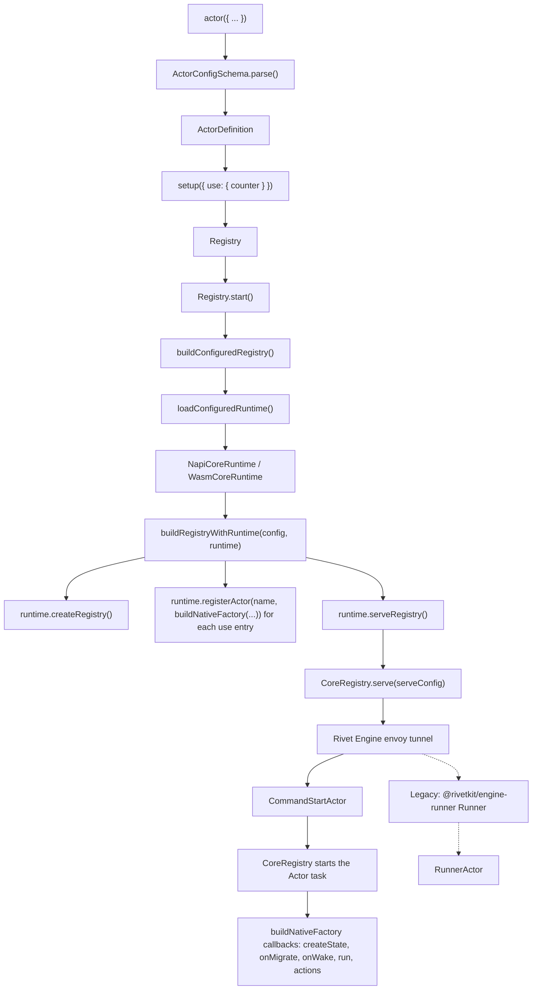
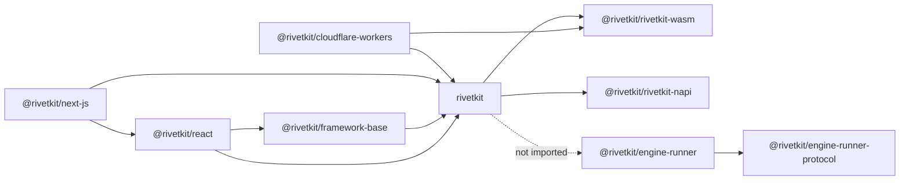
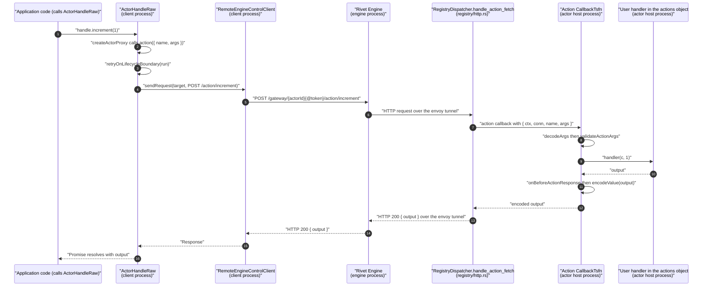
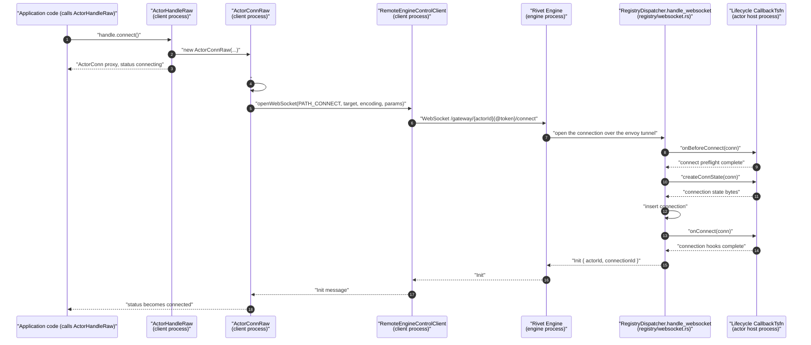
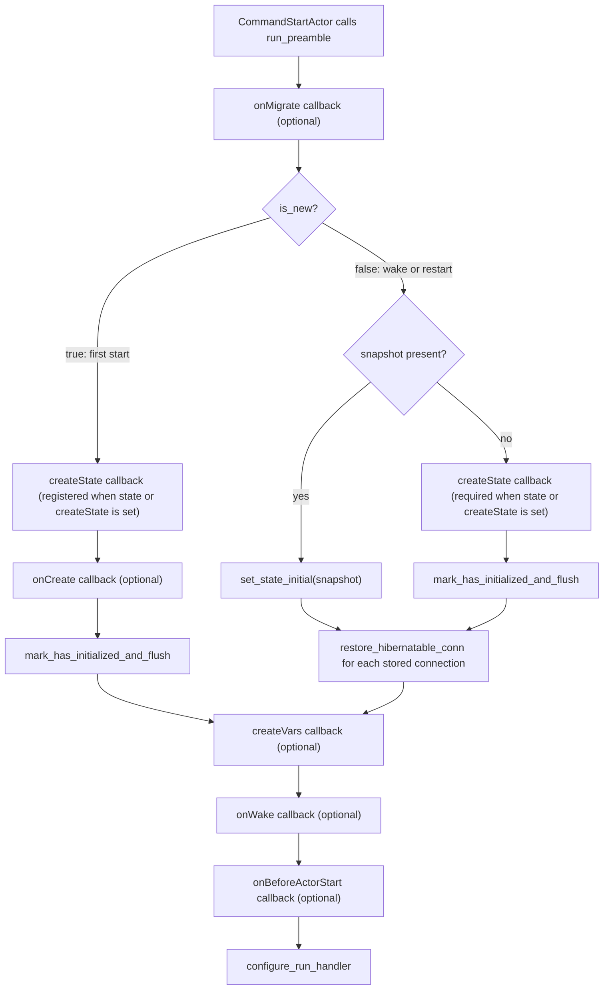

# 11 RivetKit for TypeScript

RivetKit for TypeScript turns an Actor definition into a running Actor and gives each client a typed handle to call it. The package is the developer-facing part of Rivet. The developer writes one object with `actor({...})`. The object holds actions, state, an optional embedded database, queues, and lifecycle hooks. The database is SQLite, which uses Structured Query Language (SQL). A registry then binds that object to a name. The runtime sends the name and the configuration to the Rivet Engine. The Engine starts an Actor task. A client uses a typed handle to send an action request to the same Actor. This document follows both directions: from the definition down to the Actor task, and from the client call down to the Engine gateway. Section 11.3 describes the last hop on the Actor side, the Engine-to-Actor tunnel. The source is commit `4a58441c50d1ce20d8803cfb1ab7c3285a5141d6`, version 2.3.31.

The document has two runtime paths in scope. The newer path uses the native runtime in `registry/native.ts` with the Node-API (N-API) addon or the WebAssembly (Wasm) binding. The legacy path uses the standalone `@rivetkit/engine-runner` package. The `rivetkit` package does not import `@rivetkit/engine-runner` in this commit. Each section states which path it describes when the difference matters.

## 1. The subsystem in one page

The TypeScript package has five layers. Each layer has a small public surface.

| Layer | Main symbol | Input | Output | Source |
|---|---|---|---|---|
| Definition | `actor()` | `ActorConfigInput` | `ActorDefinition` | `rivetkit-typescript/packages/rivetkit/src/actor/definition.ts:149-218` |
| Registry | `setup()` | `{ use: { name: definition } }` | `Registry` | `rivetkit-typescript/packages/rivetkit/src/registry/index.ts:1058-1062` |
| Runtime bridge | `buildConfiguredRegistry()` | `RegistryConfig` | `{ runtime, registry, serveConfig }` | `rivetkit-typescript/packages/rivetkit/src/registry/native.ts:5710-5720` |
| Client | `createClient()` | endpoint or config | `Client<Registry>` | `rivetkit-typescript/packages/rivetkit/src/client/mod.ts:65-85` |
| Framework | `createRivetKit()` | client input | `{ useActor }` | `rivetkit-typescript/packages/react/src/mod.ts:47-55` |

The definition layer does three jobs before it returns. It validates the input with `ActorConfigSchema.parse`. It walks the action tree and validates the dot-separated wire names. It creates a thin `ActorDefinition` object that holds the parsed config. The registry layer keeps the definition map. The runtime bridge creates one `ActorFactoryHandle` for each definition. That object is the native factory for the definition. It holds the native actor config and the JavaScript callbacks for state, lifecycle, actions, queues, and schedules (`registry/native.ts:4061-4065`). The bridge then gives the whole map to the native core. The native core is the Rust crate `rivetkit-core` (`rivetkit-rust/packages/rivetkit-core/Cargo.toml:1-2`). The core owns the Actor lifecycle after that point.

In the prose, a short path means a file under `rivetkit-typescript/packages/rivetkit/src/`. The short path can name the file only (`serde.ts`), one directory and the file (`test/ready.ts`), or the file with its usual directory implied (`config.ts` means `actor/config.ts`). A path that starts with a package directory, such as `react/src/mod.ts`, means `rivetkit-typescript/packages/react/src/mod.ts`. A Rust path such as `actor/sleep.rs` or `registry/http.rs` starts at `rivetkit-rust/packages/rivetkit-core/src/`. Every fenced code block gives the full path from the repository root.

The client layer never imports a definition at run time. It imports the TypeScript type of the registry. The type gives the client the actor names, action signatures, queue names, and event names. The runtime behaviour is a proxy over Hypertext Transfer Protocol (HTTP) and WebSocket calls.



The solid path is the native runtime. The dashed path is the legacy runner. Both paths end at the same Engine command. The actor task differs. The native core runs the Actor inside Rust. The legacy runner keeps a `RunnerActor` in the Node.js or Bun process. The runtime loads first, then `buildRegistryWithRuntime` receives it as an argument (`registry/native.ts:5659-5696`).

## 2. The package map

The workspace `rivetkit-typescript/packages/` holds eighteen packages. The table lists the packages that this exploration covers. The package name on npm comes from each `package.json`. npm is the Node.js package manager.

| Directory | npm name | Purpose | Depends on |
|---|---|---|---|
| `rivetkit` | `rivetkit` | Actor definitions, registry, client, database, engine client, serverless handler | `@rivetkit/on-change`, `@rivetkit/rivetkit-napi`, `@rivetkit/rivetkit-wasm`, `hono`, `zod` |
| `engine-runner` | `@rivetkit/engine-runner` | Legacy standalone runner. Connects to the Engine, receives `CommandStartActor`, hosts `RunnerActor` | `@rivetkit/engine-runner-protocol` |
| `engine-runner-protocol` | `@rivetkit/engine-runner-protocol` | Generated Binary Application Record Encoding (Bare) protocol types for the runner tunnel | `@rivetkit/bare-ts` |
| `react` | `@rivetkit/react` | React hooks. Exports `createRivetKit` and `useActor` | `@rivetkit/framework-base`, `@tanstack/react-store`, `rivetkit` |
| `next-js` | `@rivetkit/next-js` | Next.js route handlers and client re-export | `@rivetkit/react`, `hono`, `rivetkit` |
| `framework-base` | `@rivetkit/framework-base` | Framework-independent Actor store and connection cache | `@tanstack/store`, `fast-deep-equal`, `rivetkit` |
| `devtools` | `@rivetkit/devtools` | Browser development tools for the Inspector, the development console for Actor state and actions | `react`, `@floating-ui/react`, `motion` |
| `cli` | `@rivetkit/cli` | Rivet Cloud command line interface | No `dependencies` entries |
| `rivetkit-napi` | `@rivetkit/rivetkit-napi` | Native addon. Provides the envoy client and SQLite access | Rust crate |
| `rivetkit-wasm` | `@rivetkit/rivetkit-wasm` | WebAssembly binding for edge JavaScript runtimes | Rust crate |
| `mcp-hub` | `@rivetkit/mcp-hub` | Statically generated Model Context Protocol (MCP) server for the Rivet documentation | `@modelcontextprotocol/sdk`, `zod` |
| `workflow-engine` | `@rivetkit/workflow-engine` | Durable workflow engine with reentrant execution | `@rivetkit/bare-ts`, `vbare`, `cbor-x`, `fdb-tuple`, `pino` |
| `effect` | `@rivetkit/effect` | Software development kit (SDK) for the Effect framework | No `dependencies` entries |
| `supabase` | `@rivetkit/supabase` | Supabase Edge Functions integration | `@rivetkit/rivetkit-wasm`, `cbor-x`, `pino` |
| `sql-loader` | `@rivetkit/sql-loader` | SQL file loader and migration utility | No `dependencies` entries |
| `traces` | `@rivetkit/traces` | Trace storage and OpenTelemetry Protocol (OTLP) export | `@rivetkit/bare-ts`, `vbare`, `cbor-x`, `fdb-tuple` |
| `cloudflare-workers` | `@rivetkit/cloudflare-workers` | Cloudflare Workers handler over the Wasm runtime | `@rivetkit/rivetkit-wasm`, `rivetkit` |
| `engine-cli` | `@rivetkit/engine-cli` | Rivet Engine binary as platform-specific npm packages | binary assets |

The package descriptions come from each `package.json`. `engine-runner`, `engine-runner-protocol`, and `mcp-hub` have no description field. Their purpose comes from their source and README.

Two facts matter for the rest of the document.

1. `rivetkit` does not depend on `@rivetkit/engine-runner`. The runtime bridge in `rivetkit` uses `loadConfiguredRuntime` and the core registry directly.
2. `@rivetkit/react` does not export a hook named `useActorState`. The name `UseActorState` exists as a TypeScript return type in `react/src/mod.ts:31-45`. The public hook is `useActor`.



Diagram legend: a solid arrow means a package dependency. A dotted arrow means the source has no run-time import. The dotted edge is important. A reader may expect the SDK to use its own runner package. It does not in this commit. The `rivetkit` package depends on both `@rivetkit/rivetkit-napi` and `@rivetkit/rivetkit-wasm` (`rivetkit/package.json`). The native runtime loads the first package. The Wasm runtime loads the second package.

The package table uses two binary formats. Bare is the Binary Application Record Encoding, a schema-driven binary format. The `@rivetkit/bare-ts` package generates its encoders from a `.bare` schema. Concise Binary Object Representation (CBOR) is a self-describing binary format. The `cbor-x` package encodes and decodes it. Section 8.7 explains where each format appears.

## 3. The Actor definition

The `actor()` function is a thin constructor. It does not start anything. It parses and checks the config, then returns an `ActorDefinition` wrapper.

```ts
// rivetkit-typescript/packages/rivetkit/src/actor/definition.ts:149-218
export function actor<
	TState,
	TConnParams,
	TConnState,
	TVars,
	TInput,
	TDatabase extends AnyDatabaseProvider,
	TEvents extends EventSchemaConfig = Record<never, never>,
	TQueues extends QueueSchemaConfig = Record<never, never>,
	TActions extends Actions<
		TState,
		TConnParams,
		TConnState,
		TVars,
		TInput,
		TDatabase,
		TEvents,
		TQueues
	> = Actions<
		TState,
		TConnParams,
		TConnState,
		TVars,
		TInput,
		TDatabase,
		TEvents,
		TQueues
	>,
>(
	input: ActorConfigInput<
		TState,
		TConnParams,
		TConnState,
		TVars,
		TInput,
		TDatabase,
		TEvents,
		TQueues,
		TActions
	>,
): ActorDefinition<
	TState,
	TConnParams,
	TConnState,
	TVars,
	TInput,
	TDatabase,
	TEvents,
	TQueues,
	TActions
> {
	warnDeprecatedOptionKeys(
		(input as { options?: unknown } | undefined)?.options,
	);
	const config = ActorConfigSchema.parse(input) as ActorConfig<
		TState,
		TConnParams,
		TConnState,
		TVars,
		TInput,
		TDatabase,
		TEvents,
		TQueues,
		TActions
	>;
	flattenActionHandlers(config.actions);
	flattenActionInputSchemas(config.actions, config.actionInputSchemas);
	flattenActionTraceSamplers(config.actions, config.tracing?.actions);
	return new ActorDefinition(config);
}
```

The generic list is large because the config is inferred from the object literal. The parser returns the same structure with defaults filled in. Each `flatten*` function is a pure walk over the action tree. `flattenActionHandlers` returns `Record<string, RuntimeActionHandler>` (`actor/actions.ts:6-17`). `flattenActionInputSchemas` returns `Record<string, PrimitiveSchema> | undefined` (`actor/actions.ts:19-48`). `flattenActionTraceSamplers` returns `Record<string, number>` (`actor/actions.ts:55-69`). The three calls at `actor/definition.ts:214-216` discard these return values. They only validate that the action tree is well formed, and they throw early on a conflict. `ActorDefinition` stores the parsed config and does not cache a flat map.

The native path flattens the tree again. `buildActorConfig` calls `flattenActionHandlers` to produce the action name list (`registry/native.ts:3964-3966`). `buildNativeFactory` calls `flattenActionHandlers` and `flattenActionInputSchemas` again to produce the handler map and the validation config (`registry/native.ts:4071-4076`). Each call allocates a new record. The core receives only the action names. The JavaScript factory keeps the handler map.

`ActorDefinition` stores the config in a private field and exposes a read-only getter. The class has no other behaviour. The registry and the runtime read `definition.config` directly.

### 3.1 Every config field

`ActorConfigSchema` is a strict object. An unknown top-level key is an error. The schema has three refinements. They forbid `state` with `createState`, `connState` with `createConnState`, and `vars` with `createVars`.

```ts
// rivetkit-typescript/packages/rivetkit/src/actor/config.ts:1352-1414
export const ActorConfigSchema = z
	.object({
		onCreate: zFunction().optional(),
		onDestroy: zFunction().optional(),
		onMigrate: zFunction().optional(),
		onWake: zFunction().optional(),
		onSleep: zFunction().optional(),
		run: zRunHandler,
		onStateChange: zFunction().optional(),
		onBeforeConnect: zFunction().optional(),
		onConnect: zFunction().optional(),
		onDisconnect: zFunction().optional(),
		onBeforeActionResponse: zFunction().optional(),
		onRequest: zFunction().optional(),
		onWebSocket: zFunction().optional(),
		actions: zActionTree.default(() => ({})),
		actionInputSchemas: z.record(z.string(), z.any()).optional(),
		tracing: z
			.object({
				sampler: zSampleRate.optional(),
				actions: zActionSampleRates.optional(),
			})
			.strict()
			.optional(),
		connParamsSchema: z.any().optional(),
		events: z.record(z.string(), z.any()).optional(),
		queues: z.record(z.string(), z.any()).optional(),
		state: z.any().optional(),
		createState: zFunction().optional(),
		connState: z.any().optional(),
		createConnState: zFunction().optional(),
		vars: z.any().optional(),
		db: z.any().optional(),
		createVars: zFunction().optional(),
		options: ActorOptionsSchema,
		inspector: ActorInspectorConfigSchema.optional(),
	})
	.strict()
	.refine(
		(data) => !(data.state !== undefined && data.createState !== undefined),
		{
			message: "Cannot define both 'state' and 'createState'",
			path: ["state"],
		},
	)
	.refine(
		(data) =>
			!(
				data.connState !== undefined &&
				data.createConnState !== undefined
			),
		{
			message: "Cannot define both 'connState' and 'createConnState'",
			path: ["connState"],
		},
	)
	.refine(
		(data) => !(data.vars !== undefined && data.createVars !== undefined),
		{
			message: "Cannot define both 'vars' and 'createVars'",
			path: ["vars"],
		},
	);
```

`run` is optional. The schema constant is `zRunHandler`, defined as `z.union([zFunction(), RunConfigSchema]).optional()` at `config.ts:1190`. The `run` field can be a function or an object with a `run` function and Inspector metadata.

The table gives the type and the purpose of each field.

| Field | Type | Purpose |
|---|---|---|
| `onCreate` | `(c: CreateContext, input: TInput) => void \| Promise<void>` | Runs once when the Actor is created. |
| `onDestroy` | `(c: DestroyContext) => void \| Promise<void>` | Runs when the Actor is destroyed. |
| `onMigrate` | `(c: MigrateContext, isNew: boolean) => void \| Promise<void>` | Actor lifecycle hook. Runs on every Actor start after the database provider migration and before `onWake`. Section 6.3 gives the order. |
| `onWake` | `(c: WakeContext) => void \| Promise<void>` | Runs when the Actor is ready. |
| `onSleep` | `(c: SleepContext) => void \| Promise<void>` | Runs before the Actor sleeps. |
| `run` | `(c: RunContext) => void \| Promise<void>`, or `RunConfig` | Long-running background function. |
| `onStateChange` | `(c: StateChangeContext, newState: TState) => void` | Runs after a state change is saved. |
| `onBeforeConnect` | `(c: BeforeConnectContext, params: TConnParams) => void \| Promise<void>` | Checks or transforms connection parameters. |
| `onConnect` | `(c: ConnectContext, conn: Conn) => void \| Promise<void>` | Runs when a client connection opens. |
| `onDisconnect` | `(c: DisconnectContext, conn: Conn) => void \| Promise<void>` | Runs when a client connection closes. |
| `onBeforeActionResponse` | `(c, name: string, args: unknown[], output: Out) => Out \| Promise<Out>` | Rewrites an action result before the reply. |
| `onRequest` | `(c: RequestContext, request: Request) => Response \| Promise<Response>` | Handles raw HTTP under `/actors/{name}/http/*`. |
| `onWebSocket` | `(c: WebSocketContext, websocket: UniversalWebSocket) => void \| Promise<void>` | Handles raw WebSocket under `/actors/{name}/websocket/*`. |
| `actions` | `Actions<...>` | Action handlers, possibly nested. Default `{}`. |
| `actionInputSchemas` | `ActionInputSchemas` | Optional schema for each action argument list. |
| `tracing` | `{ sampler?, actions? }` | Sample rates for traces. |
| `connParamsSchema` | `unknown` | Schema for connection parameters. |
| `events` | `EventSchemaConfig` | Event declarations made with `event<T>()`. |
| `queues` | `QueueSchemaConfig` | Queue declarations made with `queue<T>()`. |
| `state` | `TState` | Static initial state. |
| `createState` | `(c, input: TInput) => TState` | Dynamic initial state. |
| `connState` | `TConnState` | Static initial state for each connection. |
| `createConnState` | `(c, params) => TConnState` | Dynamic state for each connection. |
| `vars` | `TVars` | Non-durable in-process variables. |
| `db` | `AnyDatabaseProvider` | Database provider from `db(...)`. |
| `createVars` | `(c) => TVars` | Dynamic non-durable variables. |
| `options` | `ActorOptions` | Timeouts, limits, and runtime flags. |
| `inspector` | `ActorInspectorConfig` | Custom Inspector tabs. |

The difference between `state` and `vars` is durability. The runtime saves `state`. The runtime never saves `vars`. `vars` lives only in the JavaScript process. The source shows this: `buildActorConfig` sets `hasState` from `state` or `createState` only (`registry/native.ts:3924-3926`).

The hook context types are aliases of the main context types. They add no fields of their own except the input type on `CreateContext`.

| Context type | Alias of | Extra value |
|---|---|---|
| `CreateContext` | `ActorContext` (`config.ts:605-620`) | State input `TInput` |
| `MigrateContext` | `WakeContext` (`config.ts:770-789`) | None |
| `WakeContext` | `RunContext` (`config.ts:750-768`) | None |
| `SleepContext` | `RunContext` (`config.ts:710-728`) | None |
| `DestroyContext` | `ActorContext` (`config.ts:630-648`) | None |

### 3.2 The options block and its defaults

`ActorOptionsSchema` merges a global part and an instance part. The global part has four fields. The instance part has the timeouts and limits.

```ts
// rivetkit-typescript/packages/rivetkit/src/actor/config.ts:1293-1327
const InstanceActorOptionsBaseSchema = z
	.object({
		createVarsTimeout: z.number().positive().default(5000),
		createConnStateTimeout: z.number().positive().default(5000),
		onBeforeConnectTimeout: z.number().positive().default(5000),
		onConnectTimeout: z.number().positive().default(5000),
		onMigrateTimeout: z.number().positive().default(30_000),
		sleepGracePeriod: z
			.number()
			.positive()
			.default(DEFAULT_SLEEP_GRACE_PERIOD),
		/** @deprecated `onDestroyTimeout` is folded into `sleepGracePeriod`, which now bounds the entire graceful shutdown window for both sleep and destroy. Will be removed in 2.2.0. */
		onDestroyTimeout: z.number().positive().optional(),
		/** @deprecated `waitUntilTimeout` is folded into `sleepGracePeriod`, which now bounds the entire graceful shutdown window for both sleep and destroy. Will be removed in 2.2.0. */
		waitUntilTimeout: z.number().positive().optional(),
		stateSaveInterval: z.number().positive().default(1_000),
		actionTimeout: z.number().positive().default(60_000),
		connectionLivenessTimeout: z.number().positive().default(2500),
		connectionLivenessInterval: z.number().positive().default(5000),
		/** @deprecated Use `c.keepAwake(promise)` to scope keep-awake to a specific operation, or keep `noSleep` for actors that must stay awake indefinitely. Will be removed in 2.2.0. */
		noSleep: z.boolean().default(false),
		sleepTimeout: z.number().positive().default(30_000),
		maxQueueSize: z.number().positive().default(1000),
		/** Maximum pending one-shot and recurring schedules. */
		maxSchedules: z.number().int().nonnegative().default(1000),
		maxQueueMessageSize: z
			.number()
			.positive()
			.default(64 * 1024),
		/** @deprecated Internal storage moved to SQLite and no longer uses KV preloading, so this option is ignored. Will be removed in 2.2.0. */
		preloadMaxWorkflowBytes: z.number().nonnegative().optional(),
		/** @deprecated Internal storage moved to SQLite and no longer uses KV preloading, so this option is ignored. Will be removed in 2.2.0. */
		preloadMaxConnectionsBytes: z.number().nonnegative().optional(),
	})
	.strict();
```

`DEFAULT_SLEEP_GRACE_PERIOD` is `15_000` milliseconds (`config.ts:21`). The global part adds `name`, `icon`, `enableActorRuntimeSocket` (default `false`), and `canHibernateWebSocket` (default `false`, or a function of the request) at `config.ts:1265-1284`.

Two terms in these options need a definition. Hibernation is the behaviour where the core keeps a connection record while the Actor process is not active. A hibernatable WebSocket connection survives a sleep cycle and moves to the new Actor instance without a client reconnect (`config.ts:1273-1282`; `docs/actors/content/docs/lifecycle.mdx:338-342`). KV means key-value storage. It is the older internal store, but some core data still uses it. The runtime keeps state, queues, schedules, workflow data, and connection records in SQLite (`rivetkit-rust/packages/rivetkit-core/src/actor/internal_storage/schema.rs:44-153`). The runtime ignores the KV preload options (`actor/config.ts:1322-1325`).

The runtime copies each option to a native field. `buildActorConfig` at `registry/native.ts:3899-3969` maps `stateSaveInterval` to `stateSaveIntervalMs`, `sleepGracePeriod` to `sleepGracePeriodMs`, and so on. The native core applies the timeout. The JavaScript layer does not run its own timer for these values.

Two timeouts control sleep. `sleepTimeout` is the idle window that starts sleep. Its default is 30,000 milliseconds (`config.ts:1314`). `sleepGracePeriod` is the shutdown window after sleep or destroy starts. Its default is 15,000 milliseconds (`config.ts:21`). `sleepGracePeriod` does not delay the idle check.

The core starts the idle timer only when `can_sleep()` returns yes (`actor/sleep.rs:297-350`). The predicate requires no active HTTP request, no active non-hibernatable connection, no active `run` handler, no `keepAwake` promise, no pending disconnect, and no running WebSocket callback (`actor/sleep.rs:283-295`). The timer sleeps for `sleep_timeout`, then checks the predicate again before it requests sleep. Any activity that changes a predicate input calls `reset_sleep_timer` (`actor/sleep.rs:37-63`). The reset cancels the old timer and starts a new one. The documentation states the same rule: any activity resets the timer (`docs/actors/content/docs/lifecycle.mdx:249-262`).

### 3.3 State creation

The parser forbids `state` and `createState` together. The runtime handles them differently.

- For static `state`, the `createState` callback uses `structuredClone(config.state)` (`registry/native.ts:4648-4649`). Each new Actor gets its own copy.
- For `createState`, the callback calls the user function with the decoded input (`registry/native.ts:4650-4653`).
- Both paths then call `actorCtx.initializeState(state)` and return the encoded bytes (`registry/native.ts:4658-4659`).

`createState` receives `TInput`. The input comes from the create request. `ClientRaw.create` passes `opts.input` into the `create` query (`client/client.ts:372-379`). `getOrCreate` passes `opts.createWithInput` into `getOrCreateForKey` (`client/client.ts:335-343`). The engine stores the input and sends it to the runner on every start.

### 3.4 Connection state and variables

`createConnState` runs for each connection. It receives the connection handle and the decoded parameters (`registry/native.ts:4895-4949`). `createConnStateTimeout` defaults to 5000 milliseconds. The connection state is saved with the Actor state. The `Conn` object exposes `id`, `params`, `state`, `isHibernatable`, `send`, and `disconnect` (`config.ts:367-384`).

`createVars` creates ephemeral values for the Actor (`config.ts:2363-2369`). The values are not durable. The serialized state does not contain them. `vars` is useful for database handles, timers, and other objects that cannot be serialized. The native core never receives the values.

### 3.5 The connection lifecycle for an action and a connection

An action over HTTP also creates a connection. The connection is temporary and it runs the same connection hooks. The core handles an HTTP action in `handle_http_action` (`registry/http.rs:195-257`).

1. The core decodes the argument list and the connection parameters (`registry/http.rs:205-226`).
2. The core calls `connect_conn_with_request` (`registry/http.rs:227-243`).
3. The connection preflight runs `onBeforeConnect`, then `createConnState` (`rivetkit-napi/src/napi_actor_events.rs:565-605`).
4. The core inserts the connection and runs `onConnect` (`actor/connection.rs:731-745`).
5. The core dispatches the action with the connection handle (`registry/http.rs:246-256`).
6. The core disconnects after the response, and `onDisconnect` runs (`registry/http.rs:257`; `actor/connection.rs:878`).

A WebSocket connection uses the same preflight and open hooks (`registry/websocket.rs:164-181`). The connection stays open until the client closes it or the Actor sleeps. The table compares the two cases.

| Property | Action over HTTP | WebSocket connection |
|---|---|---|
| Connection object | Temporary, one per action call | Long-lived, one per `connect()` call |
| `onBeforeConnect` | Runs | Runs |
| `createConnState` | Runs | Runs |
| `onConnect` | Runs | Runs |
| `onDisconnect` | Runs after the response | Runs when the socket closes |
| `c.conn.id` | The temporary connection identifier | The connection identifier |

The connection identifier is a Universally Unique Identifier version 4 (UUID v4) string. The core creates it with `Uuid::new_v4().to_string()` (`actor/connection.rs:718-719`). The identifier names the connection, not the Actor. The Actor identifier is a separate value.

## 4. Actions and wire names

An action is a function on the `actions` object. The handler receives the Actor context as the first argument and the client arguments after it. The return value is the action output.

```ts
// rivetkit-typescript/packages/rivetkit/src/actor/config.ts:1511-1549
export interface Actions<
	TState,
	TConnParams,
	TConnState,
	TVars,
	TInput,
	TDatabase extends AnyDatabaseProvider,
	TEvents extends EventSchemaConfig = Record<never, never>,
	TQueues extends QueueSchemaConfig = Record<never, never>,
> {
	[Action: string]:
		| ((
				c: ActionContext<
					TState,
					TConnParams,
					TConnState,
					TVars,
					TInput,
					TDatabase,
					TEvents,
					TQueues
				>,
				...args: any[]
		  ) => any)
		| Actions<
				TState,
				TConnParams,
				TConnState,
				TVars,
				TInput,
				TDatabase,
				TEvents,
				TQueues
		  >;
}

export interface ActionInputSchemas {
	[Action: string]: PrimitiveSchema | ActionInputSchemas;
}
```

`ActionContext` is `ActorContext` plus a `conn` field. The server always calls an action with a connection context in the native path. The handler can read `c.conn.id` and `c.conn.state`.

### 4.1 Flattening the tree

A group of actions can be nested. The runtime flattens the tree to one flat record. A nested path becomes a dot-separated name.

The definition calls three flatten functions and discards their return values (`actor/definition.ts:214-216`). Each function returns a new flat record: handlers (`actions.ts:6-17`), input schemas (`actions.ts:19-48`), and trace samplers (`actions.ts:55-69`). The calls still have two effects. They validate duplicate names and schema conflicts. They throw on a bad path. `ActorDefinition` stores only the original config (`definition.ts:217`). The runtime builds the flat handler map again in `buildActorConfig` (`registry/native.ts:3964-3966`).

```ts
// rivetkit-typescript/packages/rivetkit/src/actor/actions.ts:98-129
function visitActionGroup(
	value: unknown,
	path: string[],
	entries: ActionEntry[],
	names: Set<string>,
) {
	if (!isRecord(value)) {
		throw new TypeError(
			`${formatActionPath(path)} must be an action handler or group`,
		);
	}

	for (const [segment, child] of Object.entries(value)) {
		const childPath = [...path, segment];
		if (typeof child === "function") {
			const name = childPath.join(".");
			if (names.has(name)) {
				throw new TypeError(
					`Multiple action definitions flatten to \`${name}\``,
				);
			}
			names.add(name);
			entries.push({
				name,
				path: childPath,
				handler: child as RuntimeActionHandler,
			});
		} else {
			visitActionGroup(child, childPath, entries, names);
		}
	}
}
```

The flattening has three effects.

1. `actions: { billing: { charge: fn } }` becomes the wire name `billing.charge`.
2. A duplicate wire name is a construction error. The message is `Multiple action definitions flatten to \`${name}\``.
3. The client proxy builds the same name from property access. `handle.billing.charge(10)` calls `handle.action({ name: "billing.charge", args: [10] })` (`client/client.ts:572-586`).

The native core receives the flat list in `buildActorConfig`: `actions: Object.keys(flattenActionHandlers(config.actions)).sort().map((name) => ({ name }))` (`registry/native.ts:3964-3966`). The handler map is separate. The core uses the list for routing and Inspector display. The JavaScript factory uses the handler map for execution.

### 4.2 Input validation

`actionInputSchemas` is optional. A schema can use the Standard Schema interface. Standard Schema is a shared validation contract with a `~standard` property and a `validate(data)` method (`actor/schema.ts:122-124`, `:243-251`). The package `@standard-schema/spec` defines the contract (`package.json:240`). `flattenActionInputSchemas` accepts a nested path or a dotted key. It rejects a schema that appears in both forms with different values (`actions.ts:32-40`).

At call time, the runtime calls `validateActionArgs(schemaConfig.actionInputSchemas, name, decodeArgs(args))` (`registry/native.ts:5431-5435`). A failed validation throws before the handler runs. The action error then travels as an `Error` message with a group and a code.

### 4.3 Return values and errors

The handler return value is encoded with `encodeValue`, then sent as an `ActionResponse`. A thrown `RivetError` keeps its group and code. A thrown `UserError` has group `user` and code `user_error`. A thrown plain `Error` becomes an internal Actor error. Section 14 lists the classes.

`onBeforeActionResponse` runs after the handler and before the reply. The signature is `<Out>(c, name, args, output) => Out | Promise<Out>` (`config.ts:1848-1862`). It can replace the output. It cannot change the action name.

### 4.4 A complete example and its registration

The smallest complete example is `examples/hello-world`. The file defines the Actor, registers it, and starts the server.

```ts
// examples/hello-world/src/index.ts:1-30
import { actor, event, setup } from "rivetkit";

export const counter = actor({
	// Persistent state that survives restarts: https://rivet.dev/docs/actors/state
	state: {
		count: 0,
	},
	events: {
		newCount: event<number>(),
	},

	actions: {
		// Callable functions from clients: https://rivet.dev/docs/actors/actions
		increment: (c, amount: number) => {
			c.state.count += amount;
			// Send events to all connected clients: https://rivet.dev/docs/actors/events
			c.broadcast("newCount", c.state.count);
			return c.state.count;
		},

		getCount: (c) => c.state.count,
	},
});

// Register actors and start the server: https://rivet.dev/docs/setup
export const registry = setup({
	use: { counter },
});

registry.start();
```

This example uses four features. `state` declares durable state. `events` declares the `newCount` event. `actions.increment` changes state, sends an event, and returns the new count. `setup({ use: { counter } })` binds the name `counter` to the definition.

The name in `use` is the Actor name on the wire. The client type derives from the same object. `client.counter.getOrCreate(["default"])` uses the property name `counter`.

The React frontend calls the Actor through a connection.

```tsx
// examples/hello-world/frontend/App.tsx:1-30
import { createRivetKit } from "@rivetkit/react";
import { useEffect, useState } from "react";
import type { registry } from "../src/index.ts";

const { useActor } = createRivetKit<typeof registry>("http://localhost:6420");

export function App() {
	const [counterId, setCounterId] = useState("default");
	const [count, setCount] = useState<number>(0);

	const counter = useActor({
		name: "counter",
		key: [counterId],
	});

	useEffect(() => {
		if (counter.connection) {
			counter.connection.getCount().then(setCount);
		}
	}, [counter.connection]);

	counter.useEvent("newCount", (newCount: number) => {
		setCount(newCount);
	});

	const increment = async (amount: number) => {
		if (counter.connection) {
			await counter.connection.increment(amount);
		}
	};
```

The example shows the intended state pattern. The client reads the initial value with the `getCount` action. It receives later values through the `newCount` event. It does not receive automatic state snapshots. Section 5.5 explains the mechanism and its cost.

## 5. State, persistence, and snapshots

`c.state` is a write-through proxy. A read returns a proxy over the current state object. A write updates the underlying object and schedules a save.

```ts
// rivetkit-typescript/packages/rivetkit/src/registry/native.ts:2833-2876
	get state(): unknown {
		if (!this.#stateEnabled) {
			throw stateNotEnabledError();
		}
		const nextState = this.#readState();
		// Reading `c.state` rebuilds the deep write-through proxy, which
		// allocates fresh on-change caches and rewraps the whole tree. Memoize
		// the proxy keyed on the underlying state object so repeated reads and
		// deep read cascades reuse a single proxy.
		if (
			this.#stateProxy === undefined ||
			this.#stateProxyTarget !== nextState
		) {
			const assertCurrentState = () => {
				this.#assertCanMutateState();
				if (this.#readState() !== nextState) {
					throw stateTransactionConflictError();
				}
			};
			this.#stateProxyTarget = nextState;
			this.#stateProxy = createWriteThroughProxy(
				nextState,
				(nextValue) => {
					assertCurrentState();
					this.#writeState(nextValue, { scheduleSave: true });
				},
				(newValue) => {
					assertCurrentState();
					assertJsonCompatValue(newValue);
				},
			);
		}
		return this.#stateProxy;
	}

	set state(value: unknown) {
		if (!this.#stateEnabled) {
			throw stateNotEnabledError();
		}
		this.#assertCanMutateState();
		const nextValue = unwrapWriteThroughProxy(value);
		assertJsonCompatValue(nextValue);
		this.#writeState(nextValue, { scheduleSave: true });
	}
```

The proxy comes from `@rivetkit/on-change` through `createWriteThroughProxy` (`registry/write-through-proxy.ts:1-141`). The commit callback runs after each write. The proxy also calls `unwrapWriteThroughProxy` before assignment. That call removes nested proxies. The comment in `write-through-proxy.ts` says this avoids exponential degradation.

If the definition has no state, every access throws `stateNotEnabledError()`. A handler must not read `c.state` in that case.

### 5.1 When a save happens

A write does not save immediately. `#writeState` updates the in-memory state and calls `#scheduleSave` when `scheduleSave` is true. The source comment in the next block writes N-API as `NAPI`.

```ts
// rivetkit-typescript/packages/rivetkit/src/registry/native.ts:3573-3649
	// Coalesce the request-save and onStateChange work to once per event loop
	// tick. A synchronous burst of mutations (for example
	// `Object.assign(c.state, ...)`) would otherwise cross the NAPI boundary and
	// run onStateChange once per field, re-serializing the whole state each time
	// and pinning the event loop on large state.
	#scheduleSave(): void {
		const actorState = getNativePersistState(this.#runtime, this.#ctx);
		if (actorState.saveScheduled) {
			return;
		}
		actorState.saveScheduled = true;
		actorState.pendingSaveHandle = setImmediate(() => {
			this.#flushStateChange();
		});
	}

	#flushStateChange(): void {
		const actorState = getNativePersistState(this.#runtime, this.#ctx);
		if (!actorState.saveScheduled) {
			return;
		}
		if (actorState.activeStateTransactionOwner !== undefined) {
			actorState.saveScheduled = false;
			if (actorState.pendingSaveHandle !== undefined) {
				clearImmediate(actorState.pendingSaveHandle);
				actorState.pendingSaveHandle = undefined;
			}
			actorState.stateTransactionSaveDeferred = true;
			return;
		}
		actorState.saveScheduled = false;
		if (actorState.pendingSaveHandle !== undefined) {
			clearImmediate(actorState.pendingSaveHandle);
			actorState.pendingSaveHandle = undefined;
		}

		callNativeSync(() =>
			this.#runtime.actorRequestSave(this.#ctx, { immediate: false }),
		);

		if (!this.#onStateChange) {
			return;
		}

		actorState.isInOnStateChange = true;
		callNativeSync(() => this.#runtime.actorBeginOnStateChange(this.#ctx));
		let shouldFinish = true;
		try {
			const result = this.#onStateChange(
				this,
				actorState.state,
			) as unknown;
			if (isPromiseLike(result)) {
				shouldFinish = false;
				void Promise.resolve(result)
					.catch((error) => {
						logger().error({
							msg: "error in `onStateChange`",
							error,
						});
					})
					.finally(() => {
						actorState.isInOnStateChange = false;
						callNativeSync(() =>
							this.#runtime.actorEndOnStateChange(this.#ctx),
						);
					});
			}
		} finally {
			if (shouldFinish) {
				actorState.isInOnStateChange = false;
				callNativeSync(() =>
					this.#runtime.actorEndOnStateChange(this.#ctx),
				);
			}
		}
	}
```

The excerpt has two exit paths. The first exit is an early return. It runs when a state transaction owns the state (`native.ts:3594-3602`). The method clears the scheduled handle and sets `stateTransactionSaveDeferred` to true. The transaction end path must then flush the deferred save. The method does not call `actorRequestSave`.

The second exit is the normal path. It calls `actorRequestSave`, then `actorBeginOnStateChange`. If `onStateChange` is absent, the method returns after the save request (`native.ts:3613-3615`). If the hook returns a promise, the `finally` block does not finish the hook. The promise `.finally()` clears `isInOnStateChange` and calls `actorEndOnStateChange` (`native.ts:3625-3639`). If the hook returns a plain value, the outer `finally` does the same work (`native.ts:3641-3647`). A hook error is logged and does not fail the action.

The coalescing is per event-loop tick. Many writes in one synchronous block produce one `actorRequestSave`. The native core then serializes the state. The save is still asynchronous. The core decides when the bytes reach durable storage.

A handler can force a save with `c.saveState()`.

- `saveState({ immediate: true })` calls `actorRequestSaveAndWait` and waits for the save request (`native.ts:3306-3313`).
- `saveState({ maxWait: n })` calls `actorRequestSave` with `maxWaitMs` and returns at once (`native.ts:3316-3322`). `maxWait` is a core-side deadline, not a caller wait. The core throttles saves with a normal delay. It sets the save deadline to the earlier of the throttled deadline and `now + n` (`rivetkit-rust/packages/rivetkit-core/src/actor/state.rs:553-567`). The `maxWait` form does not wait for the write. Use `immediate: true` when the caller must wait.
- `saveState()` calls `actorRequestSave` with `immediate: false` (`native.ts:3325-3327`).

On the native runtime, the Actor also saves with `saveState({ immediate: true })` when it sleeps. On the Wasm runtime, it calls `runtime.actorSaveState` instead (`native.ts:4800-4818`).

### 5.2 `onStateChange`

`onStateChange` runs in the Actor process after the save request. It receives the context and the new state. The hook is server-side only. The client never runs it.

The hook has two protections. The first protection uses the transaction owner. A transaction owner is the symbol that identifies the state transaction which may mutate state. The native runtime stores the active owner in `activeStateTransactionOwner` (`registry/native.ts:3553-3566`).

1. A state write inside `onStateChange` throws `stateMutationReentrantError`. `#assertCanMutateState` checks `actorState.isInOnStateChange` (`native.ts:3553-3566`). The comment at `config.ts:1729-1730` says this prevents infinite recursion.
2. A write from another transaction owner throws `stateTransactionConflictError`. The same method checks `activeStateTransactionOwner` and `pendingStateTransactionOwners`.

The hook can be async. If it returns a promise, the runtime keeps `isInOnStateChange` true until the promise settles. If it throws, the error is logged and does not fail the action (`native.ts:3625-3639`).

### 5.3 What the "snapshot" is

The word snapshot in this subsystem means the serialized state that the native core writes. It is not a client message. The core calls `serializeForTick(reason)` through the `serializeState` callback (`registry/native.ts:5567-5583`). The reason value is `"save"` or `"inspector"` (`native.ts:148`). The N-API actor event handler skips a save when the state is not dirty, except for an Inspector request (`rivetkit-napi/src/napi_actor_events.rs:801`).

The Inspector can set state directly. The route `PATCH /inspector/state` assigns `actorCtx.state` and then saves immediately (`registry/native.ts:4249-4257`).

### 5.4 State ownership and the serialized snapshot

The state has two forms. The first form is the JavaScript object in the Actor host process. The second form is the serialized bytes in the native core. The two forms are not the same copy.

The JavaScript form lives in `NativePersistActorState.state` (`registry/native.ts:330-342`). `#readState` fills it lazily. On the first read, it calls `runtime.actorState(ctx)` and decodes the bytes with `decodeValue` (`registry/native.ts:3529-3537`). Later reads return the same object until a write replaces it.

The serialized form belongs to the native core. The core writes it from the snapshot that the `serializeState` callback returns (`registry/native.ts:5567-5583`). On a later start, the core passes the snapshot back to the JavaScript preamble. The preamble sets it as the initial state with `ctx.set_state_initial(snapshot)` (`rivetkit-napi/src/napi_actor_events.rs:274-275`). The JavaScript object is then decoded from those bytes on its first read.

`createState` does not run on a normal wake. It runs on the first creation (`is_new` is true) or as a fallback when a wake has no snapshot (`rivetkit-napi/src/napi_actor_events.rs:255-290`). The function receives the stored input. Static `state` becomes a `structuredClone` inside the same callback (`registry/native.ts:4635-4665`).

The write-through proxy is only a view. It wraps the JavaScript object and schedules a save after a write. A read does not go to the core after the first decode. The core sees the new value only after a save request.

Every state value must be CBOR-compatible. `assertJsonCompatValue` enforces the rule (`common/encoding.ts:73-180`). The name is historical. The function comment says "CBOR serializable" (`encoding.ts:73-76`). The allowed set is wider than JavaScript Object Notation (JSON): `null`, `undefined`, string, number, boolean, bigint, `Date`, `RegExp`, `Error`, `ArrayBuffer`, typed arrays, `Map`, `Set`, arrays, and plain objects. It rejects functions, symbols, `WeakMap`, `WeakSet`, `WeakRef`, `Promise`, and class instances. The setter calls the check before it stores the value (`registry/native.ts:2868-2875`), and the proxy calls it for a replacement value (`registry/native.ts:2859-2862`). The snapshot encoder is `encodeCborCompat` (`registry/native.ts:807-811`), so the check matches the serializer.

### 5.5 Why the client has no state stream

The client protocol has four server-to-client messages. They are `Init`, `Error`, `ActionResponse`, and `Event`.

```ts
// rivetkit-typescript/packages/rivetkit/src/common/client-protocol-zod.ts:41-80
export const ToClientBodySchema = z.discriminatedUnion("tag", [
	z.object({ tag: z.literal("Init"), val: InitSchema }),
	z.object({ tag: z.literal("Error"), val: ErrorSchema }),
	z.object({ tag: z.literal("ActionResponse"), val: ActionResponseSchema }),
	z.object({ tag: z.literal("Event"), val: EventSchema }),
]);
export type ToClientBody = z.infer<typeof ToClientBodySchema>;

export const ToClientSchema = z.object({
	body: ToClientBodySchema,
});
export type ToClient = z.infer<typeof ToClientSchema>;

// MARK: Message To Server
export const ActionRequestSchema = z.object({
	id: UintSchema,
	name: z.string(),
	args: z.unknown(),
});
export type ActionRequest = z.infer<typeof ActionRequestSchema>;

export const SubscriptionRequestSchema = z.object({
	eventName: z.string(),
	subscribe: z.boolean(),
});
export type SubscriptionRequest = z.infer<typeof SubscriptionRequestSchema>;

export const ToServerBodySchema = z.discriminatedUnion("tag", [
	z.object({ tag: z.literal("ActionRequest"), val: ActionRequestSchema }),
	z.object({
		tag: z.literal("SubscriptionRequest"),
		val: SubscriptionRequestSchema,
	}),
]);
export type ToServerBody = z.infer<typeof ToServerBodySchema>;

export const ToServerSchema = z.object({
	body: ToServerBodySchema,
});
export type ToServer = z.infer<typeof ToServerSchema>;
```

There is no `StateSnapshot` tag. A client reads state in one of three ways.

1. Call an action that returns the state or part of it, such as `getCount`.
2. Subscribe to an event that the Actor broadcasts after a change, such as `newCount`.
3. Use a database query if the state lives in SQLite.

**Aha:** The protocol has no state replication channel. The author kept state inside the Actor and made the client ask for it. The obvious alternative is to push every state patch to every connected client. That alternative would add per-connection version tracking, merge rules for concurrent writers, and a conflict path for a client that reconnects with stale data. The source does not state the reason for this choice. The visible effect is a smaller protocol: four message kinds and one subscription kind.

The cost is real. A client that needs live state must use events. A developer who expects `c.state` on the client will not find it. The React hook returns a connection and a handle, not a state mirror.

## 6. The database

`c.db` is an embedded SQLite database. Each Actor has its own database. The JavaScript side does not open a file. It calls the native database provider, which owns the file and the page cache.

```ts
// rivetkit-typescript/packages/rivetkit/src/common/database/config.ts:82-112
export interface SqliteDatabase {
	exec(
		sql: string,
		callback?: (row: unknown[], columns: string[]) => void,
	): Promise<void>;
	execute(sql: string, params?: SqliteBindings): Promise<SqliteExecuteResult>;
	executeBatch(
		statements: SqliteBatchStatement[],
	): Promise<SqliteExecuteResult[]>;
	beginTransaction(
		timeoutMs?: number,
		name?: string,
	): Promise<SqliteTransactionDatabase>;
	run(sql: string, params?: SqliteBindings): Promise<void>;
	query(sql: string, params?: SqliteBindings): Promise<SqliteQueryResult>;
	nativeMetrics?():
		| SqliteNativeMetrics
		| Promise<SqliteNativeMetrics | null>
		| null;
	close(): Promise<void>;
}

export interface SqliteTransactionDatabase {
	exec(
		sql: string,
		callback?: (row: unknown[], columns: string[]) => void,
	): Promise<void>;
	execute(sql: string, params?: SqliteBindings): Promise<SqliteExecuteResult>;
	commit(): Promise<void>;
	rollback(): Promise<void>;
}
```

The supporting types are small. `SqliteBindings` is an array or a named record of parameter values. `SqliteQueryResult` holds `columns` and `rows`. `SqliteExecuteResult` adds `changes` and `lastInsertRowId` (`common/database/config.ts:14-24`). `RawAccess` is the client type that `db()` returns. It has `execute`, `transaction`, `nativeMetrics?`, and `close` (`common/database/config.ts:207-228`).

Two APIs use the same method name. The table separates them.

| Method | Owner | Signature | Result | Notes |
|---|---|---|---|---|
| `exec` | `SqliteDatabase` | `exec(sql, callback?)` | `Promise<void>` | Runs a multi-statement string. The optional callback receives each row and the column names. |
| `execute` | `SqliteDatabase` | `execute(sql, params?)` | `Promise<SqliteExecuteResult>` | Runs one statement with optional bindings. |
| `executeBatch` | `SqliteDatabase` | `executeBatch(statements)` | `Promise<SqliteExecuteResult[]>` | Runs a list of statements. |
| `run` | `SqliteDatabase` | `run(sql, params?)` | `Promise<void>` | Runs one statement and discards the rows. |
| `query` | `SqliteDatabase` | `query(sql, params?)` | `Promise<SqliteQueryResult>` | Runs one statement and returns rows and columns. |
| `execute` | `RawAccess` | `execute(query, ...args)` | `Promise<TRow[]>` | The user-facing `c.db` method. Arguments are variadic. One object argument becomes named bindings; several arguments become positional bindings. |
| `transaction` | `RawAccess` | `transaction(callback, options?)` | `Promise<T>` | Runs the callback inside one SQLite transaction. |

`RawAccess.execute` calls `target.execute(query, bindings)` for one statement (`common/database/mod.ts:143-167`). It calls `execMultiStatement` when the string has more than one statement (`common/database/mod.ts:169-172`). This is why the example below can pass `c.db.execute("INSERT ...", title)` or `c.db.execute("INSERT ... (?, ?)", todoId, body)`. Both calls are valid for `RawAccess.execute`. They are not calls to `SqliteDatabase.execute`.

`db()` has two forms. `rivetkit/db` gives raw SQL. `rivetkit/db/drizzle` gives a client from Drizzle, a TypeScript Object Relational Mapper (ORM), over the same native database. The package export map has `./db` and `./db/drizzle` (`rivetkit/package.json:55-74`).

### 6.1 Raw SQL and migrations

`db({ onMigrate })` returns a `DatabaseProvider<RawAccess>`. The name `createClient` belongs to different functions. This document uses the qualified name for each one.

| Qualified name | Where it lives | Argument | What it returns |
|---|---|---|---|
| Public `createClient` | `client/mod.ts:65-84` | `endpointOrConfig?: string \| ClientConfigInput` | A `Client<A>` with the Actor accessor proxy. Section 8.1 gives it. |
| Provider method `databaseProvider.createClient` | The `db()` provider (`common/database/mod.ts:88-98`) | `ctx: DatabaseProviderContext` | A `RawAccess` client over the opened `SqliteDatabase`. |
| Inner database helper `createClient` | Inside the `db()` provider (`common/database/mod.ts:109-267`) | `target: SqliteDatabase \| SqliteTransactionDatabase`, `transactionScoped?`, `stateTransactionContext?` | A `RawAccess` over one target, including a transaction target. |
| Native callback `createClient` | `registry/native.ts:4081-4097` | `ctx: ActorContextHandle` | A `Client` over `RemoteEngineControlClient` with encoding `"bare"` and the invocation trace hooks. |

The table lists only the functions that share the name `createClient`. `createClientWithDriver` is a different name, so the table omits it. Section 8.1 describes it. The public `createClient` has two other callers. `createRivetKit` calls it for each hook context (`react/src/mod.ts:52`). `setupTest` calls it after it starts the registry (`test/mod.ts:21-24`).

The native callback is not a database function. The runtime passes it to `ActorContextHandleAdapter` as the client factory (`registry/native.ts:4137-4148`, `4155-4159`, `5483-5487`). The `client()` method on the Actor context calls this factory (`registry/native.ts:3496-3505`). Therefore `c.client()` inside an action or a connection returns a full `Client<Registry>`. That client sends its own actions and queue sends to the Engine over HTTP, not to the local Actor. The factory also attaches the current invocation trace context and a call span to each request (`registry/native.ts:4086-4096`).

The provider method requires `ctx.nativeDatabaseProvider`. If the runtime provides no native database provider, it throws `native SQLite is required, but the current runtime did not provide a native database provider` (`common/database/mod.ts:90-96`).

```ts
// examples/docs/actors-sqlite/basic/index.ts:1-47
import { actor, setup } from "rivetkit";
import { db } from "rivetkit/db";

export const todoList = actor({
  db: db({
    onMigrate: async (db) => {
      await db.execute(`
        CREATE TABLE IF NOT EXISTS todos (
          id INTEGER PRIMARY KEY AUTOINCREMENT,
          title TEXT NOT NULL
        );
      `);

      await db.execute(`
        CREATE TABLE IF NOT EXISTS comments (
          id INTEGER PRIMARY KEY AUTOINCREMENT,
          todo_id INTEGER NOT NULL,
          body TEXT NOT NULL,
          FOREIGN KEY(todo_id) REFERENCES todos(id)
        );
      `);
    },
  }),
  actions: {
    addTodo: async (c, title: string) => {
      await c.db.execute("INSERT INTO todos (title) VALUES (?)", title);
    },
    addComment: async (c, todoId: number, body: string) => {
      await c.db.execute(
        "INSERT INTO comments (todo_id, body) VALUES (?, ?)",
        todoId,
        body,
      );
    },
    getTodos: async (c) => {
      return (await c.db.execute(
        "SELECT id, title FROM todos ORDER BY id DESC",
      )) as {
        id: number;
        title: string;
      }[];
    },
  },
});

export const registry = setup({ use: { todoList } });
registry.start();
```

`c.db.execute` accepts several statements in one string. The provider detects a semicolon and calls `execMultiStatement`, which calls `db.exec` with a row callback (`common/database/mod.ts:292-305`). The native layer runs the whole string. It warns when a call uses manual transaction control such as `BEGIN` or `COMMIT`. The warning text says the calls can interleave with other Actor work (`common/database/mod.ts:132-136`). The supported form is `c.db.transaction`.

`SqliteTransactionOptions` has `name`, `timeout`, and `experimental.includeState` (`common/database/config.ts:31-46`). The last option atomically includes Actor state and hibernatable connection state. In that mode only single-statement `execute` calls are allowed. A concurrent action that mutates state fails with `actor.state_transaction_conflict`.

### 6.2 Drizzle and the migration runner

The Drizzle provider wraps the native database with `drizzle-orm/sqlite-proxy`. The remote callback sends the generated query to `nativeDb.execute`. The provider's `onMigrate` runs in a savepoint.

```ts
// rivetkit-typescript/packages/rivetkit/src/db/drizzle.ts:273-350
async function withMigrationSavepoint<TSchema extends DrizzleSchema, T>(
	client: DrizzleDatabase<TSchema>,
	callback: (leased: DrizzleDatabase<TSchema>) => Promise<T> | T,
): Promise<T> {
	return await client.transaction(
		async (leased) => {
			await leased.execute("SAVEPOINT __rivet_on_migrate");
			try {
				const result = await callback(leased);
				await leased.execute("RELEASE SAVEPOINT __rivet_on_migrate");
				return result;
			} catch (error) {
				try {
					await leased.execute(
						"ROLLBACK TO SAVEPOINT __rivet_on_migrate",
					);
				} finally {
					await leased.execute(
						"RELEASE SAVEPOINT __rivet_on_migrate",
					);
				}
				throw error;
			}
		},
		{
			name: "rivetkit-drizzle-migration",
			timeout: MIGRATION_TRANSACTION_TIMEOUT_MS,
		},
	);
}

async function runMigrations<TSchema extends DrizzleSchema>(
	db: DrizzleDatabase<TSchema>,
	migrations: DrizzleMigrations,
) {
	const journal = parseMigrationJournal(migrations.journal);

	await db.execute(`
		CREATE TABLE IF NOT EXISTS __drizzle_migrations (
			id INTEGER PRIMARY KEY AUTOINCREMENT,
			hash TEXT NOT NULL,
			created_at NUMERIC
		)
	`);

	const rows = await db.execute<{ created_at: number }>(
		"SELECT created_at FROM __drizzle_migrations ORDER BY created_at DESC LIMIT 1",
	);
	const lastMigration = rows[0]?.created_at ?? 0;

	for (const entry of journal.entries) {
		if (lastMigration >= entry.when) {
			continue;
		}

		const key = `m${entry.idx.toString().padStart(4, "0")}`;
		const migration = migrations.migrations[key];
		if (migration === undefined) {
			throw new Error(
				`missing Drizzle migration "${key}" for journal entry "${entry.tag}"`,
			);
		}

		const statements = migration
			.split("--> statement-breakpoint")
			.map((statement) => statement.trim())
			.filter(Boolean);
		for (const statement of statements) {
			await db.execute(statement);
		}

		await db.execute(
			"INSERT INTO __drizzle_migrations (hash, created_at) VALUES (?, ?)",
			await sha256Hex(migration),
			entry.when,
		);
	}
}
```

The database provider's `onMigrate` callback receives a `DrizzleDatabase<TSchema>`. The `migrations` option is a `DrizzleMigrations` object that holds the journal and the migration text (`db/drizzle.ts:257-269`). The callback calls `withMigrationSavepoint(client, ...)`. That wrapper runs both `runMigrations(leased, migrations)` and the user `onMigrate(leased)` inside one savepoint (`db/drizzle.ts:257-269`). This is why `runMigrations` calls `leased.execute` in the excerpt. The leased client is already inside the savepoint.

The runner stores the last `created_at` and skips every journal entry at or below it (`db/drizzle.ts:318-326`). It splits a migration on the Drizzle marker `--> statement-breakpoint`. It records the Secure Hash Algorithm 256-bit (SHA-256) hash of the full migration text (`db/drizzle.ts:344-348`). The next start reads only `created_at` (`db/drizzle.ts:318-321`). The source never compares the stored hash with the current migration text. A changed migration with an old `created_at` is skipped.

The name `onMigrate` belongs to three different functions. This document uses the qualified name for each one.

| Qualified name | Where it lives | Argument | What it does |
|---|---|---|---|
| Actor hook `config.onMigrate` | Actor definition (`config.ts:199`) | `(c: MigrateContext, isNew: boolean)` | The user lifecycle hook. When registered, it runs on every Actor start. |
| User database callback `db({ onMigrate })` | Database provider option (`common/database/mod.ts:23`, `db/drizzle.ts:67`) | `(db)` or `(client)` | The user database setup or migration callback. |
| Provider method `databaseProvider.onMigrate` | The `DatabaseProvider` object (`common/database/config.ts:182`) | `(client)` | The internal method that runs the user callback, and the Drizzle migrations, inside one savepoint. |

`runDatabaseMigrations` calls the provider method, not the Actor hook (`registry/native.ts:3271-3279`). The provider method calls the user database callback. For `db()`, the wrapper is `withMigrationSavepoint` around `onMigrate(leased)` (`common/database/mod.ts:270-276`). For `db({ migrations, onMigrate })`, the same wrapper also runs `runMigrations(leased, migrations)` (`db/drizzle.ts:257-269`). The user callback never receives the raw client outside the savepoint. Section 6.3 gives the order of the Actor hook and the provider method.

### 6.3 Where the migration hook runs

`buildActorConfig` sets `onMigrate` when the definition has the hook or a database provider (`registry/native.ts:4720-4752`). The native callback does four steps.

1. If `isNew` is false, close the cached database. The close sets the cached client to undefined and closes the native database (`registry/native.ts:3281-3285`). The next database call opens a new client (`registry/native.ts:3091-3136`). The call does not delete the file or any migration row. The close happens before the migration hook, so no open transaction or cached page crosses it. The source gives no comment on the reason (`registry/native.ts:4737-4739`).
2. Call `actorCtx.runDatabaseMigrations()`. That calls the database provider's `onMigrate` (`native.ts:3271-3279`).
3. If the definition has `config.onMigrate`, call it with the Actor context and `isNew`.
4. On error, close the database and rethrow.

The provider callback runs even when the definition has no Actor hook. Step 3 runs only when the hook exists.

The native preamble calls this callback before any state load (`rivetkit-napi/src/napi_actor_events.rs:244-253`). The comment at `config.ts:1608-1613` says the hook runs after persisted state loads. The code order is the reverse: the hook runs first, then the core sets the initial state. Use the code order. `onWake` runs after both the hook and the state load (`rivetkit-napi/src/napi_actor_events.rs:308-315`).

The database lives beside the Actor. The native runtime opens it by Actor identifier. The source does not expose the absolute file path in the TypeScript layer. The `NativeDatabaseProvider` interface is only `open(actorId: string): Promise<SqliteDatabase>` (`common/database/config.ts:117-119`).

### 6.4 Local and remote SQLite

The native core has two SQLite backends. `SqliteBackend::LocalNative` opens a file in the Actor host process. `SqliteBackend::RemoteEnvoy` sends each operation to the Engine (`actor/sqlite/mod.rs:93-96`). The core selects the backend from the `remote_sqlite` flag (`actor/sqlite/mod.rs:1358-1372`).

The remote backend calls `remote_sqlite_exec`, `remote_sqlite_execute`, or `remote_sqlite_execute_batch` on the envoy handle (`actor/sqlite/mod.rs:1132-1255`). The request carries the namespace identifier, the Actor identifier, the generation, the SQL text, and the bindings. The Engine owns the database file and the page cache. The Actor host holds no file.

The generation is a counter that the Engine increments for each new Actor instance (`engine/packages/pegboard/src/workflows/actor/runtime.rs:1106-1115`). It identifies one run of the Actor. It does not identify the Actor itself. The remote SQLite request includes the generation, so the Engine can tell the current instance from an older one.

The remote backend changes three properties. First, each statement crosses the network, so a query has a round-trip cost. Second, the Engine must be reachable for every query. Third, the Engine controls durability, because the Actor process does not write the file.

The remote server is the Engine. The transport is the envoy tunnel from Section 11.3. Each operation is one tunnel request. An exec uses `ToRivetSqliteExecRequest`. An execute uses `ToRivetSqliteExecuteRequest`. A batch uses `ToRivetSqliteExecuteBatchRequest`. Each request has a `requestId` and the payload (`engine/sdks/schemas/envoy-protocol/v8.bare:680-693`). The Engine replies with `ToEnvoySqliteExecResponse`, `ToEnvoySqliteExecuteResponse`, or `ToEnvoySqliteExecuteBatchResponse` with the same `requestId` (`v8.bare:760-773`). The request body carries the namespace identifier, the Actor identifier, and the generation (`rivetkit-rust/packages/rivetkit-core/src/actor/sqlite/mod.rs:1119-1141`). The Engine checks the generation, runs the statement on its own database handle, and then sends the reply (`engine/packages/pegboard-envoy/src/ws_to_tunnel_task.rs:1988-2014`). The Actor host holds no copy of the file. Durability is the Engine storage rule, not an Actor host rule.

Remote SQLite has its own protocol family. Its requests are top-level members of the `ToRivet` union, not `ToEnvoyTunnelMessage` values (`v8.bare:695-711`). Each request and response carries `requestId: u32`, not a `MessageId` with a gateway identifier and a message index (`v8.bare:660-693`, `760-773`). The page-level operations are in the same family. They are `ToRivetSqliteGetPagesRequest`, `ToRivetSqliteCommitRequest`, and the three commit-stage requests (`v8.bare:655-678`).

A remote transaction is bound to one WebSocket connection session. The Engine keeps the transaction on the database handle of that connection. `connection_session()` is a client-side counter for the current socket, and it never travels on the wire (`engine/sdks/rust/envoy-client/src/handle.rs:113-120`). A successful `BEGIN` checks that the session did not change during the call (`actor/sqlite/tx.rs:373-383`). A lost connection rolls the transaction back, and the caller gets a connection-lost error (`tx.rs:374-382`). The default transaction timeout is 60 seconds (`tx.rs:31`).

A write from an old generation fails the Engine head check. Depot is the Engine SQLite storage layer (`engine/packages/depot-client-types/src/lib.rs:1`). The Engine replies with group `depot` and code `head_fence_mismatch` (`ws_to_tunnel_task.rs:2461-2477`; `engine/packages/depot-client-types/src/lib.rs:3-8`). The core treats that reply as fatal. It reports a worker fatal, asks the Actor to sleep, and returns `sqlite/closed` to the caller (`actor/sqlite/mod.rs:1316-1329`; `error.rs:288-289`). The next generation opens a fresh database handle.

`experimental.includeState` is supported only through the native database provider. The provider must register an opener with `registerNativeStateTransactionOpener` (`common/database/mod.ts:33-61`). The native runtime registers one (`registry/native.ts:3120-3135`). A custom provider that does not register an opener throws `experimental.includeState is only supported by RivetKit's embedded database provider` (`common/database/mod.ts:219-222`). A nested transaction with the option throws a different error (`common/database/mod.ts:197-204`). When the option is present, the state write and the SQL statements use one transaction (`common/database/mod.ts:205-236`). The opener calls `beginStateTransaction`, which uses the same local or remote backend as the provider (`actor/state.rs:303-346`). Therefore the remote backend keeps the same atomicity inside the Engine database.

The Wasm runtime has no filesystem. It always uses the remote backend and defaults `sqlite.backend` to `"remote"` (`registry/native.ts:289-322`; `registry/config/index.ts:326-329`). A request for `"local"` on Wasm throws `RivetError` group `config`, code `wasm_local_sqlite` (`registry/native.ts:297-307`). The native runtime defaults to local and accepts `"remote"` as an option (`registry/config/index.ts:562-566`). The backend value maps to the core flag in `sqliteBackendForConfig` and `buildActorConfig` (`registry/native.ts:283-287`, `3907-3917`).

| Runtime | `db()` | Local SQLite | Remote SQLite | Migration hook |
|---|---|---|---|---|
| Native | Yes | Default | With `sqlite.backend: "remote"` | Runs in the Actor process through `c.db` |
| Wasm | Yes | No | Forced | Runs in the Worker through `c.db` |
| Legacy runner | No | No | No | No database provider |

The legacy row follows from the package boundary. `rivetkit` does not import `@rivetkit/engine-runner` (Section 11.2). The legacy runner has no SQLite provider of its own, so `c.db` does not exist there. On the Wasm runtime, a migration over the remote backend is one `c.db` call for each statement, and each call is a remote request.

## 7. Queues and schedules

Queues and schedules are durable Actor capabilities. Both survive a sleep. Both are owned by the native core. The JavaScript side sends commands and receives messages.

### 7.1 Queue configuration and types

`queues` maps a name to a message type. `queue<TMessage>()` creates a type token at compile time. At run time the core stores the serialized body.

```ts
// rivetkit-typescript/packages/rivetkit/src/actor/config.ts:315-365
export interface ActorQueue<
	TQueues extends QueueSchemaConfig = Record<never, never>,
> {
	send<TName extends QueueFilterName<TQueues>>(
		name: TName,
		body: QueueMessageForName<TQueues, TName>["body"],
	): Promise<any>;
	next<
		const TName extends QueueFilterName<TQueues>,
		const TCompletable extends boolean = false,
	>(opts?: QueueNextOptions<TName, TCompletable>): Promise<any>;
	nextBatch<
		const TName extends QueueFilterName<TQueues>,
		const TCompletable extends boolean = false,
	>(opts?: QueueNextBatchOptions<TName, TCompletable>): Promise<any[]>;
	waitForNames<
		const TName extends QueueFilterName<TQueues>,
		const TCompletable extends boolean = false,
	>(
		names: readonly TName[],
		opts?: QueueWaitOptions<TCompletable>,
	): Promise<any>;
	/** @experimental */
	waitForAvailable<const TName extends QueueFilterName<TQueues>>(
		names?: readonly TName[],
		opts?: Omit<QueueWaitOptions<false>, "completable">,
	): Promise<void>;
	/** @experimental */
	complete<const TName extends QueueFilterName<TQueues>>(
		message: { id: number | bigint; name: TName },
		...args: QueueCompleteArgsForName<TQueues, TName>
	): Promise<void>;
	enqueueAndWait<const TName extends QueueFilterName<TQueues>>(
		name: TName,
		body: QueueMessageForName<TQueues, TName>["body"],
		opts?: QueueEnqueueAndWaitOptions,
	): Promise<QueueCompletionResultForName<TQueues, TName>>;
	tryNext<
		const TName extends QueueFilterName<TQueues>,
		const TCompletable extends boolean = false,
	>(opts?: QueueTryNextOptions<TName, TCompletable>): Promise<any>;
	tryNextBatch<
		const TName extends QueueFilterName<TQueues>,
		const TCompletable extends boolean = false,
	>(opts?: QueueTryNextBatchOptions<TName, TCompletable>): Promise<any[]>;
	iter<
		const TName extends QueueFilterName<TQueues>,
		const TCompletable extends boolean = false,
	>(opts?: QueueIterOptions<TName, TCompletable>): AsyncIterable<any>;
	[key: string]: any;
}
```

The option types describe each call.

| Option type | Fields | Used by |
|---|---|---|
| `QueueNextOptions` | `names?`, `timeout?`, `signal?`, `completable?` | `next` |
| `QueueNextBatchOptions` | `names?`, `count?`, `timeout?`, `signal?`, `completable?` | `nextBatch` |
| `QueueTryNextOptions` | `names?`, `completable?` | `tryNext` |
| `QueueTryNextBatchOptions` | `names?`, `count?`, `completable?` | `tryNextBatch` |
| `QueueWaitOptions` | `timeout?`, `signal?`, `completable?` | `waitForNames`, `waitForAvailable` |
| `QueueEnqueueAndWaitOptions` | `timeout?`, `signal?` | `enqueueAndWait` |
| `QueueIterOptions` | `names?`, `signal?`, `completable?` | `iter` |

The source is `actor/config.ts:257-313`. A queue message has `id`, `name`, `body`, and `createdAt` (`config.ts:196-202`). The `completable` option changes the message type. A completable message has a `complete(...)` method. A completed message returns a completion value to `enqueueAndWait`.

`nextBatch` has a safety rule. If a previous completable message is not completed, it throws `queue/previous_message_not_completed` with status 400 (`registry/native.ts:1921-1930`). The rule keeps the completion cursor unambiguous.

### 7.2 The queue worker example

`examples/docs/actors-sqlite/queues` uses a queue with a database and a `run` loop.

```ts
// examples/docs/actors-sqlite/queues/index.ts:1-54
import { actor, queue, setup } from "rivetkit";
import { db } from "rivetkit/db";

export const todoList = actor({
  db: db({
    onMigrate: async (db) => {
      await db.execute(`
        CREATE TABLE IF NOT EXISTS todos (
          id INTEGER PRIMARY KEY AUTOINCREMENT,
          title TEXT NOT NULL
        );
      `);

      await db.execute(`
        CREATE TABLE IF NOT EXISTS comments (
          id INTEGER PRIMARY KEY AUTOINCREMENT,
          todo_id INTEGER NOT NULL,
          body TEXT NOT NULL,
          FOREIGN KEY(todo_id) REFERENCES todos(id)
        );
      `);
    },
  }),
  queues: {
    addTodo: queue<{ title: string }>(),
    addComment: queue<{ todoId: number; body: string }>(),
  },
  run: async (c) => {
    for await (const message of c.queue.iter()) {
      if (message.name === "addTodo") {
        await c.db.execute("INSERT INTO todos (title) VALUES (?)", message.body.title);
      } else if (message.name === "addComment") {
        await c.db.execute(
          "INSERT INTO comments (todo_id, body) VALUES (?, ?)",
          message.body.todoId,
          message.body.body,
        );
      }
    }
  },
  actions: {
    getTodos: async (c) => {
      return (await c.db.execute(
        "SELECT id, title FROM todos ORDER BY id DESC",
      )) as {
        id: number;
        title: string;
      }[];
    },
  },
});

export const registry = setup({ use: { todoList } });
registry.start();
```

The `run` callback is a long-lived consumer. `c.queue.iter()` waits for the next message. The loop runs until the Actor sleeps or aborts. The `run` function is passed to the native factory at `registry/native.ts:5324-5361`. The core restarts it when a durable wake arrives. Section 7.2.1 explains those run rules.

#### 7.2.1 When `run` starts, returns, or stops

`run` starts during the startup preamble. The preamble runs `onBeforeActorStart`, then builds the run handler (`rivetkit-napi/src/napi_actor_events.rs:318-331`). The core then spawns the factory start as a background task (`rivetkit-rust/packages/rivetkit-core/src/actor/task.rs:1262`, `1342-1395`). The Actor becomes `Started` before `run` blocks. A `run` that never returns does not block the startup protocol.

`run` gets one invocation for each Actor instance. A wake creates a new instance and runs the preamble again. The core passes `is_new` to the factory, and the JavaScript callback calls `run(actorCtx)` (`registry/native.ts:5324-5361`).

Three outcomes are possible.

| Outcome | Core behaviour | Source |
|---|---|---|
| `run` returns normally while the Actor is `Started` | The core keeps the Actor alive. It does not start `run` again inside the same instance. | `rivetkit-rust/packages/rivetkit-core/src/actor/task.rs:1532-1538` |
| `run` throws or panics while the Actor is `Started` | The core reports an errored stop to the Engine. The Engine can start a new instance, and the new preamble calls `run` again. | `rivetkit-rust/packages/rivetkit-core/src/actor/task.rs:1540-1568` |
| The Actor sleeps | The shutdown aborts the run task at the grace deadline, then joins it. A later wake starts a new instance and a new `run`. | `rivetkit-rust/packages/rivetkit-core/src/actor/task.rs:1644-1650`, `1814-1818` |

A workflow-style `run` is a run function made by the `workflow(...)` helper. That helper calls `defineRunHandler` with `inspectorKind: "workflow"` (`workflow/mod.ts:302-319`). Only that kind creates a `RunHandlerCoordinator` (`registry/native.ts:4099-4102`). The coordinator allows one active run for each Actor (`registry/run-handler-coordinator.ts:68-108`). It can also suppress a start when a failed exclusive replay already consumed the wake (`run-handler-coordinator.ts:92-98`; `registry/native.ts:5344-5355`).

A `RunWake` is an `ActorEvent` for a due durable run deadline (`rivetkit-rust/packages/rivetkit-core/src/actor/messages.rs:482-488`). It carries `wake_at` and `wake_revision`. The event handler restarts the run only when a run handler is configured and no run is active (`rivetkit-napi/src/napi_actor_events.rs:757-767`).

### 7.3 Delivery guarantees and receive behavior

The queue is durable, but delivery is at-most-once. A receive removes the message from queue storage. A completion does not remove it. The documentation states the rule directly: messages are removed from queue storage when they are received, not when they are completed (`docs/actors/content/docs/queues.mdx:34-38`).

This rule has four consequences.

1. If the handler fails before `message.complete()`, the core does not redeliver the message. A sender that waits for a completion times out (`queues.mdx:36-38`).
2. If the Actor sleeps or crashes after a receive, the message is not replayed after wake. It was already removed.
3. `complete()` only resolves a waiting sender. It does not change durability. It is available only for a message received with `completable: true` (`config.ts:257-313`).
4. `next` removes the message when it returns. The caller cannot ask the core to keep it.

`next` waits until a message exists. If the caller omits `timeout`, the wait has no deadline (`queues.mdx:78-79`; `actor/queue.rs:372-410`). `nextBatch` waits the same way. `tryNext` and `tryNextBatch` use a zero timeout, so they never wait (`queues.mdx:88`; `registry/native.ts:2101-2133`). A timed-out `tryNextBatch` returns `[]`, and `tryNext` returns `undefined`.

`iter` does not acknowledge messages. It calls `next` in a loop and yields each message (`registry/native.ts:2135-2156`). The loop ends when the core reports `actor/aborted`. An empty result continues the loop. The iterator has no `complete` call. A handler that uses `iter` with `completable: true` must call `message.complete(...)` itself. If it does not, the next `nextBatch` throws `queue/previous_message_not_completed` with status 400 (`registry/native.ts:1921-1930`).

### 7.4 Client queue send

A client does not have a `c.queue` object. A handle has a `send` method from `ActorDefinitionQueueSend` (`client/actor-common.ts:128-150`). The transport is HTTP.

- `handle.send(name, body)` returns `Promise<void>`.
- `handle.send(name, body, { wait: true, timeout })` returns `{ status: "completed" | "timedOut", response? }`.

`createQueueSender` sends `POST http://actor/queue/{encodedName}` with `{ body, wait, timeout }` (`client/queue.ts:83-145`). The gateway then routes the request to the Actor. The native core calls the `onQueueSend` callback (`registry/native.ts:5453-5500`).

`wait: true` asks for a completion. The JavaScript callback calls `actorCtx.queue.enqueueAndWait` (`registry/native.ts:5515-5529`). The receiver must then take the message with `completable: true` and call `message.complete(...)`. A receive without `completable: true` removes the message and attaches no completion handle (`actor/queue.rs:676-689`). The sender then has no reply. It returns `{ status: "timedOut" }` when `timeout` expires, and it waits indefinitely when `timeout` is absent (`registry/native.ts:5537-5553`). A call to `complete(...)` on a message without a completion handle throws `queue/complete_not_configured` (`actor/queue.rs:931-943`).

The options block has two queue limits and one schedule limit.

| Limit | Default | Source |
|---|---|---|
| `maxQueueSize` | 1000 messages | `config.ts:1315` |
| `maxQueueMessageSize` | `64 * 1024` bytes (65,536) | `config.ts:1318-1321` |
| `maxSchedules` | 1000 pending schedules | `config.ts:1317` |

`maxQueueSize` and `maxQueueMessageSize` are positive numbers. `maxSchedules` is a nonnegative integer, so zero disables pending schedules. The scheduling options also have separate history limits. `maxHistory` defaults to 100 and has a maximum of 1000 (`config.ts:112-153`).

The TypeScript layer does not check the body size. `buildActorConfig` passes `maxQueueMessageSize` to the core (`registry/native.ts:3951`), and the core applies the limit.

### 7.5 Schedules and cron

`c.schedule` handles one-shot timers. `c.cron` handles recurring jobs. Both interfaces are durable.

```ts
// rivetkit-typescript/packages/rivetkit/src/actor/config.ts:112-153
export interface ActorSchedule {
	after(
		duration: number,
		action: string,
		...args: unknown[]
	): Promise<string>;
	at(timestamp: number, action: string, ...args: unknown[]): Promise<string>;
	cancel(id: string): Promise<boolean>;
	get(id: string): Promise<ScheduledEventInfo | undefined>;
	list(): Promise<ScheduledEventInfo[]>;
	[key: string]: any;
}

export interface ActorCronSetOptions {
	name: string;
	expression: string;
	action: string;
	args?: unknown[];
	timezone?: string;
	/** Defaults to 100. Set to 0 to disable and clear history. Maximum 1,000. */
	maxHistory?: number;
}

export interface ActorCronEveryOptions {
	name: string;
	/** Fixed interval in milliseconds. Minimum 5,000. */
	interval: number;
	action: string;
	args?: unknown[];
	/** Defaults to 100. Set to 0 to disable and clear history. Maximum 1,000. */
	maxHistory?: number;
}

export interface ActorCron {
	set(options: ActorCronSetOptions): Promise<void>;
	every(options: ActorCronEveryOptions): Promise<void>;
	get(name: string): Promise<CronJobInfo | undefined>;
	list(): Promise<CronJobInfo[]>;
	delete(name: string): Promise<boolean>;
	history(name: string, options?: { limit?: number }): Promise<CronFire[]>;
	[key: string]: any;
}
```

`after` takes a duration in milliseconds. `at` takes a timestamp in milliseconds. Both return a schedule identifier. `cancel` returns whether a pending event was removed. The native adapter maps the calls to `actorScheduleAfter`, `actorScheduleAt`, `actorScheduleCancel`, `actorScheduleGet`, and `actorScheduleList` (`registry/native.ts:1499-1548`).

`cron.set` takes a cron expression and an optional timezone. `cron.every` takes a fixed interval with a minimum of 5000 milliseconds. `maxHistory` defaults to 100 and has a maximum of 1000. A history entry records `action`, `scheduledAt`, `firedAt`, `finishedAt?`, `result`, and `error?` (`config.ts:182-194`). The `result` is one of `running`, `ok`, `error`, or `skipped`.

The scheduling example shows the full pattern.

```ts
// examples/scheduling/src/index.ts:38-48
	// docs:start install
	// Install the daily report job when the Actor is created.
	onCreate: async (c) => {
		await c.cron.set({
			name: "daily-report",
			expression: "0 9 * * *",
			timezone: "America/Los_Angeles",
			action: "sendDailyReport",
		});
	},
	// docs:end install
```

A cron job names an action. The core dispatches the configured `args`, then appends a `ScheduledFireInfo` value as the last argument (`registry/native.ts:5429-5439`; `actor/context.rs:1929-1937`). The `ScheduledFireInfo` has `kind`, `id`, `name?`, `scheduledAt`, and `firedAt` (`config.ts:174-180`). The handler signature is `(c, ...configuredArgs, fire)`.

The native adapter shows the order. It calls `handler(actorCtx, ...validateActionArgs(...decodeArgs(args)), ...(scheduledFire ? [scheduledFire] : []))` (`registry/native.ts:5429-5439`). The configured args come first. The fire information comes last. The handler can compare `fire.scheduledAt` with saved state to skip a duplicate window. The example does this at `examples/scheduling/src/index.ts:53-78`.

A one-shot schedule uses the same order. `c.schedule.after(delayMs, "triggerReminder", id)` stores `id` as a configured argument. The method returns a schedule identifier. That identifier is not the action argument unless the caller passes it. The core appends `ScheduledFireInfo` after `id`, so the handler runs with `(c, id, fire)`. The example handler declares only `(c, reminderId)` (`examples/scheduling/src/index.ts:136`). JavaScript ignores the extra fire argument, so the declaration is valid.

A handler that reads the fire value looks like this.

```ts
// examples/scheduling/src/index.ts:53-58
	sendDailyReport: (c, fire: ScheduledFireInfo) => {
		const from = c.state.lastReportAt;
		const to = fire.scheduledAt;

		// Skip a run whose window was already reported.
		if (to <= from) return c.state.lastReport;
```

The cron job has no configured `args`. The fire value is therefore argument 2. For a cron job with `args: ["summary"]`, the handler is `(c, "summary", fire)`. The caller must add the fire parameter after the configured args.

## 8. The client and the call path

The client is a typed proxy over an `EngineControlClient`. The default implementation is `RemoteEngineControlClient`. It talks to the Rivet Engine over HTTP and WebSocket.

### 8.1 Creating a client

```ts
// rivetkit-typescript/packages/rivetkit/src/client/mod.ts:65-85
export function createClient<A extends Registry<any>>(
	endpointOrConfig?: string | ClientConfigInput,
): Client<A> {
	// Parse config
	const configInput =
		endpointOrConfig === undefined
			? {}
			: typeof endpointOrConfig === "string"
				? { endpoint: endpointOrConfig }
				: endpointOrConfig;
	const config = ClientConfigSchema.parse(configInput);

	// Create client
	const driver = new RemoteEngineControlClient(config);

	if (config.devtools) {
		injectDevtools(config);
	}

	return createClientWithDriver<A>(driver, config);
}
```

The default endpoint is `http://localhost:6420` (`client/config.ts:16`). The environment variables `RIVET_ENDPOINT` and `RIVET_ENGINE` can override it. The default encoding is `"bare"` (`client/config.ts:71`). The default namespace comes from `RIVET_NAMESPACE`. When that variable is unset, the fallback is `"default"` (`client/config.ts:141`). The default pool name is `"default"`.

`createClientWithDriver` returns a `Proxy`. A property that is not on `ClientRaw` is treated as an actor name. The proxy returns an object with `get`, `getOrCreate`, `getForId`, and `create` (`client/client.ts:499-561`).

### 8.2 Handle, connection, and the four accessors

| Method | Query built | Creates the Actor | Transport for actions |
|---|---|---|---|
| `get(name, key)` | `{ getForKey: { name, key } }` | No | HTTP per call |
| `getOrCreate(name, key)` | `{ getOrCreateForKey: { name, key, input?, region?, poolName? } }` | Yes, if missing | HTTP per call |
| `getForId(name, actorId)` | `{ getForId: { name, actorId } }` | No | HTTP per call |
| `create(name, key)` | `{ create: { name, key, input?, region?, poolName? } }` | Yes, resolves an actor identifier first | HTTP per call |

`GetOrCreateOptions` adds `createInRegion?`, `createWithInput?`, and `poolName?` to `QueryOptions`. `QueryOptions` has `params?`, `getParams?`, and `signal?` (`client/client.ts:99-138`). `params` is a fixed connection value. `getParams` is a function that runs for each new connection.

`getOrCreate` does not call the Engine at handle creation time. It returns an `ActorHandleRaw` with a query. The query is resolved on the first action or connection. This is lazy.

```ts
// rivetkit-typescript/packages/rivetkit/src/client/client.ts:319-352
	getOrCreate<AD extends AnyActorDefinition>(
		name: string,
		key?: string | string[],
		opts?: GetOrCreateOptions,
	): ActorHandle<AD> {
		// Convert string to array of strings
		const keyArray: string[] = typeof key === "string" ? [key] : key || [];

		logger().debug({
			msg: "get or create handle to actor",
			name,
			key: keyArray,
			parameters: opts?.params,
			createInRegion: opts?.createInRegion,
		});

		const actorQuery: ActorQuery = {
			getOrCreateForKey: {
				name,
				key: keyArray,
				input: opts?.createWithInput,
				region: opts?.createInRegion,
				poolName: opts?.poolName,
			},
		};

		const handle = this.#createHandle(
			opts?.params,
			opts?.getParams,
			actorQuery,
			opts?.signal,
		);
		return createActorProxy(handle) as ActorHandle<AD>;
	}
```

A key is a string array. The client converts a single string to a one-element array. `ActorKeySchema` limits each component with `MAX_ACTOR_KEY_SIZE`, which is 128 (`client/query.ts:10-15`). The source comment calls this a byte limit. The comment also says Cloudflare's maximum key size is 512 bytes, so the SDK keeps a large margin.

`create` is different. It resolves the actor identifier immediately with `resolveGatewayTarget(this.#driver, createQuery)` (`client/client.ts:390`). It then builds a handle with a `getForId` query (`client/client.ts:398-414`). This means a later action does not repeat the create request.

#### 8.2.1 Query to Engine request

`resolveGatewayTarget` maps each query to one driver method (`client/resolve-gateway-target.ts:13-61`). The driver then sends one Engine HTTP request.

| Input | Driver method | Engine request | Reply |
|---|---|---|---|
| `getForKey` | `driver.getWithKey` (`resolve-gateway-target.ts:25-36`) | `GET /actors?name={name}&key={key}` (`engine-client/api-endpoints.ts:57-68`) | `ActorsListResponse` |
| `getOrCreateForKey` | `driver.getOrCreateWithKey` (`resolve-gateway-target.ts:38-47`) | `PUT /actors` (`engine-client/api-endpoints.ts:83-93`) | `ActorsGetOrCreateResponse` |
| `create` | `driver.createActor` (`resolve-gateway-target.ts:49-58`) | `POST /actors` (`engine-client/api-endpoints.ts:96-106`) | `ActorsCreateResponse` |
| `getForId` | no request (`resolve-gateway-target.ts:21-23`) | none | the given identifier |
| `directId` target | no request (`resolve-gateway-target.ts:17-19`) | none | the given identifier |

`directId` is not an Actor query. It is a resolved target that carries an Actor identifier (`engine-client/driver.ts:8`). The client builds it from a `getForId` query (`client/actor-query.ts:32-35`).

The `PUT /actors` body has six fields. `datacenter` is the optional region. `name` is the actor name. `key` is the serialized key. `runner_name_selector` is `poolName ?? config.poolName`. `input` is the create input, encoded as CBOR and then base64. `crash_policy` is the crash policy, and the default is `"sleep"` (`engine-client/mod.ts:251-265`; schema `engine-api/actors.ts:47-54`). `POST /actors` uses the same fields (`engine-api/actors.ts:31-38`).

The crash policy has three values (`engine/packages/types/src/actors.rs:40-47`):

| Value | Behavior after an ungraceful stop |
|---|---|
| `"restart"` | Reschedule the Actor at once, with a pending timeout (`engine/packages/pegboard/src/workflows/actor/mod.rs:1243-1275`) |
| `"sleep"` | Set the Actor to sleeping and wait for the next request (`actor/mod.rs:1276-1287`) |
| `"destroy"` | Mark the Actor complete and destroy it (`actor/mod.rs:1288-1292`) |

The `input` field uses an encoding that is independent of the action wire encoding. The Engine has its own Application Programming Interface (API). That API uses JSON. It cannot carry raw bytes. The client encodes the create input as CBOR, then converts the bytes to a base64 string (`engine-client/mod.ts:258-262`; `engine-api/actors.ts:37`). The client default of Bare applies to actor action frames, not to this API (Section 8.7).

`serializeActorKey` joins the key parts with `/` (`actor/keys.ts:63-86`). An empty key array becomes `/`. An empty part becomes `\0`. A literal `/` inside a part becomes `\/`. The Engine treats the key as an opaque string. The client must not parse it.

The actor identifier comes from the reply field `actor.actor_id` (`engine-api/actors.ts:4-16`). Its schema is `RivetIdSchema = z.string()` (`engine-api/common.ts:3`). The Engine chooses the format. The client treats the value as an opaque string. `getWithKey` returns `undefined` when the Engine reports `actor/not_found`, and the client then throws `actorNotFound` (`engine-client/mod.ts:219-228`; `resolve-gateway-target.ts:30-34`).

One special reply changes the request. If `PUT /actors` fails with `actor/key_reserved_in_different_datacenter`, the actor already exists in another datacenter. `getOrCreateWithKey` then repeats the operation as a `GET /actors?name=&key=` request (`engine-client/mod.ts:276-306`).

#### 8.2.2 The retry loop around a dynamic query

A dynamic query can point to no live actor. Examples are `getForKey` and `getOrCreateForKey`. The first action on the handle runs inside a retry loop (`client/actor-handle.ts:327-491`). The loop has a maximum attempt count (`actor-handle.ts:509-515`):

- `getOrCreateForKey`: 60 attempts.
- Other dynamic queries: 24 attempts.
- Static queries (`getForId`, `directId`): 1 attempt.

Each attempt first resolves a gateway target. If an earlier attempt resolved an actor identifier, the loop can reuse that identifier. The loop clears the identifier with `#clearResolvedActorId` when the actor may have moved (`actor-handle.ts:446`). The next attempt then resolves the query again. This is the stale-query rule. A cached identifier never hides a new actor for the same key.

The loop retries only for a known set of lifecycle errors. The group must be `actor`. The code must be one of `not_found`, `starting`, `stopping`, `not_configured`, `dropped_reply`, `destroying`, or a code that starts with `destroyed_` (`actor-handle.ts:517-539`). Before each retry the loop waits 100 milliseconds (`actor-handle.ts:505-507`). The action `destroy` never uses this dynamic retry (`actor-handle.ts:438`).

One case converts a lifecycle error to a stable error. If a `getForId` handle receives `actor/destroyed_while_waiting_for_ready`, the loop throws `ActorError("actor", "not_found", ...)` at once (`actor-handle.ts:452-463`). A caller can catch `not_found` without a second query.

The client has two retry layers. `retryOnLifecycleBoundary` wraps the whole call, and `#sendActionAttempts` runs the dynamic loop inside it (`client/actor-handle.ts:1596-1606`, `:341-488`). Both layers can run for one call. Each boundary attempt calls the dynamic loop again, so each gets a fresh dynamic attempt budget. The boundary layer allows 5 attempts with a 25 millisecond initial delay and a 200 millisecond maximum delay (`client/lifecycle-errors.ts:283-285`, `:303`).

| Error | Dynamic loop | Boundary retry |
|---|---|---|
| `actor/not_found`, `starting`, `stopping`, `not_configured`, `dropped_reply`, `destroying`, `destroyed_*` | Retry after 100 milliseconds | No rule |
| `actor/restarting` | Not in the list (`actor-handle.ts:531-539`) | Retry |
| `guard/service_unavailable`, `actor_wake_retries_exceeded`, `actor_stopped_while_waiting`, `tunnel_request_aborted`, `tunnel_message_timeout`, `tunnel_response_closed`, `gateway_response_start_timeout` | No rule | Retry (`lifecycle-errors.ts:162-172`) |
| Legacy `actor/internal_error` with message `"Actor is stopping"` | No rule | Retry (`lifecycle-errors.ts:94-111`) |
| `actor/stopped`, `ws/going_away` | No rule | Reconnect only (`lifecycle-errors.ts:133-157`) |
| `database accessed after actor stopped` | No rule | No rule (`lifecycle-errors.ts:59-65`, `:177-179`) |

`actor/restarting` is absent from the dynamic list because the dynamic loop runs before a target exists. The error arrives after the gateway resolves an existing Actor, so the boundary layer handles it. Section 14.4 gives the boundary rules.

### 8.3 The action call path

A typed call such as `handle.increment(1)` becomes an options object. The proxy adds no business logic.

```ts
// rivetkit-typescript/packages/rivetkit/src/client/client.ts:572-589
	const actionPath = (name: string): ActorActionFunction => {
		let method = methodCache.get(name);
		if (method) return method;

		method = new Proxy(
			(...args: unknown[]) => handle.action({ name, args }),
			{
				get(target, prop: string | symbol) {
					if (typeof prop === "symbol")
						return Reflect.get(target, prop);
					if (prop === "then") return undefined;
					return actionPath(`${name}.${prop}`);
				},
			},
		) as ActorActionFunction;
		methodCache.set(name, method);
		return method;
	};
```

`ActorHandleRaw.action` validates the options, starts a trace span, and calls `#sendActionAttempts`. `ActorActionOptions` adds `signal` to `ActorGatewayOptions`, which has `skipReadyWait` (`client/actor-common.ts:57-77`). A true `skipReadyWait` sends the request without the ready wait. It retries through `retryOnLifecycleBoundary` unless the action is `destroy` (`client/actor-handle.ts:303-313`).

`destroy` is not a built-in action. The core has no action with that name unless the definition declares one. The client gives the name special transport handling in three places:

1. It skips `retryOnLifecycleBoundary` (`client/actor-handle.ts:303-313`).
2. It skips the dynamic lifecycle retry (`client/actor-handle.ts:437-450`).
3. After a successful call, it polls `driver.getForId` for up to 1 second until the Actor is gone (`client/actor-handle.ts:405-415`, `493-503`). The check succeeds when `getForId` returns no Actor. If the Actor is still present at the deadline, the poll stops without an error. The action output is already received and is returned to the caller either way.

If a definition declares an action named `destroy` that does not destroy the Actor, the client still runs these three steps. The poll then waits the full second and returns the action output. The name alone does not guarantee that the Actor stops.

If the definition has no action named `destroy`, the core returns `actor/action_not_found` (`rivetkit-typescript/packages/rivetkit-napi/src/napi_actor_events.rs:410-416`). The usual destroy pattern is a user action that calls `c.destroy()`. For example, `deleteAccount` calls `c.destroy()` (`examples/docs/actors-destroy/destroy-via-action.ts:11-15`). `c.destroy()` is an Actor context method. It requests Actor shutdown. It is not an action, and a client cannot call it directly. A client can call an action named `destroy` only when the definition declares that action. The caller uses the same proxy method as any other action, for example `handle.destroy()`. The call returns the value of that handler through the normal action response. The special name changes client retry behavior; it does not create a destroy operation.

`c.destroy()` calls `actorDestroy` and marks the destroy as requested (`registry/native.ts:3488-3494`).

```ts
// rivetkit-typescript/packages/rivetkit/src/client/actor-handle.ts:278-325
	async action<Args extends Array<unknown> = unknown[], Response = unknown>(
		opts: {
			name: string;
			args: Args;
		} & ActorActionOptions,
	): Promise<Response> {
		if (
			typeof opts === "string" ||
			typeof opts !== "object" ||
			opts === null ||
			!("name" in opts)
		) {
			throw new Error(
				`Invalid action call: expected an options object { name, args }, got ${typeof opts}. Use handle.actionName(...args) for the shorthand API.`,
			);
		}
		// Fall back to the handle-level signal from `get`/`getOrCreate`/etc.
		// when no per-call signal is provided.
		const signal = opts.signal ?? this.#signal;
		const optsWithSignal = { ...opts, signal };
		// Open before retries so all attempts share one span and parent context.
		const call = this.#startCallSpan?.(
			getActorNameFromQuery(this.#actorResolutionState),
			opts.name,
		);
		const run = async () =>
			(await this.#sendActionAttempts(
				optsWithSignal,
				call?.span,
			)) as Response;
		const send = async () => {
			if (opts.name === "destroy") {
				return await run();
			}
			return await retryOnLifecycleBoundary(run, { signal });
		};
		if (!call) {
			return await send();
		}
		try {
			const output = await send();
			call.finish();
			return output;
		} catch (error) {
			call.finish(encodeErrorForBridge(error));
			throw error;
		}
	}
```

The excerpt shows step 1 in the `send` function (`client/actor-handle.ts:308-313`). It does not show step 2, which is in the catch block (`actor-handle.ts:437-450`), or step 3, which is after the request and in `#waitForDestroyActionToSettle` (`actor-handle.ts:414-416`, `493-503`).

`#sendActionAttempts` has a loop for dynamic queries. A dynamic query can become stale when the Actor restarts. Each attempt resolves the gateway target again and builds the request. A later attempt can therefore use a new actor identifier.

1. The headers include `x-rivet-encoding` and `x-rivet-conn-params`.
2. The Universal Resource Locator (URL) is `http://actor/action/${encodeURIComponent(opts.name)}`.
3. The method is `POST`.
4. The body is `opts.args`.
5. The custom fetch calls `driver.sendRequest(target, request, gatewayOptions)`.

The source range is `client/actor-handle.ts:364-400`.

`RemoteEngineControlClient.sendRequest` builds the gateway URL and calls `sendHttpRequestToGateway`.

```ts
// rivetkit-typescript/packages/rivetkit/src/engine-client/mod.ts:372-417
	async sendRequest(
		target: GatewayTarget,
		actorRequest: Request,
		options: GatewayRequestOptions = {},
	): Promise<Response> {
		await this.#metadataPromise;
		const config = await this.#authorizedConfig();
		const httpOptions = {
			...options,
			directActorId: shouldSkipReadyWait(options)
				? directActorIdFromTarget(target)
				: undefined,
		};

		const send = (current: ClientConfig) =>
			sendHttpRequestToGateway(
				current,
				this.#buildGatewayUrlForTarget(
					current,
					target,
					requestPath(actorRequest),
					options,
				),
				actorRequest,
				httpOptions,
			);
		const response = await send(config);
		if (
			!this.#tokenProvider ||
			!config.token ||
			!isInvalidTokenResponse(response)
		)
			return response;
		if (
			(actorRequest.method === "GET" || actorRequest.method === "HEAD") &&
			!("getOrCreateForKey" in target)
		) {
			const token = await this.#tokenProvider.refreshIfCurrent(
				config.token,
			);
			await response.body?.cancel();
			return send({ ...this.#config, token });
		}
		await this.#tokenProvider.refreshIfCurrent(config.token);
		return response;
	}
```

The invalid-token rule has two parts. A response is an invalid-token response when the status is 401 and the `x-rivet-error` header has a group and code that match the invalid-token rule (`client/token-provider.ts:12-21`). The driver refreshes the token in every such case. It repeats the request only when two conditions are true (`engine-client/mod.ts:1573-1584`):

1. The request method is `GET` or `HEAD`.
2. The target is not `getOrCreateForKey`.

The first condition protects requests that change state. A `POST` action is not safe to repeat. The second condition protects actor creation. A repeated `PUT /actors` for `getOrCreateForKey` could create a second actor. When either condition fails, the driver keeps the fresh token for later requests and returns the original 401 response to the caller. The caller then sees the error.

For a resolved actor, `buildActorGatewayUrl` produces `/gateway/{actorId}{@token}{path}` (`engine-client/actor-websocket-client.ts:196-206`). The `@token` segment is optional. The builder adds `@{encodeURIComponent(token)}` only when `config.token` is defined (`:202-204`). The client passes `config.token` at both direct-identifier call sites (`engine-client/mod.ts:574-590`).

Two examples for the action `increment`:

- With a token: `https://api.rivet.dev/gateway/abc123@tok_xyz/action/increment`.
- Without a token, on a local Engine: `http://127.0.0.1:6420/gateway/abc123/action/increment`.

The token is the Engine client token. It is not a connection parameter. Connection parameters can hold user secrets. They travel in the `x-rivet-conn-params` header so that they never appear in the URL or the query string (`common/actor-router-consts.ts:13`). A dynamic query produces a URL with query parameters such as `rvt-namespace`, `rvt-method`, and the key. `rvt-method` holds `get` or `getOrCreate` (`engine-client/actor-websocket-client.ts:227-243`). The query form carries the token as the `rvt-token` parameter instead of the path segment (`engine-client/actor-websocket-client.ts:270-271`). The Engine resolves the Actor and wakes it when needed.

The reply is an HTTP response with an `output` field. The client decodes it and returns the value to the caller. The full action path is in the next diagram.

The next diagram shows one action over HTTP. It starts from an already resolved handle. A dynamic handle first resolves its target with `PUT /actors` (Section 8.2.1). The diagram omits that step. It also omits the temporary connection hooks; Section 3.5 lists them. The action and the connection are separate flows, so a second diagram follows.



The action handler callback runs in the actor host process. It is the `Action CallbackTsfn` participant. A `CallbackTsfn` is a thread-safe function that carries a call from Rust into the JavaScript event loop (`rivetkit-typescript/packages/rivetkit-napi/src/actor_factory.rs:259-282`). The callback is registered on the actor factory (`registry/native.ts:5405-5452`). It decodes the raw bytes with `decodeArgs`. It validates the arguments with `validateActionArgs`. It calls the user handler. It encodes the result with `encodeValue`. The Rust core never runs user code. The core calls the JavaScript callback and waits.

Then the next diagram shows one connection over WebSocket. The WebSocket flow carries connection events. It does not run a plain action request.



The participant named `Lifecycle CallbackTsfn` is not the handle object. It is the set of registered native callbacks. The core inserts the connection. The callback only supplies the connection state and runs the user hooks.

### 8.4 `connect()` and the WebSocket protocol

`connect()` creates a connection, not a new handle. The handle is stateless. The connection keeps a WebSocket open and carries actions and events.

```ts
// rivetkit-typescript/packages/rivetkit/src/client/actor-handle.ts:668-694
	connect(
		params?: unknown,
		options: ActorConnectOptions = {},
	): ActorConn<AnyActorDefinition> {
		logger().debug({
			msg: "establishing connection from handle",
			query: this.#actorResolutionState,
		});

		const connParams = params === undefined ? this.#params : params;
		const getParams = params === undefined ? this.#getParams : undefined;

		const conn = new ActorConnRaw(
			this.#client,
			this.#driver,
			connParams,
			getParams,
			this.#encoding,
			this.#actorResolutionState,
			resolveActorGatewayOptions(this.#gatewayOptions, options),
			this.#currentActorInvocation,
		);

		return this.#client[CREATE_ACTOR_CONN_PROXY](
			conn,
		) as ActorConn<AnyActorDefinition>;
	}
```

The client stores every connection in `ACTOR_CONNS_SYMBOL`. It starts the connection at once (`client/client.ts:437-447`). `client.dispose()` closes all connections (`client/client.ts:454-471`).

`ActorConnRaw` retries the connection with exponential backoff. The first delay is 250 milliseconds and the maximum delay is 30,000 milliseconds (`client/actor-conn.ts:450-484`). The retry is not unlimited for every error. `#shouldRetryConnectionOpenError` returns false for most errors (`client/actor-conn.ts:532-562`). The connection then clears queued messages, rejects pending promises, dispatches an `actor` error, sets status `"idle"`, and stops (`:502-526`). The caller observes the error through the connection error handler and the rejected promises.

Five cases keep the retry alive:

1. An invalid token, when a token refresh function exists. The client tries the refresh once (`actor-conn.ts:536-544`).
2. A stale resolved Actor error on a dynamic query. The next attempt resolves the query again (`:278-285`, `:546-551`).
3. A `client/get_params_failed` error. The client fetches the connection parameters again (`:553-559`).
4. A lifecycle reconnect signal, such as `actor/stopped`, `ws/going_away`, or a shutdown message (`:561`; `client/lifecycle-errors.ts:133-205`).
5. A close after the connection reached `connected`, while `#authRetryAvailable` is true (`actor-conn.ts:976-983`).

An open failure that is not in this list stops the retry. An example is `auth/forbidden` during connect. The connection sets status `"idle"` and reports the `ActorError` (`:502-526`). An invalid token with no working refresh sets `#authRetryAvailable` to false and also stops the retry (`:898-917`). `dispose()` stops the retry through an `AbortController` (`:1506-1524`).

The connection status has four values.

| Status | Meaning | Automatic reconnect |
|---|---|---|
| `idle` | No connection yet, or the connection was disposed, or the Actor is disabled | No |
| `connecting` | A connection attempt is in progress | Yes |
| `connected` | The `Init` message arrived | Not applicable |
| `disconnected` | The socket closed or the connection failed | Yes |

`#connectWebSocket` opens the socket and installs four listeners.

```ts
// rivetkit-typescript/packages/rivetkit/src/client/actor-conn.ts:598-652
	async #connectWebSocket() {
		const params = await this.#resolveConnectionParams();
		const target = getGatewayTarget(this.#actorResolutionState);
		const ws = await this.#driver.openWebSocket(
			PATH_CONNECT,
			target,
			this.#encoding,
			params,
			this.#gatewayOptions,
		);
		invariant(ws, "websocket should have been created");
		logger().debug({
			msg: "opened websocket",
			connId: this.#connId,
			readyState: ws.readyState,
			messageQueueLength: this.#messageQueue.length,
		});
		this.#websocket = ws;
		ws.addEventListener("open", () => {
			logger().debug({
				msg: "client websocket open",
				connId: this.#connId,
			});
		});
		ws.addEventListener("message", async (ev: { data: ConnMessage }) => {
			try {
				await this.#handleOnMessage(ev.data);
			} catch (err) {
				logger().error({
					msg: "error in websocket message handler",
					error: stringifyError(err),
				});
			}
		});
		ws.addEventListener("close", async (ev: Event | CloseEventLike) => {
			try {
				await this.#handleOnClose(ev);
			} catch (err) {
				logger().error({
					msg: "error in websocket close handler",
					error: stringifyError(err),
				});
			}
		});
		ws.addEventListener("error", () => {
			try {
				this.#handleOnError();
			} catch (err) {
				logger().error({
					msg: "error in websocket error handler",
					error: stringifyError(err),
				});
			}
		});
	}
```

`PATH_CONNECT` is `"/connect"` (`common/actor-router-consts.ts:4`). The connection parameters travel in the `x-rivet-conn-params` header, not in the URL. The comment at `actor-router-consts.ts:13` says this keeps tokens out of the URL and the query string.

An action over a connection sends an `ActionRequest` with a numeric identifier. The reply is an `ActionResponse` with the same identifier. An event arrives as an `Event` message and is dispatched to subscribers (`client/actor-conn.ts:838-863`). `conn.on(name, handler)` and `conn.once(name, handler)` register a handler. The Event message does not carry a state patch.

### 8.5 Queue send over a connection

`conn.send(name, body, options)` uses the same queue sender as a handle (`client/actor-conn.ts:287-311`). The transport is HTTP, not the WebSocket. The client resolves the Actor target and sends `POST /queue/{name}` through the gateway (`client/queue.ts:83-145`).

The WebSocket protocol has no queue message. Its client-to-server union has only `ActionRequest` and `SubscriptionRequest` (`common/client-protocol-zod.ts:68-75`). The HTTP request carries `wait` and `timeout` and returns a completion result (`queue.ts:80-145`). The connection socket cannot express those fields. The queue itself is durable, so the send does not depend on the socket staying open.

Ordering across the two transports is not guaranteed. A queue send can arrive before or after an action that the same connection sends on the WebSocket. Within the WebSocket, the socket preserves the order of `ActionRequest` messages. Queue messages have their own order in the queue (Section 7.3). Do not use a queue send as a barrier for a connection action.

### 8.6 Event subscriptions

`conn.on(name, handler)` and `conn.once(name, handler)` register a listener on `ActorConnRaw` (`client/actor-conn.ts:1072-1101`). The client keeps one set of listeners for each event name.

The first listener for an event name sends `SubscriptionRequest { eventName, subscribe: true }`. Later listeners for the same name share that subscription, so they send nothing. When the last listener for a name is removed, the client sends `SubscriptionRequest { eventName, subscribe: false }` (`client/actor-conn.ts:1082-1098`). One subscription therefore serves every handler that listens to the same event.

The request is a client-to-server message. It is marked `ephemeral: true`, so the message is not stored for replay (`client/actor-conn.ts:1552-1564`). Only a live connection can change its subscription.

`ephemeral` is a send option, not a protocol field. The message schema has only `eventName` and `subscribe` (`common/client-protocol-zod.ts:62-65`). The option tells `#sendMessage` to drop the message when no socket is open (`client/actor-conn.ts:1259-1264`, `1354`). It never appears on the wire.

If `conn.on` runs before the socket opens or while the socket reconnects, the client keeps the listener. The subscription request is dropped, because the socket is not open and the option is ephemeral (`client/actor-conn.ts:1348-1354`). The next open resends the request.

On the server, the core registry handles the message (`rivetkit-rust/packages/rivetkit-core/src/registry/websocket.rs:313-351`). A subscribe first calls `dispatch_subscribe_request`, which runs `onBeforeSubscribe` (`rivetkit-napi/src/napi_actor_events.rs:644-662`). The core then inserts the name into the connection subscription set (`rivetkit-rust/packages/rivetkit-core/src/actor/connection.rs:313-315`). An unsubscribe removes the name.

`onBeforeSubscribe` comes from an event option. A definition writes `event<T>({ canSubscribe: fn })` (`actor/schema.ts:25-40`). The runtime registers the callback only when at least one event has the option (`registry/native.ts:5044-5081`). The function receives the connection context and returns a boolean or a promise (`actor/schema.ts:4-6`). A false result throws `auth/forbidden` (`actor/errors.ts:461-465`). The core then closes the WebSocket with code 1011 and the text `auth.forbidden` (`websocket.rs:333-347`).

The broadcast path filters by subscription. `c.broadcast(name, args)` sends an event only to a connection where `is_subscribed` is true (`rivetkit-rust/packages/rivetkit-core/src/actor/context.rs:997-1003`). A connection that never subscribed receives no event message.

An event that an action broadcasts has an order relative to that action's reply on the same connection. `c.broadcast` writes the `Event` during the handler (`context.rs:997-1003`; `websocket.rs:722-740`). The action reply is written after the handler returns (`websocket.rs:371-428`). Both writes use the same `WebSocketSender` (`actor_connect.rs:5-35`). Therefore a client that awaits the action result receives the event first on that connection. The guarantee does not cover a different connection, and it does not cover an HTTP action.

Reconnect rebuilds the server set. A new WebSocket is a new server connection with an empty set. On open, the client sends `subscribe: true` again for every event name that still has a listener (`client/actor-conn.ts:703-706`). The client does not send an unsubscribe for the old socket. The old server connection is already gone. The core registers the name only after it receives and processes that resend (`websocket.rs:333-348`). An event broadcast between the socket open and that processing finds an empty set. The client does not receive it. The protocol has no replay tag (Section 5.5), so the event is lost.

Hibernation preserves the set. For a hibernatable connection, the server stores the subscription names with the persisted connection (`rivetkit-rust/packages/rivetkit-core/src/actor/connection.rs:358-377`). On wake, `from_persisted` adds the names back (`rivetkit-rust/packages/rivetkit-core/src/actor/connection.rs:379-399`). A hibernated connection does not lose its subscriptions.

### 8.7 Encoding: JSON, CBOR, and Bare

The client protocol has three encoding values: `"json"`, `"cbor"`, and `"bare"` (`common/encoding.ts:182`). The client default is `"bare"` (`client/config.ts:71`). The server default is `"json"` when the header is absent, and the server rejects an unknown value (`common/router-request.ts:7-19`). The value travels in the `x-rivet-encoding` header (`common/actor-router-consts.ts:11`).

| Encoding | Content type | Frame or body form | Envelope |
|---|---|---|---|
| `json` | `application/json` | Text | JavaScript Object Notation (JSON) text |
| `cbor` | `application/octet-stream` | Binary | CBOR value |
| `bare` | `application/octet-stream` | Binary | Bare frame with an embedded version |

`serializeWithEncoding` and `deserializeWithEncoding` select the branch (`serde.ts:75-155`). `encodingIsBinary`, `contentTypeForEncoding`, and `wsBinaryTypeForEncoding` map each value to its wire form (`serde.ts:29-73`). A WebSocket uses text frames for JSON and binary frames for CBOR and Bare.

The `bare` value is the default because it is the newest client protocol. `CURRENT_VERSION` is 4 (`common/client-protocol-versioned.ts:7`). The Bare handler calls `serializeWithEmbeddedVersion(value, version)` and `deserializeWithEmbeddedVersion(bytes)` (`serde.ts:102-105`, `151-153`). The `vbare` package owns the frame layout, so this checkout does not give the field width. An unknown version number throws `Error("Unknown version N")` (`common/client-protocol-versioned.ts:137-138`, `171-172`). The handler keeps converters for versions 1 through 4 (`common/client-protocol-versioned.ts:125-191`).

For an HTTP action, `requestToBare` wraps the argument list in `HttpActionRequest` and encodes it as CBOR (`client/actor-handle.ts:404-408`). `responseFromBare` decodes the `output` field from CBOR (`client/actor-handle.ts:411-412`).

A WebSocket connection uses one encoding for every message in both directions. The encoding comes from the connect request. The core decodes every client message with `decode_actor_connect_message` (`actor_connect.rs:158-176`). The core encodes every server message with `send_actor_connect_message` (`actor_connect.rs:5-37`). Therefore `Init`, `Error`, `Event`, `ActionRequest`, `ActionResponse`, and `SubscriptionRequest` all use that one encoding.

| Message | Direction | JSON | CBOR | Bare |
|---|---|---|---|---|
| `ActionRequest` | client to server | JSON text; `args` converts to CBOR | CBOR value; `args` bytes splice into the envelope | Bare; `args` is already CBOR |
| `SubscriptionRequest` | client to server | JSON text | CBOR value | Bare |
| `ActionResponse` | server to client | JSON text; `output` converts from CBOR | CBOR value; `output` bytes splice into the envelope | Bare; `output` is already CBOR |
| `Error` | server to client | JSON text; `metadata` converts from CBOR | CBOR value | Bare |
| `Event` | server to client | JSON text; `args` converts from CBOR | CBOR value; `args` bytes splice into the envelope | Bare; `args` is already CBOR |
| `Init` | server to client | JSON text | CBOR value | Bare |

The handler always receives CBOR bytes, whatever the wire encoding is. On the HTTP path the core decodes the envelope in `decode_http_action_args` (`registry/http.rs:910-938`). For JSON and CBOR, the core converts the decoded argument list into CBOR bytes. For Bare, the argument field is already CBOR bytes. The JavaScript factory then calls `decodeArgs`, which decodes CBOR (`registry/native.ts:1304-1307`). The handler result goes back through `encodeValue`, which produces CBOR bytes. The core converts that result to the request encoding with `encode_http_action_response` (`registry/http.rs:269`).

| Point | Function | Input | Output |
|---|---|---|---|
| Client HTTP send | `serializeWithEncoding` + `requestToBare` | action args | request body in the selected encoding |
| Core HTTP receive | `decode_http_action_args` | request body | CBOR argument bytes |
| JavaScript handler receive | `decodeArgs` | CBOR bytes | JavaScript argument values |
| JavaScript handler return | `encodeValue` | JavaScript value | CBOR bytes |
| Core HTTP reply | `encode_http_action_response` | CBOR bytes | reply body in the selected encoding |
| Client HTTP receive | `deserializeWithEncoding` + `responseFromBare` | reply body | JavaScript value |

The state snapshot is always CBOR. It does not use the client encoding. `serializeForTick` calls `encodeValue` on the state (`registry/native.ts:3349-3361`), and `encodeValue` calls `encodeCborCompat` (`registry/native.ts:807-811`).

Queue bodies and schedule arguments also become CBOR at the core boundary. A client queue send carries its body in the selected wire encoding. The core converts JSON and CBOR to CBOR, and Bare already carries CBOR bytes (`registry/http.rs:949-982`). The JavaScript callback decodes that body with `decodeValue` (`registry/native.ts:5515`). A schedule call passes `encodeValue(args)` to the core (`registry/native.ts:1508-1531`). Therefore the queue and schedule handlers always receive values decoded from CBOR.

### 8.8 Dispose

There are three dispose scopes.

| Scope | Method | Effect |
|---|---|---|
| Client | `client.dispose()` | Disposes every connection in `ACTOR_CONNS_SYMBOL` |
| Connection | `conn.dispose()` | Closes the WebSocket, rejects pending actions, stops reconnect |
| React component | unmount of `useActor` | Decrements the framework reference count and defers cleanup by one macrotask |

A handle has no dispose. It owns no socket and no background task.

## 9. React and the framework base

`@rivetkit/react` is a thin layer over `@rivetkit/framework-base`. The framework base owns the cache, the store, and the connection lifecycle. React supplies hooks and a store adapter.

### 9.1 The React hook

```ts
// rivetkit-typescript/packages/react/src/mod.ts:47-82
export function createRivetKit<Registry extends AnyActorRegistry>(
	clientInput: string | ClientConfigInput | undefined = undefined,
	opts: CreateRivetKitOptions<Registry> = {},
) {
	return createRivetKitWithClient<Registry>(
		createClient<Registry>(clientInput),
		opts,
	);
}

export function createRivetKitWithClient<Registry extends AnyActorRegistry>(
	client: Client<Registry>,
	opts: CreateRivetKitOptions<Registry> = {},
) {
	const { getOrCreateActor } = createVanillaRivetKit(client, opts);

	/**
	 * Hook to connect to a actor and retrieve its state. Using this hook with the same options
	 * will return the same actor instance. This simplifies passing around the actor state in your components.
	 * It also provides a method to listen for events emitted by the actor.
	 * @param opts - Options for the actor, including its name, key, and parameters.
	 * @returns An object containing the actor's state and a method to listen for events.
	 */
	function useActor<
		ActorName extends keyof ExtractActorsFromRegistry<Registry> & string,
	>(
		opts: ActorOptions<Registry, ActorName>,
	): UseActorState<Registry, ActorName> {
		// getOrCreateActor syncs opts to store on every call
		const { mount, state } = getOrCreateActor<ActorName>(opts);

		useEffect(() => {
			return mount();
		}, [mount]);

		const actorState = useStore(state);
```

`useActor` returns an object with these fields.

| Field | Type | Meaning |
|---|---|---|
| `handle` | `ActorHandle \| null` | Stateless handle. Null before creation. |
| `connection` | `ActorConn \| null` | Live WebSocket connection. Null before creation. |
| `connStatus` | `ActorConnStatus` | `idle`, `connecting`, `connected`, or `disconnected`. |
| `error` | `Error \| null` | The last connection error. |
| `hash` | `string` | The cache key built from the options. |
| `isConnected` | `boolean` | True when `connStatus === "connected"`. |
| `opts` | `ActorOptions` | The normalized options. |
| `useEvent` | `UseEvent` | A hook that subscribes to one event name. |

`ActorOptions` has `name`, `key`, `params?`, `createInRegion?`, `createWithInput?`, `enabled?`, and `noCreate?` (`framework-base/src/mod.ts:83-117`). `enabled` defaults to true. `noCreate` maps to `client.get` instead of `client.getOrCreate`.

There is no provider component in this package. `createRivetKit` creates one client at module scope. A component calls the returned `useActor`. The comment in `react/src/mod.ts` and the example both use this form.

`useEvent` is a hook factory. It returns a function that takes an event name and a handler. The handler is stored in a `useRef` so a new function identity does not re-subscribe. The effect depends on `connection`, `connStatus`, `hash`, and `eventName` (`react/src/mod.ts:93-124`). It calls `connection.on(eventName, eventHandler)` and returns the unsubscribe function.

The naming deserves care. `UseActorState` is a type alias for the return value. It is not an exported hook. A search for `useActorState` in the package returns no symbol. A reader who wants state must call an action or subscribe to an event.

### 9.2 The framework cache

`getOrCreateActor` hashes the normalized options. The default hash is a JSON string of four fields: `JSON.stringify({ name, key, params, noCreate })` (`framework-base/src/mod.ts:498-500`). Two components with the same four fields share one entry. The hash leaves out `createInRegion`, `createWithInput`, and `enabled`.

`createRivetKit` accepts an optional `hashFunction` (`framework-base/src/mod.ts:138-140`). The function receives the normalized options and returns the hash string (`framework-base/src/mod.ts:218, 225`). The default is used when the option is absent (`framework-base/src/mod.ts:218`). A custom function can process values that JSON cannot. JSON preserves the insertion order of object keys. Therefore the same `params` entries in a different insertion order give two different default hashes.

The cache has one entry per hash. A later call with the same hash does not make a second entry. The store replaces the entry options when the full options differ (`framework-base/src/mod.ts:245-250`). The last call wins for `enabled`. The connection is created once, by the first mount that finds the entry enabled and idle (`framework-base/src/mod.ts:344-347`). `createInRegion` and `createWithInput` are used only by the `client.getOrCreate` call in `create` (`framework-base/src/mod.ts:426-430`). They do not change an existing connection or an existing Actor. If two components pass different values for either field, the Actor is created at most once. The create request uses the options that the store holds when `create` runs. A later call can replace those options before that point. The second component attaches to the same entry and the same Actor. The cache does not warn about the difference. The entry keeps both `hash` and `opts` in the store (`framework-base/src/mod.ts:235-241`), so a caller can observe the stored values.

`enabled` has the same one-entry limit. Two components can share a hash and pass different `enabled` values. Each call replaces the stored options (`framework-base/src/mod.ts:245-250`). One `Effect` reads the single stored value (`framework-base/src/mod.ts:284-299`). Therefore the connection is on only while the most recent stored value is true. A component that needs an independent switch must use a different `name`, `key`, or `params`. Otherwise it must own its connection outside the cache.

The rule follows from the hash input. The cache is a connection cache, not a creation-request cache. A caller who needs a different region or input must pass a different `name`, `key`, or `params`, or must let the entry unmount before the next mount.

The function creates a `Derived` store value and an `Effect`. The `Effect` watches `enabled`. When the Actor is disabled, it disposes the connection and resets the entry to `idle`. When the Actor becomes enabled again, it schedules `create` on a microtask.

`mount` uses a reference count. The first reference mounts the `Derived` and the `Effect` and starts the connection. The last unmount defers cleanup with `setTimeout(..., 0)` (`framework-base/src/mod.ts:320-383`). The comment gives two reasons: React Strict Mode mounts and unmounts twice, and a hook can move between components in one render cycle. The delay prevents a reconnect storm.

`create` uses `client.get` when `noCreate` is true. Otherwise it uses `client.getOrCreate`. It then calls `handle.connect()` and stores the handle and connection before it registers callbacks (`framework-base/src/mod.ts:403-446`). The order prevents a status event from arriving before the store has the connection. The next source comment uses `TS` as an abbreviation for TypeScript.

```ts
// rivetkit-typescript/packages/framework-base/src/mod.ts:421-446
	try {
		const handle = actor.opts.noCreate
			? client.get(actor.opts.name as string, actor.opts.key, {
					params: actor.opts.params,
				})
			: client.getOrCreate(actor.opts.name as string, actor.opts.key, {
					params: actor.opts.params,
					createInRegion: actor.opts.createInRegion,
					createWithInput: actor.opts.createWithInput,
				});

		const connection = handle.connect();
		const storedHandle = handle as ActorHandle<AnyActorDefinition>;
		const storedConnection = connection as ActorConn<AnyActorDefinition>;

		// Store connection BEFORE registering callbacks to avoid race condition
		// where status change fires before connection is stored
		// framework-base stores every handle in a store typed as
		// ActorHandle<AnyActorDefinition>, so the specific actor type is
		// erased here regardless. Cast straight to the store's field type to
		// avoid relating the deep Registry-generic type against
		// AnyActorDefinition, which exceeds TS's instantiation-depth limit.
		updateActor(store, key, {
			handle: storedHandle,
			connection: storedConnection,
		});
```

The comment refers to the depth limit of the TypeScript compiler.

The store uses `@tanstack/store`. React reads it with `useStore` from `@tanstack/react-store`. A non-React framework can use the same `framework-base` cache and bind its own renderer.

## 10. Type safety

The type flow has one source: `setup()` returns `Registry<A>`. `A` is the map of names to `ActorDefinition` types. The client type is a mapped type over that map.

```ts
// rivetkit-typescript/packages/rivetkit/src/client/client.ts:480-488
export type Client<A extends Registry<any>> = ClientRaw &
	Omit<
		{
			[K in keyof ExtractActorsFromRegistry<A>]: ActorAccessor<
				ExtractActorsFromRegistry<A>[K]
			>;
		},
		keyof ClientRaw
	>;
```

`ExtractActorsFromRegistry` is `A extends Registry<infer Actors> ? Actors : never` (`client/client.ts:21-22`). `ActorAccessor<AD>` has the four methods. Each returns `ActorHandle<AD>`.

`ActorDefinitionActions<AD>` maps each handler to a client function (`client/actor-common.ts:88-92`). The mapped type removes the first context argument with `Args extends [unknown, ...infer Rest] ? Rest : Args` (`client/actor-common.ts:27-32`). The return type is `Promise<Awaited<Return>>`.

The `actions` field has a loose constraint. `Actions` accepts each handler with `...args: any[]` and a return type of `any` (`actor/config.ts:1511-1545`). The constraint lets a handler use any context and any argument list. The object literal still carries the real parameter and return types. `actor()` infers that literal type as `TActions` (`actor/config.ts:1570-1579`). The client map then reads the real signature from the inferred type (`client/actor-common.ts:41-49`). Therefore the client call is strict even though the constraint is loose.

The inference chain is:

1. `actor({...})` infers `TState`, `TInput`, `TQueues`, `TEvents`, and `TActions` from the object literal.
2. `ActorDefinition` carries all five as generic parameters.
3. `setup({ use: { counter } })` infers the shape of the `use` object.
4. `Registry<A>` carries the map.
5. `createClient<typeof registry>()` sets `A`.
6. `client.counter` is `ActorAccessor<typeof counter>`.
7. `client.counter.getOrCreate(["default"]).increment(1)` is type checked against the handler.

The table lists five common cases. Three fail at run time, when the module loads and calls `actor()`. Two fail in the TypeScript check alone: a wrong action argument and an unknown event name. One of the run-time cases also fails the TypeScript check when the config is an object literal.

| Mistake | When | Failure point | Error style |
|---|---|---|---|
| Unknown top-level config key | Module import | `actor()` call | Zod, a TypeScript schema validation library, reports a strict-object error at run time (`config.ts:1388-1389`); a literal also fails the TypeScript excess-property check |
| `state` and `createState` together | Module import | `actor()` call | Zod refinement message `Cannot define both 'state' and 'createState'` (`config.ts:1390-1396`) |
| Two action paths flatten to one name | Module import | `actor()` call | `TypeError` from `flattenActionHandlers` (`actor/actions.ts:6-17`) |
| Action argument has the wrong type | TypeScript check | Client call | TypeScript argument error |
| Event name is not declared | TypeScript check | `conn.on` or `useEvent` | TypeScript key error |

A module import failure stops the server before any Actor starts. A TypeScript error stops the build. The package build uses `tsup` (`package.json:194`). The type check is a separate `tsc --noEmit` command (`package.json:196`). Neither command runs a module. Therefore the three run-time failures appear only when a process imports the module.

The type does not prove that an Actor exists. A key can be new, and `get` can fail with `actor/not_found`. The type also does not prove that a region or input matches the definition. Those checks happen in the Engine and the Actor.

## 11. The process model: two runtime paths

The commit has two paths. They share the Engine protocol and the Actor definition type. They do not share the host process model.

This section uses the infrastructure terms in the next table. The Glossary gives the same terms at the end of the document.

| Term | Meaning |
|---|---|
| Engine | The control-plane service that schedules Actors and routes client traffic. |
| Envoy | One registered Engine peer. It hosts Actors over one tunnel WebSocket. |
| Runner | One legacy process. It hosts Actor slots over the runner protocol. |
| Slot | One Actor allocation unit on a runner or an envoy. |
| Pool | A named group of runners or envoys that the Engine scales. |
| Pool name | The string that selects the pool for a start request or a key query. |
| Namespace | An isolation boundary that selects a separate Actor name space in the Engine. |
| Lease | One Server-Sent Events stream from a serverless host to the Engine. |
| Drain grace period | The time after a lease reaches its drain deadline. In-flight work may finish in this period. |
| Token | A credential that the client sends to the Engine. |
| Runner key | The query value that identifies one legacy runner connection. |
| Envoy key | The query value that identifies one envoy connection. |

The word native covers two different runtimes. The next table separates them and the legacy path.

| Property | Node-API runtime | WebAssembly runtime | Legacy runner |
|---|---|---|---|
| Binding | `@rivetkit/rivetkit-napi` (`registry/napi-runtime.ts:266`) | `@rivetkit/rivetkit-wasm` (`registry/wasm-runtime.ts:260`) | `@rivetkit/engine-runner` |
| Host process | The Node.js application process | A WebAssembly host, such as Cloudflare Workers or Supabase Edge Functions | A separate Node.js or Bun process |
| SQLite | Local file or remote Engine backend | Remote Engine backend only (`registry/native.ts:289-322`) | No SQLite provider |
| Serverless mode | Supported through `handleServerlessRequest` (`registry/napi-runtime.ts:390-397`) | Supported through `handleServerlessRequest` (`registry/wasm-runtime.ts:327-336`) | Not supported |
| Tunnel protocol | Envoy protocol, version 8 | Envoy protocol, version 8 | Runner protocol, version 7 |

Both native runtimes implement `CoreRuntime` (`registry/runtime.ts:482-483`). `resolveRuntimeKind` selects one (`registry/native.ts:266-340`). The Node-API runtime loads the addon. The WebAssembly runtime loads the Wasm binding. The core code is the same Rust crate in both cases.

### 11.1 The native path

In a server process, `Registry.start()` calls `#startEnvoy`. In serverless mode, it calls `listen` instead (`registry/index.ts:964-982`). `#startEnvoy` calls `buildConfiguredRegistry(config)` once and stores the promise (`registry/index.ts:655-662`). `buildConfiguredRegistry` loads a runtime and builds the registry. It calls `loadConfiguredRuntime`, then passes the runtime to `buildRegistryWithRuntime` (`native.ts:5710-5720`).

```ts
// rivetkit-typescript/packages/rivetkit/src/registry/native.ts:5659-5696
export async function buildRegistryWithRuntime(
	config: RegistryConfig,
	runtime: CoreRuntime,
): Promise<{
	runtime: CoreRuntime;
	registry: RegistryHandle;
	serveConfig: RuntimeServeConfig;
}> {
	if (
		config.test?.enabled &&
		getEnvUniversal("_RIVET_TEST_INSPECTOR_TOKEN") === undefined
	) {
		trySetProcessEnv("_RIVET_TEST_INSPECTOR_TOKEN", "token");
	}

	// Custom inspector tab `source` paths are resolved with node:path while
	// building actor configs below, so the Node modules must be loaded first.
	// Native (napi) runtime only; wasm has no filesystem.
	if (runtime.kind === "napi") {
		importNodeDependencies();
	}

	const registry = runtime.createRegistry();

	for (const [name, definition] of Object.entries(config.use)) {
		runtime.registerActor(
			registry,
			name,
			buildNativeFactory(runtime, config, definition),
		);
	}

	return {
		runtime,
		registry,
		serveConfig: await buildServeConfig(config, runtime.kind === "napi"),
	};
}
```

The `CoreRuntime` interface has the calls that the registry uses.

| Method | Role |
|---|---|
| `createRegistry()` | Creates the core registry handle |
| `registerActor(registry, name, factory)` | Binds an `ActorFactoryHandle` to a name |
| `serveRegistry(registry, config)` | Starts the core with `RuntimeServeConfig` |
| `waitRegistryReady(registry)` | Resolves when the envoy is ready |
| `shutdownRegistry(registry)` | Stops the core |
| `handleServerlessRequest(...)` | Handles one serverless request |
| `serveListener(...)` | Serves one runtime listener |

A registry has two serverless entry points. They reach the same core, but they have different owners.

- `Registry.handler(request)` is a fetch adapter. The platform calls it once for each request. It builds the configured registry once, reads the body, and calls `runtime.handleServerlessRequest` (`registry/index.ts:217-405`). `Registry.serve()` returns `{ fetch: (request) => this.handler(request) }` for platforms that expect a fetch object (`registry/index.ts:415-419`).
- `Registry.listen(opts)` starts a long-lived local HTTP listener through the native runtime (`registry/index.ts:440-520`). `runtime.serveListener` binds the port, serves the registry routes, and optionally serves a static directory and an application fallback (`registry/index.ts:429-433`, `:512-520`). It does not call `handler` for each request. `start()` uses it when `RIVETKIT_RUNTIME_MODE` is `serverless` (`registry/index.ts:964-978`).
- The Wasm runtime cannot use `listen`. `serveListener` throws and tells the caller to mount `handler` in the platform HTTP server (`registry/wasm-runtime.ts:344-352`).

The source is `registry/runtime.ts:482-517`. `loadConfiguredRuntime` selects the runtime (`native.ts:266-281`). `config.runtime` is `"auto"`, `"native"`, or `"wasm"`. `loadNapiRuntime` imports `@rivetkit/rivetkit-napi` and creates a `NapiCoreRuntime` (`registry/napi-runtime.ts:1282-1301`). The import specifier is computed with `.join("/")` so a bundler for Deno, a JavaScript and TypeScript runtime, does not embed the native addon. The comment at `napi-runtime.ts:1286-1292` states this.

`runtime.createRegistry()` creates a `CoreRegistry` (`napi-runtime.ts:302-319`). `runtime.registerActor` calls `register` on the core registry (`napi-runtime.ts:321-327`). `runtime.serveRegistry` calls `serve(config)` (`napi-runtime.ts:329-334`). The serve configuration supplies the endpoint, token, namespace, pool name, and envoy version (`native.ts:5600-5615`). It also supplies the Engine binary path, the local Engine host and port, and the Services flag (`native.ts:5617-5650`). The comment at `native.ts:5617-5620` says the core alone decides whether to start a local Engine. The core then registers with the Engine, waits for `CommandStartActor`, and calls the JavaScript factory callbacks for the Actor lifecycle.

The Engine opens three local ports by default: guard `6420`, API peer `6421`, and metrics `6430` (`engine/packages/config/src/defaults.rs:9-13`). The Engine host default is `127.0.0.1` (`common/engine.ts:1-3`). The `httpPort` field also defaults to `6421` and describes "the local HTTP server" (`registry/config/index.ts:206-217`). No code in this checkout reads `httpPort`. The active `listen` port is `RIVET_PORT` or `3000` (`registry/index.ts:441`). Treat `6421` as the Engine API peer port, not as the port that `listen` binds.

`Registry.startAndWait()` waits for `waitRegistryReady` with a 30,000 millisecond timeout (`registry/index.ts:913-943`). `REGISTRY_READY_TIMEOUT_MS` is `30_000` (`registry/index.ts:31`).

`start()` does not wait. `startAndWait()` returns a promise and reports a startup failure. The source comment at `registry/index.ts:873-880` states this difference.

### 11.2 The legacy runner path

The legacy path uses `@rivetkit/engine-runner` in a separate Node.js or Bun process. The `engine/sdks/typescript/test-runner` package is the reference entry point.

Pegboard is the Engine subsystem that schedules Actors and sends network messages to runners (`README.md:331`; `engine/packages/pegboard/src/lib.rs:13-37`). The runner option is named `pegboardEndpoint` for that reason.

The runner opens one WebSocket to the Engine. The URL is built from the endpoint, the namespace, and the runner key.

```ts
// rivetkit-typescript/packages/engine-runner/src/mod.ts:743-753
	get pegboardUrl() {
		const wsEndpoint = this.pegboardEndpoint
			.replace("http://", "ws://")
			.replace("https://", "wss://");

		// Ensure the endpoint ends with /runners/connect
		const baseUrl = wsEndpoint.endsWith("/")
			? wsEndpoint.slice(0, -1)
			: wsEndpoint;
		return `${baseUrl}/runners/connect?protocol_version=${PROTOCOL_VERSION}&namespace=${encodeURIComponent(this.#config.namespace)}&runner_key=${encodeURIComponent(this.#runnerKey)}`;
	}
```

`PROTOCOL_VERSION` is `7` (`engine-runner/src/mod.ts:22`). On open, the runner sends `ToServerInit` with its name, version, slot count, prepopulated actor names, and metadata (`engine-runner/src/mod.ts:818-836`). It sends an ack every 5 minutes (`engine-runner/src/mod.ts:838-840`).

Two timeouts are different. The command acknowledgement interval is 5 minutes. The `KV_EXPIRE` constant is 30,000 milliseconds (`engine-runner/src/mod.ts:21`). It bounds an in-flight key-value (KV) request, not a command. When the socket is down, the runner keeps each KV request in a map. `#cleanupOldKvRequests` rejects every request older than `KV_EXPIRE` with "KV request timed out waiting for WebSocket connection" (`engine-runner/src/mod.ts:1912-1934`). The Rust envoy client uses the same 30,000 millisecond limit for in-flight KV requests and cleans them every 15,000 milliseconds (`engine/sdks/rust/envoy-client/src/kv.rs:16-17`, `:118-140`). Neither value changes the command acknowledgement interval.

Two fields in `ToServerInit` need a definition. A slot is one Actor allocation unit on a runner. The Engine can place one Actor in each free slot, so `totalSlots` is the number of Actors that the runner offers to host (`engine-runner/src/mod.ts:42`; `engine/packages/pegboard/src/workflows/runner.rs:507-568`). To prepopulate means to send actor names before any Actor exists. The Engine writes each prepopulated name into the namespace actor name list (`engine/packages/pegboard/src/workflows/runner.rs:746-769`). The list lets the Engine accept a request for a configured name.

When the Engine sends `CommandStartActor`, the runner builds an `ActorConfig` with `name`, `key`, `createTs`, and `input`. It creates a `RunnerActor`, inserts it into the map before any await, and sends the state update `"running"` (`engine-runner/src/mod.ts:1109-1194`). It then calls `config.onActorStart`. On success, it resolves `actorStartPromise`. On failure, it rejects the promise and calls `forceStopActor`.

The test runner wires this to an HTTP server from Hono, a web framework.

```ts
// engine/sdks/typescript/test-runner/src/index.ts:176-197
async function startRunner(
	runnerStarted: PromiseWithResolvers<Runner>,
	runnerStopped: PromiseWithResolvers<Runner>,
): Promise<Runner> {
	getLogger().info("Starting runner");
	let runner: Runner;
	const config: RunnerConfig = {
		logger: getLogger(),
		version: RIVET_RUNNER_VERSION,
		endpoint: RIVET_ENDPOINT,
		token: RIVET_TOKEN,
		namespace: RIVET_NAMESPACE,
		runnerName: RIVET_RUNNER_NAME,
		totalSlots: RIVET_RUNNER_TOTAL_SLOTS,
		prepopulateActorNames: {},
		onConnected: () => {
			runnerStarted.resolve(runner);
		},
		onDisconnected: () => {},
		onShutdown: () => {
			runnerStopped.resolve(runner);
		},
```

The defaults in the test runner are `INTERNAL_SERVER_PORT` 5051, `RIVET_NAMESPACE` `"default"`, `RIVET_RUNNER_NAME` `"test-runner"`, `RIVET_RUNNER_VERSION` 1, `RIVET_RUNNER_TOTAL_SLOTS` 1, `RIVET_ENDPOINT` `"http://127.0.0.1:6420"`, and `RIVET_TOKEN` `"default"` (`test-runner/src/index.ts:10-27`).

The two paths differ in one important way.

| Question | Native path | Legacy runner path |
|---|---|---|
| Host process | The application process, through `@rivetkit/rivetkit-napi` | A separate runner process |
| Actor start | The native core starts the Actor and calls JavaScript callbacks | `Runner.#handleCommandStartActor` creates a `RunnerActor` |
| Serverless | Supported through `handleServerlessRequest` on the core registry | Not supported |
| Package dependency | `rivetkit` imports the runtime loader | `rivetkit` does not import `@rivetkit/engine-runner` |

The source does not state why both paths exist in this commit. The code shows that the native path is the default for `rivetkit`. The legacy path remains in the workspace and has its own tests.

### 11.3 The Engine-to-Actor tunnel

The sections above stop at the Engine boundary. This section follows one message across that boundary. Both runtime paths use one WebSocket between the Engine and the Actor host.

The native path uses the envoy protocol, version 8. The Actor host opens `GET /envoys/connect?protocol_version=8&namespace=...&envoy_key=...&version=...&pool_name=...` (`engine/sdks/rust/envoy-client/src/connection/mod.rs:352-368`). The legacy path uses the runner protocol, version 7. The runner opens `GET /runners/connect?protocol_version=7&namespace=...&runner_key=...` (`engine-runner/src/mod.ts:743-753`).

Both paths send one protocol union value in each binary WebSocket frame. A union value starts with a one-byte tag (`engine-runner-protocol/src/index.ts:1683-1705`). The native client writes `tungstenite::Message::Binary` (`engine/sdks/rust/envoy-client/src/connection/native.rs:194-197`). It reads a binary frame and decodes one value of the `ToEnvoy` union (`native.rs:228-241`; `v8.bare:775-790`). Frames in the other direction carry a value of the `ToRivet` union (`v8.bare:695-711`). The legacy path uses the `ToServer` and `ToClient` unions (`engine-runner-protocol/src/index.ts:1674-1705`, `1858-1885`). The frame has no length prefix and no envelope other than the union tag. Bare is the encoding for both protocol schemas (`engine/sdks/schemas/envoy-protocol/v8.bare:695-790`; `engine-runner-protocol`).

The next table lists the message groups.

| Phase | Direction | Native protocol | Legacy protocol | Delivery rule |
|---|---|---|---|---|
| Handshake | Engine to Actor | `ToEnvoyInit` | `ToClientInit` | Sent once on connect. |
| Handshake | Actor to Engine | `ToRivetMetadata` | `ToServerInit` | Sent once on connect. |
| Commands | Engine to Actor | `ToEnvoyCommands` | `ToClientCommands` | Re-sent until the Actor acknowledges. |
| Commands | Actor to Engine | `ToRivetAckCommands` | `ToServerAckCommands` | Sent every 5 minutes. |
| Events | Actor to Engine | `ToRivetEvents` | `ToServerEvents` | Pending events are re-sent after reconnect. |
| Events | Engine to Actor | `ToEnvoyAckEvents` | `ToClientAckEvents` | Clears pending events up to the checkpoint. |
| Tunnel | Both | `ToEnvoyTunnelMessage`, `ToRivetTunnelMessage` | `ToClientTunnelMessage`, `ToServerTunnelMessage` | One request or socket, split into frames. |
| Liveness | Engine to Actor | `ToEnvoyPing` | `ToClientPing` | The Actor replies with a pong. |
| Liveness | Actor to Engine | `ToRivetPong` | `ToServerPong` | Reply to the ping. |

Commands are at-least-once from the Engine. The Engine re-streams every unacknowledged command (`engine/sdks/rust/envoy-client/src/commands.rs:32-35`). The envoy client drops a replayed command when its checkpoint index is at or below the last index for that `(actor_id, generation)` pair (`commands.rs:36-49`). The client acknowledges commands every `ACK_COMMANDS_INTERVAL_MS`, which is 300,000 milliseconds (`commands.rs:10`; `envoy.rs:453`).

Events are at-least-once in the other direction. The envoy client keeps every event in `pending_events` (`events.rs:16-24`). It re-sends the pending events after a reconnect (`events.rs:102-115`; `envoy.rs:761`). The Engine clears a pending event when it acknowledges the checkpoint (`events.rs:60-71`). A terminal event stays for one hour after its Actor leaves (`events.rs:7-8`, `74-99`).

The tunnel message groups carry the network traffic. Each tunnel message has a `MessageId` with three fields (`engine/sdks/schemas/envoy-protocol/v8.bare:463-470`):

- `gatewayId`: the Engine gateway that accepted the client request.
- `requestId`: the request identifier inside that gateway.
- `messageIndex`: the position of this message in the request.

The pair `gatewayId + requestId` names one HTTP request or one WebSocket. The `messageIndex` orders the messages inside it. The envoy client rejects a continuation message that has no start or has a skipped index (`engine/sdks/rust/envoy-client/src/tunnel.rs:63-82`, `93-137`).

An HTTP request has this shape (`engine/sdks/schemas/envoy-protocol/v8.bare:472-545`):

1. `ToEnvoyRequestStart` carries the actor identifier, generation, method, path, headers, optional body, and two stream flags.
2. Zero or more `ToEnvoyRequestChunk` messages carry the body. The last chunk has `finish: true`.
3. The Actor sends `ToRivetResponseStart` with the status and headers.
4. Zero or more `ToRivetResponseChunk` messages carry the response body.
5. The Actor may send `ToRivetResponseAbort` instead of a response.

A WebSocket tunnel entry uses the same `MessageId`. The Engine sends `ToEnvoyWebSocketOpen` with the actor identifier, optional generation, path, and headers (`v8.bare:548-555`). It then sends `ToEnvoyWebSocketMessage` frames (`v8.bare:557-560`). It ends with `ToEnvoyWebSocketClose` (`v8.bare:562-565`). The Actor replies with `ToRivetWebSocketOpen`, zero or more `ToRivetWebSocketMessage`, an optional `ToRivetWebSocketMessageAck`, and `ToRivetWebSocketClose` (`v8.bare:567-584`). The envoy client dispatches these kinds in `tunnel.rs:208-215`. The native callback `RegistryCallbacks::websocket` calls `RegistryDispatcher::handle_websocket` (`registry/envoy_callbacks.rs:99-134`). That method routes a connect path to `handle_actor_connect_websocket` (`registry/websocket.rs:11-53`).

The envoy client also enforces a flow-control window. The window is per HTTP stream, not per connection, and each direction has its own credit. The initial window for a request body is 1 mebibyte (MiB) (`engine/sdks/rust/envoy-protocol/src/lib.rs:13`). The sender reserves credit before each body frame and waits when credit is absent (`envoy-client/src/http.rs:255-284`). The receiver rejects a frame that would exceed the window (`envoy-client/src/actor/http.rs:168-187`). `ToRivetRequestBodyWindowUpdate` returns credit for the request body (`v8.bare:492-496`). `ToEnvoyResponseBodyWindowUpdate` returns credit for the response body (`envoy-client/src/tunnel.rs:195-207`, `303-328`).

The Actor side of the native path has three layers. The envoy client calls `RegistryCallbacks::fetch` (`rivetkit-rust/packages/rivetkit-core/src/registry/envoy_callbacks.rs:82-97`). That method calls `RegistryDispatcher::handle_fetch` (`rivetkit-rust/packages/rivetkit-core/src/registry/http.rs:36-75`). The dispatcher routes `/action/{name}` to `handle_action_fetch`, which runs the action on the `ActorTaskHandle` and returns an `HttpResponse` (`rivetkit-rust/packages/rivetkit-core/src/registry/http.rs:174-269`).

The legacy path has the same shape in TypeScript. The runner receives `ToClientTunnelMessage` (`engine-runner/src/mod.ts:915-918`). `Tunnel.handleTunnelMessage` maps `gatewayId + requestId` to a `RunnerActor`, then calls the actor `fetch` handler (`engine-runner/src/tunnel.ts:41-49`, `412-418`). The response returns as `ToServerTunnelMessage` with the same `gatewayId` and `requestId` and a new `messageIndex` (`engine-runner/src/tunnel.ts:472-545`). If the socket is down, the tunnel buffers the message and sends it after reconnect (`tunnel.ts:477-486`).

The next table states which operating-system process runs each part.

| Part | Process |
|---|---|
| Client | Browser or application process |
| Rivet Engine | Engine process |
| Envoy client | Actor host process |
| `RegistryDispatcher` and `ActorTask` | Actor host process |
| Legacy `Runner` | Separate Node.js or Bun process |
| `RunnerActor` | Same legacy runner process |

## 12. Serverless and Cloudflare Workers

A serverless host has no long-lived process that the Engine can dial. The Engine starts the host with an outbound HTTP request instead. Two paths use the `/start` route, and they use different methods.

- The native runtime path starts one Actor for each allocation. The Engine sends `POST {url}/start` with a start command in the body (`engine/packages/pegboard-outbound/src/lib.rs:474-480`). The host opens an envoy WebSocket back to the Engine. Client traffic flows over that WebSocket.
- The legacy runner path starts one runner for each slot. The Engine sends `GET {url}/start` with no body (`engine/packages/pegboard/src/workflows/serverless/conn.rs:299-320`). The runner reports its identifier over the same Server-Sent Events (SSE) stream (`conn.rs:352-362`).

The SSE stream is a lease. It is not the request transport. In the native path it carries only `ping` frames and one `stopping` frame (`rivetkit-rust/packages/rivetkit-core/src/serverless.rs:32-34`, `:399-436`). The Engine treats `ping` as a keepalive and `stopping` as a drain request (`engine/packages/pegboard-outbound/src/lib.rs:510-523`). Client requests and responses travel in the opposite direction, over the envoy WebSocket (Section 11.3).

**Aha:** The serverless lease keeps the function invocation alive. It does not carry the client request. A reader who expects a request-response stream here will look for a response that never appears on it.

The native path has these steps.

1. A client sends an action to the Engine gateway on the public endpoint (Section 8.3).
2. The Engine workflow `handle` receives `ToOutboundActorStart` for the Actor (`pegboard-outbound/src/lib.rs:158-166`).
3. The Engine builds the start payload. The payload is a 16-bit little-endian protocol version, then a versioned `ToEnvoy` value. The value is `ToEnvoyCommands` with exactly one `CommandStartActor` (`lib.rs:240-260`; `engine/sdks/rust/envoy-client/src/handle.rs:768-808`).
4. The Engine sends `POST {url}/start` with that payload as the body. The `x-rivet-pool-name`, `x-rivet-endpoint`, and `x-rivet-namespace-name` headers identify the pool and the Engine (`lib.rs:419-442`).
5. The host handler passes the request to the core. `CoreServerlessRuntime::start_response` validates the headers and the payload size (`serverless.rs:376-392`).
6. The core calls `ensure_envoy` (`serverless.rs:394`, `:522-559`). The native runtime caches one envoy for the life of the process, so later start requests reuse it (`rivetkit-typescript/packages/rivetkit-napi/src/registry.rs:638-649`). The Wasm runtime does not cache it (`rivetkit-wasm/src/lib.rs:169`).
7. The core decodes the Actor start and injects the command into the envoy with `start_serverless_actor` (`serverless.rs:395-411`; `handle.rs:731-757`).
8. The core returns status 200 with `content-type: text/event-stream`. It sends one `ping` frame at once, one `ping` every second, and one `stopping` frame when the Actor stops (`serverless.rs:399-436`).
9. The Engine gateway forwards the client request over the envoy WebSocket that the host opened (`engine/packages/pegboard-envoy/src/tunnel_to_ws_task.rs:317-327`). The host runs the action and returns the response on the same WebSocket.
10. The Engine ends the lease on the `stopping` frame, on `request_lifespan` minus the drain grace period, or on a broken stream (`lib.rs:620-699`).

The Engine starts the drain clock at `request_lifespan` minus `drain_grace_period` (`lib.rs:620-621`). At expiry it signals `GoingAway`, which starts Actor reallocation to the next generation (`engine/packages/pegboard/src/workflows/actor2/runtime.rs:648`, `:675-677`). It then keeps the stream open for the grace period and stops early on `stopping` (`lib.rs:675-699`). A client request that arrives after reallocation goes to the new generation. An in-flight request can finish while the old host stays alive. If the platform kills the host, the stream ends and the Engine reports `ServerlessStreamEndedEarly` (`lib.rs:526-539`).

A freeze does not fail the lease. The Engine opens the stream with a client that has no request timeout (`lib.rs:474`). The core cannot send pings while the platform has the host suspended. On thaw the ping loop continues, and the envoy reconnects its WebSocket if the platform closed it (Section 11.3). There is no separate lease renewal message. Each `/start` request is one lease, and a new lease is a new start request for an Actor allocation.

### 12.1 The request handler

`Registry.handler(request)` is the fetch entry point. It builds the configured registry once per process, then sends each request to `runtime.handleServerlessRequest`.

The wrapper first classifies the request with two helpers:

- `isServerlessStartRequest(request, basePath)` returns true only for `POST` on `{basePath}/start` (`registry/index.ts:1032-1038`).
- `isServerlessMetadataRequest(request, basePath)` returns true only for `GET` on `{basePath}/metadata` (`registry/index.ts:1040-1049`).

The route base path and the pool callback URL are two different values.

- `serverless.basePath` is the path prefix that the host strips before route matching. The core compares the remaining path with `/start`, `/metadata`, and `/health` (`rivetkit-rust/packages/rivetkit-core/src/serverless.rs:321-362`; `route_path` at `serverless.rs:593-604`). The default is `"/api/rivet"` (`registry/config/serverless.ts:21`).
- `configurePool.url` is the full external base URL that the Engine calls. The Engine appends `/start` to it (`engine/packages/pegboard-outbound/src/lib.rs:442`).

```ts
// rivetkit-typescript/packages/rivetkit/src/registry/index.ts:217-235
	public async handler(request: Request): Promise<Response> {
		const config = this.parseConfig();
		this.#printWelcome(config, "serverless");

		if (!this.#runtimeServerlessPromise) {
			this.#runtimeServerlessPromise =
				this.#buildConfiguredRegistry(config);
		}

		const { runtime, registry, serveConfig } =
			await this.#runtimeServerlessPromise;
		const isStartRequest = isServerlessStartRequest(
			request,
			serveConfig.serverlessBasePath ?? "/api/rivet",
		);
		const isMetadataRequest = isServerlessMetadataRequest(
			request,
			serveConfig.serverlessBasePath ?? "/api/rivet",
		);
```

If the request is a start request, the wrapper first calls `#ensureServerlessPoolConfigured` (`registry/index.ts:240-257`). The method runs `configureServerlessPool` once per process, and only when the config has `configurePool` (`registry/index.ts:189-205`). A failure returns status 503 with group `guard` and code `service_unavailable`. This is why `POST /start` has two roles on the native path: it configures the pool on first use, then it starts the Actor. The legacy `GET /start` does not take this branch, because the helper accepts only `POST`.

The wrapper reads the body and compares its length with `serverlessMaxStartPayloadBytes` only for a start request (`registry/index.ts:267-286`). The default is `16 * 1024 * 1024` bytes (`registry/config/serverless.ts:4`, `:22-25`). A larger body returns status 413 with group `message` and code `incoming_too_long`.

The wrapper then calls `runtime.handleServerlessRequest` with the method, URL, headers, and body (`registry/index.ts:329-372`; `registry/napi-runtime.ts:390-403`; `registry/wasm-runtime.ts:327-342`). This call reaches the core.

The core strips `basePath` and matches the method and the path (`serverless.rs:321-373`):

| Method | Path after the prefix | Result |
|---|---|---|
| `GET` | `""` or `"/"` | Plain-text welcome |
| `GET` | `/health` | Health status |
| `GET` | `/metadata` | Metadata payload |
| `GET` or `POST` | `/start` | `start_response` |
| `OPTIONS` | any | Status 204 |
| any | other | Status 404 |

The core applies its own size limit to the start body, for both `GET` and `POST` (`serverless.rs:387-392`). A legacy `GET` start has an empty body, so it passes. The 16 mebibyte (MiB) limit therefore applies to `POST /start` in the TypeScript wrapper and to both methods in the core.

The core sets the route base path from `serverless.basePath` (`serverless.rs:175`). If the value is `"/"`, `route_path` treats the prefix as empty (`serverless.rs:593-604`).

### 12.2 Pool configuration

`configureServerlessPool` updates the runner config for every datacenter. It tries until a timeout. The default timeout is 60,000 milliseconds and the retry delay is 1,000 milliseconds (`serverless/configure.ts:10-11`).

```ts
// rivetkit-typescript/packages/rivetkit/src/serverless/configure.ts:72-94
			const serverlessConfig = {
				serverless: {
					url: customConfig.url,
					headers,
					request_lifespan: customConfig.requestLifespan ?? 60 * 60,
					drain_grace_period: customConfig.drainGracePeriod,
					metadata_poll_interval:
						customConfig.metadataPollInterval ?? 1000,
					max_runners: 100_000,
					min_runners: 0,
					runners_margin: 0,
					slots_per_runner: 1,
				},
				metadata: customConfig.metadata ?? {},
				drain_on_version_upgrade:
					customConfig.drainOnVersionUpgrade ?? true,
			};

			await updateRunnerConfig(clientConfig, poolName, {
				datacenters: Object.fromEntries(
					dcsRes.datacenters.map((dc) => [dc.name, serverlessConfig]),
				),
			});
```

`request_lifespan` is in seconds. The default is `60 * 60`, which is 3600 seconds. `metadata_poll_interval` is in milliseconds. The default is 1000.

The four runner fields control the legacy runner pool:

- `max_runners` is the hard upper bound on the runner count.
- `min_runners` is the lower bound. It keeps warm capacity.
- `runners_margin` adds extra runners above the calculated need.
- `slots_per_runner` is the number of Actor slots that one runner serves. The legacy lease sends it in the `x-rivet-total-slots` header (`serverless/conn.rs:278-281`).

The pool computes the desired runner count with this formula (`engine/packages/pegboard/src/workflows/runner_pool.rs:272-282`):

`desired = min(max(runners_margin + ceil(desired_slots / max(slots_per_runner, 1)), min_runners), max_runners, pool_desired_max_override)`

With these defaults, the pool starts one runner for each desired slot and caps the count at 100,000. Each runner is one SSE lease. The pool dispatches one `serverless::receiver` workflow for each runner, and that workflow starts one connection workflow (`engine/packages/pegboard/src/workflows/serverless/receiver.rs:26-38`; `conn.rs:44-58`). With `slots_per_runner: 1`, each lease offers one slot.

The native path does not use this calculation. The pool reports a desired count of 0 when the runner config has a protocol version, because envoys do not use the runner pool workflow (`runner_pool.rs:251-257`). The native Engine sends one `POST /start` for each Actor allocation instead (`pegboard-outbound/src/lib.rs:279-293`). The source does not state why these default values were chosen.

### 12.3 Next.js

`@rivetkit/next-js` exposes `toNextHandler(registry)`. It sets `serverless.basePath` to `"/"` and `noWelcome` to true on every call (`next-js/src/mod.ts:13-18`, `:52`). In development it also sets `startEngine` to true and configures the pool (`next-js/src/mod.ts:20-44`). The `configurePool` object has four fields (`next-js/src/mod.ts:33-38`):

- `url` is the public endpoint plus `/api/rivet`.
- `requestLifespan` is 300 seconds.
- `drainGracePeriod` is 30 seconds.
- `metadata.provider` is `"next-js"`.

The same development block sets the top-level `envoy.version` field. That field is not part of `configurePool` (`next-js/src/mod.ts:41-44`).

`envoy.version` is a 32-bit integer that identifies the host code build. The Next.js wrapper sets it to the number of seconds since the Unix epoch at module load (`next-js/src/mod.ts:4-11`, `:41-44`). The core reports it in the `/metadata` payload as `envoy.version` (`rivetkit-rust/packages/rivetkit-core/src/serverless.rs:470-483`). The Engine polls `/metadata` at `metadata_poll_interval` and compares the value (`serverless/configure.ts:78-79`). A different value tells the Engine that the code changed, so it drains the older envoys (`next-js/src/mod.ts:4-8`). The wrapper uses seconds, not milliseconds, because the Engine stores the version as a 32-bit unsigned integer (`next-js/src/mod.ts:10`).

The Next route is `/api/rivet/[...all]`. The wrapper rewrites the pathname to `/{all}` before it calls `registry.handler` (`next-js/src/mod.ts:54-63`). The resulting paths are therefore different in two places. The native Engine sends `POST {publicUrl}/api/rivet/start`, because `/api/rivet` is the pool URL suffix (`engine/packages/pegboard-outbound/src/lib.rs:442-480`). The Next route matches that path, removes `/api/rivet`, and passes `/start` to the registry. The core accepts `/start` because `basePath` is `"/"`.

The returned object has a wrapper for each HTTP method. Each wrapper rebuilds the request URL and calls `registry.handler(request)`. The client entry point `@rivetkit/next-js/client` re-exports `@rivetkit/react` (`next-js/src/client/mod.ts:1-2`).

### 12.4 Cloudflare Workers

`@rivetkit/cloudflare-workers` uses the Wasm runtime. `setup()` forces `runtime: "wasm"` and passes the Wasm binding and module. It also sets `noWelcome: true`.

```ts
// rivetkit-typescript/packages/cloudflare-workers/src/mod.ts:27-36
export function setup<A extends RegistryActors>(
	config: CloudflareSetupConfig<A>,
): Registry<A> {
	return rivetkitSetup<A>({
		runtime: "wasm",
		wasm: { bindings: wasmBindings, initInput: wasmModule },
		noWelcome: true,
		...config,
	} as RegistryConfigInput<A>);
}
```

`createHandler` routes the manager path to `registry.handler` and every other path to the optional `options.fetch`. The default manager path is `/api/rivet` (`cloudflare-workers/src/mod.ts:13`).

```ts
// rivetkit-typescript/packages/cloudflare-workers/src/mod.ts:106-145
export function createHandler<A extends RegistryActors>(
	registryOrConfig: Registry<A> | CloudflareSetupConfig<A>,
	options: CreateHandlerOptions = {},
): CloudflareHandler {
	const managerPath = options.managerPath ?? DEFAULT_MANAGER_PATH;
	const registry =
		registryOrConfig instanceof Registry
			? registryOrConfig
			: setup(registryOrConfig);
	let envApplied = false;

	return {
		async fetch(request, env, ctx) {
			if (!envApplied) {
				applyEnv(
					registry as Registry<RegistryActors>,
					(env ?? {}) as EnvRecord,
					managerPath,
				);
				envApplied = true;
			}

			const url = new URL(request.url);
			if (
				url.pathname === managerPath ||
				url.pathname.startsWith(`${managerPath}/`)
			) {
				return registry.handler(request);
			}

			if (options.fetch) {
				return options.fetch(request, env, ctx);
			}

			return new Response(
				"This is a RivetKit server.\n\nLearn more at https://rivet.dev\n",
			);
		},
	};
}
```

The Cloudflare environment is not available at module scope. `applyEnv` copies `RIVET_ENDPOINT`, `RIVET_NAMESPACE`, `RIVET_TOKEN`, and `RIVET_POOL` into the config on the first request (`cloudflare-workers/src/mod.ts:64-85`). `RIVET_POOL` sets `config.envoy.poolName` when the config has no pool name (`:79-81`). The pool name is the value that the Engine sends in `x-rivet-pool-name` on each start request, and the core checks it (`rivetkit-rust/packages/rivetkit-core/src/serverless.rs:620-636`).

The Worker `fetch` invocation owns the SSE lease. The core returns a streaming response and keeps the body open. It writes one `ping` frame every second (`serverless.rs:32`, `:399-452`). The Wasm runtime does not cache the envoy, so each lease starts its own envoy and tears it down at the end (`rivetkit-wasm/src/lib.rs:169`; `serverless.rs:406-440`). The platform can freeze the Worker between events. The Engine does not use a read timeout on the stream (`pegboard-outbound/src/lib.rs:474`), so a suspended stream is not an error. The stream ends when the Actor stops, when the platform kills the invocation, or when the lease time ends.

The package imports `./websocket` for its side effect. Workers have no outbound `new WebSocket(url)` client. The module defines `FetchWebSocket`, which opens the socket with `fetch` and the WebSocket upgrade headers, and installs it as `globalThis.WebSocket` (`cloudflare-workers/src/websocket.ts:1-11`, `:95-102`). The Wasm envoy tunnel calls that constructor.

The Wasm runtime has one hard limit. It cannot use local SQLite. `normalizeRuntimeConfigForKind` throws a `RivetError` with group `config` and code `wasm_local_sqlite` when the SQLite backend is `"local"` (`registry/native.ts:297-306`). The Wasm config defaults the SQLite backend to `"remote"`.

The native runtime has no such check. `normalizeRuntimeConfigForKind` returns the config unchanged for the native runtime (`registry/native.ts:293-295`). Therefore the TypeScript layer does not require `sqlite.backend: "remote"` for native serverless. A local backend opens a database file on the host. The source does not guarantee that a serverless platform keeps that file between invocations. Use `"remote"` when the platform does not keep the local disk. The remote backend stores the database in the Engine depot, so a new host can open the same database (Section 6.4).

### 12.5 Serverless limitations

| Limit | Value | Source |
|---|---|---|
| Start payload | 16 mebibytes (MiB) | `registry/config/serverless.ts:4` |
| Default base path | `/api/rivet` | `registry/config/serverless.ts:21` |
| Pool configure timeout | 60,000 milliseconds | `serverless/configure.ts:10` |
| Pool configure retry delay | 1,000 milliseconds | `serverless/configure.ts:11` |
| Default SSE lease lifespan | 3600 seconds | `serverless/configure.ts:76` |
| Default metadata poll | 1000 milliseconds | `serverless/configure.ts:78-79` |
| Wasm local SQLite | Not supported | `registry/native.ts:297-306` |
| Native local SQLite in serverless | Not enforced; remote is the safe choice | `registry/native.ts:293-295` |

The host process is request-scoped, but one SSE lease serves many client requests. The lease lives for `request_lifespan` minus the drain grace period. The platform can freeze the host between requests. Actor state, queues, and schedules stay durable because the Engine and the SQLite backend own them. On the Wasm runtime, SQLite is remote, so the Actor host keeps no database file. On the native runtime, the source enforces no backend. A local SQLite file is durable only if the platform keeps the host disk. Choose `"remote"` when the platform does not.

## 13. Testing

RivetKit ships a test entry point at `rivetkit/test`. The package export is `./test` (`rivetkit/package.json:45-54`). `setupTest` starts a registry and returns a typed client.

```ts
// rivetkit-typescript/packages/rivetkit/src/test/mod.ts:11-31
export async function setupTest<A extends Registry<any>>(
	c: TestContext,
	registry: A,
): Promise<SetupTestResult<A>> {
	registry.config.test = { ...registry.config.test, enabled: true };
	registry.config.noWelcome = true;

	registry.start();
	await waitForRegistryReady(registry);

	const client = createClient<A>({
		...convertRegistryConfigToClientConfig(registry.parseConfig()),
		disableMetadataLookup: false,
	});

	c.onTestFinished(async () => {
		await client.dispose();
	});

	return { client };
}
```

`setupTest` does five things.

1. It sets `test.enabled` to true. The runtime reads this flag and uses the test token `token` for the Inspector when none is set.
2. It disables the welcome message.
3. It calls `registry.start()`. This starts the configured Engine and the runtime.
4. It waits for the health route with `waitForRegistryReady`. That helper retries 120 times, with a minimum delay of 50 milliseconds and a maximum of 250 milliseconds (`test/ready.ts:4-22`).
5. It creates a client from the registry config and registers a cleanup callback with Vitest, a JavaScript test runner.

The client is the same `createClient` that production code uses. The test does not stub the transport. It talks to the real Engine and the real Actor.

A test from `examples/state` shows the style.

```ts
// examples/state/tests/chat.test.ts:1-28
import { setupTest } from "rivetkit/test";
import { describe, expect, test } from "vitest";
import { registry } from "../src/index.ts";

describe("chat room state", () => {
	test("send and receive messages", async (ctx) => {
		const { client } = await setupTest(ctx, registry);

		// Create two clients connected to the same room
		const client1 = client.chatRoom.getOrCreate(["room1"]);
		const client2 = client.chatRoom.getOrCreate(["room1"]);

		// Client 1 sends a message
		const sentMessage = await client1.sendMessage("Alice", "Hello!");

		// Verify message structure
		expect(sentMessage).toMatchObject({
			id: expect.any(String),
			sender: "Alice",
			text: "Hello!",
			timestamp: expect.any(Number),
		});

		// Verify getMessages includes the new message
		const messages = await client2.getMessages();
		expect(messages).toHaveLength(1);
		expect(messages[0]).toEqual(sentMessage);
	});
```

The test uses two handles for the same key. The key `["room1"]` maps both handles to one Actor. The second call reads the state that the first call wrote. This proves the shared Actor identity without a direct state application programming interface (API).

The registry config also has a `test.sqliteBackend` field. It selects `"local"` or `"remote"` SQLite for the test runtime (`registry/config/index.ts`). A local backend keeps the test database on the test machine.

## 14. Errors

RivetKit has one structured error class for the Actor boundary and a small set of client-only classes.

### 14.1 The `RivetError` class

```ts
// rivetkit-typescript/packages/rivetkit/src/actor/errors.ts:142-201
export class RivetError extends Error {
	__type = "RivetError" as const;

	public public: boolean;
	public metadata?: unknown;
	public readonly rayId?: string;
	public statusCode: number;
	public actor?: ActorSpecifier;
	public readonly group: string;
	public readonly code: string;

	public static isRivetError(
		error: unknown,
	): error is RivetError | DeconstructedError {
		return isRivetErrorLike(error);
	}

	public static isActorError(
		error: unknown,
	): error is RivetError | DeconstructedError {
		return isRivetErrorLike(error);
	}

	constructor(
		group: string,
		code: string,
		message: string,
		options?: RivetErrorOptions | unknown,
	) {
		const normalized = looksLikeRivetErrorOptions(options)
			? options
			: { metadata: options };

		super(message, { cause: normalized.cause });
		this.name = "RivetError";
		this.group = group;
		this.code = code;
		this.public = normalized.public ?? false;
		this.metadata = normalized.metadata;
		this.rayId = normalized.rayId ?? undefined;
		this.statusCode = normalized.statusCode ?? (this.public ? 400 : 500);
		this.actor = normalized.actor;
	}

	toString() {
		return this.message;
	}
}

export { RivetError as ActorError };

export class UserError extends RivetError {
	constructor(message: string, options?: UserErrorOptions) {
		super("user", options?.code ?? USER_ERROR_CODE, message, {
			public: true,
			metadata: options?.metadata,
			cause: options?.cause,
		});
	}
}
```

`RivetErrorOptions` has six optional fields.

| Field | Type | Purpose |
|---|---|---|
| `public` | `boolean` | Marks the message as safe for the client |
| `metadata` | `unknown` | Extra data for the client |
| `rayId` | `string` | Request identifier for engine log correlation |
| `statusCode` | `number` | HTTP status override |
| `actor` | `ActorSpecifier` | Actor identity attached to the error |
| `cause` | `unknown` | Standard error cause from `ErrorOptions` |

The source is `actor/errors.ts:10-21`. The class is exported under two names: `RivetError` and `ActorError`. The alias exists for compatibility. `UserError` is public by default. A plain `RivetError` is private by default, and its status code is 500.

The wire shape of an error has group and code, plus an optional message, metadata, and actor specifier. The WebSocket schema is `{ group, code, message, metadata?, actionId?, actor? }` (`common/client-protocol-zod.ts:19-27`). The HTTP schema is `{ group, code, message, metadata?, actor? }` (`common/client-protocol-zod.ts:109-116`). The `actor` field has `{ actorId, generation, key? }`.

The core masks a private error before it sends the wire value. The rule uses the group and code pair, not the `public` field. The bridge carries group, code, message, metadata, and ray identifier (`registry/native.ts:870-895`). It does not carry `public` or `statusCode`.

`is_client_error_public` returns true only for a pair in the core allowlist (`rivetkit-rust/packages/rivetkit-core/src/error.rs:136-138`). The allowlist has these pairs and groups (`error.rs:23-53`):

| Pair or group | Codes |
|---|---|
| `auth` | `forbidden` |
| `actor` | `not_found`, `action_not_found`, `method_not_allowed`, `action_timed_out`, `aborted` |
| `actor_runtime_socket` | `unsupported`, `not_enabled`, `closed`, `database_unavailable` |
| `message` | `incoming_too_long`, `outgoing_too_long` |
| `schedule` | every code |
| `queue` | `full`, `message_too_large`, `message_invalid`, `invalid_payload`, `invalid_completion_payload`, `already_completed`, `previous_message_not_completed`, `complete_not_configured`, `timed_out` |
| `kv` | every code |
| `user` | every code |

A public pair sends its original message and metadata. A private pair sends the fixed text `Internal server error.` and no metadata (`error.rs:140-162`). The group and the code stay in both cases.

`framework_error_status` selects the HTTP status (`rivetkit-rust/packages/rivetkit-core/src/registry/http.rs:1125-1137`). The table covers `auth/forbidden`, `actor/not_found`, `actor/action_not_found`, `actor/action_timed_out`, `actor/invalid_request`, `actor/method_not_allowed`, the two message-length codes, and every `queue` code. Any other pair gets status 500. The action response uses this masked message and metadata (`registry/http.rs:1072-1109`).

| Pair | HTTP status |
|---|---|
| `auth/forbidden` | 403 |
| `actor/not_found`, `actor/action_not_found` | 404 |
| `actor/method_not_allowed` | 405 |
| `actor/action_timed_out` | 408 |
| `actor/invalid_request` | 400 |
| `message/incoming_too_long`, `message/outgoing_too_long` | 400 |
| every `queue` code | 400 |
| every other pair, including `actor/aborted`, every `schedule`, `kv`, and `user` code | 500 |

`RivetError.public` still has one effect on the client side. The constructor sets the default `statusCode` to 400 when `public` is true, and to 500 when it is false (`actor/errors.ts:182`). That value helps client code that inspects the object locally. It does not control the core mask.

### 14.2 The common errors

| Factory | Group | Code | Constructor status | Constructor `public` |
|---|---|---|---|---|
| `internalError(message)` | `actor` | `internal_error` | 500 | No |
| `invalidEncoding(format)` | `encoding` | `invalid` | 400 | Yes |
| `invalidRequest(error)` | `request` | `invalid` | 400 | Yes |
| `actorNotFound(id)` | `actor` | `not_found` | 400 | Yes |
| `actorStopping(id)` | `actor` | `stopping` | 400 | Yes |
| `actorRestarting(opts)` | `actor` | `restarting` | 503 | Yes |
| `forbiddenError()` | `auth` | `forbidden` | 403 | Yes |
| `unsupportedFeature(name)` | `feature` | `unsupported` | 500 | No |

Both columns are constructor values. The core uses the group and code pair for the wire mask and the HTTP status (Section 14.1). The `encoding/invalid` and `request/invalid` pairs are not in the allowlist. The core masks both messages even when the constructor flag is true.

`actorRestarting` adds metadata `{ retryable: true, phase?, retryAfterMs? }` (`actor/errors.ts:442-459`). The `phase` is one of `stopping`, `sleeping`, `waking`, or `runner_shutdown`.

### 14.3 Client-only errors

`client/errors.ts` adds five classes and two helpers.

| Symbol | Base | Meaning |
|---|---|---|
| `ActorClientError` | `Error` | Base class for client failures |
| `ManagerError` | `ActorClientError` | The manager API returned an error |
| `MalformedResponseMessage` | `ActorClientError` | A response message did not match the schema |
| `HttpRequestError` | `ActorClientError` | An HTTP request failed |
| `ActorConnDisposed` | `ActorClientError` | The connection was disposed |
| `internalClientError(msg)` | `RivetError` | Group `rivetkit`, code `internal_error` |
| `actorSchedulingError(...)` | `RivetError` | Wraps details from a scheduling error |

`isSchedulingError(group, code)` returns true for group `guard` with code `actor_ready_timeout` or `actor_runner_failed` (`client/errors.ts:42-47`). The connection uses it to fetch a more detailed error from the Engine.

### 14.4 Retry on a lifecycle boundary

`ActorHandleRaw.action` sends most actions through `retryOnLifecycleBoundary` (`client/actor-handle.ts:303-313`). The helper in `client/lifecycle-errors.ts` classifies three cases.

1. `actor/restarting` is retryable.
2. A guard gateway HTTP error is retryable while the Actor is not ready.
3. A legacy `actor/internal_error` with message `"Actor is stopping"` is retryable.

The action `destroy` bypasses the retry. A destroyed Actor cannot be retried safely.

### 14.5 Failure path of an action

The following sequence is the failure path for an action that throws a `UserError`.

1. The handler throws `new UserError("bad input")`.
2. The native callback encodes the error with the bridge format.
3. The core sends an `Error` message with group `user` and code `user_error`.
4. If the call is HTTP, the gateway returns status 500 with the error body. `framework_error_status` has no `user` arm, so `user/user_error` falls through to 500 (`registry/http.rs:1125-1137`). The body still carries the original message, because `("user", _) => Some(400)` makes the pair public (`error.rs:50`). The 400 value never becomes the HTTP status on this path.
5. If the call is a WebSocket action, `ActorConnRaw` finds the in-flight action by identifier and rejects its promise with `new errors.ActorError(group, code, message, { metadata, actor })` (`client/actor-conn.ts:754-781`).
6. The caller sees a rejected promise. The group and code are stable for a `catch` clause.

A connection-level error has `actionId: null`. The connection rejects the open promise, rejects all in-flight actions, and decides whether to reconnect (`client/actor-conn.ts:782-830`).

## 15. The Actor lifecycle and its state machine

The Actor has a lifecycle that both runtime paths share at the protocol level. The JavaScript side observes it through callbacks. The native core or the legacy runner drives it.

In the Node-API runtime, every start runs `run_preamble` (`rivetkit-typescript/packages/rivetkit-napi/src/napi_actor_events.rs:233-332`). The WebAssembly runtime has the same hook order in its own `run_preamble` (`rivetkit-typescript/packages/rivetkit-wasm/src/lib.rs:654-720`). The legacy runner has a separate start sequence. It does not run the user lifecycle hooks itself. `Runner.#handleCommandStartActor` creates a `RunnerActor`, inserts it into the map, sends the `"running"` state update, and awaits `config.onActorStart` (`engine-runner/src/mod.ts:1109-1180`). The host application owns that callback. Therefore the diagram and the tables below describe the native paths only. The preamble reads one persisted record. That record gives the `is_new` flag and the state snapshot (`rivetkit-rust/packages/rivetkit-core/src/actor/task.rs:1198-1206`). `is_new` is true only when the Actor has never initialized. A restart is not a separate preamble. A restart is a new generation of the same Actor, and it runs either the wake-with-snapshot path or the no-snapshot fallback path.



The source code sets this order, and the diagram follows the code, not the prose comment at `config.ts:1608-1613`. The internal boxes are real calls. `mark_has_initialized_and_flush` persists the initialized flag and any initial state (`napi_actor_events.rs:273`, `284`). `set_state_initial` stores the snapshot or the `createState` result as the state (`napi_actor_events.rs:263`, `275`, `283`). `restore_hibernatable_conn` rebuilds one stored connection for each saved record (`napi_actor_events.rs:293-297`). `configure_run_handler` builds the run slot and starts `run` when a handler exists (`napi_actor_events.rs:326-331`, `346-375`).

The snapshot path does not call `mark_has_initialized_and_flush`. The stored record already marks the Actor as initialized. The diagram has no failure edge. If the no-snapshot branch has no `createState` callback, the start fails with `NapiInvalidState` (`napi_actor_events.rs:285-290`).

| Start path | `is_new` | State | Hooks |
|---|---|---|---|
| First start | True | The native `createState` callback runs when it is registered. Registration happens when `state` or `createState` is set (`registry/native.ts:4630-4632`). The callback returns `structuredClone(state)` for static `state`, or the result of the user `createState`. The core stores that result as the initial state. | `onMigrate` if registered, the `createState` callback if registered, `onCreate` if defined, then `createVars`, `onWake`, `onBeforeActorStart` |
| Wake with snapshot | False | The persisted snapshot loads through `set_state_initial`. | `onMigrate`, then snapshot load, hibernated connection restore, `createVars`, `onWake`, `onBeforeActorStart` |
| Wake or restart without snapshot | False | The native `createState` callback runs when it is registered. If it is not registered, the start fails with `NapiInvalidState` (`napi_actor_events.rs:285-290`). A definition with neither `state` nor `createState` has no callback. | `onMigrate`, the `createState` callback, hibernated connection restore, `createVars`, `onWake`, `onBeforeActorStart` |
| Restart after crash or runner shutdown | False | The new generation loads the same persisted snapshot. If no snapshot exists, the fallback path above applies. | Same as wake or restart |

`onMigrate` is optional, and it runs on every start before any state load. The native callback is registered only when the definition has the hook or a database provider (`registry/native.ts:4720-4752`). The hook runs before `createState` on the first start, so `c.db` is ready inside `createState` (`napi_actor_events.rs:244-253`). The database provider's `onMigrate` runs first, then the Actor hook. Section 6.3 gives the order.

The native `createState` callback is registered when `state` or `createState` is set (`registry/native.ts:4630-4665`). A definition with neither field has no callback. Its first start sets no initial state, and a wake with no snapshot fails.

`onBeforeActorStart` is not a field in `ActorConfigSchema` (`actor/config.ts:1360-1414`). It is an internal runtime callback. It runs after `onWake` and before the run handler (`registry/native.ts:4775-4790`).

A throwing hook fails the start. The same rule applies to `onMigrate`, `createState`, `onCreate`, `createVars`, `onWake`, and `onBeforeActorStart`. `run_preamble` returns the error, and the core aborts the start before the run handler (`task.rs:1262-1268`, `1389-1393`). A thrown `RivetError` keeps its group and code (`rivetkit-napi/src/actor_factory.rs:1001-1005`). Any other thrown value becomes an unstructured error (`rivetkit-napi/src/actor_factory.rs:1014`). The Engine can then start a new generation. The client sees the failure through the retry loop in Section 8.2.2, and through the error mapping in Section 14. The source does not define a separate startup group and code for a user hook failure.

`onCreate` is optional and runs only on the first start. The native callback is registered only when `config.onCreate` is a function (`registry/native.ts:4666-4680`). `onWake` is optional and registered on every start.

Hibernated connections restore only when `is_new` is false (`napi_actor_events.rs:293-297`). The restore runs after the state load and before `createVars`.

An empty persisted snapshot is not a snapshot when the definition has a `createState` callback. `normalize_startup_snapshot` turns the empty value into no snapshot, and the wake then takes the `createState` fallback (`napi_actor_events.rs:334-343`).

A restart gets a new generation number and a new runner. The Engine increments `state.generation` when `spawn_actor` allocates a runner (`engine/packages/pegboard/src/workflows/actor/runtime.rs:1106-1118`). The run callback has its own start and stop rules. Section 7.2.1 gives them.

A sleep is not a start path. A sleep saves the final state and stops the Actor instance (`task.rs:1804-1819`). The next request or schedule starts the Actor again through the wake path. The `onSleep` hook runs during the grace period, before the final state save (`napi_actor_events.rs:667-696`, `task.rs:784-812`). Section 3.2 gives the timeout values.

This table gives the transitions after the Actor is running.

| Transition | Trigger | Hook or call | Next state |
|---|---|---|---|
| Sleep | Idle `sleepTimeout`, or `c.sleep()` | `onSleep`, then the final state save | Stopped. The next request uses a start path. |
| Destroy | `c.destroy()`, or Engine policy | `onDestroy`, then the final state save | Terminated. The handle can no longer act. |
| Restart | Crash, panic, or runner shutdown | No user restart hook. The Engine allocates a new generation. | A new Actor instance runs a start path. |
| `run` returns | The `run` handler returns | None | Started. The Actor stays alive and `run` does not restart in the same instance. |

Destroy and sleep have different persistence results.

| Item | Sleep | Destroy |
|---|---|---|
| Actor state | The final state save keeps the snapshot. The next wake loads it. | The Engine destroy workflow clears the Actor KV subspace and the SQLite storage (`engine/packages/pegboard/src/workflows/actor/destroy.rs:189-208`). |
| SQLite database | The file stays. | The destroy clears the SQLite storage (`destroy.rs:201`). |
| Queues and schedules | Their rows stay in the Actor SQLite storage (`rivetkit-rust/packages/rivetkit-core/src/actor/internal_storage/schema.rs:59-145`). | The destroy clears those rows with the SQLite storage (`destroy.rs:201`). |
| Actor key | The key still resolves to the same Actor. | The key no longer resolves. A later `getOrCreate` creates a new Actor. |
| Generation | The next wake gets a new generation from the start path. | A later create is a new Actor with its own generation sequence. |

Destroy runs the same final save as sleep. `run_shutdown` calls `save_final_state` for both shutdown kinds (`task.rs:1804-1826`). The save is unconditional. On the destroy path the save is redundant, because the Actor never starts again and the Engine destroy workflow clears the stored data (`destroy.rs:189-208`).

`onDestroy` runs before that save. The hook runs during the grace period (`napi_actor_events.rs:667-708`, `task.rs:784-812`). The save runs inside `run_shutdown` (`task.rs:1815`). The hook therefore does not read a saved record. It sees the live state in memory.

`c.sleep()` requests a sleep. `c.destroy()` requests a destroy. Both are context methods (`config.ts:445-446`). The request goes to the native core. The core decides when to honor it.

`c.keepAwake(promise)` holds the Actor awake for the duration of a promise (`config.ts:441`). `c.waitUntil(promise)` registers a promise that must finish before shutdown (`config.ts:442`). The deprecated `c.preventSleep` and `c.setPreventSleep` are no-ops (`config.ts:437-444`).

### 15.1 A concrete walk with real values

Take the counter example and the key `["default"]`.

1. `setup({ use: { counter } })` creates a `Registry` with one entry. The name is `counter`. The definition holds `state: { count: 0 }`.
2. `registry.start()` calls `buildConfiguredRegistry`. The runtime is `NapiCoreRuntime`. `buildRegistryWithRuntime` calls `runtime.createRegistry()` and then `runtime.registerActor(registry, "counter", factory)`.
3. `buildServeConfig` sets `endpoint` to `http://127.0.0.1:6420`, `namespace` to `default`, and `version` to the envoy version.
4. `runtime.serveRegistry` calls `CoreRegistry.serve(config)`. The core spawns or connects to the Engine.
5. A client calls `client.counter.getOrCreate(["default"])`. This builds a handle with the query `{ getOrCreateForKey: { name: "counter", key: ["default"] } }`. No network call happens yet.
6. The client calls `handle.increment(1)`. The proxy calls `action({ name: "increment", args: [1] })`.
7. `#sendActionAttempts` resolves the target. The driver sends `PUT /actors` with `name: "counter"`, `key: ["default"]`, `runner_name_selector: "default"`, and `crash_policy: "sleep"` (`engine-client/mod.ts:251-265`, `engine-client/api-endpoints.ts:83-93`).
8. The Engine returns an actor identifier. The driver sends `POST /gateway/{actorId}{@token}/action/increment` with the encoded argument list. The `@token` segment is absent when the client has no token (Section 8.3).
9. The Engine starts the Actor if needed. The native core calls `createState`. Because `state` is static, it uses `structuredClone({ count: 0 })`.
10. The core does not call a user `onMigrate` hook. The definition has no `onMigrate` function and no database provider, so `buildActorConfig` registers no callback.
11. The core calls `onWake` if defined. The example does not define it.
12. The core calls the `increment` handler with `c` and `1`. The handler sets `c.state.count` to 1. The write-through proxy schedules a save on the next event-loop tick.
13. The handler calls `c.broadcast("newCount", 1)`. The core sends an `Event` message to every subscribed connection.
14. The handler returns 1. The core encodes an `ActionResponse` with output 1.
15. The client receives the HTTP response, decodes the output, and resolves the promise with 1.
16. On the next tick, `#flushStateChange` calls `actorRequestSave`. The core serializes `{ count: 1 }`. If the definition had `onStateChange`, it would run once for this tick.

The walk shows the two independent channels. The action reply returns to the caller. The event goes to subscribers. The state save goes to durable storage. None of these three paths shares a message.

## 16. What to read next

- [04 Pegboard](04-pegboard-scheduling.md) explains Pegboard, the Engine subsystem that schedules Actors. It chooses a runner and sends `CommandStartActor`.
- [18 Comparisons](18-comparisons.md) compares Rivet Actors with Cloudflare Durable Objects and other durable execution systems.
- [README](README.md) gives the full map of the exploration and the one-page thesis.

## Glossary

| Term | Meaning in this document |
|---|---|
| Actor | A durable, keyed process with state and actions; it may have queues and schedules |
| Actor definition | The object returned by `actor({...})`; holds the parsed config |
| Action | A function on the `actions` object, called by a client |
| Wire name | The dot-separated name the client sends, such as `billing.charge` |
| Handle | A stateless reference to an Actor; each action is an HTTP request unless the caller uses a connection WebSocket |
| Connection | A live WebSocket with actions and event subscriptions |
| Registry | The map from Actor names to definitions, plus runtime configuration |
| Native runtime | The N-API or Wasm core that hosts the Actor inside Rust |
| Legacy runner | The standalone `@rivetkit/engine-runner` process |
| Snapshot | The serialized state that the native core writes; not a client message |
| Gateway | The Engine URL prefix `/gateway/{actorId}` that routes to an Actor |
| Hibernation | The core keeps a connection record while the Actor is not active; a hibernatable WebSocket survives sleep |
| KV | Key-value storage; the older internal store, still used for some core data |
| Transaction owner | The symbol that identifies which state transaction may write state |
| Pegboard | The Engine subsystem that schedules Actors and sends network messages to runners |
| Slot | One Actor allocation unit on a runner; `totalSlots` is the number of Actors a runner can host |
| Prepopulate | Send actor names to the Engine before any Actor exists, so the names are registered |
| Generation | A counter that the Engine increments for each new Actor instance; identifies one run, not the Actor |
| Envoy | A registered Engine peer that hosts Actors over one tunnel connection |
| Engine | The control-plane service that schedules Actors and routes client traffic |
| Runner | A legacy process that hosts Actor slots over the runner protocol |
| Pool | A named group of runners or envoys that the Engine scales |
| Pool name | The string that selects the pool for a start request or a key query |
| Namespace | An isolation boundary that selects a separate Actor name space in the Engine |
| Lease | One Server-Sent Events stream from a serverless host to the Engine |
| Drain grace period | The time after a lease reaches its drain deadline; in-flight work may finish |
| Token | A credential that the client sends to the Engine |
| Runner key | The query value that identifies one legacy runner connection |
| Envoy key | The query value that identifies one envoy connection |
