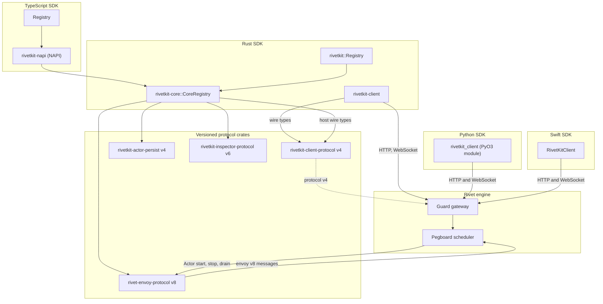
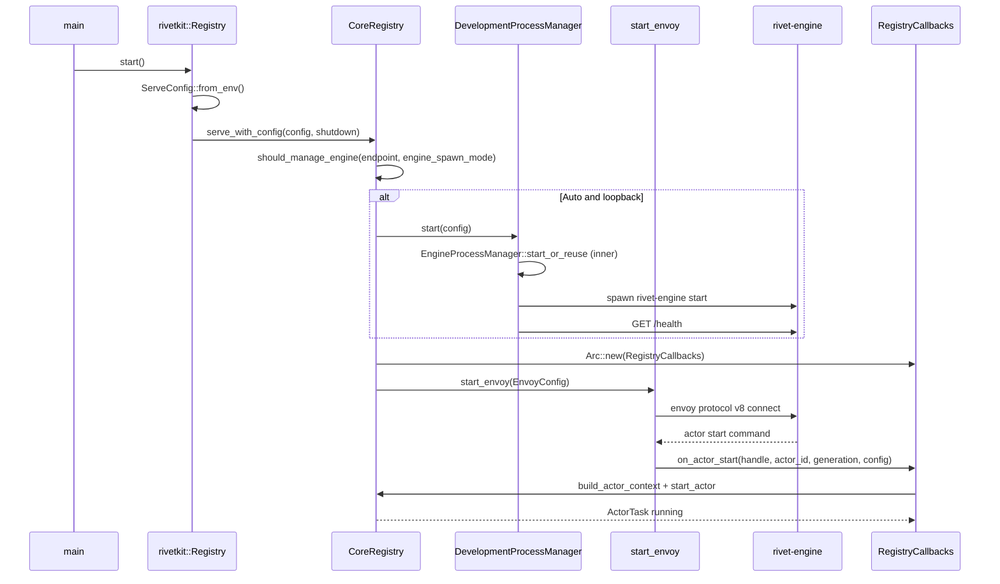
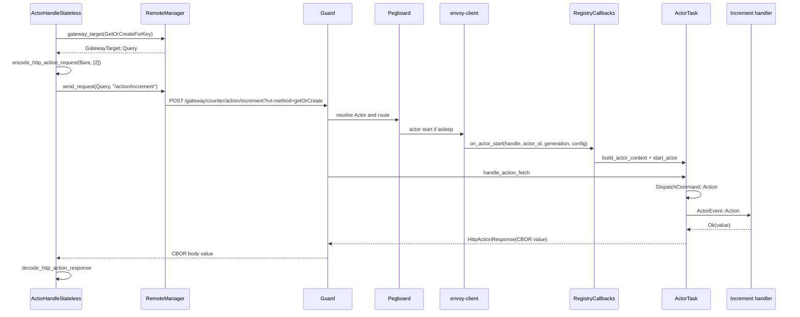
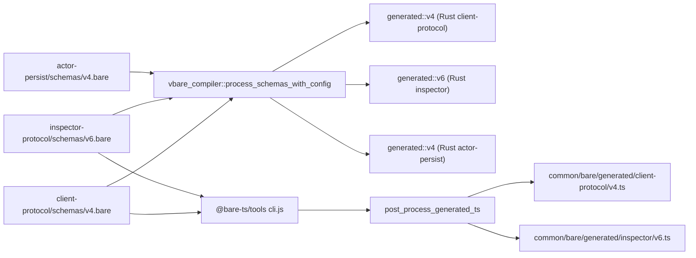

# 12 RivetKit Rust and the Other Language Clients

RivetKit for Rust is a runtime library that turns one Rust trait implementation into an Actor that the Rivet engine can schedule, call, sleep, and wake. The Rust crate is not a thin binding to the TypeScript runtime. It contains the same `rivetkit-core` library that the TypeScript package now loads through Node-API (NAPI). The Rust client and the Python and Swift clients speak the same engine protocol at the edge. They differ in how much of the runtime they carry. This document maps the Rust packages, follows one action call from a Rust client to a Rust Actor, and states which features each language client supports at commit `4a58441c50d1ce20d8803cfb1ab7c3285a5141d6`.

## 1. The four Software Development Kits and the one engine protocol

RivetKit has four client languages. Each one speaks to the engine through a small number of versioned protocols.

| Language | Directory | Role | Runtime carrier |
|----------|-----------|------|-----------------|
| TypeScript | `rivetkit-typescript/` | Client, Actor host, React hooks | `rivetkit-napi` loads `rivetkit-core` |
| Rust | `rivetkit-rust/` | Client, Actor host, test harness | `rivetkit-core` directly |
| Python | `rivetkit-python/` | Client only, experimental | Python bindings for Rust (PyO3) over `rivetkit-client` |
| Swift | `rivetkit-swift/` | Client only, experimental | Native Swift over Hypertext Transfer Protocol (HTTP) and WebSocket |

The engine does not know which language defined an Actor. In this document, an envoy is the long-lived outbound connection from an Actor host to the engine. The engine sends an Actor start, a stop, and a drain signal over the envoy. The gateway sends an action request over HTTP. The host library translates each message into a language-native call. The translation layer is `rivetkit-core` for Rust and TypeScript. Python and Swift bypass the Actor host path and use only the data-plane client path. Guard is the gateway proxy, and Pegboard is the engine scheduler. BARE means Binary Application Record Encoding, and JSON means JavaScript Object Notation.

The protocol versions at this commit are:

| Protocol | Crate | Version constant | Latest schema | Purpose |
|----------|-------|------------------|---------------|---------|
| Client protocol | `rivetkit-client-protocol` | `PROTOCOL_VERSION = 4` | `schemas/v4.bare` | WebSocket and HTTP action, queue, and event messages |
| Actor persistence | `rivetkit-actor-persist` | `CURRENT_VERSION = 4` | `schemas/v4.bare` | State, input, connections, schedules, queue rows |
| Inspector protocol | `rivetkit-inspector-protocol` | `PROTOCOL_VERSION = 6` | `schemas/v6.bare` | Inspector requests, responses, and live updates |
| Envoy protocol | `rivet-envoy-protocol` (`engine/sdks/rust/envoy-protocol`) | `generated::PROTOCOL_VERSION` (v8) | `engine/sdks/schemas/envoy-protocol/v8.bare` | Engine to Actor-host control channel |
| Runner protocol (legacy) | `@rivetkit/engine-runner-protocol` | `PROTOCOL_VERSION = 7` in `@rivetkit/engine-runner` | `engine/sdks/schemas/runner-protocol/v7.bare` | Older Actor-host control channel |



The diagram shows two different relationships. The TypeScript and Rust SDKs own an Actor host. The Python and Swift SDKs own only a client. The host path runs over the envoy protocol. The client path runs over the client protocol at the gateway.

**Aha:** The Rust SDK is not a port of the TypeScript SDK. It is the reference implementation of the Actor host. The TypeScript package now calls the same `rivetkit-core` through `rivetkit-napi`. `Runtime.create()` throws when a caller asks it to start the engine (`rivetkit-typescript/packages/rivetkit/runtime/index.ts:84-88`). The obvious alternative was two runtimes that share only a wire format. That alternative costs double implementation of state save, sleep, queue, and inspector logic, and it lets behaviour drift between languages. The repository still holds the older `@rivetkit/engine-runner` package at protocol version 7 (`rivetkit-typescript/packages/engine-runner/src/mod.ts:22`). No package under `rivetkit-typescript/packages/` imports it. The only dependent in the workspace is `@rivetkit/engine-test-runner` (`engine/sdks/typescript/test-runner/package.json:12`).

## 2. The Rust package map

The Rust workspace has eight RivetKit packages under `rivetkit-rust/packages/`. The repository root `Cargo.toml` lists all eight as workspace members (`Cargo.toml:80-87`). The root also lists the two Rust examples (`Cargo.toml:90-91`). In this section a short citation such as `rivetkit-core/src/registry/mod.rs` is relative to `rivetkit-rust/packages/`.

| Directory | Crate name | Purpose | Main types | Notable dependencies | Source size |
|-----------|------------|---------|------------|----------------------|-------------|
| `actor-persist` | `rivetkit-actor-persist` | Versioned persistence records | `versioned::Actor`, `versioned::Conn` | `serde_bare`, `vbare`, `ciborium` through shared types | 3 files, 664 lines |
| `client` | `rivetkit-client` | Data-plane client | `Client`, `ClientConfig`, `ActorHandle`, `ActorConnection` | `reqwest`, `tokio-tungstenite`, `serde_cbor` | 16 files, 3,562 lines |
| `client-protocol` | `rivetkit-client-protocol` | Client wire types | `v4::ToClient`, `v4::ToServer`, `HttpActionRequest` | `vbare`, `serde_bare` | 4 files, 740 lines |
| `engine-process` | `rivetkit-engine-process` | Spawn or reuse a local engine | `EngineProcessManager`, `EngineStartup` | `reqwest`, `tokio`, `sha2` | 2 files, 1,301 lines |
| `inspector-protocol` | `rivetkit-inspector-protocol` | Inspector wire types | `v6::ToServer`, `v6::Init` | `vbare`, `serde_bare` | 3 files, 1,494 lines |
| `rivetkit` | `rivetkit` | Actor trait, macros, registry, test harness | `Actor`, `Action`, `Handles`, `Ctx`, `Registry` | `async-trait`, `ciborium`, `rivetkit-core` | 16 files, 8,132 lines |
| `rivetkit-core` | `rivetkit-core` | Runtime primitives | `CoreRegistry`, `ActorTask`, `ActorContext`, `SqliteDb` | `rivet-envoy-client`, `depot-client`, `tokio` | 62 files, 35,125 lines |
| `shared-types` | `rivetkit-shared-types` | Types shared with the engine | `ServerlessMetadataPayload`, `ActorName` | `serde`, `serde_json` | 2 files, 73 lines |

The crate descriptions come from each `Cargo.toml`. The Source size column counts only the `.rs` files under each package's `src/` directory. For example, `rivetkit-actor-persist` describes itself as "Versioned persistence protocol types for RivetKit actors" (`rivetkit-rust/packages/actor-persist/Cargo.toml:10`). `rivetkit-core` describes itself as "Core runtime primitives for RivetKit actor hosts" (`rivetkit-rust/packages/rivetkit-core/Cargo.toml:11`).

## 3. The Actor trait, not an attribute macro

There is no attribute macro for Actors in Rust. An attribute macro does not define this type. An Actor is a struct that implements the `Actor` trait. The trait is declared in `rivetkit-rust/packages/rivetkit/src/actor.rs` with `#[async_trait]`.

```rust
// rivetkit-rust/packages/rivetkit/src/actor.rs:34-54
#[async_trait]
pub trait Actor: Send + Sync + Sized + 'static {
	type State: Serialize + DeserializeOwned + Send + Sync + 'static;
	type Input: DeserializeOwned + Default + Send + 'static;
	type Actions: ActionSet<Self>;
	type Events: EventSet;
	type Queue: QueueSet<Self>;
	type ConnParams: DeserializeOwned + Default + Send + Sync + 'static;
	type ConnState: Serialize + DeserializeOwned + Default + Send + Sync + Clone + 'static;
	type Action: DeserializeOwned + Send + 'static;

	const HAS_DATABASE: bool = false;

	/// Opts this actor into concurrent typed HTTP callbacks.
	const CONCURRENT_HTTP_CALLBACKS: bool = false;

	/// Maximum concurrently starting standard HTTP callbacks when concurrency is enabled.
	const MAX_CONCURRENT_HTTP_CALLBACKS: usize = 128;

	/// Maximum concurrently starting live HTTP callbacks when concurrency is enabled.
	const MAX_CONCURRENT_LIVE_HTTP_CALLBACK_STARTS: usize = 0;
```

Every associated type has one job.

| Associated type | Bound | Purpose |
|-----------------|-------|---------|
| `State` | `Serialize + DeserializeOwned` | Durable Actor state. Saved as Concise Binary Object Representation (CBOR) inside the Actor database. |
| `Input` | `DeserializeOwned + Default` | Creation input. A missing input decodes to `Default`. |
| `Actions` | `ActionSet<Self>` | Tuple of action types. The tuple macro builds the name table and the dispatcher. |
| `Events` | `EventSet` | Tuple of broadcast event types, up to 16. |
| `Queue` | `QueueSet<Self>` | Tuple of queue message types, up to 16. |
| `ConnParams` | `DeserializeOwned + Default` | Per-connection parameters from the client. |
| `ConnState` | `Serialize + DeserializeOwned + Default + Clone` | Per-connection state that survives hibernation. |
| `Action` | `DeserializeOwned` | Fallback action type for raw dispatch. Examples use `action::Raw`. |

Sections 4 and 5 define the `ActionSet`, `EventSet`, and `QueueSet` tuple traits. The trait's default methods make every hook optional. The source has these defaults:

```rust
// rivetkit-rust/packages/rivetkit/src/actor.rs:88-102
	async fn run(self: Arc<Self>, _ctx: Ctx<Self>) -> Result<()> {
		Ok(())
	}

	async fn on_create(self: Arc<Self>, _ctx: Ctx<Self>) -> Result<()> {
		Ok(())
	}

	async fn on_start(self: Arc<Self>, _ctx: Ctx<Self>) -> Result<()> {
		Ok(())
	}

	async fn on_state_change(self: Arc<Self>, _ctx: Ctx<Self>) -> Result<()> {
		Ok(())
	}
```

`create_state` and `create` are the exception. Their defaults return an `ActorRuntime::NotConfigured` error (`actor.rs:68-86`). A type that omits them compiles, but it fails at startup with `ActorRuntime::NotConfigured`, which names the missing component.
The full hook set is:

| Hook | Called when | Default |
|------|-------------|---------|
| `create_state(&Ctx, Input)` | No snapshot exists | Error `NotConfigured` |
| `create(&Ctx)` | After state creation, before start | Error `NotConfigured` |
| `run(self: Arc<Self>, Ctx)` | In a background task after start | `Ok(())` |
| `on_create(self, Ctx)` | Only when the Actor instance is new | `Ok(())` |
| `on_start(self, Ctx)` | Every start, including a wake | `Ok(())` |
| `on_state_change(self, Ctx)` | Inside an on-state-change region | `Ok(())` |
| `create_conn_state(self, Ctx, ConnParams)` | A client connects | `ConnState::default()` |
| `on_before_connect(self, Ctx, &ConnParams)` | Before connection state is created | `Ok(())` |
| `on_connect(self, Ctx, ConnCtx)` | After the connection exists | `Ok(())` |
| `on_disconnect(self, Ctx, ConnCtx)` | The connection closes | Empty |
| `on_subscribe(self, Ctx, ConnCtx, String)` | A client subscribes to an event | `Ok(())` |
| `on_fetch(self, Ctx, Request)` | A raw HTTP request arrives | `404` response |
| `on_fetch_response(self, Ctx, Request)` | Buffered or streaming HTTP response | Wraps `on_fetch` as buffered |
| `on_websocket(self, Ctx, WebSocket, Request)` | A WebSocket upgrade arrives | Error "websockets not supported" |
| `on_sleep(self, Ctx)` | Before the Actor sleeps | `Ok(())` |
| `on_destroy(self, Ctx)` | Before the Actor is destroyed | `Ok(())` |

The startup order is fixed in `run_actor`. The source calls `create_state` or decodes the snapshot. `is_new` is true when no snapshot decoded. It stores the result with `ctx.set_initial_state`. It then calls `A::create`, `on_create` when the instance is new, and `on_start` (`rivetkit-rust/packages/rivetkit/src/start.rs:210-226`). `on_state_change` is not in this block; the first state save calls it. `Ctx` is the Actor context, `ConnCtx` is the per-connection context, `Request` is the HTTP request, and `WebSocket` is the upgraded socket.

```rust
// rivetkit-rust/packages/rivetkit/src/start.rs:210-226
	let startup = async {
		let state = match snapshot.decode()? {
			Some(state) => state,
			// Absent input falls back to the input type's default, matching
			// rivetkit-typescript where createState receives undefined input.
			None => A::create_state(&ctx, input.decode_or_default()?).await?,
		};
		ctx.set_initial_state(state);

		let actor = Arc::new(A::create(&ctx).await?);
		if is_new {
			actor.clone().on_create(ctx.clone()).await?;
		}
		actor.clone().on_start(ctx.clone()).await?;
		Ok::<_, anyhow::Error>(actor)
	}
	.await;
```

The tests in the same file assert the life sequence. A new Actor logs `create_state, create, on_create, on_start, on_state_change`. A restored Actor logs `snapshot, create, on_start, on_state_change` (`start.rs`, test module). The state save after startup adds the `on_state_change` entry.
The Actor lifecycle state machine has these states and transitions. The states are the variants of `LifecycleState` (`actor/task_types.rs:6-15`), and the table names the code path for each transition. The variants are `Loading`, `Started`, `SleepGrace`, `SleepFinalize`, `DestroyGrace`, `Destroying`, and `Terminated`.

```mermaid
stateDiagram-v2
    [*] --> Loading
    Loading --> Started: core init completes
    Loading --> Terminated: startup error
    Started --> Started: DispatchCommand::Action (state unchanged)
    Started --> SleepGrace: Stop with ShutdownKind::Sleep
    Started --> DestroyGrace: Stop with ShutdownKind::Destroy
    SleepGrace --> SleepFinalize: grace deadline
    SleepFinalize --> Terminated: shutdown complete
    DestroyGrace --> Destroying: grace deadline
    Destroying --> Terminated: shutdown complete
    Started --> DestroyGrace: run task error
    Terminated --> [*]
```

| From | Event | To | Code path |
|------|-------|----|-----------|
| `Loading` | `start_actor` core init completes and calls `transition_to(Started)` | `Started` | `actor/task.rs:1257` |
| `Loading` | Startup error returns from `run_actor` | `Terminated` | `start.rs:235-240` |
| `Started` | `LifecycleCommand::Stop` with `ShutdownKind::Sleep` | `SleepGrace` | `actor/task.rs:776-779` |
| `Started` | `LifecycleCommand::Stop` with `ShutdownKind::Destroy` | `DestroyGrace` | `actor/task.rs:776-779` |
| `SleepGrace` | Grace deadline or idle check passes | `SleepFinalize` | `actor/task.rs:1810-1813` |
| `DestroyGrace` | Grace deadline passes | `Destroying` | `actor/task.rs:1810-1813` |
| `SleepFinalize`, `Destroying` | Shutdown cleanup completes | `Terminated` | `actor/task.rs:1568` |
| `Started` | Run task error calls `ctx.stop_with_error` | `DestroyGrace` | `start.rs:322-342` |

`ShutdownKind` has two variants, `Sleep` and `Destroy`. Sleep ends the task. The registry creates a new task for the next request, so there is no transition back from `Terminated`. Sleep leaves a remote SQLite coordinator open across wake, and both paths close the local handle. Destroy also cancels the engine alarm and sets the destroy-completed flag (`task.rs:1810-1823`, `task.rs:1951-1956`).

**Aha:** The author chose a trait with associated types, not an attribute macro that scans methods. A macro would hide the wire name and the argument type inside an attribute string. The trait form makes `Actions = (Increment, GetCount)` a type-level list. The compiler then proves that every listed action has a `Handles` implementation for the Actor. The obvious alternative, a `#[action]` macro on methods, would cost a procedural macro crate, slower builds, and weaker error messages. It would also make the action name a string literal that no type can check. The source does not state this reason. The design is visible in the type bounds.

## 4. Actions are types, and the ActionSet tuple dispatches them

An action is a struct. It implements `Action` with an output type and a wire name (`rivetkit-rust/packages/rivetkit/src/action.rs:17-23`).

```rust
// rivetkit-rust/packages/rivetkit/src/action.rs:17-23
/// An action a client can invoke on an actor. Arguments and `Output` must be JSON-compatible;
/// they are carried through the JSON value model to match the TypeScript runtime.
pub trait Action: serde::Serialize + DeserializeOwned + Send + Sync + 'static {
	type Output: serde::Serialize + DeserializeOwned + Send + 'static;

	const NAME: &'static str;
}
```

The handler is a separate trait. `Handles<A>` is implemented for the Actor type, not for the action type (`action.rs:452-456`).

```rust
// rivetkit-rust/packages/rivetkit/src/action.rs:452-456
pub trait Handles<A: Action>: Actor + Sized {
	type Future: Future<Output = Result<A::Output>> + Send + 'static;

	fn handle(self: Arc<Self>, ctx: Ctx<Self>, action: A) -> Self::Future;
}
```

The `Actions` tuple implements `ActionSet`. The macro generates one `impl` for each tuple length from 1 to 128 (`action.rs:493-554`). `TUPLE_ARITY_MAX` is 128 (`action.rs:14`). The dispatch routine compares the incoming name with each `NAME` constant. It decodes the positional arguments in field order into the action struct, calls `Handles::handle`, and encodes the output as CBOR (`action.rs:504-523`).

```rust
// rivetkit-rust/packages/rivetkit/src/action.rs:504-523
			fn dispatch(
				actor: Arc<Act>,
				ctx: Ctx<Act>,
				name: &str,
				args: &[u8],
			) -> Option<BoxActionFuture> {
				$(
					if name == <$action as Action>::NAME {
						let args = args.to_vec();
						return Some(Box::pin(async move {
							let action = decode_positional::<$action>(&args).with_context(|| {
								format!("decode action '{}' args", <$action as Action>::NAME)
							})?;
							let output = <Act as Handles<$action>>::handle(actor, ctx, action).await?;
							encode_cbor(&output, "action response")
						}));
					}
				)+
				None
			}
```

The action protocol has a fixed value model. Every argument and every output passes through a JavaScript Object Notation (JSON) value, `serde_json::Value`. `encode_cbor` enforces this: it calls `to_json_value` before it writes CBOR (`action.rs:556-559`). The encoder checks for non-finite floats first (`action.rs:38-43`). It then encodes the JSON value as CBOR with `ciborium` (`action.rs:46-51`). A decoded CBOR value is converted back into the JSON value model (`action.rs:55-80`).

This choice has a cost. A Rust type that cannot be represented in JSON is rejected. Examples are a map with a non-string key, an integer beyond the JSON range, and `NaN` or infinity. The error names the encoder label, such as `"action response"`, and the failing conversion step.
The `Raw` type is the escape hatch. It refuses to deserialize with a message that names `Action::raw_args()` and `Action::decode_as(...)` (`action.rs:561-574`). The message uses an `Action::` prefix, but the methods are on `ActionCall`, the value passed to a legacy raw action handler (`event.rs:235-267`). `ActionCall::raw_args` returns the bytes, and `ActionCall::decode_as` decodes them into a requested type.

```rust
// rivetkit-rust/packages/rivetkit/src/action.rs:561-574
#[derive(Debug, Clone, Copy, PartialEq, Eq)]
pub struct Raw;

impl<'de> Deserialize<'de> for Raw {
	fn deserialize<D>(deserializer: D) -> Result<Self, D::Error>
	where
		D: Deserializer<'de>,
	{
		let _ = de::IgnoredAny::deserialize(deserializer)?;
		Err(de::Error::custom(
			"rivetkit::action::Raw cannot be deserialized; use Action::raw_args() or Action::decode_as(...) instead",
		))
	}
}
```

An unknown action name returns `None` from `ActionSet::dispatch`. The HTTP layer turns that `None` into a framework error. The handler never runs.
An argument decode error returns `Err` from the boxed future. The error carries the text "decode action '<name>' args". The dispatch reply then becomes an error response. The Actor stays alive, because the error belongs to the call and not to the task.

## 5. Events, queues, and connection state

An event is a broadcast. It has a name and a payload. The `Event` trait has only a `NAME` constant (`rivetkit-rust/packages/rivetkit/src/event.rs:22-26`). `EventSet` is implemented for tuples of up to 16 events (`event.rs:56-75`).
`Ctx::emit` calls `broadcast` with the event name and an encoded payload (`rivetkit-rust/packages/rivetkit/src/context.rs:438-446`).

```rust
// rivetkit-rust/packages/rivetkit/src/context.rs:438-446
	pub fn broadcast<E: Serialize>(&self, name: &str, event: &E) -> Result<()> {
		let event_bytes = action::encode_varargs(event, "event args")?;
		self.inner.broadcast(name, &event_bytes);
		Ok(())
	}

	pub fn emit<E: Event>(&self, event: E) -> Result<()> {
		self.broadcast(E::NAME, &event)
	}
```

A queue message is a type with a reply type. `QueueMessage` declares `type Reply`, and `HandlesQueue::handle_queue` returns it (`rivetkit-rust/packages/rivetkit/src/queue.rs:17-27`). `QueueSet` has implementations for tuples from 1 to 16, and the empty tuple `()` is valid (`queue.rs:93-112`).
On `ActorHandle`, the client-facing queue call has two forms. `send` posts a message and returns. `send_and_wait` posts a message and waits for a reply (`rivetkit-rust/packages/client/src/handle.rs:128-140`).

A connection carries `ConnParams` into the Actor and keeps `ConnState` for the life of the connection. The state is serializable, so it can survive hibernation. `on_connect` receives a `ConnCtx`, and `GetConnLabel` in the example reads `ctx.conn().map(|conn| conn.state())` (`examples/hello-world-rust/src/lib.rs:126-131`).

## 6. A complete Rust Actor: the hello-world example

`examples/hello-world-rust` is the smallest complete Actor. The library file declares the state, the connection types, three actions, one event, the `Actor` implementation, the three handlers, and the registry.

The state and connection records are plain structs:

```rust
// examples/hello-world-rust/src/lib.rs:8-27
pub const ACTOR_NAME: &str = "counter";

type BoxFuture<T> = Pin<Box<dyn Future<Output = Result<T>> + Send>>;

pub struct Counter;

#[derive(Default, Serialize, Deserialize)]
pub struct CounterState {
	pub count: i64,
}

#[derive(Default, Serialize, Deserialize)]
pub struct CounterConnParams {
	pub label: String,
}

#[derive(Clone, Default, Serialize, Deserialize)]
pub struct CounterConnState {
	pub label: String,
}
```

Each action is a type. `Increment` has an `amount: i64` field and output `i64`. `GetCount` has no fields and output `i64`. `GetConnLabel` has no fields and output `String`. Their wire names are `"increment"`, `"getCount"`, and `"getConnLabel"`. Each `impl Action` sets the constant `NAME` in that range (`examples/hello-world-rust/src/lib.rs:29-56`).

The `Actor` implementation lists the three actions and the one event:

```rust
// examples/hello-world-rust/src/lib.rs:67-95
#[async_trait]
impl Actor for Counter {
	type State = CounterState;
	type Input = ();
	type Actions = (Increment, GetCount, GetConnLabel);
	type Events = (NewCount,);
	type Queue = ();
	type ConnParams = CounterConnParams;
	type ConnState = CounterConnState;
	type Action = action::Raw;

	async fn create_state(_ctx: &Ctx<Self>, _input: Self::Input) -> Result<Self::State> {
		Ok(CounterState::default())
	}

	async fn create(_ctx: &Ctx<Self>) -> Result<Self> {
		Ok(Self)
	}

	async fn create_conn_state(
		self: Arc<Self>,
		_ctx: Ctx<Self>,
		params: Self::ConnParams,
	) -> Result<Self::ConnState> {
		Ok(CounterConnState {
			label: params.label,
		})
	}
}
```

The increment handler mutates state inside a scope, then emits the new count. The `StateMut` guard from `ctx.state_mut()` requests a save when it drops (`context.rs:108-116`). The handler returns the new count as an `i64`.

```rust
// examples/hello-world-rust/src/lib.rs:97-111
impl Handles<Increment> for Counter {
	type Future = BoxFuture<i64>;

	fn handle(self: Arc<Self>, ctx: Ctx<Self>, action: Increment) -> Self::Future {
		Box::pin(async move {
			let count = {
				let mut state = ctx.state_mut();
				state.count += action.amount;
				state.count
			};
			ctx.emit(NewCount { count })?;
			Ok(count)
		})
	}
}
```

The registry function registers the type under the name `"counter"`. The binary is four lines. It calls `registry().start().await` under `#[tokio::main]`.

```rust
// examples/hello-world-rust/src/lib.rs:136-140
pub fn registry() -> Registry {
	let mut registry = Registry::new();
	registry.register_actor::<Counter>(ACTOR_NAME);
	registry
}
```

```rust
// examples/hello-world-rust/src/main.rs:1-4
#[tokio::main]
async fn main() -> anyhow::Result<()> {
	example_hello_world_rust::registry().start().await
}
```

The end-to-end test drives the same Actor through `rivetkit::test`. It gets the Actor, sends `Increment { amount: 1 }`, connects, and listens for `NewCount` (`examples/hello-world-rust/tests/e2e.rs`). This test path uses the in-process test harness. It does not start an engine.

A concrete call has these values. A client asks for `"counter"` with the one-element Actor key `["bare-smoke"]`. It sends the positional argument `[2]`, which means `Increment { amount: 2 }`, to `"increment"`. The peer is an `axum` test server, not a Rivet Actor. It checks the encoding, decodes the arguments, and returns a fixed `HttpActionResponse` with the object `{"count": 3}` (`bare.rs:1218-1245`).

## 7. A second example: chat-room and per-Actor SQLite

`examples/chat-room-rust` adds a database. The Actor sets `HAS_DATABASE = true` (`examples/chat-room-rust/src/lib.rs:85`). The `create` hook runs a `CREATE TABLE` statement against `ctx.sql()`.

```rust
// examples/chat-room-rust/src/lib.rs:85-106
	const HAS_DATABASE: bool = true;

	async fn create_state(_ctx: &Ctx<Self>, _input: Self::Input) -> Result<Self::State> {
		Ok(ChatRoomState::default())
	}

	async fn create(ctx: &Ctx<Self>) -> Result<Self> {
		ctx.sql()
			.execute(
				"CREATE TABLE IF NOT EXISTS messages (
					id INTEGER PRIMARY KEY AUTOINCREMENT,
					sender TEXT NOT NULL,
					text TEXT NOT NULL,
					timestamp INTEGER NOT NULL
				)",
				None,
			)
			.await?;
		Ok(Self {
			started_at_ms: now_ms(),
		})
	}
```

`SendMessage` inserts one row, increments `ChatRoomState::sent_count`, emits `NewMessage`, and returns the message (`examples/chat-room-rust/src/lib.rs:109-122`). `GetHistory` reads rows through `get_history` (`lib.rs:170`). `GetStats` returns the in-memory count and the start time.
The example shows the split between state and database. State is small and saved as one blob. The message log is a table that can grow. The state blob stays small, so a save does not rewrite the whole history.

The Rust SDK does not hide the database behind an object mapper. `ctx.sql()` returns a `SqliteDb`, and the caller writes Structured Query Language (SQL) statements with `BindParam`, a typed SQL parameter. The database is the Actor's own database. The engine stores its pages through Depot. Document [06 Depot](06-actor-sqlite-and-depot.md) covers the page path.

## 8. How a Rust process reaches the engine

The entry point is `Registry::start`. It reads `ServeConfig::from_env()` and calls `start_with_config` (`rivetkit-rust/packages/rivetkit/src/registry.rs:132-151`).

```rust
// rivetkit-rust/packages/rivetkit/src/registry.rs:132-151
	pub async fn start(self) -> Result<()> {
		self.start_with_config(ServeConfig::from_env()?).await
	}

	/// [`start`](Self::start) with an explicit [`ServeConfig`].
	///
	/// Selects the run mode from `RIVETKIT_RUNTIME_MODE` (see [`RuntimeMode`]),
	/// mirroring the TypeScript `registry.start()`. `Envoy` (default) holds one
	/// long-lived outbound envoy; `Serverless` runs an HTTP listener that lazily
	/// starts and caches an envoy on the first request.
	///
	/// Flushes pending telemetry spans before returning.
	pub async fn start_with_config(self, config: ServeConfig) -> Result<()> {
		let result = match RuntimeMode::from_env() {
			RuntimeMode::Envoy => self.start_envoy(config).await,
			RuntimeMode::Serverless => self.start_serverless(config).await,
		};
		crate::telemetry::shutdown().await;
		result
	}
```

The run mode comes from `RIVETKIT_RUNTIME_MODE`. `"serverless"` selects `RuntimeMode::Serverless`. Every other value selects `RuntimeMode::Envoy` (`rivetkit-core/src/registry/mod.rs:255-260`). The default is `Envoy` (`mod.rs:247-252`).
The engine spawn mode comes from `RIVETKIT_ENGINE_SPAWN`. `"always"` selects `Always`, `"never"` selects `Never`, and every other value selects `Auto` (`rivetkit-core/src/registry/mod.rs:234-240`). `Auto` manages an engine only when the endpoint is a loopback address (`mod.rs:353-359`).

```rust
// rivetkit-rust/packages/rivetkit-core/src/registry/mod.rs:353-359
pub(crate) fn should_manage_engine(endpoint: &str, spawn_mode: EngineSpawnMode) -> Result<bool> {
	match spawn_mode {
		EngineSpawnMode::Always => Ok(true),
		EngineSpawnMode::Never => Ok(false),
		EngineSpawnMode::Auto => is_loopback_endpoint(endpoint),
	}
}
```

`Registry::serve_with_config` calls `CoreRegistry::serve_with_config`. That function takes the service configuration and a shutdown token. The core builds a dispatcher and decides whether to manage the engine. It starts the development process manager when needed, builds `RegistryCallbacks`, and calls `envoy-client::envoy::start_envoy` with an `EnvoyConfig` (`rivetkit-core/src/registry/mod.rs:629-667`). `RegistryCallbacks` is the host's implementation of the envoy callbacks. `DevelopmentProcessManager` owns an `EngineProcessManager` and an optional services manager; `start_or_reuse` is the inner engine manager method (`development_process.rs:16-28`).

```rust
// rivetkit-rust/packages/rivetkit-core/src/registry/mod.rs:644-667
		let callbacks = Arc::new(RegistryCallbacks {
			dispatcher: dispatcher.clone(),
		});

		let prepopulate_actor_names = dispatcher
			.build_actor_metadata_map()
			.into_iter()
			.map(|(name, metadata)| (name, rivet_envoy_client::config::ActorName { metadata }))
			.collect();
		let handle = start_envoy(rivet_envoy_client::config::EnvoyConfig {
			version: config.version,
			endpoint: config.endpoint,
			token: config.token,
			namespace: config.namespace,
			pool_name: config.pool_name,
			prepopulate_actor_names,
			metadata: Some(json!({
				"rivetkit": { "version": config.serverless_package_version },
			})),
			not_global: false,
			debug_latency_ms: None,
			callbacks,
		})
		.await;
```

`EnvoyConfig` has these fields (`engine/sdks/rust/envoy-client/src/config.rs`):

| Field | Type | Purpose |
|-------|------|---------|
| `version` | `u32` | Envoy compatibility version, sent as the `version` query parameter (`connection/mod.rs:360-368`); the protocol version is separate |
| `endpoint` | `String` | Engine endpoint |
| `token` | `Option<String>` | Authentication token |
| `namespace` | `String` | Namespace |
| `pool_name` | `String` | Runner pool name |
| `prepopulate_actor_names` | `HashMap<String, ActorName>` | Actor names and metadata offered at connect |
| `metadata` | `Option<serde_json::Value>` | Extra metadata, here the RivetKit version |
| `not_global` | `bool` | When true, create a new envoy per call instead of reusing the global envoy slot |
| `debug_latency_ms` | `Option<u64>` | Artificial latency for tests |
| `callbacks` | `Arc<dyn EnvoyCallbacks>` | The host's handler set |

The `EnvoyCallbacks` trait is the control surface. It has `on_connect`, `on_disconnect`, `on_actor_start`, `on_actor_stop`, `on_actor_stop_with_completion`, `on_shutdown`, `fetch`, `websocket`, and `can_hibernate` (`engine/sdks/rust/envoy-client/src/callbacks.rs:66`). The `can_hibernate` method answers whether the host permits a sleep. `on_connect`, `on_disconnect`, and `on_actor_stop` have default bodies; `on_actor_stop_with_completion` defaults to calling `on_actor_stop` (`callbacks.rs:67-105`). `RegistryCallbacks` implements the remaining methods. `rivet-envoy-client` is the connection library; `rivet-envoy-protocol` holds the message types.



The legacy runner path is separate. `@rivetkit/engine-runner` speaks protocol version 7 and imports `@rivetkit/engine-runner-protocol` (`rivetkit-typescript/packages/engine-runner/src/mod.ts:1-22`). The current TypeScript package does not import it. The current Rust and TypeScript hosts both use the envoy client. A statement about the runner protocol in this document applies only to that legacy package.

### The local engine process manager

When the endpoint is local, `rivetkit-engine-process` starts the engine binary. The manager writes the engine configuration and log files, spawns the process, and waits for health.

```rust
// rivetkit-rust/packages/engine-process/src/lib.rs:216-242
		command
			.stdin(Stdio::null())
			.stdout(Stdio::from(stdout_file))
			.stderr(Stdio::from(stderr_file));

		// Put the engine in its own process group so terminal signals
		// (Ctrl+C, Ctrl+Z, SIGHUP on terminal close) targeting our foreground
		// process group do not reach the engine. Combined with no-kill-on-drop
		// and file-fd stdio, this gives the engine a real "intentional orphan"
		// lifetime that survives the host being killed for any reason.
		#[cfg(unix)]
		command.process_group(0);

		let mut child = command
			.spawn()
			.with_context(|| format!("spawn engine binary `{}`", binary_path.display()))?;
		let pid = child
			.id()
			.ok_or_else(|| EngineProcessError::MissingPid.build())?;

		tracing::info!(
			pid,
			path = %binary_path.display(),
			endpoint = %endpoint,
			db_path = %db_path.display(),
			"spawned engine process (intentionally orphaned, will outlive this process)"
		);
```

The manager makes the engine an intentional orphan. It puts the child in its own process group, sends stdout and stderr to files, and does not kill the child on drop. The comment states the reason: the engine must survive the host. This is the feature that makes `cargo run` practical. A developer restarts the host, and the engine keeps its state. The no-kill promise starts only when the health probe succeeds. A spawn that never becomes healthy is a failed spawn, and the manager kills it.

The manager then probes `GET {endpoint}/health`. The constants are `HEALTH_MAX_WAIT = 10 s`, `HEALTH_REQUEST_TIMEOUT = 1 s`, `HEALTH_INITIAL_BACKOFF = 100 ms`, and `HEALTH_MAX_BACKOFF = 1 s` (`engine-process/src/lib.rs:915-918`). A failed spawn calls `terminate_failed_spawn`, the only function allowed to kill the child (`lib.rs:960-964`). The admin token defaults to `"default"` when `RIVET__AUTH__ADMIN_TOKEN` is unset (`lib.rs:394-395`). A downloaded binary has a 60-second timeout (`lib.rs:632`) and a Secure Hash Algorithm 256-bit (SHA-256) check inside `download_engine_binary` (`lib.rs:626-660`).

## 9. Inside the Actor task: start, run, and dispatch

`start_actor` is the core of registration. It inserts a startup notification in `starting_instances`, looks up the factory, and creates three channels: lifecycle, dispatch, and lifecycle events (`rivetkit-core/src/registry/mod.rs:804-831`).

```rust
// rivetkit-rust/packages/rivetkit-core/src/registry/mod.rs:815-831
		let factory = self
			.factories
			.get(&request.actor_name)
			.cloned()
			.ok_or_else(|| {
				ActorRuntime::NotRegistered {
					actor_name: request.actor_name.clone(),
				}
				.build()
			})?;
		let (lifecycle_tx, lifecycle_rx) = mpsc::unbounded_channel();
		let (dispatch_tx, dispatch_rx) = mpsc::unbounded_channel();
		let (lifecycle_events_tx, lifecycle_events_rx) = mpsc::unbounded_channel();
		request
			.ctx
			.configure_lifecycle_events(Some(lifecycle_events_tx));
		request.ctx.cancel_sleep_timer();
```

If the name is not registered, the error is `ActorRuntime::NotRegistered`. The engine receives a start failure and does not keep a phantom Actor.
The registry then builds an `ActorTask` and spawns `task.run()`. It sends `LifecycleCommand::Start` with a one-shot reply. The start reply is the handshake. Only after it succeeds does the registry build the `ActorTaskHandle`, which carries the actor identifier, name, generation, context, factory, inspector, lifecycle sender, dispatch sender, and join handle (`mod.rs:849-884`).

`ActorTask::run` runs the live loop and then the shutdown path. The live loop is a biased `tokio::select!`. It watches lifecycle commands, lifecycle events, activity notifications, a sleep grace tick, dispatch commands, the user run task, state save, inspector serialization, and sleep (`actor/task.rs:478-556`). The snippet below shows the first five branches.

```rust
// rivetkit-rust/packages/rivetkit-core/src/actor/task.rs:489-541
			tokio::select! {
				biased;
				lifecycle_command = self.lifecycle_inbox.recv() => {
					match lifecycle_command {
						Some(command) => {
							if let Some(exit) = self.handle_lifecycle(command).await {
								return exit;
							}
						}
						None => {
							self.log_closed_channel(
								"lifecycle_inbox",
								"actor task terminating because lifecycle command inbox closed",
							);
							return LiveExit::Terminated;
						}
					}
				}
				lifecycle_event = self.lifecycle_events.recv() => {
					match lifecycle_event {
						Some(event) => self.handle_event(event).await,
						None => {
							self.log_closed_channel(
								"lifecycle_events",
								"actor task terminating because lifecycle event inbox closed",
							);
							return LiveExit::Terminated;
						}
					}
				}
				_ = activity_notify.notified() => {
					self.ctx.acknowledge_activity_dirty();
					if let Some(exit) = self.on_activity_signal().await {
						return exit;
					}
				}
				_ = Self::sleep_grace_tick(self.sleep_grace.as_ref().map(|grace| grace.deadline)), if self.sleep_grace.is_some() => {
					if let Some(exit) = self.on_sleep_grace_deadline().await {
						return exit;
					}
				}
				dispatch_command = self.dispatch_inbox.recv(), if self.accepting_dispatch() => {
					match dispatch_command {
						Some(command) => self.handle_dispatch(command).await,
						None => {
							self.log_closed_channel(
								"dispatch_inbox",
								"actor task terminating because dispatch inbox closed",
							);
							return LiveExit::Terminated;
						}
					}
				}
```

The bias order matters. A lifecycle stop wins over a queued action. The task checks `accepting_dispatch()`, which is true in `Started`, `SleepGrace`, and `DestroyGrace`, before it reads the dispatch channel. During grace the task still drains calls that were already accepted (`drain_accepted_dispatch`, `task.rs:758-765`).
The `run` method has a panic boundary. It calls `run_shutdown` inside `catch_unwind`. A panic during shutdown becomes `"shutdown panicked during {reason}"`. The reply is still delivered, and the state moves to `Terminated` (`task.rs:456-475`).

`handle_dispatch` handles an action in six steps. It starts telemetry with `ActorInvocation::start_action`. `ActorInvocation` records the action telemetry, and `Reply` is the one-shot reply type. It creates a one-shot reply. It sends `ActorEvent::Action` to the user loop with a tracked reply. It spawns a task that waits for the reply and converts a failure into an error that names the actor identifier. It finishes the telemetry record. It sends the reply to the HTTP or WebSocket caller (`task.rs:908-988`).

```rust
// rivetkit-rust/packages/rivetkit-core/src/actor/task.rs:916-937
				let invocation = ActorInvocation::start_action(&self.ctx, &name, incoming);
				let invocation_telemetry = invocation.telemetry();
				tracing::info!(
					actor_id = %self.ctx.actor_id(),
					action_name = %name,
					conn_id = ?conn.id(),
					args_len = args.len(),
					"actor task: handling DispatchCommand::Action"
				);
				let (tracked_reply_tx, tracked_reply_rx) = oneshot::channel();
				let action_name_for_log = name.clone();
				match self.send_actor_event(
					"dispatch_action",
					ActorEvent::Action {
						name,
						args,
						conn: Some(conn),
						scheduled_fire: None,
						invocation_telemetry: Some(invocation_telemetry),
						reply: Reply::from(tracked_reply_tx),
					},
				) {
```

The failure path is explicit. If the dispatch channel is closed, `handle_dispatch` is not called. If the Actor is stopping, `dispatch_lifecycle_error` builds the rejection with a lifecycle error. If the user drops the reply, the tracked reply channel closes and the task returns `ActorLifecycleError::DroppedReply` (`task.rs:960-970`). The dispatch reply is tied to the Actor, not to the socket, so a closed HTTP client does not cancel the action.

## 10. One action call from HTTP request to reply

The Actor host serves the action at `POST /action/{action}`. A client reaches it through `POST /gateway/{actor}/action/{action}` at the gateway. `handle_action_fetch` enforces the method, the incoming size, the encoding, and the connection parameters before it dispatches.

```rust
// rivetkit-rust/packages/rivetkit-core/src/registry/http.rs:174-215
	async fn handle_action_fetch(
		&self,
		instance: &ActorTaskHandle,
		request: Request,
		action_name: String,
	) -> Result<HttpResponse> {
		let encoding = request_encoding(request.headers());
		let actor = actor_specifier_for_instance(instance);
		if request.method() != http::Method::POST {
			return message_boundary_error_response_with_actor(
				encoding,
				framework_error_status("actor", "method_not_allowed"),
				MethodNotAllowed {
					method: request.method().to_string(),
					path: request.uri().path().to_owned(),
				}
				.build(),
				Some(&actor),
			);
		}

		let config = instance.factory.config();
		if request.body().len() > config.max_incoming_message_size as usize {
			return message_boundary_error_response_with_actor(
				encoding,
				StatusCode::BAD_REQUEST,
				IncomingMessageTooLong.build(),
				Some(&actor),
			);
		}

		let args = match decode_http_action_args(encoding, request.body()) {
			Ok(args) => args,
			Err(error) => {
				return message_boundary_error_response_with_actor(
					encoding,
					StatusCode::BAD_REQUEST,
					error.context("decode HTTP action request"),
					Some(&actor),
				);
			}
		};
```

The layer opens a synthetic connection with `connect_conn_with_request`. It wraps that connection in `DisconnectOnDrop`, which disconnects it when the value drops. It calls `dispatch_action_through_task` inside `with_action_dispatch_timeout(config.action_timeout, ...)`. It disconnects the connection and encodes the response (`http.rs:227-293`).

```rust
// rivetkit-rust/packages/rivetkit-core/src/registry/http.rs:244-257
		let request_connection = DisconnectOnDrop::new(conn.clone());

		let dispatch_result = with_action_dispatch_timeout(
			config.action_timeout,
			dispatch_action_through_task(
				&instance.dispatch,
				conn.clone(),
				action_name.clone(),
				args,
				IncomingInvocationContext::from_http_headers(request.headers()),
			),
		)
		.await;
		let disconnect_result = request_connection.disconnect().await;
```

`dispatch_action_through_task` is small. `ActionDispatchError` wraps the lifecycle error. It sends `DispatchCommand::Action` and awaits a one-shot reply. A closed reply channel becomes `ActorLifecycleError::DroppedReply`. A timeout becomes `ActionTimedOut` (`rivetkit-core/src/registry/dispatch.rs:6-41`).

```rust
// rivetkit-rust/packages/rivetkit-core/src/registry/dispatch.rs:6-41
pub(super) async fn dispatch_action_through_task(
	dispatch: &mpsc::UnboundedSender<DispatchCommand>,
	conn: ConnHandle,
	name: String,
	args: Vec<u8>,
	incoming: IncomingInvocationContext,
) -> std::result::Result<Vec<u8>, ActionDispatchError> {
	let (reply_tx, reply_rx) = oneshot::channel();
	try_send_dispatch_command(
		dispatch,
		DispatchCommand::Action {
			name,
			args,
			incoming,
			conn,
			reply: reply_tx,
		},
	)
	.map_err(ActionDispatchError::from_anyhow)?;
	reply_rx
		.await
		.map_err(|_| ActionDispatchError::from_anyhow(ActorLifecycleError::DroppedReply.build()))?
		.map_err(ActionDispatchError::from_anyhow)
}

pub(super) async fn with_action_dispatch_timeout<T, F>(
	duration: std::time::Duration,
	future: F,
) -> std::result::Result<T, ActionDispatchError>
where
	F: std::future::Future<Output = std::result::Result<T, ActionDispatchError>>,
{
	time::timeout(duration, future)
		.await
		.map_err(|_| ActionDispatchError::from_anyhow(ActionTimedOut.build()))?
}
```

The sequence for the concrete `increment` call is:



`gateway_target` turns an `ActorQuery` into `GatewayTarget::Direct` or `GatewayTarget::Query`. The response encoding is symmetric. The `ActionSet` macro encodes the output with `encode_cbor`. The HTTP layer wraps that output in `HttpActionResponse`. The client decodes the wrapper and then the output. In the bare test the object is `{"count": 3}`, because the test server writes that fixed object into the response (`bare.rs:1242-1245`). The test server replaces the example Actor, so the value is an object and not the `i64` that `Increment` returns. The SDK returns the decoded output unchanged.

The same path serves WebSocket actions. A generated `v4::ToServerBody::ActionRequest` carries an `id`, a `name`, and CBOR `args`. The Actor host replies with `ToClientBody::ActionResponse { id, output }` or `ToClientBody::Error`. The client matches the `id` to a pending one-shot channel (`rivetkit-rust/packages/client/src/connection.rs:411-463`).

## 11. The Rust client

The Rust client is in `rivetkit-client`. It has a configuration builder, a stateless handle, a stateful connection, a remote manager, codecs, and two transports. `ClientConfig::new` starts a chain of setters such as `token` and `namespace` (`client/src/client.rs:53-66`). The remote manager resolves the gateway URL, adds the `rvt-*` query parameters, and sends the request. The default encoding is `Bare` (`client/src/common.rs:63-67`), and the tests in `client/tests` cover actions, queues, and connection callbacks (`client/tests/bare.rs`).

`ClientConfig` has these fields (`rivetkit-rust/packages/client/src/client.rs:41-51`):

| Field | Type | Default | Purpose |
|-------|------|---------|---------|
| `endpoint` | `String` | required | Engine or gateway endpoint |
| `token` | `Option<String>` | `None` | Authentication token |
| `namespace` | `Option<String>` | `None` | Namespace |
| `pool_name` | `Option<String>` | `None` | Runner pool for creation |
| `encoding` | `EncodingKind` | `Bare` | JSON, CBOR, or Binary Application Record Encoding (BARE) on the wire |
| `transport` | `TransportKind` | `WebSocket` | WebSocket or Server-Sent Events (SSE) |
| `headers` | `Option<HashMap<String, String>>` | `None` | Extra headers |
| `max_input_size` | `Option<usize>` | `None` | Maximum creation input size |
| `disable_metadata_lookup` | `bool` | `false` | Skip the metadata lookup |

`Client::new` takes the config by value. `Client::from_endpoint` builds a default config (`client.rs:148-170`). `get` and `get_or_create` return a handle immediately. `create` is asynchronous because it calls the engine to allocate the Actor (`client.rs:235-259`).

```rust
// rivetkit-rust/packages/client/src/client.rs:148-170
impl Client {
	pub fn new(config: ClientConfig) -> Self {
		let remote_manager = RemoteManager::from_config(
			config.endpoint,
			config.token,
			config.namespace,
			config.pool_name,
			config.headers,
			config.max_input_size,
			config.disable_metadata_lookup,
		);

		Self {
			remote_manager,
			encoding_kind: config.encoding,
			transport_kind: config.transport,
			shutdown_tx: Arc::new(tokio::sync::broadcast::channel(1).0),
		}
	}

	pub fn from_endpoint(endpoint: impl Into<String>) -> Self {
		Self::new(ClientConfig::new(endpoint))
	}
```

`ActorHandle` dereferences to `ActorHandleStateless`, so the same `action` method serves both (`handle.rs:405-411`). `ActorHandleStateless::action` resolves the gateway target, encodes the action request, sends `POST /action/{name}`, checks the status, and decodes the response (`rivetkit-rust/packages/client/src/handle.rs:88-126`).

```rust
// rivetkit-rust/packages/client/src/handle.rs:88-126
	pub async fn action(&self, name: &str, args: Vec<JsonValue>) -> Result<JsonValue> {
		// Resolve gateway target (query targets are resolved by the gateway).
		let query = self.query.lock().expect("query lock poisoned").clone();
		let target = self.remote_manager.gateway_target(&query).await?;

		let body = codec::encode_http_action_request(self.encoding_kind, &args)?;

		let headers = self.protocol_headers()?;

		// Send request via gateway
		let path = format!("/action/{}", urlencoding::encode(name));
		let res = self
			.remote_manager
			.send_request(
				&target,
				&path,
				Method::POST,
				headers,
				Some(Bytes::from(body)),
			)
			.await?;

		if !res.status().is_success() {
			let status = res.status();
			let body = res.bytes().await?;
			if let Ok((group, code, message, metadata)) =
				codec::decode_http_error(self.encoding_kind, &body)
			{
				return Err(anyhow!(
					"action failed ({group}/{code}): {message}, metadata={metadata:?}"
				));
			}
			return Err(anyhow!("action failed: {status}"));
		}

		// Decode response
		let output = res.bytes().await?;
		codec::decode_http_action_response(self.encoding_kind, &output)
	}
```

A key query is the `ActorQuery` form that names an Actor by name and key, not by identifier. It does not resolve to an Actor identifier on the client. The client sends the query to the gateway with `rvt-*` parameters. This avoids a second round trip and lets the gateway wake the Actor.

```rust
// rivetkit-rust/packages/client/src/remote_manager.rs:655-687
		let mut params = Vec::new();
		push_query_param(&mut params, "rvt-namespace", &config.namespace);
		push_query_param(&mut params, "rvt-method", method);
		if let Some(key) = key {
			if !key.is_empty() {
				push_query_param(&mut params, "rvt-key", &key.join(","));
			}
		}
		if let Some(input) = input {
			let encoded = serde_cbor::to_vec(input)?;
			if encoded.len() > self.max_input_size {
				return Err(anyhow!(
					"actor query input exceeds max_input_size ({} > {} bytes)",
					encoded.len(),
					self.max_input_size
				));
			}
			push_query_param(&mut params, "rvt-input", &URL_SAFE_NO_PAD.encode(encoded));
		}
		if method == "getOrCreate" {
			push_query_param(
				&mut params,
				"rvt-runner",
				pool_name.unwrap_or(&self.pool_name),
			);
			push_query_param(&mut params, "rvt-crash-policy", "sleep");
		}
		if let Some(region) = region {
			push_query_param(&mut params, "rvt-region", region);
		}
		if let Some(token) = &config.token {
			push_query_param(&mut params, "rvt-token", token);
		}
```

A direct target uses `/gateway/{actor_id}@{token}{path}` (`remote_manager.rs:618-635`). A query target uses `/gateway/{name}{path}?rvt-namespace=...&rvt-method=...` (`remote_manager.rs:699-705`). The command `create` first calls `POST /actors?namespace=...` with a `crash_policy` of `"destroy"` (`remote_manager.rs:394-400`). It then returns a direct handle.

A stateless handle sends each action over its own HTTP request. A stateful connection uses WebSocket and receives events. `ActorHandle::connect` creates an `ActorConnectionInner` and starts a connection task (`handle.rs:389`). `ActorConnectionInner::action` increments a Remote Procedure Call (RPC) counter, inserts a one-shot channel, encodes the parameters with `serde_cbor`, sends `ActionRequest`, and awaits the reply (`connection.rs:411-463`).

The connection status machine has four states:

| State | Meaning | Transition |
|-------|---------|------------|
| `Idle` | No socket | `connect()` starts the driver |
| `Connecting` | Socket opening or reconnecting | Success to `Connected`, failure to `Disconnected` |
| `Connected` | `Init` received | Close to `Disconnected` |
| `Disconnected` | Socket closed | The next `try_connect` sets `Connecting` and retries with `Backoff::new(1 s, 30 s)`, doubling to the maximum with no jitter (`backoff.rs:20-23`); there is no retry limit |

## 12. `actor-persist`: what survives sleep

`actor-persist` defines the bytes that survive a sleep. It is a BARE schema with an embedded version number. `vbare` writes the version as a payload header, then passes it to `deserialize_version`. The crate re-exports the latest generated module and sets `CURRENT_VERSION = 4` (`rivetkit-rust/packages/actor-persist/src/lib.rs:1-7`).

The latest `Actor` record has four fields:

```bare
// rivetkit-rust/packages/actor-persist/schemas/v4.bare:37-44
# MARK: Actor
type Actor struct {
	# Input data passed to the actor on initialization
	input: optional<Cbor>
	hasInitialized: bool
	state: Cbor
	scheduledEvents: list<ScheduleEvent>
}
```

The record carries the creation input, a flag for initialization, the state blob, and the schedule list. The connection record carries the connection identifier, parameters, state, subscriptions, gateway and request identifiers, message indexes, request path, and request headers (`v4.bare:12-27`). The queue records carry the next identifier and size, and each message (`v4.bare:46-59`).

| Record | Fields | Purpose |
|--------|--------|---------|
| `Actor` | `input`, `hasInitialized`, `state`, `scheduledEvents` | The core snapshot |
| `Conn` | `id`, `parameters`, `state`, `subscriptions`, `gatewayId`, `requestId`, `serverMessageIndex`, `clientMessageIndex`, `requestPath`, `requestHeaders` | Hibernatable WebSocket connection |
| `QueueMetadata` | `nextId`, `size` | Queue counters |
| `QueueMessage` | `name`, `body`, `createdAt`, `failureCount`, `availableAt`, `inFlight`, `inFlightAt` | One queued message |
| `ScheduleEvent` | `eventId`, `timestamp`, `action`, `args` | One scheduled call |

The versioned enum has one variant for each schema version. The latest variant is `V4` (`actor-persist/src/versioned.rs:7-12`). `OwnedVersionedData` is the `vbare` trait for a versioned value. Its implementation names `v4::Actor` as `Latest` and provides converters from v1 to v4 and back (`versioned.rs:14-57`).

```rust
// rivetkit-rust/packages/actor-persist/src/versioned.rs:7-48
pub enum Actor {
	V1(v1::PersistedActor),
	V2(v2::PersistedActor),
	V3(v3::Actor),
	V4(v4::Actor),
}

impl OwnedVersionedData for Actor {
	type Latest = v4::Actor;

	fn wrap_latest(latest: Self::Latest) -> Self {
		Self::V4(latest)
	}

	fn unwrap_latest(self) -> Result<Self::Latest> {
		match self {
			Self::V4(data) => Ok(data),
			_ => bail!("version not latest"),
		}
	}

	fn deserialize_version(payload: &[u8], version: u16) -> Result<Self> {
		match version {
			1 => Ok(Self::V1(serde_bare::from_slice(payload)?)),
			2 => Ok(Self::V2(serde_bare::from_slice(payload)?)),
			3 => Ok(Self::V3(serde_bare::from_slice(payload)?)),
			4 => Ok(Self::V4(Self::decode_v4_with_legacy_raw_args_fallback(
				payload,
			)?)),
			_ => bail!("invalid actor persist version: {version}"),
		}
	}

	fn serialize_version(self, version: u16) -> Result<Vec<u8>> {
		match (self, version) {
			(Self::V1(data), 1) => serde_bare::to_vec(&data).map_err(Into::into),
			(Self::V2(data), 2) => serde_bare::to_vec(&data).map_err(Into::into),
			(Self::V3(data), 3) => serde_bare::to_vec(&data).map_err(Into::into),
			(Self::V4(data), 4) => serde_bare::to_vec(&data).map_err(Into::into),
			(_, version) => bail!("unexpected actor persist version: {version}"),
		}
	}
```

The source contains a compatibility decoder for a short-lived v4 writer. That writer stored schedule arguments as raw bytes while the fixed schema expects `optional<Cbor>`. The decoder accepts the old bytes and converts them (`versioned.rs:59-110`). It accepts current v4 bytes only when a decode and re-encode round trip is byte-identical. The comment says that the fallback exists so Actors persisted by the bad writer can restart. The version number stayed at 4.
The persisted blob is written to the Actor's own SQLite database, not to a user key-value table. The internal schema has these tables (`rivetkit-core/src/actor/internal_storage/schema.rs`):

| Table | Key content | Write pattern |
|-------|-------------|---------------|
| `_rivet_meta` | Bootstrap metadata, schema version, key-value import state | Point upsert, under 100 bytes |
| `_rivet_runtime` | Last pushed alarm, inspector token, next queue identifier | One row |
| `_rivet_actor` | `has_initialized`, `input` | Set at initialization, up to 256 KiB; each save upserts the same values |
| `_rivet_actor_state` | `state` blob | Debounced about once per second, immediate at shutdown, up to 256 KiB |
| `_rivet_schedule_events` | Next scheduled fires | Point insert or delete per change |
| `_rivet_schedule_history` | Fire history | Bounded rows |
| `_rivet_conns` | Connection records | Once per connect, delete on disconnect |
| `_rivet_conn_state` | Hot connection state | Debounced, rewritten at sleep |

The state table comment states the cost model: the save is debounced to about once per second, and it rewrites a column of at most 256 KiB. The table has only one column, so a save dirties only state pages (`schema.rs:50-56`).

```rust
// rivetkit-rust/packages/rivetkit-core/src/actor/internal_storage/schema.rs:50-56
	// W[debounced save ~1/s + immediate at shutdown | UPDATE state | <=256 KiB | HOT: sole column, so saves dirty only state pages]
	r#"
CREATE TABLE _rivet_actor_state (
    id    INTEGER PRIMARY KEY CHECK (id = 1),
    state BLOB NOT NULL
) STRICT
"#,
```

`persist_if_dirty` takes a save guard, reads the state revision, builds the persisted record, and calls `persist_actor_snapshot` (`rivetkit-core/src/actor/state.rs:1153-1170`). `persist_actor_snapshot(db: &SqliteDb, actor: &PersistedActor)` runs two upserts in one batch: one for `_rivet_actor` and one for `_rivet_actor_state` (`internal_storage/mod.rs:113-132`).

```rust
// rivetkit-rust/packages/rivetkit-core/src/actor/state.rs:1153-1170
	async fn persist_if_dirty(&self) -> Result<()> {
		if !self.is_dirty() {
			return Ok(());
		}

		let (revision, actor_to_persist, _write_guard) = {
			let _save_guard = self.0.save_guard.lock().await;
			if !self.is_dirty() {
				return Ok(());
			}

			let revision = self.0.state_revision.load(Ordering::SeqCst);
			let persisted = self.persisted();
			(revision, persisted, self.begin_write())
		};

		internal_storage::persist_actor_snapshot(self.sql(), &actor_to_persist)
			.await
```

The state path is not the deprecated key-value path. `Ctx::kv` exists but carries a deprecation message that points to `sql()` or Actor state (`rivetkit-rust/packages/rivetkit/src/context.rs:287-293`).

**Aha:** The author stores state in the Actor's SQLite database instead of a separate key-value service. This makes one commit path for state, schedules, connections, and user tables. The obvious alternative is a separate state store with its own consistency rules. That alternative would cost a second transaction boundary, a second failure mode during sleep, and a second set of version migrations. It would also break the single-database snapshot that the engine can move as one unit. The source does not state the reason. The table comments state the write cost of each choice.

The state blob has a documented limit of 256 KiB in the table comment. The user key-value table has a value limit of 128 KiB and a key limit of 2048 bytes. Its transaction payload limit is 512 KiB, and its row limit is 128 (`internal_storage/mod.rs:27-46`). These are runtime limits, not only comments.

## 13. The inspector protocol

The inspector exposes a running Actor to a debugging User Interface (UI). The protocol has version 6. `PROTOCOL_VERSION` is 6, and the crate re-exports `generated::v6::*` (`rivetkit-rust/packages/inspector-protocol/src/lib.rs:1-7`).

The schema defines request records for state, connections, actions, RPC listing, traces, queue, workflow history, and workflow replay. It also defines records for database schema, database rows, schedules, schedule history, and schedule delete (`rivetkit-rust/packages/inspector-protocol/schemas/v6.bare:1-74`).

```bare
// rivetkit-rust/packages/inspector-protocol/schemas/v6.bare:1-14
# Actor Inspector BARE Schema v6

type State data
type WorkflowHistory data

type PatchStateRequest struct {
	state: data
}

type ActionRequest struct {
	id: uint
	name: str
	args: data
}
```

The `Init` message carries the connection list, optional state, a state-enabled flag, and the RPC list. It also carries a database-enabled flag, the queue size, optional workflow history, a workflow-enabled flag, tab configuration as `list<TabConfigEntry>`, and schedules (`v6.bare:141-152`). The update messages are `StateUpdated`, `QueueUpdated`, `WorkflowHistoryUpdated`, `SchedulesUpdated`, and `ConnectionsUpdated`. The `ToClientBody` union ends with `Error` (`v6.bare:261-283`).

The Rust runtime exposes the protocol over two transports. The WebSocket transport checks the requested version. It accepts versions 1 to 6, and a request without `protocol_version` uses the legacy embedded v5 mode. It rejects version 0 and any version above `PROTOCOL_VERSION` (`rivetkit-core/src/registry/inspector_ws.rs:43-56`). The HTTP transport routes under `/inspector/...` (`rivetkit-core/src/registry/inspector.rs`).

| Route | Methods | Purpose |
|-------|---------|---------|
| `/inspector/state` | GET, PATCH | Read or replace Actor state |
| `/inspector/connections` | GET | List connections |
| `/inspector/rpcs` | GET | List RPC names |
| `/inspector/action/{name}` | POST | Invoke an action from the inspector |
| `/inspector/queue` | GET, POST, DELETE | Read, enqueue, or clear the queue |
| `/inspector/workflow-history` | GET | Read workflow history |
| `/inspector/workflow/replay` | POST | Request a replay |
| `/inspector/traces` | GET | Query traces |
| `/inspector/database/schema` | GET | Read the SQLite schema |
| `/inspector/database/rows` | GET | Read table rows |
| `/inspector/database/execute` | POST | Run a SQL statement |
| `/inspector/summary` | GET | Read a summary |
| `/inspector/custom-tabs/` | GET | Serve custom tab assets |

The core `Inspector` keeps live counters and a revision number for each section. The `ActorContext` calls `record_state_updated` and the other `record_*` methods; each one bumps its revision and sends the signal. `InspectorSignal` has `StateUpdated`, `ConnectionsUpdated`, `QueueUpdated`, `WorkflowHistoryUpdated`, and `SchedulesUpdated`. `InspectorSnapshot` carries `state_revision`, `connections_revision`, `queue_revision`, `schedule_revision`, `active_connections`, `queue_size`, and `connected_clients` (`rivetkit-core/src/inspector/mod.rs`).

The consumer is the inspector UI in `frontend/apps/inspector-ui`. It embeds custom tabs through the `rivetkit/inspector-tab` package and the bridge in `frontend/apps/inspector-ui/src/bridge.ts`. The browser client in `rivetkit-typescript/packages/rivetkit/src/inspector/client.browser.ts` imports schemas v1 through v6 and re-exports v6.

The internal document `docs-internal/engine/inspector-protocol.md` describes v4 outbound and v1 to v4 inbound messages. That description is stale. The source at this commit sets `PROTOCOL_VERSION = 6` and ships schemas v1 through v6. This document follows the source, as the brief requires.

## 14. Shared types and BARE code generation

The shared client and inspector schemas produce both Rust and TypeScript types. The schema file is the single definition. The Rust build script compiles it with `vbare-compiler`. The same build script then calls the TypeScript compiler in `@bare-ts/tools` through a local `mod typescript` and post-processes the output.

The `client-protocol` build script shows both steps:

```rust
// rivetkit-rust/packages/client-protocol/build.rs:7-22
fn main() -> Result<(), Box<dyn std::error::Error>> {
	let manifest_dir = PathBuf::from(std::env::var("CARGO_MANIFEST_DIR")?);
	let schema_dir = manifest_dir.join("schemas");
	let repo_root = manifest_dir
		.parent()
		.and_then(|p| p.parent())
		.and_then(|p| p.parent())
		.ok_or("Failed to find repository root")?;

	let cfg = vbare_compiler::Config::default();
	vbare_compiler::process_schemas_with_config(&schema_dir, &cfg)?;

	typescript::generate_versions(repo_root, &schema_dir, "client-protocol");

	Ok(())
}
```

The TypeScript path runs `node_modules/@bare-ts/tools/dist/bin/cli.js compile --generator ts <schema> -o <output>` for every `.bare` file (`build.rs:58-66`). `cli_js_path` is that resolved CLI path (`build.rs:28`). It skips the step with a Cargo warning when the file is absent (`build.rs:29-35`), but a present CLI that fails to start panics (`build.rs:66`).

```rust
// rivetkit-rust/packages/client-protocol/build.rs:51-77
		for schema_path in schema_paths(schema_dir) {
			let version = schema_path
				.file_stem()
				.and_then(|stem| stem.to_str())
				.expect("schema has valid UTF-8 file stem");
			let output_path = output_dir.join(format!("{version}.ts"));

			let output = Command::new(&cli_js_path)
				.arg("compile")
				.arg("--generator")
				.arg("ts")
				.arg(&schema_path)
				.arg("-o")
				.arg(&output_path)
				.output()
				.expect("Failed to execute bare compiler for TypeScript");

			if !output.status.success() {
				panic!(
					"BARE TypeScript generation failed for {}: {}",
					schema_path.display(),
					String::from_utf8_lossy(&output.stderr),
				);
			}

			post_process_generated_ts(&output_path);
		}
```

The post-processor replaces the import `@bare-ts/lib` with `@rivetkit/bare-ts`, removes the Node.js `assert` import, and adds a local `assert` function. It also prepends the marker `// @generated - post-processed by build.rs` (`build.rs:91-121`).



The generated `client-protocol/v4.ts` file begins with the marker and imports from the local BARE runtime. It defines `ActorSpecifier` and `Init`, and it exports read and write functions for each record. The generated Rust file defines the same records with Rust field names in `snake_case`. The actor-persist schema produces only Rust types; its TypeScript copy is vendored by hand and unused.

The schema directories and their consumers are:

| Schema directory | Versions | Rust consumer | TypeScript consumer |
|------------------|----------|---------------|---------------------|
| `rivetkit-rust/packages/client-protocol/schemas` | v1 to v4 | `rivetkit-client-protocol` | `rivetkit/src/common/bare/generated/client-protocol` |
| `rivetkit-rust/packages/inspector-protocol/schemas` | v1 to v6 | `rivetkit-inspector-protocol` | `rivetkit/src/common/bare/generated/inspector` |
| `rivetkit-rust/packages/actor-persist/schemas` | v1 to v4 | `rivetkit-actor-persist` | `common/bare/actor-persist` (vendored, unused) |
| `engine/sdks/schemas/envoy-protocol` | v1 to v8 | `rivet-envoy-protocol` | none |
| `engine/sdks/schemas/runner-protocol` | v1 to v7 | none | `@rivetkit/engine-runner-protocol` |

The `engine/sdks/schemas/README.md` states that the versioned BARE files are used for code generation, and that `packages/runner-protocol/build.rs` writes its output there. The directory also holds `data`, `depot`, `epoxy-protocol`, `universaldb-commit`, and `ups-protocol` schemas. This document does not describe those non-RivetKit schemas.

The `shared-types` crate holds `ServerlessMetadataEnvoy`, `ServerlessMetadataEnvoyKind`, `ServerlessMetadataRunner`, `ServerlessMetadataPayload`, `ActorName`, `ServerlessActorPreload`, and `ServerlessActorPreloadPrefix` (`rivetkit-rust/packages/shared-types/src/serverless_metadata.rs`). The payload carries the runtime, version, optional envoy protocol version, actor names, client endpoint, namespace, and token.

## 15. Python: a client-only binding that does not build

The Python package is `rivetkit-python/client`. It has no Actor host. It wraps the Rust client in a PyO3 extension module named `rivetkit_client` (`rivetkit-python/client/src/lib.rs:8-15`).

```rust
// rivetkit-python/client/src/lib.rs:1-15
use pyo3::prelude::*;

#[macro_use]
mod util;
mod simple;
mod events;

#[pymodule]
fn rivetkit_client(m: &Bound<'_, PyModule>) -> PyResult<()> {
    simple::init_module(m)?;
    events::init_module(m)?;


    Ok(())
}
```

The module has four client families. The `simple` module exports `SimpleClient` (synchronous) and `AsyncSimpleClient` (asynchronous). The `events` module exports `Client` (synchronous) and `AsyncClient` (asynchronous).

```rust
// rivetkit-python/client/src/simple/sync/client.rs:7-52
#[pyclass(name = "SimpleClient")]
pub struct Client {
    client: rivetkit_rs::Client,
}

#[pymethods]
impl Client {
    #[new]
    #[pyo3(signature=(
        endpoint,
        transport_kind="websocket",
        encoding_kind="json"
    ))]
    fn py_new(
        endpoint: &str,
        transport_kind: &str,
        encoding_kind: &str,
    ) -> PyResult<Self> {
        let transport_kind = try_transport_kind_from_str(&transport_kind)?;
        let encoding_kind = try_encoding_kind_from_str(&encoding_kind)?;
        let client = rivetkit_rs::Client::new(
            endpoint.to_string(),
            transport_kind,
            encoding_kind
        );

        Ok(Client {
            client
        })
    }

    #[pyo3(signature = (name, **kwds))]
    fn get(&self, name: &str, kwds: Option<PyKwdArgs>) -> PyResult<ActorHandle> {
        let opts = try_opts_from_kwds::<GetOptions>(kwds)?;

        let handle = self.client.get(name, opts);
        let handle = SYNC_RUNTIME.block_on(handle);

        match handle {
            Ok(handle) => Ok(ActorHandle::new(handle)),
            Err(e) => Err(py_runtime_err!(
                "Failed to get actor: {}",
                e
            ))
        }
    }
```

The source has four blockers that stop it from building against the current Rust client:

1. The dependency path is `rivetkit-client = { path = "../rust/" }` (`rivetkit-python/client/Cargo.toml:17`). No `rivetkit-python/rust/` directory exists. The Rust client is at `rivetkit-rust/packages/client`. The key also imports as `rivetkit_client`, but the code writes `rivetkit_rs`.
2. `rivetkit_rs::Client::new` is called with three arguments (`simple/sync/client.rs:27-31`). The current Rust signature takes one `ClientConfig` argument (`rivetkit-rust/packages/client/src/client.rs:149`).
3. `self.client.get(name, opts)` passes two arguments (`simple/sync/client.rs:42`). The current signature takes a name, an `ActorKey`, and options (`client.rs:185`).
4. The handle imports `rivetkit_rs::connection::ActorHandle` (`simple/sync/handle.rs:15`). The current crate has no `connection::ActorHandle` export. It has `handle::ActorHandle` and `connection::ActorConnectionInner`.

The Python class also has a registration defect. The handle type is declared with a bare `#[pyclass]` and is never added with `m.add_class`, so Python code cannot name it directly. The four Python handle structs share the name `ActorHandle`, but each lives in its own module.
The package metadata is also behind the Rust client. `pyproject.toml` names the project `rivetkit-client` at version `0.9.0-rc.1`, with Python 3.8 or later and the Maturin build backend. The module name in the built extension is `rivetkit_client`. The README example imports `python_rivetkit_client`, which is not the module name (`rivetkit-python/client/README.md`). The README also shows `client.get("chat-room", tags=[...])`, which the current `get` does not accept.

The core README marks the Python client "experimental" (root `README.md:328`). The test files call the same actions as the Rust tests. For example, `test_e2e_simple_sync.py` imports `SimpleClient as ActorClient`, calls `client.get("counter")`, subscribes to `"newCount"`, calls `action("increment", 1)`, and calls `receive(1)`, which reads one event. These tests describe the intended surface, not a working build.

The source does not contain an Application Programming Interface (API) to define a Python Actor, a Python queue API, or a Python schedule API. A Python process cannot host an Actor at this commit.

## 16. Swift: a native client with a SwiftUI wrapper

The Swift package is native Swift. It does not wrap the Rust client. It uses `URLSession` for HTTP and WebSocket and the `SwiftCBOR` package for encoding (`rivetkit-swift/Package.swift`). It requires Swift tools version 6.0.

```swift
// rivetkit-swift/Package.swift:1-19
// swift-tools-version: 6.0
import PackageDescription

let package = Package(
    name: "rivetkit-swift",
    platforms: [
        .iOS(.v17),
        .macOS(.v14),
        .tvOS(.v17),
        .watchOS(.v10),
        .visionOS(.v1)
    ],
    products: [
        .library(name: "RivetKitClient", targets: ["RivetKitClient"]),
        .library(name: "RivetKitSwiftUI", targets: ["RivetKitSwiftUI"])
    ],
    dependencies: [
        .package(url: "https://github.com/valpackett/SwiftCBOR.git", from: "0.6.0")
    ],
```

The products are `RivetKitClient` and `RivetKitSwiftUI`.

`ClientConfig` reads `RIVET_TOKEN`, `RIVET_NAMESPACE`, and `RIVET_RUNNER` from the process environment. It rejects an endpoint with a query string or a fragment. It rejects a token without a namespace. It rejects a namespace, or a token, that appears both in the Uniform Resource Locator (URL) and as a separate option (`rivetkit-swift/Sources/RivetKitClient/ClientConfig.swift:19-82`).

`ActorHandle::action` resolves the Actor identifier, percent-encodes the action name, and sends `POST /action/{name}` with a CBOR `HttpActionRequest`. It sets `x-rivet-encoding: cbor` and `Content-Type: application/octet-stream`. It decodes `HttpActionResponse<JSONValue>` and then decodes the output type (`rivetkit-swift/Sources/RivetKitClient/ActorHandle.swift:21-58`).

```swift
// rivetkit-swift/Sources/RivetKitClient/ActorHandle.swift:21-58
    /// Performs an actor action using positional arguments encoded as CBOR.
    public func action<Response: Decodable & Sendable>(
        _ name: String,
        args: [AnyEncodable],
        as _: Response.Type = Response.self
    ) async throws -> Response {
        logger.debug("handling action name=\(name, privacy: .public) encoding=cbor")
        let actorId = try await resolveActorId()
        logger.debug("found actor for action actorId=\(actorId, privacy: .public)")
        let encodedName = name.addingPercentEncoding(withAllowedCharacters: .urlPathAllowed) ?? name
        let path = "/action/\(encodedName)"
        let requestBody = HttpActionRequest(args: args)
        let bodyData = try CBORSupport.encoder().encode(requestBody)

        var headers: [String: String] = [
            Routing.headerEncoding: "cbor",
            "Content-Type": "application/octet-stream"
        ]
        if let paramsHeader = try encodeParamsHeader() {
            headers[Routing.headerConnParams] = paramsHeader
        }

        let (data, response) = try await manager.sendHttpRequestToActor(
            actorId: actorId,
            path: path,
            method: "POST",
            headers: headers,
            body: bodyData
        )

        if !(200..<300).contains(response.statusCode) {
            logger.warning("action failed name=\(name, privacy: .public) statusCode=\(response.statusCode)")
            throw try await parseActorError(data: data, response: response, actorId: actorId)
        }

        let decoded = try CBORSupport.decode(HttpActionResponse<JSONValue>.self, from: data)
        return try CBORSupport.decode(Response.self, from: decoded.output)
    }
```

The handle has two more action overloads. One uses Swift parameter packs, a language feature that lets a function accept a variable number of typed arguments. The other accepts `[JSONValue]` (`ActorHandle.swift:60-78`). It also has `fetch` for raw HTTP, `connect` for a WebSocket connection, `resolve` for the Actor identifier, and `getGatewayUrl` for the gateway URL.

`RivetKitClient::get` returns `ActorHandle` synchronously. The handle resolves the Actor identifier on the first call (`rivetkit-swift/Sources/RivetKitClient/RivetKitClient.swift:98-120`). `RivetKitSwiftUI` provides `ActorObservable`, `Actor`, `ActorCache`, `Environment`, and view modifiers.

The Swift client supports actions, events over WebSocket, raw HTTP fetch, and connection status. It does not have a queue send API. The only queue in the Swift source is an in-memory `messageQueue` that buffers WebSocket messages while the socket is not open (`ActorConnection.swift:783-811`). It does not have a schedule API. The core README marks it "experimental" (root `README.md:329`).

`ActorConnection` returns `AsyncStream` values for events with 0 to 5 arguments. It also has `errors()`, `opens()`, `closes()`, and `statusChanges()`. It resubscribes after a reconnect and flushes the message queue when the socket opens (`ActorConnection.swift:509-515`).

## 17. OpenAPI Specification, AsyncAPI Specification, and JSON Schema

The repository ships three machine-readable specifications. Each has a different source and a different consumer.

| Artifact | Format | Title and version | Source | Generator | Consumer |
|----------|--------|-------------------|--------|-----------|----------|
| `rivetkit-openapi/openapi.json` | OpenAPI Specification 3.0.0 | "RivetKit API", 2.2.0 | Engine HTTP routes | `engine/packages/api-public-openapi-gen` and `scripts/openapi` | Generated client SDKs and API documentation |
| `rivetkit-asyncapi/asyncapi.json` | AsyncAPI Specification 3.0.0 | "RivetKit WebSocket Protocol", 2.3.31 | Zod schemas in `@/common/client-protocol-zod` | `rivetkit-typescript/packages/rivetkit/scripts/dump-asyncapi.ts` | WebSocket protocol documentation |
| `rivetkit-json-schema/registry-config.json` | JSON Schema | "RivetKit Registry Configuration", unversioned | `DocRegistryConfigSchema` in `src/registry/config/index.ts` | `rivetkit-typescript/packages/rivetkit/scripts/registry-config-schema-gen.ts` | Editor validation and documentation |

The OpenAPI document has 21 paths. They include `/actors`, `/actors/names`, and `/gateway/{actor}/action/{action}`. Other paths are `/gateway/{actor}/queue/{name}`, `/gateway/{actor}/request/{path}`, the inspector routes, and the database routes. The version is 2.2.0, not the repository version 2.3.31. The source does not explain the difference.

The AsyncAPI document has one channel: `/gateway/{actorId}/connect`. It defines `toClient` and `toServer` messages and `sendToClient` and `receiveFromClient` operations. The generator calls `toJsonSchema` on eight schemas written in Zod, a TypeScript schema library. Those schemas are `ToClientSchema`, `ToServerSchema`, `InitSchema`, `ErrorSchema`, `ActionResponseSchema`, `EventSchema`, `ActionRequestSchema`, and `SubscriptionRequestSchema` (`dump-asyncapi.ts:75-84`). The generator writes `asyncapi: "3.0.0"` and the title "RivetKit WebSocket Protocol" (`dump-asyncapi.ts:86-90`).

The JSON Schema generator deletes `$schema`, sets the title and description, and writes `rivetkit-typescript/artifacts/registry-config.json` (`registry-config-schema-gen.ts:6-30`). The repository contains no copy step for the shipped `rivetkit-json-schema/registry-config.json`; that file has the title at line 205. The schema describes the configuration object that a caller passes to `setup()`, including `use`, `maxIncomingMessageSize`, and `maxOutgoingMessageSize`.

## 18. Feature matrix

This table lists only features that exist in the source at this commit. A `No` means the source has no API for that feature. It does not mean "planned". The Python column records source APIs that are present; the package does not compile, and section 15 lists the defects.

| Feature | TypeScript | Rust | Python | Swift |
|---------|------------|------|--------|-------|
| Define an Actor | Yes, `Actor` definition in `rivetkit` | Yes, `impl Actor` trait | No | No |
| Actions | Yes | Yes, `Action` + `Handles` | Client calls only | Client calls only |
| Durable state | Yes | Yes, `State` + `create_state` | No | No |
| Per-Actor SQLite | Yes | Yes, `ctx.sql()` | No | No |
| Queues | Yes | Yes, `Queue` + `HandlesQueue` | No | No |
| Schedules | Yes | Yes, `ctx.schedule()` + `ctx.cron()` | No | No |
| Events | Yes | Yes, `Event` + `ctx.emit` | Subscribe and receive | Subscribe and receive |
| Client | Yes | Yes, `rivetkit-client` | Yes, with build defects | Yes |
| React hooks | Yes, `@rivetkit/react` | No | No | No, SwiftUI wrapper instead |

The Rust column has direct evidence for each "Yes". The `Actor`, `Action`, `Handles`, `Queue`, `HandlesQueue`, `Event`, `Schedule`, and `Cron` types are exported from `rivetkit/src/lib.rs:20-57`. `Schedule` and `Cron` are the handle types that `ctx.schedule()` and `ctx.cron()` return.
The Python column is client-only. The module registers `simple` and `events` only (`rivetkit-python/client/src/lib.rs:3-11`). There is no Actor definition, state, SQLite, queue host, schedule, or inspector code in `rivetkit-python`.

The Swift column is client-only. `RivetKitClient` has `get`, `getOrCreate`, `getForId`, `create`, and `dispose`; `dispose` closes every open connection. The handle adds `action`, `fetch`, `websocket`, `connect`, `resolve`, and `getGatewayUrl`. The Swift package has no queue send, no schedule, and no Actor host (`rivetkit-swift/Sources/RivetKitClient/RivetKitClient.swift`).

## 19. Failure paths and limits

The Rust runtime has named failures for the common cases.

| Failure | Error | Source |
|---------|-------|--------|
| Actor name not registered | `ActorRuntime::NotRegistered` | `rivetkit-core/src/registry/mod.rs:815-824` |
| Action name unknown | `ActionSet::dispatch` returns `None` | `rivetkit/src/action.rs:504-523` |
| Action timed out | `ActionTimedOut` | `rivetkit-core/src/registry/dispatch.rs:31-41` |
| Run task panics | Errored stop with `actor run handler panicked` | `rivetkit/src/start.rs:299-342` |
| Engine binary missing | `EngineProcessError::BinaryNotFound` | `engine-process/src/lib.rs:183-188` |
| Engine not healthy | Spawn error with status context | `engine-process/src/lib.rs:250-260` |
| Inspector version too high | Connection rejected with `unsupported inspector protocol version` | `rivetkit-core/src/registry/inspector_ws.rs:50-56` |

An errored stop is a `Stop` lifecycle command that carries an error string for the engine.
Several limits are constants in the source:

| Limit | Value | Source |
|-------|-------|--------|
| State blob | 256 KiB | `rivetkit-core/src/actor/internal_storage/schema.rs:50` |
| User key-value value | 128 KiB | `rivetkit-core/src/actor/internal_storage/mod.rs:27` |
| User key-value key | 2048 bytes | `mod.rs:31` |
| Key-value transaction payload | 512 KiB | `mod.rs:44` |
| Key-value transaction rows | 128 | `mod.rs:46` |
| HTTP stream initial window | 1 MiB | `engine/sdks/rust/envoy-protocol/src/lib.rs:13` |
| Envoy stop drain fallback | 30 minutes | `rivetkit-core/src/registry/mod.rs:680-684` |

When the drain exceeds the threshold, the host calls `shutdown(true)` to force an immediate stop (`mod.rs:690-700`).

The action timeout is not a fixed constant. It comes from `ActorConfig::action_timeout` (`rivetkit-core/src/actor/config.rs:184`) and is applied by `with_action_dispatch_timeout` (`http.rs:246-256`). The message size limits also come from the Actor config: `max_incoming_message_size` and `max_outgoing_message_size` (`http.rs:196` and `http.rs:270`).

## What to read next

- [11 RivetKit for TypeScript](11-rivetkit-typescript.md) shows the same runtime from the TypeScript side and explains the React hooks.
- [04 Pegboard scheduling, runner pools, and envoy](04-pegboard-scheduling.md) explains how the engine places an Actor and how the envoy protocol carries a start.
- [06 Actor SQLite and Depot](06-actor-sqlite-and-depot.md) explains how the Actor's SQLite pages become durable.

## Glossary

| Term | Meaning in this document |
|------|--------------------------|
| `Actor` trait | The Rust trait that defines state, input, actions, events, queue, and connection types |
| `Ctx`, `ConnCtx`, `ActionSet` | The Actor handler context, the connection context, and the dispatch table for a tuple of actions |
| Envoy, Envoy protocol | The long-lived outbound connection from an Actor host, and the versioned BARE control protocol for start, stop, and drain |
| Guard, Pegboard | The engine gateway proxy and the engine scheduler |
| BARE, JSON | Binary Application Record Encoding and JavaScript Object Notation |
| `Backoff`, `GatewayTarget` | The capped retry timer for client connections, and the enum that selects a query or direct gateway URL |
| Hibernation, runner pool, global envoy slot | A sleeping Actor whose connections persist; a named group of Actor hosts; the single reusable envoy instance for a runtime |
| Runner protocol | The older control protocol at version 7, used by `@rivetkit/engine-runner` |
| Intentional orphan | An engine child process that survives its host by design, except after a failed spawn |
| `actor-persist` | The versioned record format for state, connections, schedules, and queues |
| `ActorHandleStateless` | The Rust client handle that sends actions over HTTP without a WebSocket |
| Inspector protocol | The versioned BARE protocol at version 6 for state, queue, database, and trace views |
