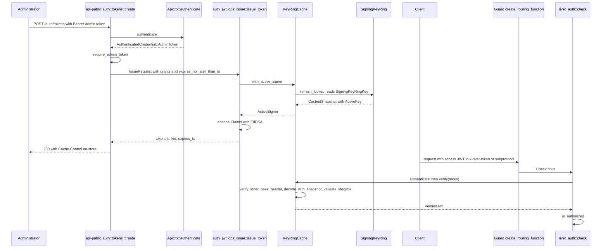
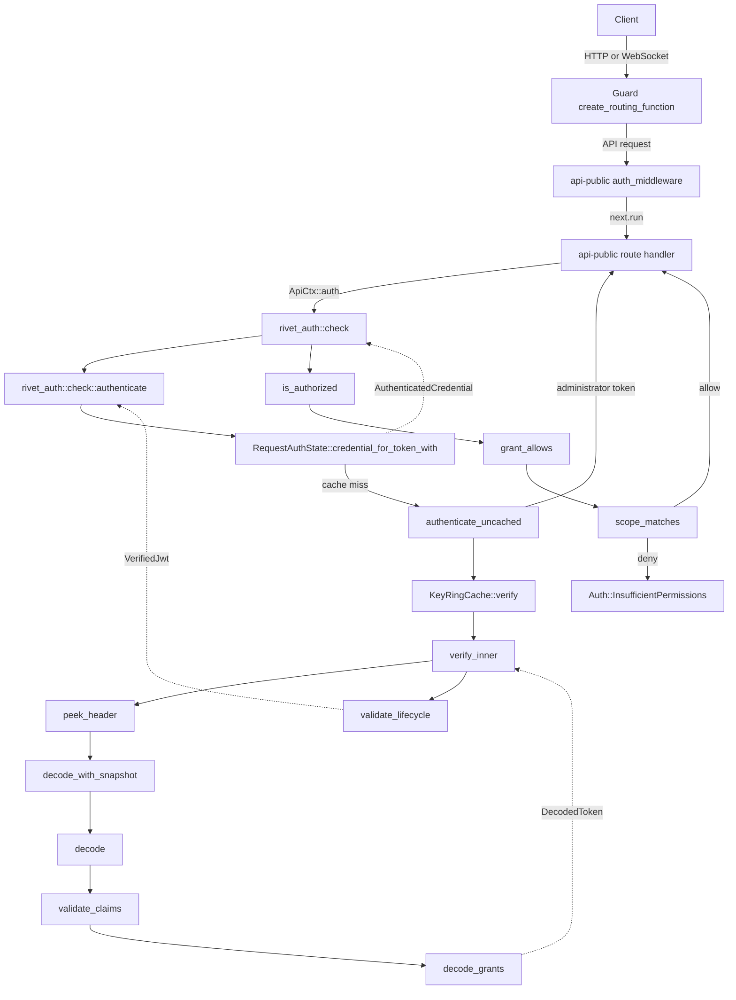
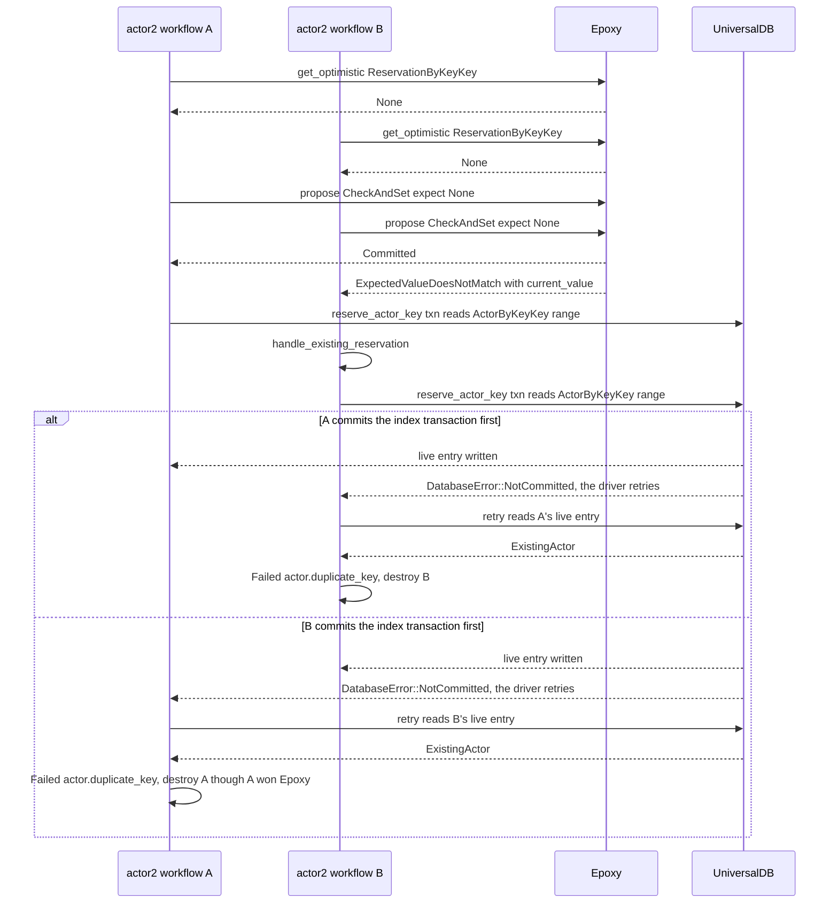

# 13 Namespaces, authentication, and authorization

Rivet decides who a request is and what it may touch in two separate steps. Authentication proves the caller holds either the administrator token or a signed access JavaScript Object Notation (JSON) Web Token (JWT). Authorization compares the request against a grant list that is scoped to one namespace and, optionally, to one Actor. An Actor is the durable compute object that a namespace owns; [03 Actors and lifecycle](03-actors-and-lifecycle.md) gives its full lifecycle. This document explains the namespace record, the Datacenter record, and every credential that the source accepts. It also explains the JSON Web Token format, the policy function, the peer trust boundary, and the Actor key reservation race. It explains the handshake of the runner and the envoy, the two node processes that section 8 describes. It reads the source at commit `4a58441c50d1ce20d8803cfb1ab7c3285a5141d6`, version 2.3.31. This is a description of the design. It is not a security audit.

The central claim is narrow. A namespace is a logical tenant boundary that appears in every namespace-scoped durable key and in every grant. The administrator token is the only bearer credential that can act across namespaces. Two other paths cross namespaces without a bearer credential. The first is the peer Application Programming Interface (API), the internal service that one control plane instance calls on another. It trusts the network. The second is `insecure_allow_unauthenticated`, a configuration flag that makes `ApiCtx::auth` return `Ok` for every resource except `Token` and `Jwt` (`engine/packages/api-public/src/ctx.rs:42-47`). Section 7 states the peer trust boundary, and section 3.1 states the token-route exception. Every JWT is bound to exactly one namespace identifier, and the grant encoding does not carry a namespace field that a client could change.

## 1. The namespace record

A namespace is the unit of tenant isolation. It has a stable identifier, a unique machine name, a display name, and a creation timestamp. The type lives in the `rivet-types` package (`engine/packages/types/src/namespaces.rs`).

```rust
// engine/packages/types/src/namespaces.rs:4-10
#[derive(Debug, Clone, Serialize, Deserialize, ToSchema)]
pub struct Namespace {
	pub namespace_id: Id,
	pub name: String,
	pub display_name: String,
	pub create_ts: i64,
}
```

| Field | Type | Purpose |
|-------|------|---------|
| `namespace_id` | `Id` | Stable identifier. It is the value that appears in every namespace-scoped durable key and in every grant. |
| `name` | `String` | Unique machine name. Clients pass this name in query parameters. It is also the key of the `ByNameKey` index. |
| `display_name` | `String` | Human-readable label. It is not unique. |
| `create_ts` | `i64` | Creation timestamp in milliseconds. The namespace value copies the workflow clock, and the workflow record stores that clock with `rivet_util::timestamp::now()`, which returns milliseconds (`engine/packages/gasoline/src/db/kv/mod.rs:306-309`; `engine/packages/util/src/timestamp.rs:6-13`). The peer list response reports the last namespace's `create_ts` as `pagination.cursor` (`engine/packages/api-peer/src/namespaces.rs:63-72`). It converts the number with `to_string()` (`:64-67`). The cursor is therefore a decimal millisecond value, not an opaque server key, and no operation reads it back. |

The identifier is not a random value alone. `Id` has one variant, `Id::V1([u8; 18])`. `Id::new_v1` places a 16-byte random value next to a 2-byte label. The label is the Datacenter label of the process that creates the namespace. The Datacenter label is the `datacenter_label` field of the Datacenter topology entry, which section 2 defines. `Config::dc_label` returns that same value (`engine/packages/config/src/config/mod.rs:350-353`).

```rust
// engine/packages/util-id/src/lib.rs:35-46
#[derive(Clone, Copy, PartialEq, Eq, Hash, PartialOrd, Ord)]
pub enum Id {
	V1([u8; 18]),
}

impl Id {
	pub fn new_v1(label: u16) -> Self {
		let mut data = [0u8; 18];
		data[..16].copy_from_slice(Uuid::new_v4().as_bytes());
		data[16..].copy_from_slice(&label.to_be_bytes());
		Id::V1(data)
	}
```

The in-memory value is 18 bytes. The byte form is 19 bytes: one version byte with the value `1`, then the 18 data bytes. The text form is 30 lower-case base-36 characters. The `Display` implementation produces them by repeated division: for each of 30 output positions, it divides the whole 19-byte number by 36 and writes the remainder. Digits `0` to `9` and letters `a` to `z` encode the values 0 to 35, and the least significant digit is written first (`engine/packages/util-id/src/lib.rs:155-183`). The version byte is the first byte of the byte form and is not part of the label.

```rust
// engine/packages/util-id/src/lib.rs:77-110
	pub fn as_bytes(&self) -> Vec<u8> {
		match self {
			Id::V1(data) => {
				let mut bytes = [0; 19];
				bytes[0] = 1; // Version byte
				bytes[1..].copy_from_slice(data);

				bytes.to_vec()
			}
		}
	}

	/// Construct an ID from its byte representation.
	pub fn from_slice(bytes: &[u8]) -> Result<Self, IdError> {
		if bytes.is_empty() {
			return Err(IdError::TooShort);
		}

		match bytes[0] {
			1 => {
				if bytes.len() != 19 {
					return Err(IdError::InvalidLength {
						expected: 19,
						got: bytes.len(),
					});
				}

				let mut data = [0u8; 18];
				data.copy_from_slice(&bytes[1..]);
				Ok(Id::V1(data))
			}
			v => Err(IdError::UnsupportedVersion(v)),
		}
	}
```

`from_slice` rejects a byte string that is not 19 bytes and a version byte that is not `1`. The text parse rejects a string that is not 30 characters. The `Display` implementation writes those 30 characters (`engine/packages/util-id/src/lib.rs:155-184`), and the Serde implementation uses the text form (`:192-208`).

The peer API creates the identifier with the current Datacenter label.

```rust
// engine/packages/api-peer/src/namespaces.rs:91-98
#[tracing::instrument(skip_all)]
pub async fn create(
	ctx: ApiCtx,
	_path: (),
	_query: (),
	body: CreateRequest,
) -> Result<CreateResponse> {
	let namespace_id = Id::new_v1(ctx.config().dc_label());
```

A later `Id::label()` call returns that Datacenter label. `label` matches the single `Id::V1` variant and reads `data[16..]` as a big-endian `u16` (`engine/packages/util-id/src/lib.rs:60-68`). Those are indices 16 and 17 of the 18-byte data array. In the 19-byte byte form they are indices 17 and 18, because the version byte shifts every data byte by one. The match has one arm, because `Id` has one variant. The function returns `u16` and cannot fail or panic. The same number is the Datacenter's Epoxy replica identifier: `Config::epoxy_replica_id` casts `dc_label()` to `u64` (`engine/packages/config/src/config/mod.rs:345-348`). The label is evidence of the creating Datacenter, not evidence of the current location of any Actor.

### 1.1 The namespace key space

The namespace package writes the record and the name index into the UniversalDB key space. UniversalDB is the storage abstraction below the record store and below Epoxy; [07 UniversalDB](07-universaldb-and-buckets.md) explains its RocksDB and PostgreSQL drivers. UniversalDB stores each value under a key. A key is a subspace prefix followed by a packed tuple. A packed tuple is an ordered byte encoding that `TuplePack` writes; each component is type-tagged, and the order of the components is the key order. The subspace is the pair `(RIVET, NAMESPACE)`. The tuple holds the remaining integers and the namespace identifier.

The integers are constants in one macro call (`engine/packages/universaldb/src/utils/keys.rs:27-95`). `RIVET` is `0`, `DATA` is `4`, `CREATE_TS` is `15`, `NAME` is `19`, `BY_NAME` is `33`, `NAMESPACE` is `39`, and `DISPLAY_NAME` is `41`.

| Constant | Value | Used in |
|----------|-------|---------|
| `RIVET` | `0` | Subspace prefix of every Rivet key. |
| `DATA` | `4` | First element of the three record tuples. |
| `CREATE_TS` | `15` | Third element of `CreateTsKey`. |
| `NAME` | `19` | Third element of `NameKey`. |
| `BY_NAME` | `33` | First element of `ByNameKey`. |
| `NAMESPACE` | `39` | Second element of the subspace prefix. |
| `DISPLAY_NAME` | `41` | Third element of `DisplayNameKey`. |

```rust
// engine/packages/namespace/src/keys/mod.rs:7-47
pub fn subspace() -> universaldb::utils::Subspace {
	universaldb::utils::Subspace::new(&(RIVET, NAMESPACE))
}

#[derive(Debug)]
pub struct NameKey {
	namespace_id: Id,
}

impl NameKey {
	pub fn new(namespace_id: Id) -> Self {
		NameKey { namespace_id }
	}

	pub fn namespace_id(&self) -> Id {
		self.namespace_id
	}
}

impl FormalKey for NameKey {
	type Value = String;

	fn deserialize(&self, raw: &[u8]) -> Result<Self::Value> {
		String::from_utf8(raw.to_vec()).map_err(Into::into)
	}

	fn serialize(&self, value: Self::Value) -> Result<Vec<u8>> {
		Ok(value.into_bytes())
	}
}

impl TuplePack for NameKey {
	fn pack<W: std::io::Write>(
		&self,
		w: &mut W,
		tuple_depth: TupleDepth,
	) -> std::io::Result<VersionstampOffset> {
		let t = (DATA, self.namespace_id, NAME);
		t.pack(w, tuple_depth)
	}
}
```

| Key type | Tuple after `(RIVET, NAMESPACE)` | Value | Purpose |
|----------|----------------------------------|-------|---------|
| `NameKey` | `(DATA, namespace_id, NAME)` | `String` | Machine name. |
| `DisplayNameKey` | `(DATA, namespace_id, DISPLAY_NAME)` | `String` | Display name. |
| `CreateTsKey` | `(DATA, namespace_id, CREATE_TS)` | `i64` | Creation timestamp. |
| `ByNameKey` | `(BY_NAME, name)` | `Id` | Unique-name index. |

The `ByNameKey` index is the only place where the name is unique. The record keys are keyed by identifier, so two records with the same name could exist without the index. The create transaction prevents that in the normal case. The name-index read uses `Serializable` isolation. Two concurrent creates of one name write the same index key, so one either conflicts or observes the first write. For a conflict, the driver retries the whole closure. The default budget is 10 retries (`engine/packages/universaldb/src/driver/postgres/database.rs:212`), and a closure can set a smaller limit with `retry_limit` (`:372-384`). The retry sees the committed index and returns `NameNotUnique`. If the conflict lasts past the retry budget, the transaction returns `MaxRetriesReached` (`:382-383`).

`MaxRetriesReached` is not a `namespace` error. It escapes the `InsertDb` activity as an outer `anyhow::Error`. Gasoline, the workflow engine package, then retries the activity, up to the activity `MAX_RETRIES`, which defaults to 5 (`engine/packages/gasoline-macros/src/lib.rs:30-35`). After the last failure, the workflow returns an error and sends neither `CreateComplete` nor `Failed`. The peer handler stays in its `tokio::select!` with no timeout, so the caller waits until the client or the transport closes the request. The source does not translate this path to a `namespace` error.

### 1.2 Creation is a workflow with a transaction

Creation runs as the `namespace` workflow. The workflow first validates the input in an activity. The activity rejects a caller that is not on the leader Datacenter. It rejects an empty name, a name longer than `util::check::MAX_IDENT_LEN`, and a name that fails `util::check::ident`. It applies separate rules to the display name: not empty, no longer than `util::check::MAX_DISPLAY_NAME_LEN`, and accepted by `util::check::display_name`.

`MAX_IDENT_LEN` is 64 and `MAX_DISPLAY_NAME_LEN` is 128 (`engine/packages/util/src/check.rs:4-5`). `ident` accepts lower-case letters, digits, and the dash. It rejects an empty string, a leading or trailing dash, a double dash, and every upper-case letter and underscore (`:18-33`). `display_name` accepts any character except non-space whitespace and rejects leading or trailing whitespace and two whitespace characters in a row (`:39-73`).

Five types carry the data. The wire types live in the peer package. The workflow and activity types live in the namespace package. `CreateRequest` and `CreateResponse` use `#[serde(deny_unknown_fields)]`, so an unknown field fails the request.

| Type | Source | Fields | Purpose |
|------|--------|--------|---------|
| `CreateRequest` | `engine/packages/api-peer/src/namespaces.rs:76-82` | `name: String`, `display_name: String` | `POST /namespaces` request body. |
| `CreateResponse` | `engine/packages/api-peer/src/namespaces.rs:84-89` | `namespace: rivet_types::namespaces::Namespace` | Response body with the new record. |
| `Input` | `engine/packages/namespace/src/workflows/namespace.rs:8-13` | `namespace_id: Id`, `name: String`, `display_name: String` | Workflow input. |
| `ValidateInput` | `engine/packages/namespace/src/workflows/namespace.rs:83-87` | `name: String`, `display_name: String` | Validation activity input. It has no identifier, because validation does not read the database. |
| `InsertDbInput` | `engine/packages/namespace/src/workflows/namespace.rs:137-143` | `namespace_id: Id`, `name: String`, `display_name: String`, `create_ts: i64` | Insert activity input. |

```rust
// engine/packages/namespace/src/workflows/namespace.rs:8-13
#[derive(Debug, Deserialize, Serialize)]
pub struct Input {
	pub namespace_id: Id,
	pub name: String,
	pub display_name: String,
}
```

The workflow sets `create_ts` from `ctx.create_ts()` when it builds `InsertDbInput` (`engine/packages/namespace/src/workflows/namespace.rs:34-41`). The value is therefore the workflow clock, not the peer API clock. `WorkflowCtx::create_ts` returns the timestamp stored in the workflow record at creation (`engine/packages/gasoline/src/ctx/workflow.rs:57-57`, `:108-108`, `:1275-1278`). A replay reads the same stored value, so a retried activity receives the same timestamp. The unit is milliseconds. The workflow record writes the value with `rivet_util::timestamp::now()` (`engine/packages/gasoline/src/db/kv/mod.rs:306-309`). That function returns `as_millis()` since the Unix epoch as an `i64` (`engine/packages/util/src/timestamp.rs:6-13`).

The workflow sends one of two messages. `CreateComplete` has no fields. `Failed` holds `error: errors::Namespace`. Both are defined in the same file (`engine/packages/namespace/src/workflows/namespace.rs:72-78`).

```rust
// engine/packages/namespace/src/workflows/namespace.rs:89-135
#[activity(Validate)]
pub async fn validate(
	ctx: &ActivityCtx,
	input: &ValidateInput,
) -> Result<std::result::Result<(), errors::Namespace>> {
	if !ctx.config().is_leader() {
		return Ok(Err(errors::Namespace::NotLeader));
	}

	if input.name.is_empty() {
		return Ok(Err(errors::Namespace::FailedToCreate {
			reason: "name too short".to_string(),
		}));
	}

	if input.name.len() > util::check::MAX_IDENT_LEN {
		return Ok(Err(errors::Namespace::FailedToCreate {
			reason: "name too long".to_string(),
		}));
	}

	if !util::check::ident(&input.name) {
		return Ok(Err(errors::Namespace::FailedToCreate {
			reason: "invalid name".to_string(),
		}));
	}

	if input.display_name.is_empty() {
		return Ok(Err(errors::Namespace::FailedToCreate {
			reason: "display name too short".to_string(),
		}));
	}

	if input.display_name.len() > util::check::MAX_DISPLAY_NAME_LEN {
		return Ok(Err(errors::Namespace::FailedToCreate {
			reason: "display name too long".to_string(),
		}));
	}

	if !util::check::display_name(&input.display_name) {
		return Ok(Err(errors::Namespace::FailedToCreate {
			reason: "invalid display name".to_string(),
		}));
	}

	Ok(Ok(()))
}
```

The activity runs on the process that Gasoline assigns the workflow to. Each engine process runs a `Worker` that polls the database and leases workflows whose names are in its registry (`engine/packages/gasoline/src/worker.rs:35-50`, `:74-90`). With a shared PostgreSQL database any process can claim the workflow. With a local RocksDB store only the process that holds that store can see it. Gasoline does not pin a workflow to the process that dispatched it. `ctx.config().is_leader()` therefore tests that workflow worker, not the process that received the peer request. A follower worker returns `NotLeader` even when the caller sent the request to the leader. The caller then receives `namespace.not_leader` through the `Failed` message. The handler has no retry and no forwarding step for this case.

The insert activity then runs one transaction. The name-index existence check uses `Serializable` isolation. The activity checks the name index, writes the three record keys, and writes the index. If the index exists, it returns `NameNotUnique` and writes nothing.

```rust
// engine/packages/namespace/src/workflows/namespace.rs:145-178
#[activity(InsertDb)]
async fn insert_db(
	ctx: &ActivityCtx,
	input: &InsertDbInput,
) -> Result<std::result::Result<(), errors::Namespace>> {
	ctx.udb()?
		.txn("namespace_create_insert_db", |tx| {
			let namespace_id = input.namespace_id;
			let name = input.name.clone();
			let display_name = input.display_name.clone();

			async move {
				let tx = tx.with_subspace(keys::subspace());

				let name_idx_key = keys::ByNameKey::new(name.clone());

				if tx.exists(&name_idx_key, Serializable).await? {
					return Ok(Err(errors::Namespace::NameNotUnique));
				}

				tx.write(&keys::NameKey::new(namespace_id), name)?;
				tx.write(&keys::DisplayNameKey::new(namespace_id), display_name)?;
				tx.write(&keys::CreateTsKey::new(namespace_id), input.create_ts)?;

				// Insert idx
				tx.write(&name_idx_key, namespace_id)?;

				Ok(Ok(()))
			}
		})
		.custom_instrument(tracing::info_span!("namespace_create_tx"))
		.await
		.map_err(Into::into)
}
```

The workflow reports `Failed` on a validation or insert error, and `CreateComplete` on success. Both messages use the topic `("namespace_id", namespace_id)` (`engine/packages/namespace/src/workflows/namespace.rs:24-56`). A topic is a Gasoline message-bus label; a subscription receives every message sent to that key. The peer API subscribes to both topics before it dispatches the workflow, then waits for one message. If `dispatch()` fails, the handler returns before it waits, and both subscriptions drop with the handler future.

```rust
// engine/packages/api-peer/src/namespaces.rs:100-125
	let mut create_sub = ctx
		.subscribe::<namespace::workflows::namespace::CreateComplete>((
			"namespace_id",
			namespace_id,
		))
		.await?;
	let mut fail_sub = ctx
		.subscribe::<namespace::workflows::namespace::Failed>(("namespace_id", namespace_id))
		.await?;

	ctx.workflow(namespace::workflows::namespace::Input {
		namespace_id,
		name: body.name.clone(),
		display_name: body.display_name.clone(),
	})
	.tag("namespace_id", namespace_id)
	.dispatch()
	.await?;

	tokio::select! {
		res = create_sub.next() => { res?; },
		res = fail_sub.next() => {
			let msg = res?;
			return Err(msg.into_body().error.build());
		}
	}
```

The `dispatch().await?` call returns an error before the wait starts. No subscription message is required for that error path. The wait is a `tokio::select!` over the two subscriptions, and `SubscriptionHandle::next` blocks until a message arrives, the subscription ends, or the transport reports an error (`engine/packages/gasoline/src/ctx/message.rs:291-327`). When the subscription ends, `next` returns `WorkflowError::SubscriptionUnsubscribed`, and `res?` returns that error from the handler (`:304-307`). The error has no `namespace` group. The peer response is therefore a plain failure, and the source does not map it to any status in the `namespace` group. Section 12 gives the status map. The wait does not observe the workflow result. If the workflow never sends either message, the request waits until the client disconnects or the transport times out. Axum drops the handler future on a client disconnect, so the two subscriptions drop. The workflow was already dispatched, and the source does not cancel it. A disconnect therefore does not stop the create, and the `Creating` state can still move to `Present` after the caller is gone. A `Failed` message becomes the API error through `msg.into_body().error.build()`. After `CreateComplete`, the handler reads the record with `get_local` (`engine/packages/api-peer/src/namespaces.rs:127-136`).

The `NotFound` arm is defensive. After `CreateComplete`, the handler calls `get_local`, and that operation first checks `is_leader`. It returns `Namespace::NotLeader` when the check fails (`engine/packages/namespace/src/ops/get_local.rs:14-17`). A handler on a follower process therefore returns `namespace.not_leader`, not `namespace.not_found`. The handler that dispatched the workflow is also the process that reads the record. With one process the record is in the same store. With the PostgreSQL driver every process reads the same database, so the record is visible to all of them. The source does not show a supported configuration in which a leader process receives `CreateComplete` and cannot read the record. A partial write cannot explain the miss, because the single transaction in section 1.2 writes every record key or none. The arm still matters for the status: `namespace.not_found` belongs to the `namespace` group, and the public API maps an unknown group to status 400.

### 1.3 The lifecycle

| State | How it is reached | Durable effect | Exit |
|-------|-------------------|----------------|------|
| Absent | No record keys exist | None | Create request |
| Creating | Workflow dispatched, no message yet | Workflow state only | `CreateComplete` or `Failed` |
| Present | Insert transaction committed | Name, display name, creation timestamp, name index | None in this commit |
| Create failed | Validation or insert returned a typed error | No record keys | The workflow sends `Failed`; the caller receives the error |
| Create abandoned | An activity exhausted its retries | No record keys | No message; the caller waits until the connection closes |

Four lifecycle facts need emphasis.

First, after `CreateComplete` the workflow enters a loop that listens for the `Update` signal. The comment in the source says "Does nothing yet" (`engine/packages/namespace/src/workflows/namespace.rs:58-67`). No code in this commit sends `Update`, and there is no update route, so the loop never runs its body.

Second, the public router registers only `GET /namespaces` and `POST /namespaces` (`engine/packages/api-public/src/router.rs:73-75`). There is no delete route and no update route. The error enum still defines `invalid_update`, but this commit has no handler that raises it (`engine/packages/namespace/src/errors.rs:23-28`).

Third, the local read operations require the leader Datacenter. `namespace_get_local` returns `NotLeader` on a follower (`engine/packages/namespace/src/ops/get_local.rs:14-17`). `namespace_list` does the same (`engine/packages/namespace/src/ops/list.rs:21-24`). A follower calls the leader through the peer API instead. The global wrappers `namespace_get_global` and `namespace_resolve_for_name_global` do this forwarding. They also use a cache on the follower (`engine/packages/namespace/src/ops/get_global.rs:9-57`, `engine/packages/namespace/src/ops/resolve_for_name_global.rs:9-53`). Name resolution is therefore not always a direct leader read. Section 1.4 describes the cache path.

Fourth, the `Present` state does not mean that the workflow exits. After `CreateComplete` the workflow stays alive in the `Update` listen loop. The "None" in the Exit column means that no durable state transition follows, not that the workflow stops.

### 1.4 How a namespace is read

The local read joins three keys and builds the type. A missing name key means the namespace does not exist. A missing display name or creation timestamp is treated as a broken record. The `context("key should exist")` call turns the absent value into an error. The error propagates out of `get_inner` and out of `get_local`. The list operation calls the same function, so one broken record aborts the whole list. The error has no `RivetError` group, so `ApiError::into_response` returns status 500 with the internal error group (`engine/packages/api-builder/src/error_response.rs:38-54`). On the peer API the error crosses `parse_response` as a failed response, and the follower returns it unchanged. The source does not state a repair path. A create with the same name cannot repair the record: the name index still exists, so the insert returns `NameNotUnique` before it writes any record key. A create with a different name makes a new identifier and does not touch the broken record.

```rust
// engine/packages/namespace/src/ops/get_local.rs:55-85
pub(crate) async fn get_inner(
	namespace_id: Id,
	tx: &universaldb::Transaction,
) -> Result<Option<Namespace>> {
	let tx = tx.with_subspace(keys::subspace());

	let name_key = keys::NameKey::new(namespace_id);
	let display_name_key = keys::DisplayNameKey::new(namespace_id);
	let create_ts_key = keys::CreateTsKey::new(namespace_id);

	let (name, display_name, create_ts) = tokio::try_join!(
		tx.read_opt(&name_key, Serializable),
		tx.read_opt(&display_name_key, Serializable),
		tx.read_opt(&create_ts_key, Serializable),
	)?;

	// Namespace not found
	let Some(name) = name else {
		return Ok(None);
	};

	let display_name = display_name.context("key should exist")?;
	let create_ts = create_ts.context("key should exist")?;

	Ok(Some(Namespace {
		namespace_id,
		name,
		display_name,
		create_ts,
	}))
}
```

The list operation scans the whole namespace subspace and keeps only `NameKey` entries. It deduplicates by namespace identifier and stops at a limit. The default limit is 1,000.

```rust
// engine/packages/namespace/src/ops/list.rs:26-68
	let namespaces = ctx
		.udb()?
		.txn("namespace_list", |tx| async move {
			let mut namespaces = Vec::new();
			let limit = input.limit.unwrap_or(1000); // Default limit to 1000

			let mut stream = tx.get_ranges_keyvalues(
				universaldb::RangeOption {
					mode: StreamingMode::Iterator,
					..(&keys::subspace()).into()
				},
				Snapshot,
			);

			let mut seen_namespaces = std::collections::HashSet::new();

			while let Some(entry) = stream.try_next().await? {
				// Try to unpack as a NameKey
				if let Ok(name_key) = keys::subspace().unpack::<keys::NameKey>(entry.key()) {
					let namespace_id = name_key.namespace_id();

					// Skip if we've already seen this namespace
					if !seen_namespaces.insert(namespace_id) {
						continue;
					}

					// Get the full namespace data
					if let Some(namespace) = super::get_local::get_inner(namespace_id, &tx).await? {
						namespaces.push(namespace);

						if namespaces.len() >= limit {
							break;
						}
					}
				}
			}

			Ok(namespaces)
		})
		.custom_instrument(tracing::info_span!("namespace_list_tx"))
		.await?;

	Ok(Output { namespaces })
```

`ListQuery` is the peer list input. It has five fields.

| Field | Type | Meaning |
|-------|------|---------|
| `limit` | `Option<usize>` | Maximum number of records. The namespace operation defaults to 1,000. |
| `cursor` | `Option<String>` | Page cursor. The handler does not read it. |
| `name` | `Option<String>` | Resolve one name and return a one-element list or an empty list. |
| `namespace_ids` | `Option<String>` | Deprecated comma-separated identifier list. |
| `namespace_id` | `Vec<Id>` | Repeatable identifier filter. |

The response has `namespaces: Vec<Namespace>` and `pagination: Pagination { cursor: Option<String> }` (`engine/packages/api-types/src/namespaces/list.rs:5-25`, `engine/packages/api-types/src/pagination.rs:4-8`). The peer handler sets the output cursor to the last record's `create_ts` (`engine/packages/api-peer/src/namespaces.rs:63-72`). The namespace operation takes only `limit` (`engine/packages/namespace/src/ops/list.rs:10-13`). The peer handler does not pass `query.cursor` to any operation. The cursor is therefore output-only. A client that sends a cursor gets the first page again, and the scan has no start key or resume position.

The filter branches differ. A `name` filter calls `resolve_for_name_global` and ignores `limit`. A non-empty identifier list calls `get_global` and ignores `limit`. The plain list calls `namespace_list` with `limit` and applies the cursor conversion above. The order of the branches is the precedence. `name` wins when it is present, even when the identifier filters are also present. Otherwise the handler concatenates the deprecated comma-separated `namespace_ids` string and the repeatable `namespace_id` list into one list (`engine/packages/api-peer/src/namespaces.rs:5-30`). The source rejects no combination of the three filters.

#### The global name resolution path

`resolve_for_name_global` is the name lookup that works on every instance. Its input has one field, `name: String`. Its output is `Option<Namespace>`. The leader runs `resolve_for_name_local`. A follower asks the leader over the peer API.

```rust
// engine/packages/namespace/src/ops/resolve_for_name_global.rs:14-53
	if ctx.config().is_leader() {
		ctx.op(crate::ops::resolve_for_name_local::Input {
			name: input.name.clone(),
		})
		.await
	} else {
		let leader_dc = ctx.config().leader_dc()?;
		let client = rivet_pools::reqwest::client().await?;

		ctx.cache()
			.clone()
			.request()
			.fetch_one_json("namespace.resolve_for_name_global", input.name.clone(), {
				let leader_dc = leader_dc.clone();
				let client = client.clone();
				move |mut cache, key| {
					let leader_dc = leader_dc.clone();
					let client = client.clone();
					async move {
						let url = leader_dc.peer_url.join("/namespaces")?;
						let res = client
							.get(url)
							.query(&[("name", &input.name)])
							.send()
							.custom_instrument(tracing::info_span!("namespaces_http_request"))
							.await?;

						let res = rivet_api_util::parse_response::<ListResponse>(res).await?;

						let ns = res.namespaces.into_iter().next();

						cache.resolve(&key, ns);

						Ok(cache)
					}
				}
			})
			.await
			.map(|x| x.flatten())
	}
```

The local path checks the leader flag again (`engine/packages/namespace/src/ops/resolve_for_name_local.rs:17-19`). It reads `ByNameKey` at Serializable isolation and then calls `get_inner` (`:31-45`). The local path caches only a found record (`:52-54`). The follower path stores the whole result in the operation cache under the key `namespace.resolve_for_name_global` plus the name. The result includes `None`, because the path passes the `Option` to `cache.resolve` (`engine/packages/namespace/src/ops/resolve_for_name_global.rs:45-45`).

The failure cases are different. A deployment without a leader fails at `leader_dc()` before the request (`:20-20`). A Hypertext Transfer Protocol (HTTP) error or a parse error returns an error, not `None` (`:34-41`). A missing name returns `None` on both paths (`engine/packages/namespace/src/ops/resolve_for_name_local.rs:36-42`). A broken record returns the `key should exist` error from `get_inner`. On the follower path the leader's peer response carries the error. `parse_response` turns a non-success status into an error, and the follower operation returns it without a translation. The public handler then returns status 500, because the error has no `RivetError` group.

### 1.5 What the namespace scopes

| Resource | How the namespace appears | Source |
|----------|---------------------------|--------|
| Actor records and indexes | `(NAMESPACE, namespace_id, ACTOR, BY_NAME_AND_KEY, name, key, create_ts, actor_id)` | `engine/packages/pegboard/src/keys/ns.rs:619-637` |
| Actor key reservations | `(EPOXY_V1, NAMESPACE, namespace_id, RESERVATION, BY_NAME_AND_KEY, name, key)` | `engine/packages/pegboard/src/keys/epoxy/ns.rs:37-50` |
| Runner records and runner workflows | Runner records use the prefix `(NAMESPACE, namespace_id, RUNNER, ...)`. The name key is `(NAMESPACE, namespace_id, RUNNER, NAME, name)`. The runner workflow input also carries `namespace_id`. The runner is the legacy node process; section 8.2 describes it. | `engine/packages/pegboard/src/keys/ns.rs:1375-1375`, `engine/packages/pegboard-runner/src/conn.rs:143-183` |
| Runner configs | `namespace_id` is part of `GlobalDataKey` | `engine/packages/pegboard/src/ops/runner/list_runner_config_enabled_dcs.rs:61-65` |
| Metrics | `(RIVET, NAMESPACE, METRIC, namespace_id, variant, ...)` | `engine/packages/namespace/src/keys/metric.rs:165-180` |
| Namespace record storage | Namespace records live in the shared UniversalDB, not in a separate database | `engine/packages/namespace/src/keys/mod.rs:7-9` |

The namespace does not scope authentication configuration. `Auth` is a deployment-level configuration value (`engine/packages/config/src/config/auth.rs:23-35`). Two namespaces in one deployment share the same administrator token, the same signing key ring, and the same JWT policy. The signing key ring is stored outside the namespace key space, under `(RIVET, AUTH, JWT)`, and the Datacenter liveness keys are also outside it.

The metric namespace holds thirteen counters. Each counter is keyed by namespace identifier and, where useful, by Actor name and request type.

```rust
// engine/packages/namespace/src/keys/metric.rs:6-34
#[derive(Debug, PartialEq, Eq)]
pub enum Metric {
	/// Seconds (actor name)
	ActorAwake(String),
	/// Count (actor name)
	TotalActors(String),
	/// Bytes (actor name)
	KvStorageUsed(String),
	/// Bytes (actor name)
	KvRead(String),
	/// Bytes (actor name)
	KvWrite(String),
	/// Count (actor name)
	AlarmsSet(String),
	/// Bytes (actor name, type)
	GatewayIngress(String, String),
	/// Bytes (actor name)
	GatewayEgress(String, String),
	/// Count (actor name, type)
	Requests(String, String),
	/// Count (actor name, type)
	ActiveRequests(String, String),
	/// Bytes (actor name)
	SqliteStorageUsed(String),
	/// Bytes (actor name)
	SqliteCommitBytes(String),
	/// Bytes (actor name)
	SqliteReadBytes(String),
}
```

The `MetricVariant` enum gives each variant an integer from `0` to `12` and a snake-case name (`engine/packages/namespace/src/keys/metric.rs:95-130`). The mapping runs from `ActorAwake = 0` to `SqliteReadBytes = 12` in declaration order. The integer is part of the key, so the order is protocol-significant. One doc comment is incomplete: `GatewayEgress(String, String)` has two arguments, but its comment names only the Actor. Every two-argument variant writes both arguments in the pack code (`engine/packages/namespace/src/keys/metric.rs:176-198`).

## 2. Datacenters and the namespace-to-replica map

A Datacenter is a topology entry, not a namespace record. The topology lists every Datacenter in the deployment. One entry is the leader. Each entry names a public origin, a peer Universal Resource Locator (URL), an optional proxy URL, and optional valid hosts.

```rust
// engine/packages/config/src/config/topology.rs:7-14
#[derive(Debug, Serialize, Deserialize, Clone, JsonSchema)]
#[serde(deny_unknown_fields)]
pub struct Topology {
	/// Must be included in `datacenters`
	pub datacenter_label: u16,
	/// Map of all datacenters, including this datacenter.
	pub datacenters: DatacentersRepr,
}
```

```rust
// engine/packages/config/src/config/topology.rs:157-179
pub struct Datacenter {
	/// When configuring `datacenters` via a hashmap this is automatically derived from the key. Required
	/// when configuring via list (which is deprecated)
	#[serde(default = "String::new")]
	pub name: String,
	pub datacenter_label: u16,
	pub is_leader: bool,
	/// Public origin that can be used to connect to this region.
	pub public_url: Url,
	/// URL of the api-peer service
	pub peer_url: Url,
	/// URL of the guard service that other datacenters can access privately. Goes to the same place as
	// public_url.
	pub proxy_url: Option<Url>,
	/// List of hosts that are valid to connect to this region with. This is used in regional
	/// endpoints to validate that incoming requests to this datacenter are going to a
	/// region-specific domain.
	///
	/// IMPORTANT: Do not use a global origin that routes to multiple different regions. This will
	/// cause unpredictable behavior when requests are expected to go to a specific region.
	#[serde(default)]
	pub valid_hosts: Option<Vec<String>>,
}
```

| Config field | Type | Purpose |
|--------------|------|---------|
| `name` | `String` | Topology key and operator label. |
| `datacenter_label` | `u16` | Numeric identity. It is also an Epoxy replica identifier. |
| `is_leader` | `bool` | Marks the leader. `Topology::leader_dc` returns the first entry with `is_leader == true`; it errors with `"topology must have a leader datacenter"` if none is true (`engine/packages/config/src/config/topology.rs:27-32`). The source does not check uniqueness. |
| `public_url` | `Url` | Public origin. The JWT issuer is derived from the leader's `public_url`. |
| `peer_url` | `Url` | The `api-peer` origin. The peer API uses this URL. |
| `proxy_url` | `Option<Url>` | Private Guard origin for Datacenter-to-Datacenter routing. Guard is the Hypertext Transfer Protocol and WebSocket gateway in front of the public API and the Actor gateway ([09 Guard](09-guard-routing.md)). |
| `valid_hosts` | `Option<Vec<String>>` | Allowed regional hosts. `validate_regional_host` compares the request `Host` with `Datacenter::is_valid_regional_host` before routing. A mismatch returns `guard.must_use_regional_host` (`engine/packages/guard/src/routing/mod.rs:372-399`). |

The Datacenter package stores only liveness data. Each process writes a last ping timestamp and a last round-trip time (RTT) for each peer.

```rust
// engine/packages/datacenter/src/keys.rs:32-41
impl TuplePack for LastPingTsKey {
	fn pack<W: std::io::Write>(
		&self,
		w: &mut W,
		tuple_depth: TupleDepth,
	) -> std::io::Result<VersionstampOffset> {
		let t = (DATA, self.dc_label, LAST_PING_TS);
		t.pack(w, tuple_depth)
	}
}
```

The ping workflow wakes every 420 seconds. The constant is `7 * 60` seconds and is named `TICK_RATE` (`engine/packages/datacenter/src/workflows/ping.rs:9-9`). The source does not state why the interval is seven minutes. Each pass sends `GET {peer_url}/health` with a 5-second timeout, then writes `LastPingTsKey` and `LastRttKey` (`engine/packages/datacenter/src/workflows/ping.rs:67-99`).

Epoxy is the replicated key-value layer that holds control-plane records across Datacenters ([08 Epoxy](08-epoxy-multi-region.md)). It runs single-decree Fast Paxos, independently for each key (`engine/packages/epoxy/README.md:3`). Paxos is a family of consensus protocols. Single-decree means that the replicas agree on one value for one key at a time, not on a shared log. It is not the EPaxos protocol; the README names EPaxos only as a reference for cross-key ordering (`engine/packages/epoxy/README.md:42`). It stores each replicated value under the replica subspace `(RIVET, EPOXY_V2, REPLICA, replica_id)` in UniversalDB. It also reads the legacy `(RIVET, EPOXY_V1, REPLICA, replica_id)` path as a fallback (`engine/packages/epoxy/src/keys/mod.rs:13-19`; `engine/packages/epoxy/src/ops/kv/get_local.rs:35-40`). It is not the UniversalDB record store. It does not hold namespace records. It copies a value to a replica set, and each replica has a numeric `ReplicaId`. `ReplicaId` is a `u64` (`engine/sdks/schemas/epoxy-protocol/v4.bare:2`).

A namespace record lives in the leader Datacenter's UniversalDB. With the `FileSystem` driver that is the leader's local RocksDB store. With the PostgreSQL driver every process points at one database, so the record is in that shared database and the leader flag decides which process serves it. The driver paragraph below states the difference in full. An Actor key reservation is not assigned to every Datacenter. It is assigned to the Datacenters that have a runner config for the pair `(namespace_id, runner_name)`. In the create request the field is `runner_name_selector`; the `actor2` workflow names the same string `pool_name` (`engine/packages/pegboard/src/ops/actor/create.rs:100-116`). The code reads every runner config across the topology. It filters to the Datacenters where the config exists. It intersects that set with the active Epoxy replicas, and it uses the result as the reservation target set.

```rust
// engine/packages/pegboard/src/ops/runner/list_runner_config_epoxy_replica_ids.rs:31-50
	let active_replicas = cluster_config
		.config
		.replicas
		.into_iter()
		.filter(|replica| matches!(replica.status, ReplicaStatus::Active))
		.map(|replica| replica.replica_id)
		.collect::<BTreeSet<_>>();

	let replicas = enabled_dcs
		.dc_labels
		.into_iter()
		.map(|dc_label| dc_label as ReplicaId)
		.filter(|replica_id| active_replicas.contains(replica_id))
		.collect::<Vec<_>>();

	if replicas.is_empty() {
		bail!("resolved runner config epoxy replica set is empty");
	}

	Ok(Output { replicas })
```

The operation joins two reads (`engine/packages/pegboard/src/ops/runner/list_runner_config_epoxy_replica_ids.rs:23-29`). `list_runner_config_enabled_dcs` returns `dc_labels: Vec<u16>` ordered by ping time to the current Datacenter, shortest first, and caches the value for 3,600,000 milliseconds (`engine/packages/pegboard/src/ops/runner/list_runner_config_enabled_dcs.rs:14-51`). `read_cluster_config` returns the Epoxy cluster configuration. `ReplicaStatus` has three variants: `Joining`, `Learning`, and `Active` (`engine/packages/epoxy/src/types.rs:22-27`). Only `Active` replicas enter the set (`v4.bare:32-38` states the same three states). The empty-set check then fails the operation with `"resolved runner config epoxy replica set is empty"`.

The `enabled_dcs` list can hold a stale entry. The source comment says that a runner can move to a new Datacenter and leave the old runner config behind. It also says that an operator must remove the old entry by hand (`engine/packages/pegboard/src/ops/runner/list_runner_config_enabled_dcs.rs:20-23`). The intersection with the active replica set does not remove a stale Datacenter that still has an `Active` replica.

| Question | Answer in this commit | Source |
|----------|----------------------|--------|
| Where is the namespace record stored? | On the leader Datacenter's UniversalDB, under `(RIVET, NAMESPACE)`. | `engine/packages/namespace/src/keys/mod.rs:7-9` |
| Which Datacenters can serve namespace reads? | The leader. Followers forward to the leader. | `engine/packages/namespace/src/ops/get_global.rs:9-57` |
| Which Datacenters hold an Actor key reservation? | Only the enabled runner-config Datacenters for that `(namespace, runner)` pair. | `engine/packages/pegboard/src/ops/runner/list_runner_config_epoxy_replica_ids.rs:31-50` |
| Is a namespace pinned to one Epoxy replica set? | No. The set is computed per `(namespace, runner_name)`. | Same file, lines 31-50 |

Each engine process configures one UniversalDB, as either `Database::Postgres(Postgres)` or `Database::FileSystem(FileSystem)` (`engine/packages/config/src/config/db/mod.rs:10-27`). The pool turns the first variant into `PostgresDatabaseDriver` and the second into `RocksDbDatabaseDriver` (`engine/packages/pools/src/db/udb.rs:49-60`). The leader's UniversalDB holds the namespace records. A follower does not hold a second copy; it calls the leader through the peer API.

The driver changes what a follower holds. With PostgreSQL, several processes can point at one database, so the leader's records are in that shared database. With the `FileSystem` variant, each process has a local RocksDB store, so a follower has no copy. The namespace code path does not change; the configuration chooses the driver.

`is_leader` is a static configuration value. `Topology::is_leader` looks up the entry for `datacenter_label` and returns its `is_leader` field, or `false` if the entry is absent (`engine/packages/config/src/config/topology.rs:39-44`). The source in this commit contains no leader election, lease, promotion, or namespace-record replication path for the Datacenter topology. A follower always sends to the `peer_url` of the entry whose `is_leader` field is true (`engine/packages/namespace/src/ops/get_global.rs:17-18`). The source does not show how a running process learns that an operator changed the flag.

The PostgreSQL driver has a different mechanism with a similar name. Its `udb_lease` table elects one process to accept database commits among the processes that share that database (section 10). That lease is internal to the driver. It does not set `is_leader`, and it does not change the topology leader.

Epoxy uses the same tuple encoding as UniversalDB. `list_runner_config_enabled_dcs` packs its `GlobalDataKey` with `namespace::keys::subspace().pack(...)` (`engine/packages/pegboard/src/ops/runner/list_runner_config_enabled_dcs.rs:61-70`). `GlobalDataKey` is the runner-config key type in the namespace subspace, not an Epoxy key. The reservation key is a different type, `ReservationByKeyKey`, whose packed bytes begin with the `EPOXY_V1` constant. It starts with `(EPOXY_V1, NAMESPACE, namespace_id, RESERVATION, ...)`. Both types use the same `TuplePack` encoding and the same integer constants, so they share one format even though their prefixes differ.

The last row of the table above matters for multi-tenancy. Two namespaces can share a replica set. One namespace can use different replica sets for different runner names. The namespace identifier is the first namespace-specific component of the reservation key, after the constants `EPOXY_V1` and `NAMESPACE`, so the keys remain distinct even when the replica set is shared.

## 3. Authentication credentials

The `rivet-auth` package exposes one entry point for both authentication and authorization. `authenticate` returns a credential. `check` authenticates and then authorizes.

```rust
// engine/packages/auth/src/check.rs:16-22
pub struct CheckInput<'a> {
	pub token: &'a str,
	pub namespace: AccessNamespaceScope,
	pub resource: ResourceKind,
	pub target: TargetScope,
	pub operation: OperationKind,
}
```

The credential is either the administrator token or a verified JWT. Four types shape the request.

| Type | Definition | Values |
|------|------------|--------|
| `AccessNamespaceScope` | `engine/packages/auth/src/scope.rs:5-10` | `Any`, `Id(Id)`, `Name(String)`. `check` resolves `Name` to an identifier before the policy call. |
| `ResourceKind` | `engine/packages/auth-policy/src/types.rs:25-35` | `Namespace`, `Actor`, `Runner`, `RunnerConfig`, `Token`, `Datacenter`, `ActorGateway`, `ActorKv`, `Jwt`. |
| `TargetScope` | `engine/packages/auth/src/scope.rs:12-18` | `Any`, `Id(Id)`. The Actor or other target. |
| `OperationKind` | `engine/packages/auth-policy/src/types.rs:85-91` | `Read`, `Update`, `List`, `Create`, `Delete`. |

Section 5 explains how the policy compares these values. The grant type uses the generic `rivet_auth_policy::types::Scope<T>`, which has the same `Any` and `Id` variants (`engine/packages/auth-policy/src/types.rs:105-109`).

```rust
// engine/packages/auth/src/check.rs:166-189
async fn authenticate_uncached(
	ctx: &StandaloneCtx,
	jwt_key_ring_cache: Option<&Arc<KeyRingCache>>,
	token: &str,
) -> Result<AuthenticatedCredential> {
	let auth = ctx.config().auth_required()?;
	if bool::from(token.as_bytes().ct_eq(auth.admin_token.read().as_bytes())) {
		return Ok(AuthenticatedCredential::AdminToken);
	}
	if !rivet_auth_jwt::is_reserved_token(token) {
		return Err(errors::Auth::InvalidToken.build());
	}
	let jwt_key_ring_cache =
		jwt_key_ring_cache.ok_or_else(|| errors::Auth::InvalidToken.build())?;
	let verified = jwt_key_ring_cache
		.verify(token)
		.await
		.map_err(rivet_auth_jwt::key_ring_cache::VerificationFailure::into_error)?;
	let authority = EffectiveAuthority::new(verified.token.grants.clone());
	Ok(AuthenticatedCredential::Jwt(JwtCredential {
		verified,
		authority,
	}))
}
```

The order of checks is explicit.

1. Compare the token with the configured administrator token. The comparison uses the `ConstantTimeEq` trait through `ct_eq`. A match returns `AdminToken` immediately. No signature check and no grant check follow.
2. If the token does not look like a reserved Rivet token, return `invalid_token`. `is_reserved_token` parses the header segment and looks for the `typ` value `rivet-auth+jwt` (`engine/packages/auth-jwt/src/codec.rs:114-154`).
3. Verify the token through the key ring cache. A verification failure is converted to an `auth` error.
4. Wrap the verified grants in `EffectiveAuthority`.

`EffectiveAuthority::new` is a plain wrapper. It does not deduplicate, sort, or validate the grants (`engine/packages/auth-policy/src/types.rs:149-161`). The type comment calls the contents "normalized" (`:143`), but the wrapper does not enforce that property. The work happens earlier: `decode_grants` runs `ValidatedGrantSet::new`, which canonicalizes the list, and then re-encodes the result to enforce the canonical form (`engine/packages/auth-jwt/src/grants.rs:126-172`). The administrator path never calls the wrapper with a grant list.

The administrator token comparison uses `ct_eq` on the configured token and the supplied token. It is not a hash comparison. The source adds no separate hash step and no length-hiding step for the administrator token, so the token length is not hidden.

### 3.1 Every credential type

The compact form `resource:operation` names one `ResourceKind` and one `OperationKind`, for example `actor:create`. This document uses that form as shorthand; the source never parses it. The token request body does not use it. The body carries `namespace`, `duration`, `subject`, and `grants`, and each grant carries `resource`, `target`, and `operations`, where `operations` is a list (`engine/packages/api-types/src/auth/tokens.rs:49-74`). The `target` field is required and is either `any` or one identifier.

| Credential | Where the request carries it | What it proves | What it grants |
|------------|-----------------------------|----------------|----------------|
| Administrator token | `Authorization: Bearer <token>` on `api-public`; `x-rivet-token`, `rivet_token.` subprotocol, actor path `@token`, or `rvt-token` on Guard | The caller knows the deployment secret | Every resource and operation, including cross-namespace requests. One exception: `GET /auth/tokens/inspect` calls `require_jwt` and rejects the administrator token with `invalid_token` (`engine/packages/api-public/src/auth/tokens.rs:146-149`, `engine/packages/auth/src/check.rs:67-72`). |
| Access JWT | `Authorization: Bearer <token>` on `api-public`; the same four Guard forms | The caller holds a token signed by the deployment key ring | Only the grants in the token, only in `rivet_ns` |
| Peer API request | No application credential | Nothing at the application layer. The source relies on network placement. | Every peer endpoint that the caller can reach |
| Runner connection JWT | `x-rivet-token` or `rivet_token.` subprotocol. Guard reads the `namespace` query parameter for the check. The handshake is the first packet exchange after the WebSocket upgrade, and section 8.2 traces it. It parses `protocol_version` (`u16`, required), `namespace` (required), and `runner_key` (required) from the query. | A JWT with `runner:create` in the named namespace. Guard does not check `runner_key`. | Connect a runner to that namespace. The parser takes the key from the query (`engine/packages/pegboard-runner/src/utils.rs:4-38`). |
| Envoy connection JWT | Same header or subprotocol. Guard reads `namespace`. The handshake parses `protocol_version`, `namespace`, `pool_name` (at most 128 bytes), `envoy_key` (3 to 128 bytes, identifier characters), and `version` (`u32`) from the query. | A JWT with `runner:create` in the named namespace | Connect an envoy to that namespace and pool. The version range is `2..=max_protocol_version` (`engine/packages/pegboard-envoy/src/utils.rs:5-90`). |
| Actor gateway token | `x-rivet-token`, WebSocket subprotocol, actor path `@token`, or query `rvt-token` | An administrator token or a JWT with `actor_gateway:read` for the Actor | Send requests to that Actor |
| Query gateway token | `rvt-token` query parameter | An administrator token or a JWT with `actor:read` or `actor:create` in the named namespace | Resolve an Actor by name and key. `rvt-method=get` asks for `actor:read`; `rvt-method=getOrCreate` asks for `actor:create` (`engine/packages/guard/src/routing/pegboard_gateway/mod.rs:152-194`). The administrator token passes `check`; the handler has no `require_jwt` call. |

Three names need a correction. The public API has no separate "public token" type. Its only credential forms are the administrator token and the access JWT. The peer API has no "peer token" type at all. It reads no credential, and its trust boundary is the network. A "runner token" is not a distinct type either. It is an access JWT that carries `runner:create` in the target namespace. The administrator token and the access JWT are the only two credential types. The other rows combine a transport with a grant, and each row states both.

The source has five transports. The first is the `Authorization: Bearer` header on the public API. The other four are on Guard: the `x-rivet-token` header, the `rivet_token.` WebSocket subprotocol, the actor path form `@token`, and the `rvt-token` query parameter. The public API reads only the first. Guard reads the other four on its routing paths.

The transports are visible in two source files. On the public API the only source is the `Authorization` header with the `Bearer ` prefix.

```rust
// engine/packages/api-public/src/router.rs:175-179
	// Extract token
	let token = headers
		.get(AUTHORIZATION)
		.and_then(|x| x.to_str().ok().and_then(|x| x.strip_prefix("Bearer ")))
		.map(|x| x.to_string());
```

This code is the `api-public` middleware. Guard forwards an API request to this router with the headers unchanged (`engine/packages/guard/src/routing/api_public.rs:20-48`). That is why the engine tests send `Authorization: Bearer` to the Guard port and still reach `api-public`.

On Guard the source depends on the connection type. A WebSocket reads the `sec-websocket-protocol` header and finds the protocol that starts with `rivet_token.`. A plain HTTP request reads `x-rivet-token`.

```rust
// engine/packages/guard/src/routing/mod.rs:127-144
	let token = if req_ctx.is_websocket() {
		req_ctx
			.headers()
			.get(SEC_WEBSOCKET_PROTOCOL)
			.and_then(|value| value.to_str().ok())
			.and_then(|protocols| {
				protocols
					.split(',')
					.map(str::trim)
					.find_map(|protocol| protocol.strip_prefix(WS_PROTOCOL_TOKEN))
			})
	} else {
		req_ctx
			.headers()
			.get(X_RIVET_TOKEN)
			.and_then(|value| value.to_str().ok())
	}
	.ok_or_else(|| rivet_auth::errors::Auth::InvalidToken.build())?;
```

The Guard constants are `X_RIVET_TARGET` (`x-rivet-target`), `X_RIVET_TOKEN` (`x-rivet-token`), `X_RIVET_SKIP_READY_WAIT` (`x-rivet-skip-ready-wait`), and the subprotocol values `rivet_target.`, `rivet_actor.`, `rivet_token.`, and `rivet_skip_ready_wait` (`engine/packages/guard/src/routing/mod.rs:20-29`). The token constants carry the credential. `rivet_target.` and `rivet_actor.` are WebSocket subprotocol prefixes. `x-rivet-token` and `x-rivet-target` are the HTTP header forms of the token and the target. The skip constants carry a flag and no credential. The Actor identifier has two transports: the `x-rivet-actor` header for HTTP and the `rivet_actor.` subprotocol for WebSocket (`engine/packages/guard/src/routing/pegboard_gateway/mod.rs:36-36`, `:240-291`). The same value also appears in the path.

The parser chooses the query path when any raw query key starts with `rvt-`. It chooses the direct path otherwise (`engine/packages/guard/src/routing/actor_path.rs:131-155`). The actor path syntax adds the token after an `@` in the Actor segment. The parser accepts `/gateway/{actor_id}@{token}/{...path}`. On a direct path, an empty identifier or an empty token returns `Ok(None)`, which makes Guard fall through to the next route. A second `@` is not special on the direct path: the parser splits on the first `@` and treats the rest as the token. On a query path, the parser returns `Err` for several causes. The causes are an empty name (`QueryEmptyActorName`), a second `@` (`QueryPathTokenSyntax`), bad percent encoding (`QueryInvalidPercentEncoding`), and duplicate `rvt-` parameters (`QueryDuplicateParam`). They also include an unknown `rvt-method` or an unknown parameter (`QueryInvalidParams`), a `get` with a parameter that only `getOrCreate` accepts (`QueryGetDisallowedParams`), and a `getOrCreate` without a pool (`QueryMissingPool`) (`engine/packages/guard/src/routing/actor_path.rs:195-330`).

```rust
// engine/packages/guard/src/routing/actor_path.rs:104-113
/// Parse actor routing information from path.
/// Matches patterns:
/// - /gateway/{actor_id}/{...path}
/// - /gateway/{actor_id}@{token}/{...path}
/// - /gateway/{name}/{...path}?rvt-namespace=...&rvt-method=...
///
/// Returns `Ok(None)` for paths that are not gateway paths or for malformed
/// direct paths (backwards-compatible silent fallthrough). Returns `Err` for
/// malformed query paths so clients receive actionable error messages.
pub fn parse_actor_path(path: &str) -> Result<Option<ParsedActorPath>> {
```

The query gateway uses the private `RvtParams` structure. All fields are strings or options, and the parser converts them later. The parser strips the reserved `rvt-` prefix before it deserializes. The query names are therefore `rvt-namespace`, `rvt-method`, `rvt-runner`, `rvt-pool`, `rvt-key`, `rvt-input`, `rvt-region`, `rvt-crash-policy`, `rvt-token`, and `rvt-skip-ready-wait` (`engine/packages/guard/src/routing/actor_path.rs:8-11`, `:231-238`).

| Field | Type | Required | Format or meaning |
|-------|------|----------|-------------------|
| `namespace` | `String` | Yes | Namespace name. |
| `method` | `String` | Yes | `get` or `getOrCreate`. Any other value returns `QueryInvalidParams`. |
| `runner` | `Option<String>` | No | Legacy name for the pool. `getOrCreate` accepts it when `rvt-pool` is absent. |
| `pool` | `Option<String>` | Only for `getOrCreate` | Pool name. |
| `key` | `Option<String>` | No | Actor key. `split_key` parses it. |
| `input` | `Option<String>` | No | Encoded input. `decode_query_input` parses it. `get` rejects it. |
| `region` | `Option<String>` | No | Region hint. `get` rejects it. |
| `crash_policy` | `Option<String>` | No | `restart`, `sleep`, or `destroy`. `get` rejects it. |
| `token` | `Option<String>` | No | Bearer credential. The auth check rejects its absence when authentication is required. |
| `skip_ready_wait` | `bool` | No, default `false` | Forward the request before the Actor reports ready. |

The ready wait is the interval between the wake signal and the Actor ready signal. When `skip_ready_wait` is true, the gateway treats the Actor as connectable even when `actor.connectable` is false (`engine/packages/guard/src/routing/pegboard_gateway/mod.rs:568-568`, `:859-859`). It therefore forwards the request without that wait. The source does not state why a client would choose this.

The parser therefore accepts a request without `rvt-token`, and `auth_query_actor_path` rejects it with `auth.invalid_token` when authentication is required (`engine/packages/guard/src/routing/pegboard_gateway/mod.rs:152-194`). A `get` request with `rvt-input`, `rvt-region`, `rvt-crash-policy`, or `rvt-runner` fails with `QueryGetDisallowedParams` (`engine/packages/guard/src/routing/actor_path.rs:284-299`). A `getOrCreate` request without `rvt-pool` and without `rvt-runner` fails with `QueryMissingPool` (`:300-304`).

### 3.2 The request cache

One Guard request can call `check` more than once. On an Actor query path, `auth_query_actor_path` checks the `Actor` resource before the query runs (`engine/packages/guard/src/routing/pegboard_gateway/mod.rs:90-91`). After the query finds the Actor, `route_request_inner` checks the `ActorGateway` resource for that Actor (`engine/packages/guard/src/routing/pegboard_gateway/mod.rs:430-452`). Both calls use the same token and the same `RequestContext`, so both use the same `RequestAuthState`. On a WebSocket upgrade, both checks complete before Guard forwards the connection to the Actor. `RequestAuthState` avoids repeated signature verification by caching one credential under a Secure Hash Algorithm 256 (SHA-256) fingerprint of the token.

```rust
// engine/packages/auth/src/check.rs:224-250
	async fn credential_for_token_with<F, Fut>(
		&self,
		token: &str,
		authenticate: F,
	) -> Result<Arc<AuthenticatedCredential>>
	where
		F: FnOnce() -> Fut,
		Fut: Future<Output = Result<AuthenticatedCredential>>,
	{
		let fingerprint: [u8; 32] = Sha256::digest(token).into();
		let mut cached = self.cached.lock().await;
		if let Some(cached) = cached.as_ref()
			&& cached.fingerprint == fingerprint
		{
			self.set_current(cached.credential.clone());
			return Ok(cached.credential.clone());
		}

		self.clear_current();
		let credential = Arc::new(authenticate().await?);
		*cached = Some(CachedCredential {
			fingerprint,
			credential: credential.clone(),
		});
		self.set_current(credential.clone());
		Ok(credential)
	}
```

The cache holds one entry, not a map. A second, different token replaces the first. The fingerprint is not a secret; it is a lookup value.

`RequestAuthState` has two owners. Each `ApiCtx` creates one in `ApiCtx::new` (`engine/packages/api-public/src/ctx.rs:20-33`). It is dropped with the request. Each Guard `RequestContext` creates one in `RequestContext::new` (`engine/packages/guard-core/src/request_context.rs:44`, `:92`). It lives for the whole request, and for a WebSocket it lives for the whole connection. The two owners use the same `rivet_auth::RequestAuthState` type; only the lifetime differs.

`RequestAuthState` has three fields (`engine/packages/auth/src/check.rs:89-94`). `cached` is `Arc<Mutex<Option<CachedCredential>>>` and holds the one credential keyed by fingerprint. `current` is `Arc<RwLock<Option<Arc<AuthenticatedCredential>>>>` and holds a second handle to the credential of the most recent successful call. `authorization_deadline_tx` is a `tokio::sync::watch::Sender<Option<u64>>`. The two credential fields have different jobs. `cached` is the lookup cache: `credential_for_token_with` compares the token fingerprint against it and skips `authenticate` on a hit (`:233-249`). `current` is a synchronous read handle for code that needs the credential without an `await`; `credential_kid()` and `authorization_deadline()` both read it (`:192-206`). No other code reads `cached`. The `u64` is the authorization deadline in whole seconds since the Unix epoch. The value is the claim `exp` plus the 30-second clock skew (`engine/packages/auth-jwt/src/key_ring_cache/mod.rs:176-180`). `set_current` writes `current` and calls `send_replace` on the channel with the same value (`:212-217`). `clear_current` writes `None` to `current` and sends `None` on the channel; it does not touch `cached` (`:219-222`). A `watch` receiver created after a send sees the latest value, so a late subscriber is not left with `None` when a credential exists. `None` means that no successful authentication is current for this request. Guard has two ways to read the result. `authorization_deadline()` reads `current` (`:192-198`, `engine/packages/guard-core/src/request_context.rs:186`). `race_authorization_deadline_updates` subscribes to the channel (`engine/packages/guard-core/src/utils.rs:678`). Both see the same value, because `set_current` writes both. A cache hit calls `set_current` again, so the deadline stays visible to Guard.

The failure path is asymmetric. `clear_current()` runs before `authenticate()`, but `*cached` is replaced only after `authenticate()` succeeds (`engine/packages/auth/src/check.rs:242-248`). A failed second token therefore leaves the first credential in `cached` and clears `current`. A later call with the first token hits the cache again and restores `current`. A cache hit does not re-check `exp`; `check` calls `is_authorized` on the stored claims (`engine/packages/auth/src/check.rs:125-164`). In Guard the expiry is still enforced. The verified credential stores `authorization_deadline` as `exp` plus the 30-second clock skew (`engine/packages/auth-jwt/src/key_ring_cache/mod.rs:176-180`, `engine/packages/auth-jwt/src/claims.rs:5`). Guard races route resolution and the proxied request against that deadline (`engine/packages/guard-core/src/proxy_service.rs:754-758`, `:808-816`). When the deadline passes first, the request fails with `Auth::TokenExpired` (`engine/packages/guard-core/src/utils.rs:659-679`). A long-lived WebSocket keeps this race for the whole session. The deadline competes with both the client-to-upstream and the upstream-to-client forwarders (`engine/packages/guard-core/src/proxy_service.rs:1647-1660`, `:2001-2018`). When it wins, Guard sends `Auth::TokenExpired` as a close frame. On the public API the window is one request, because the state belongs to `ApiCtx`. The public API does not race the deadline; a cache hit there relies on the same-request lifetime.

### 3.3 The unauthenticated bypass

Four sites read `insecure_allow_unauthenticated`. The accessor reads the optional `auth` block and returns `false` when the block is absent (`engine/packages/config/src/config/mod.rs:149-154`). On Guard, the flag short-circuits `check_connection_auth` (`engine/packages/guard/src/routing/mod.rs:124-126`), `auth_query_actor_path` (`engine/packages/guard/src/routing/pegboard_gateway/mod.rs:159-161`), and the `ActorGateway` check (`:430-430`). On the public API, `ApiCtx::auth` returns success for every resource except `Token` and `Jwt`, before it reads a token (`engine/packages/api-public/src/ctx.rs:41-47`). `ApiCtx::authenticate` does not read the flag; it always requires a token (`:67-80`). A route that calls `authenticate` therefore stays closed when the bypass is on.

`auth_required` returns the configured `Auth` value or the error `"authentication is not configured"` when the block is absent (`engine/packages/config/src/lib.rs:131-137`). `authenticate_uncached` calls it only when authentication proceeds (`engine/packages/auth/src/check.rs:166-175`). Authentication cannot proceed without the block, so the flag changes the authorization decision and does not remove the administrator token from the configuration. An operator can turn the bypass off again with no new secret.

```rust
// engine/packages/api-public/src/ctx.rs:35-65
	pub async fn auth(
		&self,
		namespace: AccessNamespaceScope,
		resource: ResourceKind,
		target: TargetScope,
		operation: OperationKind,
	) -> Result<()> {
		self.authentication_handled.store(true, Ordering::Relaxed);
		if self.config().insecure_allow_unauthenticated()
			&& !matches!(resource, ResourceKind::Token | ResourceKind::Jwt)
		{
			return Ok(());
		}
		let token = self
			.token
			.as_deref()
			.ok_or_else(|| rivet_auth::errors::Auth::InvalidToken.build())?;
		rivet_auth::check(
			self,
			self.jwt_key_ring_cache.as_ref(),
			&self.auth_state,
			rivet_auth::CheckInput {
				token,
				namespace,
				resource,
				target,
				operation,
			},
		)
		.await
	}
```

The token and JWT resources stay protected. Every other public route becomes open. The configuration comment calls this a restore of "legacy unauthenticated access behavior" (`engine/packages/config/src/config/auth.rs:28-30`). The source does not state a second reason. Three functions set one flag. `auth`, `authenticate`, and `skip_auth` each set `authentication_handled` to true (`engine/packages/api-public/src/ctx.rs:35-90`). `skip_auth` sets it without checking a credential. The middleware reads the flag after the handler. If the handler did not set it, the middleware returns status 500. The body text is `"developer error: must explicitly handle auth in all endpoints (path: {path})"` (`engine/packages/api-public/src/router.rs:188-205`). Five conditions suppress that error: a failed extractor, an `OPTIONS` request, a status of `METHOD_NOT_ALLOWED`, the path `/` or `/ui`, and any path that starts with `/ui/`.

## 4. JSON Web Token claims, signing, and verification

Rivet uses a compact JWT with the JSON Web Signature (JWS) form. The algorithm is the Edwards-curve Digital Signature Algorithm (EdDSA) over the Ed25519 curve. The token type is `rivet-auth+jwt`. The claim set is strict and rejects unknown fields.

### 4.1 The claim set

```rust
// engine/packages/auth-jwt/src/claims.rs:3-25
pub const CLAIMS_VERSION: u16 = 1;
pub const PROTOCOL_MAX_TTL: u64 = 86_400;
pub const PROTOCOL_CLOCK_SKEW: u64 = 30;

/// Rivet's versioned access-token claims profile.
///
/// Claims are intentionally strict and fail closed. Deploy verifiers that understand a new
/// `rivet_ver` before any issuer starts emitting it; additive claim changes use the same
/// verifier-first rollout because unknown fields are rejected.
#[derive(Clone, Debug, PartialEq, Eq, Serialize, Deserialize)]
#[serde(deny_unknown_fields)]
pub struct Claims {
	pub rivet_ver: u16,
	pub iss: String,
	pub aud: String,
	#[serde(skip_serializing_if = "Option::is_none")]
	pub sub: Option<String>,
	pub iat: u64,
	pub exp: u64,
	pub jti: String,
	pub rivet_ns: String,
	pub rivet_grants: String,
}
```

The one-day ceiling is defined twice. `PROTOCOL_MAX_TTL` is `86_400` in `engine/packages/auth-jwt/src/claims.rs:4`. `PROTOCOL_MAX_TTL_SECS` is `24 * 60 * 60` in `engine/packages/config/src/config/auth.rs:20`. The two values are equal, but they are separate constants in separate packages. A change to one must be matched in the other.

| Claim | Type | Meaning | Validated by |
|-------|------|---------|--------------|
| `rivet_ver` | `u16` | Claim profile version. The only accepted value is `1`. | `validate_claims` |
| `iss` | `String` | Issuer. It is the normalized leader `public_url`. | `validate_claims` |
| `aud` | `String` | Audience. The default is `rivet-api`. | `validate_claims` |
| `sub` | `Option<String>` | Optional subject. It is at most 256 bytes. | `validate_claims` |
| `iat` | `u64` | Issued-at time in seconds. | `validate_claims` |
| `exp` | `u64` | Expiration time in seconds. | `validate_claims` |
| `jti` | `String` | Token identifier. It must parse as a `TokenId`. | `validate_claims` |
| `rivet_ns` | `String` | Namespace identifier. It must parse as an `Id`. | `validate_claims` |
| `rivet_grants` | `String` | Base64url-encoded, versioned Binary Application Record Encoding (BARE) grant list. | `decode_grants` |

The `jti` value is a `TokenId`: 16 random bytes encoded as unpadded base64url (`engine/packages/auth-jwt/src/token_id.rs:8-56`). The `rivet_ns` value is a `rivet_util_id::Id`: 19 bytes (a version byte and 18 data bytes) encoded as 30 base-36 characters (`engine/packages/util-id/src/lib.rs:35-180`). `rivet_auth_jwt::Id` is a re-export of that same type (`engine/packages/auth-jwt/src/lib.rs:46-46`).

The token sizes are bounded before any JSON parser sees the payload.

| Constant | Value | Source |
|----------|-------|--------|
| `MAX_TOKEN_BYTES` | 6,144 | `engine/packages/auth-jwt/src/codec.rs:19-19` |
| `MAX_HEADER_BYTES` | 512 | `engine/packages/auth-jwt/src/codec.rs:20-20` |
| `MAX_HEADER_SEGMENT_BYTES` | 683 | `engine/packages/auth-jwt/src/codec.rs:21-21` |
| `MAX_PAYLOAD_BYTES` | 4,608 | `engine/packages/auth-jwt/src/codec.rs:22-22` |
| `SIGNATURE_BYTES` | 64 | `engine/packages/auth-jwt/src/codec.rs:23-23` |
| `MAX_SIGNATURE_SEGMENT_BYTES` | 86 | `engine/packages/auth-jwt/src/codec.rs:24-24` |
| `MAX_SUBJECT_BYTES` | 256 | `engine/packages/auth-jwt/src/codec.rs:25-25` |
| `MAX_GRANTS` | 32 | `engine/packages/auth-jwt/src/grants.rs:10-10` |
| `MAX_OPERATIONS_PER_GRANT` | 5 | `engine/packages/auth-jwt/src/grants.rs:11-11` |
| `MAX_GRANTS_BYTES` | 2,048 | `engine/packages/auth-jwt/src/grants.rs:12-12` |

### 4.2 Issuance

Issuance starts at `POST /auth/tokens`. Two early returns come first. If the `auth` block is absent, `create_inner` calls `skip_auth` and returns `IssuanceDisabled`. If `jwt.issuance_enabled()` is false, it does the same (`engine/packages/api-public/src/auth/tokens.rs:45-54`). Only then does the endpoint authenticate. It requires the administrator token. A JWT cannot issue another JWT, because `require_admin_token` rejects a `Jwt` credential with `insufficient_permissions` (`engine/packages/auth/src/check.rs:60-65`).

The administrator chooses the namespace by name in the request body. The wire `Grant` type has only `resource`, `target`, and `operations`; it has no namespace field (`engine/packages/api-types/src/auth/tokens.rs:57-74`). The handler resolves the name and sets `namespace: Scope::Id(namespace_id)` on every `OwnedGrant` (`engine/packages/api-public/src/auth/tokens.rs:57-76`). A JWT holder cannot reach this endpoint, so no non-administrator can request a token for a different namespace. The wire `Resource` enum also has no `Jwt` or `Token` variant (`engine/packages/api-types/src/auth/tokens.rs:5-16`). `ValidatedGrantSet::new` repeats both checks as a library invariant (`engine/packages/auth-jwt/src/grants.rs:21-48`).

```rust
// engine/packages/api-public/src/auth/tokens.rs:50-121
	let jwt = &auth.jwt;
	if !jwt.issuance_enabled() {
		ctx.skip_auth();
		return Err(Auth::IssuanceDisabled.build());
	}

	ctx.authenticate().await?.require_admin_token()?;
	let namespace = ctx
		.op(namespace::ops::resolve_for_name_global::Input {
			name: body.namespace,
		})
		.await?
		.ok_or_else(|| namespace::errors::Namespace::NotFound.build())?;
	let namespace_id = namespace.namespace_id;
	let grants = ValidatedGrantSet::new(
		namespace_id,
		body.grants.into_iter().map(|grant| OwnedGrant {
			namespace: Scope::Id(namespace_id),
			resource: grant.resource.into(),
			target: match grant.target {
				TargetScope::Any => Scope::Any,
				TargetScope::Id(id) => Scope::Id(id),
			},
			operations: grant.operations,
		}),
	)
	.map_err(|_| invalid_input("invalid JWT grant set"))?;
	if body
		.subject
		.as_ref()
		.is_some_and(|subject| subject.len() > rivet_auth_jwt::MAX_SUBJECT_BYTES)
	{
		return Err(invalid_input(format!(
			"subject exceeds {} UTF-8 bytes",
			rivet_auth_jwt::MAX_SUBJECT_BYTES
		)));
	}
	let duration = body
		.duration
		.unwrap_or_else(|| jwt.default_duration().as_secs());
	if duration == 0 || duration > jwt.max_duration().as_secs() {
		return Err(invalid_input(format!(
			"duration must be between 1 and {} seconds",
			jwt.max_duration().as_secs()
		)));
	}
	let now = rivet_util::timestamp::now();
	let expires_no_later_than_ts = bound_expiration(now, duration)?;

	let request = IssueRequest {
		namespace_id,
		grants: grants.into_grants(),
		expires_no_later_than_ts,
		subject: body.subject,
		issuer_token_id: rivet_auth_jwt::Id::nil(),
	};
	let issued = ctx
		.op(rivet_auth_jwt::ops::issue::Input {
			request,
			key_ring_cache: ctx.jwt_key_ring_cache()?,
		})
		.await
		.map_err(|error| {
			tracing::warn!(?error, "JWT signing request failed");
			Auth::IssuanceUnavailable.build()
		})?;

	Ok(CreateResponse {
		token: issued.token,
		issued_ts: issued.issued_ts,
		expires_ts: issued.expires_ts,
	})
```

The grant set is validated twice. The endpoint builds an `OwnedGrant` with `namespace: Scope::Id(namespace_id)`. `ValidatedGrantSet::new` then rejects several forms: an empty set, more than 32 grants, a namespace other than that identifier, and the `Jwt` and `Token` resources. It also rejects an empty operation list, or more than five operations per grant (`engine/packages/auth-jwt/src/grants.rs:21-48`).

The namespace check cannot fire on this path. The endpoint sets `Scope::Id(namespace_id)` on every grant before it calls the validator, so every grant already passes. The same is true on the decode path, where `decode_grants` sets the namespace from `rivet_ns` (`:153-155`). The check guards a future caller; it is not a live rejection path in this commit. The signer calls `ValidatedGrantSet::new` a second time (`engine/packages/auth-jwt/src/ops/issue.rs:57-58`). That call is not a tautology for the other rules: the grant vector crosses the operation boundary, and the signer rejects a payload that another caller builds. The second call also repeats the canonicalization.

`bound_expiration(now: i64, duration_seconds: u64) -> Result<i64>` builds the requested expiry. `now` is an integer count of milliseconds since the Unix epoch. `duration_seconds` is a count of whole seconds. The function converts the duration to `i64` with `i64::try_from`, multiplies by 1,000 with `checked_mul`, and adds `now` with `checked_add`. The result is `requested_expires_ts = now + duration_seconds * 1000`. Each step adds an `anyhow` context when it fails. The function then compares whole seconds: it returns `TokenExpired` when `requested_expires_ts.div_euclid(1_000) <= now.div_euclid(1_000)`. A duration of zero or less than one second is therefore rejected (`engine/packages/api-public/src/auth/tokens.rs:189-202`).

The `TokenExpired` branch is unreachable from this endpoint. The handler rejects `duration == 0`, so `duration >= 1`. The requested time is `now + duration * 1000`, and its whole-second value is always `now.div_euclid(1_000) + duration`, which is greater than `now.div_euclid(1_000)`. If another caller passed `duration_seconds == 0`, the function would return `TokenExpired`, and the error would carry the `auth.token_expired` code. The public API maps that code to status 401 Unauthorized, not 503 (`engine/packages/api-builder/src/error_response.rs:28-29`).

`bounded_expiration(issued_ts: i64, requested_expires_ts: i64, max_duration_ms: i64) -> Result<i64>` requires `requested_expires_ts > issued_ts`. It fails when that condition is false. It computes `issued_ts.checked_add(max_duration_ms)` and returns the smaller of the two values (`engine/packages/auth-jwt/src/ops/issue.rs:108-121`). It clamps a long request instead of rejecting it. The endpoint has already rejected a duration above `max_duration`, so the clamp is a second bound for other callers of the signer. Any error from the signer operation, including this one, becomes `Auth::IssuanceUnavailable` (`engine/packages/api-public/src/auth/tokens.rs:106-115`). The public API maps that code to status 503 Service Unavailable (`engine/packages/api-builder/src/error_response.rs:24-35`).

`issuer_token_id` is a field of `IssueRequest` that names the issuer credential. The public issuance path sets it to `Id::nil()`. `Id::nil()` is `Id::V1([0u8; 18])`, which is eighteen zero bytes with label `0` (`engine/packages/util-id/src/lib.rs:56-58`). Its byte form is `[1, 0, ..., 0]`, and its text form is 30 base-36 characters. It is a valid identifier, not a value that the type rejects. The signer logs the value and does not use it for a check in this commit (`engine/packages/auth-jwt/src/issuer.rs:8-14`; `engine/packages/api-public/src/auth/tokens.rs:104-104`; `engine/packages/auth-jwt/src/ops/issue.rs:34-34`).

The signer builds the claims and signs them.

```rust
// engine/packages/auth-jwt/src/ops/issue.rs:57-106
	let grants = ValidatedGrantSet::new(input.namespace_id, input.grants.clone())
		.context("invalid JWT grant set supplied to signer")?;

	let encoded_grants =
		encode_grants(&grants).context("invalid JWT grant set supplied to signer")?;
	cache
		.with_active_signer(|signer| {
			let issued_ts = signer.issued_ts;
			let expires_no_later_than_ts =
				bounded_expiration(issued_ts, input.expires_no_later_than_ts, max_duration_ms)?;

			let iat =
				u64::try_from(issued_ts.div_euclid(1_000)).context("invalid issuance timestamp")?;
			let exp = u64::try_from(expires_no_later_than_ts.div_euclid(1_000))
				.context("invalid expiration timestamp")?;
			ensure!(exp > iat, "JWT expiration must follow issuance");
			ensure!(
				exp > u64::try_from(signer.now.div_euclid(1_000))?,
				"JWT expiration must be in the future"
			);
			let jti = TokenId::generate(&mut OsRng).to_string();
			let claims = Claims {
				rivet_ver: CLAIMS_VERSION,
				iss: signer.issuer.to_owned(),
				aud: signer.audience.to_owned(),
				sub: input.subject.clone(),
				iat,
				exp,
				jti: jti.clone(),
				rivet_ns: input.namespace_id.to_string(),
				rivet_grants: encoded_grants,
			};
			let kid = signer.key.kid().to_string();
			let token = encode(signer.key, &claims).context("failed to encode JWT")?;
			let expires_ts = i64::try_from(exp)
				.context("JWT expiration does not fit in milliseconds")?
				.checked_mul(1_000)
				.context("JWT expiration overflow")?;

			Ok(IssueResponse {
				token,
				issued_ts,
				expires_ts,
				kid,
				jti,
			})
		})
		.await
		.context("failed to use active JWT signer")
}
```

The signer uses two clock values. `ActiveSigner` carries `issued_ts` and `now`. `issued_ts` is `now.div_euclid(1_000) * 1_000`, which drops the sub-second part. `now` is the exact signing time (`engine/packages/auth-jwt/src/key_ring_cache/signing.rs:81-87`). The claims `iat` and the lower bound of `bounded_expiration` come from `issued_ts`. The check `exp > signer.now.div_euclid(1_000)` uses `now`. The final lifetime therefore starts at the floored second, not at the handler's request time. A request for exactly `max_duration` seconds yields `exp` at or before the request time plus the maximum. The token is never longer than the maximum.

The `encode` function sets the JWT header to `alg = EdDSA`, `typ = rivet-auth+jwt`, and `kid` to the active key identifier (`engine/packages/auth-jwt/src/codec.rs:54-68`). The key identifier is 16 random bytes encoded as unpadded base64url (`engine/packages/auth-jwt/src/keys.rs:11-16` and `:40-44`).

### 4.3 The grant encoding does not carry a namespace

This is a security-critical detail. `encode_grants` writes the resource, the target scope, and the operations. It does not write the namespace. On decode, every grant receives `Scope::Id(namespace_id)`, where the identifier comes from the `rivet_ns` claim.

```rust
// engine/packages/auth-jwt/src/grants.rs:141-164
	let data = AuthGrantsData::deserialize_with_embedded_version(&decoded)
		.map_err(|_| TokenError::InvalidGrants)?;
	if data.grants.is_empty() || data.grants.len() > MAX_GRANTS {
		return Err(TokenError::InvalidGrants);
	}

	let mut grants = Vec::with_capacity(data.grants.len());
	for grant in data.grants {
		if grant.operations.is_empty() || grant.operations.len() > MAX_OPERATIONS_PER_GRANT {
			return Err(TokenError::InvalidGrants);
		}

		grants.push(OwnedGrant {
			namespace: Scope::Id(namespace_id),
			resource: decode_resource(grant.resource)?,
			target: match grant.target {
				auth_grants_v1::TargetScope::Any => Scope::Any,
				auth_grants_v1::TargetScope::Id(id) => {
					Scope::Id(Id::from_slice(&id).map_err(|_| TokenError::InvalidGrants)?)
				}
			},
			operations: grant.operations.into_iter().map(decode_operation).collect(),
		});
	}
```

A client can therefore change the grant targets and operations only by obtaining a new signature. The namespace binding is outside the grant list and is covered by the signature. A token for namespace A cannot carry a grant for namespace B.

The encoder writes a Binary Application Record Encoding (BARE) structure with an embedded version.

```rust
// engine/packages/auth-jwt/src/grants.rs:60-85
pub fn encode_grants(grants: &ValidatedGrantSet) -> Result<String, TokenError> {
	let data = auth_grants_v1::Data {
		grants: grants
			.grants
			.iter()
			.cloned()
			.map(|grant| auth_grants_v1::Grant {
				resource: encode_resource(grant.resource),
				target: match grant.target {
					Scope::Any => auth_grants_v1::TargetScope::Any,
					Scope::Id(id) => auth_grants_v1::TargetScope::Id(id.as_bytes()),
				},
				operations: grant.operations.into_iter().map(encode_operation).collect(),
			})
			.collect(),
	};

	let encoded = AuthGrantsData::wrap_latest(data)
		.serialize_with_embedded_version(AUTH_GRANTS_VERSION)
		.map_err(|_| TokenError::InvalidGrants)?;
	if encoded.len() > MAX_GRANTS_BYTES {
		return Err(TokenError::InvalidGrants);
	}

	Ok(URL_SAFE_NO_PAD.encode(encoded))
}
```

The schema is `engine/sdks/schemas/data/auth.grants.v1.bare`. It defines `Data { grants: list<Grant> }` and `Grant { resource, target, operations }`; the grant has no namespace field (`:30-38`). The schema `ResourceKind` enum has nine values in this order: `NAMESPACE`, `ACTOR`, `RUNNER`, `RUNNER_CONFIG`, `TOKEN`, `RESERVED`, `DATACENTER`, `ACTOR_GATEWAY`, `ACTOR_KV` (`:10-20`). The Rust enum also has nine variants, but the last one is `Jwt` (`engine/packages/auth-policy/src/types.rs:25-35`). The two lists are not the same. The schema has no `JWT` value. `encode_resource` maps `Jwt` to `unreachable!`, because validation rejects it before encoding (`engine/packages/auth-jwt/src/grants.rs:185`). `RESERVED` holds the sixth slot, between `TOKEN` and `DATACENTER`, and `decode_resource` rejects it (`:196`). A BARE `TOKEN` value does decode to `ResourceKind::Token`; the rejection happens later, in `ValidatedGrantSet::new`. `OperationKind` is an enum from `READ` to `DELETE` in the same order as the Rust enum (`:22-28`). `TargetScope` is a BARE union of `Any` and `Id`; `Id` is a byte string (`:1-8`).

`AUTH_GRANTS_VERSION` is generated from the highest schema file name. The build script parses the `.v{N}` suffix and emits a `u16` constant with that number (`engine/sdks/rust/data/build.rs:34-70`). The only grants schema is `v1`, so the version is `1`. `decode_grants` re-encodes a version-1 payload and compares the result byte-for-byte, which rejects a non-canonical order (`engine/packages/auth-jwt/src/grants.rs:166-170`).

### 4.4 Verification

The verifier reads the header first. It then calls `usable_snapshot`, which decides whether the cached key ring is good enough (`engine/packages/auth-jwt/src/key_ring_cache/refresh.rs:29-50`). Three cases apply. When the snapshot was fetched less than `verifier_max_stale` ago and refreshed within `verifier_cache_ttl`, the call returns it. When the snapshot was fetched less than `verifier_max_stale` ago but the TTL has passed, the call starts a background refresh and returns the old snapshot. In every other case the call performs a blocking refresh. A refresh failure in the last `REFRESH_FAILURE_BACKOFF`, which is 1 second, returns `VerificationUnavailable` (`:46-48`). A token whose `kid` is not in the returned snapshot triggers one bounded, forced refresh. If the key is still absent, the result is `invalid_token`. This is the path that a revoked key takes.

`refresh_unknown_kid` has five steps (`engine/packages/auth-jwt/src/key_ring_cache/refresh.rs:246-272`). First, it takes `refresh_lock`, so one caller fetches for all callers. Second, it returns the current snapshot when that snapshot is fresh and already holds the `kid`. Third, it returns `VerificationUnavailable` when a failure happened inside the same `unknown_kid_cooldown`, which defaults to 5 seconds. The check reads `last_refresh_failure_ts`, which `refresh_locked` sets on every failed fetch and clears to `i64::MIN` on every success (`:106-113`, `:293-297`). It uses that 5-second duration, not the 1-second `REFRESH_FAILURE_BACKOFF` that the ordinary refresh paths use (`:18`, `:256-258`). Fourth, it returns `None` without a fetch when a successful unknown-`kid` attempt happened inside the same cooldown. That check reads `last_unknown_refresh_ts`, which step five writes before the fetch (`:260-269`). Fifth, it records the attempt timestamp, forces a locked refresh, and returns `Some` only when the refreshed snapshot holds the `kid`. The two cases give different statuses. A recent failed fetch gives 503 `auth.verification_unavailable`. A recent successful attempt that did not find the key gives 401 `auth.invalid_token`. `verify_inner` turns a `None` into `VerificationFailure::InvalidToken`.

```rust
// engine/packages/auth-jwt/src/key_ring_cache/mod.rs:150-181
	async fn verify_inner(
		self: &Arc<Self>,
		token: &str,
	) -> Result<VerifiedJwt, VerificationFailure> {
		let header = crate::peek_header(token).map_err(map_token_error)?;
		let mut snapshot = self.usable_snapshot().await?;
		if !snapshot.keys.contains_key(&header.kid) {
			snapshot = self
				.refresh_unknown_kid(header.kid)
				.await?
				.ok_or(VerificationFailure::InvalidToken)?;
		}
		let cached_key = snapshot
			.keys
			.get(&header.kid)
			.ok_or(VerificationFailure::InvalidToken)?;

		let now = u64::try_from(rivet_util::timestamp::now() / 1000)
			.map_err(|_| VerificationFailure::VerificationUnavailable)?;
		let (decoded, retiring_issuer) =
			decode_with_snapshot(token, &cached_key.key, &snapshot, now)?;
		validate_lifecycle(&decoded, &cached_key.lifecycle, now)?;
		if retiring_issuer {
			crate::metrics::RETIRING_ISSUER_VERIFICATION_TOTAL.inc();
		}

		Ok(VerifiedJwt {
			authorization_deadline: decoded.claims.exp.saturating_add(PROTOCOL_CLOCK_SKEW),
			token: decoded,
			kid: header.kid,
		})
	}
```

The claim validation function enforces the claim profile, the lifetime bound, the issuer, the audience, the clock skew, the namespace identifier, and the grant encoding.

```rust
// engine/packages/auth-jwt/src/codec.rs:235-277
fn validate_claims(
	claims: &Claims,
	options: Option<DecodeOptions<'_>>,
) -> Result<(Id, Vec<OwnedGrant<Id, Id>>), TokenError> {
	if claims.rivet_ver != CLAIMS_VERSION
		|| claims.iss.is_empty()
		|| claims.aud.is_empty()
		|| claims
			.sub
			.as_ref()
			.is_some_and(|sub| sub.len() > MAX_SUBJECT_BYTES)
		|| TokenId::from_str(&claims.jti).is_err()
	{
		return Err(TokenError::InvalidClaims);
	}

	let lifetime = claims
		.exp
		.checked_sub(claims.iat)
		.ok_or(TokenError::InvalidClaims)?;
	if lifetime == 0 {
		return Err(TokenError::InvalidClaims);
	}
	if lifetime > PROTOCOL_MAX_TTL {
		return Err(TokenError::LifetimeTooLong);
	}

	if let Some(options) = options {
		if claims.iss != options.issuer || claims.aud != options.audience {
			return Err(TokenError::InvalidClaims);
		}
		if claims.iat > options.now.saturating_add(PROTOCOL_CLOCK_SKEW) {
			return Err(TokenError::IssuedInFuture);
		}
		if options.now >= claims.exp.saturating_add(PROTOCOL_CLOCK_SKEW) {
			return Err(TokenError::Expired);
		}
	}

	let namespace_id = Id::from_str(&claims.rivet_ns).map_err(|_| TokenError::InvalidClaims)?;
	let grants = decode_grants(namespace_id, &claims.rivet_grants)?;
	Ok((namespace_id, grants))
}
```

The lifetime rule is strict. A token with `exp == iat` is invalid. A token with a lifetime greater than 86,400 seconds is rejected even if the issuer signed it. The verifier rejects a token whose `iat` is more than 30 seconds in the future. It also rejects a token whose `exp` plus 30 seconds is at or before the current time.

The `options` parameter has two callers. `encode` passes `None`, so the issuer, audience, and clock checks do not run when Rivet signs a token (`engine/packages/auth-jwt/src/codec.rs:54-55`). `decode` always passes `Some(DecodeOptions)`, and every verification path reaches `decode` (`engine/packages/auth-jwt/src/codec.rs:70-93`). The `None` branch is therefore an encoding-time profile check, not a verification mode. No verification path in this crate calls `validate_claims` without options.

The issuer check accepts the active issuer first. If that fails with `Expired`, the verifier stops. If it fails for another reason, the verifier tries each retiring issuer whose acceptance window has not ended. A token from an accepted retiring issuer is marked as such.

```rust
// engine/packages/auth-jwt/src/key_ring_cache/validation.rs:7-46
pub(super) fn decode_with_snapshot(
	token: &str,
	key: &VerificationKey,
	snapshot: &CachedSnapshot,
	now: u64,
) -> Result<(DecodedToken, bool), VerificationFailure> {
	let decode_for = |issuer: &str| {
		decode(
			token,
			key,
			crate::DecodeOptions {
				issuer,
				audience: &snapshot.audience,
				now,
			},
		)
	};

	match decode_for(&snapshot.active_issuer) {
		Ok(token) => return Ok((token, false)),
		Err(TokenError::Expired) => return Err(VerificationFailure::Expired),
		Err(_) => {}
	}

	let now_ms = i64::try_from(now).unwrap_or(i64::MAX).saturating_mul(1_000);
	// Retiring issuers remain accepted only for their bounded migration overlap.
	for issuer in snapshot
		.retiring_issuers
		.iter()
		.filter(|issuer| now_ms < issuer.accept_until_ts)
	{
		match decode_for(&issuer.issuer) {
			Ok(token) => return Ok((token, true)),
			Err(TokenError::Expired) => return Err(VerificationFailure::Expired),
			Err(_) => {}
		}
	}

	Err(VerificationFailure::InvalidToken)
}
```

### 4.5 The key ring and its lifecycle

The signing key ring has one logical key, `SigningKeyRingKey`. It packs `(RIVET, AUTH, JWT, KEY_RING)`, and `KEY_RING` is constant `142` (`engine/packages/universaldb/src/utils/keys.rs:170-170`). The key type packs the single component `KEY_RING` (`engine/packages/auth-jwt/src/storage_keys.rs:25-33`).

The ring is an Epoxy value, not a separate UniversalDB row under that tuple. A write checks `ctx.config().is_leader()`, then sends a `CheckAndSetCommand` through `epoxy::ops::propose` (`engine/packages/auth-jwt/src/ops/key_ring/compare_and_set.rs:33-80`). A read sends `epoxy::ops::kv::get` in `Linearizable` mode (`engine/packages/auth-jwt/src/ops/key_ring/get_latest.rs:11-28`). Epoxy stores the committed value at `EPOXY_V2/replica/{replica_id}/kv/{key}/value` on each replica that holds it, and it keeps its ballot metadata beside that value in the same replica subspace (`engine/packages/epoxy/src/keys/mod.rs:13-19`; `engine/packages/epoxy/src/ops/kv/get_local.rs:35-40`). The logical key is therefore the Epoxy value key; the `(RIVET, AUTH, JWT, KEY_RING)` tuple is not a separate physical row.

A follower cannot write the ring. The `ensure!` at the start of `compare_and_set` returns the error text `"JWT signing-ring writes are leader-only"` before any proposal is sent. The caller receives a plain `anyhow` error, not a typed `auth.*` code, so the ring writer reports an operation failure rather than an authorization result.

A reader also rejects a ring that names a different owner. `fetch_snapshot_from_epoxy` sets `owner` to `ctx.config().leader_dc()?.datacenter_label` (`engine/packages/auth-jwt/src/key_ring_cache/refresh.rs:322`). `leader_dc()` returns the topology entry whose `is_leader` field is true, so the value is the same on the leader and on every follower. It is the configured leader label, not the local Datacenter label. The fetch then rejects a ring whose `leader_datacenter_id` differs from that owner, and it rejects any `leader_epoch` other than `1` (`:370-374`). The source comment says that leader changes are unsupported and that an epoch bump is not evidence of a safe handover.

The rejection is visible to the caller. The fetch returns an `anyhow` error with the text `JWT key-ring owner does not match the fixed deployment owner`. `fetch_and_cache` maps every fetch error to `VerificationFailure::VerificationUnavailable` unless it is an Epoxy v4 read error (`:137-145`). That error becomes `VerificationFailure::EpoxyV4Pending`, which lets `KeyRingCache::start` continue while the protocol upgrade is pending (`engine/packages/auth-jwt/src/key_ring_cache/mod.rs:114-120`). On the request path, `verify` converts it to `VerificationUnavailable` (`:128-135`). The API then returns 503 `auth.verification_unavailable`. The cache does not discard the previous snapshot: `fetch_and_cache` writes a new snapshot only after a successful fetch (`:241`). `usable_snapshot` can still serve the old snapshot until `verifier_max_stale` passes, which defaults to 300 seconds (`engine/packages/config/src/config/auth.rs:17`). After that, every access JWT fails with 503 until an operator restores a ring that names the configured leader.

Both calls pass `target_replicas: None`. Epoxy resolves `None` with `get_quorum_members`, which returns every replica whose status is `Active` in the cluster configuration (`engine/packages/epoxy/src/utils.rs:27-34`, `:45-78`). The ring therefore lands on every active replica. The encoded value holds `SigningKeyRecord` entries, and each entry contains a `SigningKey` with its 32-byte private seed (`engine/packages/auth-jwt/src/key_ring.rs:35-38`, `engine/packages/auth-jwt/src/keys.rs:11-16`, `:68-72`). Every active replica that stores the ring therefore stores the private keys for the active key and the pending key. A retiring key keeps only `PublicKeyRecord` (`engine/packages/auth-jwt/src/planner.rs:192-197`).

Guard's `SharedState::new` builds one `KeyRingCache` for each Guard process at startup. The cache exists only when `auth.jwt.enabled()` is true, and its mode is `SignAndVerify` when `auth.jwt.issuance_enabled()` is also true (`engine/packages/guard/src/shared_state.rs:9-26`). The same cache is passed to the `api-public` router and to every Guard authentication check (`engine/packages/guard/src/routing/api_public.rs:67-71`; `engine/packages/guard/src/routing/mod.rs:155-163`). A caller that builds the `api-public` router without Guard supplies the optional cache itself (`engine/packages/api-public/src/router.rs:56-61`). There is no second cache type.

Two flags gate different work. `Jwt::enabled` defaults to true and is the master switch for verification, issuance, and key maintenance (`engine/packages/config/src/config/auth.rs:79-82`). When it is false, Guard builds no cache (`shared_state.rs:15`), the bootstrap does not dispatch the rotation workflow (`engine/packages/bootstrap/src/lib.rs:36-41`), and the reconcile activity returns `blocked` (`engine/packages/auth-jwt/src/workflows/key_rotation/reconcile.rs:139-143`). The request path then has no verifier. `authenticate_uncached` receives `None` for the cache and returns `auth.invalid_token` for every reserved token (`engine/packages/auth/src/check.rs:175-179`). Only the administrator token authenticates. A client cannot tell this state from a forged token by the status alone, because both return 401.

`Jwt::issuance_enabled` defaults to true and is combined with `enabled()` (`auth.rs:84-86`). It changes only the cache mode and the signer check. The signer returns `JWT issuance is disabled` when the flag is false (`engine/packages/auth-jwt/src/ops/issue.rs:22-23`). Verification and key maintenance continue. The `keys` command prints both values on separate lines (section 11).

Only `SignAndVerify` puts the active private key into the snapshot (`engine/packages/auth-jwt/src/key_ring_cache/snapshot.rs:52-53`). `with_active_signer` refuses a `VerifyOnly` cache with the message "JWT signing is disabled on this cache". The signing lease is measured from the start of the ring read, not from the moment the key was activated or the previous signature. `signing_lease_valid` requires two values: `read_started_at.elapsed() < SIGNING_LEASE`, and `now - read_started_ts < SIGNING_LEASE` in milliseconds (`engine/packages/auth-jwt/src/key_ring_cache/signing.rs:59-65`). `read_started_at` and `read_started_ts` are set in `fetch_and_cache` before the fetch starts (`engine/packages/auth-jwt/src/key_ring_cache/refresh.rs:129-130`, `:189-191`). The lease therefore includes the duration of the ring read. When the lease is already stale before signing, `with_active_signer` takes `refresh_lock`, refreshes the snapshot once, and signs from the new snapshot (`signing.rs:30-47`). A failed refresh returns its error to the caller; there is no fallback signer. It then checks the same lease before it signs and again after it encodes (`:49-55`). The second check calls `active_signer(now)` and propagates its error. That call also checks `now < active.sign_until_ts`, which is the hard deadline of the key itself (`:76-79`). The hard deadline is independent of the 5-second lease. It does not refresh or retry at that point. If the lease or the hard signing deadline passed during encoding, `with_active_signer` drops the encoded token and returns the error. The public API maps that error to `auth.issuance_unavailable`, status 503 (`engine/packages/api-public/src/auth/tokens.rs:106-115`; `engine/packages/api-builder/src/error_response.rs:24-35`).

A `VerifyOnly` process verifies tokens but does not sign. A `SignAndVerify` process can sign even when it is a follower, if its configuration enables issuance. It reads the ring through Epoxy, and the ring write is leader-only. The owner check passes on the follower because it compares the ring against the configured leader label, not against the follower's own label. The active private seed is present in the follower's cache because the ring value contains it.

Pending private material is not retained in the cache. `FetchedSnapshot::from_authoritative` moves only `ring.active` into `active_signer` (`engine/packages/auth-jwt/src/key_ring_cache/snapshot.rs:39-61`). When the leader promotes the pending key, a later refresh decodes the new ring, and the promoted key is then `ring.active`, so the same constructor moves it into the signer. No separate promotion call exists in the cache.

The cache reduces the exposure that the replicated ring creates. The ring carries the private seeds, and Epoxy copies the ring to every active replica. The cache holds only the active seed, only in a process that signs, and only for the life of the snapshot.

Three cache snapshot types have different jobs. `VerificationSnapshot` is the serializable public form: claims version, active issuer and activation time, retiring issuers, audience, generation, and verification keys with lifecycle (`engine/packages/auth-jwt/src/key_ring_cache/snapshot.rs:64-103`). `FetchedSnapshot` is one fetch result: a `ReadPath`, an optional fingerprint, a `VerificationSnapshot`, and an optional `ActiveKey` (`:32-37`). `CachedSnapshot` is the in-memory form: the `VerificationSnapshot`, a `BTreeMap<KeyId, CachedKey>`, the read path and fingerprint, the issuer fields, the optional signer, and timing fields (`:205-219`). `refresh_locked` returns `Arc<CachedSnapshot>`; `fetch_snapshot_from_epoxy` returns `FetchedSnapshot`; `fetch_and_cache` converts the fetched value with `CachedSnapshot::from_wire` and attaches the signer (`engine/packages/auth-jwt/src/key_ring_cache/refresh.rs:82-106`, `:183-192`, `:315-318`).

```rust
// engine/packages/auth-jwt/src/storage_keys.rs:6-8
pub fn subspace() -> universaldb::utils::Subspace {
	universaldb::utils::Subspace::new(&(RIVET, AUTH, JWT))
}
```

The ring holds the issuer state, the audience, the leader identity, a monotonic generation, one active key, at most one pending key, a retiring list, and the last emergency receipt.

```rust
// engine/packages/auth-jwt/src/key_ring.rs:211-225
#[derive(Debug, Clone, PartialEq, Eq)]
pub struct SigningKeyRing {
	pub claims_version: u16,
	pub issuer_state: IssuerState,
	pub audience: String,
	pub leader_datacenter_id: u16,
	pub leader_epoch: u64,
	/// Configuration generation that authorized the current signing leader.
	pub leader_config_generation: u64,
	pub generation: u64,
	pub active: ActiveKey,
	pub pending: Option<PendingKey>,
	pub retiring: Vec<RetiringKey>,
	pub last_emergency_receipt: Option<EmergencyReceipt>,
}
```

| Ring field | Type | Purpose |
|------------|------|---------|
| `claims_version` | `u16` | Must equal `CLAIMS_VERSION`. |
| `issuer_state` | `IssuerState` | Active issuer, retiring issuers, and bounded history. |
| `audience` | `String` | Audience written into every token. |
| `leader_datacenter_id` | `u16` | Datacenter that owns the ring. |
| `leader_epoch` | `u64` | Leader-change counter. It is `1` for the first leader and increases only when the leader Datacenter changes. The cache rejects any value other than `1` because leader changes are unsupported (`engine/packages/auth-jwt/src/key_ring_cache/refresh.rs:370-374`). |
| `leader_config_generation` | `u64` | Configuration generation that authorized the leader. |
| `generation` | `u64` | Monotonic ring version. Rotation fences on it. |
| `active` | `ActiveKey` | Key that signs new tokens, with activation and hard deadline. |
| `pending` | `Option<PendingKey>` | Key that is published but not yet allowed to sign. |
| `retiring` | `Vec<RetiringKey>` | Public keys accepted for verification until a deadline. |
| `last_emergency_receipt` | `Option<EmergencyReceipt>` | Receipt for the last emergency revocation. |

The ring is built from smaller records. Each key record carries its own time bounds.

```rust
// engine/packages/auth-jwt/src/key_ring.rs:89-118
#[derive(Debug, Clone, PartialEq, Eq)]
pub struct ActiveKey {
	pub key: SigningKeyRecord,
	pub activated_ts: i64,
	/// Hard issuance deadline. Normal rotation happens earlier.
	pub sign_until_ts: i64,
}

#[derive(Debug, Clone, PartialEq, Eq)]
pub struct PendingKey {
	pub key: SigningKeyRecord,
	/// The key is public before this timestamp, but cannot sign until activation.
	pub activate_after_ts: i64,
}

#[derive(Debug, Clone, PartialEq, Eq)]
pub struct RetiringKey {
	pub key: PublicKeyRecord,
	pub retired_ts: i64,
	pub max_token_exp_ts: i64,
	pub verify_until_ts: i64,
}

#[derive(Debug, Clone, PartialEq, Eq)]
pub struct EmergencyReceipt {
	pub request_id: [u8; REQUEST_ID_BYTES],
	pub expected_generation: u64,
	pub committed_generation: u64,
	pub revoked_kids: Vec<KeyId>,
}
```

`IssuerState` holds the active issuer, the retiring issuers, and a bounded history (`engine/packages/auth-jwt/src/key_ring.rs:142-147`). `ActiveIssuer` has `issuer`, `activated_ts`, and `config_generation`. `RetiringIssuer` has `issuer`, `retired_ts`, and `accept_until_ts`. `IssuerHistory` has `issuer`, `activated_ts`, `retired_ts: Option<i64>`, and `config_generation`; it has no `accept_until_ts` (`engine/packages/auth-jwt/src/key_ring.rs:120-140`). `IssuerState::accepts` returns true for the active issuer or for a retiring issuer whose `accept_until_ts` is in the future (`:149-156`).

The two lists have different jobs. `retiring` is the small set that verification still accepts. `history` is the lineage record. It holds the active issuer as an entry with `retired_ts: None`, and `validate` requires that entry to exist with the same activation time and configuration generation (`engine/packages/auth-jwt/src/key_ring.rs:198-206`). The planner trims history to `ISSUER_HISTORY_LIMIT = 16` entries (`engine/packages/auth-jwt/src/key_ring.rs:10`, `engine/packages/auth-jwt/src/planner.rs:420-423`). No verification path reads `history`.

The cache converts the ring to a `VerificationSnapshot`. It drops every private key except the active key, and it keeps that key only in `SignAndVerify` mode (`engine/packages/auth-jwt/src/key_ring_cache/snapshot.rs:39-61`). The snapshot holds one `VerificationKeyEntry` for each key, and each entry has a `kid`, a public key, and a `VerificationKeyLifecycle`. The lifecycle enum has the three variants that `validate_lifecycle` matches. They are `Pending { activate_after_ts }`, `Active { activated_ts, sign_until_ts }`, and `Retiring { retired_ts, max_token_exp_ts, verify_until_ts }` (`engine/packages/auth-jwt/src/key_ring_cache/snapshot.rs:88-103`).

A key moves through three states.

| State | Can sign? | Can verify? | Exit |
|-------|-----------|-------------|------|
| `Pending` | No. Activation is scheduled at `activate_after_ts`. | Yes, for a token whose `iat` plus 30 seconds is at or after activation | Activation |
| `Active` | Yes, until `sign_until_ts` | Yes, when `iat + 30 >= activated_ts` and `iat <= sign_until_ts + 30` | Normal rotation or emergency removal |
| `Retiring` | No | Yes, until `verify_until_ts`. Only for a token with `iat` at or before `retired_ts` plus the 5-second signing lease plus 30 seconds of skew. Also `exp` at or before `max_token_exp_ts`. | Pruning |

The lifecycle check implements that table.

```rust
// engine/packages/auth-jwt/src/key_ring_cache/validation.rs:48-96
pub(super) fn validate_lifecycle(
	decoded: &DecodedToken,
	lifecycle: &VerificationKeyLifecycle,
	now_seconds: u64,
) -> Result<(), VerificationFailure> {
	let to_seconds = |milliseconds: i64| u64::try_from(milliseconds / 1000).unwrap_or(0);
	match lifecycle {
		VerificationKeyLifecycle::Pending { activate_after_ts } => {
			// Pending keys are distributed before activation so verifiers already know the public key
			// when signing switches. Possession of the pending private key must not authorize tokens
			// before the scheduled activation, apart from normal protocol clock skew.
			if decoded.claims.iat.saturating_add(PROTOCOL_CLOCK_SKEW)
				< to_seconds(*activate_after_ts)
			{
				return Err(VerificationFailure::InvalidToken);
			}
		}
		VerificationKeyLifecycle::Active {
			activated_ts,
			sign_until_ts,
		} => {
			if decoded.claims.iat.saturating_add(PROTOCOL_CLOCK_SKEW) < to_seconds(*activated_ts)
				|| decoded.claims.iat
					> to_seconds(*sign_until_ts).saturating_add(PROTOCOL_CLOCK_SKEW)
			{
				return Err(VerificationFailure::InvalidToken);
			}
		}
		VerificationKeyLifecycle::Retiring {
			retired_ts,
			max_token_exp_ts,
			verify_until_ts,
		} => {
			// Normal rotation permits one signing-cache lease after retirement, plus clock skew.
			// The persisted expiration/verification bounds cover that same allowance. Emergency
			// revocation removes the key entirely and does not use this grace period.
			if now_seconds >= to_seconds(*verify_until_ts)
				|| decoded.claims.iat
					> to_seconds(*retired_ts)
						.saturating_add(SIGNING_CACHE_LEASE.as_secs())
						.saturating_add(PROTOCOL_CLOCK_SKEW)
				|| decoded.claims.exp > to_seconds(*max_token_exp_ts)
			{
				return Err(VerificationFailure::InvalidToken);
			}
		}
	}
	Ok(())
}
```

Activation is a timer inside the key-rotation workflow. The bootstrap dispatch runs only on the leader and only when `jwt.enabled()` is true (`engine/packages/bootstrap/src/lib.rs:36-51`). Section 4.5 separates this master flag from `jwt.issuance_enabled`, which does not stop the workflow. The workflow is tagged `("auth", "jwt")` and uses `unique()`, so one instance exists for the deployment. If the workflow is absent, `request_normal` returns the error `"JWT key-rotation workflow is not running"` (`engine/packages/auth-jwt/src/ops/rotation/request_normal.rs:28-37`).

`stage_pending` sets `activate_after_ts` to the larger of the scheduled time and the publication lead. The scheduled time is `active.activated_ts + rotation_interval`. The publication lead is `now + publish_lead`. A forced rotation uses only `now + publish_lead` (`engine/packages/auth-jwt/src/planner.rs:123-156`).

Each reconcile pass checks whether a pending key exists and whether `activate_after_ts <= now`. If both are true, it calls `activate_pending` (`engine/packages/auth-jwt/src/workflows/key_rotation/reconcile.rs:443-476`). Activation sets the new active key with `activated_ts = now` and `sign_until_ts = now + max_signing_lifetime`. It moves the old active key to `retiring` with `retired_ts = now`, `max_token_exp_ts = now + lease + max_token_ttl + skew`, and `verify_until_ts = max_token_exp_ts + skew` (`engine/packages/auth-jwt/src/planner.rs:158-200`).

A blocked transition returns `Retry` with `after_ts = now + BLOCKED_RETRY`. `BLOCKED_RETRY` is 60 seconds (`engine/packages/auth-jwt/src/workflows/key_rotation/reconcile.rs:18-18`, `:584-588`). A missed activation therefore runs on the next pass, and a persistent storage failure cannot cause a hot loop.

The workflow does not run on a fixed timer. It stores a wake deadline and calls `ctx.listen_until::<Main>(deadline)` (`engine/packages/auth-jwt/src/workflows/key_rotation/mod.rs:26-34`). A `Wake::Lifecycle` deadline is the next key deadline from the reconcile result. A `Wake::Backoff` deadline is a retry after a blocked or failed pass. A signal that arrives before the deadline wakes the workflow early. When a trigger signal is already retained and the wake is a `Lifecycle` wake, `take_wait_deadline` returns `None`, so the workflow skips the wait (`engine/packages/auth-jwt/src/workflows/key_rotation/mod.rs:75-86`). The reconcile activity then runs and sets the next deadline.

The ring holds at most `NORMAL_KEY_LIMIT` keys, which is `7` (`engine/packages/auth-jwt/src/key_ring.rs:8-8`). At the limit, publication returns `Retry` at the next retiring deadline instead of adding a key (`engine/packages/auth-jwt/src/workflows/key_rotation/reconcile.rs:496-498`). `stage_pending_inner` also rejects a full ring with `"normal key-ring limit reached"` (`engine/packages/auth-jwt/src/planner.rs:133-136`).

The rotation and issuer policy has fixed defaults. All values are configurable, and validation enforces the relationships between them.

| Setting | Default | Source | Validation rule |
|---------|---------|--------|-----------------|
| Token lifetime | 3,600 seconds | `engine/packages/config/src/config/auth.rs:11-11` | `default_duration <= max_duration`. |
| Maximum lifetime | 86,400 seconds | `engine/packages/config/src/config/auth.rs:12-12` | `max_duration <= PROTOCOL_MAX_TTL_SECS`, which is 86,400 seconds. |
| Key rotation interval | 604,800 seconds (7 days) | `engine/packages/config/src/config/auth.rs:13-13` | `key_rotation_interval > 0`. |
| Key publish lead | 600 seconds (10 minutes) | `engine/packages/config/src/config/auth.rs:14-14` | `key_publish_lead < key_rotation_interval` and `key_publish_lead > verifier_cache_ttl + PUBLIC_KEY_PROPAGATION_MARGIN_SECS`. |
| Maximum signing lifetime | 1,209,600 seconds (14 days) | `engine/packages/config/src/config/auth.rs:15-15` | `key_max_signing_lifetime >= key_rotation_interval + MIN_SIGNING_FAILOVER_WINDOW_SECS`. |
| Verifier cache time to live | 60 seconds | `engine/packages/config/src/config/auth.rs:16-16` | `verifier_cache_ttl > 0`. |
| Verifier maximum stale | 300 seconds | `engine/packages/config/src/config/auth.rs:17-17` | `verifier_max_stale >= verifier_cache_ttl`. |
| Unknown-key refresh cooldown | 5 seconds | `engine/packages/config/src/config/auth.rs:18-18` | `unknown_kid_refresh_cooldown > 0`. |
| Public key propagation margin | 30 seconds | `engine/packages/config/src/config/auth.rs:19-19` | Used by the publish-lead rule. |
| Protocol maximum lifetime | 86,400 seconds | `engine/packages/config/src/config/auth.rs:20-20` | Upper bound for `max_duration`. |
| Minimum signing failover window | 604,800 seconds | `engine/packages/config/src/config/auth.rs:21-21` | Used by the signing-lifetime rule. |
| Audience | `rivet-api` | `engine/packages/config/src/config/auth.rs:10-10`, `:96-98` | Non-empty. |
| Issuer generation | 1 | `engine/packages/config/src/config/auth.rs:92-94` | Must be positive. Must increase when the derived issuer or the signing leader changes. |
| Accepted issuers | empty list | `engine/packages/config/src/config/auth.rs:54-56`, `:88-90` | Every entry is normalized; duplicates are rejected; the derived active issuer must not appear. |
| Signing cache lease | 5 seconds | `engine/packages/auth-jwt/src/lib.rs:53-55` | Used by the retiring-key check. |

`issuer_generation` is a configuration fence, not the key-ring `generation`. The key-ring `generation` increments on every committed transition (`engine/packages/auth-jwt/src/planner.rs:138-149`). `issuer_generation` comes from configuration and must be larger than the stored `issuer_state.active.config_generation` when the derived issuer changes (`engine/packages/auth-jwt/src/planner.rs:373-377`). A signing leader change without an increment is blocked with `"JWT signing leadership changed without incrementing auth.jwt.issuer_generation"` (`engine/packages/auth-jwt/src/workflows/key_rotation/reconcile.rs:227-234`). A stale process is blocked with `"this process has stale auth.jwt.issuer_generation configuration"` (`:285-295`). `accepted_issuers` holds previous issuers during a migration, and each entry is normalized before use (`engine/packages/config/src/config/auth.rs:141-157`).

A stale process is a control plane instance whose configuration carries a lower `issuer_generation` than the committed ring. `reconcile_issuer` returns `IssuerReconcile::StaleConfiguration` when `issuer_config_generation < ring.issuer_state.active.config_generation` (`engine/packages/auth-jwt/src/planner.rs:322-327`). The comment there names the cause: a mixed-version leader deployment can run the activity on a process with an older topology snapshot. The workflow then blocks and does not mutate the ring (`engine/packages/auth-jwt/src/workflows/key_rotation/reconcile.rs:285-295`).

The function that enforces these relationships is `Jwt::validate` (`engine/packages/config/src/config/auth.rs:141-212`). It returns `anyhow::Result<()>` and uses `ensure!` with a written message, so the first failed rule names itself in the error. It also requires a positive `issuer_generation`, a non-empty audience, and a unique `accepted_issuers` list that does not contain the derived active issuer. `Auth::validate` calls it (`engine/packages/config/src/config/auth.rs:38-44`), and `Config::validate` calls that during configuration load (`engine/packages/config/src/config/mod.rs:266-266`). A bad value stops startup.

The issuer is derived from the leader Datacenter's public URL. `derive_issuer` reads `leader_dc().public_url` and fails with `"cannot derive JWT issuer without a topology leader"` when no leader exists (`engine/packages/config/src/config/auth.rs:249-256`).

`normalize_issuer(url: &Url) -> Result<String>` applies five `ensure!` checks in order (`engine/packages/config/src/config/auth.rs:216-233`).

1. The scheme is `http` or `https`. The message is `"JWT issuers must use http or https"`.
2. The username is empty and the password is absent. The message is `"JWT issuers cannot contain credentials"`.
3. The query is absent. The message is `"JWT issuers cannot contain a query"`.
4. The fragment is absent. The message is `"JWT issuers cannot contain a fragment"`.
5. `host_str()` returns `Some`. The message is `"JWT issuers must be absolute URLs"`.

It then trims every trailing `/` from the path. An empty result becomes `/`. It serializes the URL and removes one final `/` (`engine/packages/config/src/config/auth.rs:235-246`). The result is the `iss` claim and the issuer string in the ring. The source does not state which other normalizations the `Url` parser applies.



Three names in the diagram need a definition. `SigningKeyRingKey` is the UniversalDB key type for the ring. It packs the constant `KEY_RING` under the subspace `(RIVET, AUTH, JWT)`, and its value type is `SigningKeyRing` (`engine/packages/auth-jwt/src/storage_keys.rs:6-32`). `refresh_locked` is the cache function that fetches the ring under a lock. It returns the current snapshot when the snapshot is fresh and `force` is false. It also returns the snapshot when a recent local fallback is still usable (`engine/packages/auth-jwt/src/key_ring_cache/refresh.rs:82-101`). Otherwise it calls `fetch_and_cache`. `SigningKeyRing` is the decoded ring. It holds the claims version, the issuer state, the audience, the signing leader fields, and the generation. It also holds the active key, an optional pending key, the retiring keys, and the last emergency receipt (`engine/packages/auth-jwt/src/key_ring.rs:211-225`).

## 5. Scopes and the policy decision

Authorization uses two scope types. The caller side can name a namespace by identifier, by name, or use `Any`. The target side can name one Actor identifier or use `Any`.

```rust
// engine/packages/auth/src/scope.rs:5-18
#[derive(Clone, Debug)]
pub enum AccessNamespaceScope {
	Any,
	Id(Id),
	Name(String),
}

#[derive(Clone, Copy, Debug, Deserialize, Serialize, ToSchema)]
#[serde(rename_all = "snake_case", deny_unknown_fields)]
#[schema(as = AuthTargetScope)]
pub enum TargetScope {
	Any,
	Id(Id),
}
```

Both types convert into the generic policy scope. `AccessNamespaceScope::Name` first resolves to an identifier through `namespace::ops::resolve_for_name_global`, so the policy layer never compares names (`engine/packages/auth/src/check.rs:136-150`). The policy type is two variants.

```rust
// engine/packages/auth-policy/src/types.rs:105-118
#[derive(Debug, Clone, Copy, PartialEq, Eq, PartialOrd, Ord, Hash, Serialize, Deserialize)]
pub enum Scope<T> {
	Any,
	Id(T),
}

impl<T> Scope<T> {
	pub fn as_ref(&self) -> Scope<&T> {
		match self {
			Scope::Any => Scope::Any,
			Scope::Id(id) => Scope::Id(id),
		}
	}
}
```

The policy types are in `rivet-auth-policy`.

| Type | Fields | Purpose |
|------|--------|---------|
| `AccessRequest<NamespaceId, TargetId>` | `namespace: Scope<NamespaceId>`, `resource: ResourceKind`, `target: Scope<TargetId>`, `operation: OperationKind` | One question that a caller asks. |
| `Grant<'a, NamespaceId, TargetId>` | `namespace: Scope<NamespaceId>`, `resource: ResourceKind`, `target: Scope<TargetId>`, `operations: &'a [OperationKind]` | One borrowed permission rule. |
| `OwnedGrant<NamespaceId, TargetId>` | Same fields with `Vec<OperationKind>` | One stored permission rule. |
| `EffectiveAuthority<NamespaceId, TargetId>` | `grants: Vec<OwnedGrant<NamespaceId, TargetId>>` | The complete grant set of one credential. |

In this codebase the namespace and target parameters are both `rivet_util::Id` (`engine/packages/auth-jwt/src/grants.rs:15-18`).

`ResourceKind` has nine variants and `OperationKind` has five (`engine/packages/auth-policy/src/types.rs:25-171`).

| `ResourceKind` | Meaning |
|----------------|---------|
| `Namespace` | The namespace record. |
| `Actor` | An Actor record or Actor name list. |
| `Runner` | A runner record or runner list. |
| `RunnerConfig` | A runner configuration. |
| `Token` | Access JWT issuance. |
| `Datacenter` | A Datacenter record. |
| `ActorGateway` | The request gateway for one Actor. |
| `ActorKv` | The key-value store of one Actor. |
| `Jwt` | JWT inspection or control-plane token operations. |

| `OperationKind` | Meaning |
|-----------------|---------|
| `Read` | Read one object. |
| `Update` | Change one object. |
| `List` | Enumerate objects. |
| `Create` | Create one object. |
| `Delete` | Remove one object. |

The request path has three authorization points. Guard checks the runner and envoy connections with `check_connection_auth` (`engine/packages/guard/src/routing/runner.rs:58-58`, `engine/packages/guard/src/routing/envoy.rs:58-58`). Guard checks the Actor gateway paths with `auth_query_actor_path` and the Actor resource. The public API checks each route. An `api-public` request that arrives through Guard is not checked at Guard; Guard forwards it with unchanged headers (`engine/packages/guard/src/routing/api_public.rs:20-48`). The `api-public` route handler performs the check. All three points end in `rivet_auth::check`. The diagram shows the public API path. Section 8 shows the runner and envoy connection path.



The administrator branch skips `KeyRingCache::verify`, `validate_claims`, and the policy functions. `authenticate_uncached` returns `AuthenticatedCredential::AdminToken`, and `check` returns `Ok` before it calls `is_authorized`. That shortcut is the reason the administrator token can cross namespaces.

The decision function is pure. It compares the resource, the operation, and both scopes.

```rust
// engine/packages/auth-policy/src/authorize.rs:1-46
use crate::{AccessRequest, Grant, OwnedGrant, Scope};

/// `Scope::Any` widens only the grant side of the comparison.
pub fn grant_allows<NamespaceId: PartialEq, TargetId: PartialEq>(
	grant: &Grant<'_, NamespaceId, TargetId>,
	request: &AccessRequest<NamespaceId, TargetId>,
) -> bool {
	grant.resource == request.resource
		&& grant.operations.contains(&request.operation)
		&& scope_matches(&grant.namespace, &request.namespace)
		&& scope_matches(&grant.target, &request.target)
}

pub fn is_authorized<'a, NamespaceId: PartialEq, TargetId: PartialEq>(
	request: &AccessRequest<NamespaceId, TargetId>,
	grants: impl IntoIterator<Item = Grant<'a, NamespaceId, TargetId>>,
) -> bool {
	grants
		.into_iter()
		.any(|grant| grant_allows(&grant, request))
}

/// This prevents delegation from widening namespace, resource, target, or operation authority.
pub fn can_delegate<NamespaceId: PartialEq, TargetId: PartialEq>(
	parent: &[OwnedGrant<NamespaceId, TargetId>],
	requested: &[OwnedGrant<NamespaceId, TargetId>],
) -> bool {
	requested.iter().all(|grant| {
		grant.operations.iter().all(|&operation| {
			let request = AccessRequest {
				namespace: grant.namespace.as_ref(),
				resource: grant.resource,
				target: grant.target.as_ref(),
				operation,
			};
			is_authorized(&request, parent.iter().map(OwnedGrant::as_grant))
		})
	})
}
fn scope_matches<T: PartialEq>(grant: &Scope<T>, request: &Scope<T>) -> bool {
	match (grant, request) {
		(Scope::Any, _) => true,
		(Scope::Id(grant_id), Scope::Id(request_id)) => grant_id == request_id,
		(Scope::Id(_), Scope::Any) => false,
	}
}
```

The matching rule is asymmetric. `Scope::Any` on the grant matches every request. `Scope::Any` on the request matches only a grant of `Scope::Any`. A grant that names one identifier never satisfies a request for "any".

A target identifier has no namespace prefix in the policy. `TargetScope::Id(id)` compares the raw `Id` value (`engine/packages/auth-policy/src/types.rs:120-134`). The namespace scope is the barrier. A token for namespace A carries grants scoped to A, so a request that names namespace B fails on the namespace comparison even when the target identifier matches. The policy does not check that the target Actor belongs to the namespace; the Actor record lookup does that.

Verification does not confirm that the namespace identifier exists. `validate_claims` parses `rivet_ns` and `decode_grants` binds the grants to it (`engine/packages/auth-jwt/src/codec.rs:274-276`). Neither step reads the namespace record. A token for a deleted or never-created namespace verifies. A later request fails only when a handler resolves the namespace name or reads the record.

The namespace create route shows the request that no tenant grant can satisfy.

```rust
// engine/packages/api-public/src/namespaces.rs:84-90
	ctx.auth(
		AccessNamespaceScope::Any,
		ResourceKind::Namespace,
		TargetScope::Any,
		OperationKind::Create,
	)
	.await?;
```

The list route uses the same namespace and target scope. It asks for `OperationKind::List` when the query has no identifier and no name, and for `OperationKind::Read` when one filter is present (`engine/packages/api-public/src/namespaces.rs:32-43`). Both operations are namespace-level, so both are administrator-only.

**Aha:** The asymmetry is the reason a tenant token can never list or create namespaces. Every JWT grant is decoded with `Scope::Id(namespace_id)`. The public namespace list and create routes ask with `AccessNamespaceScope::Any`. `scope_matches` returns false for that pair, so `is_authorized` refuses. This holds for the filtered `Read` branch too, because the filter changes the operation and not the scope. Only the administrator token, which returns before the policy call, passes. When `insecure_allow_unauthenticated` is true, `ApiCtx::auth` also returns `Ok` for these routes, so the insecure bypass passes too (section 3.3). The obvious alternative is to let a namespace-scoped grant satisfy an `Any` request, or to let a JWT carry `Scope::Any`. That would let one tenant enumerate every tenant and create new tenants. The cost of the current choice is real: an operator cannot delegate tenant creation to a scoped token. Every namespace-level operation needs the administrator token, or the insecure bypass. The source does not state whether that cost was accepted deliberately.

The policy package exposes `can_delegate`, but no production caller uses it in this commit. Only the unit tests call it (`engine/packages/auth-policy/tests/authorize.rs:124-196`). It is not part of any endpoint.

### 5.1 `check` builds the request and calls the policy

`check` converts the caller scopes into policy scopes, resolves a namespace name if necessary, and calls `is_authorized`. A `Name` that does not resolve returns `namespace.not_found`. A resolved name becomes an identifier.

```rust
// engine/packages/auth/src/check.rs:125-164
pub async fn check(
	ctx: &StandaloneCtx,
	jwt_key_ring_cache: Option<&Arc<KeyRingCache>>,
	request_state: &RequestAuthState,
	input: CheckInput<'_>,
) -> Result<()> {
	let credential = authenticate(ctx, jwt_key_ring_cache, request_state, input.token).await?;
	if matches!(&*credential, AuthenticatedCredential::AdminToken) {
		return Ok(());
	}
	let jwt = credential.require_jwt()?;
	let namespace = match input.namespace {
		AccessNamespaceScope::Any => Scope::Any,
		AccessNamespaceScope::Id(namespace_id) => Scope::Id(namespace_id),
		AccessNamespaceScope::Name(name) => {
			let namespace = ctx
				.op(namespace::ops::resolve_for_name_global::Input { name })
				.await?
				.ok_or_else(|| namespace::errors::Namespace::NotFound.build())?;
			Scope::Id(namespace.namespace_id)
		}
	};
	let target = match input.target {
		TargetScope::Any => Scope::Any,
		TargetScope::Id(target_id) => Scope::Id(target_id),
	};
	let request = AccessRequest {
		namespace: namespace.as_ref(),
		resource: input.resource,
		target: target.as_ref(),
		operation: input.operation,
	};
	if !is_authorized(
		&request,
		jwt.authority().grants().iter().map(OwnedGrant::as_grant),
	) {
		return Err(errors::Auth::InsufficientPermissions.build());
	}
	Ok(())
}
```

Three consequences follow directly from this code.

1. The administrator token never reaches `is_authorized`. It bypasses every grant check.
2. A namespace name is resolved before the grant check. A missing name returns a namespace error, not a permission error.
3. A caller can distinguish an existing namespace name from a missing one by the status code, if the caller already holds a valid JWT. The source does not hide that difference.

### 5.2 A route guard

The public namespace routes are the clearest example. List uses `OperationKind::List` when the query has no identifier and no name, and `Read` otherwise. Create always uses `OperationKind::Create`. Both pass `AccessNamespaceScope::Any` and `TargetScope::Any`.

```rust
// engine/packages/api-public/src/namespaces.rs:32-59
async fn list_inner(ctx: ApiCtx, query: ListQuery) -> Result<ListResponse> {
	ctx.auth(
		AccessNamespaceScope::Any,
		ResourceKind::Namespace,
		TargetScope::Any,
		if query.namespace_ids.is_none() && query.namespace_id.is_empty() && query.name.is_none() {
			OperationKind::List
		} else {
			OperationKind::Read
		},
	)
	.await?;

	if ctx.config().is_leader() {
		rivet_api_peer::namespaces::list(ctx.into(), (), query).await
	} else {
		let leader_dc = ctx.config().leader_dc()?;
		request_remote_datacenter::<ListResponse>(
			ctx.config(),
			leader_dc.datacenter_label,
			"/namespaces",
			axum::http::Method::GET,
			Some(&query),
			Option::<&()>::None,
		)
		.await
	}
}
```

A namespace-scoped route guard is different. The Actor name list route resolves the namespace from the query and asks for the Actor list operation.

```rust
// engine/packages/api-public/src/actors/list_names.rs:46-52
	ctx.auth(
		AccessNamespaceScope::Name(query.namespace.clone()),
		ResourceKind::Actor,
		TargetScope::Any,
		OperationKind::List,
	)
	.await?;
```

### 5.3 Allow and deny examples

The policy tests give two allow assertions and four deny assertions. The transport plays no part. `grant_allows` compares two values only: the `Grant` and the `AccessRequest`.

```rust
// engine/packages/auth-policy/tests/authorize.rs:31-69
#[test]
fn matches_exact_and_wildcard_scopes() {
	let namespace_id = 1;
	let target_id = 2;

	assert!(grant_allows(
		&grant(Scope::Id(namespace_id), Scope::Id(target_id)),
		&request(Scope::Id(namespace_id), Scope::Id(target_id)),
	));
	assert!(grant_allows(
		&grant(Scope::Any, Scope::Any),
		&request(Scope::Id(namespace_id), Scope::Id(target_id)),
	));
}

#[test]
fn rejects_scope_mismatches() {
	let namespace_id = 1;
	let other_namespace_id = 2;
	let target_id = 3;
	let other_target_id = 4;

	assert!(!grant_allows(
		&grant(Scope::Id(namespace_id), Scope::Any),
		&request(Scope::Any, Scope::Any),
	));
	assert!(!grant_allows(
		&grant(Scope::Id(namespace_id), Scope::Any),
		&request(Scope::Id(other_namespace_id), Scope::Any),
	));
	assert!(!grant_allows(
		&grant(Scope::Any, Scope::Id(target_id)),
		&request(Scope::Any, Scope::Any),
	));
	assert!(!grant_allows(
		&grant(Scope::Any, Scope::Id(target_id)),
		&request(Scope::Any, Scope::Id(other_target_id)),
	));
}
```

The table uses this notation. A `Grant` field has the form (namespace scope, target scope, `ResourceKind`, `[OperationKind]`). A request field has the same form, but its operation is a single `OperationKind`. A row writes only the fields that the assertion varies. Every field that the row does not write is equal on both sides and is one identifier in the same namespace.

| Example | Grant | Request | Result | Reason |
|---------|-------|---------|--------|--------|
| Exact allow | Namespace 1, Actor 2, `Actor`, `[Read]` | Namespace 1, Actor 2, `Actor`, `Read` | Allow | Every field matches. |
| Wildcard grant | `Any`, `Any`, `Actor`, `[Read]` | Namespace 1, Actor 2, `Actor`, `Read` | Allow | A grant `Any` matches a request identifier. |
| Wrong namespace | Namespace 1 | Namespace 2 | Deny | Both sides are identifiers and they differ. |
| Grant identifier against request `Any` | Namespace 1 | `Any` | Deny | The grant cannot widen itself. |
| Wrong resource | `Runner`, `[Read]` | `Actor`, `Read` | Deny | The resource differs. |
| Wrong operation | `Actor`, `[Create]` | `Actor`, `Read` | Deny | The operation list does not contain `Read`. |

The last two rows come from `requires_resource_and_operation_match` (`engine/packages/auth-policy/tests/authorize.rs:71-93`).

## 6. The authorization policy package

`rivet-auth-policy` has no I/O and no dependencies on the control plane. It contains four small files.

| File | Contents |
|------|----------|
| `engine/packages/auth-policy/src/lib.rs` | Re-exports `can_delegate`, `grant_allows`, and `is_authorized`, and the seven types in `types.rs`. |
| `engine/packages/auth-policy/src/types.rs` | `ResourceKind`, `OperationKind`, `Scope`, `AccessRequest`, `Grant`, `OwnedGrant`, `EffectiveAuthority`. |
| `engine/packages/auth-policy/src/authorize.rs` | `grant_allows`, `is_authorized`, `can_delegate`, and the private helper `scope_matches`. |
| `engine/packages/auth-policy/src/errors.rs` | The public `auth` error group. |

The error group has six codes (`engine/packages/auth-policy/src/errors.rs:5-37`). Each code maps to one HTTP status in the public API and in Guard. The table gives a short form of each message; the code block after it gives the exact text.

The Guard column states the status that the Guard error mapper assigns to the code (`engine/packages/guard-core/src/utils.rs:391-403`). A mapping is not a route. The Guard runner and envoy routes call `check_connection_auth`, which cannot raise either issuance code, because it does not issue a token. The two issuance codes come from the token endpoints. Guard forwards those requests to `api-public` unchanged, and `api-public` builds the response. The Guard mapper holds the arms because it renders any error that reaches it.

| Code | Short meaning | Public API status | Guard mapper status |
|------|---------------|-------------------|--------------|
| `invalid_token` | Authentication token is invalid. | 401 | 401 |
| `token_expired` | Authentication token has expired. | 401 | 401 |
| `verification_unavailable` | Verification keys are temporarily unavailable. | 503 | 503 |
| `insufficient_permissions` | Insufficient permissions to access this resource. | 403 | 403 |
| `issuance_unavailable` | The signing service is temporarily unavailable. | 503 | 503 |
| `issuance_disabled` | JWT issuance is not enabled for this deployment. | 503 | 503 |

The public API mapping has six arms (`engine/packages/api-builder/src/error_response.rs:24-35`). Any other error group, or any other code in a known group, becomes 400. The policy package does not compute token lifetimes; it only defines and maps these codes. Section 4.2 gives the expiration arithmetic and the signer error mapping that produce `token_expired` and `issuance_unavailable`.

```rust
// engine/packages/api-builder/src/error_response.rs:24-35
				let status = match (rivet_err.group(), rivet_err.code()) {
					("api", "not_found") => StatusCode::NOT_FOUND,
					("api", "unauthorized") => StatusCode::UNAUTHORIZED,
					("api", "forbidden") => StatusCode::FORBIDDEN,
					("auth", "invalid_token" | "token_expired") => StatusCode::UNAUTHORIZED,
					("auth", "insufficient_permissions") => StatusCode::FORBIDDEN,
					(
						"auth",
						"verification_unavailable" | "issuance_unavailable" | "issuance_disabled",
					) => StatusCode::SERVICE_UNAVAILABLE,
					_ => StatusCode::BAD_REQUEST,
				};
```

The error type is a `RivetError` derive. The first string is the group and the second is the code.

```rust
// engine/packages/auth-policy/src/errors.rs:4-37
/// Public authentication failures for administrator tokens and access JWTs.
#[derive(RivetError, Debug, Deserialize, Serialize)]
#[error("auth")]
pub enum Auth {
	#[error("invalid_token", "Authentication token is invalid.")]
	InvalidToken,

	#[error("token_expired", "Authentication token has expired.")]
	TokenExpired,

	#[error(
		"verification_unavailable",
		"The server could not verify the authentication token because verification keys are temporarily unavailable. Retry the request."
	)]
	VerificationUnavailable,

	#[error(
		"insufficient_permissions",
		"Insufficient permissions to access this resource."
	)]
	InsufficientPermissions,

	#[error(
		"issuance_unavailable",
		"The server could not issue an authentication token because the signing service is temporarily unavailable. Retry the request."
	)]
	IssuanceUnavailable,

	#[error(
		"issuance_disabled",
		"JWT issuance is not enabled for this deployment."
	)]
	IssuanceDisabled,
}
```

## 7. The peer API trust boundary

The peer API is the service that one control plane instance calls on another. It is a separate Axum router with no authentication middleware and no dependency on `rivet-auth` or `rivet-auth-jwt`.

```rust
// engine/packages/api-peer/src/router.rs:5-15
#[tracing::instrument(level = "debug", skip_all)]
pub async fn router(
	config: rivet_config::Config,
	pools: rivet_pools::Pools,
) -> anyhow::Result<axum::Router> {
	create_router("api-peer", config, pools, |mut router| {
		router = epoxy::http_routes::mount_routes(router);
		router
			// MARK: Namespaces
			.route("/namespaces", get(namespaces::list))
			.route("/namespaces", post(namespaces::create))
```

The service binds the host and port from the `api_peer` configuration block (`engine/packages/api-peer/src/lib.rs:16-27`). It serves every route directly. The manifest for `rivet-api-peer` lists `rivet-api-builder`, `rivet-api-types`, `rivet-api-util`, and `rivet-config`, but not `rivet-auth` and not `rivet-auth-jwt` (`engine/packages/api-peer/Cargo.toml:1-41`). A manifest names direct dependencies only. It does not prove that no transitive dependency reaches the auth crate. The direct-dependency check and the router code above both show that no peer route reads a credential.

The caller does not add a credential either. `request_remote_datacenter` builds a request to `dc.peer_url`, sets the query string, sets a JSON body if one is present, and sends it. There is no `Authorization` header and no custom token header.

```rust
// engine/packages/api-util/src/lib.rs:63-97
pub async fn request_remote_datacenter<T>(
	config: &rivet_config::Config,
	dc_label: u16,
	endpoint: &str,
	method: Method,
	query: Option<impl Serialize>,
	body: Option<impl Serialize>,
) -> Result<T>
where
	T: DeserializeOwned,
{
	let dc = config
		.dc_for_label(dc_label)
		.ok_or_else(|| errors::Datacenter::NotFound.build())?;

	let client = rivet_pools::reqwest::client().await?;
	let mut url = dc.peer_url.join(endpoint)?;

	// NOTE: We don't use reqwest's `.query` because it doesn't support list query parameters
	if let Some(q) = &query {
		url.set_query(Some(&serde_html_form::to_string(q)?));
	}

	tracing::debug!(%method, %url, "sending request to remote datacenter");

	let url_string = url.to_string();
	let mut request = client.request(method, url);

	if let Some(b) = &body {
		request = request.json(b);
	}

	let res = send_request(request, dc_label, &url_string).await?;
	parse_response::<T>(res).await
}
```

The send helper calls `request.send()` and adds only error context (`engine/packages/api-util/src/lib.rs:15-23`).

The trust boundary is therefore the network. Any process that can open a Transmission Control Protocol (TCP) connection to the peer port can call every peer endpoint. That includes namespace creation, Actor creation and deletion, runner config changes, cache purge, Epoxy state changes, and raw UniversalDB reads. The source does not add an application credential and does not state a reason. The practical requirement is that the `peer_url` is reachable only from other control plane instances.

The default bind does not help. The host defaults to the unspecified IPv6 address `::` and the port defaults to 6421 (`engine/packages/config/src/defaults.rs:5-11`). The server binds that address with `TcpListener::bind` and serves it with `axum::serve` (`engine/packages/api-peer/src/lib.rs:18-27`). A host of `::` means every local interface. An operator can set `api_peer.host` and `api_peer.port` in the configuration (`engine/packages/config/src/config/api_peer.rs:8-20`). With no credential in the protocol, a network control such as a security group, a firewall rule, or a private subnet is the only protection.

The table below is illustrative. Each row shows one endpoint that the peer router mounts; it is not a full route list.

| Peer endpoint group | Example route | Effect if reached by an unauthorized caller |
|---------------------|---------------|---------------------------------------------|
| Namespaces | `POST /namespaces` | Create a tenant with a chosen name. |
| Actors | `POST /actors`, `DELETE /actors/{actor_id}` | Create or destroy Actors. |
| Runner configs | `PUT /runner-configs/{runner_name}` | Change scheduling configuration. |
| Envoys and runners | `GET /runners`, `GET /envoys` | Read deployment state. |
| Depot inspection | `GET /depot/inspect/raw/scan` | Read raw stored keys. |
| Internal | `POST /cache/purge`, `POST /epoxy/coordinator/state` | Change control plane behavior. |

The peer API also has no protocol-version check in this commit. The closest version gate is on the envoy WebSocket path, not on peer HTTP.

## 8. Runner and envoy identity

The source keeps two node processes and two runner workflows. The legacy runner process is `pegboard-runner`. It speaks the runner protocol and dispatches one of two workflows, `runner` or `runner2`, by protocol version. The envoy process is `pegboard-envoy`. It speaks the envoy protocol, and the control plane keeps its connection state in `PegboardEnvoyWs`; the envoy process does not dispatch a runner workflow. Both processes connect through Guard as a WebSocket. Guard authenticates the connection before it hands the socket to the runner or envoy service, and both services then ask the namespace for an identifier by name.

### 8.1 The Guard check

Guard applies the same check to both targets. The target string is `"runner"` or `"envoy"`. The token comes from `x-rivet-token` or the `rivet_token.` subprotocol. The namespace comes from the `namespace` query parameter. The check asks for `ResourceKind::Runner` with `OperationKind::Create` and `TargetScope::Any`.

```rust
// engine/packages/guard/src/routing/mod.rs:146-181
	let namespace = req_ctx
		.path()
		.split_once('?')
		.and_then(|(_, query)| {
			url::form_urlencoded::parse(query.as_bytes())
				.find_map(|(key, value)| (key == "namespace").then(|| value.into_owned()))
		})
		.map(AccessNamespaceScope::Name)
		.unwrap_or(AccessNamespaceScope::Any);
	let auth_state = req_ctx.auth_state().clone();
	phase_timeout(
		Phase::new("route_auth_check", &metrics::ROUTE_AUTH_CHECK_DURATION).with_router(target),
		ctx.config().guard().route_auth_check_timeout(),
		rivet_auth::check(
			ctx,
			shared_state.jwt_key_ring_cache.as_ref(),
			&auth_state,
			rivet_auth::CheckInput {
				token,
				namespace,
				resource: ResourceKind::Runner,
				target: TargetScope::Any,
				operation: OperationKind::Create,
			},
		),
		|elapsed, timeout| {
			errors::RouteAuthCheckTimeout {
				target: target.to_owned(),
				elapsed_ms: elapsed.as_millis() as u64,
				timeout_ms: timeout.as_millis() as u64,
			}
			.build()
		},
	)
	.await
}
```

The consequence is that an envoy and a runner use the same grant kind. There is no separate `Envoy` resource. A token with `runner:create` in namespace N can connect either kind of node to namespace N. The tests issue exactly that grant before they start an envoy (`engine/packages/engine/tests/jwt_transports.rs:36-43`).

A connection with no `namespace` query parameter becomes `AccessNamespaceScope::Any`, because the parser falls back with `unwrap_or(AccessNamespaceScope::Any)` (`engine/packages/guard/src/routing/mod.rs:146-154`). `check` then builds `Scope::Any` (`engine/packages/auth/src/check.rs:136-138`). The administrator token returns before the policy check (`:132-134`), so it connects. A namespace-scoped JWT does not connect. Every JWT grant carries `Scope::Id(namespace_id)` (section 4.3), and an identifier grant does not match a request `Any` (section 5.3). The caller gets `auth.insufficient_permissions`.

### 8.2 The runner handshake

The runner URL carries three required query parameters: `protocol_version`, `namespace`, and `runner_key`.

```rust
// engine/packages/pegboard-runner/src/utils.rs:3-39
#[derive(Clone)]
pub struct UrlData {
	pub protocol_version: u16,
	pub namespace: String,
	pub runner_key: String,
}

impl UrlData {
	pub fn parse_url(url: url::Url) -> Result<UrlData> {
		// Read protocol version from query parameters (required)
		let protocol_version = url
			.query_pairs()
			.find_map(|(n, v)| (n == "protocol_version").then_some(v))
			.context("missing `protocol_version` query parameter")?
			.parse::<u16>()
			.context("invalid `protocol_version` query parameter")?;

		// Read namespace from query parameters
		let namespace = url
			.query_pairs()
			.find_map(|(n, v)| (n == "namespace").then_some(v))
			.context("missing `namespace` query parameter")?
			.to_string();

		// Read runner key from query parameters (required)
		let runner_key = url
			.query_pairs()
			.find_map(|(n, v)| (n == "runner_key").then_some(v))
			.context("missing `runner_key` query parameter")?
			.to_string();

		Ok(UrlData {
			protocol_version,
			namespace,
			runner_key,
		})
	}
```

After the socket opens, the service waits up to 5 seconds for an initial binary packet (`engine/packages/pegboard-runner/src/conn.rs:63-66`). A timeout raises `ws.timed_out_waiting_for_init`. A stream end or a Close message raises `ws.connection_closed`. A text or ping message raises `ws.invalid_initial_packet` with the text "must be a binary blob" (`:68-79`). Guard treats these errors as fatal, sends the close frame from `err_to_close_frame`, and closes the socket (`engine/packages/guard-core/src/proxy_service.rs:1904-1927`). The close code is 1011, because the group is not `ws.connection_closed`, not `ws.eviction`, and not `auth` (`engine/packages/guard-core/src/utils.rs:541-545`).

`init.name()` is the runner name, and `init.version()` and `init.total_slots()` also come from the packet (`engine/packages/pegboard-runner/src/conn.rs:251-270`). The service looks up an existing runner with `get_by_key` by `(namespace_id, init.name(), runner_key)` (`:94-108`). The `runner_key` is an identity label, not a secret. The URL parser does not check its length or its characters (`engine/packages/pegboard-runner/src/utils.rs:27-32`). Guard's token check is the only authentication.

The service resolves the namespace name first. A missing namespace fails with `namespace.not_found` before the init packet is read. The socket is already upgraded, so Guard sends a close frame with code 1011 and reason `namespace.not_found#<ray_id>` (`engine/packages/guard-core/src/utils.rs:583-588`). `ray_id` is the request trace identifier that Guard appends to the close reason.

```rust
// engine/packages/pegboard-runner/src/conn.rs:50-56
	let namespace_name = namespace.clone();
	let namespace = ctx
		.op(namespace::ops::resolve_for_name_global::Input { name: namespace })
		.await
		.with_context(|| format!("failed to resolve namespace: {}", namespace_name))?
		.ok_or_else(|| namespace::errors::Namespace::NotFound.build())
		.with_context(|| format!("namespace not found: {}", namespace_name))?;
```

The runner protocol version selects the workflow. `is_mk2` returns true when the version is greater than `PROTOCOL_MK1_VERSION`, which is 3. A true result uses `runner2`; a false result uses the legacy `runner` workflow.

```rust
// engine/packages/runner-protocol/src/lib.rs:11-16
pub const PROTOCOL_MK1_VERSION: u16 = 3;
pub const PROTOCOL_MK2_VERSION: u16 = 7;

pub fn is_mk2(protocol_version: u16) -> bool {
	protocol_version > PROTOCOL_MK1_VERSION
}
```

`PROTOCOL_MK2_VERSION` is the newest mk2 wire version, and the crate re-exports it as `generated::v7` (`engine/packages/runner-protocol/src/lib.rs:8-12`). It is not the boundary test. `is_mk2` returns true for every version above 3, so versions 4 through 7 all take the `runner2` path. `Init::new` then calls `versioned::ToServerMk2::deserialize(buf, protocol_version)`. That function selects the schema by exact version: 4 uses `V4`, 5 and 6 use `V6`, and 7 uses `V7` (`engine/packages/runner-protocol/src/versioned.rs:426-441`). The runner path has no explicit upper bound. A version above 7 still enters `Init::Mk2` and fails in the decoder with `ws.invalid_packet` (`engine/packages/pegboard-runner/src/conn.rs:225-236`).

```rust
// engine/packages/pegboard-runner/src/conn.rs:144-183
	let workflow_id = if protocol::is_mk2(protocol_version) {
		ctx.workflow(pegboard::workflows::runner2::Input {
			runner_id,
			namespace_id: namespace.namespace_id,
			name: init.name().to_string(),
			key: runner_key.clone(),
			version: init.version(),
			total_slots: init.total_slots(),
			protocol_version,
		})
		.tag("runner_id", runner_id)
		.unique()
		.dispatch()
		.await
		.with_context(|| {
			format!(
				"failed to dispatch runner workflow for runner: {}",
				runner_id
			)
		})?
	} else {
		ctx.workflow(pegboard::workflows::runner::Input {
			runner_id,
			namespace_id: namespace.namespace_id,
			name: init.name().to_string(),
			key: runner_key.clone(),
			version: init.version(),
			total_slots: init.total_slots(),
		})
		.tag("runner_id", runner_id)
		.unique()
		.dispatch()
		.await
		.with_context(|| {
			format!(
				"failed to dispatch runner workflow for runner: {}",
				runner_id
			)
		})?
	};
```

The service reuses an identity when it can. If `get_by_key` returns a runner, the service first sends `Action::UpdatePing` with `rtt: 0` and reads the returned eligibility (`engine/packages/pegboard-runner/src/conn.rs:110-130`). `RunnerEligibility::Expired` means the old workflow has already decided that the runner is gone. In that case the service makes a new identifier with `Id::new_v1(ctx.config().dc_label())`. Any other eligibility reuses `runner.runner_id` (`:131-141`). A missing row also gets a new identifier (`:138-141`). The ping update runs before the workflow dispatch on purpose. It stops a concurrent expiry check from expiring a runner that is about to receive signals. It also reports whether the expiry already happened (`:111-114`). A new identifier gets a new workflow, because the dispatch is tagged with `runner_id` and marked `unique` (`:144-183`).

### 8.3 The envoy handshake

The envoy URL has five required query parameters: `protocol_version`, `namespace`, `pool_name`, `envoy_key`, and `version`. It adds a version gate that the runner path does not have.

```rust
// engine/packages/pegboard-envoy/src/utils.rs:5-39
/// Oldest envoy protocol version this engine still speaks.
const MIN_PROTOCOL_VERSION: u16 = 2;

#[derive(Clone)]
pub struct UrlData {
	pub protocol_version: u16,
	pub namespace: String,
	pub pool_name: String,
	pub envoy_key: String,
	pub version: u32,
}

impl UrlData {
	/// Parses the envoy handshake URL.
	///
	/// `max_protocol_version` is the version negotiated across the engine fleet, not this binary's
	/// compiled ceiling. An envoy accepted at a version an older pod cannot speak would break as
	/// soon as its actor commands landed on that pod.
	pub fn parse_url(url: url::Url, max_protocol_version: u16) -> Result<UrlData> {
		// Read protocol version from query parameters
		let protocol_version = url
			.query_pairs()
			.find_map(|(n, v)| (n == "protocol_version").then_some(v))
			.ok_or_else(|| {
				WsError::InvalidRequest("missing `protocol_version` query parameter").build()
			})?
			.parse::<u16>()
			.context(
				WsError::InvalidRequest("invalid `protocol_version` query parameter").build(),
			)?;
		if protocol_version < MIN_PROTOCOL_VERSION || protocol_version > max_protocol_version {
			return Err(
				WsError::InvalidRequest("unsupported `protocol_version` query parameter").build(),
			);
		}
```

The code block above stops at the protocol gate. The rest of `UrlData::parse_url` reads the other four parameters (`engine/packages/pegboard-envoy/src/utils.rs:41-90`). It requires `namespace` and `pool_name`. It limits `pool_name` to 128 bytes. It requires `envoy_key` to be 3 to 128 bytes and to pass `util::check::ident_with_len`. It parses `version` as a `u32`. The envoy then resolves the namespace by name and loads the runner config for the pool. It fails with `ws.no_runner_config` when that config is absent (`engine/packages/pegboard-envoy/src/conn.rs:102-122`). The protocol range check happens inside `UrlData::parse_url`, before any of this.

The maximum is a configuration value that the running process passes, not a value from the envoy. The caller passes `ctx.config().protocols().envoy.version()` (`engine/packages/pegboard-envoy/src/lib.rs:89`). The code comment calls this the version negotiated across the engine fleet, not this binary's compiled ceiling (`engine/packages/pegboard-envoy/src/utils.rs:20-22`). `RuntimeProtocol::version()` returns the override when one is set and the compiled version otherwise (`engine/packages/config/src/runtime_protocols.rs:38-53`). The `RuntimeProtocols` default uses version 0 for every protocol. A process that does not load the real protocol crates therefore fails every range check. It does not negotiate a wrong format (`:64-77`). The `version` query parameter is a different number. It is a `u32`, and it is the envoy's own build version. The control plane persists it in `VersionKey` for `(namespace_id, envoy_key)` and compares it on a reconnect. A change logs a warning with the text "envoy_key reconnected with changed version; operationally prohibited - investigate", but the connection is not rejected (`engine/packages/pegboard-envoy/src/conn.rs:389-399`).

| Property | Runner | Envoy |
|----------|--------|-------|
| Guard target string | `runner` | `envoy` |
| Required grant | `runner:create` in the namespace | `runner:create` in the namespace |
| Query parameters | `protocol_version`, `namespace`, `runner_key` | `protocol_version`, `namespace`, `pool_name`, `envoy_key`, `version` |
| Namespace resolution | `resolve_for_name_global` | `resolve_for_name_global` |
| Protocol gate | `is_mk2` selects `runner2` or `runner` | At least 2 and at most `config.protocols().envoy.version()` |
| Workflow | `runner2` when `is_mk2` is true, `runner` when it is false | No runner workflow; the control plane uses `PegboardEnvoyWs` |
| Identity label | `runner_key` | `envoy_key` plus `pool_name` |

### 8.4 The combined handshake and close mapping

Guard has one failure behavior that applies to both node types. When a WebSocket request fails before the upgrade, Guard tries to upgrade the socket anyway so that it can send the error as a close frame. This document calls that attempt the **error-proxy upgrade** (`engine/packages/guard-core/src/proxy_service.rs:524-590`). If the upgrade succeeds, the client reads the error from a close frame. If the upgrade fails, the client reads the HTTP response. The table below gives the close codes for each failure.

```mermaid
sequenceDiagram
    participant Node as pegboard-runner or pegboard-envoy
    participant Guard as Guard check_connection_auth
    participant Auth as rivet_auth::check
    participant Conn as pegboard_runner init_conn or pegboard_envoy handle_websocket
    participant NS as namespace::ops::resolve_for_name_global
    participant RCTX as pegboard::ops::runner_config::get
    participant WF as runner2 or runner workflow

    Node->>Guard: WebSocket upgrade with rivet_token and namespace query
    Guard->>Auth: check(ResourceKind::Runner, OperationKind::Create, TargetScope::Any)
    alt token or grant invalid
        Auth-->>Guard: auth.invalid_token or auth.insufficient_permissions
        Guard-->>Node: HTTP 401/403, or close 1008 if the error-proxy upgrade succeeds
    else authorized
        Auth-->>Guard: Ok
        Guard->>Conn: RoutingOutput::CustomServe
        alt pegboard-runner path
            Conn->>NS: resolve namespace name
            alt namespace missing
                Conn-->>Node: Close 1011, namespace.not_found
            else namespace found
                Node->>Conn: Init packet within 5 seconds
                alt timeout, non-binary packet, stream end, or Close
                    Conn-->>Node: Close 1011 for ws.timed_out_waiting_for_init or ws.invalid_initial_packet; close 1000 for ws.connection_closed
                else valid mk2 packet
                    Conn->>Conn: get_by_key, then Action::UpdatePing
                    Conn->>WF: dispatch runner2 with tag runner_id and unique()
                    Conn-->>Node: ToClientInit (protocol::mk2::ToClientInit)
                else valid mk1 packet
                    Conn->>WF: dispatch runner with tag runner_id and unique()
                    Conn->>WF: signal Forward(ToServerInit)
                    WF-->>Node: ToClientInit (protocol::ToClientInit)
                end
            end
        else pegboard-envoy path
            Conn->>Conn: UrlData::parse_url applies the version gate
            alt protocol_version outside 2..=max_protocol_version
                Conn-->>Node: Close 1011, ws.invalid_request
            else version accepted
                Conn->>NS: resolve namespace name
                Conn->>RCTX: runner_config::get for the pool
                alt namespace missing or no runner config
                    Conn-->>Node: Close 1011, namespace.not_found or ws.no_runner_config
                else namespace and pool found
                    Conn-->>Node: ToEnvoyInit
                end
            end
        end
    end
```

The diagram shows the two handshake branches and their failure points. An authentication failure happens before the upgrade. Guard normally returns HTTP 401 or 403 with the error response. When the request is a WebSocket upgrade, Guard makes the error-proxy upgrade so that it can send the error as a close frame (`engine/packages/guard-core/src/proxy_service.rs:524-590`). If that upgrade succeeds, the client sees close code 1008, because the error group is `auth` (`engine/packages/guard-core/src/utils.rs:541-545`). If the upgrade fails, the client sees the HTTP status. A failure inside `init_conn` or `handle_websocket` happens after the upgrade, so the client gets a close frame with code 1011 and the error code in the reason text (`engine/packages/guard-core/src/utils.rs:541-545`, `:583-588`).

`ToClientInit` is the first control-plane message on the runner path. The type differs by protocol family. For mk2, it is `protocol::mk2::ToClientInit`, wrapped by `versioned::ToClientMk2::wrap_latest` and serialized with the connection's `protocol_version` (`engine/packages/pegboard-runner/src/conn.rs:390-405`). For mk1, it is `protocol::ToClientInit`, sent by the `runner` workflow through `SendMessageToRunnerInput` after the workflow receives the forwarded `ToServerInit` (`engine/packages/pegboard/src/workflows/runner.rs:82-111`). Both forms carry the runner identifier and the protocol metadata. `ToEnvoyInit` is the analogous first message on the envoy path. It is a `protocol::ToEnvoy` variant, wrapped by `versioned::ToEnvoy::wrap_latest` and serialized with the connection's `protocol_version` (`engine/packages/pegboard-envoy/src/conn.rs:146-165`). It carries `ProtocolMetadata` with `envoy_lost_threshold`, `actor_stop_threshold`, and `max_response_payload_size`.

On the runner path, `init_conn` resolves the namespace before it waits for the init packet (`engine/packages/pegboard-runner/src/conn.rs:49-66`). The runner protocol version is a query parameter, so the service knows the protocol before the packet arrives. After a valid packet, the mk2 path looks up the runner with `get_by_key`, updates the ping with `Action::UpdatePing`, and dispatches `runner2` before it sends `ToClientInit` (`:94-183`). The mk1 path dispatches `runner` and forwards the packet to that workflow, and the workflow sends `ToClientInit` (`:198-215`; `engine/packages/pegboard/src/workflows/runner.rs:82-111`).

On the envoy path, `handle_websocket` parses the URL and applies the protocol gate before it resolves the namespace (`engine/packages/pegboard-envoy/src/lib.rs:86-101`). `init_conn` resolves the namespace a second time and loads the pool with `pegboard::ops::runner_config::get`. It sends `ToEnvoyInit` only after both succeed (`engine/packages/pegboard-envoy/src/conn.rs:102-165`).

`RoutingOutput::CustomServe` is the Guard routing result that gives the live socket to a custom serve implementation. For the runner the implementation is `PegboardRunnerWsCustomServe`. For the envoy it is `PegboardEnvoyWs` (`engine/packages/guard/src/routing/runner.rs:60-61`; `engine/packages/guard/src/routing/envoy.rs:60-61`).

Both node types follow one order. Guard authenticates first, with the same `runner:create` check. The service then reads the protocol version from the query and applies its own gate: `is_mk2` for the runner and `2..=max_protocol_version` for the envoy. The service then resolves the namespace by name. The runner path then waits for an init packet and dispatches a runner workflow. The envoy path then loads the pool and sends `ToEnvoyInit`. The namespace name is the only value that both layers read from the request, and each layer resolves it independently.

| Failure | Where it happens | What the client sees |
|---------|------------------|---------------------|
| Missing or invalid token | `check_connection_auth` | HTTP 401; close 1008 if the error-proxy upgrade succeeds |
| Token has no matching grant | `rivet_auth::check` inside `check_connection_auth` | HTTP 403; close 1008 if the error-proxy upgrade succeeds |
| Unknown namespace | `resolve_for_name_global`, after the upgrade | Close 1011, `namespace.not_found#<ray_id>` |
| Runner init timeout | `tokio::time::timeout` with 5 seconds | Close 1011, `ws.timed_out_waiting_for_init#<ray_id>` |
| Runner stream end or Close before init | `ws_rx.next()` returns `None` or a Close message | Close 1000, `ws.connection_closed#<ray_id>` |
| Runner text or ping before init | packet type match in `init_conn` | Close 1011, `ws.invalid_initial_packet#<ray_id>` |
| Envoy protocol version outside the range | `UrlData::parse_url` | Close 1011, `ws.invalid_request#<ray_id>` |
| Envoy pool absent | `pegboard::ops::runner_config::get` | Close 1011, `ws.no_runner_config#<ray_id>` |
| Token expires during an open WebSocket | `wait_for_authorization_deadline` | Close 1008, `auth.token_expired#<ray_id>` |
| Internal error with no `RivetError` | `err_to_close_frame` fallback | Close 1011, `core.internal_error#<ray_id>` |

The mapping is one `match` on the error group and code. `ws.connection_closed` and `ws.eviction` give a normal close, code 1000. Any `auth` group gives a policy close, code 1008. Every other group gives code 1011 (`engine/packages/guard-core/src/utils.rs:541-545`). An error with no `RivetError` in its chain becomes `core.internal_error` before the match (`:535-539`). The reason text is `group.code#ray_id`, truncated to 123 bytes because the WebSocket protocol limits the close reason (`:583-588`). The server does not send the error message text in the close frame.

## 9. Actor key reservation

An Actor key is a client-chosen string. It is unique inside one namespace and one Actor name. Two clients can race to create the same key. The source chooses one winner with one single-decree Fast Paxos proposal on that reservation key (`engine/packages/epoxy/README.md:3`). [03 Actors and lifecycle](03-actors-and-lifecycle.md) gives the full create, start, sleep, wake, and destroy sequence around this step.

### 9.1 Who reserves and when

The client calls the public create or get-or-create route. The public route first authorizes `actor:create` in the named namespace (`engine/packages/api-public/src/actors/create.rs:58-64`). The peer API then dispatches the `actor2` workflow through `pegboard::ops::actor::create`. If the input has a key, the workflow calls `keys::reserve_key` before it populates any index.

The source states the order and the reason. The reservation is slow because it crosses Datacenters. It runs before the indexes so that a half-created Actor never appears in an API list with a key that was not reserved.

```rust
// engine/packages/pegboard/src/workflows/actor2/mod.rs:150-156
	// 2. **Reserve the key with Epoxy** This is slow as it traverses datacenters globally to
	//    ensure key is unique across the entire system. We do this before adding to indexes to
	//    prevent showing the actor in API requests before the creation is complete.
	//
	// 3. **Add actor to relevant indexes** Only done after confirming Epoxy key is reserved. If
	//    we added to indexes before Epoxy validation, actors could appear in lists with duplicate
	//    key (since reservation wasn't confirmed yet).
```

### 9.2 The reservation record

The reservation key is an Epoxy key with the namespace identifier, the Actor name, and the client key. The value is a reservation identifier.

```rust
// engine/packages/pegboard/src/keys/epoxy/ns.rs:8-22
pub struct ReservationByKeyKey {
	namespace_id: Id,
	name: String,
	key: String,
}

impl ReservationByKeyKey {
	pub fn new(namespace_id: Id, name: String, key: String) -> Self {
		ReservationByKeyKey {
			namespace_id,
			name,
			key,
		}
	}
}
```

The tuple is `(EPOXY_V1, NAMESPACE, namespace_id, RESERVATION, BY_NAME_AND_KEY, name, key)` (`engine/packages/pegboard/src/keys/epoxy/ns.rs:37-50`). The constants are `EPOXY_V1 = 70`, `NAMESPACE = 39`, `RESERVATION = 83`, and `BY_NAME_AND_KEY = 68` (`engine/packages/universaldb/src/utils/keys.rs:67-67`, `:96-96`, `:98-98`, `:111-111`).

A reservation identifier is created with `Id::new_v1(dc_label)` (`engine/packages/pegboard/src/workflows/actor2/keys.rs:193-193`). The label records the Datacenter that reserved the key. The internal design document gives two reasons against storing an Actor identifier instead (`docs-internal/engine/ACTOR_KEY_RESERVATION.md:24-28`). First, the Epoxy read assumes that the value does not change after it is set. Second, an Actor identifier can be destroyed and replaced, so it is not a stable target. The same document gives a separate reason against storing a bare Datacenter label: a chain of moves could return to a Datacenter that still holds an old pointer (`:30-34`).

The comparison against a bare Datacenter label needs more detail because the code does not implement it. The internal design document describes a later mechanism called reservation chains (`docs-internal/engine/ACTOR_KEY_RESERVATION.md:36-95`). A chain stores a pointer from an old reservation identifier to a new one when an Actor moves between Datacenters. The document marks the mechanism as future work. No reservation-chain code exists in this commit; a search of `engine/packages/pegboard/src` finds `ForwardToDatacenter`, which forwards to the Datacenter in the current identifier, and no pointer type. With a bare Datacenter label, a chain of moves `DC 1 -> DC 2 -> DC 1` could point in a circle while one Datacenter still held an old pointer. The unique component makes each identifier distinct. In the notation `1.1 -> 2.2 -> 1.3`, the first number is the Datacenter label and the second is the distinct identifier created in that Datacenter. A future chain can follow that path without a loop. The design document itself says that this section needs more work on edge cases (`:96-96`).

### 9.3 The race

`reserve_key` first reads the reservation optimistically. It asks for the replica set of the `(namespace, runner_name)` pair, reads the reservation key from one active replica, and treats an absent value as "not found".

```rust
// engine/packages/pegboard/src/workflows/actor2/keys.rs:21-65
pub async fn reserve_key(
	ctx: &mut WorkflowCtx,
	namespace_id: Id,
	name: &str,
	key: &str,
	actor_id: Id,
	pool_name: &str,
) -> Result<ReserveKeyOutput> {
	let optimistic_reservation = ctx
		.activity(LookupKeyOptimisticInput {
			namespace_id,
			name: name.to_string(),
			key: key.to_string(),
			pool_name: pool_name.to_string(),
		})
		.await?;

	match optimistic_reservation {
		// Key found optimistically
		LookupKeyOptimisticOutput::Found(reservation_id) => {
			handle_existing_reservation(ctx, reservation_id, namespace_id, name, key, actor_id)
				.await
		}
		// Key not found optimistically
		LookupKeyOptimisticOutput::NotFound(new_reservation_id, target_replicas) => {
			if !target_replicas.contains(&ctx.config().epoxy_replica_id()) {
				let replica_id = target_replicas
					.into_iter()
					.next()
					.context("target_replicas is empty")?;
				let dc_label = u16::try_from(replica_id)?;

				return Ok(ReserveKeyOutput::ForwardToDatacenter { dc_label });
			}

			let proposal_result = ctx
				.activity(ProposeInput {
					namespace_id,
					name: name.to_string(),
					key: key.to_string(),
					new_reservation_id,
					actor_id,
					target_replicas,
				})
				.await?;
```

The optimistic lookup returns one of two forms. `Found(Id)` carries the reservation identifier that already exists. `NotFound(Id, Vec<ReplicaId>)` carries a new reservation identifier and the replica set that must hold the value (`engine/packages/pegboard/src/workflows/actor2/keys.rs:152-157`). `handle_existing_reservation` takes the workflow context, the reservation identifier, the namespace identifier, the Actor name, the key, and the new Actor identifier. It returns `ReserveKeyOutput`. When the identifier label is the local Datacenter, it calls `reserve_actor_key`. Otherwise it returns `ForwardToDatacenter` with that label (`engine/packages/pegboard/src/workflows/actor2/keys.rs:114-142`).

The optimistic lookup does four things (`engine/packages/pegboard/src/workflows/actor2/keys.rs:159-199`). It calls `list_runner_config_epoxy_replica_ids` with the namespace and `runner_name = pool_name` to get the replica set. It builds `ReservationByKeyKey`. It calls `epoxy::ops::kv::get_optimistic` with the local replica identifier, the packed key, `CachingBehavior::Optimistic`, `target_replicas: Some(replicas)`, and `save_empty: false`. A found value is deserialized to a reservation identifier; an absent value makes a new `Id::new_v1(ctx.config().dc_label())`. `save_empty: false` stops the read from caching an empty value (`:179-188`). The return value also becomes the target set for the proposal, so the proposal uses the same replicas that served the read.

The propose activity issues one `CheckAndSetCommand`. It expects the value `None` and writes the new reservation identifier. Epoxy accepts exactly one proposal for that key.

```rust
// engine/packages/pegboard/src/workflows/actor2/keys.rs:211-248
#[activity(Propose)]
#[max_retries = 10]
pub async fn propose(ctx: &ActivityCtx, input: &ProposeInput) -> Result<ProposalResult> {
	let reservation_key = keys::epoxy::ns::ReservationByKeyKey::new(
		input.namespace_id,
		input.name.clone(),
		input.key.clone(),
	);
	let reservation_value = reservation_key.serialize(input.new_reservation_id)?;

	let proposal_result = ctx
		.op(epoxy::ops::propose::Input {
			proposal: Proposal {
				commands: vec![Command {
					kind: CommandKind::CheckAndSetCommand(CheckAndSetCommand {
						key: keys::subspace().pack(&reservation_key),
						expect_one_of: vec![None],
						new_value: Some(reservation_value),
					}),
				}],
			},
			mutable: false,
			purge_cache: false,
			target_replicas: Some(input.target_replicas.clone()),
		})
		.await?;

	// Error inside the activity to invoke a retry
	match &proposal_result {
		ProposalResult::Committed
		| ProposalResult::ConsensusFailed {
			reason: ConsensusFailedReason::ExpectedValueDoesNotMatch { .. },
		} => {}
		res => bail!("proposal failed: {res:?}"),
	}

	Ok(proposal_result)
}
```

The `#[max_retries = 10]` attribute sets `MAX_RETRIES = 10` for the activity (`engine/packages/gasoline-macros/src/lib.rs:178`). Gasoline compares `error_count + 1 >= MAX_RETRIES` and returns `ActivityMaxFailuresReached` on the last failed attempt (`engine/packages/gasoline/src/ctx/workflow.rs:609-616`). The mismatch case does not use that budget. Both `Committed` and `ExpectedValueDoesNotMatch` return `Ok`, so the activity records a result and does not retry (`engine/packages/pegboard/src/workflows/actor2/keys.rs:238-247`). Only an unexpected `ProposalResult` reaches `bail!` and counts as a failure.

An `ActivityMaxFailuresReached` error fails the `actor2` workflow. The workflow sends no `Failed` message on that path, because the two `Failed` sends cover only `ForwardToDatacenter` and `KeyExists` (`engine/packages/pegboard/src/workflows/actor2/mod.rs:194-224`). The create operation waits on two completion subscriptions, a destroy subscription, and a 5-second poll (`engine/packages/pegboard/src/ops/actor/create.rs:126-176`, `:13-13`). The poll calls `create_complete`, which reads `create_complete_ts` from the workflow state (`:283-315`). A failed workflow never sets that field, so the poll returns false on every tick. The `tokio::select!` loop has no deadline of its own, so the caller waits until the client or the transport closes the request. The source does not translate this path to a `pegboard` error.

The workflow then handles both outcomes. A commit writes the local index. A mismatch reads the committed value, deserializes the winning reservation identifier, and then forwards to another Datacenter or repeats the index check in this one.

```rust
// engine/packages/pegboard/src/workflows/actor2/keys.rs:67-109
			match proposal_result {
				ProposalResult::Committed => {
					let output = ctx
						.activity(ReserveActorKeyInput {
							namespace_id,
							name: name.to_string(),
							key: key.to_string(),
							actor_id,
						})
						.await?;
					match output {
						ReserveActorKeyOutput::Success => Ok(ReserveKeyOutput::Success),
						ReserveActorKeyOutput::ExistingActor { existing_actor_id } => {
							Ok(ReserveKeyOutput::KeyExists { existing_actor_id })
						}
					}
				}
				ProposalResult::ConsensusFailed {
					reason: ConsensusFailedReason::ExpectedValueDoesNotMatch { current_value },
				} => {
					if let Some(current_value) = current_value {
						let existing_reservation_id = keys::epoxy::ns::ReservationByKeyKey::new(
							namespace_id,
							name.to_string(),
							key.to_string(),
						)
						.deserialize(&current_value)?;

						handle_existing_reservation(
							ctx,
							existing_reservation_id,
							namespace_id,
							name,
							key,
							actor_id,
						)
						.await
					} else {
						bail!("unreachable: current_value should exist")
					}
				}
				res => bail!("unreachable: {res:?}"),
			}
```

A concrete race has two workflows, A and B, for the same `(namespace, name, key)`.

1. A and B both call `lookup_key_optimistic`. Both read `None`.
2. A and B both call `propose` with `expect_one_of: vec![None]`.
3. Epoxy orders the proposals. A commits. B receives `ConsensusFailed` with `ExpectedValueDoesNotMatch` and the committed value.
4. A calls `reserve_actor_key`. B calls `handle_existing_reservation` with A's reservation identifier.
5. If B runs in another Datacenter, `handle_existing_reservation` returns `ForwardToDatacenter`. B writes no local index entry. The workflow reports `actor.key_reserved_in_different_datacenter` and destroys the B Actor (`engine/packages/pegboard/src/workflows/actor2/mod.rs:194-207`). When `input.forward_request` is true and the request names no Datacenter, the create operation calls `forward_to_datacenter` and sends the create to A's Datacenter (`engine/packages/pegboard/src/ops/actor/create.rs:139-157`). The peer create route sets `forward_request: true` (`engine/packages/api-peer/src/actors/create.rs:48-48`). The forwarded create can then succeed in A's Datacenter.
6. If B runs in A's Datacenter, B calls `reserve_actor_key` too. Both activities open the `pegboard_actor2_reserve_key` transaction. Each transaction scans the `ActorByKeyKey` range and then inserts a key in that range.
7. UniversalDB serializes the two transactions. A `Serializable` range read records a read conflict range (`engine/packages/universaldb/src/tx_ops.rs:462-464`). The second transaction to commit conflicts with the first transaction's write range (`engine/packages/universaldb/src/conflict_tracker.rs:94-120`). The driver retries it with backoff (`engine/packages/universaldb/src/driver/rocksdb/database.rs:107-129`). The retry reads the first transaction's live entry and returns `ExistingActor`.
8. The commit order decides which workflow survives. If A's transaction commits first, B retries, sees A's live entry, and returns `KeyExists`. If B's transaction commits first, A retries, sees B's live entry, and returns `KeyExists`.
9. `KeyExists` makes that workflow send `Failed` with `actor.duplicate_key` and destroy that Actor (`engine/packages/pegboard/src/workflows/actor2/mod.rs:209-223`). One live index entry remains in both orders.

The local index therefore never holds two live entries for one key. The `Serializable` read conflict range covers the inserted key, and the automatic retry makes the second transaction read the committed result. The PostgreSQL driver reports the same conflict as `DatabaseError::NotCommitted`, and its `run` loop applies the same retry with backoff (`engine/packages/universaldb/src/driver/postgres/commit.rs:60-92`; `engine/packages/universaldb/src/driver/postgres/database.rs:330-398`). The Epoxy reservation still decides the durable identity of the key. It does not decide which Actor stays alive.

In the second order, the Epoxy winner is destroyed. A won the proposal, but B committed the index first. A retries, sees B's live entry, returns `KeyExists`, and is destroyed. The reservation value still names A. B keeps a live record even though B lost the proposal. `reserve_actor_key` does not compare the index entry with the reservation winner (`engine/packages/pegboard/src/workflows/actor2/keys.rs:264-322`). The source does not add such a check.

A later key lookup still finds B. `get_for_key` reads the reservation value, takes its Datacenter label, and scans the local index in that Datacenter (`engine/packages/pegboard/src/ops/actor/get_for_key.rs:39-61`). The label and B are in the same Datacenter in this order, so the lookup returns B.

`list_for_ns` uses a reverse iterator over `(namespace, name, key, create_ts, actor_id)` and stops at the first live entry (`engine/packages/pegboard/src/ops/actor/list_for_ns.rs:68-89`). The newest `create_ts` comes first. With the serialization above, at most one entry is live, so the order of live entries cannot matter. The order still matters after a destroy, because destroyed entries remain. The scan skips them. The scan cap is 4,096 entries, and the operation returns `actor.key_index_scan_limit_exceeded` when it reaches the cap without a live entry (`:21-21`, `:95-110`).

In the order above, the loser has two outcomes: `KeyExists` with `actor.duplicate_key`, or `ForwardToDatacenter` with `actor.key_reserved_in_different_datacenter`. The reservation value protects the durable identity of the key. It does not decide which same-Datacenter workflow stays alive.

### 9.4 The local index

`reserve_actor_key` scans every index entry for the key. A live entry means another Actor owns the key. A destroyed entry is ignored. If no live entry exists, the activity writes an entry with `is_destroyed: false`.

```rust
// engine/packages/pegboard/src/workflows/actor2/keys.rs:264-322
#[activity(ReserveActorKey)]
pub async fn reserve_actor_key(
	ctx: &ActivityCtx,
	input: &ReserveActorKeyInput,
) -> Result<ReserveActorKeyOutput> {
	let state = ctx.state::<State>()?;

	let create_ts = state.create_ts;
	let res = ctx
		.udb()?
		.txn("pegboard_actor2_reserve_key", |tx| async move {
			let tx = tx.with_subspace(keys::subspace());

			// Check if there are any actors that share the same key that are not destroyed
			let actor_key_subspace = keys::subspace().subspace(&keys::ns::ActorByKeyKey::subspace(
				input.namespace_id,
				input.name.clone(),
				input.key.clone(),
			));

			let mut stream = tx.get_ranges_keyvalues(
				universaldb::RangeOption {
					mode: StreamingMode::Iterator,
					..(&actor_key_subspace).into()
				},
				Serializable,
			);

			while let Some(entry) = stream.try_next().await? {
				let (idx_key, data) = tx.read_entry::<keys::ns::ActorByKeyKey>(&entry)?;
				if !data.is_destroyed {
					return Ok(ReserveActorKeyOutput::ExistingActor {
						existing_actor_id: idx_key.actor_id,
					});
				}
			}

			// Write key
			tx.write(
				&keys::ns::ActorByKeyKey::new(
					input.namespace_id,
					input.name.clone(),
					input.key.clone(),
					create_ts,
					input.actor_id,
				),
				ActorByKeyKeyData {
					workflow_id: ctx.workflow_id(),
					is_destroyed: false,
				},
			)?;

			Ok(ReserveActorKeyOutput::Success)
		})
		.custom_instrument(tracing::info_span!("actor_reserve_key_tx"))
		.await?;

	Ok(res)
}
```

The index tuple is `(NAMESPACE, namespace_id, ACTOR, BY_NAME_AND_KEY, name, key, create_ts, actor_id)`.

```rust
// engine/packages/pegboard/src/keys/ns.rs:619-637
impl TuplePack for ActorByKeyKey {
	fn pack<W: std::io::Write>(
		&self,
		w: &mut W,
		tuple_depth: TupleDepth,
	) -> std::io::Result<VersionstampOffset> {
		let t = (
			NAMESPACE,
			self.namespace_id,
			ACTOR,
			BY_NAME_AND_KEY,
			&self.name,
			&self.k,
			self.create_ts,
			self.actor_id,
		);
		t.pack(w, tuple_depth)
	}
}
```

The key includes the namespace identifier at position two. A key in namespace A therefore cannot collide with the same text in namespace B, and a scan for a key is already bounded to one namespace.

### 9.5 The release rule

Destroy does not delete the reservation. It writes a tombstone into the local index entry, and only if that entry exists. The source comment explains the existence check. An Actor that lost the reservation race never wrote an index entry. A tombstone for it would remain forever under a key it never owned.

```rust
// engine/packages/pegboard/src/workflows/actor2/mod.rs:1238-1260
				if let Some(key) = &key {
					// Only tombstone the index entry this actor wrote when it reserved the key. An
					// actor that lost the reservation race never wrote one, and creating a
					// tombstone for it would leave a permanent entry under a key it never owned.
					// Every such entry has to be read back by later lookups for that key.
					let idx_key = crate::keys::ns::ActorByKeyKey::new(
						namespace_id,
						name.clone(),
						key.clone(),
						create_ts,
						actor_id,
					);

					if tx.exists(&idx_key, Serializable).await? {
						tx.write(
							&idx_key,
							ActorByKeyKeyData {
								workflow_id: ctx.workflow_id(),
								is_destroyed: true,
							},
						)?;
					}
				}
```

| Event | Epoxy reservation | Local index entry |
|-------|-------------------|-------------------|
| First create wins | Written once with `CheckAndSet` | Live entry written |
| Second create loses | Unchanged | One live entry exists; the second transaction retries, reads it, and returns `KeyExists` (section 9.3) |
| Winner destroyed | Unchanged | Same entry, `is_destroyed: true` |
| Create after destroy | Unchanged | New live entry added after the destroyed entry |
| Create in another Datacenter, forwarding not allowed | Unchanged | Workflow sends `Failed` with `KeyReservedInDifferentDatacenter` and destroys the Actor |
| Create in another Datacenter, forwarding allowed and no Datacenter named | Unchanged | `create` calls `forward_to_datacenter`; the create runs in the owner Datacenter and can succeed |

Destroy routes by the Actor identifier label (`engine/packages/api-public/src/actors/delete.rs:54-68`). The tombstone is therefore written in the same Datacenter that wrote the live entry. The Epoxy reservation does not change. A later create in that Datacenter succeeds, because the workflow forwards by the reservation label and the owner scans past the destroyed entry. A create in another Datacenter still forwards to the same owner, so a cross-Datacenter create after a cross-Datacenter destroy uses the same single reservation. The source does not move the reservation to the caller's Datacenter.

The reservation identifier is never updated or removed in this commit. The internal document calls reservation chains and moving a reservation between Datacenters future work (`docs-internal/engine/ACTOR_KEY_RESERVATION.md:36-100`). The code agrees: the value is written only when the key is `None`.



The diagram draws both index orders. Each order leaves one live entry. In the second order, the Actor that won the Epoxy proposal is the one that is destroyed. The next section states what the reservation protects in every case.

### 9.6 What the reservation does and does not protect

The reservation protects one property: one key maps to one durable reservation in one namespace. It does not guarantee that the surviving Actor is the Epoxy winner, because the local index can keep the loser (section 9.3). The namespace identifier is in the reservation key, in the index key, and in the JWT. The grant check ties an access JWT to one namespace. A caller with a JWT for namespace A cannot reserve a key in namespace B. Three callers are outside that rule. The administrator token returns before the grant check, and it names no namespace (section 3). The `insecure_allow_unauthenticated` flag makes `ApiCtx::auth` return `Ok` for `Actor:Create` without a token (section 3.3). The peer API reads no credential at all (section 7). An operator must keep the flag off and the peer port private in a multi-tenant deployment.

The gateway paths take the namespace from the request, not from the token. The query gateway reads the `namespace` query parameter and passes `AccessNamespaceScope::Name` (`engine/packages/guard/src/routing/pegboard_gateway/mod.rs:162-182`). The actor path `/gateway/{actor_id}@{token}` loads the Actor first and passes `AccessNamespaceScope::Id(actor.namespace_id)` with target `Id(actor_id)` (`:415-450`). A token can therefore use the actor path only for an Actor in the namespace named by its `rivet_ns` claim.

The reservation does not protect a key from another client inside the same namespace. Any caller with `Actor:Create` in namespace N can race for any unused key in N. There is one durable winner in Epoxy, and there is one live index entry. The two roles need separate names, because the same workflow can win one and lose the other. The Epoxy loser gets `actor.duplicate_key` when the Epoxy winner commits its index transaction first. The Epoxy loser retries its own index transaction, reads the winner's live entry, and is destroyed. The Epoxy loser gets `Success` when it commits the index transaction first. In that order the Epoxy winner retries, reads the loser's live entry, and is destroyed with `actor.duplicate_key`. A workflow also gets `actor.key_reserved_in_different_datacenter` when the reservation label names another Datacenter and forwarding is not allowed. Key ownership is namespace ownership, not end-user ownership. The source has no per-user key ownership field.

A client also cannot take a key that another live Actor owns. The reservation value is not writable after the first commit, because the proposal expects `None`. A second proposal receives the current value. The losing workflow reads that value and duplicates or forwards. It does not overwrite it.

## 10. Multi-tenancy

Rivet isolates namespaces logically, inside one shared storage system. No namespace gets its own database process, its own bucket, or its own signing key ring. A bucket is the object storage container that the Enterprise cold tier uses for Actor database pages. The open-source build does not write it, as [07 UniversalDB](07-universaldb-and-buckets.md) explains. The table separates the logical answer from the physical answer for each dimension.

| Isolation dimension | Mechanism | Isolation | Source |
|---------------------|-----------|-----------|--------|
| Namespace record | Record key packs `namespace_id` | Logical; one record space | `engine/packages/namespace/src/keys/mod.rs:38-47` |
| Unique names | One global `ByNameKey` index | Logical; one index | `engine/packages/namespace/src/workflows/namespace.rs:159-170` |
| Actor records | `(NAMESPACE, namespace_id, ACTOR, ...)` | Logical | `engine/packages/pegboard/src/keys/ns.rs:619-637` |
| Actor key reservation | `(EPOXY_V1, NAMESPACE, namespace_id, RESERVATION, ...)` | Logical; one Epoxy cluster | `engine/packages/pegboard/src/keys/epoxy/ns.rs:37-50` |
| Authorization | Every JWT grant has `Scope::Id(rivet_ns)` | Logical | `engine/packages/auth-jwt/src/grants.rs:141-166` |
| Runner and envoy | Connection stores `namespace_id` from name resolution | Logical | `engine/packages/pegboard-runner/src/conn.rs:185-191` |
| Runner configs | `namespace_id` in the config key | Logical | `engine/packages/pegboard/src/ops/runner/list_runner_config_enabled_dcs.rs:61-65` |
| Metrics | `namespace_id` in the metric key | Logical | `engine/packages/namespace/src/keys/metric.rs:165-180` |
| Authentication config | One deployment-level `Auth` value | Shared; physical, one value | `engine/packages/config/src/config/auth.rs:23-35` |
| Database process | One `Database` value per engine process | Shared when PostgreSQL is used; separate RocksDB when the filesystem driver is used | `engine/packages/pools/src/db/udb.rs:20-67` |
| Quota | No namespace-level quota found. One per-Actor key-value quota exists. | Not a tenant boundary | `engine/packages/pegboard/src/actor_kv/mod.rs:22-26` |

Each engine process opens one `rivet_universaldb::Database` from `config.database()` (`engine/packages/pools/src/db/udb.rs:20-67`). The PostgreSQL driver can point many processes at one database. The filesystem driver gives each process its own RocksDB directory. Namespace records are read and written on the leader, and a follower forwards the request to the leader (`engine/packages/api-public/src/namespaces.rs:45-58`, `:92-105`). Only records that Epoxy manages, such as runner pools and Actor key reservations, are copied across Datacenters by Epoxy. The namespace record is not an Epoxy record; the leader process owns it. [07 UniversalDB](07-universaldb-and-buckets.md) gives the record and driver model, and [08 Epoxy](08-epoxy-multi-region.md) gives the replication model.

The database layer is shared, not tenant-aware. The PostgreSQL driver has one fixed schema with four tables: `kv` for the latest value, `udb_lease` for the leader lease, `udb_version_seq` for commit versions, and `udb_applied` for failover deduplication (`engine/packages/universaldb/src/driver/postgres/database.rs:50-77`). The lease is a database-driver mechanism, not the topology leader from section 2. A "database follower" in this subsection means a process that does not hold `udb_lease`. A topology follower can hold it, because the lease is elected among processes and does not read `is_leader`.

One process takes the lease with an `INSERT ... ON CONFLICT` that bumps `epoch` only when the previous lease expired, and it renews the lease on a timer (`engine/packages/universaldb/src/driver/postgres/resolver/lease.rs:26-62`). The lease lasts 10 seconds (`:8`). If the holder dies, the lease expires and another process takes it with the next `epoch` (`:24-41`). A database follower sends its commit to the leased `leader_addr` through the NATS messaging system. When no lease is known, it polls every 50 milliseconds for up to 5 seconds (`engine/packages/universaldb/src/driver/postgres/commit.rs:23-25`, `:125-133`, `:243-259`). The namespace insert activity still runs only on a process that reports `is_leader` (section 1.2). The commit of that insert, however, is accepted by whichever process holds the database lease, and that process can be a topology follower.

Every node applies that schema at startup with `CREATE TABLE IF NOT EXISTS`, so the call is idempotent (`:152-159`, `:255-261`). There is no per-namespace schema, table, or database. The follower pool defaults to 64 connections, and a separate leader pool holds 2 connections (`:38-42`, `:143-150`). `engine/packages/pools/src/db/udb.rs` passes `pool_max_size: None`, so the driver default applies (`:36-47`). The driver has no backup or restore routine. An operator backs up the PostgreSQL database, or the RocksDB directory, outside the engine. The filesystem driver uses one local path per process, with a default under the user data directory or `./data/db` (`engine/packages/config/src/config/db/mod.rs:29-36`).

The per-Actor key-value quota is 10 gibibytes (GiB), with 128 keys, a 2,048-byte key limit, a 128-kibibyte value limit, and a 976-kibibyte request payload limit (`engine/packages/pegboard/src/actor_kv/mod.rs:20-27`). The source does not show a namespace-level byte quota, Actor count quota, or request rate quota in these packages.

```rust
// engine/packages/pegboard/src/actor_kv/mod.rs:20-27
// Keep the KV validation limits below in sync with
// rivetkit-typescript/packages/rivetkit/src/drivers/file-system/kv-limits.ts.
pub const MAX_KEY_SIZE: usize = 2 * 1024;
pub const MAX_VALUE_SIZE: usize = 128 * 1024;
pub const MAX_KEYS: usize = 128;
pub const MAX_PUT_PAYLOAD_SIZE: usize = 976 * 1024;
const MAX_STORAGE_SIZE: usize = 10 * 1024 * 1024 * 1024; // 10 GiB
const VALUE_CHUNK_SIZE: usize = 10_000; // 10 KB, not KiB, see https://apple.github.io/foundationdb/blob.html
```

Two namespaces in one deployment share the storage that their processes use. With the PostgreSQL driver, that is one database for every process. With the RocksDB driver, it is one local directory for each process, and namespaces on different processes do not share it. In both cases the namespaces also share the object storage bucket configuration, the Epoxy cluster, the administrator token, and the JWT signing ring. The bucket is present only when the Enterprise cold tier is in use. The separation is enforced by key prefixes and by the authorization check. That is why the `namespace_id` in the reservation key and the `Scope::Id` in the grant are both necessary. Either one alone would leave a path for one tenant to reach another.

Two counterfactuals show the need. If the reservation key omitted `namespace_id`, the Epoxy key would be `(name, key)`. Two tenants with the same Actor name and key would then contend for one reservation. A read in namespace B would find the reservation that namespace A created. `get_for_key` compares the reservation label with the local label and returns `Output::Forward` for the other Datacenter (`engine/packages/pegboard/src/ops/actor/get_for_key.rs:35-62`). Namespace B would therefore forward to namespace A's Datacenter with namespace B in the request. The lookup there scans namespace B's index and returns no Actor. The read does not return A's Actor, but B learns that a reservation exists for that key and which Datacenter holds it. The two tenants also cannot both own the key, because the first reservation blocks the second. If every JWT grant used `Scope::Any` for the namespace, any valid JWT could name any namespace in the request path. The route would resolve a namespace that the token does not own, and the policy would match it. The prefix supplies the storage boundary; `Scope::Id` supplies the authorization boundary.

The `Scope::Any` asymmetry closes the widest path. A JWT cannot list namespaces, cannot create namespaces, and cannot ask for a resource without naming its own namespace. The administrator token remains the only cross-tenant bearer credential. The peer API remains a second exception, because it reads no credential and trusts the network (section 7).

## 11. The `rivet-engine auth` subcommands

The engine binary has an `Auth` subcommand. Its purpose is JWT key administration, not user administration.

```rust
// engine/packages/engine/src/lib.rs:31-35
	/// Manage authentication state
	Auth {
		#[clap(subcommand)]
		command: auth::SubCommand,
	},
```

The `auth` command has one subcommand, `Jwt`, and that command has three actions.

```rust
// engine/packages/engine/src/commands/auth.rs:11-43
#[derive(Parser)]
pub enum SubCommand {
	/// Manage JWT signing keys
	Jwt {
		#[clap(subcommand)]
		command: JwtSubCommand,
	},
}

#[derive(Parser)]
pub enum JwtSubCommand {
	/// Show the authoritative public key ring and signing deadlines
	Keys,
	/// Stage a generation-fenced normal rotation with the configured publication lead
	Rotate {
		#[arg(long)]
		expected_generation: u64,
		/// Confirm the operational change
		#[arg(long)]
		yes: bool,
	},
	/// Immediately replace the active signer and revoke named public keys
	RevokeKey {
		/// Key ID to revoke. Repeat to revoke multiple keys.
		#[arg(long, required = true)]
		kid: Vec<String>,
		#[arg(long)]
		expected_generation: u64,
		/// Confirm the disruptive emergency change
		#[arg(long)]
		yes: bool,
	},
}
```

| Command | Operation | Effect | Confirmation | Implementing files |
|---------|-----------|--------|--------------|--------------------|
| `rivet-engine auth jwt keys` | `auth_jwt_rotation_status` | Prints the ring generation, active and pending keys, retiring keys, rotation deadline, hard signing deadline, issuer state, and leader state. | None | `engine/packages/engine/src/commands/auth.rs:155-209` |
| `rivet-engine auth jwt rotate --expected-generation N --yes` | `auth_jwt_rotation_request_normal` | Stages a normal rotation with the configured publish lead. | `--yes` plus a generation preflight | `engine/packages/engine/src/commands/auth.rs:57-73` |
| `rivet-engine auth jwt revoke-key --kid K --expected-generation N --yes` | `auth_jwt_rotation_request_emergency` | Replaces the active signer and removes the named keys from the ring. | `--yes` plus a generation preflight plus a receipt check | `engine/packages/engine/src/commands/auth.rs:74-102` |

Every action first opens a `StandaloneCtx` with the `auth_jwt_cli` service name. The last two arguments of `StandaloneCtx::new` are the ray identifier (`ray_id`) and the request identifier (`req_id`), and the command line interface fills both with `Id::new_v1(config.dc_label())` (`engine/packages/engine/src/commands/auth.rs:107-120`; `engine/packages/gasoline/src/ctx/standalone.rs:38-46`). The action then reads `auth_jwt_rotation_status`. The status operation reads the latest key ring snapshot from Epoxy and computes the displayed deadlines from the configured rotation interval.

The normal rotate path checks the expected generation, checks that no pending rotation exists, finds the running key rotation workflow, and sends `StartRotation` (`engine/packages/auth-jwt/src/ops/rotation/request_normal.rs:15-38`). The emergency path checks the key count, validates the request against the current ring, and sends `EmergencyRotate` (`engine/packages/auth-jwt/src/ops/rotation/request_emergency.rs:19-50`). The emergency planner always revokes the current active key and any pending key, then removes every selected retiring key from the new ring (`engine/packages/auth-jwt/src/planner.rs:241-297`).

The command waits for a bounded result. `wait_for_status` polls every 500 milliseconds for at most 120 seconds (`engine/packages/engine/src/commands/auth.rs:138-153`). A normal rotation waits for a new generation with a pending key. An emergency revocation waits for a receipt with the same 16-byte request identifier.

The 120-second limit ends the command, not the rotation. The rotate or revoke operation has already sent its message to the key rotation workflow, and that workflow runs inside the control plane. The command only stops polling and returns an error. The source does not cancel the workflow when the poll fails.

The output is line-oriented text, not JSON. `keys` writes `generation`, `JWT enabled`, `issuance enabled`, `desired issuer`, `issuer generation`, `active issuer`, and `issuer configuration valid`, then one `retiring issuer` line for each retiring issuer (`engine/packages/engine/src/commands/auth.rs:155-175`). It then writes `leader`, `active kid`, `normal rotation due`, `hard signing deadline`, `pending kid` or `pending kid: none`, and one `retiring kid` line for each retiring verification key (`:176-208`). Timestamps use Request for Comments (RFC) 3339 when `chrono` can parse the millisecond value, and the raw number otherwise (`:211-215`). A rotate or revoke command first writes `Normal JWT rotation staged.` or `Emergency JWT key revocation committed.`, then the same status block (`:71-72`, `:100-101`).

Exit behavior follows the Rust `main` contract. `JwtSubCommand::execute` returns `Result<()>`, and `main` returns `Result<()>` (`engine/packages/engine/src/main.rs:21-24`). Any error prints `Error: <message>` on standard error and exits with code 1. Success exits with code 0. A missing `--yes` gives `Error: pass --yes to confirm JWT key rotation` or `Error: pass --yes to confirm emergency JWT key revocation` (`engine/packages/engine/src/commands/auth.rs:61-61`, `:79-79`). A generation mismatch gives the preflight error with the expected and authoritative values (`:128-136`). A timed-out wait gives `Error: timed out waiting for JWT key-rotation workflow` (`:148-150`).

## 12. Failure cases

The public API and Guard use different status maps, but the `auth` group has the same meaning in both. The public API map covers two groups, `api` and `auth`, with six arms (`engine/packages/api-builder/src/error_response.rs:24-35`). The Guard map covers five groups: `api`, `auth`, `guard`, `pegboard`, and `actor` (`engine/packages/guard-core/src/utils.rs:394-432`). Any unmatched Rivet error group or code becomes 400 in both maps. An error with no `RivetError` and no `RawErrorResponse` in its chain becomes 500 in the public API and in Guard (`engine/packages/api-builder/src/error_response.rs:38-54`, `engine/packages/guard-core/src/utils.rs:436-451`). The `ws` group is not in either map. A `ws` error would become 400 if it reached an HTTP error renderer, but the runner and envoy `ws` errors arise after the socket upgrade and leave as close frames. The inspect endpoint is the one route where the administrator token fails: `require_jwt` returns `auth.invalid_token` when the credential is not a JWT (`engine/packages/auth/src/check.rs:67-72`).

`GET /auth/tokens/inspect` returns the caller's own verified JWT claims, not a stored record. The response has `namespace_id`, `subject`, `grants`, `issued_ts`, and `expires_ts` (`engine/packages/api-types/src/auth/tokens.rs:85-94`). It sets `Cache-Control: no-store` (`engine/packages/api-public/src/auth/tokens.rs:132-140`). The handler calls `authenticate` and then `require_jwt` (`:146-149`). The administrator token has no namespace, subject, or grants, so the route rejects it instead of returning an empty record.

```rust
// engine/packages/guard-core/src/utils.rs:394-433
			let status = match (rivet_err.group(), rivet_err.code()) {
				("api", "not_found") => StatusCode::NOT_FOUND,
				("api", "unauthorized") => StatusCode::UNAUTHORIZED,
				("api", "forbidden") => StatusCode::FORBIDDEN,
				("auth", "invalid_token") => StatusCode::UNAUTHORIZED,
				("auth", "token_expired") => StatusCode::UNAUTHORIZED,
				("auth", "insufficient_permissions") => StatusCode::FORBIDDEN,
				("auth", "verification_unavailable") => StatusCode::SERVICE_UNAVAILABLE,
				("auth", "issuance_unavailable") => StatusCode::SERVICE_UNAVAILABLE,
				("auth", "issuance_disabled") => StatusCode::SERVICE_UNAVAILABLE,
				("guard", "rate_limit") => StatusCode::TOO_MANY_REQUESTS,
				("guard", "upstream_error") => StatusCode::BAD_GATEWAY,
				("guard", "routing_error") => StatusCode::BAD_GATEWAY,
				("guard", "request_timeout") => StatusCode::GATEWAY_TIMEOUT,
				("guard", "route_dispatch_timeout") => StatusCode::GATEWAY_TIMEOUT,
				("guard", "route_api_public_timeout") => StatusCode::GATEWAY_TIMEOUT,
				("guard", "route_compute_timeout") => StatusCode::GATEWAY_TIMEOUT,
				("guard", "route_auth_check_timeout") => StatusCode::GATEWAY_TIMEOUT,
				("guard", "retry_attempts_exceeded") => StatusCode::BAD_GATEWAY,
				("pegboard", "route_subscribe_timeout") => StatusCode::GATEWAY_TIMEOUT,
				("pegboard", "route_fetch_actor_timeout") => StatusCode::GATEWAY_TIMEOUT,
				("pegboard", "route_auth_check_timeout") => StatusCode::GATEWAY_TIMEOUT,
				("pegboard", "route_wake_signal_timeout") => StatusCode::GATEWAY_TIMEOUT,
				("pegboard", "route_resolve_query_timeout") => StatusCode::GATEWAY_TIMEOUT,
				("guard", "service_unavailable") => StatusCode::SERVICE_UNAVAILABLE,
				("guard", "actor_wake_retries_exceeded") => StatusCode::SERVICE_UNAVAILABLE,
				("guard", "actor_stopped_while_waiting") => StatusCode::SERVICE_UNAVAILABLE,
				("guard", "tunnel_request_aborted") => StatusCode::SERVICE_UNAVAILABLE,
				("guard", "tunnel_message_timeout") => StatusCode::GATEWAY_TIMEOUT,
				("guard", "request_delivery_unconfirmed") => StatusCode::SERVICE_UNAVAILABLE,
				("guard", "tunnel_response_closed") => StatusCode::SERVICE_UNAVAILABLE,
				("guard", "gateway_response_start_timeout") => StatusCode::GATEWAY_TIMEOUT,
				("guard", "actor_ready_timeout") => StatusCode::SERVICE_UNAVAILABLE,
				("guard", "no_route") => StatusCode::NOT_FOUND,
				("guard", "invalid_request_body") => StatusCode::PAYLOAD_TOO_LARGE,
				("guard", "invalid_response_body") => StatusCode::BAD_GATEWAY,
				("actor", "creation_rate_limit") => StatusCode::TOO_MANY_REQUESTS,
				("actor", "not_found") => StatusCode::NOT_FOUND,
				_ => StatusCode::BAD_REQUEST,
			};
```

| Failure | Public API status and code | Guard status and code | Where it is raised |
|---------|---------------------------|-----------------------|--------------------|
| Missing token | 401 `auth.invalid_token` | 401 `auth.invalid_token`; WebSocket close code Policy | `engine/packages/api-public/src/ctx.rs:48-51`; `engine/packages/guard/src/routing/mod.rs:144` |
| Malformed or unknown token | 401 `auth.invalid_token` | 401 `auth.invalid_token` | `engine/packages/auth/src/check.rs:175-177` |
| Expired JWT | 401 `auth.token_expired` | 401 `auth.token_expired` | `engine/packages/auth-jwt/src/key_ring_cache/validation.rs:25-46` |
| Revoked key | 401 `auth.invalid_token` | 401 `auth.invalid_token` | `engine/packages/auth-jwt/src/key_ring_cache/mod.rs:156-165` |
| Insufficient grants | 403 `auth.insufficient_permissions` | 403 `auth.insufficient_permissions` | `engine/packages/auth/src/check.rs:157-162` |
| Wrong namespace identifier | 403 `auth.insufficient_permissions` | 403 `auth.insufficient_permissions` | `engine/packages/auth-policy/src/authorize.rs:40-46` |
| Unknown namespace name, before the upgrade | 400 `namespace.not_found` from the route check | 400 `namespace.not_found` from the route check; close 1011 if the error-proxy upgrade succeeds | `engine/packages/auth/src/check.rs:139-144` |
| Unknown namespace name, after the upgrade | Not reached; the public API has no runner or envoy socket | Close 1011 with reason `namespace.not_found#<ray_id>`, when the service resolves the name | `engine/packages/pegboard-runner/src/conn.rs:49-66`; `engine/packages/pegboard-envoy/src/conn.rs:102-122` |
| Verification keys unavailable | 503 `auth.verification_unavailable` | 503 `auth.verification_unavailable` | `engine/packages/auth-jwt/src/key_ring_cache/mod.rs:54-63` |
| Issuance disabled (absent `auth` block or `jwt.issuance_enabled() == false`) | 503 `auth.issuance_disabled` | Not reached through Guard | `engine/packages/api-public/src/auth/tokens.rs:46-54` |
| Signing unavailable | 503 `auth.issuance_unavailable` | Not reached through Guard | `engine/packages/api-public/src/auth/tokens.rs:106-115` |
| Inspect with administrator token | 401 `auth.invalid_token` | Not reached through Guard | `engine/packages/api-public/src/auth/tokens.rs:145-149`; `engine/packages/auth/src/check.rs:67-72` |
| Duplicate Actor key in the same Datacenter | 400 `actor.duplicate_key` | Same through the peer route | `engine/packages/pegboard/src/workflows/actor2/mod.rs:209-223` |
| Actor key reserved in another Datacenter, forwarding not allowed | 400 `actor.key_reserved_in_different_datacenter` | Same through the peer route | `engine/packages/pegboard/src/workflows/actor2/mod.rs:194-207` |
| Actor key reserved in another Datacenter, forwarding allowed | No 400; the create is forwarded to the owner Datacenter and its result is returned | Same through the peer route | `engine/packages/pegboard/src/ops/actor/create.rs:139-157` |
| Actor key index scan cap | 400 `actor.key_index_scan_limit_exceeded` | Same through the peer route | `engine/packages/pegboard/src/ops/actor/list_for_ns.rs:95-110` |
| Guard missing routing header | Not reached | 400 `guard.missing_header` | `engine/packages/guard/src/errors.rs:5-14` |
| Guard no route | Not reached | 404 `guard.no_route` | `engine/packages/guard/src/errors.rs:39-49` |
| Envoy protocol below 2 or above the fleet maximum | Not reached | WebSocket close code Error (1011), reason `ws.invalid_request#<ray_id>` | `engine/packages/pegboard-envoy/src/utils.rs:35-39`; `engine/packages/guard-core/src/utils.rs:541-545`; `:583-588` |
| Peer protocol mismatch | No check exists in this commit | No check exists | `engine/packages/api-peer/src/router.rs:5-16` |

Four failure paths need a note.

`err_to_close_frame` selects the close code from the error group and code only (`engine/packages/guard-core/src/utils.rs:530-545`). `ws.connection_closed` and `ws.eviction` select `Normal` (1000). Any `auth.*` code selects `Policy` (1008). Every other pair selects `Error` (1011). The last set includes `ws.timed_out_waiting_for_init`, `ws.invalid_initial_packet`, `ws.invalid_request`, `namespace.not_found`, and every `pegboard.*` error. A client that reads only the HTTP upgrade response will not see the reason. Guard upgrades the socket and sends the error as a close frame (`engine/packages/guard-core/src/proxy_service.rs:524-583`). The reason text is `group.code#ray_id`, cut to 123 bytes (`engine/packages/guard-core/src/utils.rs:583-588`).

Guard cannot rely on a close frame that it sends while the socket is already closing. On the handler path, Guard catches the send error, logs `"failed to send close frame (websocket may be already closing)"`, and stops the connection (`engine/packages/guard-core/src/proxy_service.rs:1826-1864`). The close code matters only while the transport can still carry it.

An unknown namespace name returns 400, not 403. The check resolves the name before it evaluates grants. A caller with a valid JWT can therefore learn whether a namespace name exists. On Guard the same failure can arrive after the upgrade, from `init_conn` or `handle_websocket`, and it then leaves as close code 1011. The source does not add a uniform error for this case.

The forged-token row in the failure table above fails in the signature check when the token names a `kid` that the snapshot contains. `decode_with_snapshot` calls `decode` for the active issuer, and `decode` returns `TokenError::InvalidSignature` (`engine/packages/auth-jwt/src/key_ring_cache/validation.rs:13-45`). `map_token_error` turns that into `VerificationFailure::InvalidToken` (`:98-111`). The handler then builds `auth.invalid_token` with status 401. An unknown `kid` fails earlier: `verify_inner` calls `refresh_unknown_kid`, and a `None` result becomes `InvalidToken` without a signature check (`engine/packages/auth-jwt/src/key_ring_cache/mod.rs:154-165`). Both paths give the same status and code, so the client cannot tell them apart.

## 13. A complete example

The JWT tests give a concrete flow with real request shapes. The test creates a namespace, issues a token, and calls the public API. The values below are from the test code, with a random suffix.

The test runs a two-Datacenter deployment with `ctx::TestOpts::new(2)`, an administrator token, and a 90-second timeout (`engine/packages/engine/tests/jwt_auth.rs:15-18`). Datacenter 1 is the leader and Datacenter 2 is the follower (`engine/packages/engine/tests/common/ctx.rs:233-241`). The test creates namespace `jwt-test-{random u16}` with display name `JWT Test` on the leader's peer port. It calls `api::peer::namespaces_create(ctx.leader_dc().api_peer_port(), ...)` (`engine/packages/engine/tests/jwt_auth.rs:20-30`). The helper sends no token (`engine/packages/engine/tests/common/api/peer.rs:43-59`), and the peer router has no authentication middleware (section 7). The create therefore succeeds on the network trust boundary. The test then issues a token from the follower Datacenter through that follower's Guard port. The base is `follower_base = http://127.0.0.1:{ctx.get_dc(2).guard_port()}`, so the issue call goes to Guard on Datacenter 2 (`engine/packages/engine/tests/jwt_auth.rs:32-42`). The issue route does not require the leader. It calls `namespace::ops::resolve_for_name_global`. On a follower, that operation sends `GET {leader peer_url}/namespaces?name=...` and caches the result (`engine/packages/namespace/src/ops/resolve_for_name_global.rs:19-53`). The route then signs with the `KeyRingCache` that Guard built for the follower process. Guard passes that same cache to the `api-public` router (`engine/packages/guard/src/routing/api_public.rs:67-71`). The cache mode is `SignAndVerify` when JWT is enabled and `auth.jwt.issuance_enabled()` is true (`engine/packages/guard/src/shared_state.rs:9-26`). The test sets an administrator token, and both defaults are true (`engine/packages/config/src/config/auth.rs:79-86`). The follower can therefore sign even though it cannot write the ring (`engine/packages/api-public/src/auth/tokens.rs:56-63`, `:106-115`). The fetch accepts the ring because the owner check compares against the configured leader label (section 4.5). The ring writes stay leader-only. That is why the test name says "non-writer datacenter" (`engine/packages/engine/tests/jwt_auth.rs:13-14`).

```rust
// engine/packages/engine/tests/jwt_auth.rs:33-53
			let issue_body = json!({
				"namespace": namespace,
				"duration": 60,
				"subject": "end-user-123",
				"grants": [{
					"resource": "actor",
					"target": "any",
					"operations": ["list"]
				}]
			});

			let issued = retry_success(|| {
				client
					.post(format!("{follower_base}/auth/tokens"))
					.bearer_auth(ADMIN_TOKEN)
					.json(&issue_body)
			})
			.await
			.json::<rivet_api_types::auth::tokens::CreateResponse>()
			.await
			.expect("failed to decode JWT issuance response");
```

`ADMIN_TOKEN` is the string `jwt-test-admin` in this test (`engine/packages/engine/tests/jwt_auth.rs:11-11`). The issued token has a 60-second lifetime, subject `end-user-123`, and one grant: resource `actor`, target `any`, operation `list`.

Now trace one authorized call. The client sends `GET /actors/names?namespace=jwt-test-...` with `Authorization: Bearer <token>`, to the same `follower_base` (`engine/packages/engine/tests/jwt_auth.rs:72-78`). The base is the Guard port of Datacenter 2, so the request first reaches Guard. Guard's `api-public` route forwards the request with unchanged headers, including `Authorization` (`engine/packages/guard/src/routing/api_public.rs:20-48`). The `api-public` router receives the token and extracts it from the header. The route handler calls `ctx.auth` with `AccessNamespaceScope::Name(namespace)`, `ResourceKind::Actor`, `TargetScope::Any`, and `OperationKind::List`.

`check` then performs these steps.

1. `authenticate` compares the token with the administrator token. They differ.
2. `is_reserved_token` sees the `rivet-auth+jwt` type. The token is reserved.
3. `KeyRingCache::verify` reads the `kid`, finds the key for that `kid`, decodes the token, checks the `EdDSA` signature, checks `iss`, `aud`, `iat`, and `exp`, and validates the key lifecycle.
4. `decode_grants` reads `rivet_grants`. The grant set has one grant. The namespace is set to `Scope::Id(namespace_id)` from `rivet_ns`.
5. `check` resolves the name `jwt-test-...` to the same identifier. The request namespace is `Scope::Id(namespace_id)`.
6. `is_authorized` calls `grant_allows`. Resource `Actor` equals `Actor`. The operation list contains `List`. The namespace identifiers are equal. The grant target is `Any`, which matches the request target `Any`.
7. The handler runs and returns 200.

The test asserts `StatusCode::OK` (`engine/packages/engine/tests/jwt_auth.rs:72-79`).

The test then issues a second token with the `read` operation instead of `list`. The same call returns 403 `insufficient_permissions`, and the error group is `auth` (`engine/packages/engine/tests/jwt_auth.rs:81-113`).

| Request | Token grants | Result | Error code |
|---------|--------------|--------|------------|
| `GET /actors/names?namespace=N` | `actor`, `any`, `list` | 200 | None |
| `GET /actors/names?namespace=N` | `actor`, `any`, `read` | 403 | `insufficient_permissions` |
| Same request with `Bearer unknown-opaque-token` | None | 401 | `invalid_token` |
| `GET /auth/tokens/inspect` with the administrator token | Not a JWT | 401 | `invalid_token` |
| `POST /auth/tokens` with a JWT | A valid JWT | 403 | `insufficient_permissions` |
| `GET /actors/names?namespace=N` with a forged three-part token | Invalid signature | 401 | `invalid_token` |

The second row is the important one. The token is valid, signed, and unexpired. It names the correct namespace. It fails only because the operation does not match. That is the policy layer working as designed.

The transports test shows the same model at Guard. It issues a token with `runner:create` and uses it to start an envoy. It then issues a second token with `actor:read` for `any` target and `actor_gateway:read` for one Actor identifier. A query gateway request with `rvt-method=getOrCreate` and a missing token or an invalid token returns `invalid_token`. The same request with the read-only token returns `insufficient_permissions`, because `getOrCreate` asks for `actor:create` and the token has only `actor:read`. The test verifies that no Actor was created (`engine/packages/engine/tests/jwt_transports.rs:124-176`).

The Actor gateway request with the correct `actor_gateway:read` grant on the Actor identifier returns 200 (`engine/packages/engine/tests/jwt_transports.rs:178-190`). The request with a missing `x-rivet-actor` header returns 400 `guard.missing_header` (`engine/packages/engine/tests/jwt_transports.rs:192-202`).

The actor path form also works. `GET /gateway/{actor_id}@{token}/ping` returns 200 (`engine/packages/engine/tests/jwt_transports.rs:204-211`). The query form with `rvt-namespace`, `rvt-method`, `rvt-key`, and `rvt-token` also returns 200 (`engine/packages/engine/tests/jwt_transports.rs:227-238`).

## What to read next

- [03 Actors and lifecycle](03-actors-and-lifecycle.md) for the Actor record, create workflow, destroy path, and the full key reservation sequence in context.
- [04 Pegboard scheduling](04-pegboard-scheduling.md) for runner pools, envoy selection, and the runner protocol that carries commands.
- [09 Guard routing](09-guard-routing.md) for the routing function, target headers, WebSocket upgrade, and error response path.

## Glossary for this document

**Access JWT**: A signed JSON Web Token that carries a namespace identifier and a grant list.

**Actor key**: A client-chosen string that is unique inside one namespace and one Actor name. The key is reserved through Epoxy.

**Administrator token**: The deployment secret that returns before the grant check. It is the only cross-namespace bearer credential. It is not a JSON Web Token, so routes that call `require_jwt` reject it.

**Claim**: One field inside a JSON Web Token payload, such as `rivet_ns` or `exp`.

**Datacenter label**: A 16-bit number that identifies a Datacenter. It is also an Epoxy replica identifier and the label of an `Id`.

**Effective authority**: The grant set attached to one authenticated credential. `EffectiveAuthority::new` does not normalize it; the caller passed a set that `ValidatedGrantSet::new` already canonicalized.

**Grant**: One permission rule with a namespace scope, a resource, a target scope, and a list of operations.

**Issuer**: The string in the `iss` claim. It is derived from the leader Datacenter public URL.

**Key identifier**: The 16-byte value named `kid` in the JWT header. It selects the verification key.

**Key ring**: The durable record that holds the active, pending, and retiring signing keys.

**Namespace**: The logical tenant boundary. Its identifier appears in every namespace-scoped key and in every grant.

**Ray identifier (`ray_id`)**: The identifier that the source attaches to one request for tracing. Guard appends it to a WebSocket close reason after the `#` separator.

**Reservation identifier**: The value stored in Epoxy for an Actor key. Its label is the Datacenter that won the reservation.

**Resource kind**: One of nine categories that a grant can name, such as `Actor` or `Runner`.

**Scope**: Either `Any` or one identifier. `Any` widens only the grant side of a comparison.

**Signing lease**: The 5-second window in which a cached active signer may be used. `with_active_signer` refreshes the snapshot when the window has expired before signing. If the window expires during encoding, it drops the token and returns an error; it does not retry.
