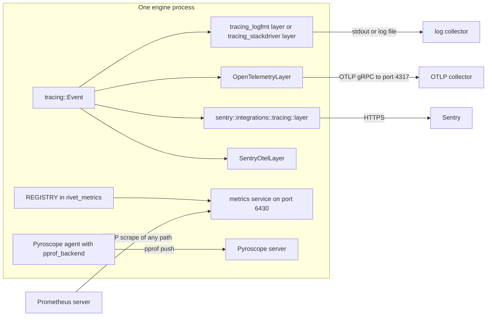
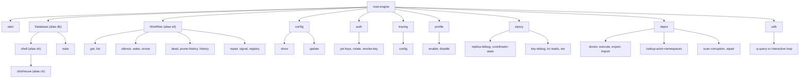
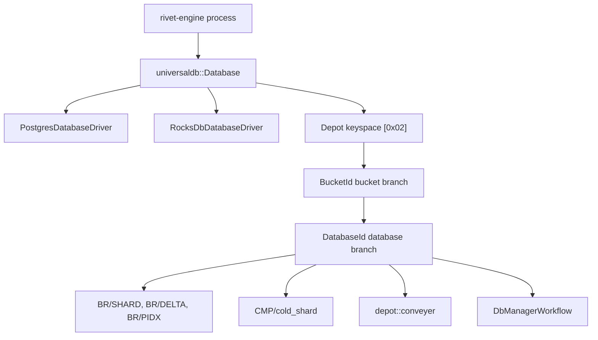
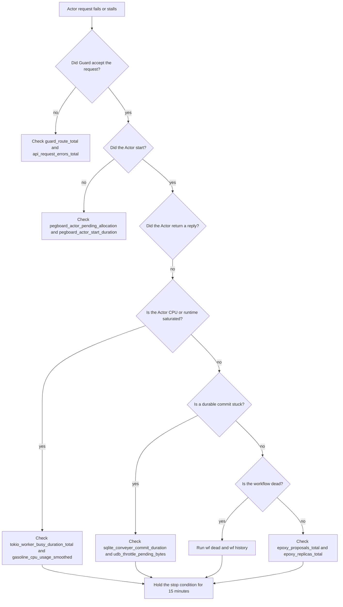

# 14 Observability and operations

This document shows how an operator sees and controls a running Rivet cluster.
It covers what each process reports, where it reports it, and which command
answers which question. It reads the source at commit
`4a58441c50d1ce20d8803cfb1ab7c3285a5141d6`, version 2.3.31. All paths are
relative to `/Users/darkvoid/GitSources/src.Rivet/rivet` unless the text says
otherwise.

The central fact is simple. Each engine process runs every service by default,
and every service writes to one Prometheus registry in that process. Logs and
Sentry events, OpenTelemetry traces, and Pyroscope profiles leave the process
through separate paths. The `rivet-engine` command line interface (CLI) uses
three transports when it contacts a running engine. The first is an HTTP call to
one peer Application Programming Interface (API). The second is a direct read or
write on UniversalDB (UDB). The third is a publish call on the
publish-and-subscribe layer. The separate `rivet` CLI is a cloud and development
tool. Section 7.11 lists the transports for both CLIs and the transport for each
`rivet-engine` command.
The operator does not need a separate agent for each subsystem. A cluster can have many
engine processes. Each process has its own registry and its own metrics port
(`engine/packages/engine/src/run_config.rs:4-67`).

## Components and terms

The rest of this document uses the words below with one fixed meaning. The
Source column gives the definition in the checkout.

| Term | What it means here | Source |
|------|--------------------|--------|
| Node | One host or Kubernetes pod that runs one `rivet-engine start` process. | `engine/packages/engine/src/run_config.rs:4-67` |
| Node identifier | The `node_id` label value. It is a random Universally Unique Identifier (UUID) that each process creates at startup. It is not the host name or the pod name. | `engine/packages/pools/src/node_id.rs:10-18`, `engine/packages/pools/src/pools.rs:24-29` |
| Engine process | One operating system process. It runs the selected services. | `engine/packages/engine/src/commands/start.rs:10-63` |
| Service | One supervised task inside the engine process. | `engine/packages/engine/src/run_config.rs:4-67` |
| Core service | A service with `ServiceKind::Core`, which the comment calls "run no matter what". The startup filter still removes it when `--services` or `--except-services` excludes it. | `engine/packages/service-manager/src/lib.rs:59-61`, `engine/packages/engine/src/commands/start.rs:34-69` |
| Cluster | Every engine process that shares one UniversalDB (UDB) and one pubsub transport. The default memory transport is process-local, so a multi-process cluster needs the NATS driver. | `engine/packages/config/src/config/pubsub.rs:6-101` |
| Datacenter | One topology entry with a label, a name, a public Uniform Resource Locator (URL), a peer URL, and an optional private proxy URL. The `proxy_url` accessor returns the proxy URL when it is set and the public URL otherwise. One entry is the leader. | `engine/packages/config/src/config/topology.rs:7-45`, `engine/packages/config/src/config/topology.rs:168-170`, `engine/packages/config/src/config/topology.rs:192-194` |
| Leader | The datacenter whose entry sets `is_leader: true`. The `config.is_leader()` accessor reads that entry. Key-ring writes require it; section 7.4 defines the key ring. | `engine/packages/config/src/config/mod.rs:371-373`, `engine/packages/config/src/config/topology.rs:163` |
| Pub/Sub | The publish and subscribe layer that carries control messages between processes. The memory driver is the default; NATS is the shared driver. | `engine/packages/config/src/config/pubsub.rs:13-17` |
| Pod | A Kubernetes unit. The manifest runs one engine process in it and sets the Kubernetes (K8S) pod name variable `K8S_POD_NAME`. | `engine/packages/profiling/src/pyroscope.rs:30-33` |
| Service manager | The supervisor that filters, starts, and restarts services. It adds the metrics service. | `engine/packages/service-manager/src/lib.rs:142-200` |
| Guard | The public ingress service. It listens on port 6420, authenticates API requests, and routes them. It does not authenticate `/health`. | `engine/packages/config/src/defaults.rs:9-14`, `engine/packages/api-builder/src/router.rs:64-83` |
| Peer API | The private control API. It listens on port 6421 and has no authentication layer. | `engine/packages/api-peer/src/router.rs:6-108` |
| Pegboard | The Actor scheduler and the runner and envoy registry. | `engine/packages/pegboard/src/metrics.rs:4-202` |
| Runner | A process that hosts Actors and connects to the engine over a WebSocket. | `docs-internal/engine/RUNNER_LIFECYCLE.md:1-60` |
| Envoy (Rivet) | A WebSocket tunnel endpoint that connects a runner host to the engine. It is not the Envoy proxy. | `docs-internal/engine/envoy-load-balancing.md:1-40` |
| Actor | One user-defined compute unit with an Actor identifier. | `engine/packages/engine/src/commands/depot.rs:431-440` |
| RivetKit | The Software Development Kit (SDK) and runtime that hosts Actors in a user process. | `engine/CLAUDE.md:82-84` |
| Depot | The branchable SQLite storage layer. | `engine/packages/depot/CLAUDE.md:1-14` |
| UniversalDB (UDB) | The transactional key-value store. The driver is PostgreSQL or the RocksDB file-system backend. The default is the file-system backend. | `engine/packages/config/src/config/db/mod.rs:10-21` |
| Bucket | A namespace-scoped branch identifier. It holds a catalog of databases. | `docs-internal/engine/sqlite/storage-structure.md:5-14` |
| Branch | An append-only lineage of one database or bucket. A rollback forks a branch. | `docs-internal/engine/sqlite/storage-structure.md:12`, `docs-internal/engine/sqlite/storage-structure.md:60-84` |
| Hot tier | The `META`, `COMMITS`, `PIDX`, `DELTA`, and `SHARD` keys under the `BR` prefix. | `docs-internal/engine/sqlite/storage-structure.md:86-111` |
| Cold tier | The `CMP/cold_shard` and `CMP/retired_cold_object` keys. They are read-only in this edition. | `docs-internal/engine/sqlite/storage-structure.md:113-132` |
| txid | The monotonic transaction identifier of one committed database state. | `docs-internal/engine/sqlite/storage-structure.md:95` |
| Conveyer | The commit pipeline that writes pages, metadata, and shard images. | `engine/packages/depot/src/conveyer/commit/apply.rs:65-85` |
| Compaction | The background job that folds delta history into shards and reclaims dead keys. | `engine/packages/depot/CLAUDE.md:19`, `engine/packages/depot/CLAUDE.md:30-34` |
| Epoxy | The consensus layer for mutable UDB keys. | `engine/packages/epoxy/src/ops/propose.rs:360-518` |
| Ballot | One proposal attempt number plus the identifier of the proposing replica. | `engine/packages/api-peer/src/internal.rs:214-218` |
| Changelog | The recent committed values that a replica keeps for one Epoxy key. | `engine/packages/api-peer/src/internal.rs:301-315` |
| Coordinator | The Epoxy replica that drives cluster reconfiguration. | `engine/packages/api-peer/src/internal.rs:220-286` |
| Gasoline | The durable workflow engine. | `engine/packages/engine/src/commands/wf/mod.rs:22-121` |
| ClickHouse | An optional column store for workflow debug queries. `db shell clickhouse` runs the external `clickhouse-client` program against `clickhouse.native_url`. | `engine/packages/config/src/config/clickhouse.rs:7-19`, `engine/packages/engine/src/util/db.rs:15-72` |

## 1. The operator surfaces in one view

An operator has five surfaces. Each surface has a different transport, a
different default state, and a different privacy cost.

| Surface | Transport | Default | Leaves the process |
|---------|-----------|---------|--------------------|
| Metrics | Hypertext Transfer Protocol (HTTP) scrape | On | No. The scraper pulls. |
| OpenTelemetry traces | OpenTelemetry Protocol (OTLP) over gRPC Remote Procedure Calls (gRPC) | Off | Yes, when `RIVET_OTEL_ENABLED=1` |
| Logs | Standard output, or a file | On | Depends on the deployment log collector |
| Sentry errors | HTTPS | On (opt-out) | Yes |
| Pyroscope profiles | HTTP push from the agent | Off | Yes, when enabled |

The ports come from `engine/packages/config/src/defaults.rs:9-14`. Guard
listens on 6420, the peer API listens on 6421, and the metrics server listens on
6430. The default host for all three is the unspecified IPv6 address (`::`), as
`engine/packages/config/src/defaults.rs:1-7` shows. That address accepts
connections on every IPv4 and IPv6 interface of the host. Section 8.4 explains
the security result for the peer API.

One engine process serves one node. The process starts every service by default,
and the metrics service counts as one more service
(`engine/packages/engine/src/run_config.rs:4-67`,
`engine/packages/service-manager/src/lib.rs:146-153`). A cluster with three
engine pods therefore has three registries, three metrics servers, and three
copies of each long-running service. Prometheus must scrape each pod address.
One scrape of a service name does not collect the whole cluster.

The service manager adds the metrics service after the operator selects a
service set. The code at `engine/packages/service-manager/src/lib.rs:146-153`
pushes a service named `"metrics"` that calls
`rivet_metrics_server::run_standalone`. The operator cannot remove it with
`--except-services`, because the push happens after the filter runs.



The diagram shows the pipeline that the rest of this document explains. The
tracing subscriber is the source for logs and spans. It is also the source for
the Sentry events that the Sentry tracing layer selects. A direct
`rivet_telemetry::capture_error` call is a second Sentry source, and section 2
explains it. Metrics do not use the tracing path. The Pyroscope agent is
independent of both. `SentryOtelLayer` only copies a trace identifier into the
Sentry scope. It sends no event.

## 2. Telemetry, Sentry, and what leaves the process

Rivet sends error telemetry to Sentry unless the operator disables it. The
configuration field is `telemetry.enabled`, and its default is `true`
(`engine/packages/config/src/config/telemetry.rs:4-14`). The comment in the
source says "Telemetry is opt-out". The package README shows the configuration
block that turns it off: `"telemetry": { "enabled": false }`
(`engine/packages/telemetry/README.md`). The flag controls the Sentry client
only. It does not stop metrics, OpenTelemetry traces, logs, or Pyroscope
profiles. Those paths have their own gates, and the table at the end of this
section lists them.

The binary contains one fixed Sentry Data Source Name (DSN). It is a constant at
`engine/packages/telemetry/src/lib.rs:4`. The host in that DSN is
`o4504307129188352.ingest.us.sentry.io`. An operator who does not want any
event to reach that host must set the flag to `false`. There is no environment
variable override for the DSN in this file.

`rivet_telemetry::init` reads the flag first. It returns `None` and installs
nothing when telemetry is disabled. Otherwise it installs the Sentry client with
the fixed DSN and the crate release name. It then calls `configure_scope` and
returns a `sentry::ClientInitGuard`. The guard must stay alive for the life of
the process. The engine holds it in `main_inner` as `_guard`
(`engine/packages/engine/src/main.rs:46`).

```rust
// engine/packages/telemetry/src/lib.rs:7-23
pub fn init(config: &rivet_config::Config) -> Option<sentry::ClientInitGuard> {
	if !config.telemetry.enabled {
		return None;
	}

	let guard = sentry::init((
		SENTRY_URL,
		sentry::ClientOptions {
			release: sentry::release_name!(),
			..Default::default()
		},
	));

	sentry::configure_scope(|scope| configure_scope(scope, config));

	Some(guard)
}
```

The scope configuration is the privacy-sensitive part. It sets three tags and
nothing else. The comment in the source states the reason: configuration
serialization preserves secrets, and even ordinary strings such as server URLs
can contain credentials. The tags are fixed strings.

```rust
// engine/packages/telemetry/src/lib.rs:25-53
fn configure_scope(scope: &mut sentry::Scope, config: &rivet_config::Config) {
	// Only send fixed, allowlisted labels. Config serialization preserves secrets, and
	// even ordinary strings (such as server URLs) can contain credentials.
	scope.set_tag(
		"database",
		match config.database() {
			Database::Postgres(_) => "postgres",
			Database::FileSystem(_) => "file_system",
		},
	);
	scope.set_tag(
		"pubsub",
		match config.pubsub() {
			PubSub::Nats(_) => "nats",
			PubSub::Memory(_) => "memory",
		},
	);
	let cache = config.cache();
	scope.set_tag(
		"cache",
		if cache.enabled {
			match cache.driver() {
				CacheDriver::InMemory => "in_memory",
			}
		} else {
			"disabled"
		},
	);
}
```

| Tag | Possible values | Meaning |
|-----|-----------------|---------|
| `database` | `postgres`, `file_system` | The durable driver class |
| `pubsub` | `nats`, `memory` | The message transport class |
| `cache` | `in_memory`, `disabled` | The cache mode |

**Aha:** The author sends an allowlist of class names, not the configuration
object. The obvious alternative is to attach the configuration to the Sentry
scope for rich debugging. That alternative leaks passwords and tokens, because
`Secret<T>` hides values only from `Debug` and not from serialization
(`engine/packages/config/src/secret.rs:28-35`, `engine/packages/config/src/secret.rs:37-45`). The allowlist costs
some diagnosis detail and removes a credential leak.

The rest of what leaves the process comes from two places. The first is
`rivet_telemetry::capture_error`, which wraps
`sentry::integrations::anyhow::capture_anyhow` and returns a Sentry event Universally Unique Identifier (UUID)
(`engine/packages/telemetry/src/lib.rs:55-57`). `main_inner` calls it for a
configuration load error and for a command error. The second is the
`sentry::integrations::tracing::layer()` in the tracing subscriber. Rivet does
not configure that layer's event filter in this commit. Therefore the `sentry`
crate default decides which tracing events become Sentry events or breadcrumbs.
This document did not verify that crate default, because the crate source is not
in the checkout. Treat the event selection as unverified.

The tracing subscriber installs the Sentry layer even when telemetry is off
(`engine/packages/runtime/src/traces.rs:62-63`). With `telemetry.enabled` set to
`false`, `rivet_telemetry::init` returns `None` and installs no client. The layer
is present, but it has no client to receive an event. The source in this
checkout does not show the layer sending anything in that state.

The build enables a fixed set of Sentry features. The workspace entry sets
`default-features = false` and enables `anyhow`, `backtrace`, `contexts`,
`debug-images`, `panic`, `reqwest`, `rustls`, and `tracing`
(`Cargo.toml:214-226`). The client crate version is 0.45.0 (`Cargo.lock:6865-6883`).
The `anyhow` integration is active through `capture_error`. The `panic`,
`contexts`, `backtrace`, and `debug-images` integrations come from the enabled
features. The `tracing` integration is active because the subscriber installs
its layer. The source does not attach Actor state, Structured Query Language
(SQL) text, or request bodies to the scope.

One caution is necessary. The source proves that the scope tags are an
allowlist. It does not prove that every captured event field is free of user
data. A tracing event can carry fields that an instrumented function recorded.
An operator with a strict data policy should set `telemetry.enabled` to `false`
and use only local logs, metrics, and traces.

This table lists every outbound path that the surfaces in section 1 use.

| Signal | Destination | Transport | Gate | Default |
|--------|-------------|-----------|------|---------|
| Metrics | The operator's scraper | HTTP `GET` to port 6430 | None | On, but nothing leaves until a scrape arrives |
| Traces | `RIVET_OTEL_GRPC_ENDPOINT` | OTLP over gRPC | `RIVET_OTEL_ENABLED=1` | Off |
| Logs | Standard output or the daily log file | Local write | None | On |
| Sentry events | `o4504307129188352.ingest.us.sentry.io` (the fixed DSN) | HTTPS | `telemetry.enabled` | On |
| Profiles | `pyroscope.server_url` | HTTP push | Configuration block plus a runtime enable message | Off |

The metrics row is the only pull path. The other four rows push data, or write
it locally. When the operator disables a push path, the flag is the first
control and a firewall rule is the second. The firewall rule must block the
Sentry host, the OTLP endpoint, and the Pyroscope server. A disabled flag does
not close the network path by itself.

## 3. OpenTelemetry: one provider, traces only

This commit configures a tracer provider and no other OpenTelemetry provider.
The Rust source in `engine/packages/metrics-server/src/providers.rs` builds an
`SdkTracerProvider` with a batch span exporter. It does not build an
`SdkMeterProvider` or an `SdkLoggerProvider`. A search for those type names in
the metrics server, runtime, and metrics crates finds no match. Metrics stay on
the Prometheus registry, and logs stay on the tracing subscriber.

The provider starts only when the environment variable `RIVET_OTEL_ENABLED` is
exactly the string `"1"` (`engine/packages/metrics-server/src/providers.rs:113`).
The function returns `None` in every other case. `rivet_runtime::run` calls it
before it installs the tracing subscriber, and it passes the result to the
subscriber (`engine/packages/runtime/src/lib.rs:35-40`).

```rust
// engine/packages/metrics-server/src/providers.rs:112-124
pub fn init_otel_providers() -> Option<OtelProviderGuard> {
	let enable_otel = std::env::var("RIVET_OTEL_ENABLED").map_or(false, |x| x == "1");

	if enable_otel {
		opentelemetry::global::set_text_map_propagator(TraceContextPropagator::new());

		let tracer_provider = init_tracer_provider();

		Some(OtelProviderGuard { tracer_provider })
	} else {
		None
	}
}
```

The exporter is an OTLP gRPC span exporter. It uses the `tonic` transport and
the gRPC protocol. The endpoint comes from `RIVET_OTEL_GRPC_ENDPOINT`, and the
default is `http://localhost:4317`
(`engine/packages/metrics-server/src/providers.rs:81-92`). The provider batches
spans before export. The source does not set a batch timeout, queue size, or
retry policy. The pinned `opentelemetry_sdk` crate version 0.28 supplies those
values (`Cargo.toml:335-337`). This document does not state the numbers,
because the crate source is not in the checkout.

The exporter uses the endpoint exactly as written. The builder sets only the
transport, the protocol, and the endpoint
(`engine/packages/metrics-server/src/providers.rs:86-92`). It sets no Transport
Layer Security (TLS) option, certificate, header, or authentication token. The
workspace build enables `trace`, `metrics`, `logs`, and `grpc-tonic`, and it
enables no TLS feature (`Cargo.toml:331-333`). Those are features of
`opentelemetry-otlp`. The `rustls` feature in section 2 belongs to the Sentry
build, a different dependency, and it does not enable TLS here. An `https://`
endpoint therefore does not work in this build. Use a plain `http://` collector
on a trusted network, or terminate TLS in a local collector process.

```rust
// engine/packages/metrics-server/src/providers.rs:86-109
fn init_tracer_provider() -> SdkTracerProvider {
	let exporter = opentelemetry_otlp::SpanExporter::builder()
		.with_tonic()
		.with_protocol(opentelemetry_otlp::Protocol::Grpc)
		.with_endpoint(otel_grpc_endpoint())
		.build()
		.unwrap();

	let initial_ratio = std::env::var("RIVET_OTEL_SAMPLER_RATIO")
		.ok()
		.and_then(|s| s.parse::<f64>().ok())
		.unwrap_or(0.001);

	let dynamic_sampler = DynamicSampler::new(initial_ratio);

	let _ = SAMPLER.set(dynamic_sampler.clone());

	SdkTracerProvider::builder()
		.with_sampler(Sampler::ParentBased(Box::new(dynamic_sampler)))
		.with_id_generator(RandomIdGenerator::default())
		.with_resource(resource())
		.with_batch_exporter(exporter)
		.build()
}
```

The sampler is a two-layer design. The outer layer is `ParentBased`. A child
span follows the sampling decision of its parent. The inner layer is a custom
`DynamicSampler` that reads a `TraceIdRatioBased` ratio from an
`Arc<RwLock<f64>>` each time it samples
(`engine/packages/metrics-server/src/providers.rs:12-54`). The initial ratio is
`RIVET_OTEL_SAMPLER_RATIO`, and the default is `0.001`. That is one sampled trace
for every one thousand trace identifiers. A poisoned lock means a thread
panicked while it held the write guard. The read then returns `Err`, and the
sampler uses the hard-coded literal `0.001` (`engine/packages/metrics-server/src/providers.rs:42`).
That literal is not the operator's initial value. A panic during
`set_sampler_ratio` therefore resets the ratio to one in one thousand, not to
the value in the configuration.

The dynamic part exists so that an operator can change the ratio without a
restart. `set_sampler_ratio` writes the new value into the same lock
(`engine/packages/metrics-server/src/providers.rs:58-68`). The dynamic
configuration service calls it when it receives a tracing configuration
message. Section 5 explains that message path.

| Environment variable | Default | Effect |
|----------------------|---------|--------|
| `RIVET_OTEL_ENABLED` | unset | Must be `"1"` to start the provider |
| `RIVET_OTEL_GRPC_ENDPOINT` | `http://localhost:4317` | OTLP gRPC collector address |
| `RIVET_OTEL_SAMPLER_RATIO` | `0.001` | Initial trace sample ratio |
| `RUST_TRACE` | `info`, `tokio_cron_scheduler=warn`, `async_nats=warn`, `tokio=warn`, `hyper=warn`, `h2=warn` | Filter for the OpenTelemetry layer only. It is fixed at startup. |
| `TOKIO_CONSOLE_ENABLE` | unset | Must be `"1"` to start the Tokio console layer |

An empty `RUST_TRACE` value produces the six default directives, not an empty
filter (`engine/packages/runtime/src/traces.rs:150-175`). The reload handle in
section 5 changes `RUST_LOG` only. A `RUST_TRACE` change needs a process
restart.

The resource describes the process. `resource()` sets the service name from
`rivet_env::service_name()` and adds a `service.version` attribute with the
crate version and the semantic-conventions schema URL
(`engine/packages/metrics-server/src/providers.rs:70-79`). The propagator is
`TraceContextPropagator`, which is the World Wide Web Consortium (W3C) trace
context format.

`OtelProviderGuard` owns the provider. Its `Drop` implementation calls
`tracer_provider.shutdown()` and logs an error if shutdown fails
(`engine/packages/metrics-server/src/providers.rs:126-137`). The shutdown call
flushes the batch exporter. The guard lives in `rivet_runtime::run` for the
duration of the runtime.

What leaves the process is a set of spans. Each span has the resource above,
the span name, the span kind, attributes, events, and links that the
instrumented code records. Rivet does not add Actor state or SQL text in this
file. The `#[tracing::instrument]` attributes in the codebase decide the span
names and the recorded arguments. An operator with a strict data policy should
review those attributes before enabling export.

## 4. Metrics: one registry for every service

Every engine subsystem that records metrics uses one process-wide Prometheus registry. The
registry is a `lazy_static` in `rivet_metrics`. It uses the namespace `"rivet"`
and an empty set of constant labels:

```rust
// engine/packages/metrics/src/registry.rs:1-7
use prometheus::*;

lazy_static::lazy_static! {
	pub static ref REGISTRY: Registry = Registry::new_custom(
		Some("rivet".to_string()),
		Some(labels! { })).unwrap();
}
```

The namespace changes the exposition name. A metric that a subsystem registers
as `epoxy_proposals_total` appears as `rivet_epoxy_proposals_total`. This
document uses the registered name in tables and says "exposition name" when the
prefix matters. The empty constant labels mean that a scrape does not carry a
cluster label. An operator who runs several clusters must add that label in the
scrape configuration.

The metrics service is a small HTTP server. It binds `config.metrics.host()` and
`config.metrics.port()`. The defaults are `::` and 6430
(`engine/packages/config/src/config/metrics.rs:14-21`,
`engine/packages/config/src/defaults.rs:4-13`). A bind failure is fatal: the
service logs the error and calls `std::process::exit(1)`
(`engine/packages/metrics-server/src/server.rs:17-25`). A bind failure also
skips the OpenTelemetry flush. The call does not run Rust destructors, so
`OtelProviderGuard::drop` never flushes the span batch
(`engine/packages/metrics-server/src/providers.rs:126-137`). The server has no
route
table. It reads the request, ignores the path, gathers the registry, encodes it
with `TextEncoder`, and returns status 200 with the encoder content type
(`engine/packages/metrics-server/src/server.rs:38-54`). A scrape of `/metrics`,
`/`, or any other path returns the same body.

```rust
// engine/packages/metrics-server/src/server.rs:38-54
async fn serve_req(_req: Request<Body>) -> Result<Response<Body>, hyper::Error> {
	let encoder = TextEncoder::new();

	let metric_families = rivet_metrics::REGISTRY.gather();
	let mut buffer = Vec::new();
	encoder
		.encode(&metric_families, &mut buffer)
		.expect("encode");

	let response = Response::builder()
		.status(200)
		.header(CONTENT_TYPE, encoder.format_type())
		.body(Body::from(buffer))
		.expect("response");

	Ok(response)
}
```

**Aha:** The metrics server has no `/metrics` route and no health route. The
obvious design is a router with a metrics path. The author instead answered every
request with the full registry. This removes a configuration mismatch between
the scrape path and the server path, and it makes the service trivial to probe.
The cost is that any request, including one from a scanner, causes a full
registry gather and encode.

The engine's own API metrics show the shape of an instrumented subsystem. The
middleware records pending requests, total requests, duration, and errors. The
labels are `router`, `method`, and `path`, plus `status` and `error` on the
duration and error metrics (`engine/packages/api-builder/src/metrics.rs:5-31`).

The runtime metrics are sampled on a five-second interval. The sampler reads
the Tokio runtime handle and updates the queue depths, the active task count,
and the blocking thread counts. It also updates per-worker overflow, local queue
depth, and busy time (`engine/packages/runtime/src/lib.rs:157-207`). The sampler
interval is five seconds, and the sampler always runs.

The task poll histogram is the only runtime metric that needs a poll hook. The
gate is `env::var("TOKIO_RUNTIME_METRICS").is_ok()`, so any value enables it,
including an empty value (`engine/packages/runtime/src/lib.rs:75`). The variable
must be present before the runtime starts. A value of `"0"` or `"false"` does
not disable the metric. The source does not support a runtime toggle.

The table below lists one representative metric for each subsystem. Appendix A
is the full inventory of every metric that this document names. The runbook uses
more metrics than this table shows, including `api_request_errors_total`,
`gasoline_cpu_usage`, `gasoline_cpu_usage_smoothed`, and the
`udb_throttle_*` series. Appendix A gives their labels and source.

| Subsystem | Registered metric | Type | Labels |
|-----------|-------------------|------|--------|
| Runtime | `tokio_thread_count` | Gauge | none |
| Runtime | `tokio_global_queue_depth` | Gauge | none |
| Runtime | `tokio_blocking_queue_depth` | Gauge | none |
| Runtime | `tokio_task_total` | Counter | none |
| Runtime | `tokio_active_task_count` | Gauge | none |
| Runtime | `tokio_blocking_thread_count` | Gauge | none |
| Runtime | `tokio_idle_blocking_thread_count` | Gauge | none |
| Runtime | `tokio_worker_busy_duration_total` | Counter | `worker` |
| Runtime | `tokio_task_poll_duration` | Histogram | none |
| API | `api_request_pending` | Gauge | `router`, `method`, `path` |
| API | `api_request_total` | Counter | `router`, `method`, `path` |
| API | `api_request_duration` | Histogram | `router`, `method`, `path`, `status`, `error` |
| Guard | `guard_route_total` | Counter | `router` |
| Guard | `guard_route_pegboard_ready_wait_duration` | Histogram | `namespace_id`, `pool_name`, `was_sleeping`, `wake_retries_bucket`, `outcome` |
| Pegboard | `pegboard_actor_pending_allocation` | Gauge | `namespace_id`, `runner_name` |
| Pegboard | `pegboard_actor_start_duration` | Histogram | `namespace_id`, `pool_name`, `kind` |
| Pegboard | `envoy_lb_no_envoy_available_total` | Counter | `namespace_id`, `pool_name`, `strategy` |
| Depot | `sqlite_conveyer_commit_duration` | Histogram | `node_id`, `path` |
| Depot | `sqlite_conveyer_commit_rejected_total` | Counter | `node_id`, `reason` |
| Depot | `sqlite_compaction_pass_total` | Counter | `kind`, `result` |
| Depot | `sqlite_compaction_lag_txids` | Histogram | `tier` |
| Depot | `sqlite_s3_request_failures_total` | Counter | `node_id`, `op` |
| Epoxy | `epoxy_proposals_total` | Counter | `result` |
| Epoxy | `epoxy_fast_path_total` | Counter | none |
| Epoxy | `epoxy_changelog_size` | Gauge | none |
| Epoxy | `epoxy_replicas_total` | Gauge | `status` |
| Gasoline | `gasoline_workflow_active` | Gauge | `workflow_name` |
| Gasoline | `gasoline_workflow_dead` | Gauge | `workflow_name` |
| Gasoline | `gasoline_workflow_errors` | Counter | `workflow_name` |
| Gasoline | `gasoline_activity_duration` | Histogram | `workflow_name`, `activity_name` |
| Gasoline | `gasoline_load_shedding_ratio` | Histogram | none |
| UniversalDB | `udb_transaction_total` | Counter | `name` |
| UniversalDB | `udb_throttle_pending_bytes` | Gauge | `throttle`, `kind` |
| UniversalDB | `udb_last_tx_completed_age_seconds` | Gauge | none |

The names in the table are the registered names. Add the `rivet_` namespace
prefix to get the exposition name. The source files are
`engine/packages/runtime/src/metrics.rs`, `engine/packages/api-builder/src/metrics.rs`,
`engine/packages/guard/src/metrics.rs`, `engine/packages/pegboard/src/metrics.rs`,
`engine/packages/depot/src/metrics.rs`, `engine/packages/epoxy/src/metrics.rs`,
`engine/packages/gasoline/src/metrics.rs`, and
`engine/packages/universaldb/src/metrics.rs`.

The labels matter for diagnosis. `node_id` identifies one process, not one host.
`Pools::new` calls `NodeId::new()`, which returns `Uuid::new_v4()`, so the value
is a new random UUID at every process start
(`engine/packages/pools/src/pools.rs:24-29`, `engine/packages/pools/src/node_id.rs:10-18`).
A restart changes the value, and a host with two processes has two values. The
registry also has empty constant labels, so the engine emits no `pod` label. Add
`pod` or `instance` in the Prometheus scrape configuration when a query must
group by pod (`engine/packages/metrics/src/registry.rs:1-7`). `namespace_id`
separates tenants. A query that sums a metric without these labels hides the
answer. The label values are not all bounded. Appendix A gives
the type, the labels, and the value domain for every metric that this document
names.

The labels below deserve a warning. `path` on the API metrics is a matched route
template, or the string `"unknown"`, so its cardinality follows the route table
(`engine/packages/api-builder/src/middleware.rs:95-100`). `namespace_id`,
`node_id`, `runner_name`, `workflow_name`, and `activity_name` are unbounded sets
from the database. A Prometheus label with one value per tenant or one value per
Actor grows without limit. Keep those labels out of recording rules that fan
out, or aggregate them away before storage.

The RivetKit side has one important rule. The engine package comment at
`engine/CLAUDE.md:82-84` states that RivetKit core records process-wide
Prometheus metrics but does not serve them over HTTP. A user renders them with
`registry.routes.prometheusMetrics()` in TypeScript or
`Registry::prometheus_metrics()` in Rust and mounts the response on a user
router. The same comment states that there is no per-Actor
`/gateway/<actor_id>/metrics` route and no serverless `/metrics` route. An
operator who expects an Actor-level metrics endpoint will not find one in this
commit.

## 5. Traces, logs, and the reload path

The tracing subscriber is a layered `tracing_subscriber::registry`. The source
applies six layers in one fixed order (`engine/packages/runtime/src/traces.rs:37-110`).
The formatter is logfmt by default. It is Google Cloud Platform (GCP) JavaScript
Object Notation (JSON) when `RUST_LOG_FORMAT=gcp`. The GCP path uses the
`tracing_stackdriver` layer (`engine/packages/runtime/src/traces.rs:105`).
Stackdriver is the former name of Google Cloud Logging, so this format suits a
Google Cloud log collector.

| Order | Layer | Role | Gate |
|-------|-------|------|------|
| 1 | Reloadable `EnvFilter` | Filters every later layer with the `RUST_LOG` specification | Always on |
| 2 | `OpenTelemetryLayer` | Creates spans and sends them to the OTLP exporter | Only when the provider exists. `RUST_TRACE` filters this layer. |
| 3 | `sentry::integrations::tracing::layer()` | Turns tracing events into Sentry events and breadcrumbs | Always on |
| 4 | `SentryOtelLayer` | Copies the OpenTelemetry trace identifier and span identifier into the Sentry trace context. It creates no event. | Always on |
| 5 | `console_subscriber::ConsoleLayer` | Serves the Tokio console | `TOKIO_CONSOLE_ENABLE=1` |
| 6 | `tracing_logfmt` layer or `tracing_stackdriver` layer | Writes the log line to standard output | Logfmt by default. GCP selects Stackdriver. |

The `SentryOtelLayer` is easy to confuse with the Sentry tracing layer. Layer 3
decides which events become Sentry events. Layer 4 only attaches trace
identifiers to the current Sentry scope
(`engine/packages/runtime/src/traces.rs:112-148`). Layer 4 runs on every event,
but it does not increase the number of events that Sentry receives. When the
OpenTelemetry provider is `None`, layer 2 is not added
(`engine/packages/runtime/src/traces.rs:37-63`). When telemetry is disabled,
layer 3 is still added, but it has no Sentry client (section 2).

Layer 1 sets the ceiling for every later layer. An event must pass the
`RUST_LOG` filter before the `OpenTelemetryLayer` can see it. The `RUST_TRACE`
filter then narrows only the OpenTelemetry layer. A target at `trace` in
`RUST_TRACE` produces no span while `RUST_LOG` holds that target at `info`. The
reload path changes the ceiling, not the `RUST_TRACE` filter.

```rust
// engine/packages/runtime/src/traces.rs:37-63
pub fn init_tracing_subscriber(otel_providers: &Option<OtelProviderGuard>) {
	// Create reloadable env filter for RUST_LOG
	let (reload_layer, reload_handle) = reload::Layer::new(build_filter_from_env_var("RUST_LOG"));

	// Store handle globally for later reloading
	let _ = RELOAD_HANDLE.set(reload_handle);

	let registry = tracing_subscriber::registry();

	// Build and apply otel layers to the registry if otel is enabled
	let otel_trace_layer = match otel_providers {
		Some(providers) => {
			let tracer = providers.tracer_provider.tracer("tracing-otel-subscriber");

			let otel_trace_layer = OpenTelemetryLayer::new(tracer)
				.with_filter(build_filter_from_env_var("RUST_TRACE"));

			Some(otel_trace_layer)
		}
		None => None,
	};

	let registry = registry
		.with(reload_layer)
		.with(otel_trace_layer)
		.with(sentry::integrations::tracing::layer())
		.with(SentryOtelLayer);
```

The default filter is `info`, with five noisy targets set to `warn`:
`tokio_cron_scheduler`, `async_nats`, `tokio`, `hyper`, and `h2`
(`engine/packages/runtime/src/traces.rs:151-169`). The builder appends the
operator directives after those defaults (`engine/packages/runtime/src/traces.rs:163-166`).
A later directive for the same target overrides the earlier one. The five
`warn` directives stay active for every target that the operator does not name.

| Variable | Default | Effect |
|----------|---------|--------|
| `RUST_LOG` | `info` plus five `warn` directives | Application log filter. The CLI can reload this value. |
| `RUST_TRACE` | The same six directives | OpenTelemetry span filter. It is fixed at startup. |
| `RUST_LOG_FORMAT` | `logfmt` | `gcp` selects Stackdriver JSON |
| `RUST_LOG_SPAN_NAME` | off | Include the span name |
| `RUST_LOG_SPAN_PATH` | off | Include the span path |
| `RUST_LOG_TARGET` | off | Include the target |
| `RUST_LOG_LOCATION` | off | Include the source location |
| `RUST_LOG_MODULE_PATH` | off | Include the module path |
| `RUST_LOG_ANSI_COLOR` | off | Enable American National Standards Institute (ANSI) color |

The reload path is the part that makes the CLI useful. The `tracing` command
builds a `SetTracingConfigMessage` and publishes it on the UniversalPubSub
subject `rivet.debug.tracing.config`
(`engine/packages/engine/src/commands/tracing.rs:24-41`,
`engine/packages/dynamic-config/src/pubsub_subjects.rs:5`). The message uses a
double option for each field. An absent field means "leave the value alone". An
explicit `null` means "reset to the default". A value means "set this value".
The dynamic configuration listener deserializes the message and calls
`reload_log_filter` or `set_sampler_ratio`
(`engine/packages/dynamic-config/src/tracing_config.rs:46-81`).

```rust
// engine/packages/dynamic-config/src/tracing_config.rs:46-81
fn apply(update: &SetTracingConfigMessage) {
	tracing::debug!(
		filter = ?update.filter,
		sampler_ratio = ?update.sampler_ratio,
		"received tracing config update"
	);

	// An absent field leaves the current value alone, and an explicit null resets it to the default.
	match &update.filter {
		Some(Some(filter)) => {
			if let Err(err) = rivet_runtime::reload_log_filter(filter) {
				tracing::error!(?err, "failed to reload log filter");
			}
		}
		Some(None) => {
			if let Err(err) = rivet_runtime::reload_log_filter("") {
				tracing::error!(?err, "failed to reload log filter to default");
			}
		}
		None => {}
	}

	match update.sampler_ratio {
		Some(Some(ratio)) => {
			if let Err(err) = rivet_metrics_server::set_sampler_ratio(ratio) {
				tracing::error!(?err, "failed to reload sampler ratio");
			}
		}
		Some(None) => {
			if let Err(err) = rivet_metrics_server::set_sampler_ratio(DEFAULT_SAMPLER_RATIO) {
				tracing::error!(?err, "failed to reload sampler ratio to default");
			}
		}
		None => {}
	}
}
```

The publish uses `PublishOpts::broadcast()`
(`engine/packages/engine/src/commands/tracing.rs:36-40`). A broadcast always
uses the configured pubsub driver. The memory optimization is a shortcut that
delivers to one in-process subscriber and skips the driver. The driver enables
that shortcut only for a `OneSubscriber` publish with an in-process receiver
(`engine/packages/universalpubsub/src/pubsub.rs:364-390`). A broadcast has no
single receiver, so the shortcut does not apply.

The effect depends on the driver and on the service set.

| Condition | What the broadcast reaches |
|-----------|----------------------------|
| Driver is `memory` and the CLI is a separate process | No engine process. The subscriber map is process-local. |
| Driver is `memory` and the publisher runs inside the engine process | Only that process. |
| Driver is `nats` | Every engine process on the same NATS network, in every datacenter connected to it. |
| `dynamic_config` is excluded with `--except-services` | That process does not apply the message. Other processes that run the service still do. The publish still succeeds. |

The memory driver stores subscribers in a process-local map
(`engine/packages/universalpubsub/src/driver/memory/mod.rs:25-50`). The default
driver is `memory` (`engine/packages/config/src/config/pubsub.rs:6-101`). A
separate `rivet-engine config update` or `rivet-engine tracing config` process
therefore publishes to a map that no engine process reads. The command prints
success because the publish call succeeded. Use the NATS driver for a cluster
that accepts these commands from a separate process. The NATS default address is
`127.0.0.1:4222`, and every engine process and the CLI must use the same
addresses.

The subject has no datacenter field. A broadcast reaches every datacenter that
shares the NATS deployment. The command does not contact one process at a time.
This behavior is why one command can change a whole cluster, and why one command
can change more than the operator intended. The `--services` flag does not
change the scope. The `dynamic_config` service must run in each target process.
The listener in `engine/packages/dynamic-config/src/lib.rs:1-29` applies the
message to its process. The command does not wait for an apply acknowledgement.

`reload_log_filter` rebuilds an `EnvFilter` from the new specification and
calls `handle.reload`. The handle is a global `OnceLock<reload::Handle<...>>`
that `init_tracing_subscriber` set at startup
(`engine/packages/runtime/src/traces.rs:10-12`, `engine/packages/runtime/src/traces.rs:177-192`). A process that did
not initialize the subscriber returns the error "reload handle not initialized".

The log file path is optional. `logs.redirect_logs_dir` is an `Option<PathBuf>`
(`engine/packages/config/src/config/logs.rs:5-10`). When it is set, the `start`
command creates a `rivet_logs::Logs` with a seven-day retention constant
(`engine/packages/engine/src/commands/start.rs:7-31`). The log writer rotates at
the Coordinated Universal Time (UTC) day boundary. It names the file
`log-%m-%d-%y`, calls `dup2_stdout` and `dup2_stderr` on the file descriptor,
and prunes files older than the retention
(`engine/packages/logs/src/unix.rs:64-113`).

**Aha:** The log redirect changes the file descriptors of the whole process,
not the sink of one layer. That means every service in the process writes to the
same daily file. The obvious alternative is a per-service file. The author
chose one file so that a node has one log stream to collect and one retention
rule. The cost is that a noisy service can dominate the file, and a filter
change affects all services at once.

## 6. Profiling with Pyroscope

Central Processing Unit (CPU) profiling is off by default and can be turned on at runtime. The profiler
is a Pyroscope agent with a `pprof_backend`. It requires a `pyroscope`
configuration block. The block has a required `server_url` and an optional
`sample_rate` whose default is 100 Hertz (Hz)
(`engine/packages/config/src/config/pyroscope.rs:4-20`). The presence of the
block makes profiling available. It does not start the agent.

`server_url` is a plain string. The configuration comment defines it as the base
URL of the Pyroscope server, and Rivet passes it unchanged to the agent builder
(`engine/packages/config/src/config/pyroscope.rs:7-10`,
`engine/packages/profiling/src/pyroscope.rs:93-102`). The configured
`sample_rate` is the fallback. A runtime message that carries a rate overrides
it, because the service calls `update.sample_rate.unwrap_or(default_sample_rate)`
(`engine/packages/profiling/src/pyroscope.rs:52`).

The profiling service is a Core service. When the block is present, it
subscribes to the UniversalPubSub subject `rivet.debug.profile.config` and
waits for a message. When a message enables profiling, it builds and starts an
agent. When a message disables profiling, it stops and shuts down the agent
(`engine/packages/profiling/src/pyroscope.rs:18-82`).

```rust
// engine/packages/profiling/src/pyroscope.rs:85-105
fn start_agent(
	server_url: &str,
	sample_rate: u32,
	dc: &str,
	pod: &str,
) -> Result<PyroscopeAgent<PyroscopeAgentRunning>> {
	let backend = pprof_backend(PprofConfig { sample_rate }, BackendConfig::default());

	let agent = PyroscopeAgentBuilder::new(
		server_url,
		"rivet-engine",
		sample_rate,
		"rivet-engine",
		env!("CARGO_PKG_VERSION"),
		backend,
	)
	.tags(vec![("dc", dc), ("pod", pod)])
	.build()?;

	Ok(agent.start()?)
}
```

The builder call passes six positional values
(`engine/packages/profiling/src/pyroscope.rs:85-105`). Value one is
`server_url`. Value two is the string `"rivet-engine"`. Value three is
`sample_rate`. Value four is the same string, `"rivet-engine"`. Value five is
the Rivet crate version. Value six is the pprof backend. The call gives no
names to values two and four, and the two strings are identical. The
`pyroscope` crate version is 2.0.5 (`Cargo.lock:4675-4678`), and its source is
not in the checkout. This document therefore cannot verify which of the two
strings is the application name and which is a second label. Do not use the
literal string as a per-process identifier.

The agent pushes a pprof CPU profile to the configured Pyroscope server. The
agent version is the Rivet crate version. There are two tags: `dc` from
`config.dc_name()` and `pod` from the `K8S_POD_NAME` environment variable, or
`unknown` when the variable is absent
(`engine/packages/profiling/src/pyroscope.rs:30-33`). The source does not set a
profile upload interval in this file. The `pyroscope` crate and the backend
decide that interval, and this document cannot verify the value. Confirm the
interval in the Pyroscope user interface after the first profile arrives.

The operator starts profiling with the CLI. The command sends an HTTP `PUT` to
the peer API endpoint `/debug/profile/config`. The default endpoint is
`http://localhost:6421` (`engine/packages/engine/src/commands/profile.rs:8-22`).
The request body has `enabled` and an optional `sample_rate`
(`engine/packages/engine/src/commands/profile.rs:25-30`). The peer API handler
deserializes the body, publishes a `SetProfileConfigMessage` as a broadcast, and
returns an empty response (`engine/packages/api-peer/src/internal.rs:45-75`).

```rust
// engine/packages/engine/src/commands/profile.rs:32-55
impl SubCommand {
	pub async fn execute(self, _config: rivet_config::Config) -> Result<()> {
		let (enabled, sample_rate, endpoint) = match self {
			Self::Enable {
				sample_rate,
				endpoint,
			} => (true, sample_rate, endpoint),
			Self::Disable { endpoint } => (false, None, endpoint),
		};

		let request = SetProfileConfigRequest {
			enabled,
			sample_rate,
		};

		let client = rivet_pools::reqwest::client().await?;
		let url = format!("{}/debug/profile/config", endpoint);

		let response = client
			.put(&url)
			.json(&request)
			.send()
			.await
			.context("failed to send request")?;
```

The control loop has five steps in this order:

1. The CLI sends an HTTP `PUT` to `/debug/profile/config` on one peer API.
2. The peer API handler publishes `SetProfileConfigMessage` as a broadcast
   (`engine/packages/api-peer/src/internal.rs:45-75`).
3. Each `profiling` service that subscribes receives the message.
4. The service starts or stops the Pyroscope agent.
5. The agent pushes profiles to `pyroscope.server_url` on the crate schedule.

The command prints "Profiler enabled" or "Profiler disabled" when the peer API
returns a success status. On a failure it prints the status and the response
body and returns an error (`engine/packages/engine/src/commands/profile.rs:57-72`).
A success status means step 2 completed. It does not mean that step 3 or step 4
happened. The handler returns an empty response after the publish, not after an
agent starts. Confirm the profile in the Pyroscope user interface.

The failure paths are explicit. The service checks `config.pyroscope` before it
subscribes. If `config.pyroscope` is `None`, the service logs a debug message
and parks forever on `std::future::pending()`. The comment explains why: a Core
service that returns would be restarted in a loop by the service manager
(`engine/packages/profiling/src/pyroscope.rs:18-25`). A process that started
without the block never subscribes, so a later message cannot start an agent.
Add the block and restart the process. If the build target is not Linux or macOS
on x86-64 or AArch64, the service logs a warning when Pyroscope is configured,
then parks (`engine/packages/profiling/src/lib.rs:3-30`). If the agent fails to
start, the service logs the error and stays ready for a later message.

## 7. The `rivet-engine` command line interface

The server binary is the `rivet-engine` package. The clap command name is
`Rivet` (`engine/packages/engine/src/main.rs:11-17`). Every subcommand shares
one global option: `--config`, which is a repeatable path to a configuration
file or a directory of configuration files
(`engine/packages/engine/src/main.rs:16-18`). The `SubCommand` enum has ten
variants (`engine/packages/engine/src/lib.rs:10-58`).

```rust
// engine/packages/engine/src/lib.rs:10-58
#[derive(Parser)]
pub enum SubCommand {
	/// Starts the Rivet server
	Start(start::Opts),
	/// Manages databases
	#[clap(alias = "db")]
	Database {
		#[clap(subcommand)]
		command: db::SubCommand,
	},
	/// Manages workflows
	#[clap(alias = "wf")]
	Workflow {
		#[clap(subcommand)]
		command: wf::SubCommand,
	},
	/// Manage the Rivet config
	Config {
		#[clap(subcommand)]
		command: config::SubCommand,
	},
	/// Manage authentication state
	Auth {
		#[clap(subcommand)]
		command: auth::SubCommand,
	},
	/// Manage tracing configuration
	Tracing {
		#[clap(subcommand)]
		command: tracing::SubCommand,
	},
	/// Manage CPU profiling
	Profile {
		#[clap(subcommand)]
		command: profile::SubCommand,
	},
	/// Epoxy debug commands
	Epoxy {
		#[clap(subcommand)]
		command: epoxy::SubCommand,
	},
	/// Depot SQLite diagnostic commands
	Depot {
		#[clap(subcommand)]
		command: depot::SubCommand,
	},
	/// Allows inspection of UDB data
	Udb(udb::Opts),
}
```



The diagram groups related variants to keep it readable. It shows every
top-level subcommand. It does not show every leaf variant. The source enums are
the complete list (`engine/packages/engine/src/lib.rs:10-58`,
`engine/packages/engine/src/commands/db/mod.rs:4-30`,
`engine/packages/engine/src/commands/wf/mod.rs:22-121`,
`engine/packages/engine/src/commands/epoxy.rs:9-104`).

### 7.1 `start`

`start` runs the service manager. `-s` or `--services` selects a list of
services. `--except-services` removes services from the full set. The two flags
conflict. An unknown service name is an error
(`engine/packages/engine/src/commands/start.rs:10-18`, `engine/packages/engine/src/commands/start.rs:34-63`).

The full service list comes from `engine/packages/engine/src/run_config.rs:4-67`.
Each row names the task that the service starts.

| Service | Kind | Starts |
|---------|------|--------|
| `api_peer` | `ApiPeer` | `rivet_api_peer::start` |
| `guard` | `ApiPublic` | `rivet_guard::start` |
| `workflow_worker` | `Standalone` | `rivet_workflow_worker::start` |
| `pegboard_outbound` | `Standalone` | `pegboard_outbound::start` |
| `bootstrap` | `Oneshot` | `rivet_bootstrap::start` |
| `dynamic_config` | `Core` | `rivet_dynamic_config::start` |
| `version_management` | `Core` | `rivet_version_management::start` |
| `epoxy_protocol_version` | `Core` | `epoxy::protocol_version::start` |
| `cache_purge` | `Core` | `rivet_cache_purge::start` |
| `profiling` | `Core` | `rivet_profiling::start` |

The metrics service is added by the manager, as section 1 explains. The kind
selects the service behavior. `ApiPublic`, `ApiPeer`, `Standalone`, `Singleton`,
and `Core` use the restarting `Service` behavior. `Oneshot` is retried after a
crash. `Cron` runs on its schedule
(`engine/packages/service-manager/src/lib.rs:63-103`). A `Core` kind does not
protect a service from `--services` or `--except-services`. The `start` command
filters by service name, not by kind, before it calls the service manager
(`engine/packages/engine/src/commands/start.rs:34-69`). A node that runs
`--services api_peer` therefore runs no `dynamic_config` service, and it applies
no dynamic update broadcast.

```bash
# Start every service with the default configuration.
rivet-engine start

# Start only the API and Guard, for an edge node.
rivet-engine start --services api_peer --services guard

# Start everything except the workflow worker.
rivet-engine start --except-services workflow_worker
```

### 7.2 `db`

`db` manages local databases. `shell` (alias `sh`) takes a database type and a
database name. The only database type is `clickhouse` (alias `ch`). `-q` or
`--query` runs one query instead of opening a shell
(`engine/packages/engine/src/commands/db/mod.rs:4-25`). The shell starts the
external `clickhouse-client` program over `clickhouse.native_url`. It uses port
9440 when the URL has no port, and it passes the configured user and password
(`engine/packages/engine/src/util/db.rs:15-72`). The second positional argument
is named `service` in the source (`engine/packages/engine/src/commands/db/mod.rs:10-11`).
It selects the ClickHouse database, not an engine service. The command passes it
as `--database` (`engine/packages/engine/src/util/db.rs:23-26`,
`engine/packages/engine/src/util/db.rs:52-62`). The source does not list the
valid database names. The command needs an installed `clickhouse-client` and a
`clickhouse` configuration block. `db` has no ClickHouse client of its own.

`nuke --yes` removes the configured file-system database directory. It refuses
to run without `--yes`, and it returns "nuke postgres not implemented" for a
PostgreSQL configuration (`engine/packages/engine/src/commands/db/mod.rs:51-66`).
The default directory is `~/.local/share/rivet-engine/db`. The code uses
`./data/db` when `dirs::data_local_dir()` returns `None`
(`engine/packages/config/src/config/db/mod.rs:29-36`). That function returns
`None` when the platform has no local data directory for the current user. The
command prints the path before it calls `remove_dir_all`.

```bash
# Run one ClickHouse query for the workflow worker service.
rivet-engine db shell clickhouse workflow_worker -q "select count() from gasoline_workflow"

# Remove the local file-system database after confirmation.
rivet-engine db nuke --yes
```

### 7.3 `config`

`config show` prints the configuration that the CLI process loaded, with Rust
`Debug` formatting (`engine/packages/engine/src/commands/config.rs:145-147`). It
reads the files and environment variables of the CLI process. It does not
contact an engine process. It does not show a dynamic override that a running
engine applied in memory. The output can therefore differ from the values that
the engine uses. `Secret<T>` redacts its value in `Debug`, but ordinary strings
such as server URLs are printed as written
(`engine/packages/config/src/secret.rs:28-35`). Treat the output as sensitive.

`config update` changes a dynamic limit at runtime. It does not call the engine
API. The command first calls `apply_dynamic` on its own configuration, so an
invalid value fails in the CLI process (`engine/packages/engine/src/commands/config.rs:333-337`).
It then publishes a `SetDynamicConfigMessage` on `rivet.config.dynamic`, with
`PublishOpts::broadcast()` (`engine/packages/engine/src/commands/config.rs:339-345`).
The CLI exits after the publish, so its local change has no lasting effect. A
running engine applies the message only when its `dynamic_config` service
receives it.

The driver rule in section 5 applies here. With the default memory driver, the
separate CLI process publishes to a map that no engine process reads. The
command prints "Updated" because the publish succeeded. A cluster that accepts
this command from a separate process needs the NATS driver.

The variants cover every field in `DynamicConfigUpdate`
(`engine/packages/config/src/dynamic.rs:12-142`). Section 12.2 maps each command
name to its configuration key. An omitted value sends `null` and reverts the key
to the value in the configuration file. A value sends an explicit override.

The command definition types each value
(`engine/packages/engine/src/commands/config.rs:20-139`). Byte counts are
unsigned integers. Percentages, multipliers, and soft-utilization values are
floating-point numbers. The hot-fold selector is a Boolean, and batch sizes are
unsigned integers. Pass a number without a unit suffix. A byte count is bytes, a
rate is bytes per second, and a duration is milliseconds. Two commands take a
workflow name. The syntax is
`config update worker-max-wake-keys-per-workflow-name-per-pull <workflow_name> [max]`
(`engine/packages/engine/src/commands/config.rs:112-118`) and
`config update worker-max-concurrent-workflows <workflow_name> [max]`
(`engine/packages/engine/src/commands/config.rs:134-139`).

```bash
# Show the effective configuration.
rivet-engine config show

# Raise the per-database storage cap at runtime, on every engine process.
rivet-engine config update max-storage-bytes 21474836480

# Revert that limit to the value in the configuration file.
rivet-engine config update max-storage-bytes
```

### 7.4 `auth`

`auth jwt` manages the JSON Web Token (JWT) signing keys. All three commands
open a local `StandaloneCtx` over UDB. `StandaloneCtx` is the Gasoline operation
context that is not attached to a running workflow
(`engine/packages/gasoline/src/ctx/standalone.rs:20-34`). The command builds one
from its own pools, cache, and database handle
(`engine/packages/engine/src/commands/auth.rs:107-120`). The commands do not use
the peer API (`engine/packages/engine/src/commands/auth.rs:107-120`). They need
the same UDB configuration as the engine. They do not need the peer port. A
write needs a process whose current datacenter entry sets `is_leader: true`,
because the key-ring operation rejects every other process
(`engine/packages/auth-jwt/src/ops/key_ring/compare_and_set.rs:38-41`).
`is_leader` is a topology field, not a standalone configuration key
(`engine/packages/config/src/config/topology.rs:163`,
`engine/packages/config/src/config/mod.rs:371-373`).

The key ring has one authoritative location. It is the `SigningKeyRingKey` in
the UDB subspace `(RIVET, AUTH, JWT)` (`engine/packages/auth-jwt/src/storage_keys.rs:6-45`).
A write is an Epoxy `CheckAndSetCommand`. The expected encoded ring is the
concurrency token. A mismatch returns `Conflict` and changes nothing
(`engine/packages/auth-jwt/src/ops/key_ring/compare_and_set.rs:43-94`). The
generation number is the human-readable fence around that token.

| Command | Transport | Fence | Waits for |
|---------|-----------|-------|-----------|
| `keys` | UDB read | None | Nothing |
| `rotate` | UDB operation and Epoxy check-and-set | `--expected-generation`, `--yes` | Generation increase and a pending key, up to 120 seconds |
| `revoke-key` | UDB operation and Epoxy check-and-set | `--kid`, `--expected-generation`, `--yes` | A matching emergency receipt, up to 120 seconds |

Both write commands poll the key-ring status every 500 milliseconds for up to
120 seconds (`engine/packages/engine/src/commands/auth.rs:138-153`).
`revoke-key` makes a random request identifier and sends it in
`request_emergency`. It then waits until `last_emergency_receipt` carries the
same identifier (`engine/packages/engine/src/commands/auth.rs:86-99`). That
receipt is the proof that the emergency change committed. A timeout is not
proof that the change failed.

`rotate` stages a pending key. It does not replace the active signer at once.
The pending key has an `activate_after_ts` that is at least the current time
plus `auth.jwt.key_publish_lead` (`engine/packages/auth-jwt/src/planner.rs:142-196`).
The planner requires the publish lead to be positive and shorter than the
rotation interval (`engine/packages/auth-jwt/src/planner.rs:26-28`). The default
lead is 10 minutes, and the default rotation interval is 7 days
(`engine/packages/config/src/config/auth.rs:10-21`). The rotation workflow wakes
at `next_wake_ts`. While a pending key exists, that value is the pending
`activate_after_ts` (`engine/packages/auth-jwt/src/planner.rs:458-468`). The
workflow stores it as a lifecycle wake
(`engine/packages/auth-jwt/src/workflows/key_rotation/mod.rs:45-56`). At the
wake time, `reconcile_pending_activation` calls `activate_pending` when
`activate_after_ts <= now` (`engine/packages/auth-jwt/src/workflows/key_rotation/reconcile.rs:443-475`).
The transition makes the pending key active and moves the old key to the
retiring list (`engine/packages/auth-jwt/src/planner.rs:158-199`). The `keys`
command shows both the pending key and the active key, so an operator can see
the wait. A retiring key stays valid until its
`verify_until_ts`, which is the maximum token expiry plus clock skew
(`engine/packages/auth-jwt/src/planner.rs:174-182`). The default access token
lifetime is 1 hour, and the maximum is 24 hours
(`engine/packages/config/src/config/auth.rs:10-12`,
`engine/packages/config/src/config/auth.rs:100-106`). The fail-closed signing
deadline is 14 days (`engine/packages/config/src/config/auth.rs:15`,
`engine/packages/config/src/config/auth.rs:119-124`). The deadline starts at
activation. `activate_pending` sets `sign_until_ts` to the activation time plus
`key_max_signing_lifetime` (`engine/packages/auth-jwt/src/planner.rs:186-191`).
A retry or a forced rotation never extends it
(`engine/packages/auth-jwt/src/planner.rs:189`). The retiring key has a separate
deadline. Its `verify_until_ts` is its maximum token expiry plus one clock skew
(`engine/packages/auth-jwt/src/planner.rs:174-182`). That value is a
verification deadline, not a signing deadline. At `now >= sign_until_ts`,
`active_signer` returns an error and issuance fails
(`engine/packages/auth-jwt/src/key_ring_cache/signing.rs:67-79`). Existing
tokens keep working until their own expiry. Rotate the key to restore issuance.

`keys` prints these fields. The first group is the key ring state: generation,
JWT enabled, issuance enabled, and the desired issuer. The second group is the
issuer state: configured and active issuer generation, active issuer, and issuer
configuration valid. The third group is the retiring issuers with an accept-until
time. The fourth group is the leader datacenter and the desired datacenter, plus
the leader epoch and configuration generation. The fifth group is the active key
identifier, the normal rotation due time, and the hard signing deadline. The
sixth group is the pending key identifier and activation time. The last group is
the retiring key identifiers with a verify
through time (`engine/packages/engine/src/commands/auth.rs:155-209`).

The desired issuer comes from the configuration through `derive_issuer`. The
active issuer and its generation come from the key-ring state. The `issuer
configuration valid` field is a computed boolean. It compares the two issuer
values, the two generations, the accepted issuer list, and the leader
configuration generation (`engine/packages/auth-jwt/src/ops/rotation/status.rs:53-99`).
The leader epoch and configuration generation are the ring's record of the last
leader change (`engine/packages/auth-jwt/src/ops/rotation/status.rs:61-64`). A
false `issuer configuration valid` means the values disagree; it does not mean
that signing is off.

```bash
# Inspect the key ring first.
rivet-engine auth jwt keys

# Stage a normal rotation from generation 7.
rivet-engine auth jwt rotate --expected-generation 7 --yes

# Emergency revocation of two key identifiers.
rivet-engine auth jwt revoke-key --kid key-a --kid key-b --expected-generation 8 --yes
```

### 7.5 `tracing`

`tracing config` publishes a new log filter and an optional OpenTelemetry
sampler ratio to every engine process. `-f` or `--filter` takes a filter
specification such as `debug` or `rivet_api_peer=trace`. An empty string resets
the filter to the default. `-s` or `--sampler-ratio` takes a ratio from 0.0 to
1.0. Pass the flag with no value to reset the ratio to the default
(`engine/packages/engine/src/commands/tracing.rs:6-21`).

```bash
# Raise the log level for one target and lower the trace sample ratio.
rivet-engine tracing config -f "info,rivet_api_peer=trace" -s 0.01

# Reset both values to the compiled defaults.
rivet-engine tracing config -f "" -s
```

### 7.6 `profile`

`profile enable` and `profile disable` control the Pyroscope agent. `enable`
takes an optional `--sample-rate` in Hz and an `--endpoint` that defaults to
`http://localhost:6421`. `disable` takes only the endpoint
(`engine/packages/engine/src/commands/profile.rs:5-23`).

`profile` is separate from the `config` and `tracing` commands. The CLI sends an
HTTP `PUT` to one peer API. The peer API handler runs inside one engine process
and publishes the message there (`engine/packages/api-peer/src/internal.rs:45-75`).
The message then follows the driver rule in section 5. With the memory driver,
only the process that received the `PUT` applies it. With the NATS driver, every
engine process on the network applies it.

```bash
# Enable profiling at 200 Hz through the local peer API.
# With the NATS driver, the broadcast reaches every engine process on the network.
rivet-engine profile enable --sample-rate 200

# Disable profiling through the local peer API.
rivet-engine profile disable
```

### 7.7 `depot`

`depot` is the Depot diagnostic command family. The variants are `doctor`,
`execute`, `export`, `import`, `lookup-actor-namespaces`, `scan-corruption`, and
`repair` (`engine/packages/engine/src/commands/depot.rs:17-33`). Section 8
explains each one. `export` needs `--output` plus exactly one selector:
`--actor-id`, or `--bucket-id` with `--database-id`. `import` needs only
`--input`, and it runs only with a local file-system UDB
(`engine/packages/engine/src/commands/depot.rs:133-199`).

```bash
# Diagnose one Actor database and print the JSON report.
rivet-engine depot doctor --actor-id <actor-id>

# Run one SQL statement against that database.
rivet-engine depot execute --actor-id <actor-id> -q "select 1 as answer"
```

### 7.8 `epoxy`

`epoxy` sends debug requests to the peer API of a replica. The variants are
`replica-debug`, `coordinator-state`, `coordinator-reconfigure`,
`coordinator-set-state`, `key-debug`, `key-debug-fanout`, `get-local`,
`get-optimistic`, and `set` (`engine/packages/engine/src/commands/epoxy.rs:9-104`).
Every variant accepts `--endpoint`. The default is the topology `peer_url` of
the local datacenter (`engine/packages/engine/src/commands/epoxy.rs:300-310`).
`coordinator-set-state` also needs `--config-file`. `set` takes a key and a
value. The `--base64` flag applies to the key only. Without the flag, the
command parses the key through the tuple parser. The value always goes through
`SimpleTupleValue::parse_str_with_type_hint`, and the command then encodes the
value bytes as Base64 (`engine/packages/engine/src/commands/epoxy.rs:88-103`,
`engine/packages/engine/src/commands/epoxy.rs:243-250`). The positional value is
therefore typed text, such as `str:value`. It is not Base64. The Base64 value
that section 8.7 describes is the HTTP request field, after this encoding.

```bash
# Show the local replica state.
rivet-engine epoxy replica-debug

# Inspect one key across every replica. The key uses UDB tuple path syntax.
rivet-engine epoxy key-debug-fanout "/rivet/example"

# Write an immutable value. The command sends mutable: false.
rivet-engine epoxy set "/rivet/example" "str:value"
```

The `set` command is a set-if-absent write. It cannot replace or delete a key
(section 8.7).

### 7.9 `udb`

`udb` opens a UniversalDB (UDB) inspector. `-q` or `--query` runs one command
and exits. Without `-q`, the command starts a read-eval-print loop (REPL) with
history stored in `/tmp/rivet-udb-cli-history`
(`engine/packages/engine/src/commands/udb/mod.rs:12-54`). The REPL commands are
`cd`, `get`, `ls`, `size`, `move` or `mv`, `set`, `clear`, `exit`, and `oneoff`
(`engine/packages/engine/src/commands/udb/cli.rs:20-129`). `cd` keeps the
previous key, and `cd -` swaps to it
(`engine/packages/engine/src/commands/udb/cli.rs:163-171`). `get -t <type>` sets
a type hint, and `-t raw` prints the bytes. `ls` takes `-d/--max-depth` with a
default of 1, and `-u/--hide-subspaces` hides subspace keys past that depth. It
takes `-s/--style` with the values `list` or `tree` and a default of `tree`. The
`-l/--limit` flag sets the maximum entry count, and `-o/--open` lists entries
after the current key as well as under it. `--prefer-bytes` prints strings as
bytes (`engine/packages/engine/src/commands/udb/cli.rs:41-68`,
`engine/packages/engine/src/util/udb.rs:11-15`). A subspace is a key prefix
(`engine/packages/universaldb/src/utils/subspace.rs:11-23`). At the depth
cutoff, `ls` can show one entry for the whole prefix instead of each child key.
`-u/--hide-subspaces` removes those entries. The `oneoff` command has two
subcommands. `reapply-lost-serverless` scans the old serverless desired-slot
keys and adds their slot counts into the current Pegboard subspace.
`-f/--flip` negates the count, and `--dry-run` only logs the entries
(`engine/packages/engine/src/commands/udb/cli.rs:583-639`).
`repair-epoxy-changelog <replica_id>` scans one replica's changelog subspace. It
tries each entry as the version 2 schema with a byte-identical roundtrip, and it
applies the entries that pass through the normal catchup path. `--dry-run`
counts and logs the entries without applying them
(`engine/packages/engine/src/commands/udb/cli.rs:140-152`,
`engine/packages/engine/src/commands/udb/cli.rs:973-984`).

The key syntax is a path of typed segments. The grammar is at the top of
`engine/packages/engine/src/commands/udb/key_parser.rs:1-18`. A leading `/` is
optional. A segment can be `u64:`, `i64:`, `f64:`, `uuid:`, `id:`, `str:`,
`nested:`, `bytes:` or `b:` followed by a value. A nested value uses `[...]`.
The path separator is `/`, `..` moves to the parent, and `.` keeps the current
segment. A `\` escapes the next character
(`engine/packages/engine/src/commands/udb/key_parser.rs:6-18`). The parser also
accepts a symbolic constant name in place of a numeric value
(`engine/packages/engine/src/commands/udb/key_parser.rs:245-259`). The names are
lowercase: `runner`, `data`, `namespace`, `envoy`, and `last_ping_ts`
(`engine/packages/universaldb/src/utils/keys.rs:32-143`). An uppercase name is
not a constant and parses as a string.

```bash
# List the top level of the UDB key space with a depth of two.
rivet-engine udb -q "ls -d 2"

# Read one typed key and print its value.
rivet-engine udb -q "get /rivet/example/u64:42"
```

### 7.10 `wf`

`wf` reads and repairs Gasoline workflows. The variants are `get`, `list`,
`silence`, `wake`, `revive`, `dead`, `prune-history`, `history`, `repair`,
`signal`, and `registry` (`engine/packages/engine/src/commands/wf/mod.rs:22-121`).
`get` takes one or more positional workflow identifiers. `list` takes positional
tag pairs in the form `key=value` (`engine/packages/engine/src/util/wf/mod.rs:12-36`).
The parser splits each pair on the first `=`. It also takes
`-n/--name`, `-s/--state`, and `-p/--pretty`
(`engine/packages/engine/src/commands/wf/mod.rs:26-37`). `dead` takes
`-n/--name`, `-e/--error`, and `-p/--parallelization`
(`engine/packages/engine/src/commands/wf/mod.rs:54-63`). `prune-history` takes
`-n/--name`, `-b/--before` as an RFC 3339 date-time, `-d/--dry-run`, and
`-p/--parallelization` (`engine/packages/engine/src/commands/wf/mod.rs:64-74`).
`history` takes `-j/--exclude-json`, `-f/--include-forgotten`,
`-l/--print-location`, and a repeatable `-t/--print-ts`
(`engine/packages/engine/src/commands/wf/mod.rs:75-91`). `repair` takes
`-v/--variant`, `-l/--location`, `-y/--yes`, and `-d/--dry-run`
(`engine/packages/engine/src/commands/wf/mod.rs:97-114`). The variant values are
`deallocate-set-error`, `orphaned-sleep-state`, `sleep-state-mismatch`,
`duplicate-iteration-history`, `loop-iteration-mismatch`,
`iteration-timestamp-inversion`, `propose-consensus-failed`, and
`missing-init-state` (`engine/packages/engine/src/commands/wf/mod.rs:262-273`).
The first, second, fifth, seventh, and eighth variants apply automatically after
confirmation. The third, fourth, and sixth are detect only, because the source
cannot decide which side of the inconsistency is correct
(`engine/packages/gasoline/src/db/debug.rs:124-226`). `signal` has `get`,
`list`, `silence`, and `prune` subcommands
(`engine/packages/engine/src/commands/wf/signal.rs:10-43`).

```bash
# List workflows for one Actor. The tag pair uses key=value with no spaces.
rivet-engine wf list "actor_id=<actor-id>"

# Find dead workflows whose error contains "database".
rivet-engine wf dead --name actor --error database

# Print the history graph without JSON payloads.
rivet-engine wf history <workflow-id> --exclude-json

# Diagnose a repair without changing anything.
rivet-engine wf repair <workflow-id> --dry-run
```

### 7.11 The separate `rivet` CLI

The repository also builds a second command line tool from
`engine/packages/cli`. Its package name is `rivet-cli`, and its binary name is
`rivet` (`engine/packages/cli/Cargo.toml`, `engine/packages/cli/src/main.rs:23-35`).
It is not the server. It has commands for `dev`, `engine`, `deploy`, `logs`,
`pool`, `setup-ci`, and `token` (`engine/packages/cli/src/main.rs:30-46`).

| `rivet` command | Transport | Target | Cloud only |
|-----------------|-----------|--------|------------|
| `dev` | Local process plus the engine endpoint | Local development loop | No |
| `engine` | Spawns or proxies to the bundled `rivet-engine` | Local engine binary | No |
| `deploy` | HTTPS to the cloud API | Rivet Cloud | Yes |
| `logs` | HTTPS and Server-Sent Events (SSE) to the cloud API | Rivet Cloud | Yes |
| `pool` | HTTPS to the cloud API | Rivet Cloud | Yes |
| `setup-ci` | Local file write | GitHub Actions workflow in the repository | No |
| `token` | HTTPS to the cloud API | Rivet Cloud | Yes |

The command definitions are at `engine/packages/cli/src/main.rs:30-46`. The
default cloud API is at `engine/packages/cli/src/main.rs:11`. The `setup-ci`
local write is at `engine/packages/cli/src/commands/setup_ci.rs:15-31`.

The `logs` command is cloud-only. It calls `/tokens/api/inspect` and the
project, namespace, managed pool log history, and log stream endpoints under the
cloud API (`engine/packages/cli/src/commands/logs.rs:14-140`). It cannot read a
self-hosted engine's local log file. Use the log collector or the daily file
from section 5 for a self-hosted cluster.

The `rivet-engine` command family has a different transport for each group.

| `rivet-engine` command | Transport | Needs a reachable engine process |
|------------------------|-----------|----------------------------------|
| `start` | Starts one process | No |
| `db` | External `clickhouse-client` process over the native port | No. Needs the program and a `clickhouse` block. |
| `config show` | Local configuration files and environment | No |
| `config update` | Pubsub broadcast | No. Needs a shared pubsub driver. |
| `auth jwt` | UDB, with an Epoxy check-and-set for writes | No. Needs leader configuration for writes. |
| `tracing config` | Pubsub broadcast | No. Needs a shared pubsub driver. |
| `profile` | HTTP to the peer API | Yes, the peer port |
| `epoxy` | HTTP to the peer API | Yes, the peer port |
| `depot` | UDB | No |
| `udb` | UDB | No |
| `wf` | Gasoline database in UDB | No |

The source for each row is the section that explains the command. The `db` row
uses `clickhouse_shell` in `engine/packages/engine/src/util/db.rs:15-72`.

The difference is the target. `rivet-engine` controls a running engine process
through local configuration, the peer API, or the database. `rivet` is a cloud
and development workflow tool. Its `logs` command tails cloud log history and
supports `--follow`, `--limit`, `--before`, `--region`, `--contains`, and
`--json` (`engine/packages/cli/src/commands/logs.rs`). Its `engine` command
resolves an engine binary and proxies the arguments to it
(`engine/packages/cli/src/commands/engine.rs`). Its default engine endpoint is
`http://127.0.0.1:6420` (`engine/packages/cli/src/main.rs`).

An operator who runs a self-hosted cluster uses `rivet-engine`. An operator who
uses Rivet Cloud or the local development loop uses `rivet`.

## 8. Diagnostics that answer specific questions

The diagnostic commands fall into four groups: Depot storage, UDB key space,
Gasoline workflows, and Epoxy replication. Each group answers a different
question. This section gives the exact selectors, outputs, and exit codes.

### The storage layers in one picture



UDB is the only durable substrate. The driver is PostgreSQL or the RocksDB
file-system backend (`engine/packages/config/src/config/db/mod.rs:10-21`). The
two driver types are `PostgresDatabaseDriver` and `RocksDbDatabaseDriver`
(`engine/packages/universaldb/src/driver/mod.rs:14-18`).
`DbManagerWorkflow` is the workflow that the macro generates for the
`depot_db_manager3` function. It dispatches the companion workflows and runs the
database manager loop (`engine/packages/depot/src/workflows/db_manager.rs:13-17`).
Section 11.3 lists it with the other Depot workflows.
Depot keeps no local SQLite file. It stores SQLite pages as UDB values
(`engine/packages/depot/CLAUDE.md:11-13`). A `BucketId` is a bucket branch
identifier, and a `DatabaseId` is a database branch identifier
(`docs-internal/engine/sqlite/storage-structure.md:5-10`). The bucket catalog
lists its databases under `BUCKET_CATALOG`
(`docs-internal/engine/sqlite/storage-structure.md:14`,
`docs-internal/engine/sqlite/storage-structure.md:53-58`).

The hot tier holds `META`, `COMMITS`, `PIDX`, `DELTA`, and `SHARD` keys under
the `BR` prefix (`docs-internal/engine/sqlite/storage-structure.md:86-107`).
The conveyer is the only writer of a commit. It reads the current head, applies
the page set, and writes a new head with the next txid
(`engine/packages/depot/src/conveyer/commit/apply.rs:204-224`). The commit
options carry `expected_head_txid`, and a mismatch returns `HeadFenceMismatch`
(`engine/packages/depot/src/conveyer/types/pages.rs:105-109`).

The cold tier holds `CMP/cold_shard` and `CMP/retired_cold_object` keys. Those
keys are read-only in this edition (`docs-internal/engine/sqlite/storage-structure.md:113-132`).
No Amazon Simple Storage Service (S3) client is present in the Depot package or
in `Cargo.lock`. The metric `sqlite_s3_request_failures_total` is registered at
`engine/packages/depot/src/metrics.rs:173-178`, but it has no writer in this
commit. The series is always absent. Do not use it as a bucket
health signal.

### 8.1 `depot doctor`: is this database healthy?

`doctor` diagnoses one Depot-backed SQLite database. The operator must give
exactly one selector. The choices are `--bucket-id` with `--database-id`,
`--actor-id`, or `--database-branch-id`. The command rejects zero selectors and
two selectors (`engine/packages/engine/src/commands/depot.rs:222-300`).

The source exposes four skip flags, so their checks run by default. The flags are
`--skip-full-integrity-check`, `--skip-first-bad-txid`,
`--skip-page-provenance`, and `--skip-resolver-compare`. The operator can limit
the transaction identifier range with `--min-txid` and `--max-txid`. The command
also accepts `--artifact-dir` for diagnostic artifacts
(`engine/packages/engine/src/commands/depot.rs:222-260`). Each skip flag is
recorded as a boolean in `analysis_scope`: `full_integrity_check`,
`first_bad_txid_search`, `page_provenance_collection`, and
`depot_resolver_comparison` (`engine/packages/depot/src/doctor.rs:2989-3014`).

The output is one JSON document. The top-level fields are `verdict`,
`generated_at_ms`, `duration_ms`, `selected_head_txid`, `selected_db_size_pages`,
`first_bad_txid`, `previous_good_txid`, `identity`, `analysis_scope`, `facts`,
`analyses`, and `artifacts` (`engine/packages/depot/src/doctor.rs:138-150`).

The top-level `verdict` field is an object, not a string. It has five fields:
`verdict`, `corruption_class`, `unsupported_reason`, `reason`, and `message`
(`engine/packages/depot/src/doctor.rs:128-135`). The `verdict` value is
`healthy`, `corrupt`, `inconclusive`, or `unsupported`. The `corruption_class`
value is `none`, `delta_history`, `depot_reconstruction`,
`hot_compaction_state`, `sqlite_structure`, `unknown`, or `unsupported`
(`engine/packages/depot/src/doctor.rs:107-126`). A script that reads
`report.verdict` as a string will fail.

The verdict certifies only the checks that ran. A skipped check leaves a
`false` in `analysis_scope`, so a `healthy` verdict does not cover that check
(`engine/packages/depot/src/doctor.rs:3004-3007`). Read `analysis_scope`
together with the verdict when the operator skipped a check.

The exit code is part of the interface: 0 healthy, 1 corrupt, 2 inconclusive, 4
unsupported (`engine/packages/depot/src/doctor.rs:423-430`). Exit code 3 is not
used. A script can gate a repair on the code without parsing the JSON.

```rust
// engine/packages/depot/src/doctor.rs:128-151
#[derive(Debug, Clone, Serialize)]
pub struct DoctorVerdict {
	pub verdict: DoctorVerdictKind,
	pub corruption_class: CorruptionClass,
	pub unsupported_reason: Option<&'static str>,
	pub reason: Option<&'static str>,
	pub message: String,
}

#[derive(Debug, Clone, Serialize)]
pub struct DoctorReport {
	pub verdict: DoctorVerdict,
	pub generated_at_ms: i64,
	pub duration_ms: u128,
	pub selected_head_txid: Option<u64>,
	pub selected_db_size_pages: Option<u32>,
	pub first_bad_txid: Option<u64>,
	pub previous_good_txid: Option<u64>,
	pub identity: Value,
	pub analysis_scope: Value,
	pub facts: Value,
	pub analyses: Value,
	pub artifacts: Value,
}
```

Two fields carry context rather than a verdict. `identity` holds hashed
selector identifiers and branch fields. The hashes cover the bucket, database,
database branch, bucket branch, namespace, Actor, current database pointer, and
current branch pointer. The branch fields are
`selected_branch_is_current_database_pointer`,
`selected_branch_is_root_branch`, `detected_storage_kind`, and
`lifecycle_generation` (`engine/packages/depot/src/doctor.rs:2928-2966`).
`analysis_scope` holds the selector type, the txid bounds, the actual and
selected head, the four check booleans, and the start and end snapshot facts
(`engine/packages/depot/src/doctor.rs:2989-3014`).

The nested `facts`, `analyses`, and `artifacts` values are free-form JSON, and
the source does not document their inner schema. Use the verdict and the exit
code for automation.

### 8.2 `depot execute`: what does this SQL return?

`execute` opens one Actor database or one bucket database and runs one SQL
statement. The selector is `--actor-id` or the pair `--bucket-id` and
`--database-id`. The query comes from `-q` or `--query`
(`engine/packages/engine/src/commands/depot.rs:319-345`).

The command returns JSON with two fields. `columns` is the column name array.
`rows` is an array of row arrays. A null becomes JSON null. An integer or float
becomes a JSON number. Text becomes a JSON string. A blob becomes an object with
`type` `"blob"` and a base64 string
(`engine/packages/engine/src/commands/depot.rs:407-429`).

`execute` is not a read-only command. It opens the database with
`SQLITE_OPEN_READWRITE | SQLITE_OPEN_CREATE`
(`engine/packages/depot-client/src/worker.rs:532-537`). It runs one statement
through `exec` and then closes the database
(`engine/packages/engine/src/commands/depot.rs:346-361`). The source sets no
explicit transaction and no statement timeout. A write statement can commit.

Four rules make the command safe:

1. A read statement still opens the database with
   `SQLITE_OPEN_READWRITE | SQLITE_OPEN_CREATE`
   (`engine/packages/depot-client/src/worker.rs:532-537`). A mistyped selector
   can create an empty database. Run reads only where an Actor may write.
2. A write statement needs an idle database. The Depot contract permits one
   writer per database. Pegboard exclusivity is the release fence: the scheduler
   gives one runner the database, a ping keeps that grant, and the lost timeout
   releases it (`engine/packages/depot/CLAUDE.md:11`,
   `engine/packages/depot/CLAUDE.md:23-25`). `execute` takes no such lock.
3. `execute` commits through the embedded VFS. The embedded VFS is the SQLite
   virtual file system in `depot-client` that reads and writes pages through
   UDB instead of a local file (`engine/packages/depot-client/src/vfs.rs:117-140`).
   That VFS sets `expected_head_txid` from the current `state.head_txid`
   (`engine/packages/depot-client/src/vfs.rs:2163-2166`,
   `engine/packages/depot-client/src/vfs.rs:2292-2295`). `state.head_txid` is
   the commit head that the open connection last saw. A concurrent commit that
   moves the head makes this write fail with `HeadFenceMismatch`
   (`engine/packages/depot/src/conveyer/types/pages.rs:105-109`). The fence is
   a commit-time check, not a lock. Run the write while the database is idle.
4. Treat `DROP`, `VACUUM`, and writes to `sqlite_schema` as destructive. The
   command has no dry-run and no confirmation flag.

A real invocation and its output shape:

```bash
rivet-engine depot execute --actor-id <actor-id> -q "select 1 as answer"
```

```json
{
  "columns": ["answer"],
  "rows": [[1]]
}
```


### 8.3 The other Depot commands

`export --output <path>` writes one database to a file. `import --input <path>`
reads it back. Import works only with the local file-system backend, which uses
RocksDB. The check is `verify_local_import_config`
(`engine/packages/engine/src/commands/depot.rs:133-199`).
`lookup-actor-namespaces` prints `{actor_id, namespace_id}` objects for the
identifiers that the operator gives (`engine/packages/engine/src/commands/depot.rs:49-70`).

`scan-corruption partial-hot-shard` answers one question: does a current
database branch select a hot shard version that covers fewer pages than the
branch needs? A hot shard version is one selected shard image at a given txid. A
readable version covers every page in its range at that txid
(`engine/packages/depot/src/recovery.rs:509-516`). The source calls the defect
"the no-cold multi-slice compaction bug" but does not define the mechanism
(`engine/packages/depot/src/recovery.rs:243-247`). The scan checks the
observable result. It looks for a selected image that omits a page whose index
owner is at or below the image txid (`engine/packages/depot/src/recovery.rs:509-516`).
The scan reads UDB snapshots only, with `Snapshot` isolation
(`engine/packages/depot/src/recovery.rs:12`,
`engine/packages/depot/src/recovery.rs:429`). `Snapshot` is the read isolation
level, and the scan performs no writes.

Some comments in the Depot package still say FoundationDB (FDB), but the UDB
drivers in this commit are PostgreSQL and RocksDB (section 8). The options and
defaults are
`--transaction-max-ms` 2000, `--transaction-max-mb` 4, `--concurrency` 4, and
an optional `--database-limit` for a smoke test
(`engine/packages/engine/src/commands/depot.rs:93-107`).

The scan output is one JSON report. The top-level fields are `method`,
`read_only`, `scope`, `pointer_rows_scanned`, `ignored_pointer_rows`,
`current_databases`, `unique_current_branches`, `prefilter`,
`healthy_candidates`, `affected`, `inconclusive`, and `io`
(`engine/packages/depot/src/recovery.rs:132-146`). `prefilter` has counts for
`missing_head`, `never_hot_compacted`, `cold_history`, and `candidates`
(`engine/packages/depot/src/recovery.rs:124-130`). Each `affected` entry has the branch, the database identities, the
head txid, the page count, and the suspect shards. Each suspect shard lists the
shard identifier, the selected version, the selected and expected page counts,
and the missing page numbers (`engine/packages/depot/src/recovery.rs:98-115`).
`inconclusive` lists branches that the
scan could not decide (`engine/packages/depot/src/recovery.rs:117-122`).

The command prints the report and returns success even when `affected` is not
empty (`engine/packages/engine/src/commands/depot.rs:117-129`). It has no
distinct "corrupt" exit code. Read the `affected` array, not the exit code. Use
the scan after a suspected bad compaction, not on a schedule.

`repair vacuum` rebuilds a database when its vacuum preflight accepts it. It is
the only repair strategy (`engine/packages/engine/src/commands/depot.rs:202-220`).
The preflight rejects a database that already passes `integrity_check`. It
rejects a database with unreadable tables unless `--allow-unreadable-tables` is
set (`engine/packages/engine/src/commands/depot_vacuum.rs:252-262`). It then runs
`VACUUM INTO` on a throwaway copy. It rejects the copy if the copy is still
corrupt, has a foreign key violation, has a different schema, or loses rows
(`engine/packages/engine/src/commands/depot_vacuum.rs:285-398`).
`repair vacuum` takes no Pegboard Actor lock. It opens the same embedded VFS
handle that an Actor uses and commits through the same path
(`engine/packages/engine/src/commands/depot_vacuum.rs:102-107`). The VFS sets
`expected_head_txid`, so a concurrent commit fails the repair instead of
overwriting it (`engine/packages/depot-client/src/vfs.rs:2163-2166`). Run the
repair while the database is idle, because the fence is a commit-time check.
A real repair requires an absolute `--backup-dir`. The command preflights every
target first, writes and verifies one pre-repair export per database, applies
the repair, and verifies the result
(`engine/packages/engine/src/commands/depot.rs:466-625`). `--dry-run` proves the
rebuild on a throwaway copy and needs no backup directory. `--candidate-dir`
keeps the rebuilt candidate. Positional values are database identifiers with
`--bucket-id`, and actor identifiers otherwise
(`engine/packages/engine/src/commands/depot.rs:444-464`).

The repair output is a JSON array. Each element has `database`, `strategy`,
`dry_run`, and `backup`, and the preflight fields `before_integrity`,
`before_row_counts`, `unreadable_tables`, `applicable`, `rejection_reason`,
`candidate_integrity`, `candidate_row_counts`, `foreign_key_violations`, and
`recovered_rows` (`engine/packages/engine/src/commands/depot_vacuum.rs:444-455`).
A non-applicable target stays unchanged. The command exits 0 on success and
nonzero on an error. It has no separate code for "repaired" and "not
applicable". Read the `applicable` field, and run `depot doctor` again after the
repair.

Use this order: `doctor`, then `scan-corruption` when the verdict names a hot
compaction defect, then `repair vacuum --dry-run`, then the real repair with a
backup directory. Do not repair a database that `doctor` calls healthy.

### 8.4 Depot inspection over HTTP

The peer API has a `/depot/inspect` route family. These are not CLI subcommands;
they answer structural questions without the `execute` path
(`engine/packages/api-peer/src/router.rs:44-73`).

| Route | Question it answers |
|-------|---------------------|
| `/depot/inspect/summary` | What is the overall Depot state? |
| `/depot/inspect/catalog` | What buckets and databases exist? |
| `/depot/inspect/buckets/{bucket_id}` | What is in this bucket? |
| `/depot/inspect/buckets/{bucket_id}/databases/{database_id}` | What is in this database? |
| `/depot/inspect/branches/{branch_id}` | What is the state of this branch? |
| `/depot/inspect/branches/{branch_id}/pages/{pgno}/trace` | Where did this page come from? |
| `/depot/inspect/branches/{branch_id}/rows/{family}` | Which rows are in this key family? |
| `/depot/inspect/branches/{branch_id}/cold-reconcile` | Does the cold tier match the hot tier? |
| `/depot/inspect/raw/key/{key}` | What raw value is at this key? |
| `/depot/inspect/raw/scan` | What raw keys match a scan? |
| `/depot/inspect/raw/decode-key/{key}` | How does this raw key decode? |

The valid `{family}` values are `commits`, `pidx`, `deltas`, `shards`,
`cold-shards`, `retired-cold-objects`, `pitr-intervals`, `pins`, and
`staged-hot-shards` (`engine/packages/depot/src/inspect.rs:169-196`).

The `{key}` value in the raw routes is unpadded Base64URL. The handler calls
`decode_path_key`, which uses `BASE64_URL_SAFE_NO_PAD`
(`engine/packages/depot/src/inspect.rs:702-706`). This is not the standard Base64
that the Epoxy debug commands use (section 8.7). A value from one command family
is not valid in the other.

The peer API listens on port 6421 by default. Its host default is `::`, so it
accepts connections on every interface (`engine/packages/config/src/defaults.rs:1-14`).
The peer router adds permissive Cross-Origin Resource Sharing (CORS), a trace
layer, a logging layer, and the API context layer. It adds no authentication
layer (`engine/packages/api-builder/src/router.rs:53-89`,
`engine/packages/api-peer/src/router.rs:6-108`). Guard on port 6420 performs the
authentication that tenants see. The peer port bypasses Guard.

An unauthenticated caller on a reachable peer port can read and change cluster
state. The route families are:

| Access | Routes | Result |
|--------|--------|--------|
| Read | `GET /namespaces`, `/runner-configs`, `/actors`, `/actors/names`, `/actors/{actor_id}/kv/keys/{key}`, `/runners`, `/runners/names`, `/envoys` | Lists every tenant namespace, Actor, runner, and envoy, and reads one Actor key-value entry |
| Read | `GET /depot/inspect/...` | Reads rows, page provenance, raw keys, and cold-tier reconciliation |
| Read | `GET /epoxy/coordinator/state`, `/epoxy/replica/...` | Reads cluster configuration and key state |
| Write | `POST /namespaces` | Creates a tenant namespace |
| Write | `POST` or `PUT` or `DELETE` on `/actors...`, `/runner-configs...` | Creates or deletes Actors and runner configuration |
| Write | `POST /actors/{id}/sleep`, `/actors/{id}/reschedule` | Changes Actor lifecycle |
| Write | `POST /cache/purge` | Purges the cache |
| Write | `POST /epoxy/coordinator/state`, `/epoxy/coordinator/replica-reconfigure` | Reconfigures the Epoxy cluster |
| Write | `PUT /epoxy/replica/kv/{key}` | Writes a value through consensus |
| Write | `PUT /debug/profile/config` | Starts or stops profiling |

Use one of these controls, in this order:

1. Set `api_peer.host` to `"::1"` or `"127.0.0.1"`, so the process binds only
   the loopback interface (`engine/packages/config/src/config/api_peer.rs:8-16`).
2. Put an authenticating proxy in front of the peer port when a remote operator
   needs access.
3. Add a network policy that allows port 6421 only from the control-plane
   network, and port 6430 only from the Prometheus scrape network.

The same rule applies to the metrics port. It has no authentication and answers
every path with the full registry (`engine/packages/metrics-server/src/server.rs:38-54`).
It leaks tenant and path labels if an untrusted network can reach it. Document
[15 Deployment](15-deployment-and-self-hosting.md) covers the firewall and
ingress boundary. The `auth.insecure_allow_unauthenticated` option restores
legacy access on Actor and routing endpoints. It does not add authentication to
the peer port (`engine/packages/config/src/config/auth.rs:28-30`).

### 8.5 UDB queries

The UDB inspector reads the same key space that the engine writes. The paths use
typed segments, so a key can be addressed without a hand-written tuple encoder.
The REPL keeps a current key and a previous key. `cd ..` moves up one segment.
`get` reads one key. `ls` lists keys under a prefix. `size` estimates or scans
the subspace size. `move` renames a key or subtree. `set` writes a value.
`clear` deletes a key or range and asks for confirmation unless `--yes` is
present. `exit` leaves the loop.

Every read and write runs in a transaction with a five-second timeout
(`engine/packages/engine/src/commands/udb/cli.rs:170-190`). A command that
exceeds the timeout returns an error instead of holding the REPL.

`get` prints a typed value with the caller's type hint, or an inferred type.
`-t raw` prints raw bytes. `ls` prints a tree by default; `--style` selects
another layout (`engine/packages/engine/src/commands/udb/cli.rs:41-70`).

### 8.6 Workflow diagnostics

The workflow commands answer the questions that a dead workflow raises. `dead`
finds the workflows and shows the applicable repair. `history` shows the event
graph. `repair` validates and applies one known repair.

| Command | Question | Important flags |
|---------|----------|-----------------|
| `wf get <id>` | What is this workflow? | none |
| `wf list` | Which workflows match? | Positional tag pairs, `--name`, `--state`, `--pretty` |
| `wf dead` | Which workflows died? | `--name`, `--error`, `--parallelization` |
| `wf history <id>` | What happened, in order? | `--exclude-json`, `--include-forgotten`, `--print-location`, `--print-ts` |
| `wf repair <id>` | Can this workflow be repaired? | `--variant`, `--location`, `--yes`, `--dry-run` |
| `wf revive` | Can dead workflows be woken? | `--name`, `--error`, `--dry-run` |
| `wf silence <id>` | Hide a workflow from dead and running lists | none |
| `wf wake <id>` | Set the wake-immediate property | none |
| `wf prune-history` | Delete old completed history | `--name`, `--before`, `--dry-run`, `--parallelization` |
| `wf signal` | Send a signal to a workflow | `get`, `list`, `silence`, `prune` (`engine/packages/engine/src/commands/wf/signal.rs:10-43`) |
| `wf registry` | What workflows are registered? | none |

`revive` matches names and error substrings. `dead` uses the same match. The
source comment gives an example: an error filter of `"database"` matches a
workflow that died with the error `"database transaction failed"`
(`engine/packages/engine/src/commands/wf/mod.rs:43-63`). The repair command
repairs one workflow at a time on purpose. The doc comment says to confirm one
workflow is healthy before moving to the next
(`engine/packages/engine/src/commands/wf/mod.rs:92-96`).

### 8.7 Epoxy debug commands

The Epoxy commands call the peer API. The default endpoint is the local
datacenter `peer_url` from the topology configuration. A key argument uses UDB
tuple path syntax. The command tuple-packs the path and Base64-encodes the
bytes (`engine/packages/engine/src/commands/epoxy.rs:313-340`). With
`--base64`, the argument must already be Base64. The encoded string is the last
path segment. It is not a plain URL-encoded tuple. The encoding is standard
Base64 with padding (`base64::engine::general_purpose::STANDARD`), not the
unpadded Base64URL of the Depot raw routes (section 8.4). `get-local` and
`get-optimistic` also take `-t/--type` for the printed value
(`engine/packages/engine/src/commands/epoxy.rs:60-87`).

Epoxy stores per-key Fast Paxos state. Fast Paxos is the consensus variant in
which one round trip to a quorum can commit a proposal. The instance log is an
ordered record that a classic Paxos replica keeps, one entry for each consensus
instance. Epoxy does not keep one; it keeps only the state for each key
(`engine/packages/api-peer/src/internal.rs:352-355`). A proposal carries a
ballot. The fast path commits when a fresh ballot reaches the fast quorum. The
slow path runs a prepare phase when the key needs a prepare, or when a mutable
key already has a committed value. The prepare phase collects the highest
accepted ballot from the quorum. A prepare can retry and bump the ballot
(`engine/packages/epoxy/src/ops/propose.rs:360-518`). A committed value has a
version and a mutable flag. The changelog keeps the recent committed values for
the key (`engine/packages/api-peer/src/internal.rs:301-315`). A replica is
`active`, `learning`, or `joining`. The coordinator is the replica that sends
the cluster configuration (`engine/packages/api-peer/src/internal.rs:220-286`).
Document [02 Control plane architecture](02-control-plane-architecture.md) gives
the full protocol.

| Command | Peer API path | Response type | Answer |
|---------|---------------|---------------|--------|
| `epoxy replica-debug` | `/epoxy/replica/debug` | `GetEpoxyReplicaDebugResponse` | Local replica state and counts |
| `epoxy coordinator-state` | `/epoxy/coordinator/state` | `GetEpoxyStateResponse` | Coordinator cluster state |
| `epoxy coordinator-reconfigure` | `/epoxy/coordinator/replica-reconfigure` | `ReplicaReconfigureResponse` | Ask the coordinator to reconfigure |
| `epoxy coordinator-set-state` | `/epoxy/coordinator/state` | `SetEpoxyStateResponse` | Set the cluster state from a JSON file |
| `epoxy key-debug` | `/epoxy/replica/key/{key}` | `GetEpoxyKeyDebugResponse` | One key on the local replica |
| `epoxy key-debug-fanout` | `/epoxy/replica/key/{key}/fanout` | `GetEpoxyKeyDebugFanoutResponse` | One key on every replica |
| `epoxy get-local` | `/epoxy/replica/kv/{key}/local` | `GetEpoxyKvResponse` | Local value only |
| `epoxy get-optimistic` | `/epoxy/replica/kv/{key}/optimistic` | `GetEpoxyKvResponse` | Local, cache, then fanout |
| `epoxy set` | `/epoxy/replica/kv/{key}` | `SetEpoxyKvResponse` | Write a value |

The response structs are at `engine/packages/api-peer/src/internal.rs:112-379`
and `engine/packages/api-peer/src/internal.rs:572-705`. `GetEpoxyReplicaDebugResponse` holds `config` and a `computed`
value. The computed value holds `this_replica_id`, `this_replica_status`,
`is_coordinator`, `quorum_members`, `quorum_sizes`, and `replica_counts`.
`EpoxyQuorumSizes` holds `fast`, `slow`, `all`, and `any`. `EpoxyReplicaCounts`
holds `active`, `learning`, and `joining`
(`engine/packages/api-peer/src/internal.rs:183-218`). The quorum sizes use the
active replicas only (`engine/packages/epoxy/src/utils.rs:27-34`). For n active
replicas, `slow` is `floor(n/2)+1`, and `fast` is `n - floor((slow-1)/2)`.
`all` is n, and `any` is 1 when n is greater than 0
(`engine/packages/epoxy/src/utils.rs:86-110`). The `learning` and `joining`
replicas do not count toward a quorum. There is no `healthy` status.

The peer API `set` handler has a narrow contract. It accepts only a Base64 value,
and it rejects a null value (`engine/packages/api-peer/src/internal.rs:643-679`).
The CLI command in section 7.8 does this encoding for the operator. The
request type comment says that a null value deletes the key, but the handler
returns an error before it builds the proposal. In this commit the handler
cannot delete a key. It always sends `mutable: false`, so it is a set-if-absent
write. It cannot replace an existing key. The result string is `committed`, or
`consensus_failed: <reason>` (`engine/packages/api-peer/src/internal.rs:697-704`).

Use the fanout form when replicas disagree, because the local form is faster
but can show a stale value.

## 9. Health and readiness

Both API routers share one health route. `create_router` adds
`.route("/health", axum_get(health_check))` at
`engine/packages/api-builder/src/router.rs:71`. The handler returns a JSON object
with three fields: `status` `"ok"`, `runtime` `"engine"`, and `version` from the
crate version (`engine/packages/api-builder/src/router.rs:93-99`). The route is
unauthenticated on both ports. `create_router` adds it to the outer router, and
the public router applies `auth_middleware` only to the routes that its builder
closure returns (`engine/packages/api-builder/src/router.rs:64-87`,
`engine/packages/api-public/src/router.rs:151-154`). The peer router has no
authentication layer at all.

The public API also has a fanout route. `/health/fanout` checks every datacenter
in the topology. It requires read permission on the datacenter resource
(`engine/packages/api-public/src/router.rs:137`,
`engine/packages/api-public/src/health.rs:60-70`). The response has one
`datacenters` array. Each entry has `datacenter_label`, `datacenter_name`,
`status`, `rtt_ms`, `response`, and `error`
(`engine/packages/api-public/src/health.rs:12-40`). The `rtt_ms` value is
milliseconds (`engine/packages/api-public/src/health.rs:99`).

```rust
// engine/packages/api-public/src/health.rs:12-40
#[derive(Debug, Serialize, Deserialize, ToSchema)]
#[schema(as = HealthFanoutResponse)]
pub struct FanoutResponse {
	pub datacenters: Vec<DatacenterHealth>,
}

#[derive(Debug, Serialize, Deserialize, ToSchema)]
pub struct DatacenterHealth {
	pub datacenter_label: u16,
	pub datacenter_name: String,
	pub status: HealthStatus,
	pub rtt_ms: Option<f64>,
	pub response: Option<HealthResponse>,
	pub error: Option<String>,
}

#[derive(Debug, Serialize, Deserialize, ToSchema)]
#[serde(rename_all = "snake_case")]
pub enum HealthStatus {
	Ok,
	Error,
}

#[derive(Debug, Serialize, Deserialize, ToSchema)]
pub struct HealthResponse {
	pub runtime: String,
	pub status: String,
	pub version: String,
}
```

The local datacenter is checked directly. A remote datacenter is checked with
two HTTP requests, one to `peer_url/health` and one to `proxy_url/health`
(`engine/packages/api-public/src/health.rs:145-169`). The `proxy_url` accessor
returns the public URL when the optional private proxy URL is not set
(`engine/packages/config/src/config/topology.rs:192-194`). Both requests have a
five-second timeout. The entry is `Ok` only when the peer request returns a
success status and the proxy request returns the JSON body
(`engine/packages/api-public/src/health.rs:171-180`). The fanout runs at most
sixteen datacenter futures at a time
(`engine/packages/api-public/src/health.rs:134`).

| Endpoint | Port | Method | Response |
|----------|------|--------|----------|
| `/health` | 6420 and 6421 | GET | `{"status":"ok","runtime":"engine","version":"2.3.31"}` |
| `/health/fanout` | 6420 | GET | One entry for each datacenter |
| any path | 6430 | GET | Prometheus text of the whole registry |

This commit does not define a `/ready`, `/readyz`, or `/livez` route in the
routers that this document read. A search for those path strings in
`engine/packages` finds no match. The source does not implement a readiness
state machine. Document
[15 Deployment](15-deployment-and-self-hosting.md) uses `/health` on port 6421
for the startup, readiness, and liveness probes
(`15-deployment-and-self-hosting.md:1477-1498`). That probe is a liveness probe
in this source. It returns 200 when the process can answer HTTP.

Use these checks to build a readiness gate. This section is an operator
procedure, not a mode in the source. Each check names its exact request or
query, a starting threshold, and a stop condition.

| Check | Request or query | Starting threshold | Stop condition |
|-------|------------------|--------------------|----------------|
| Process is up | `up{job="<local-job-name>"} == 1` | Equal to 1 for 30 seconds | Two consecutive scrapes are 0 |
| API answers | `GET /health` on port 6421 | 200 | Two consecutive 5-second probes fail |
| UDB is reachable | `GET /depot/inspect/summary` on port 6421 | 200 within 2 seconds | Two consecutive probes fail |
| Replica quorum | `max by (instance) (rivet_epoxy_replicas_total{status="active"})` | At least the slow quorum size from `epoxy replica-debug` | Active count below the slow quorum |
| Commit path moves | `sum(increase(rivet_sqlite_conveyer_commit_duration_count[5m]))` | Greater than 0 while the cluster serves writes | Zero for 15 minutes with live traffic |

The `up` query is a template. Replace `job` with the local Prometheus job name
for the engine scrape. The `epoxy_replicas_total` gauge is a per-process view,
so do not sum it across pods (`engine/packages/epoxy/src/metrics.rs:104-115`).
Each process reports its own replica set. Summing multiplies the count by the
number of processes.

Two Prometheus conventions apply to every query here. `up` is a synthetic series
that Prometheus generates for each scrape target. It is not a Rivet metric, and
it does not appear in Appendix A. A histogram exposes `_count`, `_sum`, and
`_bucket` series. `histogram_quantile` reads the `le` label from the `_bucket`
series. A query that names only the base histogram name returns no data.

The last two checks need conditions that a probe cannot always supply. An idle
cluster has no commits, and a single-replica Epoxy cluster has a quorum of one.
Tune the thresholds to the deployment, or run the checks in staging. The
`/depot/inspect/summary` response has a `node_id` field, so a check can prove
which process answered (`engine/packages/depot/src/inspect.rs:708-715`). The
engine emits no `pod` label. Add `pod` in the scrape configuration when a query
must group by pod (section 4).

A synthetic check can exercise the same paths on demand. It has three steps:

1. `GET /health` must return 200. This proves the HTTP listener and router.
2. `GET /depot/inspect/summary` must return 200. This proves a UDB read through
   the process, not just the HTTP listener.
3. `rivet-engine depot execute --actor-id <scratch-id> -q "select 1"` must
   return `{"columns":["1"],"rows":[[1]]}`. This proves the Depot open path and
   the SQLite read path.

Use a scratch Actor database, not a production database, for step 3. The command
is not read-only in general, as section 8.2 explains. Create the scratch
database by running `depot execute` once against an unused Actor identifier. The
open path uses `SQLITE_OPEN_CREATE`
(`engine/packages/depot-client/src/worker.rs:532-537`). Run the check every 30
seconds in staging. Do not use the full three-step check as a Kubernetes
readiness probe, because it opens a database and adds load.

## 10. The dashboard and the Actor inspector

The repository holds the dashboard code under `frontend/src` and two inspector
applications under `frontend/apps`: `inspector` and `inspector-ui`. The engine
serves the built user interface (UI) from the public API. `engine/packages/api-public/src/ui.rs:8-41`
includes the files with `include_dir!` and serves them at `/ui` and
`/ui/{*path}` (`engine/packages/api-public/src/router.rs:139-143`).

| Application | Path | Role | Entry point |
|-------------|------|------|-------------|
| Dashboard | `frontend/src` | Hosts the Actor list, the tab strip, and the inspector iframe | `frontend/src/components/actors/inspector-tab-registry.tsx:12-45` |
| `inspector` | `frontend/apps/inspector` | Full-page application with a connect form, an Actor list, and a tab strip | `frontend/apps/inspector/src/app/inspector-root.tsx:12-70` |
| `inspector-ui` | `frontend/apps/inspector-ui` | Iframe content that renders one tab. It has no tab strip. | `frontend/apps/inspector-ui/src/main.tsx:60-127` |

The two connection modes answer different questions. The dashboard connects to
the engine API with a token and a namespace. It asks about the cluster. The
inspector connects to one Actor through the RivetKit inspector protocol. It asks
about that Actor. The `inspector-ui` application is not a third mode. It is the
iframe body that the dashboard or the standalone application mounts, and it uses
the bridge protocol in `frontend/apps/inspector-ui/src/bridge.ts:1-57`.

The engine serves the dashboard at `/ui/` on the Guard port, 6420
(`engine/packages/api-public/src/router.rs:139-143`). Open
`http://<guard-host>:6420/ui/`. The static files need no token. The page asks
for an API token and a namespace, and its data requests carry the token as a
bearer credential.

The inspector endpoint is discovered, not configured. `getInspectorClientEndpoint`
takes the URL that the operator or the dashboard supplies as the base URL. It
removes trailing slashes, then tries `<base>/metadata` and then
`<base>/api/rivet/metadata` (`frontend/src/app/data-providers/inspector-data-provider.tsx:65-70`).
It reads `clientEndpoint`, `clientNamespace`, and `clientToken` from the first
document that answers (`frontend/src/app/data-providers/inspector-data-provider.tsx:84-106`).
It then proves the endpoint with an HTTP `OPTIONS` request
(`frontend/src/app/data-providers/inspector-data-provider.tsx:76-81`). The
client uses the `loopback` address space
(`frontend/src/app/data-providers/inspector-data-provider.tsx:18-30`). A browser
treats a public page and a loopback address as different address spaces. The
page cannot reach loopback unless it requests the loopback space and the user
grants the permission. That is why the standalone application asks for local
network access.

The connection sequence has five steps:

1. The standalone application asks for local network access
   (`frontend/apps/inspector/src/app/inspector-root.tsx:43-52`).
2. It resolves the endpoint from the metadata document and the `OPTIONS` proof.
3. It builds the WebSocket URL. For a RivetKit version 2.3.4 or newer, it adds
   `?protocol_version=<n>`. For an older version, it leaves the query out and
   uses the embedded framing. The boundary is
   `MIN_RIVETKIT_VERSION_INSPECTOR_NEGOTIATION = "2.3.4"` at
   `frontend/src/components/actors/actor-inspector-context.tsx:199-212`.
4. It opens `/inspector/connect` and sends the token in the
   `Sec-WebSocket-Protocol` header with the prefix `rivet_inspector_token.`
   (`rivetkit-rust/packages/rivetkit-core/src/registry/websocket.rs:807-817`).
5. The server sends `Init`, then answers requests and pushes updates.

The dashboard chooses the protocol number in two steps. First
`getInspectorProtocolVersion` maps the Actor semantic version to a number. It
returns 6 at 2.3.4 or newer, 5 at 2.3.3 or newer, 4 at 2.1.6 or newer, 3 at
2.0.42 or newer, 2 for another major version 2, and 1 otherwise
(`frontend/src/components/actors/actor-inspector-context.tsx:287-308`). Second,
the dashboard takes the minimum of that number and its compiled
`INSPECTOR_PROTOCOL_CURRENT_VERSION`
(`frontend/src/components/actors/actor-inspector-context.tsx:884-893`). The
traces and queue thresholds at 2.0.40 enable features; they do not change the
number. The thresholds are semantic versions, such as `2.3.4`. The result is a
small integer from 1 through 6. The two values are different fields and are not
interchangeable.

```ts
// frontend/src/components/actors/actor-inspector-context.tsx:319-327
export function buildInspectorWebSocketUrl(
	baseUrl: string,
	version: number,
	negotiated: boolean,
): string {
	return `${baseUrl}/inspector/connect${
		negotiated ? `?protocol_version=${version}` : ""
	}`;
}
```

The minimum in the second step caps a new Actor's protocol number at the number
that the dashboard knows. The dashboard imports `CURRENT_VERSION`,
`TO_CLIENT_VERSIONED`, and `TO_SERVER_VERSIONED` from `rivetkit/inspector/client`
and passes the number into that helper
(`frontend/src/components/actors/actor-inspector-context.tsx:17-23`, `frontend/src/components/actors/actor-inspector-context.tsx:884-899`).

The protocol source contradicts the internal note. The current constant is 6
(`rivetkit-rust/packages/inspector-protocol/src/lib.rs:7`). The server accepts a
query value from 1 through 6. A value of 0 or a value above 6 is rejected with
an error (`rivetkit-rust/packages/rivetkit-core/src/registry/inspector_ws.rs:34-57`).
A missing query is not an error. It selects `LegacyEmbeddedV5`, which is the v5
framing with the version embedded in each message
(`rivetkit-rust/packages/rivetkit-core/src/registry/inspector_ws.rs:8-26`).
Negotiated mode uses the requested version for both directions, through the
V1 to V6 converters (`rivetkit-rust/packages/inspector-protocol/src/versioned.rs:13-78`).
The statement that outbound frames stay at v4 is false for this commit. Treat
`docs-internal/engine/inspector-protocol.md:18-23` as historical.

The wire messages use Binary Application Record Encoding (BARE). Each frame is
one `ToServer` message or one `ToClient` message, and the envelope has one
`body` field:

| Direction | Envelope | Body variants |
|-----------|----------|---------------|
| Client to server | `ToServer` with a `body` field | `PatchStateRequest`, `StateRequest`, `ConnectionsRequest`, `ActionRequest`, `RpcsListRequest`, `TraceQueryRequest`, `QueueRequest`, `WorkflowHistoryRequest`, `WorkflowReplayRequest`, `DatabaseSchemaRequest`, `DatabaseTableRowsRequest`, `SchedulesRequest`, `ScheduleHistoryRequest`, `ScheduleDeleteRequest` |
| Server to client | `ToClient` with a `body` field | The matching responses, plus `ConnectionsUpdated`, `QueueUpdated`, `StateUpdated`, `WorkflowHistoryUpdated`, `SchedulesUpdated`, `Error`, and `Init` |

Each request has an `id` field. The matching response copies it as `rid`
(`rivetkit-rust/packages/inspector-protocol/schemas/v6.bare:6-96`,
`rivetkit-rust/packages/inspector-protocol/schemas/v6.bare:154-230`). An
update has no `rid`. It is a push, not a response. The `Init` message has
`connections`, `state`, `isStateEnabled`, `rpcs`, `isDatabaseEnabled`,
`queueSize`, `workflowHistory`, `isWorkflowEnabled`, `tabConfig`, and
`schedules` (`rivetkit-rust/packages/inspector-protocol/schemas/v6.bare:141-152`).
The dashboard uses `Init` to decide which tabs can work before it sends a
request (`frontend/src/components/actors/inspector-tab-registry.tsx:79-150`).

The server also accepts the token in an `Authorization: Bearer <token>` header.
A failed check closes the socket with code 1008 and reason
`inspector.unauthorized` (`rivetkit-rust/packages/rivetkit-core/src/registry/inspector_ws.rs:173-202`).
The standalone application needs local network access because it connects from
the browser to a local RivetKit endpoint. The engine does not proxy that
connection.

What an operator can inspect depends on the tabs that the actor supports. The
tab registry lazy-loads the workflow, database, state, queue, schedules,
connections, and console tabs
(`frontend/src/components/actors/inspector-tab-registry.tsx:12-45`). The actor
page also has traces, metrics, logs, and configuration tabs as separate
components (`frontend/src/components/actors/actor-traces-tab.tsx`,
`frontend/src/components/actors/actor-metrics-tab.tsx`,
`frontend/src/components/actors/actor-logs-tab.tsx`, and
`frontend/src/components/actors/actor-config-tab.tsx`). The
workflow tab appears only when the Actor reports workflow support. In protocol
v6, the `Init` message carries `isWorkflowEnabled`
(`rivetkit-rust/packages/inspector-protocol/schemas/v6.bare:141-152`). The older
note describes a mailbox reply instead
(`docs-internal/engine/inspector-protocol.md:29-31`). Use the `Init` flag for a
modern Actor.

The capability set is negotiated, not assumed. The registry builds an
`ActorCapabilities` snapshot with five booleans: `isWorkflowEnabled`,
`isDatabaseEnabled`, `isStateEnabled`, `isQueueSupported`, and
`isSchedulesSupported` (`frontend/src/components/actors/inspector-tab-registry.tsx:61-70`).
The `Init` message fills the queries that supply the values
(`frontend/src/components/actors/inspector-tab-registry.tsx:170-186`). The
registry checks those values before it shows a tab
(`frontend/src/components/actors/inspector-tab-registry.tsx:79-150`). An operator
who cannot see a tab should first check the Actor version and this snapshot, not
the browser.

The `@rivetkit/devtools` package is a development convenience. It injects a
floating button into a page and reads the first client configuration from
`window.__rivetkit`. A click opens `<endpoint>/ui` with the `u`, `t`, `ns`, and
`r` query parameters, which carry the endpoint, token, namespace, and pool name
(`rivetkit-typescript/packages/devtools/src/mod.tsx:56-77`). The package is
marked private in its `rivetkit-typescript/packages/devtools/package.json:1-5`. It is for development, not for a
production operator.

**Aha:** The inspector negotiates its protocol version in the WebSocket URL
query for new runtimes and embeds it in each message for older runtimes. The
author kept both rules so that an old Actor and a new dashboard can still talk.
The cost is two code paths.

The devtools URL carries the client token in the query string (`t`). A query
string can appear in browser history, proxy logs, and referrer headers. Do not
use the tool on a shared or production browser profile.

## 11. Failure diagnosis: a runbook

This section maps a symptom to the first metric or command and to the document
that explains the mechanism. The metric names are the registered names. Add the
`rivet_` prefix for the exposition name.

The mechanism map gives one line for each term that the runbook uses. Read the
named document when the one line is not enough.

| Term | Mechanism in one line | Document |
|------|-----------------------|----------|
| Guard | Authenticates the request, selects a route, and waits for the Actor ready signal. | Source only: `engine/packages/guard/src/` |
| Pegboard allocation | Schedules an Actor onto a runner or through an envoy. | [04 Pegboard](04-pegboard-scheduling.md) |
| Actor wake | Moves a sleeping Actor through wake to ready. | [03 Actors and lifecycle](03-actors-and-lifecycle.md) |
| Depot commit | Writes pages and a new head through the conveyer, behind a head fence. | Source only: `engine/packages/depot/src/conveyer/` |
| Epoxy proposal | Runs the fast path, or the prepare slow path, for one key. | [02 Control plane architecture](02-control-plane-architecture.md) |
| Gasoline workflow | Replays a durable event history and leases work to a worker. | [05 Gasoline](05-gasoline-durable-execution.md) |
| Bucket and branch | Maps a tenant bucket and each database to branch keys in UDB. | [07 UniversalDB and buckets](07-universaldb-and-buckets.md) |
| UDB throttle | Holds bytes when a byte-per-second budget is full. | [07 UniversalDB and buckets](07-universaldb-and-buckets.md) |
| Runner and envoy | Registers over a WebSocket and stays eligible through a last-ping timestamp. | [04 Pegboard](04-pegboard-scheduling.md) |

Every threshold below is a starting point. A threshold that comes from a
compiled default names its source. Other thresholds are operator choices, and
the text marks them as such. Change them to match the traffic and the service
level objective.



The `N` node is the end state. The table below gives the stop condition for
each branch. Do not close an incident before the same condition holds for the
stated interval. The engine emits no `pod` label. Add `pod` from Kubernetes
service discovery in the scrape configuration, or group by `instance`.

| Step | Check | Query or command (exposition names) | Threshold and basis | Next action | Stop condition |
|------|-------|-------------------------------------|---------------------|-------------|----------------|
| B | Did Guard select a route? | `sum by (router) (rate(rivet_guard_route_total[5m]))` | A zero rate for 5 minutes while clients fail is abnormal. Operator choice. | Zero: go to C. Non-zero: go to D. | The rate stays above zero for 15 minutes. |
| C | What is the API error? | `sum by (router, error, status) (rate(rivet_api_request_errors_total[5m]))` | Any increase. The labels are the fact, not the threshold. | This counter covers the `api-peer` and `api-public` routers only (section 11.1). A Guard rejection appears in the Guard log, not here. `401` or `403`: check the token and the actor id. `429`: a rate limit, not a storage limit (`engine/packages/guard-core/src/utils.rs:404`, `engine/packages/guard-core/src/utils.rs:430`). Check the client retry interval and the rate-limit logs. `5xx`: check Guard and upstream logs. | No new errors for 15 minutes. |
| D | Did the Actor start? | `histogram_quantile(0.99, sum by (le) (rate(rivet_pegboard_actor_start_duration_bucket[5m])))`, `sum(rivet_pegboard_actor_pending_allocation)`, and `sum(rivet_pegboard_actor_active)` | The 99th percentile (p99) start above 30000 milliseconds is past the start deadline (`engine/packages/config/src/config/pegboard.rs:241-243`). Pending above zero with flat active is a capacity fault. Read the scope of both gauges in section 11.5 before you sum them. | Pending grows: go to E. Started but no reply: go to F. | p99 below 30000 milliseconds and pending zero for 10 minutes. |
| E | Why does allocation wait? | `sum by (runner_name) (rivet_pegboard_actor_pending_allocation)`, `sum by (strategy) (rate(rivet_envoy_lb_no_envoy_available_total[5m]))`, and `sum by (runner_name) (rate(rivet_pegboard_serverless_outbound_req_total[5m]))` | Any `no_envoy` increase, or pending that grows while active stays flat. | Go to 11.5. A zero outbound rate does not prove a fault while Actors are pending, because the outbound path starts after allocation. | Pending returns to zero and the active count rises for 10 minutes. |
| F | Did the Actor reply within the budget? | There is no end-to-end Actor duration metric. Measure the request at the client, and use `histogram_quantile(0.99, sum by (le, was_sleeping) (rate(rivet_guard_route_pegboard_ready_wait_duration_bucket{outcome="ready"}[5m])))`. | Ready wait above 5000 milliseconds is slow for a warm Actor. Operator choice. | Go to G. | Client p99 and ready-wait p99 stay below the service level objective for 15 minutes. |
| G | Is the process runtime saturated? | `max by (pod, worker) (rate(rivet_tokio_worker_busy_duration_total[5m]))` and `histogram_quantile(0.5, sum by (le) (rate(rivet_gasoline_cpu_usage_smoothed_bucket[5m])))` | A busy fraction above 0.9 per worker, or smoothed CPU near the core limit. Both are operator choices. | Go to H. | The busy fraction stays below 0.8 for 15 minutes. |
| H | What does the detail show? | `sum(rate(rivet_gasoline_load_shedding_ratio_sum[5m])) / sum(rate(rivet_gasoline_load_shedding_ratio_count[5m]))`, `sum by (worker) (rivet_tokio_worker_local_queue_depth)`, and `sum by (worker) (rivet_tokio_worker_overflow_count)` | An average shedding ratio below 1.0 means the worker pulls fewer workflows. A queue depth that grows on one worker means an uneven load. | Add capacity or lower the load. The CPU detail is in 11.1. | The ratio returns to 1.0 and no worker queue grows for 15 minutes. |
| I | Is a durable commit stuck? | `histogram_quantile(0.99, sum by (le) (rate(rivet_sqlite_conveyer_commit_duration_bucket[5m])))` and `sum by (reason) (rate(rivet_sqlite_conveyer_commit_rejected_total[5m]))` | Commit p99 above 5000 milliseconds, or any new staged `too_large` reject. Operator choice for the duration. | Go to J. | p99 below 5000 milliseconds for 15 minutes. |
| J | Why does the commit wait? | `sum by (throttle, kind) (rivet_udb_throttle_pending_bytes)`, `sum by (throttle, kind, result) (rate(rivet_udb_throttle_decisions_total[5m]))`, `sum by (throttle, kind) (rivet_udb_throttle_budget_bytes)`, and `sum(rate(rivet_udb_throttle_decisions_total{result="denied"}[5m])) / sum(rate(rivet_udb_throttle_decisions_total[5m]))` | A growing pending value, or a denied ratio that stays near 1. | `throttle="depot_actor"`: see 11.3. Check the conveyer head fence in the logs. | Pending is flat or zero and the admitted ratio recovers for 15 minutes. |
| K | Is a workflow dead? | `sum by (workflow_name) (rivet_gasoline_workflow_dead)` | Any value above zero that was not there before. | Go to L. | No new dead workflow for 30 minutes. |
| L | Which workflow and why? | `rivet-engine wf dead -n <name>` and `rivet-engine wf history <id>` | The command output is the diagnosis. | Run `rivet-engine wf repair <id> --dry-run` first, as in 11.2. | The workflow is healthy and the next one is not attempted until then. |
| M | Is a replica or a proposal failing? | `max by (instance, status) (rivet_epoxy_replicas_total)` and `sum by (result) (rate(rivet_epoxy_proposals_total[5m]))` | For one instance, fewer `active` replicas than the quorum, or any `failed` proposal. The gauge is a per-process view, so do not sum it (section 8.7). | Go to 11.4. | The active count reaches the quorum and `failed` stays at zero for 15 minutes. |

The table stops at a leaf when the stop condition holds. If a step names a
command, run it on the host in the `pod` that shows the fault, because the peer
API is local to one process (section 8.4).

### 11.1 A slow Actor

Start with the request path. `guard_route_total` with the `router` label shows
whether Guard received the request and which routing module it selected. The
label has no outcome value.

`api_request_duration` and `api_request_errors_total` carry `router`, `method`,
`path`, `status`, and `error` (`engine/packages/api-builder/src/metrics.rs:19-32`).
The `error` label is empty on success and is `group.code` on failure
(`engine/packages/api-builder/src/middleware.rs:192-206`). These metrics come
from the `api-builder` middleware. They cover the `api-peer` and `api-public`
routers only. Guard's Actor gateway does not use that middleware, so Actor
traffic has stage durations and no end-to-end duration metric.

`guard_route_pegboard_ready_wait_duration` is the time Guard waited for a
sleeping Actor to become ready. It has the `namespace_id`, `pool_name`,
`was_sleeping`, `wake_retries_bucket`, and `outcome` labels
(`engine/packages/guard/src/metrics.rs:97-106`). `was_sleeping` is `true` or
`false`. `wake_retries_bucket` is `0`, `1`, `2`, or `3+`. `outcome` is `ready`,
`rewake_not_found`, `stopped`, `failed`, `destroyed`, `pool_error`, or `timeout`
(`engine/packages/guard/src/routing/pegboard_gateway/mod.rs:588-605`, `engine/packages/guard/src/routing/pegboard_gateway/mod.rs:620-709`).
The `was_sleeping` label separates a cold start from a slow warm request.

Then check the runtime. `tokio_worker_busy_duration_total` is a counter of
seconds each worker spent polling. It has a `worker` label, and the counter is
per worker. Its rate against wall-clock time is that worker's busy fraction
(`engine/packages/runtime/src/metrics.rs:52-57`). The rate needs no division by
the worker count. `max by (pod, worker)` selects the busiest worker, as step G
does. A saturated runtime has a busy fraction near 1. A runtime whose workers
are parked has a low fraction even when requests are slow, which points at a
dependency. The `tokio_worker_local_queue_depth` and `tokio_worker_overflow_count`
metrics show whether one worker is overloaded.

`gasoline_cpu_usage` is a histogram of CPU cores used, not a percentage
(`engine/packages/gasoline/src/metrics.rs:288-293`). A sample value of 2.0 means
two cores. The buckets stop at 16. `gasoline_cpu_usage_smoothed` applies an
exponential moving average to the same value
(`engine/packages/gasoline/src/metrics.rs:294-299`). The smoothing constant is
`worker_load_shedding_beta`, and the default is 0.95
(`engine/packages/config/src/config/runtime.rs:128-130`).

The workflow pull loop divides the smoothed value by the core limit. The core
limit comes from `worker_cpu_max` in millicores, or from the cgroup quota, or
from the CPU count (`engine/packages/gasoline/src/db/kv/system.rs:57-71`). The
code converts `worker_cpu_max` to cores by division by 1000
(`engine/packages/gasoline/src/db/kv/system.rs:56-60`). A cgroup quota becomes a
core count by quota divided by period
(`engine/packages/gasoline/src/db/kv/system.rs:61-63`). The smoothed value is
already in cores, as the `1 = 1 core` comment states
(`engine/packages/gasoline/src/db/kv/system.rs:73-74`). The result is a ratio
from 0 to 1 (`engine/packages/gasoline/src/db/kv/system.rs:126-127`). The loop maps that ratio through
`worker_load_shedding_curve`, and the default curve is `[(700, 1000), (900, 50)]`
(`engine/packages/config/src/config/runtime.rs:123-126`). Both curve coordinates
are permille. The code multiplies the ratio by 1000 before the interpolation,
and it divides the result by 1000 before it records the histogram
(`engine/packages/gasoline/src/db/kv/mod.rs:1194-1210`). Below a ratio of 0.7
the worker pulls 100 percent of eligible workflows. At a ratio of 0.9 the worker
pulls 5 percent. The service records each pull ratio in the
`gasoline_load_shedding_ratio` histogram
(`engine/packages/gasoline/src/metrics.rs:300-305`,
`engine/packages/gasoline/src/db/kv/mod.rs:1194-1210`). The ratio decides which
workflows the pull keeps (`engine/packages/gasoline/src/db/kv/mod.rs:1437-1438`).
A sample below 1.0 is throttling, not a fault. The worker drops work on purpose
to protect the process. Use the average expression in step H of the runbook to
read the current fraction.

Then check the Actor start. `pegboard_actor_start_duration` has `namespace_id`,
`pool_name`, and `kind` labels (`engine/packages/pegboard/src/metrics.rs:32-38`).
`pegboard_actor_pending_allocation` shows the queue of Actors that wait for a
runner (`engine/packages/pegboard/src/metrics.rs:4-10`). A pending count that
grows points at capacity or at a runner that cannot register. The companion
`pegboard_actor_active` gauge has no writer in this commit, so use the pending
count and the runner registration state, not a pending-to-active ratio
(section 11.5).

Document [03 Actors and lifecycle](03-actors-and-lifecycle.md) explains the
sleep, wake, and reschedule states. Document
[04 Pegboard](04-pegboard-scheduling.md) explains allocation. The Guard ready
wait is implemented in `engine/packages/guard/src/`; the sibling document set
does not yet include a Guard document.

### 11.2 A stuck workflow

`gasoline_workflow_dead` counts dead workflows by name
(`engine/packages/gasoline/src/metrics.rs:86-91`). A rising value is the first
signal. `gasoline_workflow_errors` counts workflow errors, and
`gasoline_signal_pending` counts signals that wait for delivery
(`engine/packages/gasoline/src/metrics.rs:98-103`, `engine/packages/gasoline/src/metrics.rs:175-180`). A high pending
signal count with no activity points at a workflow that is not being leased.
`gasoline_workflow_concurrency_quota_usage` shows whether the cluster-wide
concurrency limit is the cause (`engine/packages/gasoline/src/metrics.rs:138-143`).
The value is a ratio from 0 to 1, even though the help text says percent
(`engine/packages/gasoline/src/db/kv/mod.rs:1542-1544`).

Run `wf dead` with the workflow name and an error substring. Then run
`wf history <id>` to see the event graph. If the workflow died because of a
known history defect, `wf repair <id> --dry-run` prints the diagnosis and the
repair that would apply. Do not run a repair without the dry run first. The
source says to repair one workflow at a time and confirm that it is healthy
before the next one (`engine/packages/engine/src/commands/wf/mod.rs:92-96`).

Document [05 Gasoline](05-gasoline-durable-execution.md) explains replay,
history, wake conditions, and the repair classes.

### 11.3 A full bucket or a full database

Three limits are in play. The per-database limit is
`sqlite.max_storage_bytes`, and the default is 10 gibibytes (GiB)
(`engine/packages/config/src/config/sqlite.rs:207-210`). A commit that would
exceed it is refused with the `quota_exceeded` error
(`engine/packages/depot/src/conveyer/error.rs:61-69`). The staged commit cap is
`MAX_COMMIT_DIRTY_PAGES`, which is 32,768 dirty pages
(`engine/packages/depot-client-types/src/lib.rs:33`). The single-shot cap is
`MAX_SINGLE_SHOT_COMMIT_DIRTY_PAGES`, which is 320 dirty pages
(`engine/packages/depot/src/conveyer/constants.rs:186-188`). The client chooses
the path from the dirty page count. A commit of 320 pages or fewer takes the
single-shot path. A larger commit is staged in segments
(`engine/packages/depot-client/src/vfs.rs:2631-2648`). Both page caps return
`CommitTooLarge`. Only the staged path increments the `too_large` label
(`engine/packages/depot/src/conveyer/commit/stage.rs:360-369`).
`sqlite.unstable_disable_commit_size_cap` disables only the single-shot check
(`engine/packages/depot/src/conveyer/commit/apply.rs:496-512`). The staged check
at `engine/packages/depot/src/conveyer/commit/stage.rs:284-289` always applies.

The distance to the storage limit is not a metric in the files this document
read. `sqlite_conveyer_commit_rejected_total` counts only staged `too_large`
refusals (`engine/packages/depot/src/conveyer/commit/stage.rs:360-369`). It does
not show a quota refusal or a single-shot refusal.

Compaction is off by default in this commit. `sqlite.unstable_disable_compaction`
defaults to `true` (`engine/packages/config/src/config/sqlite.rs:216-219`).
`depot::registry` registers the compaction workflows only when the key is
`false` (`engine/packages/depot/src/lib.rs:23-35`). Until an operator sets the
key to `false` and restarts, the compaction and cold-tier series below are
absent.

When compaction is on, four workflows can register. Their registered names come
from the function name, not the struct name
(`engine/packages/gasoline-macros/src/lib.rs:112`). The names are
`depot_compaction_backfill`, `depot_db_hot_compactor3`, `depot_db_manager3`, and
`depot_db_reclaimer3` (`engine/packages/depot/src/lib.rs:28-33`). No
cold-compactor workflow registers. The runtime concurrency map names
`depot_db_manager3`, `depot_db_hot_compactor3`, `depot_db_cold_compactor3`, and
`depot_db_reclaimer3`
(`engine/packages/config/src/config/runtime.rs:177-190`). The cold name has no
workflow. `depot_compaction_backfill` has no map entry, so no configured
concurrency limit applies to it
(`engine/packages/gasoline/src/db/kv/mod.rs:1153-1163`).
The cold upload and delete helpers have no production caller. Only a test calls
the upload helper (`engine/packages/depot/src/metrics.rs:968-985`,
`engine/packages/depot/tests/inline/metrics_compaction.rs:200-201`). The delete
helpers have no caller (`engine/packages/depot/src/metrics.rs:987-1005`). The
cold upload, cold delete, and S3 series are therefore absent even with
compaction on. Do not use them as bucket health signals.

`sqlite_compaction_lag_txids` is a histogram, not a gauge. Its `tier` label is
`hot` or `cold`. Hot install writes a compacted shard image into the live
`SHARD` rows (`engine/packages/depot/src/metrics.rs:551-561`). Cold publish
would copy that image to the cold tier, and no cold publisher runs in this
commit. The `hot` lag is the txid span that waits for hot install. The `cold`
lag is the span that is hot-installed but not yet cold-published
(`engine/packages/depot/src/metrics.rs:632-638`,
`engine/packages/depot/src/metrics.rs:1008-1018`). The database manager records
both values at refresh (`engine/packages/depot/src/workflows/db_manager.rs:1055`).
A growing cold lag points at cold publication, not at the Actor.

`sqlite_s3_request_failures_total` is registered with `node_id` and `op` labels
(`engine/packages/depot/src/metrics.rs:173-178`). No code increments it in this
checkout, so the series is always absent. Do not use it as a health signal.

The write path also has throttles. `udb_throttle_pending_bytes` and
`udb_throttle_decisions_total` with `throttle`, `kind`, and `result` labels show
whether the engine is holding bytes because a budget is full
(`engine/packages/universaldb/src/metrics.rs:110-135`). The throttle names are
`depot_compaction` and `depot_actor`
(`engine/packages/config/src/config/sqlite.rs:8-16`).

Run `depot doctor --actor-id <id>` to separate a logical corruption from a
storage limit. A `healthy` verdict with a quota refusal means the database is
valid and the limit is the cause. A `corrupt` verdict points at the checks that
the doctor ran.

Document [07 UniversalDB and buckets](07-universaldb-and-buckets.md) explains
the key space and the throttles. The Depot commit path, compaction, and cold
tier are implemented in `engine/packages/depot/src/`; the sibling document set
does not yet include a Depot document.

### 11.4 A replica that is down

`epoxy_replicas_total` has a `status` label. The values are `active`,
`learning`, and `joining`, and there is no `healthy` value
(`engine/packages/epoxy/src/metrics.rs:74-79`,
`engine/packages/epoxy/src/metrics.rs:104-115`). The gauge is a per-process
view, so do not sum it across processes. `epoxy_proposals_total` with the
`result` label has three values: `committed`, `slow_path`, and `failed`. There
is no timeout value (`engine/packages/epoxy/src/ops/propose.rs:510-515`).
`epoxy_prepare_total`, `epoxy_prepare_retry_total`, and
`epoxy_ballot_bump_total` show recovery activity. A rising prepare count with a
falling fast-path count points at contention or at a missing replica
(`engine/packages/epoxy/src/metrics.rs:20-48`).

Run `epoxy replica-debug` on each host. Then run `epoxy coordinator-state` to
see the cluster view. Use `epoxy key-debug-fanout` for one key when the replica
states disagree. The command reads every replica, so it shows which replica has
the stale value.

Document [02 Control plane architecture](02-control-plane-architecture.md)
explains the datacenter topology that Epoxy replicates across. Ballots, the fast
and slow paths, and the changelog are implemented in `engine/packages/epoxy/src/`.

### 11.5 A runner or an envoy that will not register

Pegboard uses two kinds of host process. A runner is a process that registers
with the engine over a WebSocket and hosts Actors. A Rivet envoy is a tunnel
endpoint. It forwards Actor traffic to a runner that sits behind a network
boundary. A Rivet envoy is not the Envoy proxy from the Cloud Native Computing
Foundation. The names are unrelated.

`pegboard_actor_pending_allocation` grows while `pegboard_actor_active` stays
flat. Both have the `namespace_id` and `runner_name` labels
(`engine/packages/pegboard/src/metrics.rs:4-16`). The two gauges do not have the
same scope. The `pegboard_metrics_aggregator` workflow is the only writer of the
pending gauge. It resets the gauge and scans the whole pending subspace every 15
seconds (`engine/packages/pegboard/src/workflows/metrics_aggregator.rs:10`,
`engine/packages/pegboard/src/workflows/metrics_aggregator.rs:42-116`).
Bootstrap dispatches that workflow once with `.unique()`, so only the process
that holds its lease reports values
(`engine/packages/bootstrap/src/lib.rs:124-131`). The value is a cluster-wide
snapshot, not a per-process count. A `sum` across pods repeats the same count
and any stale copy. `pegboard_actor_active` has no writer in this commit. Its
aggregation activity is commented out
(`engine/packages/pegboard/src/workflows/metrics_aggregator.rs:118-140`), so the
series is always absent. The `pending` count is the usable signal. Do not treat
a missing `active` series as zero.
`pegboard_serverless_outbound_req_total` and
`pegboard_serverless_outbound_req_active` show the outbound serverless path
(`engine/packages/pegboard/src/metrics.rs:55-67`). They count HTTP requests that
the engine sends to a serverless runner for one Actor request, and the requests
in flight
(`engine/packages/pegboard-outbound/src/lib.rs:275-293`). This path starts after
allocation. The metric does not count Actors that wait for a runner. For the envoy path,
`envoy_lb_no_envoy_available_total` counts the allocations that found no envoy.
`envoy_lb_scan_depth` and `envoy_lb_scan_circuit_breaker_total` show the load
balancer's search (`engine/packages/pegboard/src/metrics.rs:143-207`).

The last-ping timestamp is a stored key. For a runner it is `LastPingTsKey`
under `(RUNNER, DATA, runner_id, LAST_PING_TS)`
(`engine/packages/pegboard/src/keys/runner.rs:97-140`). For an envoy it is
`LastPingTsKey` under `(NAMESPACE, ENVOY, DATA, namespace_id, envoy_key,
LAST_PING_TS)` (`engine/packages/pegboard/src/keys/envoy.rs:663-720`). The
timestamp is part of the allocation index key, so a stale runner moves out of
the eligible range (`engine/packages/pegboard/src/ops/runner/update_alloc_idx.rs:71-148`).
The uppercase names in that tuple notation are Rust constants. The `udb`
command uses their lowercase string forms.

The `rivet-engine` command set has no Pegboard subcommand
(`engine/packages/engine/src/commands/mod.rs:1-12`). Use the `udb` command to
read the stored ping keys. The `udb` key parser reads the lowercase symbolic
constant `runner` as its integer tuple value, and the type hint `id` reads a
Rivet identifier (`engine/packages/engine/src/commands/udb/key_parser.rs:213-260`).
An uppercase name is not a constant. The value is Unix epoch milliseconds in an
`i64` (`engine/packages/util/src/timestamp.rs:6-13`).

```bash
# Read the runner last-ping timestamp in milliseconds.
rivet-engine udb -q "get runner/data/id:<runner_id>/last_ping_ts -t i64"

# Read the envoy last-ping timestamp in milliseconds.
rivet-engine udb -q "get namespace/envoy/data/id:<namespace_id>/str:<envoy_key>/last_ping_ts -t i64"
```

```promql
# Pending allocations that stay above zero point at a registration or capacity
# problem, not at Actor work. The active gauge has no writer, so it cannot
# form the other half of a gap.
sum by (runner_name) (rivet_pegboard_actor_pending_allocation)
```

The thresholds and the ping timers explain the timing. A runner is eligible
while its last ping is no older than `pegboard.runner_eligible_threshold`, which
defaults to 10000 milliseconds
(`engine/packages/config/src/config/pegboard.rs:263-265`). The allocation index
uses that cutoff (`engine/packages/pegboard/src/ops/runner/update_alloc_idx.rs:49`).
A liveness monitor marks a runner lost when its last ping is older than
`pegboard.runner_lost_threshold`, which defaults to 15000 milliseconds
(`engine/packages/config/src/config/pegboard.rs:267-269`,
`engine/packages/pegboard/src/workflows/runner2.rs:639-653`). The runner sends a
ping every `pegboard.runner_update_ping_interval_ms`, which defaults to 3000
milliseconds (`engine/packages/config/src/config/pegboard.rs:362-363`,
`engine/packages/pegboard-runner/src/ping_task.rs:21-29`).

An envoy has four separate timing values. The ping task sends a ping every
`pegboard.envoy_update_ping_interval`, which defaults to 3000 milliseconds, with
a random jitter of 0 to 127 milliseconds
(`engine/packages/config/src/config/pegboard.rs:400-402`,
`engine/packages/pegboard-envoy/src/ping_task.rs:20-34`). The same task closes
the WebSocket when no pong arrives within `pegboard.envoy_ping_timeout`, which
defaults to 15000 milliseconds
(`engine/packages/config/src/config/pegboard.rs:382-384`,
`engine/packages/pegboard-envoy/src/ping_task.rs:36-51`). Allocation uses
`pegboard.envoy_eligible_threshold`, which defaults to 10000 milliseconds. An
envoy with an older last ping receives no new allocation
(`engine/packages/config/src/config/pegboard.rs:404-406`,
`engine/packages/pegboard/src/workflows/actor2/runtime.rs:212`). The liveness
monitor uses `pegboard.envoy_lost_threshold`, which defaults to 15000
milliseconds, to mark the envoy lost
(`engine/packages/config/src/config/pegboard.rs:378-380`,
`engine/packages/pegboard/src/workflows/actor2/mod.rs:445-460`). An operator who
sees a runner or an envoy disappear compares `now - last_ping` with these
values.

Document [04 Pegboard](04-pegboard-scheduling.md) explains runner pools, the
envoy protocol, and the ping and demuxer timers. Document
[15 Deployment](15-deployment-and-self-hosting.md) explains the node and network
configuration that a runner needs.

## 12. Configuration reference for operations

This table lists the configuration keys that change what an operator sees or
what the engine accepts. The defaults come from the accessor methods in
`engine/packages/config`. An unset `Option` in the configuration file uses the
accessor default.

The `Dynamic` column shows whether `rivet-engine config update` can change the
key without a restart. A `restart` value means that only a new configuration
file and a new process apply the change.

| Key | Default | Effect | Dynamic | Source |
|-----|---------|--------|---------|--------|
| `telemetry.enabled` | `true` | Send Sentry telemetry only (section 2) | restart | `engine/packages/config/src/config/telemetry.rs:9-14` |
| `metrics.host` | `::` | Metrics bind address | restart | `engine/packages/config/src/config/metrics.rs:15-17`, `engine/packages/config/src/defaults.rs:4-8` |
| `metrics.port` | `6430` | Metrics bind port | restart | `engine/packages/config/src/config/metrics.rs:19-21`, `engine/packages/config/src/defaults.rs:10-14` |
| `guard.host` | `::` | Guard bind address | restart | `engine/packages/config/src/config/guard.rs:173-175` |
| `guard.port` | `6420` | Guard bind port | restart | `engine/packages/config/src/config/guard.rs:177-179` |
| `guard.actor_ready_timeout_ms` | `30000` | Budget for the Actor ready signal | restart | `engine/packages/config/src/config/guard.rs:240-244` |
| `api_peer.host` | `::` | Peer API bind address | restart | `engine/packages/config/src/config/api_peer.rs:14-16` |
| `api_peer.port` | `6421` | Peer API bind port | restart | `engine/packages/config/src/config/api_peer.rs:18-20` |
| `pyroscope.server_url` | no default | Presence enables the profiler block | restart | `engine/packages/config/src/config/pyroscope.rs:4-10` |
| `pyroscope.sample_rate` | `100` Hz | CPU sample rate | restart | `engine/packages/config/src/config/pyroscope.rs:14-19` |
| `logs.redirect_logs_dir` | unset | Redirect stdout and stderr to daily files | restart | `engine/packages/config/src/config/logs.rs:5-10` |
| `pubsub` | memory driver | Driver for broadcast and pub/sub | restart | `engine/packages/config/src/config/pubsub.rs:13-17` |
| `pubsub.nats.addresses` | `["127.0.0.1:4222"]` | NATS server addresses | restart | `engine/packages/config/src/config/pubsub.rs:47-50` |
| `pubsub.nats.port` | `4222` | NATS port when the address omits it | restart | `engine/packages/config/src/config/pubsub.rs:61-64` |
| `pubsub.nats.disable_memory_optimization` | `false` | Force every publish through NATS | restart | `engine/packages/config/src/config/pubsub.rs:40-44` |
| `sqlite.max_storage_bytes` | 10 GiB | Per-database storage cap | yes | `engine/packages/config/src/config/sqlite.rs:207-210` |
| `sqlite.unstable_disable_commit_size_cap` | `false` | Disable the single-shot commit cap of 320 dirty pages only; the staged cap of 32,768 always applies | restart | `engine/packages/config/src/config/sqlite.rs:212-214`, `engine/packages/depot/src/conveyer/commit/apply.rs:496-512` |
| `sqlite.unstable_disable_compaction` | `true` | Disable all SQLite compaction; while `true`, no compaction workflow registers | restart | `engine/packages/config/src/config/sqlite.rs:216-219`, `engine/packages/depot/src/lib.rs:28-33` |
| `sqlite.compaction_write_bytes_per_second` | 16 mebibytes per second (MiB/s) | Compaction write budget | yes | `engine/packages/config/src/config/sqlite.rs:221-224` |
| `sqlite.compaction_read_bytes_per_second` | 64 MiB/s | Compaction read budget | yes | `engine/packages/config/src/config/sqlite.rs:226-229` |
| `sqlite.actor_write_bytes_per_second` | unset, unthrottled | Actor commit write budget | yes | `engine/packages/config/src/config/sqlite.rs:52-60` |
| `sqlite.actor_read_bytes_per_second` | unset, unthrottled | Actor `get_pages` read budget | yes | `engine/packages/config/src/config/sqlite.rs:61-67` |
| `sqlite.compaction_admission_percent` | `100` | Percentage (0-100) of branches that compact | yes | `engine/packages/config/src/config/sqlite.rs:87-95` |
| `sqlite.compaction_hot_fold_direct_to_shard` | `false` | Fold hot images straight into `SHARD` | yes | `engine/packages/config/src/config/sqlite.rs:68-86` |
| `sqlite.compaction_stage_throttle_budget_multiplier` | `0.3` | Staging share of the compaction budget | yes | `engine/packages/config/src/config/sqlite.rs:235-240` |
| `sqlite.compaction_stage_throttle_admit_soft_util` | `0.5` | Staging admit ramp start | yes | `engine/packages/config/src/config/sqlite.rs:242-245` |
| `sqlite.compaction_stage_throttle_backoff_ms` | `30000` | Staging backoff after a deny | yes | `engine/packages/config/src/config/sqlite.rs:247-250` |
| `sqlite.compaction_install_throttle_budget_multiplier` | `1.0` | Install and cold publish share | yes | `engine/packages/config/src/config/sqlite.rs:252-256` |
| `sqlite.compaction_install_throttle_admit_soft_util` | `0.5` | Install admit ramp start | yes | `engine/packages/config/src/config/sqlite.rs:258-261` |
| `sqlite.compaction_reclaim_throttle_budget_multiplier` | `1.5` | Reclaim share of the budget | yes | `engine/packages/config/src/config/sqlite.rs:263-268` |
| `sqlite.compaction_reclaim_throttle_admit_soft_util` | `0.9` | Reclaim admit ramp start | yes | `engine/packages/config/src/config/sqlite.rs:270-273` |
| `sqlite.manager_idle_poll_interval_ms` | 12 hours | Idle branch poll interval | restart | `engine/packages/config/src/config/sqlite.rs:275-278` |
| `sqlite.manager_reclaim_interval_ms` | 10 minutes | Reclaim latency floor | restart | `engine/packages/config/src/config/sqlite.rs:280-282` |
| `sqlite.compaction_max_hot_drain_span_txids` | `512` | Hot drain span and reclaim granularity | yes | `engine/packages/config/src/config/sqlite.rs:284-286` |
| `sqlite.pitr` | absent | Point-in-time recovery is off | restart | `engine/packages/config/src/config/sqlite.rs:289-291` |
| `sqlite.pitr.interval_ms` | 5 minutes | Point-in-time recovery spacing | restart | `engine/packages/config/src/config/sqlite.rs:445-448` |
| `sqlite.pitr.retention_ms` | 7 days | Point-in-time recovery retention | restart | `engine/packages/config/src/config/sqlite.rs:450-452` |
| `runtime.worker_cpu_max` | unset | Core limit in millicores; cgroup or CPU count when unset | restart | `engine/packages/config/src/config/runtime.rs:11-13`, `engine/packages/config/src/config/runtime.rs:57-71` |
| `runtime.worker_load_shedding_curve` | `[(700, 1000), (900, 50)]` | CPU permille to pull permille | restart | `engine/packages/config/src/config/runtime.rs:14-26`, `engine/packages/config/src/config/runtime.rs:123-126` |
| `runtime.worker_load_shedding_beta` | `0.95` | Smoothing constant for CPU usage | restart | `engine/packages/config/src/config/runtime.rs:128-130` |
| `runtime.worker_poll_interval_ms` | `16000` | Workflow pull interval | yes | `engine/packages/config/src/config/runtime.rs:136-138` |
| `runtime.worker_max_workflows_per_pull` | `1000` | Workflow lease batch | yes | `engine/packages/config/src/config/runtime.rs:162-164` |
| `runtime.worker_max_deduped_workflows_per_pull` | `10000` | Deduplicated pull batch | yes | `engine/packages/config/src/config/runtime.rs:158-160` |
| `runtime.worker_max_wake_condition_clears_per_pull` | `40000` | Wake-key clear batch | yes | `engine/packages/config/src/config/runtime.rs:166-175` |
| `runtime.worker_max_wake_keys_per_workflow_name_per_pull` | `20000`, or `5000` for four depot workflows | Wake keys read per pull | yes | `engine/packages/config/src/config/runtime.rs:140-156` |
| `runtime.worker_max_concurrent_workflows` | `100` for `depot_db_manager3`, `depot_db_hot_compactor3`, `depot_db_cold_compactor3`, and `depot_db_reclaimer3` | Cluster-wide workflow limit per name. The cold name has no registered workflow. A registered name with no entry has no limit. | yes | `engine/packages/config/src/config/runtime.rs:177-190`, `engine/packages/depot/src/lib.rs:28-33` |
| `runtime.guard_shutdown_duration` | 600 seconds | Guard drain time | restart | `engine/packages/config/src/config/runtime.rs:192-194` |
| `runtime.worker_shutdown_duration` | 30 seconds | Worker drain time | restart | `engine/packages/config/src/config/runtime.rs:132-134` |
| `runtime.force_shutdown_duration` | 600 seconds | Forced exit time | restart | `engine/packages/config/src/config/runtime.rs:197-199` |
| `runtime.gasoline_prune_eligibility_duration` | 7 days | Workflow history retention | restart | `engine/packages/config/src/config/runtime.rs:205-215` |
| `runtime.gasoline_prune_interval_duration` | 12 hours | Prune scan interval | restart | `engine/packages/config/src/config/runtime.rs:217-222` |
| `pegboard.actor_allocation_threshold` | 2000 ms | Wait for an allocation ack | restart | `engine/packages/config/src/config/pegboard.rs:237-239` |
| `pegboard.actor_start_threshold` | 30000 ms | Wait for a start state | restart | `engine/packages/config/src/config/pegboard.rs:241-243` |
| `pegboard.runner_eligible_threshold` | 10000 ms | Runner becomes ineligible | restart | `engine/packages/config/src/config/pegboard.rs:263-265` |
| `pegboard.runner_lost_threshold` | 15000 ms | Runner is lost and evicted | restart | `engine/packages/config/src/config/pegboard.rs:267-269` |
| `pegboard.envoy_eligible_threshold` | 10000 ms | Envoy becomes ineligible | restart | `engine/packages/config/src/config/pegboard.rs:404-406` |
| `pegboard.envoy_lost_threshold` | 15000 ms | Envoy is lost | restart | `engine/packages/config/src/config/pegboard.rs:378-380` |
| `pegboard.envoy_update_ping_interval` | 3000 ms | Envoy ping interval | restart | `engine/packages/config/src/config/pegboard.rs:400-402` |
| `pegboard.envoy_ping_timeout` | 15000 ms | Time without a pong before timeout | restart | `engine/packages/config/src/config/pegboard.rs:382-384` |
| `pegboard.runner_update_ping_interval_ms` | 3000 ms | Runner ping interval | restart | `engine/packages/config/src/config/pegboard.rs:362-363` |
| `auth.jwt.enabled` | `true` | Verify and issue JSON Web Tokens | restart | `engine/packages/config/src/config/auth.rs:79-82` |
| `auth.jwt.issuance_enabled` | `true` | Mint new tokens | restart | `engine/packages/config/src/config/auth.rs:84-86` |
| `auth.jwt.issuer_generation` | `1` | Topology fence for issuer and signer | restart | `engine/packages/config/src/config/auth.rs:92-94` |
| `auth.jwt.default_duration` | 1 hour | Default token lifetime | restart | `engine/packages/config/src/config/auth.rs:11`, `engine/packages/config/src/config/auth.rs:100-102` |
| `auth.jwt.max_duration` | 24 hours | Maximum token lifetime | restart | `engine/packages/config/src/config/auth.rs:12`, `engine/packages/config/src/config/auth.rs:104-106` |
| `auth.jwt.key_rotation_interval` | 7 days | Active key rotation age | restart | `engine/packages/config/src/config/auth.rs:13`, `engine/packages/config/src/config/auth.rs:108-113` |
| `auth.jwt.key_publish_lead` | 10 minutes | Publish before activation | restart | `engine/packages/config/src/config/auth.rs:14`, `engine/packages/config/src/config/auth.rs:115-117` |
| `auth.jwt.key_max_signing_lifetime` | 14 days | Fail-closed signing deadline | restart | `engine/packages/config/src/config/auth.rs:15`, `engine/packages/config/src/config/auth.rs:119-124` |
| `auth.jwt.verifier_cache_ttl` | 60 seconds | Verifier cache lifetime | restart | `engine/packages/config/src/config/auth.rs:16`, `engine/packages/config/src/config/auth.rs:126-128` |
| `auth.jwt.verifier_max_stale` | 5 minutes | Maximum stale verifier key | restart | `engine/packages/config/src/config/auth.rs:17`, `engine/packages/config/src/config/auth.rs:130-132` |

An `admit_soft_util` value is the fraction of a throttle budget below which
every check admits. Between that value and 1.0, the admission probability falls
on a straight line to zero (`engine/packages/universaldb/src/throttle.rs:187-196`,
`engine/packages/universaldb/src/throttle.rs:736-749`). The lane's
`budget_multiplier` scales the budget before this test
(`engine/packages/universaldb/src/throttle.rs:758-765`). The ramp is per check,
not a fixed delay.

The two `sqlite.pitr.*` keys are nested under the `sqlite.pitr` block. They take
effect only when that parent block is present. The block is absent by default,
and point-in-time recovery is then off
(`engine/packages/config/src/config/sqlite.rs:288-291`,
`engine/packages/config/src/config/sqlite.rs:445-452`).

The dynamic update path covers 21 fields. The engine compares a dynamic update
against the loaded value and applies a local override. The double-option fields
in `engine/packages/config/src/dynamic.rs:17-141` carry three states: absent,
set to `null`, and set to a value. An absent field keeps the current value. A
`null` value reverts the local override to the configuration file value. A
value sets the override. The tracing message uses the same three states, but its
reset target is different. A `null` there resets the value to the compiled
default, not to a configuration file value. For the filter, the handler calls
`reload_log_filter("")`. For the ratio, it calls
`set_sampler_ratio(DEFAULT_SAMPLER_RATIO)`
(`engine/packages/dynamic-config/src/tracing_config.rs:46-81`). The source states
the rule in `engine/packages/dynamic-config/src/tracing_config.rs:53`.

A change from `config update` applies to every engine process that receives the
`rivet.config.dynamic` broadcast. It does not change the configuration file.
The `config show` command does not print the override, because it reads the
local file and environment (section 7.3). Other keys need a new process with a
new configuration file.

### 12.2 Command names to configuration keys

The `config update` subcommands use kebab-case names. The following table maps
each name to its configuration key (`engine/packages/engine/src/commands/config.rs:20-140`).

| Command | Configuration key |
|---------|-------------------|
| `max-storage-bytes` | `sqlite.max_storage_bytes` |
| `compaction-admission-percent` | `sqlite.compaction_admission_percent` |
| `compaction-write-bytes-per-second` | `sqlite.compaction_write_bytes_per_second` |
| `compaction-read-bytes-per-second` | `sqlite.compaction_read_bytes_per_second` |
| `actor-write-bytes-per-second` | `sqlite.actor_write_bytes_per_second` |
| `actor-read-bytes-per-second` | `sqlite.actor_read_bytes_per_second` |
| `compaction-hot-fold-direct-to-shard` | `sqlite.compaction_hot_fold_direct_to_shard` |
| `compaction-max-hot-drain-span-txids` | `sqlite.compaction_max_hot_drain_span_txids` |
| `compaction-stage-throttle-budget-multiplier` | `sqlite.compaction_stage_throttle_budget_multiplier` |
| `compaction-stage-throttle-admit-soft-util` | `sqlite.compaction_stage_throttle_admit_soft_util` |
| `compaction-stage-throttle-backoff-ms` | `sqlite.compaction_stage_throttle_backoff_ms` |
| `compaction-install-throttle-budget-multiplier` | `sqlite.compaction_install_throttle_budget_multiplier` |
| `compaction-install-throttle-admit-soft-util` | `sqlite.compaction_install_throttle_admit_soft_util` |
| `compaction-reclaim-throttle-budget-multiplier` | `sqlite.compaction_reclaim_throttle_budget_multiplier` |
| `compaction-reclaim-throttle-admit-soft-util` | `sqlite.compaction_reclaim_throttle_admit_soft_util` |
| `worker-poll-interval-ms` | `runtime.worker_poll_interval_ms` |
| `worker-max-wake-keys-per-workflow-name-per-pull` | `runtime.worker_max_wake_keys_per_workflow_name_per_pull` |
| `worker-max-deduped-workflows-per-pull` | `runtime.worker_max_deduped_workflows_per_pull` |
| `worker-max-workflows-per-pull` | `runtime.worker_max_workflows_per_pull` |
| `worker-max-wake-condition-clears-per-pull` | `runtime.worker_max_wake_condition_clears_per_pull` |
| `worker-max-concurrent-workflows` | `runtime.worker_max_concurrent_workflows` |

Omit the value to revert that field to the configuration file value
(`engine/packages/engine/src/commands/config.rs:23-24`). For
`worker-max-wake-keys-per-workflow-name-per-pull`, pass the workflow name
`default` to cover every name (`engine/packages/engine/src/commands/config.rs:112-118`,
`engine/packages/config/src/config/runtime.rs:140-156`).
`worker-max-concurrent-workflows` matches one exact workflow name
(`engine/packages/gasoline/src/db/kv/mod.rs:1473`).

## 13. Limits, failure paths, and operational cautions

Several observability paths can themselves fail. This section collects them so
that an operator does not confuse a broken signal with a broken system.

The metrics server exits the process on a bind failure
(`engine/packages/metrics-server/src/server.rs:17-25`). A port conflict is
therefore fatal, not a degraded mode. Reserve port 6430.

The peer API and the metrics server have no authentication layer, and both bind
`::` by default. Guard on port 6420 is the authenticated boundary. A network
that exposes port 6421 or port 6430 to an untrusted client exposes the read and
write routes in section 8.4 and the full metric registry. Bind the services to a
loopback address, or put a proxy, a network policy, or both in front of them.

The OpenTelemetry exporter builds with `unwrap()`
(`engine/packages/metrics-server/src/providers.rs:92`). The source adds no retry
or dead-letter path, and it does not document a batch queue limit. An
unreachable collector can drop spans after the queue fills. Test the collector
path before an incident.

The Sentry path is opt-out, and the DSN is fixed. An air-gapped deployment must
set `telemetry.enabled` to `false`. A firewall rule is a second control, not a
substitute for the flag.

The log redirect is process-wide and daily. A filter change broadcasts to every
engine process on the NATS network, so a `trace` session raises the level on
every process that receives it. Reset the filter with
`rivet-engine tracing config -f ""`.

Compaction is off by default. `sqlite.unstable_disable_compaction` defaults to
`true`, so no compaction workflow registers
(`engine/packages/config/src/config/sqlite.rs:216-219`,
`engine/packages/depot/src/lib.rs:28-33`). A dashboard that expects compaction
or cold-tier series shows no data until an operator enables compaction and
restarts. The S3 failure counter also has no writer, so an alert on
`rivet_sqlite_s3_request_failures_total` never fires
(`engine/packages/depot/src/metrics.rs:173-178`).

The profiler needs a configuration block. Without it, the peer API still returns
success because it published the message. Confirm the profile in the Pyroscope
UI. The inspector devtools URL carries the token in the query string, so do not
copy it into a ticket or a chat.

The `config update`, `tracing config`, and `profile enable` commands report
success after a message is published. `config update` and `tracing config`
publish from the command-line process itself. `profile enable` sends an HTTP
`PUT`, and the peer API handler publishes inside the engine process that
receives the request (`engine/packages/api-peer/src/internal.rs:45-75`). The
success result does not prove that a remote process applied the change. With the
memory driver, the broadcast reaches only the publishing process (section 5). A
separate command-line process therefore reports success and changes nothing.

The health route is liveness only. A cluster can return `{"status":"ok"}` while
every durable commit fails. The source has no readiness state machine. The
runbook in section 11 is an operator procedure, not a readiness probe in the
binary.

## Appendix A. Metric inventory

The table lists every metric that this document names. The type and the labels
come from the registration block in the named source file. The exposition name
adds the `rivet_` prefix. A label domain is either bounded (a fixed value set)
or unbounded (a value from the database or the configuration). An unbounded
label can create one series per tenant, Actor, or workflow.

| Metric | Type | Labels | Label domains | Source |
|--------|------|--------|---------------|--------|
| `api_request_duration` | Histogram | `router`, `method`, `path`, `status`, `error` | `router`: `api-peer` or `api-public`. `path`: matched route or `unknown`. `status`: HTTP status. `error`: empty, or `group.code`. | `engine/packages/api-builder/src/metrics.rs:19-25` |
| `api_request_errors_total` | Counter | `router`, `method`, `path`, `status`, `error` | Same domains as `api_request_duration`. | `engine/packages/api-builder/src/metrics.rs:26-32` |
| `api_request_pending` | Gauge | `router`, `method`, `path` | `router`: `api-peer` or `api-public`. `path`: matched route or `unknown`. | `engine/packages/api-builder/src/metrics.rs:6-12` |
| `api_request_total` | Counter | `router`, `method`, `path` | Same domains as `api_request_pending`. | `engine/packages/api-builder/src/metrics.rs:13-18` |
| `envoy_lb_no_envoy_available_total` | Counter | `namespace_id`, `pool_name`, `strategy` | `namespace_id`: unbounded. `pool_name`: operator set. `strategy`: `random_ping_timestamp`, `newest_ping_timestamp`, `random_full_range`, `hash`. | `engine/packages/pegboard/src/metrics.rs:150-155` |
| `envoy_lb_scan_circuit_breaker_total` | Counter | `namespace_id`, `pool_name`, `strategy` | Same domains as the no-envoy metric. | `engine/packages/pegboard/src/metrics.rs:202-207` |
| `envoy_lb_scan_depth` | Histogram | `namespace_id`, `pool_name`, `strategy` | Same domains as the no-envoy metric. | `engine/packages/pegboard/src/metrics.rs:165-171` |
| `epoxy_ballot_bump_total` | Counter | none | Not applicable. | `engine/packages/epoxy/src/metrics.rs:44-48` |
| `epoxy_changelog_size` | Gauge | none | Not applicable. | `engine/packages/epoxy/src/metrics.rs:51-55` |
| `epoxy_fast_path_total` | Counter | none | Not applicable. | `engine/packages/epoxy/src/metrics.rs:20-24` |
| `epoxy_prepare_retry_total` | Counter | none | Not applicable. | `engine/packages/epoxy/src/metrics.rs:38-42` |
| `epoxy_prepare_total` | Counter | none | Not applicable. | `engine/packages/epoxy/src/metrics.rs:32-36` |
| `epoxy_proposals_total` | Counter | `result` | `committed`, `slow_path`, `failed`. | `engine/packages/epoxy/src/metrics.rs:6-11` |
| `epoxy_replicas_total` | Gauge | `status` | `active`, `learning`, `joining`. | `engine/packages/epoxy/src/metrics.rs:74-79` |
| `gasoline_activity_duration` | Histogram | `workflow_name`, `activity_name` | Both unbounded. | `engine/packages/gasoline/src/metrics.rs:161-166` |
| `gasoline_cpu_usage` | Histogram | none | Value is cores used, not a percentage. Buckets 0.1 to 16. | `engine/packages/gasoline/src/metrics.rs:288-293` |
| `gasoline_cpu_usage_smoothed` | Histogram | none | Same unit as `gasoline_cpu_usage`. | `engine/packages/gasoline/src/metrics.rs:294-299` |
| `gasoline_load_shedding_ratio` | Histogram | none | Value is 0 to 1. | `engine/packages/gasoline/src/metrics.rs:300-305` |
| `gasoline_signal_pending` | Gauge | `signal_name` | Unbounded registered string. | `engine/packages/gasoline/src/metrics.rs:175-180` |
| `gasoline_workflow_active` | Gauge | `workflow_name` | Unbounded registered string. | `engine/packages/gasoline/src/metrics.rs:80-85` |
| `gasoline_workflow_concurrency_quota_usage` | Gauge | `workflow_name` | Unbounded registered string. The value is a 0 to 1 ratio (`engine/packages/gasoline/src/db/kv/mod.rs:1542-1544`). | `engine/packages/gasoline/src/metrics.rs:138-143` |
| `gasoline_workflow_dead` | Gauge | `workflow_name` | Unbounded registered string. | `engine/packages/gasoline/src/metrics.rs:86-91` |
| `gasoline_workflow_errors` | Counter | `workflow_name` | Unbounded registered string. | `engine/packages/gasoline/src/metrics.rs:98-103` |
| `guard_route_pegboard_ready_wait_duration` | Histogram | `namespace_id`, `pool_name`, `was_sleeping`, `wake_retries_bucket`, `outcome` | `was_sleeping`: `true`, `false`. `wake_retries_bucket`: `0`, `1`, `2`, `3+`. `outcome`: `ready`, `rewake_not_found`, `stopped`, `failed`, `destroyed`, `pool_error`, `timeout`. | `engine/packages/guard/src/metrics.rs:97-105`, `engine/packages/guard/src/routing/pegboard_gateway/mod.rs:588-605` |
| `guard_route_total` | Counter | `router` | `api`, `envoy`, `gateway`, `none`, `runner`, `ws_health`. | `engine/packages/guard/src/metrics.rs:5-11`, `engine/packages/guard/src/routing/mod.rs:199-321` |
| `pegboard_actor_active` | Gauge | `namespace_id`, `runner_name` | `namespace_id`: unbounded. `runner_name`: operator set. | `engine/packages/pegboard/src/metrics.rs:11-16` |
| `pegboard_actor_pending_allocation` | Gauge | `namespace_id`, `runner_name` | Same domains as `pegboard_actor_active`. | `engine/packages/pegboard/src/metrics.rs:4-9` |
| `pegboard_actor_start_duration` | Histogram | `namespace_id`, `pool_name`, `kind` | `kind`: `serverless`, `serverful`. | `engine/packages/pegboard/src/metrics.rs:33-39`, `engine/packages/pegboard/src/workflows/actor2/runtime.rs:879-894` |
| `pegboard_serverless_outbound_req_active` | Gauge | `namespace_id`, `runner_name` | Same domains as `pegboard_actor_active`. | `engine/packages/pegboard/src/metrics.rs:62-67` |
| `pegboard_serverless_outbound_req_total` | Counter | `namespace_id`, `runner_name` | Same domains as `pegboard_actor_active`. | `engine/packages/pegboard/src/metrics.rs:55-60` |
| `sqlite_compaction_cold_object_delete_failures_total` | Counter | `phase` | `retired`, `orphan`. | `engine/packages/depot/src/metrics.rs:625-630`, `engine/packages/depot/src/metrics.rs:147-148` |
| `sqlite_compaction_cold_objects_uploaded_total` | Counter | none | Not applicable. | `engine/packages/depot/src/metrics.rs:591-595` |
| `sqlite_compaction_cold_upload_bytes_total` | Counter | none | Not applicable. | `engine/packages/depot/src/metrics.rs:597-601` |
| `sqlite_compaction_cold_upload_duration` | Histogram | `result` | `succeeded`, `failed`. | `engine/packages/depot/src/metrics.rs:603-609` |
| `sqlite_compaction_lag_txids` | Histogram | `tier` | `hot`, `cold`. | `engine/packages/depot/src/metrics.rs:632-638`, `engine/packages/depot/src/metrics.rs:1008-1018` |
| `sqlite_compaction_pass_total` | Counter | `kind`, `result` | `kind`: `hot_stage`, `hot_install`, `reclaim_fdb`, `reclaim_sweep`, `reclaim_dead_shard`. `result`: `succeeded`, `rejected`, `failed`, `error`, `throttled`, `incomplete`, `drained`, `stalled`, `admission_blocked`. | `engine/packages/depot/src/metrics.rs:461-466`, `engine/packages/depot/src/metrics.rs:86-125` |
| `sqlite_conveyer_commit_duration` | Histogram | `node_id`, `path` | `node_id`: a random UUID, one per engine process. `path`: `single_shot`, `staged`. | `engine/packages/depot/src/metrics.rs:182-188`, `engine/packages/depot/src/metrics.rs:97-100` |
| `sqlite_conveyer_commit_rejected_total` | Counter | `node_id`, `reason` | `reason`: `too_large` today. | `engine/packages/depot/src/metrics.rs:280-285`, `engine/packages/depot/src/conveyer/commit/stage.rs:360-369` |
| `sqlite_s3_request_failures_total` | Counter | `node_id`, `op` | No writer in this checkout, so there is no series. | `engine/packages/depot/src/metrics.rs:173-178` |
| `tokio_active_task_count` | Gauge | none | Not applicable. | `engine/packages/runtime/src/metrics.rs:25-29` |
| `tokio_blocking_queue_depth` | Gauge | none | Not applicable. | `engine/packages/runtime/src/metrics.rs:15-19` |
| `tokio_blocking_thread_count` | Gauge | none | Not applicable. | `engine/packages/runtime/src/metrics.rs:30-34` |
| `tokio_global_queue_depth` | Gauge | none | Not applicable. | `engine/packages/runtime/src/metrics.rs:10-14` |
| `tokio_idle_blocking_thread_count` | Gauge | none | Not applicable. | `engine/packages/runtime/src/metrics.rs:35-39` |
| `tokio_task_poll_duration` | Histogram | none | Enabled only when `TOKIO_RUNTIME_METRICS` is set. | `engine/packages/runtime/src/metrics.rs:58-63`, `engine/packages/runtime/src/lib.rs:75` |
| `tokio_task_total` | Counter | none | Not applicable. | `engine/packages/runtime/src/metrics.rs:20-24` |
| `tokio_thread_count` | Gauge | none | Not applicable. | `engine/packages/runtime/src/metrics.rs:5-9` |
| `tokio_worker_busy_duration_total` | Counter | `worker` | Bounded by the Tokio worker count. | `engine/packages/runtime/src/metrics.rs:52-57` |
| `tokio_worker_local_queue_depth` | Gauge | `worker` | Bounded by the Tokio worker count. | `engine/packages/runtime/src/metrics.rs:46-51` |
| `tokio_worker_overflow_count` | Gauge | `worker` | Bounded by the Tokio worker count. | `engine/packages/runtime/src/metrics.rs:40-45` |
| `udb_last_tx_completed_age_seconds` | Gauge | none | Not applicable. | `engine/packages/universaldb/src/metrics.rs:146-150` |
| `udb_throttle_budget_bytes` | Gauge | `throttle`, `kind` | `throttle`: `depot_compaction`, `depot_actor`. `kind`: `read`, `write`. | `engine/packages/universaldb/src/metrics.rs:122-127`, `engine/packages/config/src/config/sqlite.rs:8-16` |
| `udb_throttle_decisions_total` | Counter | `throttle`, `kind`, `result` | `result`: `admitted`, `denied`. | `engine/packages/universaldb/src/metrics.rs:128-133`, `engine/packages/universaldb/src/throttle.rs:523-529` |
| `udb_throttle_pending_bytes` | Gauge | `throttle`, `kind` | Same `throttle` and `kind` domains as the budget metric. | `engine/packages/universaldb/src/metrics.rs:110-115` |
| `udb_transaction_total` | Counter | `name` | The transaction name is a code literal, so the set grows only with new code. | `engine/packages/universaldb/src/metrics.rs:48-53` |

## What to read next

Read [04 Pegboard](04-pegboard-scheduling.md) for the allocation, envoy, and
runner timers that section 11 uses. Read
[07 UniversalDB and buckets](07-universaldb-and-buckets.md) for the key space
and the throttles behind the storage metrics. Read
[15 Deployment](15-deployment-and-self-hosting.md) for probes, ports, network
policy, and the log collector that receive these signals.

> **Glossary for this document**
>
> - **Exposition name**: the metric name after the `rivet` namespace prefix.
> - **OTLP**: OpenTelemetry Protocol, the span export format on port 4317.
> - **pprof**: the CPU profile format that the Pyroscope agent produces.
> - **Logfmt**: a log line of `key=value` pairs, the default format.
> - **Verdict**: the `depot doctor` classification of one database.
> - **Fanout**: one request sent to every datacenter or every replica.
> - **Double option**: a message field with three states: absent, null, value.
> - **Core service**: a service with `ServiceKind::Core`; the startup filter can still remove it.
> - **Leader**: the datacenter whose topology entry sets `is_leader: true`.
> - **Node identifier**: the random UUID in the `node_id` metric label, created at process start.
> - **ClickHouse**: the optional column store for workflow debug queries.
> - **Memory optimization**: the UPS shortcut that keeps a publish in process when one subscriber exists.
> - **UDB**: UniversalDB, the transactional key-value layer under Depot and Gasoline.
> - **UPS**: Universal Pub/Sub, the publish and subscribe layer.
> - **NATS**: the message broker that the non-memory UPS driver uses.
> - **JWT**: JSON Web Token, the short-lived authentication token.
> - **EMA**: exponential moving average, the CPU smoothing method.
> - **PITR**: point-in-time recovery, a Depot history feature.
> - **FDB**: FoundationDB; a historical name in comments. This edition uses PostgreSQL or RocksDB under UDB.
> - **SLO**: service level objective, the latency and error target.
> - **BARE**: the binary encoding that the inspector protocol uses.
> - **RTT**: round-trip time. The health field `rtt_ms` is in milliseconds.
> - **RID**: request identifier in an inspector frame.
> - **GiB**: gibibyte, 1024 mebibytes. **MiB**: mebibyte, 1024 kibibytes.
> - **Actor ready signal**: the message that Guard waits for before it forwards an Actor request.
