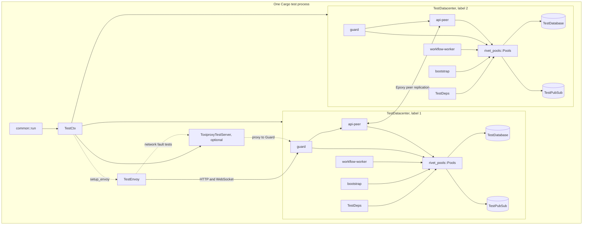
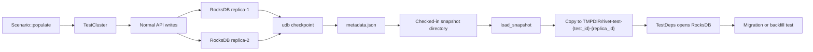
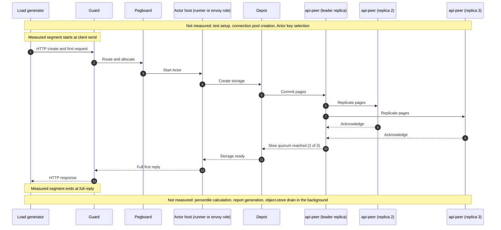

# 16 Tests, benchmarks, and limits

This document examines how the Rivet project proves that its Actors work, how it measures the published latency and memory values, and where the real limits are. It reads the test harness, the snapshot fixtures, the benchmark method, and the constants in the source. It separates three kinds of statement. The first kind is a behaviour that a test executes. The second kind is a number that the project reports. The third kind is a claim that only the product documentation makes. The document also records the tests that the repository marks as ignored, and the limits that the source does not contain.

## 1. What this document covers, and what it does not

The Rivet repository holds six different kinds of proof. They do not have the same strength.

| Kind of proof | What it shows | What it does not show |
| --- | --- | --- |
| Rust unit test | One function or one module obeys its contract | The function works with the other services |
| Rust integration test | A crate works against a real database or a real transport | The full control plane works |
| Engine harness test | The control plane starts, schedules an Actor, and routes a request | The production topology works at scale |
| Snapshot migration test | Old durable state opens under new code | The migration is reversible |
| RivetKit (the Rivet TypeScript software development kit) test | The TypeScript runtime and client agree on a protocol | Every language client agrees |
| Benchmark | One workload on one cluster at one time | Other workloads, other hardware, or tail failures |

The benchmark section is the most important separation in this document. The project publishes five values. This exploration did not run the code. It did not reproduce the five values. It can only check the method, the sample counts, the hardware description, and the arithmetic that the method implies. The raw samples are not in the repository. The harness that produced the published samples is not in the repository either. Section 9.3 states this finding in detail.

The source of truth is commit `4a58441c50d1ce20d8803cfb1ab7c3285a5141d6` of `git@github.com:rivet-dev/rivet.git`, version 2.3.31. All paths are relative to `/Users/darkvoid/GitSources/src.Rivet/rivet` unless the text names another root.

## 2. The test layers and the commands that run them

The repository has eight test layers. They live in different directories and they use different runners. The root task runner command `npx turbo test` runs every package test task, but it is an aggregate command, not a ninth layer.

| Layer | Directory | Command | Scope |
| --- | --- | --- | --- |
| Rust unit tests | Inside each crate, in `#[cfg(test)]` modules | `cargo test -p <crate>` | One module |
| Rust crate integration tests | `engine/packages/<crate>/tests/` | `cargo test -p <crate>` | One crate and its dependencies |
| Engine harness, legacy runner | `engine/packages/engine/tests/runner/` | `cargo test -p rivet-engine` | Control plane and legacy runner protocol |
| Engine harness, envoy | `engine/packages/engine/tests/envoy/` | `cargo test -p rivet-engine` | Control plane and envoy protocol |
| Snapshot migration tests | `engine/packages/epoxy/tests/`, `engine/packages/pegboard/tests/`, `rivetkit-rust/packages/rivetkit-core/tests/migration/` | `cargo test -p epoxy`, `cargo test -p pegboard`, `cargo test -p rivetkit-core` | Old durable state under new code |
| RivetKit TypeScript tests | `rivetkit-typescript/packages/rivetkit/tests/` | `pnpm --filter rivetkit test` | TypeScript runtime, client, and driver matrix (the same test run against each configured driver) |
| Workflow world tests | `integrations/workflow-world/tests/` | `pnpm --filter @rivet-dev/workflow-world test` | The `world` interface of the external `@workflow/world` library (`integrations/workflow-world/package.json:30-33`) |
| Protocol and schema compatibility tests | `engine/sdks/rust/*/tests/`, `engine/sdks/typescript/*/tests/` | `cargo test -p rivet-actor-runtime-socket-protocol`, `cargo test -p rivet-envoy-protocol`, `pnpm --filter @rivetkit/engine-envoy-protocol test` | Rust and TypeScript agree on the wire format |

The engine harness is one Cargo integration test target. The file `engine/packages/engine/tests/mod.rs` declares three modules.

```rust
// engine/packages/engine/tests/mod.rs:1-3
mod common;
mod envoy;
mod runner;
```

The `runner` directory holds the older protocol. The `envoy` directory holds the newer protocol. The two paths share the helpers in `common`. This document names the path for every statement that differs between them.

A runner is an actor host role that speaks the runner protocol. An envoy is an actor host role that speaks the envoy protocol and opens an outbound connection to the control plane. The two roles are not two names for one process. They use different wire protocols, and Guard routes their requests through different paths (`engine/packages/guard/src/routing/mod.rs:228-254`). Both roles host Actors. The test envoy registers a runner configuration under its pool name so that the scheduler can select it (`engine/packages/engine/tests/common/test_helpers.rs:382`). The runner configuration is the scheduler placement record for an actor host, not the runner wire protocol. An envoy uses the same record, so Pegboard can place Actors on it.

The harness has 379 test functions in total. Of these, 224 are in `tests/runner` and 145 are in `tests/envoy`, which gives 369. The other 10 are in other engine test files. The repository marks 99 of the 379 tests with `#[ignore]`. Section 13 analyses that number.

The engine package declares the test helper crates as development dependencies.

```toml
# engine/packages/engine/Cargo.toml:88-96
rivet-envoy-protocol.workspace = true
rivet-runner-protocol.workspace = true
rivet-test-envoy.workspace = true
rivet-test-deps.workspace = true
rivet-util.workspace = true
rusqlite.workspace = true
serde_html_form.workspace = true
test-snapshot-gen.workspace = true
tokio-tungstenite.workspace = true
```

The package name is `rivet-engine`. The library crates are `rivet-test-deps`, `rivet-test-envoy`, and `test-snapshot-gen`.

The cross-language conformance tests live outside the engine harness. Two Rust tests check the wire protocol. `engine/sdks/rust/actor-runtime-socket-protocol/tests/versioned.rs:4-68` checks that every top-level frame round-trips with an embedded version and that an unsupported version is rejected. `engine/sdks/rust/envoy-protocol/tests/remote_sql_compat.rs:104-245` checks that remote Structured Query Language (SQL) frames refuse to serialize below protocol version 4, and that batch frames refuse below version 6. It also checks that a version 4 payload does not decode as version 3. One TypeScript test, `engine/sdks/typescript/envoy-protocol/tests/http-abort-golden.test.ts:7-38`, asserts that the TypeScript encoder produces the same bytes as the Rust golden vector. These tests are the evidence that the Rust and TypeScript implementations agree. The workflow world conformance suite in section 7.6 tests an external workflow library, not the Rivet wire protocol.

## 3. The Rust engine test harness, step by step

The harness runs the control plane inside the test process. It does not start the `rivet-engine` binary. It starts the same services through `rivet_service_manager::start` on a Tokio runtime.

### 3.1 The entry point

Every engine test calls `common::run`. The function builds a Tokio runtime, creates a `TestCtx`, and wraps the test body in a timeout.

```rust
// engine/packages/engine/tests/common/mod.rs:21-34
pub fn run<F, Fut>(opts: TestOpts, test_fn: F)
where
	F: FnOnce(TestCtx) -> Fut,
	Fut: Future<Output = ()>,
{
	let runtime = tokio::runtime::Runtime::new().expect("failed to build runtime");
	runtime.block_on(async {
		let timeout = Duration::from_secs(opts.timeout_secs);
		let ctx = TestCtx::new_with_opts(opts).await.expect("build testctx");
		tokio::time::timeout(timeout, test_fn(ctx))
			.await
			.expect("test timed out");
	});
}
```

The timeout covers the test body and every future that the body awaits. It does not cover `TestCtx::new_with_opts`, because `common::run` awaits that call before it starts the timer (`engine/packages/engine/tests/common/mod.rs:28-31`). The default body budget is 10 seconds (`engine/packages/engine/tests/common/ctx.rs:21`). The namespace helper retries for up to 60 seconds inside that body (`engine/packages/engine/tests/common/test_helpers.rs:34`). The retry limit is therefore larger than the default body budget. A test that waits more than 10 seconds for a namespace fails at the body timeout first. A test that needs the full retry window must raise the body budget with `TestOpts::with_timeout` (`engine/packages/engine/tests/common/ctx.rs:29-32`). If `TestCtx::new_with_opts` blocks, the port wait inside setup panics after 30 seconds.

### 3.2 The options

`TestOpts` has six fields. The test chooses the number of datacenters. The other five fields set the body timeout, authentication, network fault injection, and the optional outbound Pegboard service. Pegboard is the Actor scheduler (`engine/packages/pegboard/src/workflows/runner.rs:20-29`).

```rust
// engine/packages/engine/tests/common/ctx.rs:8-27
pub struct TestOpts {
	pub datacenters: usize,
	pub timeout_secs: u64,
	pub pegboard_outbound: bool,
	pub auth_admin_token: Option<String>,
	pub insecure_allow_unauthenticated: bool,
	pub network_faults: bool,
}

impl TestOpts {
	pub fn new(datacenters: usize) -> Self {
		Self {
			datacenters,
			timeout_secs: 10,
			pegboard_outbound: false,
			auth_admin_token: Some(TEST_ADMIN_TOKEN.to_owned()),
			insecure_allow_unauthenticated: false,
			network_faults: false,
		}
	}
```

| Field | Type | Default | Meaning |
| --- | --- | --- | --- |
| `datacenters` | `usize` | Set by the caller | Number of control plane datacenters |
| `timeout_secs` | `u64` | 10 | Timeout for the test body |
| `pegboard_outbound` | `bool` | `false` | Start the `pegboard_outbound` service |
| `auth_admin_token` | `Option<String>` | `Some("default")` | Admin token for the test control plane |
| `insecure_allow_unauthenticated` | `bool` | `false` | Disable authentication checks |
| `network_faults` | `bool` | `false` | Start a Toxiproxy server for fault tests |

The constant `TEST_ADMIN_TOKEN` is `"default"` at `engine/packages/engine/tests/common/ctx.rs:6`.

### 3.3 The context

`TestCtx` holds the datacenters and the options. `TestDatacenter` holds the configuration, the `rivet_pools::Pools` connection pool set, the test dependencies, a workflow context for assertions, and the handle of the engine task. The `Pools` connection set is not a runner pool. A runner pool is the set of actor hosts that share one runner configuration name.

```rust
// engine/packages/engine/tests/common/ctx.rs:68-80
pub struct TestCtx {
	dcs: Vec<TestDatacenter>,
	pub opts: TestOpts,
	network_faults: Option<rivet_test_deps::ToxiproxyTestServer>,
}

pub struct TestDatacenter {
	pub config: rivet_config::Config,
	pub pools: rivet_pools::Pools,
	pub test_deps: rivet_test_deps::TestDeps,
	pub workflow_ctx: StandaloneCtx,
	engine_handle: tokio::task::JoinHandle<Result<()>>,
}
```

### 3.4 The setup call

`TestCtx::new_with_opts` performs five steps. It initializes logging. It asserts that the datacenter count is at least one. It asks `TestDeps::new_multi` for one dependency set for each datacenter. It starts every datacenter in parallel. It optionally starts Toxiproxy.

```rust
// engine/packages/engine/tests/common/ctx.rs:89-133
pub async fn new_with_opts(opts: TestOpts) -> Result<Self> {
	// Set up logging
	let _ = tracing_subscriber::fmt()
		.with_env_filter("info")
		.with_ansi(false)
		.with_test_writer()
		.try_init();

	// Initialize test dependencies for all DCs
	assert!(opts.datacenters >= 1, "datacenters must be at least 1");
	let dc_count = opts.datacenters;
	tracing::info!("setting up test dependencies for {} DCs", dc_count);
	let dc_labels: Vec<u16> = (1..=dc_count as u16).collect();
	let test_deps_list = rivet_test_deps::TestDeps::new_multi(&dc_labels)
		.await?
		.into_iter();

	// Setup all datacenters in parallel so each DC's epoxy/peer endpoints can reach the
	// others without hitting a startup race (sequential setup would let DC1's epoxy try to
	// contact DC2 before DC2's API server is listening, which puts DC1 into a long backoff
	// loop).
	let setup_futures = test_deps_list.map(|test_deps| {
		Self::setup_instance(
			test_deps,
			opts.pegboard_outbound,
			opts.auth_admin_token.clone(),
			opts.insecure_allow_unauthenticated,
		)
	});
	let mut dcs: Vec<TestDatacenter> =
		futures_util::future::try_join_all(setup_futures).await?;
	dcs.sort_by_key(|dc| dc.config.dc_label());

	let network_faults = if opts.network_faults {
		Some(rivet_test_deps::ToxiproxyTestServer::start().await?)
	} else {
		None
	};

	Ok(Self {
		dcs,
		opts,
		network_faults,
	})
}
```

The source comment gives the reason for parallel setup. A sequential setup lets the first datacenter contact the second before the second is listening. The first datacenter then enters a long backoff loop.

`TestDeps::new_multi` calls `new_multi_with_test_id` with a new random test identifier (`engine/packages/test-deps/src/lib.rs:51-54`). The identifier names the storage path for each datacenter. `new` and `new_with_test_id` reduce the same result to one datacenter (`engine/packages/test-deps/src/lib.rs:37-49`).

### 3.5 The services in one datacenter

`setup_instance` starts four services in every datacenter and one optional service. It then waits for the Application Programming Interface (API) peer port and the Guard port.

```rust
// engine/packages/engine/tests/common/ctx.rs:161-203
let engine_handle = tokio::spawn({
	let config = config.clone();
	let pools = pools.clone();
	async move {
		let mut services = vec![
			Service::new(
				"api-peer",
				ServiceKind::ApiPeer,
				|config, pools| Box::pin(rivet_api_peer::start(config, pools)),
				false,
			),
			Service::new(
				"guard",
				ServiceKind::Standalone,
				|config, pools| Box::pin(rivet_guard::start(config, pools)),
				true,
			),
			Service::new(
				"workflow-worker",
				ServiceKind::Standalone,
				|config, pools| Box::pin(rivet_workflow_worker::start(config, pools)),
				true,
			),
			Service::new(
				"bootstrap",
				ServiceKind::Oneshot,
				|config, pools| Box::pin(rivet_bootstrap::start(config, pools)),
				false,
			),
		];

		if include_pegboard_outbound {
			services.push(Service::new(
				"pegboard_outbound",
				ServiceKind::Standalone,
				|config, pools| Box::pin(pegboard_outbound::start(config, pools)),
				true,
			));
		}

		rivet_service_manager::start(config, pools, services).await
	}
});
```

| Service | Kind | Started in every test | Purpose |
| --- | --- | --- | --- |
| `api-peer` | `ApiPeer` | Yes | Internal control plane API and peer traffic |
| `guard` | `Standalone` | Yes | Public entry for Hypertext Transfer Protocol (HTTP) and WebSocket traffic |
| `workflow-worker` | `Standalone` | Yes | Runs Gasoline workflows (the durable workflow engine) |
| `bootstrap` | `Oneshot` | Yes | Creates the Epoxy replica and coordinator, the default namespace, and other first-run records |
| `pegboard_outbound` | `Standalone` | No | Outbound connections for the serverless path |

The fourth argument to `Service::new` is `requires_graceful_shutdown` (`engine/packages/service-manager/src/lib.rs:30-47`). It marks a service that the manager must stop in an orderly way. The `ServiceKind` value selects the run behavior. `ApiPublic`, `ApiPeer`, `Standalone`, `Singleton`, and `Core` run as long-lived services. The manager restarts a long-lived service after it exits or crashes. `Oneshot` runs one task and retries it after a crash. `Cron` runs a task on a schedule (`engine/packages/service-manager/src/lib.rs:50-103`). The manager adds a `metrics` service with the `Core` kind (`engine/packages/service-manager/src/lib.rs:147-152`).

`bootstrap` creates durable records, not an in-memory flag. It creates the Epoxy replica and coordinator, the default namespace, the backfill state, the Pegboard metrics aggregator, the gas pruner, and the datacenter ping (`engine/packages/bootstrap/src/lib.rs:17-28`). It then rotates the JavaScript Object Notation (JSON) Web Token (JWT) signing key (`engine/packages/bootstrap/src/lib.rs:30-31`). The `Oneshot` kind lets the task exit after those records exist.

The harness aborts the engine task when `TestDatacenter` is dropped (`engine/packages/engine/tests/common/ctx.rs:272`). It does not join the task. A service that fails after startup does not fail the test. The test process only observes the failure if a later request fails. This is a real limit of the harness, not a defect in a tested feature.

`wait_for_port` connects to `127.0.0.1:<port>` every 100 milliseconds. It panics after 30 seconds (`engine/packages/engine/tests/common/ctx.rs:276-301`).

### 3.6 The harness topology

The diagram shows the process and service layout for one test with two datacenters. Every box is a real service or helper in the source.



The two datacenters share one test process. They do not share a database or a pub/sub transport. `TestDeps::new_multi` creates one dependency set for each label. `setup_single_datacenter` reads `TestDatabase::from_env()` and `TestPubSub::from_env()` and builds a separate configuration for that label (`engine/packages/test-deps/src/datacenter.rs:10-58`). Each datacenter then creates its own connection pools from that configuration (`engine/packages/test-deps/src/datacenter.rs:109-110`). The four services in one datacenter receive the same `Pools` set (`engine/packages/engine/tests/common/ctx.rs:156-201`).

In the harness, a datacenter is one control-plane instance set. It has one label, one configuration, one database, one pub/sub transport, and one pair of API peer and Guard ports (`engine/packages/engine/tests/common/ctx.rs:74-80`). The label is a `u16`. The first label in the list is the leader (`engine/packages/test-deps/src/lib.rs:63-81`).

The peer link carries Epoxy traffic. Epoxy peers are replicas in other datacenters, and each replica writes to its own database (`engine/packages/epoxy/src/protocol_version.rs:4-5`). The topology records a `peer_url` for each datacenter (`engine/packages/test-deps/src/lib.rs:74-76`). A write that needs a quorum therefore reaches the other datacenter over the `api-peer` services, even though the local stores are separate. A two-datacenter test exercises that replication and the leader behaviour that depends on it. The parallel setup exists because the first datacenter contacts the second during startup (`engine/packages/engine/tests/common/ctx.rs:106-109`).

## 4. The complete lifecycle of one engine test

The test `envoy_actor_basic_create` is a complete example. It creates a namespace, starts an envoy, creates an Actor through Guard, waits for the start notification, and then waits for the envoy to record the allocation.

```rust
// engine/packages/engine/tests/envoy/actors_lifecycle.rs:22-69
#[test]
fn envoy_actor_basic_create() {
	common::run(common::TestOpts::new(1), |ctx| async move {
		let (namespace, _) = common::setup_test_namespace(ctx.leader_dc()).await;

		let (start_tx, start_rx) = tokio::sync::oneshot::channel();
		let start_tx = Arc::new(Mutex::new(Some(start_tx)));

		let envoy = common::setup_envoy(ctx.leader_dc(), &namespace, |builder| {
			builder.with_actor_behavior("test-actor", move |_| {
				Box::new(common::test_envoy::NotifyOnStartActor::new(
					start_tx.clone(),
				))
			})
		})
		.await;

		let res = common::create_actor(
			ctx.leader_dc().guard_port(),
			&namespace,
			"test-actor",
			envoy.pool_name(),
			rivet_types::actors::CrashPolicy::Sleep,
		)
		.await;

		let actor_id = res.actor.actor_id.to_string();

		// Wait for actor to start (notification from actor)
		start_rx
			.await
			.expect("actor should have sent start notification");

		// The actor sends its start notification before the test Envoy records it.
		tokio::time::timeout(tokio::time::Duration::from_secs(5), async {
			loop {
				if envoy.has_actor(&actor_id).await {
					break;
				}
				tokio::time::sleep(tokio::time::Duration::from_millis(50)).await;
			}
		})
		.await
		.expect("envoy should have the actor allocated");

		tracing::info!(?actor_id, envoy_key = ?envoy.envoy_key, "actor allocated to envoy");
	});
}
```

The trace below follows the real calls in order.

| Step | Call | What happens | Source |
| --- | --- | --- | --- |
| 1 | `TestOpts::new(1)` | One datacenter, 10 second timeout | `engine/packages/engine/tests/common/ctx.rs:18-27` |
| 2 | `common::run` | Tokio runtime, `TestCtx`, timeout wrapper | `engine/packages/engine/tests/common/mod.rs:21-34` |
| 3 | `TestCtx::new_with_opts` | Test dependencies, parallel datacenter setup | `engine/packages/engine/tests/common/ctx.rs:89-133` |
| 4 | `setup_instance` | Start `api-peer`, `guard`, `workflow-worker`, `bootstrap` | `engine/packages/engine/tests/common/ctx.rs:161-203` |
| 5 | `wait_for_port` | Wait for `api-peer` and `guard` | `engine/packages/engine/tests/common/ctx.rs:205-210` |
| 6 | `setup_test_namespace` | Create `test-<random u16>` through Guard | `engine/packages/engine/tests/common/test_helpers.rs:30-54` |
| 7 | `setup_envoy` | Build envoy version 1, upsert runner config, start, wait ready | `engine/packages/engine/tests/common/test_helpers.rs:368-388` |
| 8 | `create_actor` | Call `api::public::actors_create` with runner selector | `engine/packages/engine/tests/common/test_helpers.rs:397-420` |
| 9 | `start_rx.await` | Wait for the `NotifyOnStartActor` behaviour | `engine/packages/engine/tests/envoy/actors_lifecycle.rs:50-53` |
| 10 | Poll `envoy.has_actor` | Wait for the envoy to record the allocation | `engine/packages/engine/tests/envoy/actors_lifecycle.rs:55-65` |

The namespace helper retries the create call for 60 seconds. It sleeps 100 milliseconds between attempts. The default body budget is 10 seconds (`engine/packages/engine/tests/common/ctx.rs:21`). A test that uses the default budget therefore stops at 10 seconds, before the helper exhausts its retries.

```rust
// engine/packages/engine/tests/common/test_helpers.rs:30-54
pub async fn setup_test_namespace(leader_dc: &TestDatacenter) -> (String, rivet_util::Id) {
	let random_suffix = rand::random::<u16>();
	let namespace_name = format!("test-{random_suffix}");
	let start = std::time::Instant::now();
	let timeout = std::time::Duration::from_secs(60);
	let res = loop {
		match super::api::public::namespaces_create(
			leader_dc.guard_port(),
			rivet_api_peer::namespaces::CreateRequest {
				name: namespace_name.clone(),
				display_name: "Test Namespace".to_string(),
			},
		)
		.await
		{
			Ok(res) => break res,
			Err(err) if start.elapsed() < timeout => {
				tracing::warn!(?err, "retrying test namespace setup");
				tokio::time::sleep(std::time::Duration::from_millis(100)).await;
			}
			Err(err) => panic!("failed to setup test namespace: {err:?}"),
		}
	};
	(res.namespace.name, res.namespace.namespace_id)
}
```

The envoy helper shows the order that the test depends on. The runner configuration must exist before the envoy starts. The envoy must be ready before the test creates an Actor with its runner pool name.

The value from `envoy.pool_name()` is a runner pool name. `upsert_normal_runner_config` uses that name for the runner configuration (`engine/packages/engine/tests/common/test_helpers.rs:382`). A runner pool is the set of actor hosts that share one runner configuration name. It is not the `rivet_pools::Pools` connection set. The scheduler reports an error when no runner configuration matches the requested pool name (`engine/packages/pegboard/src/errors.rs:76-84`).

```rust
// engine/packages/engine/tests/common/test_helpers.rs:368-388
pub async fn setup_envoy<F>(
	dc: &super::TestDatacenter,
	namespace: &str,
	configure: F,
) -> super::test_envoy::TestEnvoy
where
	F: FnOnce(super::test_envoy::TestEnvoyBuilder) -> super::test_envoy::TestEnvoyBuilder,
{
	let builder = super::test_envoy::TestEnvoyBuilder::new(namespace).with_version(1);

	let builder = configure(builder);

	let envoy = builder.build(dc).await.expect("failed to build test envoy");

	upsert_normal_runner_config(dc, namespace, envoy.pool_name()).await;

	envoy.start().await.expect("failed to start envoy");
	envoy.wait_ready().await;

	envoy
}
```

The create helper uses the public API, not an internal op. The test therefore exercises the same Guard route that a client uses.

```rust
// engine/packages/engine/tests/common/test_helpers.rs:397-420
pub async fn create_actor(
	port: u16,
	namespace: &str,
	name: &str,
	runner_name: &str,
	crash_policy: rivet_types::actors::CrashPolicy,
) -> super::api_types::actors::create::CreateResponse {
	super::api::public::actors_create(
		port,
		super::api_types::actors::create::CreateQuery {
			namespace: namespace.to_string(),
		},
		super::api_types::actors::create::CreateRequest {
			datacenter: None,
			name: name.to_string(),
			key: None,
			input: None,
			runner_name_selector: runner_name.to_string(),
			crash_policy,
		},
	)
	.await
	.expect("failed to create actor")
}
```

The failure path is simple. If the Actor does not start, `start_rx` never resolves and the test body hits the 10 second timeout. If the envoy does not record the Actor, the 5 second poll expires and the test panics with `"envoy should have the actor allocated"`. If the control plane does not start, `wait_for_port` panics after 30 seconds with the service name and port. The harness prints the panic through the test thread.

## 5. Test dependencies and Docker

The `rivet-test-deps` crate supplies the database, the pub/sub transport, the ports, and the container cleanup. The default configuration uses no Docker at all.

The crate split separates orchestration from container code. `engine/packages/test-deps/` holds `TestDeps` and `setup_single_datacenter`. It re-exports every item from `rivet_test_deps_docker` (`engine/packages/test-deps/src/lib.rs:10`). That second crate lives in `engine/packages/test-deps-docker/` and holds `TestDatabase`, `TestPubSub`, and the Toxiproxy server. Citations below use the file that contains the item.

### 5.1 Database choices

`TestDatabase` has two variants.

```rust
// engine/packages/test-deps-docker/src/database.rs:14-24
pub fn from_env() -> Self {
	use std::result::Result::{Err, Ok};
	match std::env::var("RIVET_TEST_DATABASE") {
		Ok(val) => match val.as_str() {
			"postgres" => TestDatabase::Postgres,
			"filesystem" => TestDatabase::FileSystem,
			_ => TestDatabase::FileSystem, // Default
		},
		Err(_) => TestDatabase::FileSystem, // Default
	}
}
```

| Variant | Backend | Docker | Default |
| --- | --- | --- | --- |
| `Postgres` | PostgreSQL 18 container | Yes | No |
| `FileSystem` | RocksDB in a temporary directory | No | Yes |

The filesystem path is `rivet-test-{test_id}-{dc_label}` inside the system temporary directory (`engine/packages/test-deps-docker/src/database.rs:81`). The PostgreSQL container waits for readiness with 10 attempts and a 500 millisecond delay between attempts (`engine/packages/test-deps-docker/src/database.rs:93-137`).

### 5.2 Pub/sub choices

`TestPubSub` has two variants. The memory driver is the default.

```rust
// engine/packages/test-deps-docker/src/pubsub.rs:13-23
pub fn from_env() -> Self {
	use std::result::Result::{Err, Ok};
	match std::env::var("RIVET_TEST_PUBSUB") {
		Ok(val) => match val.as_str() {
			"nats" => TestPubSub::Nats,
			"memory" => TestPubSub::Memory,
			_ => TestPubSub::Memory, // Default
		},
		Err(_) => TestPubSub::Memory, // Default
	}
}
```

| Variant | Backend | Docker | Default |
| --- | --- | --- | --- |
| `Nats` | NATS 2.10.22 container | Yes | No |
| `Memory` | In-process channels | No | Yes |

### 5.3 The test dependency object

`TestDeps::new_multi_with_test_id` picks an unused port for each service. It uses the first datacenter as the leader. It sets up every datacenter concurrently and stores the container names for cleanup. `Drop` runs `docker stop` and `docker rm` for each container (`engine/packages/test-deps/src/lib.rs:132-153`).

`new_multi(dc_ids)` generates a new test identifier and calls `new_multi_with_test_id(dc_ids, Uuid::new_v4())` (`engine/packages/test-deps/src/lib.rs:51-54`). `new_with_test_id(test_id)` calls `new_multi_with_test_id(&[1], test_id)` and returns the first element (`engine/packages/test-deps/src/lib.rs:42-49`). `new_multi_with_test_id` is the only implementation; the other constructors add a test identifier or reduce the result (`engine/packages/test-deps/src/lib.rs:56-100`). The test identifier forms the storage path, so two calls with the same identifier reuse the same storage (`engine/packages/test-deps/src/datacenter.rs:8-9`).

```rust
// engine/packages/test-deps/src/datacenter.rs:97-121
// Use short timeouts for tests
root.pegboard = Some(rivet_config::config::pegboard::Pegboard {
	actor_start_threshold: Some(3_000), // 3 seconds instead of 30
	serverless_base_retry_timeout: Some(500), // 500ms instead of 2s
	serverless_backoff_max_exponent: Some(2), // Max 2^2 = 4x base = 2s
	..Default::default()
});

tracing::info!(
	dc = dc.datacenter_label,
	"creating test configuration and pools"
);
let config = rivet_config::Config::from_root(root);
let pools = rivet_pools::Pools::test(config.clone()).await?;

tracing::info!(dc = dc.datacenter_label, "test dependencies setup complete");
tracing::info!(dc = dc.datacenter_label, config = ?*config, "test dependencies config");
Ok(TestDeps {
	pools,
	config,
	container_names,
	api_peer_port,
	guard_port,
	stop_docker_containers_on_drop: true,
})
```

The test configuration changes three Pegboard defaults. `actor_start_threshold` becomes 3,000 milliseconds instead of 30,000. The serverless base retry becomes 500 milliseconds instead of 2,000. The maximum backoff exponent becomes 2 instead of 8. These changes make a failing test fail in seconds, not minutes.

### 5.4 Which tests need Docker

| Test area | Docker needed | Why |
| --- | --- | --- |
| Default engine harness tests | No | RocksDB filesystem and memory pub/sub |
| Engine tests with `RIVET_TEST_DATABASE=postgres` | Yes | PostgreSQL container |
| Engine tests with `RIVET_TEST_PUBSUB=nats` | Yes | NATS container |
| Network fault tests | Yes, for Toxiproxy | Toxiproxy container |
| Snapshot tests | No | Checked-in RocksDB directories copied to temp |
| RivetKit driver tests | No, by default | A real engine child process with filesystem storage |
| RivetKit platform tests | Depends on the platform | Excluded unless `RIVETKIT_INCLUDE_PLATFORM_TESTS=1` |

Toxiproxy uses admin port 8474 and default proxy port 8666. The image is `ghcr.io/shopify/toxiproxy:2.12.0` (`engine/packages/test-deps-docker/src/toxiproxy.rs:11-12,93`).

### 5.5 A stale internal document

The internal document `docs-internal/engine/TEST_DEPENDENCIES.md:9-12` lists three database options. It names `foundationdb`, `postgres`, and `filesystem`. The source has only `Postgres` and `FileSystem` (`engine/packages/test-deps-docker/src/database.rs:7-11`). The `foundationdb` option does not exist in this commit. The document is stale. The code wins.

The same document says that containers are cleaned up on drop. That part matches the code.

## 6. Snapshots and migration guards

A snapshot is a checked-in copy of the entire UniversalDB state for every replica in a small cluster. It is not a logical dump. It is a set of RocksDB checkpoint directories.

### 6.1 What a snapshot contains

Each scenario directory has one metadata file and one directory for each replica.

```text
engine/packages/test-snapshot-gen/snapshots/epoxy-v1/
  metadata.json
  replica-1/
  replica-2/
```

The metadata file `engine/packages/test-snapshot-gen/snapshots/epoxy-v1/metadata.json` has three fields.

```json
{
  "commit": "3beb449f6",
  "branch": "main",
  "generated_at": "1775373263"
}
```

The field name `generated_at` suggests an International Organization for Standardization (ISO) 8601 timestamp. The generator writes epoch seconds as a string instead. The function `get_iso_timestamp` returns `format!("{secs}")` (`engine/packages/test-snapshot-gen/src/main.rs:60-67`). The source comment says that a date library was not worth the dependency. This is a small documentation mismatch, not a functional problem.

A snapshot includes every key space. The internal document says it captures the UniversalDB state for Epoxy, Gasoline, Pegboard, and the other systems (`docs-internal/engine/TEST_SNAPSHOTS.md:12`). A test can therefore assert on durable state that the normal API created in an older version.

### 6.2 How the generator produces a snapshot

The generator has two commands. `List` prints every scenario. `Build` runs one scenario.

```rust
// engine/packages/test-snapshot-gen/src/main.rs:22-31
#[derive(Subcommand)]
enum Command {
	/// Build a single scenario's snapshot.
	Build {
		/// Scenario name (e.g. "epoxy-v1").
		scenario: String,
	},
	/// List available scenarios.
	List,
}
```

The scenario trait has three methods.

```rust
// engine/packages/test-snapshot-gen/src/scenarios/mod.rs:9-20
#[async_trait(?Send)]
pub trait Scenario {
	/// Unique name for this scenario (used as directory name).
	fn name(&self) -> &'static str;

	/// Number of replicas in the cluster.
	fn replica_count(&self) -> usize;

	/// Populate state in the cluster. Called after the cluster is fully
	/// initialized with all replicas active.
	async fn populate(&self, cluster: &TestCluster) -> Result<()>;
}
```

The generator has two registered scenarios.

```rust
// engine/packages/test-snapshot-gen/src/scenarios/mod.rs:22-27
pub fn all() -> Vec<Box<dyn Scenario>> {
	vec![
		Box::new(epoxy_keys::EpoxyKeys),
		Box::new(pb_actor_v1_pre_migration::PbActorV1PreMigration),
	]
}
```

| Scenario | Directory | Replicas | State written |
| --- | --- | --- | --- |
| `EpoxyKeys` | `epoxy-v1` | 2 | Three keys through Epoxy consensus |
| `PbActorV1PreMigration` | `pb-actor-v1-pre-migration` | 2 | One Actor named `test`, then a sleep |

The build path removes the old directory, creates a new cluster, calls `populate`, checkpoints each replica, shuts the cluster down, and writes the metadata (`engine/packages/test-snapshot-gen/src/main.rs:99-145`). A regeneration overwrites the previous snapshot in place. The metadata records the short commit and branch, but not a hash of the checkpoint files.

### 6.3 How a test loads a snapshot

`load_snapshot` finds every directory whose name starts with `replica-`. It parses the replica identifier. It copies the directory to `rivet-test-{test_id}-{replica_id}` in the system temporary directory. It removes an existing copy first.

```rust
// engine/packages/test-snapshot-gen/src/lib.rs:24-63
pub fn load_snapshot(scenario: &str, test_id: uuid::Uuid) -> Result<HashMap<ReplicaId, PathBuf>> {
	let dir = snapshot_dir(scenario);
	load_snapshot_from(&dir, test_id)
}

/// Like `load_snapshot` but from an explicit directory.
pub fn load_snapshot_from(
	snapshot_dir: &Path,
	test_id: uuid::Uuid,
) -> Result<HashMap<ReplicaId, PathBuf>> {
	let mut replicas = HashMap::new();

	for entry in std::fs::read_dir(snapshot_dir)
		.with_context(|| format!("failed to read snapshot dir {}", snapshot_dir.display()))?
	{
		let entry = entry?;
		let name = entry.file_name().to_string_lossy().to_string();
		if !name.starts_with("replica-") {
			continue;
		}

		let replica_id: ReplicaId = name
			.strip_prefix("replica-")
			.unwrap()
			.parse()
			.context("invalid replica id in snapshot dir name")?;

		// Copy to the standard test path format so the test infrastructure picks it up.
		let dest = std::env::temp_dir().join(format!("rivet-test-{}-{}", test_id, replica_id));
		if dest.exists() {
			std::fs::remove_dir_all(&dest)?;
		}
		copy_dir_recursive(&entry.path(), &dest)
			.with_context(|| format!("failed to copy snapshot for replica {replica_id}"))?;

		replicas.insert(replica_id, dest);
	}

	Ok(replicas)
}
```

The copy step is the contract between the snapshot crate and the test dependency crate. `setup_single_datacenter` tells `TestDatabase::FileSystem` to open the same `rivet-test-{test_id}-{dc_label}` path. If either side changes the format, the test opens an empty database and the migration assertion fails. The internal document states this coupling at `docs-internal/engine/TEST_SNAPSHOTS.md:141`.

The mapping is direct. `load_snapshot_from` names each copy with the snapshot directory's replica identifier (`engine/packages/test-snapshot-gen/src/lib.rs:52`). `SnapshotTestCtx::start_replica` passes that same identifier as the datacenter label, converted with `replica_id as u16` (`engine/packages/test-snapshot-gen/src/lib.rs:214-221`). `setup_single_datacenter` then opens `rivet-test-{test_id}-{dc_label}` for that label (`engine/packages/test-deps/src/datacenter.rs:36-37`). The cast preserves the number only for identifiers below 65,536, because the protocol defines `ReplicaId` as a 64-bit unsigned integer (`engine/sdks/schemas/epoxy-protocol/v4.bare:2`). The snapshot fixtures use small identifiers, so the names match in these tests. An identifier above 65,535 would truncate and break the match.

`SnapshotTestCtx::from_snapshot` sorts the replica identifiers, chooses the first as the leader, starts the replicas, and waits until all replicas are active. On shutdown it sleeps 200 milliseconds before it stops the services (`engine/packages/test-snapshot-gen/src/lib.rs:193`). The sleep is a timing assumption, not a readiness signal.

### 6.4 The snapshot lifecycle

The diagram shows the full path from a checked-in fixture to a migration assertion.



### 6.5 The migration paths that snapshots guard

The repository provides three complete snapshot guards. It also contains a fourth test whose snapshot is absent. The table groups the guards by upgrade area. The incomplete guard is the third row.

| Guard | Snapshot | Test | Status | What it proves |
| --- | --- | --- | --- | --- |
| Epoxy v1 to v2 | `epoxy-v1` | `engine/packages/epoxy/tests/backfill_snapshot.rs:45` | Complete | Legacy data remains readable, the new key space starts empty, dual read falls back, and backfill is idempotent |
| Pegboard Actor v1 before migration | `pb-actor-v1-pre-migration` | `engine/packages/pegboard/tests/actor_v1_pre_migration.rs:9-10` | Complete but weak | The namespace resolves, the old Actor is listed, a Wake signal is sent, and the Actor workflow is not dead after 3 seconds |
| Actor layout v2.2.1 to current | `actor-v2-2-1-baseline` | `engine/packages/engine/tests/actor_v2_2_1_migration.rs:17-24` | Incomplete: fixture missing | Old Actor storage migrates to the current layout |
| RivetKit Actor v2.2.1 to current | `rivetkit-core/tests/migration/v2_2_1/snapshot` | `rivetkit-rust/packages/rivetkit-core/tests/migration/v2_2_1/mod.rs:34-37` | Complete | A TypeScript verifier reads the migrated state within 90 seconds |

`backfill_snapshot.rs` uses two Epoxy mechanisms. The dual read checks the version 2 value first, then the legacy committed value, then the legacy versioned value, and then the optional optimistic cache. The first value found wins (`engine/packages/epoxy/src/ops/kv/get_local.rs:30-45`). The changelog is a versionstamp-keyed log. `append` writes one entry for each committed change (`engine/packages/epoxy/src/replica/changelog.rs:17-44`), and `read` returns entries after a given versionstamp (`engine/packages/epoxy/src/replica/changelog.rs:46-80`). The test checks that the changelog contains an entry for each backfilled key (`engine/packages/epoxy/tests/backfill_snapshot.rs:174-190`).

The Epoxy test is the strongest of the three complete guards. It loads the old snapshot. It asserts that each legacy key exists. It asserts that the version 2 key space is empty. It reads through the dual-read path. It re-proposes an immutable value and checks that the second proposal is idempotent. It proposes a different value and checks for `CommandError::ExpectedValueDoesNotMatch`. It writes a new mutable key and mutates it. It then runs the backfill, checks that three keys migrate, and checks the changelog and the post-backfill read order (`engine/packages/epoxy/tests/backfill_snapshot.rs:42-224`).

The Pegboard test is weaker. It resolves the namespace, lists the old Actor, sends a `Wake` signal, sleeps for 3 seconds, and asserts that the workflow is not dead. The fixed sleep is an assumption about propagation. The test does not prove that the Actor served a request after the wake.

### 6.6 A missing snapshot in the engine test

The engine test `actor_v2_2_1_baseline_migrates_to_current_layout` names the snapshot `actor-v2-2-1-baseline`.

```rust
// engine/packages/engine/tests/actor_v2_2_1_migration.rs:17-24
const SNAPSHOT_NAME: &str = "actor-v2-2-1-baseline";
const ACTOR_NAME: &str = "actor-v2-2-1-baseline";
const USER_KV_VALUE: &[u8] = b"snapshot-value";
const QUEUE_MESSAGE_BODY: &[u8] = b"queued-from-v2.2.1";

#[tokio::test(flavor = "multi_thread")]
async fn actor_v2_2_1_baseline_migrates_to_current_layout() -> Result<()> {
	let mut test_ctx = SnapshotTestCtx::from_snapshot_with_coordinator(SNAPSHOT_NAME).await?;
```

The generator has no scenario with that name. The only scenario directories under `engine/packages/test-snapshot-gen/snapshots/` are `epoxy-v1` and `pb-actor-v1-pre-migration`; the directory also holds an empty `.gitkeep` file. The similarly named snapshot under `rivetkit-rust/packages/rivetkit-core/tests/migration/v2_2_1/snapshot/` is a different fixture for a different harness.

The load call returns an error because it cannot read the directory. The test cannot pass from the checked-in source. This is a concrete test-quality finding.

A developer machine could hold the fixture outside version control. If the fixture exists on that machine, the test can pass there. That path cannot run from a clean checkout, because the repository contains no generator scenario for `actor-v2-2-1-baseline` (section 6.2). The checked-in source therefore cannot produce the fixture and cannot pass the test.

## 7. RivetKit tests: `setupTest` and the shared engine

The TypeScript tests use two different mechanisms. The unit and integration tests call `setupTest`. The driver tests start a real engine child process.

### 7.1 What `setupTest` does

`setupTest` prepares a registry and a client. It marks the test configuration as enabled, disables the welcome message, calls `registry.start()`, and waits for the registry to become ready (`rivetkit-typescript/packages/rivetkit/src/test/mod.ts:11-31`).

```typescript
// rivetkit-typescript/packages/rivetkit/src/test/mod.ts:11-31
export async function setupTest<A extends Registry<any>>(
	c: TestContext,
	registry: A,
): Promise<SetupTestResult<A>> {
	registry.config.test = { ...registry.config.test, enabled: true };
	registry.config.noWelcome = true;

	registry.start();
	await waitForRegistryReady(registry);

	const client = createClient<A>({
		...convertRegistryConfigToClientConfig(registry.parseConfig()),
		disableMetadataLookup: false,
	});

	c.onTestFinished(async () => {
		await client.dispose();
	});

	return { client };
}
```

The call `registry.start()` chooses a runtime mode. In serverless mode it calls `listen`. In every other mode it calls `#startEnvoy` (`rivetkit-typescript/packages/rivetkit/src/registry/index.ts:964-982`). The registry then builds a serve configuration from the endpoint and the pool name (`rivetkit-typescript/packages/rivetkit/src/registry/native.ts:5592-5615`).

**Aha:** The JavaScript option `startEngine` defaults to `getRivetRunEngine()`, which is true only when `RIVET_RUN_ENGINE === "1"` (`rivetkit-typescript/packages/rivetkit/src/registry/config/index.ts:225`, `rivetkit-typescript/packages/rivetkit/src/utils/env-vars.ts:23-24`). When `startEngine` is true, the endpoint is the local engine endpoint, and the schema rejects a separate endpoint (`rivetkit-typescript/packages/rivetkit/src/registry/config/index.ts:344-349`, `rivetkit-typescript/packages/rivetkit/src/registry/config/index.ts:365-368`). When `startEngine` is false, the registry uses an explicit endpoint if one exists. If no endpoint exists and the environment is not production, it uses the local engine endpoint (`rivetkit-typescript/packages/rivetkit/src/registry/config/index.ts:344-368`, `rivetkit-typescript/packages/rivetkit/src/utils/env-vars.ts:108`). The native core then makes the spawn decision. `should_manage_engine` returns true for the `Always` mode, false for the `Never` mode, and `is_loopback_endpoint(endpoint)` for the default `Auto` mode (`rivetkit-rust/packages/rivetkit-core/src/registry/mod.rs:225-241`, `rivetkit-rust/packages/rivetkit-core/src/registry/mod.rs:353-381`). The environment variable `RIVETKIT_ENGINE_SPAWN` selects `always`, `never`, or the default `auto` mode (`rivetkit-rust/packages/rivetkit-core/src/registry/mod.rs:233-240`). The core starts the development processes when that function returns true (`rivetkit-rust/packages/rivetkit-core/src/registry/mod.rs:630-636`). The JavaScript layer resolves the binary path but does not duplicate the decision (`rivetkit-typescript/packages/rivetkit/src/registry/native.ts:5617-5627`).

A test process therefore does start its own native engine in a development or test environment, because the fallback endpoint is loopback. It does not start one when the configuration names a remote endpoint. The comment in section 7.5 describes the development case correctly. The `startEngine` flag and the `RIVET_RUN_ENGINE` variable force the local endpoint, but they are not the only path to a local engine. The driver test suite uses a separate engine process so that it can control the engine lifetime and ports (section 7.2).

Both paths start an engine process. The difference is ownership. `setupTest` lets the native core start and supervise the engine. The driver harness spawns the engine itself and controls its lifetime and ports.

The readiness helper polls the registry health route with `pRetry`, 120 attempts, and a 50 to 250 millisecond delay (`rivetkit-typescript/packages/rivetkit/src/test/ready.ts:7-20`). The retry count ends that wait. The separate `startAndWait` path has a 30 second registration timeout (`REGISTRY_READY_TIMEOUT_MS = 30_000`, `rivetkit-typescript/packages/rivetkit/src/registry/index.ts:31`, `rivetkit-typescript/packages/rivetkit/src/registry/index.ts:913-925`). `setupTest` calls `start`, not `startAndWait`, so the 30 second timer does not bound the helper.

### 7.2 How the driver tests get an engine

The driver harness starts a real `rivet-engine` child process. It prefers the repository build at `../../../../target/debug/rivet-engine`. If that file does not exist, it uses `getEnginePath()` from the installed package (`rivetkit-typescript/packages/rivetkit/tests/shared-engine.ts:20-23`, `rivetkit-typescript/packages/rivetkit/tests/shared-engine.ts:95-101`).

The harness picks an unused Guard port, API peer port, and metrics port. It creates a temporary database root and writes a `config.json` with one datacenter. It then spawns the engine.

```typescript
// rivetkit-typescript/packages/rivetkit/tests/shared-engine.ts:311-331
const spawnStartedAt = performance.now();
const logs: RuntimeLogs = { stdout: "", stderr: "" };
const engine = spawn(
	resolveEngineBinaryPath(),
	["start", "--config", configPath],
	{
		env: {
			...process.env,
			RIVET__AUTH__ADMIN_TOKEN:
				process.env.RIVET__AUTH__ADMIN_TOKEN ?? "default",
			RIVET__GUARD__HOST: host,
			RIVET__GUARD__PORT: guardPort.toString(),
			RIVET__API_PEER__HOST: host,
			RIVET__API_PEER__PORT: apiPeerPort.toString(),
			RIVET__METRICS__HOST: host,
			RIVET__METRICS__PORT: metricsPort.toString(),
			RIVET__FILE_SYSTEM__PATH: join(dbRoot, "db"),
		},
		stdio: ["ignore", "pipe", "pipe"],
	},
);
```

The harness waits for engine health for 90 seconds (`rivetkit-typescript/packages/rivetkit/tests/shared-engine.ts:351`). It stops the engine with `SIGTERM` and then `SIGKILL` if the process does not exit (`rivetkit-typescript/packages/rivetkit/tests/shared-engine.ts:232-257`).

The harness coordinates test processes through two files in the system temporary directory. The lock directory is `rivetkit-driver-engine-<stateId>.lock`, and the state file is `rivetkit-driver-engine-<stateId>.json` (`rivetkit-typescript/packages/rivetkit/tests/shared-engine.ts:63-71`). A process creates the lock directory with `mkdirSync` and holds it while it reads or writes the state (`rivetkit-typescript/packages/rivetkit/tests/shared-engine.ts:103-135`). A second process retries every 50 milliseconds (`rivetkit-typescript/packages/rivetkit/tests/shared-engine.ts:132`). If the lock is older than 120 seconds, the second process removes it (`rivetkit-typescript/packages/rivetkit/tests/shared-engine.ts:25`, `rivetkit-typescript/packages/rivetkit/tests/shared-engine.ts:121-129`).

The lock only serializes startup. The second process finds the engine through the state file, which records `endpoint`, `metricsEndpoint`, `pid`, `dbRoot`, and `refs` (`rivetkit-typescript/packages/rivetkit/tests/shared-engine.ts:34-52`, `rivetkit-typescript/packages/rivetkit/tests/shared-engine.ts:167-182`). The process accepts the existing engine only when the process identifier is alive and the health route answers (`rivetkit-typescript/packages/rivetkit/tests/shared-engine.ts:394-412`). It then increments `refs` in the state file (`rivetkit-typescript/packages/rivetkit/tests/shared-engine.ts:400-401`). The last release stops the engine and removes the state (`rivetkit-typescript/packages/rivetkit/tests/shared-engine.ts:450-466`). During the 120 seconds, a second process does not kill the first lock holder. It waits and retries. The 120 seconds is only the age at which a lock becomes stale, not a startup timeout.

### 7.3 An Actor test

The actor test below uses the driver matrix. The matrix runs the same test against every configured driver.

```typescript
// rivetkit-typescript/packages/rivetkit/tests/driver/actor-state.test.ts:8-20
test("persists state between actor instances", async (c) => {
	const { client } = await setupDriverTest(c, driverTestConfig);

	// Create instance and increment
	const counterInstance = client.counter.getOrCreate();
	const initialCount = await counterInstance.increment(5);
	expect(initialCount).toBe(5);

	// Get a fresh reference to the same actor and verify state persisted
	const sameInstance = client.counter.getOrCreate();
	const persistedCount = await sameInstance.increment(3);
	expect(persistedCount).toBe(8);
});
```

The test calls `client.counter.getOrCreate()` twice with no key. The client converts an absent key to an empty array (`rivetkit-typescript/packages/rivetkit/src/client/client.ts:319-325`). Both handles therefore name the same Actor with the same empty key. The test proves that two handles reach the same durable state through the same Actor name and the same empty key. It does not create a second Actor instance, even though the test title says `actor instances`. It does not prove that the second call woke a sleeping Actor. It also does not prove cross-machine behaviour, because the test engine has one datacenter and one node process.

### 7.4 A client test

The client test below does not use a live engine. It builds a gateway URL and checks the `rvt-runner` query parameter. Other tests in the same file stub the global `fetch` function and inspect the request body (`rivetkit-typescript/packages/rivetkit/tests/remote-engine-client-pool-name.test.ts:25-40`, `rivetkit-typescript/packages/rivetkit/tests/remote-engine-client-pool-name.test.ts:71-93`).

```typescript
// rivetkit-typescript/packages/rivetkit/tests/remote-engine-client-pool-name.test.ts:95-107
test("getOrCreate gateway URL uses per-call poolName for rvt-runner", async () => {
	const driver = makeDriver();

	const url = await driver.buildGatewayUrl({
		getOrCreateForKey: {
			name: "room",
			key: ["a"],
			poolName: "call-pool",
		},
	});

	expect(new URL(url).searchParams.get("rvt-runner")).toBe("call-pool");
});
```

The test proves that the per-call pool name becomes the `rvt-runner` query parameter. It does not prove that the engine honours the parameter. The Actor test in the previous section exercises the runtime path, but it does not check the `rvt-runner` parameter.

### 7.5 The Vitest configuration

The RivetKit suite forbids parallel files and sets the worker count to one (`rivetkit-typescript/packages/rivetkit/vitest.config.ts:16-20`). The workflow world suite uses the same serial execution to stop native engines from contending. Its comment gives the reason: each `setupTest` file starts its own native engine (`integrations/workflow-world/vitest.config.ts:25-29`).

```typescript
// rivetkit-typescript/packages/rivetkit/vitest.config.ts:16-24
fileParallelism: false,
testTimeout: 30_000,
hookTimeout: 30_000,
minWorkers: 1,
maxWorkers: 1,
sequence: {
	...defaultConfig.test.sequence,
	concurrent: false,
},
```

The workflow world configuration shows the retry policy and the same file serialization.

```typescript
// integrations/workflow-world/vitest.config.ts:13-29
sequence: { concurrent: false },
// Actor / chaos tests stand up native runtimes and poll; give them room.
testTimeout: 30_000,
hookTimeout: 30_000,
// The RivetKit test driver occasionally drops an actor mid-
// provisioning (`actor_wake_retries_exceeded`); that's harness flakiness,
// not product behavior (real regressions fail deterministically across
// retries — see the negative-control checks in each suite). Retry to keep
// the gate reliable without masking genuine failures.
retry: 2,
// RivetKit actors keep module-level singletons; isolate files.
pool: "forks",
// Each setupTest file spins up its own native engine; running files in
// parallel makes those engines contend (sporadic `fetch failed` across whole
// files). Serialize file execution — the deterministic suites are fast, so
// the wall-clock cost is small and the gate becomes reliable.
fileParallelism: false,
```

The table describes the workflow world configuration.

| Setting | Value | Effect |
| --- | --- | --- |
| `retry` | 2 | A failed test runs up to three times |
| `pool` | `forks` | Each file runs in a child process |
| `fileParallelism` | `false` | One test file at a time |
| `testTimeout` | 30,000 milliseconds (ms) | A test can poll for 30 seconds |
| `hookTimeout` | 30,000 ms | Setup and teardown can take 30 seconds |
| `sequence.concurrent` | `false` | Tests inside a file run in order |

The retry policy is an explicit acceptance of flakiness. The comment names the symptom: `actor_wake_retries_exceeded`. The comment also claims that real regressions fail deterministically across retries. The repository does not include the negative-control checks that the comment mentions in a form that this exploration could run. The RivetKit configuration sets `fileParallelism: false`, `minWorkers: 1`, and `maxWorkers: 1`, and it sets no retry (`rivetkit-typescript/packages/rivetkit/vitest.config.ts:16-24`).

### 7.6 The workflow world test gap

The package `@rivet-dev/workflow-world` defines six scripts: two build helpers and four test commands.

```text
# integrations/workflow-world/package.json:22-29
"scripts": {
	"build": "tsc -p tsconfig.build.json",
	"check-types": "tsc --noEmit",
	"test": "pnpm run test:unit && pnpm run test:integration && pnpm run test:conformance",
	"test:unit": "vitest run tests/unit",
	"test:integration": "tsx scripts/integration/run.ts",
	"test:conformance": "pnpm run build && tsx scripts/conformance/run.ts"
},
```

| Script | What it executes |
| --- | --- |
| `build` | `tsc -p tsconfig.build.json`; compiles the package (`integrations/workflow-world/package.json:23`) |
| `check-types` | `tsc --noEmit`; type checks without output (`integrations/workflow-world/package.json:24`) |
| `test:unit` | `vitest run tests/unit`; Vitest executes the test files under `tests/unit/` (`integrations/workflow-world/package.json:26`) |
| `test:integration` | `tsx scripts/integration/run.ts`; the script imports the world implementation and the registry (`integrations/workflow-world/scripts/integration/run.ts:1-12`), starts an engine (`integrations/workflow-world/scripts/integration/run.ts:859`), and starts a runtime (`integrations/workflow-world/scripts/integration/run.ts:244-265`) |
| `test:conformance` | `pnpm run build` and `tsx scripts/conformance/run.ts`; the script starts an engine, creates a namespace and a runner pool, then spawns `vitest run tests/conformance.test.ts` with `RUN_WORKFLOW_CONFORMANCE=1` (`integrations/workflow-world/scripts/conformance/run.ts:224-271`) |
| `test` | Runs the three scripts in order (`integrations/workflow-world/package.json:25-28`) |

The integration script does not import the Vitest files in `tests/integration/`. The conformance test file skips itself unless `RUN_WORKFLOW_CONFORMANCE === "1"` (`integrations/workflow-world/tests/conformance.test.ts:4-7`). The `test:conformance` script sets that condition in the Vitest child process (`integrations/workflow-world/scripts/conformance/run.ts:230-242`). A reader who runs `vitest` directly sees a skipped suite, not a passing one.

## 8. Benchmarks: the published method

The project publishes one benchmark table. The table has four latency rows. The memory value is separate, in the README feature table. The method is in `docs/general/content/benchmarking.mdx`. The headline values are also in `README.md:143-156`.

### 8.1 The cluster

The benchmark uses one region and three availability zones. The control plane has three instances. One machine runs the Actor node process. The load generator runs on the same machine.

| Item | Value | Source |
| --- | --- | --- |
| Region | Azure `eastus2` | `docs/general/content/benchmarking.mdx:13` |
| Control plane | 3 instances, one per zone | `docs/general/content/benchmarking.mdx:14` |
| Control plane machine | `Standard_L8as_v5`, 8 virtual central processing units (vCPU), 64 gibibytes (GiB) of random access memory (RAM), about 1.7 terabytes (TB) of local Non-Volatile Memory Express (NVMe) storage | `docs/general/content/benchmarking.mdx:14` |
| File system | ext4, `noatime` | `docs/general/content/benchmarking.mdx:14` |
| Durability | Every write acknowledged by 2 of 3 instances, at least one in another zone | `docs/general/content/benchmarking.mdx:15` |
| Node machine and client | 1 `Standard_D16as_v7`, 16 vCPU, first zone | `docs/general/content/benchmarking.mdx:16` |
| Load generator | Same machine as the node process | `docs/general/content/benchmarking.mdx:16` |
| Software | Debian 13, Node.js 24, release builds | `docs/general/content/benchmarking.mdx:17` |
| Object storage | Azure Blob Storage, locally redundant storage | `docs/general/content/benchmarking.mdx:18` |
| Date | October 25, 2026 | `docs/general/content/benchmarking.mdx:7` |

The document does not explain how the control plane uses the Blob Storage account.

In this benchmark, a machine is an Azure virtual machine. A node process is one operating-system process that hosts Actors (`README.md:64`). One machine can run one node process. The benchmark uses one node process on one machine.

### 8.2 The request rules

The benchmark uses plain HTTP inside one region. It reuses connections. It keeps one request in flight. Create and wake requests have 20 millisecond gaps. The document reports nearest-rank percentiles and does not trim samples. Every condition completed without errors (`docs/general/content/benchmarking.mdx:20`).

| Rule | Value | Effect on the result |
| --- | --- | --- |
| Transport | Plain HTTP | No Transport Layer Security (TLS) handshake cost |
| Connection | Reused | No new connection setup per sample |
| Concurrency | 1 request in flight | No queueing from the load generator |
| Gap | 20 ms | The system can settle between samples |
| Percentile | Nearest rank | No interpolation |
| Trimming | None | Outliers remain in the sample |
| Errors | None reported | The latency does not include failed requests |

### 8.3 What each row measures

| Measurement | Samples | p50 (ms) | p99 (ms) | Start and end of the timer |
| --- | ---: | ---: | ---: | --- |
| Create | 1,500 | 6.92 | 8.11 | Client send to full first reply from a new keyed Actor |
| Wake | 1,200 | 4.37 | 6.80 | Client send to full reply from an Actor asleep for at least 10 seconds |
| Durable insert | 1,200 | 0.69 | 0.80 | Around one 128-byte row insert in autocommit mode |
| Warm read | 1,200 | 0.059 | 0.080 | Around a primary-key read of one 128-byte row from the SQLite memory cache |

`Keyed Actor` means an Actor whose key is not empty. The benchmark uses a new non-empty key for each create (`docs/general/content/benchmarking.mdx:51`). `Full first reply` means the complete first response, not only the response headers (`docs/general/content/benchmarking.mdx:28`). `Autocommit mode` means the insert runs as one statement without an explicit surrounding transaction; the published description times the query and names no separate begin or commit call (`docs/general/content/benchmarking.mdx:30`). All values in the p50 and p99 columns are milliseconds.

The create row includes scheduling, storage creation, and framework startup. It excludes an image pull and a container boot, because an Actor is not a container (`README.md:65`). The wake row requires the Actor to sleep for at least 10 seconds before the request. The durable insert row includes the write to a majority of disks across zones. The warm read row does not touch a disk.

### 8.4 The benchmark request timeline

The diagram shows one create request. The notes mark the measured segment. The part before the client send and the part after the reply are outside the measurement.



The diagram is a logical timeline. Depot is the page store that Actor SQLite uses (section 10.1). The replication arrows show the slow quorum of two of three replicas. Section 12.2 explains why the fast quorum for three replicas is three. The source does not publish a trace with exact spans for each step. The order comes from the Actor lifecycle in the source, not from a recorded profile. The document says only what the clock covers, not how long each internal step takes.

The create timer starts at the client send and ends at the full first reply. Every step that the reply waits for is inside the clock. If storage creation waits for the quorum acknowledgement, that wait is inside the create number. The published document does not state which write the reply waits for, so a reader cannot separate the quorum wait from the rest of the create path (`docs/general/content/benchmarking.mdx:28`). The durable insert row explicitly includes the write to a majority of disks across zones (`docs/general/content/benchmarking.mdx:30`).

### 8.5 What the published number does not include

The method leaves several costs outside the clock. This list is important for a fair comparison.

- It does not include a container image pull or a virtual machine boot.
- It does not include a cold Domain Name System (DNS) lookup, because connections are reused.
- It does not include a TLS handshake, because the traffic is plain HTTP.
- It does not include concurrent load, because one request is in flight.
- It does not include failed requests, because the document reports that all conditions completed without errors.
- It does not include the background drain to object storage in the request path. The README says the bucket is not on the write path (`README.md:68`).
- It does not include multi-region replication over a wide area network.
- It does not include memory growth from large Actor state.
- It does not include a cold database cache or a cold Actor cache, except for the defined create and wake conditions.

The document does not state which write the create reply waits for. The timer necessarily includes any quorum wait that the reply path performs before it sends the reply. The durable insert row explicitly includes the majority-disk write. The create row says it includes storage creation. It does not separate storage creation from quorum acknowledgement.

## 9. The published numbers and what was not reproduced

This exploration did not run the benchmark. It did not have the cluster, the load generator, or the harness. It can check the published method and the arithmetic. It cannot recompute the percentiles from raw samples, because the repository does not contain them.

| Value | Reported by | Reproduced here | What can be checked |
| --- | --- | --- | --- |
| 6.92 ms create p50 | Project README and benchmark document | No | Sample count and percentile method |
| 8.11 ms create p99 | Project README and benchmark document | No | Sample count and percentile method |
| 4.37 ms wake p50 | Project README and benchmark document | No | Sleep condition and sample count |
| 6.80 ms wake p99 | Project README and benchmark document | No | Sleep condition and sample count |
| 72.4 KB (kilobytes) memory per Actor | Project README | No | Definition only: resident set size (RSS) increase per running Actor |

### 9.1 The percentile arithmetic

Nearest rank uses the sorted sample at position `ceil(p * n)`, where `p` is the percentile and `n` is the sample count. The values below follow from the published sample counts.

| Row | Samples | p50 position | p99 position |
| --- | ---: | ---: | ---: |
| Create | 1,500 | 750 | 1,485 |
| Wake | 1,200 | 600 | 1,188 |
| Durable insert | 1,200 | 600 | 1,188 |
| Warm read | 1,200 | 600 | 1,188 |

The document does not publish the sorted samples. A reader therefore cannot check that the 750th sample is 6.92 milliseconds. A reader can only check that the method and the sample count are consistent. The benchmark document asks a reproducer to report every sample and every failure (`docs/general/content/benchmarking.mdx:55-57`). The published page does not include the raw sample list.

### 9.2 The memory definition

The README defines the memory value as the increase in resident set size (RSS) for one running Actor. The measurement uses the Rust RivetKit software development kit (`README.md:156`).

| Question | Answer in the source |
| --- | --- |
| Is it RSS or virtual memory? | RSS |
| Is it per Actor or per process? | Per running Actor, as an increase |
| How many Actors were measured? | Not stated |
| What was the baseline? | Not stated |
| How long was the sample? | Not stated |
| Does it include the SQLite page cache? | Not stated |
| Does it include connection buffers? | Not stated |
| Does it include the Node.js or Rust runtime baseline? | The value is an increase, so the baseline is subtracted, but the subtraction method is not stated |

The value 72.4 KB is therefore a project-reported figure with a clear high-level definition and no published raw data. It is not a code constant. This exploration did not reproduce it.

### 9.3 Aha: the published harness is not in the repository

**Aha:** The directory `engine/packages/perf` looks like the benchmark harness, but it is not. It is a Prometheus instrumentation crate. It records a measurement into a histogram and warns when the measurement is slow. The published create and wake benchmark uses a separate harness that is not in this commit.

The crate exposes `PerfMeasure` with a name, a histogram, a slow threshold, a start time, label names, label values, a tracing span, and a finished flag.

```rust
// engine/packages/perf/src/lib.rs:6-17
#[doc(hidden)]
#[must_use = "PerfMeasure must be ended with perf_finish! or perf_abandon!"]
pub struct PerfMeasure {
	pub name: &'static str,
	pub histogram: &'static HistogramVec,
	pub slow_threshold: Duration,
	pub start: Instant,
	pub label_names: Vec<&'static str>,
	pub label_values: Vec<String>,
	pub span: tracing::Span,
	pub finished: bool,
}
```

The finish function checks that the label order matches the histogram registration. It records the elapsed time in seconds as a floating-point value.

```rust
// engine/packages/perf/src/lib.rs:42-72
pub fn __finish(&mut self) -> Duration {
	self.finished = true;

	let elapsed = self.start.elapsed();
	let metric_label_names = self
		.histogram
		.desc()
		.first()
		.map(|desc| {
			desc.variable_labels
				.iter()
				.map(String::as_str)
				.collect::<Vec<_>>()
		})
		.unwrap_or_default();
	assert_eq!(
		self.label_names, metric_label_names,
		"PerfMeasure label order must match HistogramVec registration",
	);

	let label_values = self
		.label_values
		.iter()
		.map(String::as_str)
		.collect::<Vec<_>>();
	self.histogram
		.with_label_values(&label_values)
		.observe(elapsed.as_secs_f64());

	elapsed
}
```

The two TypeScript benchmark files are fully commented out. The file `engine/sdks/typescript/runner/benches/actor-lifecycle.bench.ts` has no active code. The file `rivetkit-typescript/packages/engine-runner/benches/actor-lifecycle.bench.ts` is the same. The comment at line 149 says `TODO(RVT-4979): Add back after sleep cycles fixed` (`engine/sdks/typescript/runner/benches/actor-lifecycle.bench.ts:149`). A benchmark that depends on sleep cycles cannot currently run.

The other benchmark-like files are unofficial. `examples/kitchen-sink/scripts/bench.ts:3-15` measures a cloud Actor and subtracts a baseline round-trip time. `examples/kitchen-sink/scripts/benchmark.ts:1-13` measures latency from a local example. `engine/packages/universalpubsub/benches/simple.rs:15-30` measures the pub/sub driver. None of them produces the published table.

The conclusion is narrow. The method is public. The numbers are reproducible in principle. The exact harness and the raw samples are not in the repository at this commit.

## 10. Limits in the code

The limits below are constants, defaults, or getters in the source. A value appears in the table only if this exploration opened the file and read the line. The table does not include limits from the product documentation.

### 10.1 SQLite and Depot

| Constant or default | Value | File and line | Meaning |
| --- | ---: | --- | --- |
| `PAGE_SIZE` | 4,096 bytes | `engine/packages/depot/src/conveyer/keys.rs:30` | SQLite page size used by Depot |
| `SQLITE_PAGE_SIZE` | 4,096 bytes | `engine/packages/depot/src/conveyer/types/serialization.rs:4` | Re-export of the same page size |
| `SHARD_SIZE` | 64 pages | `engine/packages/depot-client-types/src/lib.rs:13` | Pages per storage shard |
| `COMMIT_SEGMENT_MAX_SHARDS` | 5 | `engine/packages/depot-client-types/src/lib.rs:16` | Shards one staged segment may span |
| `MAX_COMMIT_DIRTY_PAGES` | 32,768 pages | `engine/packages/depot-client-types/src/lib.rs:33` | Dirty pages one commit may carry |
| Measured commit ceiling | about 61,000 pages | `engine/packages/depot-client-types/src/lib.rs:20-24` | FoundationDB measurement in the comment: 60,146 pages succeed and 62,152 fail |
| `max_storage_bytes` | 10 GiB | `engine/packages/config/src/config/sqlite.rs:207-209` | Maximum storage for one SQLite database |
| Compaction write budget | 16 mebibytes (MiB) per second | `engine/packages/config/src/config/sqlite.rs:221-224` | Write budget for the `depot_compaction` throttle |
| Compaction read budget | 64 MiB per second | `engine/packages/config/src/config/sqlite.rs:226-229` | Read budget for the `depot_compaction` throttle |
| Compaction default | Disabled | `engine/packages/config/src/config/sqlite.rs:216-219` | `unstable_disable_compaction` defaults to true |
| RocksDB open files | 10,000 | `engine/packages/universaldb/src/driver/rocksdb/database.rs:44` | Maximum open files for the local driver |

The shard and commit limits apply at three different levels. `SHARD_SIZE` is 64 pages per shard. A staged commit segment spans at most 5 shards, so one segment carries at most 320 pages. `MAX_COMMIT_DIRTY_PAGES` caps the whole commit at 32,768 pages, and the client cuts a large commit into many segments (`engine/packages/depot-client-types/src/lib.rs:10-16`, `engine/packages/depot-client-types/src/lib.rs:35-40`). The 320-page segment value equals `MAX_SINGLE_SHOT_COMMIT_DIRTY_PAGES` (`engine/packages/depot/src/conveyer/constants.rs:147-152`, `engine/packages/depot/src/conveyer/constants.rs:186`). The 5 times 64 product does not cap the commit.

The two compaction budgets belong to the `depot_compaction` throttle. The source comment names the depot compaction, cold, and reclaim paths as the users of that throttle (`engine/packages/config/src/config/sqlite.rs:5-8`). The budgets are not a byte-per-second limit for the bucket. Section 12.3 describes the full storage pipeline.

The commit ceiling deserves a full explanation. The comment in `engine/packages/depot-client-types/src/lib.rs:18-32` explains the number with FoundationDB. FoundationDB charges a write conflict range for each `set`, and the measured finalize transaction costs about 170 bytes per page against a 10 megabyte (MB) transaction limit. The comment reports that 60,146 pages succeed and 62,152 pages fail with `transaction_too_large`. The comment is stale for this commit. The only database drivers are PostgreSQL and RocksDB (`engine/packages/config/src/config/db/mod.rs:12-15`, `engine/packages/universaldb/src/driver/mod.rs:14-18`). Neither driver applies the FoundationDB conflict-range accounting. The enforced value is still `MAX_COMMIT_DIRTY_PAGES = 32_768` (`engine/packages/depot-client-types/src/lib.rs:33`). The engine enforces the cap so that an oversized commit fails cleanly instead of failing in a driver transaction (`engine/packages/depot/src/conveyer/constants.rs:154-171`). The source does not state a PostgreSQL or RocksDB transaction-size limit in the files opened for this document. The 32,768-page cap is therefore the limit that this commit enforces. The FoundationDB explanation is history, not a description of the current backend.

### 10.2 Guard

Guard has three groups of limits. The first group bounds route resolution and dispatch. The second bounds upstream transport and WebSocket traffic. The third bounds admission state.

#### Route resolution and dispatch

| Constant or default | Value | File and line | Meaning |
| --- | ---: | --- | --- |
| Route cache time to live | 600,000 ms | `engine/packages/config/src/config/guard.rs:189-191` | Ten minutes |
| Route timeout | 60,000 ms | `engine/packages/config/src/config/guard.rs:193-195` | Backstop for one route resolution |
| Route dispatch timeout | 55,000 ms | `engine/packages/config/src/config/guard.rs:197-199` | Time limit for one dispatch phase |
| Public API route timeout | 5,000 ms | `engine/packages/config/src/config/guard.rs:201-203` | Time limit for the public API phase |
| Compute route timeout | 10,000 ms | `engine/packages/config/src/config/guard.rs:205-207` | Time limit for a compute route phase |
| Authentication route timeout | 5,000 ms | `engine/packages/config/src/config/guard.rs:209-211` | Time limit for an authentication check |
| Pegboard subscribe timeout | 2,000 ms | `engine/packages/config/src/config/guard.rs:213-215` | Time limit to subscribe to Pegboard |
| Pegboard fetch Actor timeout | 5,000 ms | `engine/packages/config/src/config/guard.rs:217-221` | Time limit to fetch Actor state |
| Pegboard auth check timeout | 5,000 ms | `engine/packages/config/src/config/guard.rs:223-225` | Time limit for a Pegboard auth check |
| Pegboard wake signal timeout | 5,000 ms | `engine/packages/config/src/config/guard.rs:227-230` | Time limit to send a wake signal |
| Proxy retry attempts | 7 | `engine/packages/config/src/config/guard.rs:9` | Attempts for one proxy request |
| Proxy retry initial interval | 150 ms | `engine/packages/config/src/config/guard.rs:10` | First retry delay |

Guard resolves a route before it sends the request upstream. The route cache holds a resolved route for 10 minutes (`engine/packages/config/src/config/guard.rs:189-191`). On a cache miss, `ProxyService` wraps the routing function in the 60 second `route_timeout` (`engine/packages/guard-core/src/proxy_service.rs:169-188`). That 60 second limit is a backstop, not the primary limit. Each routing module applies the 55 second `route_dispatch_timeout` around its own phase (`engine/packages/guard/src/routing/mod.rs:215-254`). The public API, compute, authentication, and Pegboard timeouts are per phase inside that dispatch budget (`engine/packages/config/src/config/guard.rs:201-231`). The upstream proxy then has 7 attempts with a 150 millisecond initial interval (`engine/packages/config/src/config/guard.rs:9-10`). The 30 second upstream timeout in the next group applies to one attempt. Seven attempts could exceed 55 seconds in principle. The 55 second dispatch fence stops the loop first, and the 60 second backstop stops the whole route.

#### Upstream transport and WebSocket traffic

| Constant or default | Value | File and line | Meaning |
| --- | ---: | --- | --- |
| WebSocket max message | 32 MiB | `engine/packages/config/src/config/guard.rs:6` | Largest accepted WebSocket message |
| WebSocket max frame | 32 MiB | `engine/packages/config/src/config/guard.rs:7` | Largest accepted WebSocket frame |
| Upstream request timeout | 30,000 ms | `engine/packages/config/src/config/guard.rs:11` | Time limit for one upstream attempt |
| WebSocket setup timeout | 30,000 ms | `engine/packages/config/src/config/guard.rs:12` | Time limit for WebSocket setup |
| WebSocket connect attempt | 5,000 ms | `engine/packages/config/src/config/guard.rs:13` | Time limit for one connect attempt |
| WebSocket send timeout | 5,000 ms | `engine/packages/config/src/config/guard.rs:14` | Time limit for a send |
| WebSocket flush timeout | 2,000 ms | `engine/packages/config/src/config/guard.rs:15` | Time limit for a flush |
| HTTP pool idle timeout | 30,000 ms | `engine/packages/config/src/config/guard.rs:16` | Idle time before a pooled connection closes |
| HTTP request body limit | 20 MiB | `engine/packages/config/src/config/guard.rs:323-324` | Largest accepted HTTP body |

After route resolution, `ProxyService` sends the request to the selected actor host. The upstream request timeout is 30 seconds for one attempt (`engine/packages/guard-core/src/proxy_service.rs:840`, `engine/packages/guard-core/src/proxy_service.rs:875-884`). A WebSocket connection has a 30 second setup budget, a 5 second connect-attempt budget, a 5 second send budget, and a 2 second flush budget (`engine/packages/config/src/config/guard.rs:12-15`). The transport accepts a WebSocket message and frame of up to 32 MiB and an HTTP body of up to 20 MiB (`engine/packages/config/src/config/guard.rs:6-7`, `engine/packages/config/src/config/guard.rs:323-324`). A pooled HTTP connection closes after 30 seconds idle (`engine/packages/config/src/config/guard.rs:16`).

#### Admission state

| Constant or default | Value | File and line | Meaning |
| --- | ---: | --- | --- |
| Admission cache capacity | 10,000 | `engine/packages/config/src/config/guard.rs:17` | Cached client admission records |
| Admission cache idle timeout | 3,600,000 ms | `engine/packages/config/src/config/guard.rs:18` | One hour |
| Maximum requests in flight | No default | `engine/packages/config/src/config/guard.rs:255-257` | Optional value, disabled when unset |

Guard keeps admission records in a cache. The cache holds 10,000 records and drops an idle record after one hour (`engine/packages/config/src/config/guard.rs:17-18`). The optional `max_in_flight` value is separate. The getter returns `Option<usize>`, and the default is `None` (`engine/packages/config/src/config/guard.rs:255-257`). A deployment that does not set `max_in_flight` has no Guard-level admission limit. The source does not state a reason for the optional default.

### 10.3 Pegboard and Actor lifecycle

Pegboard has four groups of limits. The first group controls the Actor lifecycle. The second controls runner and hibernation eligibility. The third controls serverless retries. The fourth controls Actor creation.

#### Actor lifecycle timing

| Constant or default | Value | File and line | Meaning |
| --- | ---: | --- | --- |
| `base_retry_timeout` | 2,000 ms | `engine/packages/config/src/config/pegboard.rs:233-235` | Base delay for a retry |
| `actor_allocation_threshold` | 2,000 ms | `engine/packages/config/src/config/pegboard.rs:237-239` | Time before an allocation is considered late |
| `actor_start_threshold` | 30,000 ms | `engine/packages/config/src/config/pegboard.rs:241-243` | Time before an Actor start is considered failed |
| `actor_stop_threshold` | 1,800,000 ms | `engine/packages/config/src/config/pegboard.rs:247-249` | Thirty minutes |
| `actor_retry_duration_threshold` | 300,000 ms | `engine/packages/config/src/config/pegboard.rs:251-253` | Five minutes |
| `retry_reset_duration` | 600,000 ms | `engine/packages/config/src/config/pegboard.rs:255-257` | Ten minutes |
| `reschedule_backoff_max_exponent` | 8 | `engine/packages/config/src/config/pegboard.rs:259-261` | Maximum reschedule backoff exponent |

These values are thresholds in the Actor lifecycle state machine. Pegboard reads them through config getters. `actor_allocation_threshold` marks an allocation that did not arrive in time. `actor_start_threshold` marks a start that did not complete (`engine/packages/config/src/config/pegboard.rs:237-243`). `actor_stop_threshold` bounds a stop that did not finish. `actor_retry_duration_threshold` bounds the window in which Pegboard counts retries, and `retry_reset_duration` clears the count (`engine/packages/config/src/config/pegboard.rs:247-257`). The thresholds do not bound a client request by themselves. They decide when Pegboard retries, reschedules, or stops an Actor.

#### Runner and hibernation eligibility

| Constant or default | Value | File and line | Meaning |
| --- | ---: | --- | --- |
| `runner_eligible_threshold` | 10,000 ms | `engine/packages/config/src/config/pegboard.rs:263-265` | Time before a runner becomes eligible |
| `runner_lost_threshold` | 15,000 ms | `engine/packages/config/src/config/pegboard.rs:267-269` | Time before a runner is considered lost |
| `hibernating_request_eligible_threshold` | 90,000 ms | `engine/packages/config/src/config/pegboard.rs:271-274` | Time before a hibernating request is eligible |

`runner_eligible_threshold` is the time before a runner becomes eligible for scheduling (`engine/packages/config/src/config/pegboard.rs:263-265`). `runner_lost_threshold` is the time before a runner is considered lost (`engine/packages/config/src/config/pegboard.rs:267-269`). A hibernating request is a request held for an Actor that is asleep. Pegboard lists an entry when its timestamp is older than the 90 second threshold (`engine/packages/pegboard/src/ops/actor/hibernating_request/list.rs:25-44`). The threshold decides when the request becomes eligible for the next step. It is not a client timeout.

#### Serverless retries

| Constant or default | Value | File and line | Meaning |
| --- | ---: | --- | --- |
| `serverless_base_retry_timeout` | 2,000 ms | `engine/packages/config/src/config/pegboard.rs:276-278` | Base serverless retry delay |
| `serverless_retry_reset_duration` | 600,000 ms | `engine/packages/config/src/config/pegboard.rs:280-283` | Ten minutes |
| `serverless_backoff_max_exponent` | 8 | `engine/packages/config/src/config/pegboard.rs:285-287` | Maximum serverless backoff exponent |

The serverless path uses these values to compute a retry delay. The delay grows with the power of 2 up to the maximum exponent. The test dependency configuration sets the base to 500 milliseconds and the exponent to 2, so the largest delay is 2 seconds (`engine/packages/test-deps/src/datacenter.rs:97-103`).

#### Actor creation limits

| Constant or default | Value | File and line | Meaning |
| --- | ---: | --- | --- |
| `actor_create_rate_limit_requests` | 500 | `engine/packages/config/src/config/pegboard.rs:441-443` | Bucket capacity |
| `actor_create_rate_limit_drip_rate_ms` | 10 ms | `engine/packages/config/src/config/pegboard.rs:445-447` | Time to regain one request |
| `preload_max_total_bytes` | 1,048,576 bytes | `engine/packages/config/src/config/pegboard.rs:449-451` | Maximum preload bytes |

Actor creation uses a leaky bucket for each namespace. The bucket capacity is 500 requests. It regains one request every 10 milliseconds (`engine/packages/pegboard/src/ops/actor/create.rs:57-81`, `engine/packages/util/src/throttle.rs:116-120`). That equals a sustained rate of 100 requests per second after a burst of 500. The drip window is the time to regain one request, not a window that holds 500 requests. Preload is the set of key-value entries that Pegboard loads into an Actor before it starts. `preload_max_total_bytes` caps the total bytes of those entries (`engine/packages/pegboard/src/actor_kv/preload.rs:329-353`).

### 10.4 Payload and protocol limits

A message crosses several hops. Each hop applies its own limit. The smallest limit on a path sets the maximum for that path.

| Hop | Direction | Maximum | Enforcing limit |
| --- | --- | ---: | --- |
| Client to Guard, HTTP body | Send | 20 MiB | `http_max_request_body_size` (`engine/packages/config/src/config/guard.rs:323-324`) |
| Client to Guard, WebSocket message | Send | 32 MiB | `websocket_max_message_size` (`engine/packages/config/src/config/guard.rs:6`, `engine/packages/config/src/config/guard.rs:327-330`) |
| Guard to actor host, response body | Receive | 20 MiB | `runner_max_response_payload_body_size` (`engine/packages/config/src/config/pegboard.rs:357-360`) |
| Actor host to Guard, runner payload | Send | 20 MiB | `MAX_PAYLOAD_SIZE` (`engine/sdks/typescript/runner/src/utils.ts:3-4`) |
| RivetKit connection parameters | Send | 4,096 bytes | `MAX_CONN_PARAMS_SIZE` (`rivetkit-typescript/packages/rivetkit/src/common/network.ts:1-2`) |
| RivetKit incoming message | Receive | 65,536 bytes | `maxIncomingMessageSize` (`rivetkit-typescript/packages/rivetkit/src/registry/config/index.ts:92`) |
| RivetKit outgoing message | Send | 1,048,576 bytes | `maxOutgoingMessageSize` (`rivetkit-typescript/packages/rivetkit/src/registry/config/index.ts:95`) |
| Memory pub/sub message | Internal | 10 MiB | `MEMORY_MAX_MESSAGE_SIZE` (`engine/packages/universalpubsub/src/driver/memory/mod.rs:17`) |
| NATS pub/sub message | Internal | 1 MiB | `NATS_MAX_MESSAGE_SIZE` (`engine/packages/universalpubsub/src/driver/nats/mod.rs:19`) |
| JSON Web Token | Authentication | 6,144 bytes | `MAX_TOKEN_BYTES` (`engine/packages/auth-jwt/src/codec.rs:19`) |

The smallest limit on a path sets the maximum for that path. A RivetKit connection accepts an incoming message of at most 65,536 bytes, even though Guard accepts a 32 MiB WebSocket message. A client that sends an HTTP body to Guard can send at most 20 MiB. A RivetKit connection sends an outgoing message of at most 1 MiB. A runner response body can be at most 20 MiB. The memory pub/sub driver allows 10 MiB and the NATS driver allows 1 MiB, so a payload that passes with the memory driver can fail with NATS (section 13.5).

`MAX_TOKEN_BYTES` is an independent upper bound on the compact token. It is not the sum of the header, payload, and signature caps. The decoder checks each component and the whole token separately (`engine/packages/auth-jwt/src/codec.rs:19-25`).

| Constant or default | Value | File and line | Meaning |
| --- | ---: | --- | --- |
| `MAX_PAYLOAD_SIZE` | 20 MiB | `engine/sdks/typescript/runner/src/utils.ts:4` | Maximum runner payload |
| Runner response payload | 20 MiB | `engine/packages/config/src/config/pegboard.rs:357-360` | Configured in Pegboard |
| Memory pub/sub message | 10 MiB | `engine/packages/universalpubsub/src/driver/memory/mod.rs:17` | Maximum in-memory message |
| NATS message | 1 MiB | `engine/packages/universalpubsub/src/driver/nats/mod.rs:19` | Maximum NATS message |
| `MAX_TOKEN_BYTES` | 6,144 bytes | `engine/packages/auth-jwt/src/codec.rs:19` | Maximum JavaScript Object Notation (JSON) Web Token size |
| `MAX_HEADER_BYTES` | 512 bytes | `engine/packages/auth-jwt/src/codec.rs:20` | Maximum token header size |
| `MAX_PAYLOAD_BYTES` | 4,608 bytes | `engine/packages/auth-jwt/src/codec.rs:22` | Maximum token payload size |
| `MAX_SIGNATURE_SEGMENT_BYTES` | 86 bytes | `engine/packages/auth-jwt/src/codec.rs:24` | Maximum signature segment |
| `MAX_SUBJECT_BYTES` | 256 bytes | `engine/packages/auth-jwt/src/codec.rs:25` | Maximum token subject |
| `maxIncomingMessageSize` | 65,536 bytes | `rivetkit-typescript/packages/rivetkit/src/registry/config/index.ts:92` | RivetKit client default |
| `maxOutgoingMessageSize` | 1,048,576 bytes | `rivetkit-typescript/packages/rivetkit/src/registry/config/index.ts:95` | RivetKit client default |
| `MAX_CONN_PARAMS_SIZE` | 4,096 bytes | `rivetkit-typescript/packages/rivetkit/src/common/network.ts:2` | Client-side connection parameter limit |

The comment at `engine/sdks/typescript/runner/src/utils.ts:3` says to keep `MAX_PAYLOAD_SIZE` in sync with `runner_max_response_payload_body_size` in the Pegboard configuration. The two values are both 20 MiB in this commit.

### 10.5 Limits that are absent

This exploration searched the engine packages for a maximum number of connections per Actor, a maximum Actor count, a per-Actor memory cap, and a per-Actor central processing unit (CPU) quota. It did not find one in the files that it opened.

| Possible limit | Finding |
| --- | --- |
| Maximum connections per Actor | No constant or getter found |
| Maximum Actor count per namespace | No constant or getter found |
| Maximum Actor count per runner | The runner has `total_slots`, a scheduling field, not a hard global cap |
| Per-Actor memory cap | No constant or getter found |
| Per-Actor CPU quota | No constant or getter found |
| Maximum Actor creation batch | No batch limit found; the create rate limit is 500 requests per 10 ms |
| Maximum WebSocket connections at Guard | No constant found; `max_in_flight` is optional and unset by default |

The runner does have a slot count. The test runner builder defaults `total_slots` to 100 (`engine/packages/engine/tests/common/test_runner.rs:313`). That value belongs to test code. The RivetKit envoy configuration defaults `totalSlots` to 100,000 (`rivetkit-typescript/packages/rivetkit/src/registry/config/envoy.ts:13`). The documented configuration schema states the same default (`rivetkit-typescript/packages/rivetkit/src/registry/config/index.ts:543-546`). An operator can override the value with `RIVET_TOTAL_SLOTS` (`rivetkit-typescript/packages/rivetkit/src/utils/env-vars.ts:19-22`). The runner workflow stores the value as an input field (`engine/packages/pegboard/src/workflows/runner.rs:28`). This is a capacity control for one actor host, not a namespace-wide Actor limit.

The absence of a per-Actor CPU quota is significant. The README says that an Actor is a task inside a node process, not a container or a virtual machine (`README.md:64`). The runtime model depends on the Actor language. The engine binary uses a multi-threaded Tokio runtime (`engine/packages/runtime/src/lib.rs:62-64`). A native RivetKit Actor is a cooperative `ActorTask` future. The core spawns it with `RuntimeSpawner::spawn`, which calls `tokio::spawn` (`rivetkit-rust/packages/rivetkit-core/src/runtime.rs:54-62`, `rivetkit-rust/packages/rivetkit-core/src/actor/task.rs:1376`). Tokio schedules many such tasks on a pool of worker threads. A task that runs without an await point occupies a worker thread and can delay other tasks. The multi-threaded pool reduces that risk, but it does not isolate a task from its neighbours.

A TypeScript Actor runs on the Node.js or Bun event loop of its host process (`README.md:64`). Many TypeScript Actors in one node process share that event loop. A CPU-bound handler in one Actor delays the other Actors in the same process. The source sets no CPU quota for one Actor. This exploration did not find a source comment that states the isolation policy.

## 11. Code guarantees and product claims

The README compares Rivet with Cloudflare Durable Objects. The comparison mixes statements that the code supports with statements that only the product documentation makes.

| Claim | Source of the claim | Status in this commit |
| --- | --- | --- |
| No 128 MB memory cap | `README.md:283` | The source has no per-Actor memory cap. This is an absence, not a positive guarantee. |
| Bottomless storage instead of a 10 gigabyte (GB) SQLite limit | `README.md:283` | The README says 10 GB. The enforced value is 10 GiB, which is about 10.74 GB (`engine/packages/config/src/config/sqlite.rs:207-209`). Bottomless storage depends on a cold tier, which is the object-storage tier that holds demoted shard images (`engine/packages/depot/src/compaction/types.rs:336-338`). The inspection output reports the hard-coded placeholder `cold_tier_configured: false`, and this commit has no object-storage driver. |
| Actors are not randomly evicted | `README.md:283` | This exploration found no random-eviction code. Idle Actors stop and reschedule by policy. An absence, not a positive guarantee. |
| Vanilla Node.js or Bun | `README.md:283` | The TypeScript runtime runs on the host runtime. This is consistent with the code. |
| Billions of Actors on one control plane | `README.md:66` | No hard Actor count cap found. The project does not publish a test at that scale. This is a scale claim. |
| A write is acknowledged by 2 of 3 instances | `README.md:155` | The Epoxy slow quorum supports this configuration. The fast quorum needs 3 (section 12.2). The deployment chooses the replica count. |
| The bucket is the only external durable store | `README.md:69` | PostgreSQL is also an external durable store and is a supported driver (`engine/packages/config/src/config/db/mod.rs:12-15`). The claim is false as written when an operator selects PostgreSQL. The bucket client is not in this commit. |
| One Rust binary and a bucket | `README.md:69` | The binary exists. The bucket client is not in this commit. |
| Full Vitest support | `README.md:283` | The `setupTest` helper and the driver tests exist. The RivetKit config serializes files and sets no retry (section 7.5). |
| Control over Actor upgrades | `README.md:283` | The newer runner workflow drains older versions. The legacy workflow does not. See section 12.5. |

### 11.1 The bucket claim

The architecture claims that the control plane instances find each other through a bucket and that the bucket is the only external durable store. This commit does not contain an object-storage client.

| Check | Result | Source |
| --- | --- | --- |
| Database enum | `Postgres` and `FileSystem` only | `engine/packages/config/src/config/db/mod.rs:12-15` |
| UniversalDB drivers | `postgres` and `rocksdb` only | `engine/packages/universaldb/src/driver/mod.rs:14-18` |
| Object-storage crate in Cargo files | None found | Search of `Cargo.toml` files |
| Cold tier status in inspection output | Hard-coded placeholder `false` | `engine/packages/depot/src/inspect.rs:1149` |
| Cold tier status in doctor output | Hard-coded placeholder `false` | `engine/packages/depot/src/doctor.rs:3008` |

The `Pools` setup selects a driver from `config.database()`. The only two arms are PostgreSQL and filesystem (`engine/packages/pools/src/db/udb.rs:21-61`). The filesystem arm creates a RocksDB driver. There is no third arm.

Both cold-tier values are hard-coded placeholders. The inspect function always returns `cold_tier_configured: false`, and its comment says there is no cold tier to reconcile against in this build (`engine/packages/depot/src/inspect.rs:1142-1151`). The doctor response writes the same literal (`engine/packages/depot/src/doctor.rs:3008`). Neither value is a runtime observation. They are evidence that this build has no cold-tier reconciliation path, not a measurement of a configured bucket.

Two statements conflict. The claim says the bucket is the only external durable store. The commit supports a PostgreSQL driver (`engine/packages/config/src/config/db/mod.rs:12-15`). PostgreSQL runs outside the engine process. PostgreSQL is therefore a second external durable store whenever an operator selects it. The claim also fails under the filesystem driver. That driver stores data on local disk, and the code uses no bucket at all.

This is the most important unverified claim in this document. The benchmark document names Azure Blob Storage. The README names a bucket. The code in this commit does not show the client that writes to it. A reader must treat the bucket design as a product claim for this commit, not as a code guarantee.

The absence also changes the risk analysis. A single-bucket dependency cannot be traced in code that has no bucket client. Section 12 states this limit explicitly.

### 11.2 The storage cap

The default cap is 10 GiB per SQLite database. The comment says that burst mode raises the effective cap when the cold drain falls behind (section 12.3). The cap is enforced at commit time. A commit whose projected usage exceeds the cap fails with `depot.quota_exceeded` and is not partially applied (`engine/packages/config/src/config/sqlite.rs:21-28`).

The code also disables hot compaction by default (section 12.3). The getter returns `true` for `unstable_disable_compaction` when the value is unset. The comment says `TODO: Re-enable compaction by default after thorough testing is complete` (`engine/packages/config/src/config/sqlite.rs:216-219`).

These two defaults interact. A database can grow to the 10 GiB cap. Both mechanisms depend on the same compaction pass. The single `unstable_disable_compaction` flag disables that pass, so it stops both the demotion of cold pages and the reclamation of space (`engine/packages/config/src/config/sqlite.rs:5-8`, `engine/packages/config/src/config/sqlite.rs:216-219`). A deployment that writes continuously can reach the cap. The source does not state how the cold drain behaves when compaction is disabled.

## 12. Operational risks

The risks below follow from the code or from a documented absence. Each row gives the mechanism, the symptom, and the mitigation that the source provides. If the source provides no mitigation, the row says so.

| Risk | Mechanism | Symptom | Mitigation in source |
| --- | --- | --- | --- |
| Single bucket dependency | Product claim: instances coordinate through one bucket | A bucket outage blocks coordination or cold drain | None visible in this commit; no bucket client in the source |
| Quorum loss | The slow quorum is 2 of 3 replicas; the fast quorum is 3 | Requests fail or time out when two replicas are unavailable | Add replicas; no automatic mode change found |
| Slow object store | Cold drain falls behind live writes | Local storage grows toward the 10 GiB cap | Compaction budgets exist, but compaction is disabled by default |
| Hot Actor | Many Actors share one node process; no per-Actor CPU quota | One CPU-bound Actor delays its neighbours | None found |
| Large workflow history | One history entry per event | Replay cost and storage grow with workflow length | Internal maintenance workflows only: completed chunks move to forgotten history. No user-workflow history bound is provided (section 12.6) |
| Version skew | Old and new envoys run at the same time | Old Actors do not move to the new version | `runner2` drains older versions; the legacy runner does not |
| Upgrade of storage layout | Old durable state must open under new code | An upgrade fails at startup or on first access | Snapshot migration tests, but one fixture is missing |

### 12.1 Single bucket dependency

The README says that control plane instances find each other through the bucket (`README.md:69`). It also says that the bucket is not on the write path (`README.md:68`). Those two statements together define the intended failure mode. A short bucket outage should not stop an in-flight write that already has quorum. A long outage should stop cold drain and new instance coordination.

This commit cannot confirm the mechanism. The database enum has no object-storage variant. The UniversalDB driver module exposes only PostgreSQL and RocksDB. The inspection and doctor outputs both report `cold_tier_configured: false`. The value is a hard-coded placeholder, not a runtime check (`engine/packages/depot/src/inspect.rs:1142-1151`, `engine/packages/depot/src/doctor.rs:3008`).

The operational consequence is a gap in the evidence. An operator who deploys this commit must confirm the bucket integration from the deployment tooling, not from the engine source. This exploration did not open the deployment tooling for this claim.

### 12.2 Quorum loss

Epoxy supports four quorum types. The slow quorum is `n / 2 + 1`. The fast quorum is `n - ((slow - 1) / 2)`. The `All` quorum is `n`. The `Any` quorum is one when `n` is greater than zero.

```rust
// engine/packages/epoxy/src/utils.rs:86-111
fn calculate_slow_quorum_size(n: usize) -> usize {
	match n {
		0 => 0,
		_ => (n / 2) + 1,
	}
}

fn calculate_fast_quorum_size(n: usize) -> usize {
	match n {
		0 => 0,
		1 => 1,
		_ => {
			let slow_quorum = calculate_slow_quorum_size(n);
			n - ((slow_quorum - 1) / 2)
		}
	}
}

pub fn calculate_quorum(n: usize, q: QuorumType) -> usize {
	match q {
		QuorumType::Fast => calculate_fast_quorum_size(n),
		QuorumType::Slow => calculate_slow_quorum_size(n),
		QuorumType::All => n,
		QuorumType::Any => usize::from(n > 0),
	}
}
```

| Replicas | Slow quorum | Fast quorum | All | Any |
| ---: | ---: | ---: | ---: | ---: |
| 1 | 1 | 1 | 1 | 1 |
| 2 | 2 | 2 | 2 | 1 |
| 3 | 2 | 3 | 3 | 1 |
| 5 | 3 | 4 | 5 | 1 |

The fast quorum for three replicas is three, not two. The formula `3 - ((2 - 1) / 2)` uses integer division, so the subtraction is zero. A deployment that needs a fast quorum with three replicas must contact all three. The published benchmark says that every write is acknowledged by 2 of 3 instances. That statement describes the slow quorum, not the fast quorum. The benchmark document does not name the quorum type that the write path uses.

If two of three replicas are unavailable, the slow quorum cannot be reached. A write cannot commit. The source provides no automatic replica replacement in the files opened for this document. The symptom is a timeout or an error at the Actor, not data loss, because the write does not commit. The test suite has network fault tests, but this exploration did not find a test that removes two of three replicas and asserts the failure mode.

### 12.3 Slow object store

The storage pipeline has four stages. Hot compaction rewrites live pages into shard images inside the database. `ReclaimRowStats` reports the shard rows that the pass handles (`engine/packages/depot/src/compaction/types.rs:328-345`). Reclaim removes dead versions and demotes live cold shards. The `shard_evict` field counts live shard rows that move to the cold tier, not rows that are deleted (`engine/packages/depot/src/compaction/types.rs:336-338`). Cold publish writes a complete shard set for one hot-fold boundary. It caps the upload at 256 objects and 64 MiB per activity (`engine/packages/depot/src/conveyer/constants.rs:190-200`). Bucket upload stores those objects in the object store. The same constants bound the delete batches and the grace period before deletion (`engine/packages/depot/src/conveyer/constants.rs:197-203`).

In this document, the cold drain means the reclaim and cold publish stages. Bucket upload is the final stage. The four names describe one pipeline, not four independent features. The intended design keeps the bucket off the write path. The local replicas acknowledge a write. The background pipeline moves pages to the bucket. If the bucket is slow, the pipeline falls behind. Local storage grows.

The 16 MiB per second write budget and the 64 MiB per second read budget belong to the `depot_compaction` throttle. The source comment names the depot compaction, cold, and reclaim paths as the users of that throttle (`engine/packages/config/src/config/sqlite.rs:5-8`). These are not separate bucket-upload budgets. The per-database cap is 10 GiB (`engine/packages/config/src/config/sqlite.rs:207-209`). The source does not state a byte-per-second limit for the bucket itself.

The mitigation is weakened by the default. Hot compaction is disabled unless the operator sets `unstable_disable_compaction` to false (`engine/packages/config/src/config/sqlite.rs:216-219`). The name is inverted: `true` disables compaction. The comment says to re-enable compaction after testing. A default deployment therefore relies on a path that is off by default.

The source does not state the expected drain rate for a normal workload. It does not state the alarm threshold for a falling-behind drain. An operator must monitor storage growth and the compaction metrics in document [14 Observability](14-observability-and-operations.md).

### 12.4 Hot Actor

An Actor is a task in a node process (`README.md:64`). The source sets a message-size limit and a create-rate limit, but this exploration found no per-Actor CPU quota and no per-Actor memory cap (section 10.5).

The mechanism depends on the Actor language. A TypeScript Actor occupies the event loop of its node process. A native Actor task occupies a Tokio worker thread while it runs without an await point. The native core spawns each `ActorTask` with `tokio::spawn` (`rivetkit-rust/packages/rivetkit-core/src/runtime.rs:54-62`). The other Actors in that process wait. A memory-heavy Actor can also raise the process RSS for every Actor in the process.

The symptom is latency for Actors that are not hot. Guard does not see the hot Actor as failed, because the process is still alive. The scheduler does not move the other Actors, because their runners are still eligible.

The mitigation is placement. The source has runner pools and a runner name selector. A runner pool is a set of actor hosts that share one runner configuration name. An operator can separate workloads into different pools. The source does not provide a per-Actor CPU limit, a per-Actor memory limit, or automatic isolation of a hot Actor. This exploration did not find a comment that states the intended policy for a hot Actor.

### 12.5 Version skew

The newer runner workflow drains older runner versions. It calls `DrainOlderVersionsInput`, then sends a `Stop` signal to each older runner workflow.

```rust
// engine/packages/pegboard/src/workflows/runner2.rs:74-90
// Drain older runner versions if configured
let drain_result = ctx
	.activity(DrainOlderVersionsInput {
		namespace_id: input.namespace_id,
		name: input.name.clone(),
		version: input.version,
	})
	.await?;
for workflow_id in drain_result.older_runner_workflow_ids {
	ctx.signal(Stop {
		reset_actor_rescheduling: false,
	})
	.to_workflow_id(workflow_id)
	.graceful_not_found()
	.send()
	.await?;
}
```

The legacy runner workflow does not do this. The source says so directly.

```rust
// engine/packages/pegboard/src/workflows/runner.rs:136-137
// NOTE: This intentionally does not implement drain_on_version_upgrade
// like runner2.rs since this workflow is legacy.
```

The TypeScript runtime logs an error in production when the envoy version comes from the default and not from configuration or the environment. The message says that Actors will not drain automatically across deploys (`rivetkit-typescript/packages/rivetkit/src/registry/index.ts:644-653`).

| Path | Drains older versions | Consequence of a version skew |
| --- | --- | --- |
| `runner2.rs` | Yes, when configured | Old runners receive `Stop` |
| `runner.rs` | No | Old runners remain until another event stops them |
| Envoy version default | No | The production log warns that Actors will not drain |

The mitigation is to set the envoy version in configuration or in `RIVET_ENVOY_VERSION`, and to use the newer runner workflow. The source does not state whether a deployment can force every namespace onto the newer workflow.

### 12.6 Large workflow history

A workflow history stores one entry for each event. A long loop creates many events. The source comment in the compaction backfill workflow says that the loop state is the scan cursor alone. Completed chunks move to forgotten history instead of growing live workflow history with one entry per database.

```rust
// engine/packages/depot/src/workflows/compaction_backfill.rs:54-55
// The loop state is the scan cursor alone, so completed chunks move to forgotten history instead
// of growing live workflow history with one entry per database.
```

The database manager workflow uses the same pattern. The comment says that completed resume-cursor iterations move to forgotten history instead of growing live history without a bound (`engine/packages/depot/src/workflows/db_manager.rs:563-564`).

This is a mitigation for internal maintenance workflows. It is not a global history cap. A user workflow with a long loop still records its events. This exploration found no maximum history length, no maximum event count, and no automatic truncation for a user workflow in the files it opened. The symptom is a slow replay and a larger storage footprint. The mitigation is workflow design: use a bounded loop, or move repeated work into an activity that records one result.

### 12.7 Upgrades

The repository has four storage migration guards. Three have complete snapshots: Epoxy, Pegboard Actor version 1, and RivetKit Actor version 2.2.1. The fourth guard is the Actor layout guard, and its fixture is missing (section 6.5). It is the third row below.

| Upgrade | Guard | Gap |
| --- | --- | --- |
| Epoxy version 1 to version 2 | `epoxy-v1` snapshot and backfill test | The test is present and the fixture exists |
| Pegboard Actor version 1 | `pb-actor-v1-pre-migration` snapshot | The test sleeps 3 seconds and checks only that the workflow is alive |
| Actor layout version 2.2.1 | `actor-v2-2-1-baseline` snapshot | Incomplete: the engine fixture is missing |
| RivetKit Actor version 2.2.1 | A separate RivetKit snapshot | The verifier runs the TypeScript script for 90 seconds |

The source does not provide a rollback path. A migration test proves that old state opens under new code. It does not prove that new state opens under old code. The repository does not contain a down-migration test in the files that this exploration opened.

## 13. Test quality visible in the repository

The test suite has real strengths. It starts real services. It uses real databases. It has snapshot tests for old durable state. It has network fault tests with a real proxy. It has a driver matrix for the TypeScript client. The gaps below are equally real.

### 13.1 Ignored tests

The engine harness has 379 test functions and 99 `#[ignore]` attributes.

| Directory | Tests | Ignored | Share ignored |
| --- | ---: | ---: | ---: |
| `engine/packages/engine/tests/runner` | 224 | 94 | 42 percent |
| `engine/packages/engine/tests/envoy` | 145 | 5 | 3 percent |
| Other engine test files | 10 | 0 | 0 percent |
| Total | 379 | 99 | 26 percent |

Most ignore reasons are specific, but not all. Four tests have no reason, and fourteen tests share the catch-all reason `Other single reasons`.

| Reason | Count |
| --- | ---: |
| `broken legacy Pegboard Runner test: times out in full engine sweep` | 50 |
| `broken legacy Pegboard Runner test: times out in full runner sweep` | 13 |
| `broken legacy Pegboard Runner test: runner config upsert core.internal_error` | 5 |
| `broken: times out in full engine sweep` | 4 |
| No reason given | 4 |
| `broken: fails in full engine sweep, passes alone` | 2 |
| `broken legacy Pegboard Runner test: fails only in full engine sweep` | 2 |
| Diagnostic reproduction for a SQLite corruption plan | 4 |
| Cross-datacenter `reserve_key` race | 1 |
| Other single reasons | 14 |

The pattern is clear. The legacy runner directory is mostly disabled. Ninety-four of its 224 tests carry `#[ignore]`, so `cargo test` skips them. The reason text says they time out in a full sweep. Four tests are ignored with no reason. A reader cannot tell why they are ignored or when they should be enabled.

The table accounts for all 99 ignored tests. Fifty of them name the same legacy runner timeout. A reader can identify the reason for 81 tests. A reader cannot identify the reason for 18 tests: four have no reason, and fourteen are hidden in the catch-all group.

The newer envoy directory is much healthier. Five of 145 tests are ignored. The engine harness is moving from the legacy runner to the envoy path, and the test suite shows that move.

### 13.2 Fixed sleeps

The engine tests contain 97 calls to `tokio::time::sleep` or `thread::sleep`. Some calls wait for a known timeout. Others are guesses about propagation.

| Helper | Sleep | What it assumes | Source |
| --- | ---: | --- | --- |
| `wait_for_eventual_consistency` | 500 ms | State has propagated | `engine/packages/engine/tests/common/test_helpers.rs:241-243` |
| `wait_for_actor_propagation` | 1,000 ms | Actor state has propagated | `engine/packages/engine/tests/common/test_helpers.rs:245-248` |
| `envoy_actor_basic_create` poll | 50 ms per attempt, 5 s limit | The envoy records the Actor | `engine/packages/engine/tests/envoy/actors_lifecycle.rs:55-65` |
| `SnapshotTestCtx` shutdown | 200 ms | Services have stopped | `engine/packages/test-snapshot-gen/src/lib.rs:193` |
| Pegboard Actor migration | 3,000 ms | The wake signal has propagated | `engine/packages/pegboard/tests/actor_v1_pre_migration.rs:50` |

The two helpers are the weakest. They do not poll a condition. They sleep for a fixed time and return. A slow machine can fail the test. A fast machine pays the full delay. The poll in `envoy_actor_basic_create` is better, because it checks a condition and has a limit.

The 3 second sleep in the Pegboard migration test is also weak. The test asserts that the workflow is not dead after the sleep (`engine/packages/pegboard/tests/actor_v1_pre_migration.rs:50`). The sleep can detect a workflow that died during the first 3 seconds. It cannot detect a workflow that dies in the same state after 3 seconds, because the test stops watching at that point. It also does not prove that the Actor served a request. A poll on a request result would give stronger evidence.

### 13.3 Continuous integration does not run the Rust tests

The Rust workflow has a Test job, but the whole job is commented out.

```yaml
# .github/workflows/rust.yml:94-114
# test:
#   name: Test
#   runs-on: depot-ubuntu-24.04-8
#   steps:
#     - uses: actions/checkout@v4
#
#     - uses: actions-rust-lang/setup-rust-toolchain@v1
#       with:
#         toolchain: stable
#
#     - uses: Swatinem/rust-cache@v2
#       with:
#         # Share cache across all Rust jobs
#         shared-key: "rust-ci"
#         # Save cache even if the build fails
#         cache-on-failure: true
#         # Only save cache on main branch to avoid cache pollution from PRs
#
#     - name: Run tests
#       run: cargo test --verbose
#
```

The active Rust jobs check formatting, run `cargo check`, and test the publish surface. They do not run `cargo test`. A pull request can therefore change behaviour without a failing Rust test in Continuous Integration (CI).

The frontend workflow is also limited. It runs Biome quality checks, type checks, and an edge budget. It does not run the RivetKit Vitest suite (`.github/workflows/frontend.yml:14-133`). This exploration found one workflow that runs a package test, `.github/workflows/pipboy.yml:135`, and that package is unrelated to the Actor runtime.

This is the most serious test-quality finding. The tests exist, but the default CI path does not execute them. The test count and the ignore count describe the local suite, not the gate.

### 13.4 Retries and serial execution

The workflow world suite accepts flakiness. Its configuration retries a failed test two times and names the symptom: `actor_wake_retries_exceeded` (`integrations/workflow-world/vitest.config.ts:17-22`). It also serializes files to avoid engine contention. The RivetKit configuration in section 7.5 does not set a retry.

A retry is a reasonable tool for a known harness race. A retry also hides a real failure that is intermittent. The comment says that real regressions fail deterministically across retries. The repository does not include the negative-control checks that the comment references in a form that this exploration could run. A reader should treat the retry as a documented compromise, not as proof that the harness is stable.

### 13.5 Environment-dependent tests

The engine harness changes behaviour with environment variables. `RIVET_TEST_DATABASE` selects PostgreSQL or the filesystem. `RIVET_TEST_PUBSUB` selects NATS or memory. A test can pass with the memory driver and fail with NATS. The message size limit is 10 MiB for memory and 1 MiB for NATS (`engine/packages/universalpubsub/src/driver/memory/mod.rs:17`, `engine/packages/universalpubsub/src/driver/nats/mod.rs:19`).

The test dependency document does not state which tests require which backend. It lists the options and the default. A developer who runs the suite without Docker gets the filesystem and memory path only. The PostgreSQL and NATS paths are not exercised by default.

### 13.6 Internal documents can be stale

The test dependency document lists a `foundationdb` option that the source does not have (`docs-internal/engine/TEST_DEPENDENCIES.md:10`). The source has only `Postgres` and `FileSystem`. This is a direct conflict. The code wins.

A reader who uses the internal document to set `RIVET_TEST_DATABASE=foundationdb` gets the default filesystem backend. The `from_env` function maps every unknown value to `FileSystem` (`engine/packages/test-deps-docker/src/database.rs:14-24`). The test does not fail at startup. It silently uses a different backend. That is worse than a hard error.

### 13.7 A fair assessment

The suite is not thin. It starts the real control plane services, uses real storage, and covers the Actor lifecycle, network faults, large payloads, SQLite generation, JSON Web Token (JWT) authentication, and old snapshots. The newer envoy path is active and mostly enabled. The snapshot mechanism is a strong idea, because it tests durable state, not only request and response.

The suite is also not a reliable gate in this commit. The legacy runner tests are mostly disabled. The fixed sleeps make results machine-dependent. The Rust CI job is commented out. The benchmark harness is absent. One snapshot fixture is missing. A reader should not treat a green local run as proof that every claim holds.

## 14. What to read next

- [04 Pegboard](04-pegboard-scheduling.md) explains the scheduler that the engine tests exercise, including the runner and envoy protocols.
- [06 Depot and Actor SQLite](06-actor-sqlite-and-depot.md) explains the page, shard, and commit limits in section 10.1.
- [18 Comparisons](18-comparisons.md) places the Durable Objects claims and the reported numbers beside the other systems in this exploration.

## Glossary for this document

| Term | Meaning in this document |
| --- | --- |
| Actor | The Rivet unit of state and execution. It has a key, which can be empty, durable state, and a location chosen by the scheduler. |
| Actor host | A process that runs Actor code and connects to the control plane. It uses one of two roles: runner or envoy. |
| Control plane | The `rivet-engine` services that route requests, schedule Actors, and store durable state. |
| Pegboard | The control-plane service that schedules Actors and manages actor hosts (`engine/packages/pegboard/src/workflows/runner.rs:20-29`). |
| Gasoline | The durable workflow library that Pegboard uses to run its workflows (`engine/packages/pegboard/src/workflows/runner.rs:5`). |
| RivetKit | The Actor runtime and client for TypeScript and Rust, in `rivetkit-typescript/` and `rivetkit-rust/`. |
| Runner | The Actor host role that uses the legacy runner protocol. Pegboard sends actor events over that protocol (`engine/packages/pegboard/src/workflows/runner.rs:20-29`). |
| Envoy | The Actor host role that uses the newer envoy protocol. It connects to the control plane peer service and carries versioned remote SQL frames (`engine/sdks/rust/envoy-protocol/tests/remote_sql_compat.rs:104-245`). |
| Machine | A physical or virtual computer. The benchmark uses one Azure virtual machine. |
| Node process | One operating-system process that runs a JavaScript runtime. The Actors inside it share one event loop (`README.md:64`). |
| Runner pool | A set of actor hosts that share one runner configuration name. Tests select it with `pool_name` and `runner_name_selector`. |
| Driver matrix | The same test suite run against each configured database driver. |
| World interface | The set of functions that the external `@workflow/world` library calls on an implementation (`integrations/workflow-world/package.json:30-33`). |
| Guard | The public entry service for HTTP and WebSocket traffic. |
| Depot | The layer that stores Actor SQLite pages. |
| Epoxy | The replicated consensus layer for UniversalDB. |
| UniversalDB | The key-value database that sits on Epoxy and a driver. |
| Cold tier | The optional object-storage stage of the Depot pipeline. Section 12.3 describes its four stages. |
| Engine harness | The Rust test harness in `engine/packages/engine/tests/` that starts the services in the test process. |
| Snapshot | A checked-in RocksDB checkpoint of every replica in a small cluster. |
| Nearest-rank percentile | The sorted sample at position `ceil(p * n)`, with no interpolation. |
| Resident set size | The part of a process memory that is in physical memory. |
