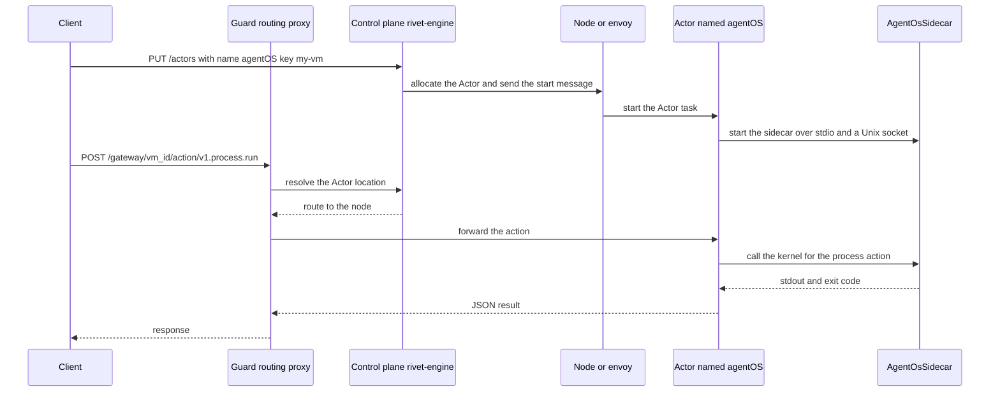
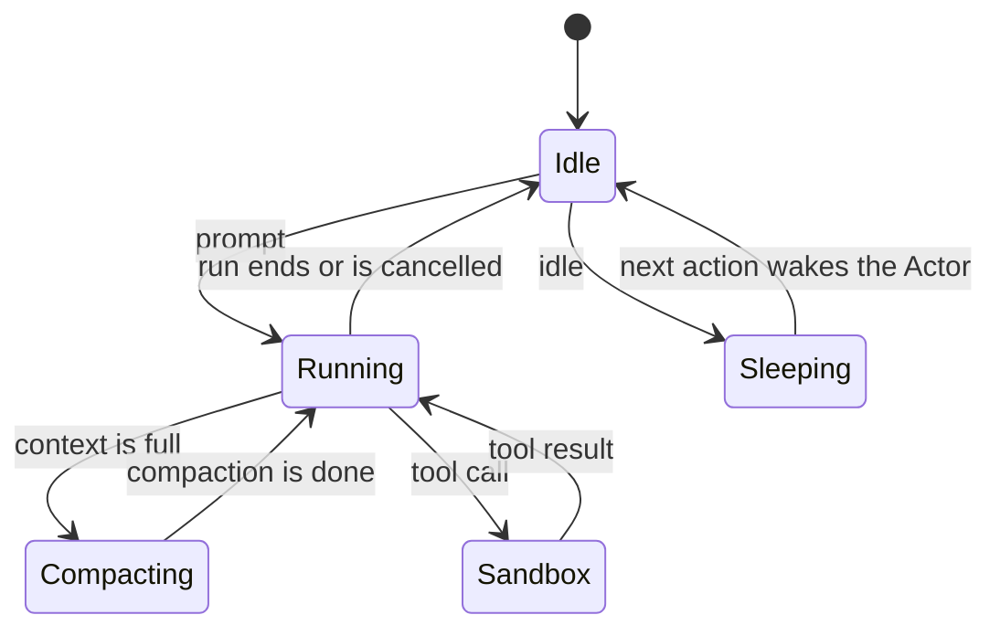
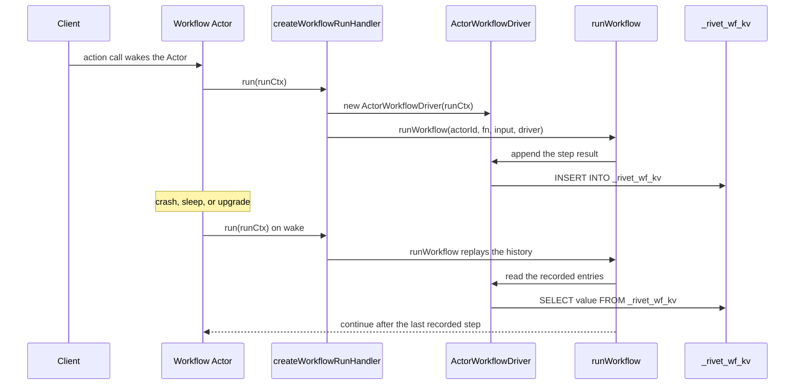
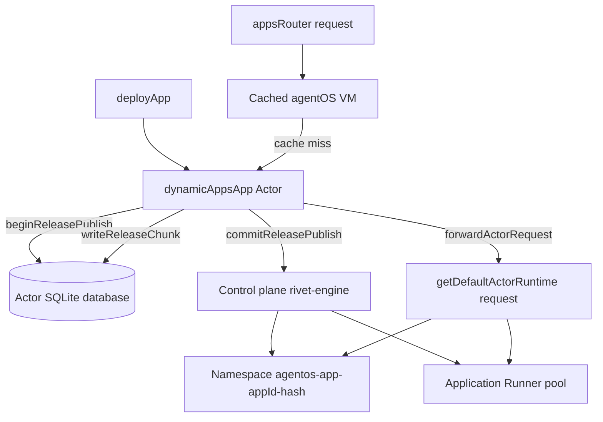
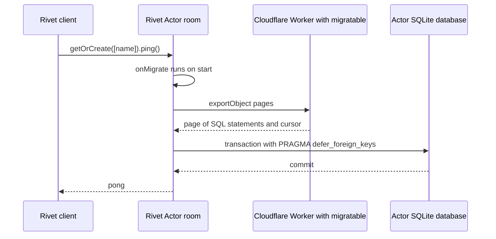
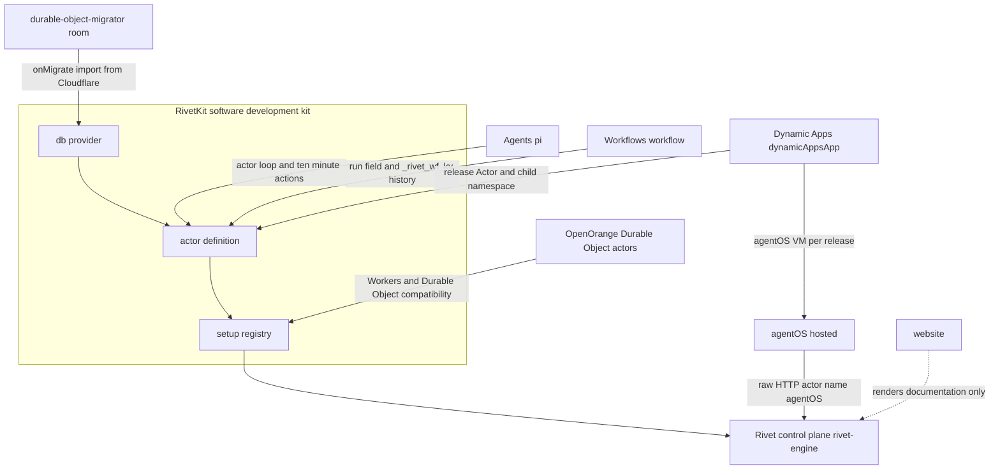

# 17 The product family

The Rivet product family is a set of seven sibling repositories. Six build a developer product on top of Rivet. The seventh publishes the public website and documentation. This document reads each repository at its own commit. It shows the code that connects each runtime consumer to Rivet. It then tests one claim against all seven: a product adds an Actor definition and a developer experience, not a scheduler. That claim holds for Agents, Workflows, Dynamic Apps, OpenOrange, hosted agentOS, and the migrator example. The stronger claim, that every product is a Runner configuration plus a RivetKit registry plus a control plane namespace, fits OpenOrange fully. It fits hosted agentOS, Agents, Workflows, and Dynamic Apps partly. It fits the migrator package and the website not at all.

## 1. Scope, sources, and the check on each revision

This document reads only the sibling repositories under
`/Users/darkvoid/GitSources/src.Rivet`. It does not document the core repository
again. Documents [00 Overview](00-overview.md) to
[16 Tests and limits](16-tests-benchmarks-and-limits.md) cover the core
repository, the engine, the Actor lifecycle, the TypeScript software development
kit (SDK), and the operation of the control plane.

The source of truth for this document is the set of seven working trees below.
I read each file in place and did not run the products. All claims come from the
files, the package manifests, or the product documentation inside each
repository.

| Order | Product | Directory | Main language | Role in the family |
|-------|---------|-----------|---------------|--------------------|
| 1 | agentOS | `agentos/` | Rust and TypeScript | A small Linux-compatible computer for each agent |
| 2 | Agents | `agents/` | TypeScript | An agent loop that lives inside an Actor |
| 3 | Workflows | `workflows/` | TypeScript | Durable, replayable multi-step operations inside an Actor |
| 4 | Dynamic Apps | `dynamic-apps/` | TypeScript | A deployment platform for user-generated applications |
| 5 | OpenOrange | `open-orange/` | TypeScript | A Cloudflare Workers runtime on a Rivet cluster |
| 6 | durable-object-migrator | `durable-object-migrator/` | TypeScript | A move tool for Cloudflare Durable Objects |
| 7 | website | `website/` | TypeScript; Astro framework | The documentation and marketing site |

### 1.1 The verified revision of every sibling

I ran `git -C <directory> log -1 --format=%H` for each sibling. The output is
the full hash.

| Product | Full commit hash | Short form |
|---------|------------------|------------|
| agentOS | `c7462927ec452bbd5def5c0fc50a3fd74574d13a` | `c746292` |
| Agents | `e963879702cf40ccf5be71e8be970626413dd28a` | `e963879` |
| Workflows | `2fab0efd5bf1a75035df5362ab57058680219264` | `2fab0ef` |
| Dynamic Apps | `b5398eeb1fe3cf7d26065791a5f71a9b8b530f53` | `b5398ee` |
| OpenOrange | `0f3c2eac56d7f67d16398d54c4560543621f5582` | `0f3c2ea` |
| durable-object-migrator | `816c28b376e47b511f7ea7a635ab19995d84169a` | `816c28b` |
| website | `10c8c186cc24d0aa54f15cedb9c2658fa4276483` | `10c8c18` |

The core repository is at commit
`4a58441c50d1ce20d8803cfb1ab7c3285a5141d6`, version 2.3.31, in the checkout
`/Users/darkvoid/GitSources/src.Rivet/rivet`. Core citations are relative to
that checkout. That commit is the reference for every core behavior in this
document. The sibling revisions do not form one consistent build. Section 13
returns to this point, because the version skew is the clearest cost of the
family design.

### 1.2 How to read the citations

A citation has the form `path:line` or `path:line-line`. The path is relative to
the sibling directory named in the section. A path inside a fenced code block
also names the repository, so the block checks on its own.

## 2. The six words this document uses

The core documents define the full vocabulary. This section gives only the
words that the products share, so that the rest of the document does not need
the core source open.

| Word | Meaning in this document | Core document |
|------|--------------------------|---------------|
| Actor | A keyed, durable process with state, a SQLite database, connections, and a timer schedule. | [03 Actors](03-actors-and-lifecycle.md) |
| Actor registry | The `setup({ use })` value that maps an Actor name to an Actor definition. A package registry, a Pi extension registry (a list of Pi extensions), and an Actor registry are different things. | [11 RivetKit TypeScript](11-rivetkit-typescript.md) |
| Runner | The process that hosts Actor tasks. Older core code says "Runner"; newer code says "node" or "envoy". | [04 Pegboard](04-pegboard-scheduling.md) |
| Namespace | The tenant boundary that holds Actors, tokens, and policy. | [13 Auth and namespaces](13-auth-and-namespaces.md) |
| Control plane | The `rivet-engine` process. | [02 Control plane](02-control-plane-architecture.md) |
| Node pool | A named set of nodes that the control plane can schedule onto. | [04 Pegboard](04-pegboard-scheduling.md) |

The core code uses three names for the host process: Runner, envoy, and node.
The control plane calls it an envoy. RivetKit 2 used the key `envoy`. RivetKit 3
calls it a node and reads the pool under `node`. Both paths exist in this
commit. When a product statement holds for one path only, this document says
which path.

The products also separate definition from placement. The Actor definition is
code in the product. The scheduling decision is data in the control plane. The
product chooses the name, key, database, and actions. The control plane chooses
the node, the region, and the start moment.

## 3. agentOS: a virtual machine for each agent

### 3.1 Purpose

agentOS gives one agent a small Linux-compatible computer. The computer has a
process table, a filesystem, a network view, and a permission model. It runs
many guests in one process. A guest is JavaScript in a V8 isolate or a compiled
tool in WebAssembly. The product states that it is a library, not extra
infrastructure, and that it does not need a hypervisor or nested virtualization
(`README.md:25-35`).

agentOS has two modes. In library mode, the virtual machine runs inside the
backend process that the operator already runs. In hosted mode, the virtual
machine is a durable Actor on Rivet Cloud or on a self-hosted Rivet cluster.
`README.md:60-69` gives the full comparison. The hosted mode adds a scoped JSON
Web Token (JWT) for browser clients and expiring preview URLs. The library mode
has neither.

### 3.2 Language, build system, package layout, entry point

agentOS is a mixed Rust and TypeScript workspace. The Rust side is a Cargo
workspace under `crates/`. The TypeScript side is a pnpm workspace under
`packages/`. The root manifest is `package.json:1-2`, named
`@rivet-dev/agentos-workspace`.

The Cargo workspace holds `kernel`, `vfs`, `v8-runtime`, `execution`, `runtime`,
`native-sidecar`, `sidecar-protocol`, and related crates. The README describes
the sidecar as a Rust process that runs separately from the application process
(`README.md:292-301`).

The TypeScript packages and their versions are below. The version is important
here. Every public runtime package is version `0.0.1`. The build tools are the
one exception at 0.2.1.

| Package | Version | Role |
|---------|---------|------|
| `@rivet-dev/agentos-core` | 0.0.1 | The library and the sidecar client |
| `@rivet-dev/agentos-runtime-core` | 0.0.1 | The shared runtime layer |
| `@rivet-dev/agentos-runtime-sidecar` | 0.0.1 | The sidecar runtime entry |
| `@rivet-dev/agentos-sandbox` | 0.0.1 | The sandbox client surface |
| `@rivet-dev/agentos-toolchain` | 0.0.1 | The software toolchain |
| `@rivet-dev/agentos-build-tools` | 0.2.1 | Build support |

The entry points are separate by mode.

- Library mode: `AgentOs.create()` from `@rivet-dev/agentos-core`
  (`packages/core/src/agent-os.ts:2935-2941`).
- Hosted mode: `createAgentOsClient()` from `@rivet-dev/agentos`, or plain
  Hypertext Transfer Protocol (HTTP) calls (`README.md:180-211`). No package in
  `packages/` carries that name, so the hosted client is not in this tree.
- Sidecar mode: `AgentOs.createSidecar()` and `AgentOs.getSharedSidecar()`
  (`packages/core/src/agent-os.ts:2923-2933`).

```ts
// agentos/packages/core/src/agent-os.ts:2935-2941
static async create(
	options?: AgentOsOptions,
	/** @internal Product wrappers select a sidecar-owned default profile here. */
	defaultsProfile: NonNullable<
		CreateVmConfig["defaultsProfile"]
	> = "agent_os",
): Promise<AgentOs> {
```

`create` parses the options, resolves the default software bundle, removes
duplicate package paths, resolves names in the software package registry, and
allocates a sidecar. The excerpt shows the signature only. The public input is
`AgentOsOptions` or `undefined`. The internal `defaultsProfile` parameter selects
a sidecar-owned profile for product wrappers and defaults to `"agent_os"`. The
output is `Promise<AgentOs>`. The visible error cases are an unknown package name
and a failure to start the shared sidecar. A duplicate package path is not an
error; the function removes it (`packages/core/src/agent-os.ts:2955-2971`). The
default software comes from immutable agentOS package (`.aospkg`) files, never
from npm (`packages/core/src/agent-os.ts:2943-2944`).

### 3.3 How agentOS uses Rivet

agentOS uses the control plane in hosted mode only. It does not use RivetKit in
either mode. A search of every `package.json` in the repository for the string
`"rivetkit"` returned no line. The repository also does not contain a
`setup({ use })` registry. The hosted path speaks the control plane HTTP
Application Programming Interface (API) directly.

The raw HTTP example in the README is the clearest evidence. It creates the
Actor with a name, a key, a Runner selector, a crash policy, and a namespace.

```bash
# agentos/README.md:217-234
curl -X PUT "https://api.rivet.dev/actors?namespace=$RIVET_NAMESPACE" \
  -H "Authorization: Bearer $RIVET_TOKEN" \
  --json '{
    "name": "agentOS",
    "key": "my-vm",
    "runner_name_selector": "services",
    "crash_policy": "sleep"
  }'
# → { "actor": { "actor_id": "…" }, "created": true }

curl "https://api.rivet.dev/gateway/$VM_ID/action/v1.process.run" \
  -H "x-rivet-token: $VM_TOKEN" \
  --json '{"args": [{
    "command": "sh",
    "args": ["-c", "echo hello"],
    "options": { "captureStdio": true }
  }]}'
# → { "output": { "status": { "exitCode": 0, … }, "stdout": "hello\n", "stderr": "" } }
```

Each field has one job.

| Field | Value | Job |
|-------|-------|-----|
| `name` | `agentOS` | Selects the Actor definition that the node registered for hosted agentOS. |
| `key` | `my-vm` | Gives the virtual machine a durable identity. The same key returns the same machine. |
| `runner_name_selector` | `services` | Selects the Runner pool that hosts the AgentOS service. |
| `crash_policy` | `sleep` | Puts the Actor to sleep after a crash instead of a tight restart loop. |
| `namespace` | `$RIVET_NAMESPACE` | Selects the tenant boundary. It is a query parameter, not a body field. |

The action path has the form
`POST /gateway/{vm_id}/action/v1.{group}.{action}` (`README.md:209-211`). The
group in the example is `process`, and the action is `run`. The first response
supplies `actor_id`, which is the value for `$VM_ID`. `$VM_TOKEN` is a JSON Web
Token (JWT) scoped to that virtual machine (`README.md:239-240`). The second
`curl` gets POST from `--json`. The README lists the action groups at
`README.md:321-334`. The action call can use a scoped `VM_TOKEN` instead of the
project `RIVET_TOKEN`, so the caller does not need control-plane authority over
the whole namespace.

The source does not state why hosted agentOS uses raw HTTP instead of a
RivetKit registry. The old `rivetkit/agent-os` entry point now throws a
migration error, and the message points to `@rivet-dev/agentos-core` for library
mode and `@rivet-dev/agentos` for hosted mode.

```ts
// rivet/rivetkit-typescript/packages/rivetkit/src/agent-os/index.ts:1-5
// agentOS no longer ships inside RivetKit. This entrypoint remains so existing
// imports fail with migration guidance instead of a missing-module error.
throw new Error(
	"rivetkit/agent-os has been removed. Use @rivet-dev/agentos-core to run agentOS VMs in your process, or hosted agentOS with @rivet-dev/agentos. See https://rivet.dev/agentos/docs",
);
```

The sequence below follows the hosted path from the client to the sidecar. The
boxes name the client, Guard (the routing proxy at the network edge,
[09 Guard routing](09-guard-routing.md)), the control plane `rivet-engine`, the
node, the Actor named `agentOS`, and the `AgentOsSidecar` class. Create uses the
control-plane API; the action uses Guard, which routes to the Actor's node.



The flow has one failure point at each hop. If the control plane cannot find a
node in the `services` pool, the allocation waits. If the sidecar does not start,
the Actor start fails. If the action times out, the gateway returns an error and
the Actor stays alive. The README does not give the timeout value for a hosted
action. The source does not state it in the files I read.

### 3.4 Inside agentOS

The architecture is a trust boundary. The application process or the HTTP API
connects to the sidecar. The sidecar holds a trusted kernel and all guest code.
The kernel owns the process table, the virtual filesystem, networking, and
permissions. Guest code runs in V8 isolates and WebAssembly. Guest code reaches
the kernel only through syscalls (`README.md:292-310`).

The TypeScript surface has three important shapes. `AgentOs` is the library
handle, with `create`, `createSidecar`, and `getSharedSidecar`. The object from
`create` exposes `process`, `filesystem`, and `javascript`
(`README.md:81-100`). `AgentOsSidecar` owns the sidecar process
(`packages/core/src/agent-os.ts:6258`). I read only its declaration, so this
document does not list its fields. `VirtualFileSystem` has one method for each
filesystem operation that the guest can issue. The excerpt below is a prefix,
not the whole interface.

```ts
// agentos/packages/core/src/runtime.ts:33-46
export interface VirtualFileSystem {
	readFile(path: string): Promise<Uint8Array>;
	readTextFile(path: string): Promise<string>;
	readDir(path: string): Promise<string[]>;
	readDirWithTypes(path: string): Promise<VirtualDirEntry[]>;
	writeFile(path: string, content: string | Uint8Array): Promise<void>;
	createDir(path: string): Promise<void>;
	mkdir(path: string, options?: { recursive?: boolean }): Promise<void>;
	exists(path: string): Promise<boolean>;
	stat(path: string): Promise<VirtualStat>;
	removeFile(path: string): Promise<void>;
	removeDir(path: string): Promise<void>;
	rename(oldPath: string, newPath: string): Promise<void>;
	realpath(path: string): Promise<string>;
```

The interface continues with `symlink`, `readlink`, `lstat`, `link`, `chmod`,
`chown`, `utimes`, `truncate`, `pread`, and more. Every file, process, and
network operation is a syscall into the trusted kernel (`README.md:309-311`).

The sandbox client has a smaller surface. `AgentOsSandboxClient` in
`packages/core/src/sandbox.ts:39-65` exposes `runProcess`, `createProcess`,
`listProcesses`, `stopProcess`, `killProcess`, `getProcessLogs`, and
`sendProcessInput`. `AgentOsSandboxProvider` is the factory interface with one
method, `start(): Promise<AgentOsSandboxClient>` (`packages/core/src/sandbox.ts:67-69`).

The README example sets `maxProcesses: 64` and
`maxFilesystemBytes: 256 * 1024 * 1024` (`README.md:152-153`). The caller
chooses them, and the source states no default.

### 3.5 Status

The README uses no preview, beta, experimental, or general availability label
for agentOS; the only match is the feature name "preview URLs". The website
gives no status badge, and every public runtime package is 0.0.1. The source
states no status.

### 3.6 Limits and what agentOS does not do

- The library mode has no control plane. It runs until `dispose()` or process
  exit (`README.md:64-65`) and does not survive the death of the host process.
- The hosted mode sleeps when idle unless a process runs (`README.md:65`).
- Only the hosted mode creates an expiring preview URL for a port (`README.md:67`).
- agentOS is not a micro virtual machine. It uses V8 isolates and WebAssembly,
  so it does not run an arbitrary Linux kernel or native binary (`README.md:31`).
- The repository does not contain a hosted Actor definition. The Actor named
  `agentOS` is a control-plane object, so its definition is outside this tree.

### 3.7 Revision

agentOS is at `c7462927ec452bbd5def5c0fc50a3fd74574d13a`. I read it with
`git -C agentos log -1 --format=%H` and `nl -ba` on each cited file.

## 4. Agents: an agent loop inside an Actor

### 4.1 Purpose

The Agents repository holds two products. Rivet Agents runs the Pi coding agent
as a durable Rivet Actor. Sandbox Agent runs coding agents in sandboxes and
controls them over HTTP (`README.md:7-10`). The main package is
`@rivet-dev/pi`, described as "Run the Pi coding agent as a durable Rivet Actor"
(`packages/pi/package.json:4`).

The Actor owns one Pi Durable harness. Pi Durable is the agent harness package
`@earendil-works/pi-durable`. The harness stores conversations, tasks, and
documents in the Actor's SQLite database. A run survives sleep, an upgrade, and
a crash. The run resumes when the Actor wakes. The actions of the Actor match
the Pi Durable API one to one (`packages/pi/src/actor.ts:130-137`).

### 4.2 Language, build system, package layout, entry point

The repository is a pnpm workspace. The root manifest pins pnpm 9.15.0
(`package.json:5`) and builds every package under `packages/` with
`pnpm -r --filter './packages/*' build` (`package.json:8`). The Pi package
builds with `tsc -p tsconfig.build.json` (`packages/pi/package.json:43-45`).

| Tree | Package or directory | Version | Role |
|------|----------------------|---------|------|
| `packages/pi` | `@rivet-dev/pi` | 0.5.4 | The Actor definition for Pi |
| `packages/sandbox-adapter` | `@rivet-dev/sandbox-adapter` | 0.5.4 | Providers for agentOS, Docker, Daytona, E2B, and Freestyle |
| `sandbox-agent/foundry` | `@sandbox-agent/foundry-backend` | 0.1.0 | The hosted Sandbox Agent backend |

The entry point is the `pi()` function. It returns an Actor definition. The
caller puts that definition into a normal `setup({ use })` registry. The
quickstart shows the smallest complete program.

```ts
// agents/examples/docs/quickstart/server.ts:10-17
const agent = pi({
	model: "anthropic/claude-opus-5-5",
	registry: extensions,
});

export const registry = setup({ use: { agent } });

registry.start();
```

`pi()` takes one `PiActorConfigInput` and returns a `PiActorDefinition`
(`packages/pi/src/actor.ts:138-169`). In the quickstart, `registry` inside
`pi()` is the Pi extension registry, the list of Pi extensions that the harness
loads. The `setup({ use })` value is the Actor
registry. The input has two groups. The first group is the Actor configuration
that RivetKit already knows, such as `state`, `actions`, `onWake`, and
`onConnect`. The second group is the Pi options, such as `model`, `registry`,
`credentials`, and `sandbox`. The `splitConfig` helper moves the Pi keys out of
the Actor configuration before `actor()` sees them
(`packages/pi/src/actor-config.ts:9-24`).

The function has three explicit error cases. It throws when the caller does not
pass a `registry`, and it throws when the caller passes its own `db` option,
because `pi()` owns the database (`packages/pi/src/actor.ts:174-181`). It also
throws when a user action or event reuses a built-in name
(`packages/pi/src/actor-config.ts:26-42`).

### 4.3 How Agents uses Rivet

The product uses RivetKit. It imports `actor`, `event`, and the type helpers
from `rivetkit`, and it imports `db` from `rivetkit/db`
(`packages/pi/src/actor.ts:2-9`). The peer range is
`>=2.3.28 <2.4.0 || ^3.0.0-preview.2`, and the development version is
`3.0.0-preview.2` (`packages/pi/package.json:58`, `packages/pi/package.json:67`).
That range spans the 2.x line and the 3.0 preview line.

The Actor definition shows the main Rivet features that the product uses.

```ts
// agents/packages/pi/src/actor.ts:202-220
return actor({
	...sharedActorConfig(
		"pi()",
		actorConfig,
		{ slot: PI_RUNTIME, create: createPiRuntime },
		(c, stop) => closeHarness(c, piOptions, stop),
		{
			onSleep: withPi(actorConfig.onSleep, false),
			onDestroy: withPi(actorConfig.onDestroy, false),
		},
	),
	db: db({ onMigrate: migratePiTables }),
	events: { ...(actorConfig.events ?? {}), ...piEvents },
	actions: {
		...wrapActions(actorConfig.actions ?? {}, (c: PiContext, action) =>
			withPiAccess(c, piOptions, action),
		),
		...actions,
	},
```

The block adds a `db()` provider with `onMigrate`, an event schema, an action
set, a runtime slot on the Actor variables, and lifecycle hooks
(`packages/pi/src/actor-config.ts:58-80`). `PI_RUNTIME` is the symbol key,
`createPiRuntime` builds the runtime, `withPiAccess` and `wrapActions` wrap
actions, and `withPi` wraps a hook. `onWake` opens the harness, runs the
application `onWake`, and then resumes interrupted work. `onSleep` and `onDestroy`
close it after the application hook runs.

The shared configuration sets two timing values. `actionTimeout` is ten minutes
(`packages/pi/src/actor-config.ts:4-5`). `sleepGracePeriod` is
`DEFAULT_SLEEP_GRACE_PERIOD_MS`, which is 15 minutes
(`packages/pi/src/drain.ts:1-5`). The caller's options spread after both, so the
caller can override them. The reason is in the comment at
`packages/pi/src/actor-config.ts:4`: Pi waits such as `waitForIdle`, `prompt`,
and `submission.wait` outlive the RivetKit one-minute default.

```ts
// agents/packages/pi/src/actor-config.ts:60-68
const sleepGracePeriod: number =
	config.options?.sleepGracePeriod ?? DEFAULT_SLEEP_GRACE_PERIOD_MS;
return {
	...config,
	options: {
		actionTimeout: DEFAULT_ACTION_TIMEOUT_MS,
		sleepGracePeriod: DEFAULT_SLEEP_GRACE_PERIOD_MS,
		...config.options,
	},
```

The `onWake` failure path is careful. If `openOnWake` fails, the Actor stays up.
The error is logged, and each action later reports the cause. The comment says
that a schema newer than the code is one such cause
(`packages/pi/src/actor.ts:221-241`). That choice protects the recovery path. A
crash loop would hide the cause. The cost is that a broken Actor stays awake
until an operator acts or the application destroys it.

The Sandbox Agent backend uses a different shape. It uses the RivetKit
serverless mode. The registry sets the serverless base path, the Runner version,
the logger, and six Actors.

```ts
// agents/sandbox-agent/foundry/packages/backend/src/actors/index.ts:13-29
export const registry = setup({
  serverless: {
    basePath: "/v1/rivet",
  },
  runner: { version: runnerVersion },
  logging: {
    baseLogger: logger,
  },
  use: {
    user,
    organization,
    task,
    taskSandbox,
    auditLog,
    githubData,
  },
});
```

This is the clearest example of a product that configures the Runner in its
registry. The `serverless.basePath` tells RivetKit where to mount the callback
routes. The `runner.version` selects the Runner build. The backend package pins
RivetKit to a preview build at commit `791500a`, not a released version
(`agents/sandbox-agent/foundry/packages/backend/package.json:27`).

### 4.4 Inside Agents

The main components are `pi()`, the Pi runtime slot, the action layer, and the
harness.

The `pi()` function checks the input, builds the Pi actions, and calls
`actor()`. The Pi runtime is created lazily and stored in a symbol slot on the
Actor variables. The symbol is `PI_RUNTIME`, and the factory is
`createPiRuntime` (`packages/pi/src/actor.ts:206`).

The action layer has two wrappers. `withPiAccess` opens the harness when an
action needs it. `withPi` wraps a lifecycle hook and controls whether the hook
opens the harness (`packages/pi/src/actor.ts:188-198`).

The harness is the Pi Durable object. It owns the conversations, the tasks, and
the documents. The Actor owns the harness. The Actor does not own a model
connection across a sleep. `onWake` resumes the interrupted work after the
application `onWake` runs (`packages/pi/src/actor.ts:221-240`).

The product documentation draws a state machine with five states: Idle,
Running, Compacting, Sleeping, and Sandbox
(`docs/content/docs/architecture.mdx:13`). The diagram below repeats its
transitions.



The source files do not declare these names as an enum, so treat the diagram as
the product model.

The sleep grace period is 15 minutes by default
(`docs/content/docs/architecture.mdx:115`), the value of
`DEFAULT_SLEEP_GRACE_PERIOD_MS` (`packages/pi/src/drain.ts:5`). Actions wait up
to ten minutes, and a timed-out wait leaves the run going
(`docs/content/docs/architecture.mdx:117`). The source does not state why the
action timeout equals the wait limit. The comment in the code states only that
the Pi waits outlive the one-minute RivetKit default.

### 4.5 Status

The Pi Durable dependency is in beta: "Pi Durable is still in beta, so expect
its API to change between releases" (`docs/content/docs/pi.mdx:10`). The
`@rivet-dev/pi` package is 0.5.4. The Sandbox Agent backend is 0.1.0 and carries
no label. The website hides the Agents product from its switcher
(`website/src/sitemap/product-metadata.ts:144-157`).

### 4.6 Limits and what Agents does not do

- `pi()` owns the database; a caller cannot pass a `db` option
  (`packages/pi/src/actor.ts:179-181`).
- The action timeout is ten minutes, and `options.actionTimeout` can change it
  (`packages/pi/src/actor-config.ts:65-67`).
- An interrupted run resumes on wake; it does not continue while the Actor
  sleeps.
- The sandbox is optional. Without one, the files live in the Actor database
  (`examples/docs/quickstart/server.ts:6`).
- The repository does not document the conversation format. It wraps
  `@earendil-works/pi-durable` (`packages/pi/src/actor.ts:133-134`).

### 4.7 Revision

Agents is at `e963879702cf40ccf5be71e8be970626413dd28a`. I read it with
`git -C agents log -1 --format=%H` and `nl -ba` on each cited file.

## 5. Workflows: durable execution on top of an Actor

### 5.1 Purpose

Workflows turns a multi-step operation into a durable, replayable run inside an
Actor. The package description is "Durable, replayable workflows for Rivet
Actors" (`packages/workflows/package.json:4`). A workflow is a normal Actor with
one extra field: `run`. The run function calls `ctx.step(...)`. Each step result
goes into the Actor database. After a crash or a sleep, the workflow replays the
recorded steps and does not repeat them.

The package preserves the existing workflow history encoding. It uses only the
public workflow-host capabilities of RivetKit. It re-exports RivetKit, so a
workflow Actor and a regular `actor(...)` definition can share one registry
(`README.md:30-35`).

### 5.2 Language, build system, package layout, entry point

The repository is a pnpm workspace with one published package,
`@rivet-dev/workflows` version 2.3.10 (`packages/workflows/package.json:2-3`).
The package builds with `tsup` after a schema compile step
(`packages/workflows/package.json:52-53`). It requires Node.js 22 or later
(`packages/workflows/package.json:47-49`).

| File | Role |
|------|------|
| `packages/workflows/src/mod.ts` | The public entry. It re-exports RivetKit and the workflow API. |
| `packages/workflows/src/rivetkit/mod.ts` | The `workflow()` function and the run handler. |
| `packages/workflows/src/rivetkit/driver.ts` | The `ActorWorkflowDriver` that stores history in the Actor database. |

The public entry is a re-export, not a wrapper.

```ts
// workflows/packages/workflows/src/mod.ts:1-11
export * from "rivetkit";
export * from "./index.js";
export type {
	WorkflowBranchContextOf,
	WorkflowContextOf,
	WorkflowLoopContextOf,
	WorkflowStepContextOf,
} from "./rivetkit/context.js";
export * from "./rivetkit/mod.js";
// Prefer workflow-specific meanings for names that also exist in RivetKit.
export type { WorkflowState } from "./types.js";
```

A caller therefore imports `setup` and `workflow` from one package, and one
registry holds both workflow Actors and plain Actors.

### 5.3 How Workflows uses Rivet

The product uses RivetKit in three ways. The `workflow()` function calls
`actor()` to build the definition. It uses the `run` field of the Actor
definition. It uses the workflow-host API of RivetKit, which the core documents
call Gasoline. The package peer range is `>=2.3.11 <2.4.0`
(`packages/workflows/package.json:66-67`), and the development version is
2.3.11 (`packages/workflows/package.json:75`). The package is on the 2.x line.

The `workflow()` function is a thin adapter.

```ts
// workflows/packages/workflows/src/rivetkit/mod.ts:519-539
export function workflow(
	input:
		| WorkflowConfigInput<any, any, any, any, any, any, any, any, any>
		| WorkflowRunFunction<any, any, any, any, any, any, any, any>,
	options: WorkflowOptions<any, any, any, any, any, any, any, any> = {},
):
	| ActorDefinition<any, any, any, any, any, any, any, any, any>
	| WorkflowRunHandler<any, any, any, any, any, any, any, any> {
	if (typeof input === "function") {
		return createWorkflowRunHandler(input, options);
	}

	// RivetKit's `types` field exists only for inference and is not accepted by
	// its strict runtime config schema.
	const { run, types: typeOnly, ...actorInput } = input;
	void typeOnly;
	return actor({
		...actorInput,
		run: createWorkflowRunHandler(run, options),
	});
}
```

The function has two forms. A function input returns a run handler. An object
input returns an Actor definition that uses the handler as its `run` field. The
second form removes `types` before `actor()` sees it, because the runtime schema
does not accept it.

The run handler is where the durable work happens. It creates the `ActorWorkflowDriver` (the history store), the
`ActorWorkflowControlDriver` (the control driver for replay), and the workflow
inspector (the history snapshot view)
(`packages/workflows/src/rivetkit/mod.ts:297-300`), then calls
`runWorkflow` with the driver. `WorkflowContext` wraps the core context, so the
user function sees the workflow API.

```ts
// workflows/packages/workflows/src/rivetkit/mod.ts:336-351
		const handle = runWorkflow(
			runCtx.actorId,
			async (ctx) => await fn(new WorkflowContext(ctx, runCtx)),
			undefined,
			driver,
			{
				mode: "live",
				// The actor logger and the engine's pino logger are runtime
				// compatible but not structurally assignable.
				logger: runCtx.log as RunWorkflowOptions["logger"],
				onHistoryUpdated: workflowInspector.update,
				onError: onError
					? async (event) => await onError(runCtx, event)
					: undefined,
			},
		);
```

The Actor `run` handler receives a `RunContext` and builds the driver.
`runWorkflow(workflowId, workflowFn, input, driver, options)` runs the user
function inside a `WorkflowContext`. The third argument is the workflow input,
which this run does not use. `mode: "live"` selects the live execution path.
The `WorkflowContext` makes `state`, `vars`, `db`, and `client()` available only inside a
`ctx.step(...)` callback (`docs/content/docs/steps.mdx:8`). `vars` are
per-Actor variables, and `client()` returns a Rivet client handle. The
restriction prevents a side effect from running twice during a replay.

The sequence below follows a run, a crash, and a replay. Every participant
except the client is a real class, function, or table in the package.



The failure path is explicit. `handle` is the `WorkflowHandle` that
`runWorkflow` returns. If `handle.result` rejects, the handler checks the abort
signal and the error type. An abort returns quietly. A fatal error is logged and
rethrown. A non-fatal workflow error is logged as a warning, and the Actor sleeps
until something wakes it (`packages/workflows/src/rivetkit/mod.ts:365-388`).
The warning text is "workflow failed and will sleep until woken"
(`packages/workflows/src/rivetkit/mod.ts:382-384`).

### 5.4 Inside Workflows

The storage layer is a key-value table inside the Actor database. The table is
`_rivet_wf_kv`. Each history key is the two-byte prefix `[6, 1]` followed by the
workflow entry key (`packages/workflows/src/rivetkit/driver.ts:33-40`). The
upsert statement is a normal SQLite `INSERT ... ON CONFLICT` statement.

```ts
// workflows/packages/workflows/src/rivetkit/driver.ts:12-18
const WORKFLOW_STORAGE_PREFIX = new Uint8Array([6, 1]);
const WORKFLOW_UPSERT_SQL =
	"INSERT INTO _rivet_wf_kv (key, value) VALUES (?, ?) ON CONFLICT(key) DO UPDATE SET value = excluded.value";

const WORKFLOW_SQLITE_MAX_VALUE_BYTES = 256 * 1024;
const WORKFLOW_SQLITE_MAX_BATCH_ROWS = 128;
const WORKFLOW_SQLITE_MAX_BATCH_BYTES = 512 * 1024;
```

| Constant | Value | Meaning |
|----------|-------|---------|
| `WORKFLOW_SQLITE_MAX_VALUE_BYTES` | `256 * 1024` | The largest value for one history entry |
| `WORKFLOW_SQLITE_MAX_BATCH_ROWS` | `128` | The largest number of rows in one batch |
| `WORKFLOW_SQLITE_MAX_BATCH_BYTES` | `512 * 1024` | The largest batch payload in bytes |

`WorkflowStorage` (`packages/workflows/src/rivetkit/driver.ts:115`) reads one
value, deletes one value, deletes a range, and lists a range. The history is an
ordered key range in one SQLite table, so the Actor's normal backup carries it
with no extra service. The product starts no workflow server; the Actor runs the
workflow ([05 Gasoline](05-gasoline-durable-execution.md)).

### 5.5 Status

The package version is 2.3.10, on the core 2.x line. The README does not use the
words preview, beta, or experimental. The website metadata gives Workflows no
badge (`website/src/sitemap/product-metadata.ts:173-184`). The source states no
other status, and the repository does not claim general availability.

### 5.6 Limits and what Workflows does not do

- A step value is at most 256 KiB. A batch is at most 128 rows and 512 KiB
  (`packages/workflows/src/rivetkit/driver.ts:16-18`).
- `state`, `vars`, `db`, `client()`, and the event APIs are valid only inside a
  `ctx.step(...)` callback (`docs/content/docs/steps.mdx:8`).
- A caught failure does not undo a state change. Earlier `state` and `vars`
  mutations remain visible, so the caller writes a compensating step
  (`docs/content/docs/steps.mdx:43`).
- The package provides no scheduler, workflow server, or separate history store.

### 5.7 Revision

Workflows is at `2fab0efd5bf1a75035df5362ab57058680219264`. I read it with
`git -C workflows log -1 --format=%H` and `nl -ba` on each cited file.

## 6. Dynamic Apps: a deployment platform inside one Actor

### 6.1 Purpose

Dynamic Apps deploys a separate application for each user or each tenant. The
application can be an Artificial Intelligence (AI) generated backend, a static
site, or a small HTTP service. The product builds the application, stores the
build as an immutable release, and runs the release in an agentOS virtual
machine. It keeps the release state in a Rivet Actor.

The root README adds one detail: a cache-hit request is served from a bounded
local V8 isolate and does not route through the `dynamicAppsApp` Actor
(`README.md:3-5`).

### 6.2 Language, build system, package layout, entry point

The repository is a pnpm 10.13.1 workspace (`package.json:4`). It builds the
builder, the core, and the adapter in that order (`package.json:8-9`).

| Package | Version | Role |
|---------|---------|------|
| `@rivet-dev/dynamic-apps` | 0.3.0 | The Rivet-backed adapter and the Actor definition |
| `@rivet-dev/dynamic-apps-core` | 0.3.0 | Storage-independent build and release logic |
| `@rivet-dev/dynamic-apps-builder` | 0.3.0 | The build step for an application |

The public surface has three values: `deployApp(input, options?)`,
`appsRouter`, and `setDynamicAppsLogHandler(handler)`
(`packages/dynamic-apps/README.md:7-14`). The adapter is the batteries-included
option. A caller that wants its own storage uses the core package
(`packages/dynamic-apps/README.md:1-5`).

### 6.3 How Dynamic Apps uses Rivet

The product uses RivetKit for the state Actor and the control plane API for the
runtime namespace. It also uses agentOS for the virtual machine. The package
depends on `rivetkit` version 2.3.29 (`packages/dynamic-apps/package.json:33-37`).

The registry turns off the optional Services sidecar (Rivet's service host) and
raises the message limit, because an artifact chunk expands during action
serialization.

```ts
// dynamic-apps/packages/dynamic-apps/src/registry.ts:8-15
export const privateAppsRegistry = setup({
	// Artifact chunks are binary deployment traffic and expand during RivetKit
	// action serialization. The default 64 KiB action limit is too small.
	maxIncomingMessageSize: 1024 * 1024,
	// The app-state actor does not use the optional Services sidecar.
	startServices: false,
	use: createAppsActors({
		artifactCache: artifactCacheDirectory
```

The Actor is `dynamicAppsApp`. It has a 16-minute action timeout, a database
with a migration callback, an `onRequest` handler, and a state object.

```ts
// dynamic-apps/packages/dynamic-apps/src/actors.ts:956-970
const dynamicAppsApp = actor({
	options: { actionTimeout: 16 * 60_000 },
	db: db({ onMigrate: migrateAppsTables }),
	onRequest: forwardActorRequest,
	createState: (): AppState => ({
		activeRelease: null,
		namespace: null,
		revision: 0,
		cloudNamespace: null,
		runnerToken: null,
		publicToken: null,
		publishSequence: 0,
		latestPublishSequence: 0,
	}),
	actions: {
```

The state fields describe the lifecycle of one application.

| Field | Type | Purpose |
|-------|------|---------|
| `activeRelease` | `string \| null` | The release that serves traffic now |
| `activatingRelease` | `string \| null` | The release that is activating |
| `namespace` | `string \| null` | The Rivet namespace for the application |
| `revision` | `number` | The local revision counter |
| `cloudNamespace` | `string \| null` | The Rivet Cloud namespace identifier |
| `runnerToken` | `string \| null` | The token for the application Runner |
| `publicToken` | `string \| null` | The token that the application may use |
| `publishSequence` | `number` | The sequence of the publish in progress |
| `latestPublishSequence` | `number` | The last accepted publish sequence |

`activatingRelease` is optional and `createState` leaves it unset. The state
type is at `packages/dynamic-apps/src/actors.ts:67-77`.

The limits are large and explicit. The constants are at
`packages/dynamic-apps/src/actors.ts:27-35`.

| Constant | Value | Purpose |
|----------|-------|---------|
| `DEFAULT_MAX_VERSIONS` | `20` | Retained releases for one application |
| `DEFAULT_MAX_REGIONS` | `8` | Allowed regions |
| `DEFAULT_MAX_REQUEST_BYTES` | `1 MiB` | Request body limit |
| `DEFAULT_MAX_RESPONSE_BYTES` | `4 MiB` | Response body limit |
| `MAX_REPLICAS` | `128` | Replica limit |
| `ARTIFACT_CHUNK_BYTES` | `128 * 1024` | Upload chunk size |
| `MAX_ARTIFACT_BYTES` | `64 * 1024 * 1024` | Release artifact limit |

The upload path has two forms. The Actor exposes three actions:
`beginReleasePublish`, `writeReleaseChunk`, and `commitReleasePublish`. Each
action runs under `c.keepAwake(...)` so the Actor stays awake during the upload
(`packages/dynamic-apps/src/actors.ts:970-998`). The `deploy` action does the
same three steps in one call: it builds the release, stores the files, writes
the artifact chunks, and commits the publish
(`packages/dynamic-apps/src/actors.ts:1003-1061`). The `resolveDeployment`
action returns the route decision for a request
(`packages/dynamic-apps/src/actors.ts:1065-1069`).

The control plane provides the namespace and the Runner pool. The namespace name
is derived from the application identifier and the host namespace.

```ts
// dynamic-apps/packages/dynamic-apps/src/control-plane.ts:80-88
function namespaceName(appId: string, hostNamespace: string): string {
	const suffix = createHash("sha256")
		.update(hostNamespace)
		.update("\0")
		.update(appId)
		.digest("hex")
		.slice(0, 10);
	return `${`agentos-app-${appId}`.slice(0, 63 - suffix.length - 1)}-${suffix}`;
}
```

The name has a fixed prefix, a cut-down application identifier, and a ten
character hash. The total length stays under 64 characters. The hash separates
two host namespaces that use the same application identifier. The control plane
default endpoint is `http://localhost:6420`, and the cloud endpoint is
`https://cloud-api.rivet.dev` (`packages/dynamic-apps/src/control-plane.ts:6-7`).
The deployment connects with a `cloud_api_*` project token on Rivet Cloud and
creates a namespace, a Runner pool, and scoped credentials
(`packages/dynamic-apps/README.md:82-86`).

The flow below follows a deployment from the caller to the virtual machine.



The request path has a fast path and a slow path. A cache-hit request makes no
Actor call and no storage call (`packages/dynamic-apps/README.md:16-19`). A
cache miss goes to the Actor. The `onRequest` function `forwardActorRequest`
checks the callback path, checks the release status, and checks the callback
secret. It returns 404 for a bad path, 503 when the release has no active
application RivetKit registry, and 401 when the secret is wrong
(`packages/dynamic-apps/src/actors.ts:916-934`). If the checks pass, it calls
`getDefaultActorRuntime().request(...)` with the release key, the namespace, the
pool, and the artifact loader (`packages/dynamic-apps/src/actors.ts:935-945`).

### 6.4 Inside Dynamic Apps

The product has four layers. The builder turns a source tree into an `.aospkg`
artifact. The core prepares the source and builds without Rivet. The adapter
stores the release in `dynamicAppsApp` and provisions the namespace. The runtime
runs the artifact in an agentOS virtual machine through `appsRouter`.

The Actor database holds the release metadata, the artifact chunks, and the
files of a release. The `deploy` action deletes old files and persists new files
in batches, then writes the artifact in chunks
(`packages/dynamic-apps/src/actors.ts:1034-1056`). The chunk size is
`ARTIFACT_CHUNK_BYTES`, and the total artifact limit is 64 MiB.

The product supports two execution modes for a direct app, which is an app
without RivetKit actors. `pooled` is the default. It resets and reuses a
retained context. A retained context is one JavaScript context that the pool
keeps after a request. `ephemeral` requests a fresh context from the cached
virtual machine (`packages/dynamic-apps/README.md:156-166`,
`benchmarks/dynamic-apps/RESULTS.md:8-10`). A direct app runs in a Node.js 22
agentOS sandbox. Native addons, WebSockets, and streaming ordinary HTTP bodies
are not supported (`packages/dynamic-apps/README.md:33-36`).

The product also lets an application declare its own RivetKit registry. The
application mounts `registry.handler` at a path, and Dynamic Apps forwards the
Rivet callback to it. The documentation warns the application not to call
`serve()`, `registry.start()`, or bind a port
(`packages/dynamic-apps/README.md:38-66`).

### 6.5 Status

Dynamic Apps is in preview. The documentation says its API is subject to change
(`docs/content/docs/index.mdx:7-9`). The website metadata gives it a "Preview"
badge (`website/src/sitemap/product-metadata.ts:185-197`). The benchmark report
adds that deployed performance qualification is pending
(`benchmarks/dynamic-apps/RESULTS.md:3-4`), and it publishes no latency numbers
(`benchmarks/dynamic-apps/RESULTS.md:12-14`).

### 6.6 Limits and what Dynamic Apps does not do

- The product is preview, so the API can change, and the deployed performance is
  not qualified.
- A release artifact is at most 64 MiB, a request 1 MiB, and a response 4 MiB.
- A direct application does not support native addons, WebSockets, or streaming
  ordinary HTTP bodies (`packages/dynamic-apps/README.md:35-36`).
- The application must not start its own listener or call `registry.start()`
  (`packages/dynamic-apps/README.md:64-66`).
- The control plane schedules the application Actors. The product provides the
  namespace, the pool, the release, and the callback, not a container.

### 6.7 Revision

Dynamic Apps is at `b5398eeb1fe3cf7d26065791a5f71a9b8b530f53`. I read it with
`git -C dynamic-apps log -1 --format=%H` and `nl -ba` on each cited file.

## 7. OpenOrange: a Workers runtime on Rivet

### 7.1 Purpose

OpenOrange runs an existing Cloudflare Workers project on Amazon Web Services
(AWS), Google Cloud, Microsoft Azure, or a private server. The application code
and the Wrangler configuration do not change. Each Durable Object becomes one
Rivet Actor with its own SQLite database. Each queue becomes one Actor keyed by
the queue name. One Actor named `openorange:cron` holds one Rivet cron job per
`triggers.crons` expression (`packages/runtime-node/src/internal-actors/cron.ts:20-26`).
A container runs the Worker code, and the Rivet control plane places each Actor
on a container (`README.md:23-30`, `README.md:140-146`).

The command line interface (CLI) commands are `deploy`, `dev`, `serve`,
`migrate`, `doctor`, and `mcp` (Model Context Protocol)
(`src/bin.ts:10-18`). The package version is 1.0.1 and the license is Apache 2.0
(`package.json:2-3`, `package.json:48`).

### 7.2 Language, build system, package layout, entry point

The repository is a pnpm workspace with two workspace packages and a root
package. The runtime package is `@open-orange/runtime-node`. The second package
is `@open-orange/cloudflare-conformance`, which holds conformance probes
(`packages/cloudflare-conformance/package.json:2-5`). The root package is the
`open-orange` command line interface (CLI) with the binaries `open-orange`,
`openorange`, and `orange`. The runtime package stays at version 0.0.0 because
the workspace does not publish it.

| Package or file | Version | Role |
|-----------------|---------|------|
| `open-orange` | 1.0.1 | The CLI and the public package |
| `@open-orange/runtime-node` | 0.0.0 | The Node.js runtime, the bindings, and the registry |
| `packages/runtime-node/src/internal/rivetkit.ts` | not versioned | The RivetKit adapter |
| `packages/runtime-node/src/bindings/durable-objects/registry.ts` | not versioned | The Durable Object to Actor mapping |

The runtime depends on `rivetkit` `3.1.2-rc.1`
(`packages/runtime-node/package.json:43`), `@rivet-dev/agentos-core` 0.4.1,
`@rivet-dev/durable-object-migrator` 1.0.2, and
`@rivet-dev/sandbox-adapter` 0.5.3 (`packages/runtime-node/package.json:30-32`).
Those published versions do not match the sibling working trees. Section 13
treats this as evidence, not as a mistake.

### 7.3 How OpenOrange uses Rivet

OpenOrange uses RivetKit 3. It defines every Durable Object as an Actor. The
product has two deployment modes. In the self-contained mode, the runtime starts
its own engine when the caller gives no endpoint. In the distributed mode, the
caller supplies an endpoint and each Actor runs on a container node. The central
function is `createRivetRegistry`.

```ts
// open-orange/packages/runtime-node/src/internal/rivetkit.ts:530-566
export function createRivetRegistry(
	options: CreateRivetRegistryOptions,
): RivetRegistry {
	assertPinnedRivetKitBuild(options.installedBuild);
	const registry = loadRivetKitSpecifier<RivetKitModule>("rivetkit").setup({
			...(options.endpoint === undefined
				? {
						engineHost: options.engineHost,
						enginePort: options.enginePort,
						startEngine: true,
						...tokenOption(),
					}
				: {
						endpoint: options.endpoint,
						startEngine: false,
						// The runtime took RIVET_TOKEN out of the environment, so RivetKit cannot read it.
						...(new URL(options.endpoint).password.length > 0 ? {} : tokenOption()),
					}),
			// RivetKit 3 reads the pool under `node` and silently drops the 2.x `envoy` key.
			...(options.poolName === undefined ? {} : { node: { poolName: options.poolName } }),
			...namespaceOption(options.endpoint, options.namespace),
			noWelcome: true,
			// Orange starts Services itself, as it starts the Engine (see services-process.ts).
			startServices: false,
			shutdown: {
				disableSignalHandlers: true,
				gracePeriodMs: 5_000,
			},
			// RivetKit's 64 KiB default caps an action request, such as a Queues sendBatch(). The
			// Engine takes at most 32 MiB in one message from a runner, so that is the cap.
			// https://github.com/rivet-dev/actors/blob/cf8679c670bc1e0e22252a6daf0523b9a1771ed6/engine/packages/pegboard-envoy/src/routes.rs#L186
			maxIncomingMessageSize: 32 * 1024 * 1024,
			// "local" runs SQLite in this process and stores its pages in the Engine,
			// so the data survives a runner that restarts on an empty disk.
			sqlite: "local",
			use: options.use,
		});
```

This one function configures the Runner, the namespace, and the registry. It
sets the engine address, the node pool, the tenant boundary, the 32 MiB message
limit, local SQLite, and the Services switch.

The comment at `packages/runtime-node/src/internal/rivetkit.ts:548` warns about
version drift: RivetKit 3 reads the pool under `node` and silently drops the 2.x
`envoy` key. A product that moves to 3.x must change that key.

The Durable Object Actor definition has options that match the Cloudflare
lifecycle.

```ts
// open-orange/packages/runtime-node/src/bindings/durable-objects/registry.ts:513-521
options: {
	actionTimeout: unlimitedActionTimeoutMs,
	// Rivet's WebSocket hibernation is paused until a re-architecture, so a socket from
	// acceptWebSocket() is a normal Rivet socket, and its object stays awake while it is open.
	canHibernateWebSocket: false,
	createVarsTimeout: 31_000,
	name: shape.displayName,
	sleepTimeout: 10_000,
},
```

`unlimitedActionTimeoutMs` is `2 ** 31 - 1`
(`packages/runtime-node/src/internal/rivetkit.ts:196`). Rivet runs a cron or
alarm fire as an action. The default 60-second timeout rejects the fire but does
not stop the handler. The Actor can then sleep and close its database under the
running handler. The unlimited timeout prevents that sequence
(`packages/runtime-node/src/internal/rivetkit.ts:193-195`).

Workerd is Cloudflare's Workers runtime. It hibernates an idle WebSocket actor
after ten seconds, so `sleepTimeout` is 10 seconds. Rivet's own WebSocket
hibernation is off in this build, so an open socket keeps the Actor awake; the
same ten-second value keeps the idle cadence close to Workerd
(`packages/runtime-node/src/bindings/durable-objects/registry.ts:501-520`). The
`createVarsTimeout` is 31 seconds, just above the Cloudflare 30-second
constructor limit (`packages/runtime-node/src/bindings/durable-objects/registry.ts:505-508`).

```ts
// open-orange/packages/runtime-node/src/internal-actors/cron.ts:20-35
// One actor holds one Rivet cron job per `triggers.crons` expression. The job
// name is the expression as written, so it is also `controller.cron`. Orange
// evaluates the Cloudflare expression itself and gives Rivet only the next
// matching minute as a concrete `m h D M *` expression. Rivet's cron parser
// lacks `LW`, crosses month edges for `W`, and numbers weekdays from 0.
export const cronActorName = "openorange:cron";
export const cronActorKey: readonly string[] = ["cron"];

const syncAction = "sync";
const fireAction = "fire";

// Cloudflare does not run a tick it missed. Rivet runs the first missed tick
// once when the actor starts again, for example after `orange dev` was
// stopped, so the actor drops a fire that starts this late.
// https://github.com/rivet-dev/rivet/blob/a00b07f483aa3fb07ab403614bcb79d7a8be0322/rivetkit-rust/packages/rivetkit-core/src/actor/schedule.rs#L660-L730
const missedTickAfterMs = 60_000;
```

The queue Actor type is `openorange:queue`, and each queue name is one Actor
key. It stores each message as a row in the Actor's SQLite database until the
consumer acknowledges it
(`packages/runtime-node/src/internal-actors/queue.ts:21-39`). OpenOrange defines
three internal Actor names: `openorange:cron`, `openorange:queue`, and
`openorange:tail`. An internal Actor is one that OpenOrange defines for itself,
not one that maps to a user Durable Object. The `openorange:tail` Actor reads
Durable Streams segments, the time-windowed parts of an append-only event stream,
for one consumer
(`packages/runtime-node/src/internal-actors/tail.ts:20-26`). The Durable Object
Actors are normal registrations. `createDurableObjectActorDefinitions` builds
one registration for each class in the Wrangler configuration
(`packages/runtime-node/src/bindings/durable-objects/registry.ts:1086-1138`).

The registry assembles the `use` map from both groups. The lifecycle code adds
each Durable Object registration to the internal Actors and passes the map to
`createRivetRegistry` (`packages/runtime-node/src/bindings/durable-objects/lifecycle.ts:83-102`).

The README draws the architecture at `README.md:135-146`. The containers run the
Workers and the Durable Objects. The control plane places each Durable Object on
a container and routes requests to it. The Simple Storage Service (S3) bucket
stores each object's SQLite data (`README.md:144-146`). The runtime comment at
`packages/runtime-node/src/internal/rivetkit.ts:1084-1085` says the local SQLite
pages go to the engine. The engine is the process that keeps them in the bucket.

### 7.4 Inside OpenOrange

The product has four parts. The CLI parses the Wrangler configuration and starts
the runtime. The runtime loads the Worker bundle and exposes the bindings. The
bindings map each Cloudflare primitive to an Actor or a service. The registry
maps each Durable Object class through
`createDurableObjectActorDefinitions`. The README marks Durable Objects as
partial, the KV (key-value) store, D1 (SQL database), and rate limiting as
drop-in, Queues and Cron Triggers as drop-in, and R2 (object storage) as
pluggable (`README.md:150-161`). The control plane schedules the Actors, and the
S3 bucket stores the data.

The Durable Object binding is the hard part. OpenOrange keeps a generation slot
for each object; the slot holds the object's generation (the class and identity
that one Actor generation constructs) or a copy still importing from Cloudflare. If an import is pending, the first calls wait in the slot. If an
import is unfinished and the process is not migrating, the Actor stays up and
only its calls fail, so a restart does not loop
(`packages/runtime-node/src/bindings/durable-objects/registry.ts:431-463`).

### 7.5 Status

The README gives OpenOrange no preview, beta, or experimental label. The
package is 1.0.1. The README presents it as a replacement for Cloudflare Workers
and gives cost numbers (`README.md:25-30`, `README.md:113-129`); this document
does not test that claim.

### 7.6 Limits and what OpenOrange does not do

- Durable Objects are partial, not drop-in (`README.md:154`).
- WebSocket hibernation is off. A socket from `acceptWebSocket()` is a normal
  Rivet socket, and the object stays awake while it is open
  (`packages/runtime-node/src/bindings/durable-objects/registry.ts:515-517`).
- A missed cron tick is dropped if the Actor starts more than 60 seconds late
  (`packages/runtime-node/src/internal-actors/cron.ts:31-35`).
- The product uses RivetKit `3.1.2-rc.1`, a release candidate
  (`packages/runtime-node/package.json:43`).
- The product starts or connects to a Rivet engine. It defines no scheduler and
  does not reproduce the cost comparison.

### 7.7 Revision

OpenOrange is at `0f3c2eac56d7f67d16398d54c4560543621f5582`. I read it with
`git -C open-orange log -1 --format=%H` and `nl -ba` on each cited file.

## 8. durable-object-migrator: a move tool, not a runtime

### 8.1 Purpose

The durable-object-migrator moves Cloudflare Durable Objects to another server.
It does not provide the destination runtime. It adds an export route to the
Cloudflare Worker, then copies each Durable Object to a destination database or
to a Rivet Actor. The README states the problem directly: Cloudflare has no way
to export a Durable Object's data (`README.md:30-38`).

The tool has three steps. Wrap the Durable Object class with `migratable`.
Point the domain at the new server; the new code copies each object from the old
Worker on first use, so that Worker must stay reachable. Run a backfill job for
objects that get no requests (`README.md:32-36`).

### 8.2 Language, build system, package layout, entry point

The repository is a TypeScript package with pnpm 11.18.0 and Node.js 24 or later
(`package.json:19-22`). The package is `@rivet-dev/durable-object-migrator`
version 1.0.0, and the license is the MIT License (`package.json:2-6`). It has
three exports: `./worker`, `./client`, and `./alchemy`
(`package.json:23-27`).

| File or directory | Role |
|-------------------|------|
| `src/worker.ts` | The Cloudflare side. The `migratable()` wrapper and the export route. |
| `src/client.ts` | The destination side. `createClient`, `exportObject`, `resolve`, and `backfill`. |
| `src/alchemy.ts` | The Alchemy destination adapter |
| `examples/rivet/` | The Rivet Actor destination example |

The package has no `rivetkit` dependency; the Rivet support lives in the example
and in a caller-written destination adapter.

### 8.3 How the migrator uses Rivet

The core package does not use Rivet. Its Worker side uses Cloudflare's Durable
Object API, and its client side uses HTTP plus the Cloudflare list API. The
Rivet path appears in `examples/rivet`.

The constants show the shape of the export. The Worker owns three internal
tables that are not part of the user object's data (`src/worker.ts:23`).

```ts
// durable-object-migrator/src/worker.ts:18-32
export const ROUTE_PREFIX = "/__migrate/";
const MIGRATOR_HEADER = "x-migrator";
const TOKEN_ENV = "WORKER_MIGRATOR_TOKEN";
const DISABLED_ENV = "MIGRATOR_DISABLED";

// Tables owned by this file. They never appear in an export.
const STATE_TABLE = "__migrator";
const KV_TABLE = "__do_kv";
const META_TABLE = "__do_meta";

// One export page stays near this size. A single row can be up to 2 MB on
// Cloudflare, so a page always holds at least one row.
const PAGE_BYTES = 4 * 1024 * 1024;
const ROWS_PER_QUERY = 500;
const KV_PER_LIST = 128;
```

`migratable(Base)` returns a subclass of the user class
(`src/worker.ts:56-80`). The subclass intercepts `fetch`; a `/__migrate/`
request goes to the migrator. After migration, application traffic returns
`migrator.moved`, so a late write cannot land on the old copy.
`migrationRoute(req, env, { token })` is the route entry.

The Rivet example is the important part for this document. The `room` Actor
imports its own data in `onMigrate`. The hook runs on every Actor start, before
the Actor serves anything. The import itself runs only when the marker table is
absent. The comment states the safety argument: only one instance of an Actor
runs at a time, so lazy migration and backfill cannot import the same Durable
Object twice.

RivetKit has two `onMigrate` positions. The example uses the top-level
`actor({ onMigrate })` hook. The Agents product uses `db({ onMigrate })`. The
top-level hook runs on every start after state loads and before `onWake`; the
provider hook runs with the database client
(`rivet/rivetkit-typescript/packages/rivetkit/src/actor/config.ts:1608-1625`).

```ts
// durable-object-migrator/examples/rivet/registry.ts:17-45
export const room = actor({
	db: db(),
	// Runs on every start, before the actor serves anything. Only one instance
	// of an actor runs at a time, so lazy migration and backfill cannot import
	// the same Durable Object twice.
	onMigrate: async (c) => {
		const moved = await c.db.execute(`SELECT 1 FROM sqlite_master WHERE name = '__do_meta'`);
		if (moved.length > 0) return;

		const key = c.key[0]!;
		const id = key.startsWith(UNNAMED_PREFIX)
			? key.slice(UNNAMED_PREFIX.length)
			: (await migrator.resolve("ROOMS", { name: key })).id;

		// All or nothing. If the export throws (for example MigrationDirtyError),
		// nothing is kept and the next start tries again.
		await c.db.transaction(async (tx) => {
			// The export can insert a child row before its parent. Foreign keys
			// cannot be turned off inside a transaction, so check them at commit.
			await tx.execute("PRAGMA defer_foreign_keys = ON");
			for await (const page of migrator.exportObject({ binding: "ROOMS", id })) {
				for (const stmt of page.statements) await tx.execute(stmt);
			}
		});
	},
	actions: {
		ping: () => "pong",
	},
});
```

The export writes the object id, name, and alarm time into `__do_meta` at the
end of the last page (`src/worker.ts:559-563`). That tail is how `__do_meta`
reaches the Actor. The guard works because the Actor database then contains the
marker table.

The backfill script creates a `createRivetClient` client and calls
`getOrCreate([name]).ping()` for every Durable Object. Each Actor imports its own
data (`examples/rivet/backfill.ts:10-27`).

The product uses three Rivet features here: an Actor with a key, the
`onMigrate` hook, and the Actor SQLite database. The backfill uses the client
`getOrCreate` call to create or wake the Actor. The Actor key is the Durable
Object name, or `cloudflare:<id>` when the object has no name
(`examples/rivet/registry.ts:14-15`).

The sequence below follows one lazy migration. The client wakes the Actor. Only
the Actor reads from the Worker.



The Worker creates `__do_kv` and `__do_meta` at the start of the first export
page and skips their existing rows (`src/worker.ts:389-392`, `src/worker.ts:579-588`).
So the import copies the marker table's schema and the tail row, not the old
table rows.

The failure path is all or nothing. If the export throws, for example with
`MigrationDirtyError`, the transaction rolls back and the next start tries
again. The client also has a hard check. If the Worker does not answer with the
`x-migrator` header, the client throws `migrator.not_a_migrator` and explains
that `workerUrl` must still reach Cloudflare after the Domain Name System (DNS)
cutover (`src/client.ts:84-91`).

### 8.4 Inside the migrator

The Worker side has a state table for the migration, a key-value table for
Durable Object storage values in the devalue serialization format, and a
metadata table for the object metadata.

The client side has three operations. `exportObject` yields pages of SQL
statements and fetches the next page while the caller writes the current page,
so the Durable Object stays awake between pages (`src/client.ts:109-129`).
`resolve` turns a name into an id or an id into a name. `backfill` lists every
object with stored data and calls the user function for each one. The defaults
are `concurrency = 8` and `retries = 3` (`src/client.ts:146-148`).

The backfill position is a cursor and an index. The saved position never passes
an object that failed, so a resumed run retries it
(`src/client.ts:153-155`).

### 8.5 Status

The package is version 1.0.0. It is a tool, not a runtime product. The README
describes a three-step move (`README.md:30-38`). The source does not give a
preview or beta label. The repository does not claim to be a host for the
destination application.

### 8.6 Limits and what the migrator does not do

The guide lists the limits in a table (`docs/guide.md:106-120`). The important
ones are below.

| Limit | Meaning |
|-------|---------|
| A row is at most 2 MB on Cloudflare | A 2 MB blob becomes a roughly 4 MB `INSERT`; the guide does not explain the increase |
| Pages are about 4 MB | Tested in production with 1.5 MB rows |
| The Cloudflare list API has a delay | Usually a few minutes, and it changes between runs |
| The list API returns identifiers, not names | The tool records a name when another response supplies one |
| Key-value values use devalue | A value that devalue cannot encode fails the export |
| An object with continuous writes | The export keeps retrying |
| Virtual tables, such as the full-text search engine | Not supported |
| KV-backed Durable Objects | Not supported |
| Backup-only export | Does not exist. An export marks the object as migrated |

The tool also does not provide the destination. A caller that chooses Rivet
writes the Actor and the `onMigrate` body. A caller that chooses a SQLite file,
Postgres, or Alchemy writes a different adapter. Alchemy is an
infrastructure-as-code tool that can define Durable Objects; the package exports
an adapter for it (`README.md:87`, `package.json:23-27`). The package does not
choose for the caller.

### 8.7 Revision

The durable-object-migrator is at
`816c28b376e47b511f7ea7a635ab19995d84169a`. I read it with
`git -C durable-object-migrator log -1 --format=%H` and `nl -ba` on each cited
file.

## 9. website: the documentation assembly line

### 9.1 Purpose

The website repository builds `https://rivet.dev`. It holds the marketing pages,
the documentation shell, the search integration, and the build pipeline. It does
not author the product documentation. Each product repository ships its own
documentation bundle, and the website links that bundle into its content
directory (`src/sitemap/docs-sources.ts:1-19`).

This product joins several product documentation sets into one public surface. Its source shows
the contract that the assembler enforces: a `docs/content` directory, a
`docs/sidebar.json` file, and an `examples/` directory.

### 9.2 Language, build system, package layout, entry point

The website is a static site built with Astro, a static site generator. The
package is `rivet-website` version 2.0.21 (`package.json:2-3`). The build runs
`pnpm astro build` (`scripts/build.ts:8-11`). The Astro configuration sets
`site` to `https://rivet.dev` and `output` to `static` (`astro.config.ts:19-22`).
The production image builds with Node.js 22 and serves with Caddy, a web server
(`Dockerfile:1-10`). Railway, a hosting service, deploys the image.

| Path | Role |
|------|------|
| `src/sitemap/product-metadata.ts` | The product list, the display order, and the status badges |
| `src/sitemap/docs-sources.ts` | Which repository owns each documentation bundle |
| `scripts/assemble.ts` | The link, artifact, and asset assembly step |
| `scripts/build.ts` | The `astro build` wrapper |
| `vendor/` | Checked-in copies of product documentation for a build without siblings |

The product metadata is the website's own product list, not the same list as the
seven repositories. The `actors` entry points to the core repository, and the
`agents` entry is hidden. The `agentos`, `workflows`, `dynamic-apps`,
`sandbox-agent`, and `secure-exec` entries point to the repositories that host
them. OpenOrange and the migrator have no entry
(`src/sitemap/product-metadata.ts:125-269`).

### 9.3 How the website uses Rivet

The website does not use Rivet at runtime. It has no registry, no Actor, and no
namespace. Its only Rivet code is one documentation example, and that example
is not built into the site as executable code.

The documentation source map records which repository owns each bundle
(`src/sitemap/docs-sources.ts:39-49`). The assembly step chooses the source for
each product. A local bundle wins. A sibling checkout wins over a vendored copy.
The vendor copy is the fallback for a continuous integration (CI) build that
does not check out the siblings. `resolveTarget` returns `in-repo`, `sibling`,
`vendor`, or `missing` (`scripts/assemble.ts:86-102`). The `DOCS_VENDOR_ONLY=1`
variable forces the vendor path (`scripts/assemble.ts:82-83`).

The assembly step is strict. It stops the build when a product bundle has no
`sidebar.json` or a generated artifact is missing (`scripts/assemble.ts:201-208`,
`scripts/assemble.ts:275-285`). It copies the generated schemas, including
`rivetkit-typescript/artifacts/actor-config.json` and
`engine/artifacts/config-schema.json` (`scripts/assemble.ts:244-254`). A broken
bundle therefore breaks the website build by exit code.

The one Rivet code sample in the website tree is a documentation example for
running a process as an Actor node. It sets `startEngine` and `startServices` to
false.

```ts
// website/cloud/examples/docs/actor-nodes/server.ts:4-19
const counter = actor({
	state: { count: 0 },
	actions: {
		increment: (c, amount: number) => (c.state.count += amount),
	},
});

const registry = setup({
	startEngine: false,
	startServices: false,
	runtime: "native",
	use: { counter },
});

// Connect to the cluster as an actor node.
registry.start();
```

This snippet is the website's only direct contact with RivetKit. It is a
documentation source file. The site does not run it.

### 9.4 Inside the website

The components are metadata, source map, assembler, Astro, and Caddy. The
metadata sets the display order; only Dynamic Apps has a badge
(`src/sitemap/product-metadata.ts:188`). The source map names the documentation
owner: `actors` maps to the core repository (`src/sitemap/docs-sources.ts:18-19`),
and the general site and API reference map to `docs/general` and `docs/api`
(`src/sitemap/docs-sources.ts:60-86`). The assembler links `<repo>/docs/content`
into `src/content/docs/<product>` and copies schemas, artifacts, and public
assets (`scripts/assemble.ts:234-317`). Caddy serves the files and adds
redirects, including `www.rivet.dev` to `rivet.dev` (`Caddyfile:67-72`).

### 9.5 Status

The website is the production site at `https://rivet.dev`
(`astro.config.ts:20`). The Dockerfile builds the image, Caddy serves it
(`Dockerfile:1-10`), and Railway deploys it (`railway.toml`). The repository
gives no preview or beta label.

### 9.6 Limits and what the website does not do

- The website does not author product documentation. It only assembles it
  (`src/sitemap/docs-sources.ts:4`).
- The website does not run Rivet. It has no Actor, no registry, and no namespace.
- A missing `sidebar.json` or generated artifact stops the build
  (`scripts/assemble.ts:201-208`, `scripts/assemble.ts:275-285`).
- The site is static output. A vendor copy can be stale, but a CI build with
  `DOCS_VENDOR_ONLY=1` uses it.

### 9.7 Revision

The website is at `10c8c186cc24d0aa54f15cedb9c2658fa4276483`. I read it with
`git -C website log -1 --format=%H` and `nl -ba` on each cited file.

## 10. The family map

The diagram places the control plane at the center, RivetKit as the SDK layer,
and each product as a consumer. Each edge label states what the product adds;
the hosted agentOS edge bypasses RivetKit, and the website edge is dashed.



Each label names a mechanism that the product adds to the shared base. Section
11 compares the same products by Actor type, owner, runtime, and service.

## 11. The comparison table

The table compares the runtime shape of each product. "Who defines the Actor"
asks where the Actor definition lives. "Separate runtime" asks whether the
product starts or ships a process that is not the Rivet control plane.

| Product | Actor type | Who defines the Actor | Separate runtime | Main extra service |
|---------|------------|-----------------------|------------------|--------------------|
| agentOS | Hosted VM Actor named `agentOS`, or no Actor in library mode | Not in the agentOS repository. The hosted Actor name is a control-plane object. | Yes, the Rust sidecar | Sidecar with a kernel, VFS, V8, and WebAssembly |
| Agents | `pi()` Actor | `@rivet-dev/pi` | No, the Actor runs in the node | Pi Durable harness and optional sandbox provider |
| Workflows | `workflow()` Actor | `@rivet-dev/workflows` | No | Workflow history in `_rivet_wf_kv` |
| Dynamic Apps | `dynamicAppsApp` Actor | `@rivet-dev/dynamic-apps` | Yes, an agentOS VM per release | Builder, release store, child namespace, Runner pool |
| OpenOrange | One Actor per Durable Object, plus cron, queue, and tail Actors | `@open-orange/runtime-node` | Yes, the Node.js runtime and the container | Workers compatibility layer and Services process |
| migrator | `room` Actor in the example | The caller, using `actor()` and `onMigrate` | No separate runtime; it runs in the existing Cloudflare Worker and Node.js client | Export route and backfill client |
| website | None | Nobody | No | Astro static build and Caddy |

The agentOS Actor definition is outside its repository. The migrator defines
one only in its example, and its package has no Rivet dependency.

## 12. The shared pattern, stated exactly

The claim under test is that "a product is a Runner configuration plus a
RivetKit registry plus a control plane namespace". The seven repositories show
that this sentence fits one product fully (OpenOrange),
four partly (hosted agentOS, Agents, Workflows, Dynamic Apps), and two not at
all (the migrator package and the website).

### 12.1 Runner configuration

A Runner configuration tells the control plane how to place the Actor: which
pool, which engine address, or which Runner build.

| Product | Runner configuration | Evidence |
|---------|----------------------|----------|
| agentOS hosted | `runner_name_selector: "services"` in the create call | `README.md:222` |
| Agents | `runner: { version: runnerVersion }` in the Sandbox Agent backend; the Pi package sets none | `sandbox-agent/foundry/packages/backend/src/actors/index.ts:17` |
| Workflows | None in the package | `packages/workflows/src/rivetkit/mod.ts` has no runner key |
| Dynamic Apps | A Runner pool created through the control plane | `packages/dynamic-apps/src/control-plane.ts:16-24` gives the pool field |
| OpenOrange | `node: { poolName }`, `engineHost`, `enginePort` | `packages/runtime-node/src/internal/rivetkit.ts:534-549` |
| migrator | None in the example | `examples/rivet/registry.ts:47` uses plain `setup` |
| website | None | No runtime |

RivetKit 3 reads the pool under `node` and silently drops the 2.x `envoy` key;
OpenOrange records this (`packages/runtime-node/src/internal/rivetkit.ts:548`).
The pattern therefore has a version-sensitive part, not one stable interface.

### 12.2 RivetKit registry

A registry maps an Actor name to an Actor definition.

| Product | Registry | Evidence |
|---------|----------|----------|
| agentOS hosted | None | No `setup` call in the repository |
| Agents | `setup({ use: { agent } })` in the Pi quickstart | `examples/docs/quickstart/server.ts:15` |
| Workflows | `setup({ use: { report } })` | `README.md:27` |
| Dynamic Apps | `setup({ maxIncomingMessageSize, startServices, use })` | `packages/dynamic-apps/src/registry.ts:8-43` |
| OpenOrange | `setup({ ..., use })` inside `createRivetRegistry` | `packages/runtime-node/src/internal/rivetkit.ts:530-566` |
| migrator | `setup({ use: { room } })` in the example | `examples/rivet/registry.ts:47` |
| website | None | No runtime |

The registry is the most common part; five products have one. `report` is the
Workflows README's example name. Hosted agentOS uses the control plane API, and
the website is not a runtime.

### 12.3 Control plane namespace

A namespace is the tenant boundary.

| Product | Namespace | Evidence |
|---------|-----------|----------|
| agentOS hosted | Query parameter `namespace` | `README.md:217` |
| Agents | From the client or the environment | Not set in the registry |
| Workflows | From the client or the environment | Not set in the registry |
| Dynamic Apps | `agentos-app-<appId>-<hash>` | `packages/dynamic-apps/src/control-plane.ts:80-88` |
| OpenOrange | `namespaceOption(options.endpoint, options.namespace)` | `packages/runtime-node/src/internal/rivetkit.ts:550` |
| migrator | The example passes `RIVET_ENDPOINT` to `createRivetClient`; it sets no separate namespace | `examples/rivet/backfill.ts:10` |
| website | None | No runtime |

Dynamic Apps is the only product that creates a namespace as part of normal
operation. The others accept one from the caller or the environment.

### 12.4 The sentence, corrected

The corrected sentence keeps the useful part and removes the overclaim.

> A runtime product supplies zero, one, two, or three of these parts: an Actor
> definition, a Runner selection, and a namespace. The control plane is the same
> in all cases.

The website supplies zero parts.

## 13. Where the pattern bends

The pattern bends in four places. Each bend has a source citation.

### 13.1 The hosted agentOS path has no registry

agentOS uses the control plane API directly. A `PUT /actors` call creates the
Actor named `agentOS` (`README.md:217-225`). The repository has no RivetKit
`setup` call and no RivetKit `actor` call. The hosted definition must live in
the service that serves the `services` Runner pool, and that service is not in
this working tree.

The trade-off is visible in the API. The caller must know the Actor name
(`agentOS`), the key shape (`my-vm`), the Runner selector (`services`), and the
crash policy (`sleep`). With a registry, the Runner selector and the crash
policy would live in the Actor definition, not in the request. The raw path
makes the product independent of the SDK version. That may be the reason, but
the source does not state it.

### 13.2 The migrator defines an Actor only in an example

The package manifest has no `rivetkit` dependency. The exports are `./worker`,
`./client`, and `./alchemy` (`package.json:23-27`). The `room` Actor is in
`examples/rivet/registry.ts`, because Rivet is one of several destinations.

### 13.3 The website is not a runtime product

The website has no registry, no Actor, and no namespace. Its only Rivet code is
a documentation sample (`cloud/examples/docs/actor-nodes/server.ts:4-19`). It is
a distribution surface, not a consumer of the scheduler.

### 13.4 The versions do not line up

The family is not one build, and the evidence is in the manifests. The RivetKit
column holds a declared peer range for Agents and Workflows, and an installed
version for Dynamic Apps and OpenOrange.

| Product | RivetKit version | AgentOS version | Other version |
|---------|------------------|-----------------|---------------|
| Agents | `>=2.3.28 <2.4.0 \|\| ^3.0.0-preview.2` | not used | sandbox adapter 0.5.4 |
| Workflows | `>=2.3.11 <2.4.0` | not used | package 2.3.10 |
| Dynamic Apps | 2.3.29 | 0.4.3 | package 0.3.0 |
| OpenOrange | `3.1.2-rc.1` | 0.4.1 | migrator 1.0.2, sandbox adapter 0.5.3 |
| agentOS sibling | not used | 0.0.1 | package 0.0.1 |
| migrator sibling | not used | not used | package 1.0.0 |

The OpenOrange row is the clearest case. It depends on agentOS 0.4.1, while the
agentOS sibling is at 0.0.1. It depends on migrator 1.0.2, while the sibling is
at 1.0.0. It depends on sandbox adapter 0.5.3, while the Agents sibling has
0.5.4. The products consume published versions, not sibling revisions, so a
reader must not treat the seven commits as one release.

This is the real cost of the family design: the control plane is shared, so the
products converge on the scheduler. The SDK project is shared, but its version
is not. The silent `envoy` key drop is the failure mode that this cost produces
(`packages/runtime-node/src/internal/rivetkit.ts:548`).

## 14. The product strategy and its cost

**Aha:** The same control plane schedules every Actor product, so a product
adds an Actor definition and a developer experience, not a scheduler. The
evidence is direct for Agents, Workflows, Dynamic Apps, OpenOrange, and the
migrator's Rivet example. Each of these cases defines an Actor, or an Actor
example, and hands it to the same `setup` and `actor` path. The product code
contains no placement logic, no lease, no membership, and no node registry. The
control plane owns those. The product contains a builder, a harness, a history
format, a compatibility layer, or an import protocol; those are the real
product.

The claim needs one narrowing. Hosted agentOS consumes the scheduler through the
raw control plane API, not through RivetKit. It still does not add a scheduler,
so the core of the claim holds. But its Actor definition is outside the agentOS
repository, so a reader cannot see the full product in one tree. The claim also
does not apply to the agentOS library mode, which has no control plane at all,
and it does not apply to the website, which has no runtime.

The benefit is that a product team writes an Actor definition and some product
logic. The team gets placement, wake, sleep, crash recovery, regions, tokens,
namespaces, SQLite, and a bucket-backed durable store without writing them.
These products build very different things: an agent loop, a workflow engine, a
deployment platform, a Workers runtime, and a migration target.

The cost is that the product inherits the control plane's limits and its version
surface. The agentOS product cannot run without a Rivet cluster in hosted mode.
OpenOrange must pin a release candidate of RivetKit, and it records a silent key
change between versions. Workflows cannot move to RivetKit 3 without changing
its peer range. Agents accepts both 2.x and 3.0 preview, which means it carries
two compatibility paths. The family has one scheduler but not one SDK; that split
is the price of the shared base.

The obvious alternative is a separate scheduler for each product, so each
product owns placement and recovery. That would need one lease system for each
product, plus membership views, wake paths, and storage layers. The source does
not state that the team considered it, but five products call the same `setup`
and `actor` functions.

## What to read next

- [11 RivetKit TypeScript](11-rivetkit-typescript.md) for the `actor()`,
  `setup()`, and `db()` definitions that every product in this document uses.
- [04 Pegboard](04-pegboard-scheduling.md) for the scheduler that the products
  share and do not reimplement.
- [15 Deployment and self-hosting](15-deployment-and-self-hosting.md) for the
  control plane, the node pools, and the bucket that the hosted products depend
  on.

## Glossary for this document

| Term | Meaning here |
|------|--------------|
| Family | The seven sibling repositories that this document reads |
| Hosted mode | The agentOS mode where the virtual machine is a Rivet Actor |
| Library mode | The agentOS mode where the virtual machine runs inside the host process |
| Sidecar | The Rust process that holds the agentOS kernel and the guests |
| Harness | The Pi Durable object that an Agents Actor owns |
| Release | An immutable build of a Dynamic Apps application |
| Retained context | One JavaScript context that the Dynamic Apps pool keeps after a request |
| Child namespace | The per-application namespace that Dynamic Apps creates |
| Durable Object | The Cloudflare stateful object that OpenOrange and the migrator translate |
| Export page | One bounded set of SQL statements that the migrator reads from a Durable Object |
| Internal Actor | An Actor that OpenOrange defines for itself, such as `openorange:cron` |
| Marker table | The `__do_meta` table that the migrator writes to stop a second import |
| Vendor copy | A checked-in documentation bundle under `website/vendor/` |

The full glossary is [19 Glossary](19-glossary.md).
