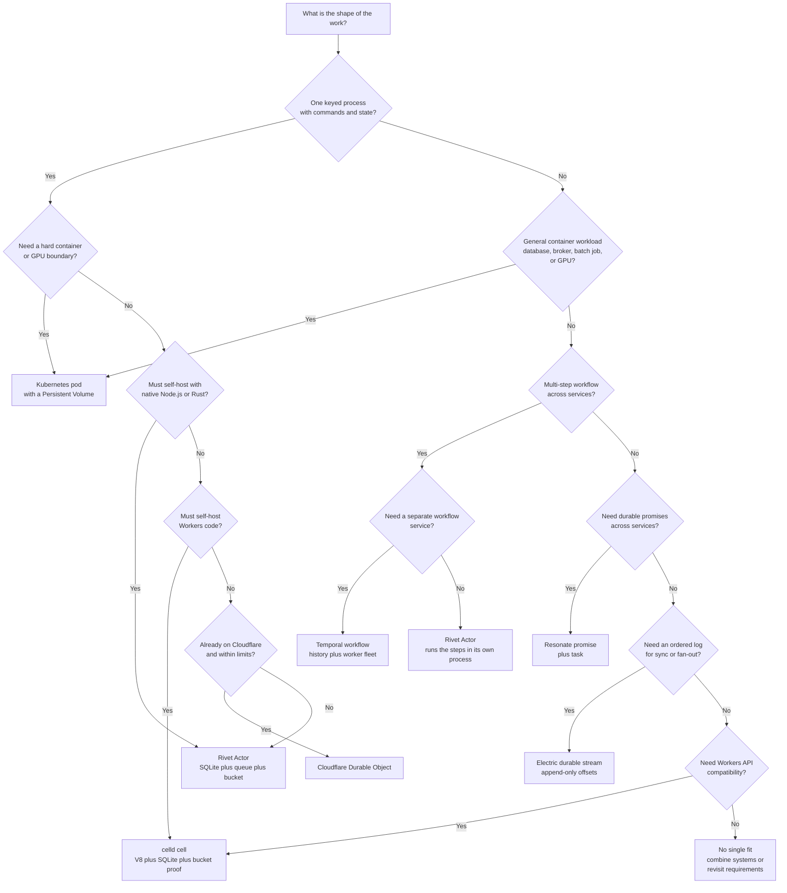

# 18 Comparisons: Rivet, Durable Objects, Kubernetes, and durable state systems

Rivet makes a keyed Actor, its SQLite database, and its workflow state durable.
SQLite is an embedded database. It uses Structured Query Language (SQL). This
document compares Rivet with six systems that also keep the state of a
distributed program: Cloudflare Durable Objects, Kubernetes, Temporal, Resonate,
Electric Durable Streams, and celld. The comparison asks one question. Where does
the durable memory of a distributed program live, and which system pays which
cost to keep it there? The answer is not a ranking. Each system makes a different
part of the problem durable. Rivet makes the Actor durable. A Durable Object
makes one object durable. Kubernetes keeps a workload specification and its
volume durable. The controller creates replacement pods around that
specification. Temporal and Resonate make a workflow history durable. Electric
makes an ordered log durable. celld makes one Workers object and its bucket proof
durable.

The document uses the source at commit
`4a58441c50d1ce20d8803cfb1ab7c3285a5141d6` (version 2.3.31) for every Rivet
claim. It uses the sibling explorations in this parent directory for Resonate,
Electric, and celld. It marks every other claim with its own label.

**Aha:** The deepest difference is not speed or storage size. It is the unit that
survives a crash. Rivet survives as a keyed Actor and its state. A Durable Object
survives as an object and its SQLite database. Kubernetes keeps the workload
specification and the Persistent Volume. The controller creates a replacement
pod after a failure. Temporal and Resonate survive as an event history. Electric
survives as a byte log. celld survives as a cell plus its ownership epoch. The
unit of survival decides the recovery path, the failure model, and the
operational cost.

## 1. The comparison rule

Every comparison needs a rule, because a vendor page and a source file do not
carry the same weight. This document uses five labels.

| Label | Meaning | What the reader may conclude |
|-------|---------|------------------------------|
| Rivet source | A code or documentation file and line range in the Rivet repository at commit `4a58441c` | The file exists at that commit and says this |
| Rivet product claim | A claim in the Rivet repository about Rivet or another product. It includes benchmark and scale claims | This is the project's claim. This document does not verify it |
| Sibling source | A file in the Resonate, Electric, or celld exploration, or the underlying source path named there | The exploration states it, and its own source citation is named |
| External document | The named public page for Cloudflare, Kubernetes, or Temporal | This document names the page and did not fetch it |
| General knowledge | General familiarity with a system, with no named source read | This document did not verify it |

The citation rule has four parts.

1. A Rivet repository path is relative to the Rivet repository root. The path
   starts with `README.md`, `docs/`, or `engine/`.
2. A file of this exploration uses `./README.md` or `../spec.md`. A bare
   `README.md` means the Rivet repository README.
3. A sibling exploration file uses its full path from this file:
   `../../src.resonate/markdown/...`,
   `../../src.celld/markdown/...`, or
   `../../src.electric/markdown/...`.
4. A Cloudflare, Kubernetes, or Temporal claim uses the Rivet comparison
   material when that material exists. Otherwise it says "External document" or
   "General knowledge".

This document does not use a web search. No external document was fetched for
this snapshot. No external claim was read at its source. An External document
claim names a page but was not read. A General knowledge claim comes from
general familiarity and was not verified. The Kubernetes numbers are the values
that the Rivet README publishes. The README states that they are typical
published values, not a matched benchmark. That statement is at `README.md:157`.

The commit is the only authority for Rivet behavior. The internal documents under
`docs-internal/` are useful maps. They can be stale. When they conflict with the
code, this document follows the code. One example is storage. An internal document still describes a FoundationDB
layout. FoundationDB is a distributed key-value database (General knowledge). The
current code uses Amazon Simple Storage Service (S3) objects for the cold tier and the public
architecture document says object storage holds the data. The code and the public document win.

## 2. What each system makes durable

A fair comparison starts with the unit of survival, because the unit decides
everything that follows. The table gives the short answer. The sections give the
mechanism. Three names appear in the table before their full explanation.
Pegboard is the Rivet scheduling and placement layer. An envoy is the node
process that hosts Actors on the version 2 path. UniversalDB is the
transactional key-value store that holds Rivet records.

| System | Durable unit | Where the unit lives | What a crash costs |
|--------|--------------|----------------------|--------------------|
| Rivet | A keyed Actor and its state | A task in a node process, the Actor SQLite database, the UniversalDB records that hold workflow state, and a key-value space | On the version 2 path, a lost envoy makes Pegboard sleep the Actor. Its state stays. A graceful stop destroys the Actor and its data. The `crash_policy` field changes this only on the version 1 path. |
| Cloudflare Durable Objects | One named object and its SQLite database | One Cloudflare runtime object | The platform restarts the object. Its SQLite data is intact. |
| Kubernetes | One workload specification and its volumes | A controller, a container sandbox, and a Persistent Volume | The controller creates a replacement pod. Its volume follows if the storage class allows it. |
| Temporal | One workflow execution and its event history | A Temporal service database | A worker replays the history and continues. |
| Resonate | One durable promise and its task | A server storage engine, or S3 for the Resonate server written in Zig | A worker reacquires the task. The promise state is intact. |
| Electric Durable Streams | One append-only stream | A file, a SQLite database, or a segment file plus metadata | A reader resumes from its stored offset. |
| celld | One cell and its SQLite database | A cell runs inside a V8 isolate on an owner node. V8 is the JavaScript engine, and an isolate is one V8 instance. A script is one uploaded Worker code module. One script can place up to 32 cells in one isolate. The cell also has a bucket chain and an ownership record. | A new owner restores the epoch chain. The acknowledged writes are intact. |

Rivet's unit is a *virtual Actor*. The Actor has an identity that is independent
of the machine that runs it. The first field of the `Actor` type is the
`actor_id`, and the type also holds an optional `key` and a `namespace_id`.

```rust
// engine/packages/types/src/actors.rs:7-38
#[derive(Debug, Clone, Serialize, Deserialize, ToSchema)]
pub struct Actor {
	pub actor_id: Id,
	pub name: String,
	pub key: Option<String>,

	pub namespace_id: Id,
	pub datacenter: String,
	pub runner_name_selector: String,
	pub crash_policy: CrashPolicy,

	/// Denotes when the actor was first created.
	pub create_ts: i64,
	/// Denotes when the actor was first made connectable. Null if never.
	pub start_ts: Option<i64>,
	/// Denotes when the actor started waiting for an allocation.
	pub pending_allocation_ts: Option<i64>,
	/// Denotes when the actor was last connectable. Null if actor is not running.
	pub connectable_ts: Option<i64>,
	/// Denotes when the actor entered a sleeping state.
	pub sleep_ts: Option<i64>,
	/// Denotes when the actor will try to allocate again. If this is set, the actor will not attempt to
	/// allocate until the given timestamp.
	pub reschedule_ts: Option<i64>,
	/// Denotes when the actor was destroyed.
	pub destroy_ts: Option<i64>,

	/// Error details if the actor failed to start.
	#[serde(skip_serializing_if = "Option::is_none")]
	#[schema(value_type = Option<Object>, additional_properties = true)]
	pub error: Option<crate::actor::ActorError>,
}
```

The table below gives the purpose of each field. The `actor_id` is the durable
identifier. The `key` is the user-facing key inside a namespace. The `datacenter`
and `runner_name_selector` are placement inputs, not state. The timestamps record
the lifecycle. The `error` field is diagnostic, not part of the durable data.

| Field | Type | Purpose |
|-------|------|---------|
| `actor_id` | `Id` | Durable identifier. It does not change when the Actor moves. |
| `name` | `String` | Actor type name from the registry |
| `key` | `Option<String>` | User key inside the namespace. The namespace, the name, and the key select one Actor. |
| `namespace_id` | `Id` | Tenant boundary |
| `datacenter` | `String` | Placement region or data center |
| `runner_name_selector` | `String` | Node pool name. The field keeps the legacy runner name. A runner is the older host process that serves Actor commands. |
| `crash_policy` | `CrashPolicy` | Action after a crash: restart, sleep, or destroy |
| `create_ts` | `i64` | Creation time in milliseconds |
| `start_ts` | `Option<i64>` | First time the Actor became connectable |
| `pending_allocation_ts` | `Option<i64>` | Start of the current allocation wait |
| `connectable_ts` | `Option<i64>` | Last time the Actor was reachable |
| `sleep_ts` | `Option<i64>` | Time the Actor entered the sleeping state |
| `reschedule_ts` | `Option<i64>` | Earliest time for the next allocation attempt |
| `destroy_ts` | `Option<i64>` | Destruction time |
| `error` | `Option<ActorError>` | Last start or runtime error, when present |

The lookup uses the namespace, the name, and the key. It returns one `actor_id`
(`engine/packages/guard/src/routing/pegboard_gateway/resolve_actor_query.rs:71-100`).
The `actor_id` is the durable identifier after the lookup. A caller that already
holds the `actor_id` does not need the lookup.

`CrashPolicy` is a small enum. The enum marks `Destroy` as the default variant
(`engine/packages/types/src/actors.rs:40-47`). A caller that constructs the
default value gets `Destroy`. The `getOrCreate` query is different. It supplies
`Sleep` when the request names no policy
(`engine/packages/guard/src/routing/pegboard_gateway/resolve_actor_query.rs:53`).
The policy has a different effect on each Actor workflow.

The version 1 workflow reads the policy after an ungraceful exit
(`engine/packages/pegboard/src/workflows/actor/mod.rs:1242-1292`). A `Restart`
policy allocates the Actor again. A `Sleep` policy marks the Actor sleeping. A
`Destroy` policy removes the Actor. A graceful exit destroys the Actor whatever
the policy says.

The version 2 workflow does not read `crash_policy`. Its input struct has no
such field (`engine/packages/pegboard/src/workflows/actor2/mod.rs:21-33`). The
create operation builds that input without the policy
(`engine/packages/pegboard/src/ops/actor/create.rs:113-121`). The workflow
decides from the stop result instead. A graceful stop destroys. An
error or a lost envoy sleeps
(`engine/packages/pegboard/src/workflows/actor2/runtime.rs:639-663`). The stored
policy has no effect on this path.

Guard is the Rivet request router. For `getOrCreate`, it passes the policy value
to the create operation. The version 2 create input has no field for it, so the
value stops there. A reader must not expect it to change the version 2 stop
behavior.

`Destroy` removes durable data on the version 2 path. The workflow writes the
destroy timestamp and removes the active Actor index
(`engine/packages/pegboard/src/workflows/actor2/mod.rs:1211-1277`). It then
clears the Actor key-value subspace and the version 2 storage
(`engine/packages/pegboard/src/workflows/actor2/mod.rs:1288-1311`). The storage
clear removes the page index, the commit rows, and the delta chunks that carry
page bytes (`engine/packages/pegboard/src/actor_sqlite.rs:38-60`). Depot is the
Rivet per-Actor storage engine. The version 1 destroy workflow does the same
work at `engine/packages/pegboard/src/workflows/actor/destroy.rs:103-150`.

Neither published latency measurement runs a crash. The 6.92 ms cold start
creates a new Actor. The 4.37 ms wake follows a sleep of at least 10 seconds
(`README.md:153-154`). Neither measurement names a crash policy, because neither
path runs the crash decision.

```rust
// engine/packages/types/src/actors.rs:40-47
#[derive(Debug, Copy, Clone, Default, Serialize, Deserialize, PartialEq, Eq, Hash, ToSchema)]
#[serde(rename_all = "snake_case")]
pub enum CrashPolicy {
	Restart,
	Sleep,
	#[default]
	Destroy,
}
```

The Actor's workflow keeps two durable records. The `State` type holds the
identity, the pool, the timestamps, and the current error. It has no
`generation` field. The `LifecycleState` holds the `generation`, the current
`Transition`, an alarm time, and a retry backoff state.

`State` is workflow state. Gasoline, the Rivet durable execution engine, saves it
through a `StateGuard` (`engine/packages/gasoline/src/workflow.rs:27-70`). The
guard holds the state as a shared raw JavaScript Object Notation (JSON) value.
A write through the guard sets a dirty flag. On drop, the guard serializes the
struct back into that shared value
(`engine/packages/gasoline/src/workflow.rs:60-64`). Gasoline later writes
the workflow record that holds the value (`engine/packages/gasoline/src/db/mod.rs:333-341`).
UniversalDB receives the record, not one field at a time. On replay, Gasoline
reads the record and reconstructs `State`.

`LifecycleState` is loop state. A loop is a bounded repetition in one workflow.
The workflow passes the state to `ctx.lupe().with_state(...)`
(`engine/packages/pegboard/src/workflows/actor2/mod.rs:247-255`). `lupe` returns
a loop builder, and `with_state` attaches the state to it
(`engine/packages/gasoline/src/builder/workflow/lupe.rs:19-40`). Gasoline stores
each loop checkpoint in a `LoopEvent`
(`engine/packages/gasoline/src/builder/workflow/lupe.rs:64-80`).

Gasoline keeps both records in UniversalDB. UniversalDB is the transactional
key-value store. It holds workflow records and the Depot records for Actor
SQLite in different key subspaces. Epoxy is the Rivet consensus layer for
geo-distributed keys. It is not a store for Actor data. In this source it serves
Actor key reservation only (`engine/packages/epoxy/README.md:37-42`). Its own
consensus records commit in UniversalDB (`engine/packages/epoxy/README.md:51`).
The Actor's SQLite database is a logical database that Depot builds from its
records. It is not a third store.
The workflow state is separate from the application rows. A reader must keep the
two apart. The workflow state holds scheduling and lifecycle facts.

```rust
// engine/packages/pegboard/src/workflows/actor2/mod.rs:35-67
#[derive(Deserialize, Serialize)]
pub struct State {
	pub actor_id: Id,
	pub name: String,
	pub pool_name: String,
	pub key: Option<String>,
	pub namespace_id: Id,

	pub acquired_slot: bool,
	pub envoy_last_command_idx: i64,
	// Used as a cache
	pub envoy_key: Option<String>,

	pub create_ts: i64,
	pub create_complete_ts: Option<i64>,
	pub allocate_ts: Option<i64>,
	/// Set only on first allocation.
	pub start_ts: Option<i64>,
	// NOTE: This is not the alarm ts, this is when the actor started sleeping. See `LifecycleState` for alarm
	pub sleep_ts: Option<i64>,
	pub connectable_ts: Option<i64>,
	pub reschedule_ts: Option<i64>,
	pub destroy_ts: Option<i64>,

	/// Explains why the actor is NOT healthy, either due to failure to allocate or a failed
	/// envoy.
	///
	/// # When error is cleared
	///
	/// - When actor is allocated
	/// - When actor becomes connectable
	pub error: Option<ActorError>,
}
```

The next section compares the Rivet unit with the Cloudflare unit. The two units
look similar at the surface. The differences are in placement, runtime, and
limits.

## 3. Cloudflare Durable Objects

Cloudflare Durable Objects is a platform with one named object for each key. A
Durable Object class defines the object. The platform gives each object an
identifier. The object runs on the Cloudflare network. The object can use SQLite
storage and a key-value storage Application Programming Interface (API). The
platform can hibernate an idle object and wake it on the next request. These
model facts come from the Cloudflare Durable Objects documentation at
`https://developers.cloudflare.com/durable-objects/`. This document labels them
external. The Rivet repository does not contain the Cloudflare implementation, so
this snapshot cannot verify them.

The Rivet README makes four specific claims about Durable Objects. It says
Durable Objects have a 128 megabyte (MB) memory cap. It says they have a 10
gigabyte (GB) SQLite limit. It says the platform can evict them at random. It says
they use a custom runtime. The same paragraph says Rivet removes each constraint.
This document labels these statements as Rivet product claims. The source is
`README.md:281-283`.

```markdown
<!-- README.md:281-283 -->
<summary><b>How does Rivet compare to Cloudflare Durable Objects?</b></summary>

Rivet is often used as an open-source alternative to Cloudflare Durable Objects that is easy to self-host and scales. It also fixes many of the constraints of Durable Objects: no 128 MB memory cap, bottomless storage instead of a 10 GB SQLite limit, Actors are not randomly evicted, and you control the runtime because Actors run on vanilla Node.js or Bun instead of a custom runtime. Rivet also adds built-in connection handling, event broadcasting, durable scheduling and cron, full Vitest support, lifecycle hooks for draining, and control over Actor upgrades. See the [Cloudflare Durable Objects comparison](https://www.rivet.dev/actors/compare/rivet-actors-vs-cloudflare-durable-objects/).
```

The quoted comparison line names Node.js and Bun because it answers the
custom-runtime claim. The same README says "plain Node.js, Bun, or Rust" at
`README.md:62`. The language-runtime row below uses the wider statement.

The Rivet README also states the model on its own side. It says an Actor is a
long-lived process with durable state, a SQLite database, a queue, realtime
connections, and scheduling. It says an Actor lives inside a node process that
the operator already runs. It does not live in its own container or Virtual
Machine (VM). The source is `README.md:60-71`.

### 3.1 The point-by-point table

The table compares the two systems on thirteen axes. The "stronger" column gives the
system that has the better property for the stated workload. A "stronger" result
is not universal. The notes after the table explain the rows that need context.

| Axis | Rivet Actor | Cloudflare Durable Object | Stronger | Why |
|------|-------------|---------------------------|----------|-----|
| Identity | `actor_id` plus optional user key in a namespace | One object identifier per object, derived from a name or a unique value | Equal | Both give stable keyed identity. Rivet adds a readable key and a namespace. |
| Placement | Pegboard chooses a node or envoy. The operator can set the data center and the node pool. | Cloudflare chooses the location. The user does not control it. | Rivet for control. Cloudflare for global simplicity. | Rivet source: `engine/packages/types/src/actors.rs:13-16`. Cloudflare placement is external. |
| Storage | Per-Actor SQLite and key-value data. Pages replicate to control plane disks and move to a bucket. | SQLite storage with the 10 GB limit that Rivet names. | Rivet on size. Cloudflare on managed simplicity. | The 10 GB figure is a Rivet product claim at `README.md:283`. The Rivet size claim is also a product claim. The database-size row below gives the path rule. |
| Execution model | An Actor is a task in a Node.js, Bun, or Rust process. Many Actors share the process. | One object runs in a Cloudflare runtime. The platform serializes events per object. | Rivet for runtime choice and density. Cloudflare for a managed single-object concurrency model. | Rivet source: `README.md:64`. The Durable Object model is external. |
| Language runtime | Native Node.js, Bun, or Rust. The user keeps the normal package manager, debugger, and test runner. | Custom Workers runtime with V8 isolates. The code must fit the Workers API. | Rivet | Rivet source: `README.md:71` and `README.md:283`. |
| Connection handling | Built-in Hypertext Transfer Protocol (HTTP) and WebSocket routing through Guard (the Rivet request router), event broadcasting, and opt-in WebSocket hibernation. Guard parks the socket while the Actor sleeps. | WebSocket support and platform hibernation. The platform unloads an idle object. | Rivet claims more built-in behavior. Cloudflare is more managed. | Rivet claim: `README.md:168`, `README.md:174`, `README.md:283`. Cloudflare behavior is External document. |
| Scheduling | Cron, timers, and sleep are part of the Actor API. An alarm timestamp is part of the workflow state. | Alarms are part of the Durable Object API. Cron is a separate Workers feature. | Rivet for one integrated scheduler. Cloudflare for platform alarms. | Rivet source: `engine/packages/pegboard/src/workflows/actor2/runtime.rs:15-21` and `engine/packages/pegboard/src/workflows/actor2/mod.rs:586-603`. Cloudflare is external. |
| Local development | The same control plane binary runs locally. The README says local matches production. | Local emulation through the Cloudflare development tools. The production platform is not local. | Rivet | Rivet claim: `README.md:187` and `README.md:218`. Cloudflare is external. |
| Self-hosting | Apache 2.0. The user can run the control plane, the nodes, and a bucket. | No self-host. The platform is managed. | Rivet | Rivet source: `README.md:177` and `README.md:262`. |
| Memory | 72.4 kilobytes (KB) is the Resident Set Size (RSS) increase for one running Actor. The shared node process is counted once. The source states no per-Actor memory cap. | 128 MB memory cap, as the Rivet README claims. The source states no overhead per object. | Not comparable | The Rivet number is measured use, not a limit. The Cloudflare number is a limit and a Rivet product claim at `README.md:281-283`. |
| Scale | Billions of Actors on one control plane, as a product claim | Not stated by the source | Rivet on the claim | The basis is `README.md:66-71`. The number is a Rivet claim, not a measurement in this document. |
| Database size | The native path has no fixed size in the README. The remote SQL path has a 256 mebibyte (MiB) limit (`docs/actors/content/docs/limits.mdx:87`). | 10 GB SQLite, as the Rivet README claims | Rivet on the stated limit. Neither side is verified here. | The Cloudflare figure is a Rivet product claim at `README.md:281-283`. Section 10.6 gives the path rule. |
| Eviction | Actors are not randomly evicted, as a Rivet claim | Random eviction, as the Rivet README claims | Rivet on the claim | The basis is `README.md:281-283`. The claim describes Cloudflare and is not verified here. |

The identity row is the one place where the systems are close. Both use a stable
name to reach a single logical object. Rivet also stores a user key. The key is
optional. An Actor without a key still has an `actor_id`. A Durable Object always
has an identifier.

The placement row is the main architectural difference. Cloudflare runs the
object where the platform decides. Rivet runs the Actor where Pegboard decides.
Pegboard allocates a slot on an envoy. An envoy is a process that hosts the
Actor on a node. The source has two paths. The newer path is the actor
version 2 workflow and the envoy protocol. The legacy runner path also exists.
The create operation checks the pool protocol version and dispatches the version
2 workflow when the pool supports it.

A pool is serverful when its config kind is `Normal`. Pegboard allocates a slot
on an envoy that already runs
(`engine/packages/pegboard/src/workflows/actor2/alloc_serverful/mod.rs:13`). A
pool is serverless when its kind is `Serverless`. Pegboard publishes the start
message to the serverless provider. It then waits for an allocated signal
(`engine/packages/pegboard/src/workflows/actor2/runtime.rs:197-250`,
`engine/packages/pegboard/src/workflows/actor2/runtime.rs:413-444`).

```rust
// engine/packages/pegboard/src/ops/actor/create.rs:105-124
	let actor_v2 = pool_res
		.into_iter()
		.next()
		.map(|p| p.protocol_version.is_some())
		.unwrap_or_default();
	if actor_v2 {
		// Dispatch actor workflow
		let workflow_id = ctx
			.workflow(crate::workflows::actor2::Input {
				actor_id: input.actor_id,
				name: input.name.clone(),
				pool_name: input.runner_name_selector.clone(),
				key: input.key.clone(),
				namespace_id: input.namespace_id,
				input: input.input.clone(),
				from_v1: false,
			})
			.tag("actor_id", input.actor_id)
			.dispatch()
			.await?;
```

The code block shows the switch. A pool with a protocol version uses the actor
version 2 workflow. The workflow starts the Actor through an envoy or a
serverless provider. The older path
still exists for pools without that version. A claim about placement must say
which path it describes. This document describes the version 2 path unless it
says otherwise. See [04 Pegboard](04-pegboard-scheduling.md).

### 3.2 Lifecycle and hibernation

Rivet's lifecycle has nine states. The `Transition` enum names every state. The
state machine is durable. A crash does not lose the transition. Gasoline replays
the workflow and continues from the stored state.

```rust
// engine/packages/pegboard/src/workflows/actor2/runtime.rs:15-76
#[derive(Deserialize, Serialize)]
pub struct LifecycleState {
	pub generation: u32,
	pub transition: Transition,
	pub alarm_ts: Option<i64>,
	pub retry_backoff_state: RetryBackoffState,
}

impl LifecycleState {
	pub fn new() -> Self {
		LifecycleState {
			generation: 0,
			transition: Transition::Allocating {
				destroy_after_start: false,
				lost_timeout_ts: 0,
			},
			alarm_ts: None,
			retry_backoff_state: RetryBackoffState::default(),
		}
	}
}

#[derive(Debug, Deserialize, Serialize)]
#[serde(rename_all = "snake_case")]
pub(crate) enum Transition {
	Allocating {
		destroy_after_start: bool,
		/// Handles cleaning up the actor if it does not receive a certain state before the timeout (ex.
		/// created -> running event, stop intent -> stop event). If the timeout is reached, the actor is
		/// considered lost.
		lost_timeout_ts: i64,
	},
	Starting {
		destroy_after_start: bool,
		lost_timeout_ts: i64,
	},
	Running {
		envoy: EnvoyState,
	},
	SleepIntent {
		envoy: EnvoyState,
		lost_timeout_ts: i64,
		/// If a wake was received in between an actor's intent to sleep and actor stop.
		rewake_after_stop: bool,
	},
	StopIntent {
		envoy: EnvoyState,
		lost_timeout_ts: i64,
	},
	GoingAway {
		envoy: EnvoyState,
		lost_timeout_ts: i64,
	},
	Sleeping,
	Reallocating {
		since_ts: i64,
	},
	Destroying {
		envoy: EnvoyState,
		lost_timeout_ts: i64,
	},
}
```

The table gives the meaning of each state and the next state on the normal path.
A cause of entry can be a create flag, a workflow decision, an envoy event, a
drain signal, or a timeout.

| State | Meaning | Cause of entry | Normal next state |
|-------|---------|------------|-------------------|
| `Allocating` | The workflow waits for a slot | The workflow starts, a reallocation chooses a slot, or a serverless pool waits for its provider | `Starting` when an allocated signal arrives |
| `Starting` | Pegboard sent the start command to the allocated runtime | An allocated signal for the current generation | `Running`, or `Destroying` when `destroy_after_start` is true |
| `Running` | The Actor is connectable | The runtime reports `ActorStateRunning` | `SleepIntent`, `StopIntent`, `GoingAway`, or `Destroying` |
| `SleepIntent` | The Actor will sleep after the stop reply | An envoy `ActorIntentSleep` event, or a `Sleep` signal | `Sleeping`, or `Reallocating` when a wake arrived or the alarm has passed |
| `StopIntent` | The Actor will stop but not sleep | An envoy `ActorIntentStop` event | `Destroying` on a graceful stop. `Sleeping` on an error or a loss. |
| `GoingAway` | The node is draining | A `GoingAway` signal | `Reallocating`, then `Allocating` or `Starting` when allocation succeeds |
| `Sleeping` | The state is saved and the process is gone | A sleep decision, or `Reallocating` after the retry limit | `Allocating` on a wake |
| `Reallocating` | The workflow tries another runtime | A failed allocation, or a drain | `Allocating` or `Starting` when allocation succeeds. `Sleeping` after the retry limit. |
| `Destroying` | The Actor is removed | A graceful `StopIntent`, or `destroy_after_start` | Terminal |

`SleepIntent` and `StopIntent` have different causes. An idle Actor or the sleep
Application Programming Interface (API) causes `SleepIntent`. The runtime sends
a sleep intent on the Actor's behalf. A stop request causes `StopIntent`. The
workflow sets the transition and sends the stop command to the envoy
(`engine/packages/pegboard/src/workflows/actor2/mod.rs:715-765`).

The `handle_stopped` function makes the decision. It deallocates the slot first.
It then reads the transition and the stop result. A graceful stop from
`StopIntent` destroys the Actor. An error or a lost envoy sleeps the Actor. A
`SleepIntent` with `rewake_after_stop` set reallocates the Actor. The source is
`engine/packages/pegboard/src/workflows/actor2/runtime.rs:607-733`.

The `Sleeping` state has no envoy. The workflow listens for a wake signal or for
an alarm. The alarm path is explicit in the signal loop. A timeout produces a
fake `Wake` signal. A request that arrives through Guard also wakes the Actor.

The wait survives a control-plane crash. `listen_n_until` writes a sleep event
with a deadline and a state before it waits
(`engine/packages/gasoline/src/ctx/workflow.rs:925-962`). On replay, the
workflow reads the recorded deadline and waits only for the remaining time
(`engine/packages/gasoline/src/ctx/workflow.rs:1001-1005`). If the deadline has
passed, the wait returns at once. A recorded signal event also replays without a
new wait (`engine/packages/gasoline/src/ctx/workflow.rs:967-996`).

```rust
// engine/packages/pegboard/src/workflows/actor2/mod.rs:586-603
		Transition::Sleeping => {
			if let Some(alarm_ts) = state.alarm_ts {
				// Listen for signals with timeout. if a timeout happens, it means this actor should
				// wake up
				let signals = ctx.listen_n_until::<Main>(alarm_ts, 256).await?;
				if signals.is_empty() {
					tracing::debug!(actor_id=?input.actor_id, "actor wake");

					// Fake signal
					vec![Main::Wake(Wake {})]
				} else {
					signals
				}
			} else {
				// Listen for signals with no timeout
				ctx.listen_n::<Main>(256).await?
			}
		}
```

The sleep activity writes the state and removes the connectable marker. The
`sleep_ts` key is the durable marker that the gateway lookup reads when it asks
whether the Actor is sleeping. The source is
`engine/packages/pegboard/src/ops/actor/get_for_gateway.rs:42`.

```rust
// engine/packages/pegboard/src/workflows/actor2/runtime.rs:961-988
#[derive(Debug, Serialize, Deserialize)]
pub struct SetSleepingInput {}

/// Make the actor not connectable and set as sleeping. It is not deallocated yet.
#[activity(SetSleeping)]
pub async fn set_sleeping(ctx: &ActivityCtx, input: &SetSleepingInput) -> Result<()> {
	let mut state = ctx.state::<State>()?;
	let now = util::timestamp::now();

	let actor_id = state.actor_id;
	ctx.udb()?
		.txn("pegboard_actor2_set_sleeping", |tx| async move {
			let tx = tx.with_subspace(keys::subspace());

			// Make not connectable
			tx.delete(&keys::actor::ConnectableKey::new(actor_id));
			tx.write(&keys::actor::SleepTsKey::new(actor_id), now)?;

			Ok(())
		})
		.custom_instrument(tracing::info_span!("actor_set_sleeping_tx"))
		.await?;

	state.sleep_ts = Some(now);
	state.connectable_ts = None;

	Ok(())
}
```

The Cloudflare model also has hibernation. The difference is what remains
resident. A hibernated Durable Object keeps its identity and its SQLite data.
A sleeping Rivet Actor keeps its workflow state and its SQLite pages. Neither
keeps a running process.

Hibernation and sleeping are related, but the words are not equal. Hibernation
is the Cloudflare platform action. Sleeping is the Rivet Actor state. In Rivet,
hibernation also names a WebSocket behavior that is off by default. See
[10 Realtime and hibernation](10-realtime-and-hibernation.md).

The Rivet claim is that the wake takes 4.37 milliseconds (ms) at the 50th
percentile (p50) and 6.80 ms at the 99th percentile (p99). The source is
`README.md:154`. This is a project measurement with 1,200 samples. The README
does not give a Cloudflare wake figure. This document therefore makes no numeric
comparison with Cloudflare. See
[16 Tests, benchmarks, and limits](16-tests-benchmarks-and-limits.md).

Two operational definitions matter for the numbers. A cold start is a client
request to a newly created keyed Actor. The client receives the first full reply.
The measurement includes scheduling, storage creation, and framework startup
(`README.md:154`). A wake is a client request to an Actor that slept for at
least 10 seconds. The client receives the full reply (`README.md:154`). Neither
definition states whether the server reads the bucket. A new Actor has no pages
to fetch. A woken Actor can need a cold page from the bucket. The README does not
report that case. Section 10.3 states that a bucket outage blocks cold pages.

### 3.3 Where each is the right choice

Cloudflare Durable Objects is the right choice when the application already runs
on Cloudflare, the object fits the platform limits, and the operator does not
want to run any infrastructure. The platform supplies global placement, Transport
Layer Security (TLS), identity, and storage. The cost is vendor dependence, the platform runtime, and
the stated limits. These are External document claims. The named external
document is `https://developers.cloudflare.com/durable-objects/`. This document
did not fetch it.

Rivet is the right choice when the application must self-host. It also fits when
the code needs the standard Node.js or Bun ecosystem. It fits when one key needs
more than 10 GB on the native path. It fits when the Actors must run near data in
the operator's own cloud. The cost is a control plane, a bucket, and nodes to operate. The price is
also a more complex protocol. These claims come from this exploration's
`./README.md` and the Rivet repository README.

## 4. Kubernetes

Kubernetes schedules pods. A pod is one or more containers that share a network
namespace and a set of volumes. The kube-scheduler assigns the pod to a node.
The kubelet on that node starts the containers. A Persistent Volume (PV) holds
data across pod restarts. The storage class and the Container Storage Interface
(CSI) driver decide whether a replacement pod can use the same volume on
another node. These are External document claims. The named external document is
`https://kubernetes.io/docs/concepts/workloads/pods/`. This document did not
fetch it.

Rivet schedules Actors. An Actor is not a pod. It is a task inside a node
process that the operator already runs. The README says this directly: "An Actor
lives inside a node process you already run, not in its own container or VM. A
server that held hundreds of pods holds hundreds of thousands of Actors." The
source is `README.md:64`.

The Rivet README publishes a comparison table. The table is the main Rivet
comparison material for Kubernetes. It is a product claim. The README also gives
the method and the caveat. The first column of the quoted table holds the axis
names. The README leaves that header blank.

```markdown
<!-- README.md:139-148 -->
## How Actors compare to Kubernetes

| | Rivet Actor | Kubernetes pod |
|---|:---:|:---:|
| **Cold start** | **6.92 ms** | ~6 s |
| **Wake from hibernation** | **4.37 ms** | ~6 s (new pod) |
| **Memory per instance** | **72.4 KB** | ~200 MB |
| **Memory while idle** | **0 MB** (hibernates) | Always resident |
| **Scale** | **Billions** of Actors on one control plane | ~5k nodes per cluster |
| **Storage** | **Bottomless** SQLite, replicated and moved to your bucket | Persistent volume per pod |
```

The README explains the numbers below the table. The cold start is 6.92 ms at
p50 and 8.11 ms at p99 over 1,500 samples. The wake is 4.37 ms at p50 and 6.80 ms
at p99 over 1,200 samples. The memory figure is the increase in Resident Set Size
(RSS) for one running Actor. The setup used Azure `eastus2`, three availability
zones, and three control plane instances. The source is `README.md:150-159`.

The README states the Kubernetes side plainly. The Kubernetes figures are
"typical published values, not a matched benchmark." The ~6 seconds assumes a
pre-provisioned node. The ~200 MB is a typical idle Node.js pod. The ~5,000 nodes
is the limit that the Rivet README states. The README does not name a Kubernetes
document for that number. The source is `README.md:157`. This document treats
the number as Rivet's summary, not as a verified Kubernetes limit. A reader must
not treat the table as a controlled experiment. This document does the same.

### 4.1 The unit, the cold start, and the memory

A pod has a container image, a runtime, a network namespace, and a volume. The
scheduler must find a node with enough central processing unit (CPU), memory, and
storage. The kubelet must pull the image if it is not cached. The container
runtime must start the process. That chain takes seconds in the typical case. A
warm node with a cached image is faster than a cold node. The README's ~6 seconds
is a typical value, not a floor.

An Actor has no image pull and no container boot. The node process already runs
the Actor runtime. Pegboard sends a start command to the envoy. The envoy starts
the Actor task and loads its state. The new Actor's empty SQLite database becomes
available. The new Actor fetches no pages, because it has none. A woken Actor can
have evicted pages, and it may fetch them from the bucket. The README does not
report that case. The 6.92 ms p50 measurement covers the new Actor chain.

The memory difference follows from the unit. A pod reserves memory for the
container runtime, the base image, and the Node.js or other language runtime. An
Actor shares the node process and adds its own state. The 72.4 KB is the RSS
increase per Actor. It does not include the shared node process. A reader must
not multiply 72.4 KB by the number of Actors and compare that number with the
total memory of a pod. The right comparison is per running unit, with the shared
process counted once.

**Aha:** The 72.4 KB figure is honest only when the shared process is counted
once. A node with 1,000 Actors pays one Node.js process plus 1,000 state
increments. A Kubernetes node with 1,000 pods pays 1,000 runtimes. The design
choice is to share the runtime. The obvious alternative is one container per
Actor. That alternative buys isolation and costs density.

### 4.2 Storage, scale, and network

A pod's volume is a Persistent Volume. The volume can be a network disk, a local
disk, or a CSI-backed store. A pod is not moved. The controller deletes it and
creates a replacement pod. The replacement pod can use the volume only when the
storage class supports multi-attach or reattachment. A local volume cannot
follow the workload. The data model is a filesystem. The application must choose
a database, a file format, and a backup method.

An Actor's storage is part of the Actor. Each Actor gets a SQLite database and a
key-value space. The control plane replicates writes to the local disks of
several instances. A background process moves pages to the bucket. The bucket is
not on the write path. The README states that storage never runs out and the
bucket never sits on the write path. The source is `README.md:68`. This is a
product claim. The native SQLite path supports it. The WebAssembly and remote SQL
path has a 256 MiB database limit, as section 10 explains.

The scale difference is one control plane for billions of Actors versus about
5,000 nodes per cluster. The two numbers measure different things. The Kubernetes
number is a node count. The Rivet number is an Actor count. A single Kubernetes
node can host many Actors. The correct comparison is the scheduling unit and the
control plane load, not the raw counts. The README uses the numbers as a
density argument. The source is `README.md:66` and `README.md:147`.

The network models also differ. Kubernetes gives each pod an Internet Protocol
(IP) address on the pod network. A Service is a stable virtual address for a
group of pods. Ingress is a Hypertext Transfer Protocol (HTTP) router that
exposes a Service outside the cluster. Network policy controls traffic. The model
is general purpose. It can carry any protocol.

Rivet uses Guard. Guard is the Rivet request router. It receives HTTP and
WebSocket traffic. It routes the request by Actor key to the envoy that hosts
the Actor. A node opens an outbound connection to the control plane. The node
needs no public address for Actor traffic. The model is narrow. It carries HTTP
and WebSocket to keyed Actors. The benefit is that the client never learns the
node address. Guard resolves the Actor identity to the current envoy on each
request. The architecture page says the Actor keeps the same address when it
moves (`docs/general/content/architecture.mdx:42`). That address is the stable
Actor address, not the node address. The source is
`README.md:168` and `docs/general/content/architecture.mdx:38-42`.

### 4.3 Where Kubernetes is stronger

Kubernetes is stronger on six axes. This document states them plainly, because
a fair comparison must give the other side its due. Two terms in the first row
need a definition. A cgroup limits and accounts for process resources. seccomp
filters system calls.

| Axis | Why Kubernetes is stronger |
|------|----------------------------|
| Isolation | A pod has a container boundary, cgroups, namespaces, seccomp profiles, and network policy. An Actor is a task in a shared process. A bug in one Actor can affect the process. |
| Ecosystem | Kubernetes has operators, Helm charts, CSI drivers, ingress controllers, service meshes, policy engines, and a large tool market. Rivet has a smaller ecosystem. |
| Graphics Processing Unit (GPU) | Kubernetes has device plugins and GPU scheduling. A pod can request a GPU. Rivet Actors run on the node's runtime; a GPU Actor needs a GPU node pool and is not a transparent per-Actor resource. |
| Mature scheduling | Kubernetes has affinity, anti-affinity, taints, tolerations, priority, preemption, topology spread, and a mature control loop. Pegboard is younger and has a narrower policy surface. |
| Open governance | Kubernetes is developed in the open and runs on many clouds. A user can avoid one vendor runtime. Rivet is also Apache 2.0, but one project controls its protocol and control plane. |
| Arbitrary workloads | A pod can run a database, a message broker, a batch job, or a machine-learning trainer. An Actor is a keyed, stateful request handler. |

The isolation point is the most important. An Actor is not a security boundary in
the way a container is. The README says a generated, untrusted code Actor gets
its own database and filesystem. The source is `README.md:70`. That claim is a
product claim. It does not say the Actor has a kernel boundary. A reader who needs
a hard isolation boundary must use a container, a micro Virtual Machine, or a
sandbox. The `agentOS` product gives one agent a small Linux-compatible
computer ([17 The product family](17-the-product-family.md), lines 88-108).

The GPU row is an inference from the Actor model. The source does not state a
per-Actor GPU policy.

The sixth axis is arbitrary workloads. A pod can run a database, a message
broker, a batch job, or a machine-learning trainer. Rivet Actors are for keyed,
stateful request handlers. Rivet can run on Kubernetes. The README lists
Kubernetes as a control plane and node deployment target. The source is
`README.md:187` and `README.md:226`. The comparison is about the scheduling unit,
not about the deployment platform. A user can run Rivet Actors on Kubernetes
nodes.

### 4.4 Where Rivet is stronger

Rivet is stronger on three axes.

1. **Density.** 72.4 KB per Actor versus about 200 MB per idle pod. The project
   reports the first number. The second is a typical published value. The ratio
   is about 2,800 times, or about 3.4 orders of magnitude. The shared process
   explains most of it.
2. **State.** An Actor has SQLite, key-value data, a queue, and realtime
   connections as part of the unit. A pod has a filesystem and must add a
   database. The state is not a separate service.
3. **Wake latency.** 4.37 ms from sleep versus about 6 seconds for a new pod.
   The Actor workflow keeps the state and the placement metadata. The pod must
   go through the scheduler and the container runtime.

The cold start and wake numbers come from the Rivet README. They are project
measurements. The Kubernetes numbers are typical published values. The README
says so at `README.md:157`. This document does not add a benchmark.

The operational cost follows from the unit. A Kubernetes cluster needs a control
plane, etcd, a Container Network Interface (CNI), a CSI driver, an ingress
controller, and an autoscaler. etcd is the Kubernetes
key-value store for cluster state. The Kubernetes control plane is the API
server, the scheduler, and the controller manager. A Rivet deployment needs
identical Rivet control plane instances, a persistent disk per instance, one
bucket per cluster, and the nodes.
The README says self-hosting means four things: control plane instances, a
persistent disk per instance, one bucket, and the nodes. The source is
`README.md:218`. When Rivet runs on Kubernetes, its components run as pods and
services in the cluster. The Rivet cost is in addition to the cluster, not a
replacement for it. That is an inference from the deployment model.

The Rivet benchmark page adds one operational fact. It says Kubernetes does not
give pods raw Non-Volatile Memory Express (NVMe), so it cannot reproduce the
Rivet numbers. The source is `docs/general/content/benchmarking.mdx:39`. That is a Rivet product claim. It is
also a reminder that the two systems optimize different hardware paths.

## 5. Temporal

Temporal is a durable execution platform. A Temporal workflow is a program with a
deterministic history. A worker runs the workflow code. An activity is a step
with side effects. The Temporal service stores the workflow history in a
persistence database. A worker fleet polls task queues. After a crash, a worker
replays the history and continues. These are general Temporal facts from
`https://docs.temporal.io/`. This document labels them external. This snapshot
does not contain the Temporal source or a Temporal deployment.

The Rivet repository does not mention Temporal. A search of the Markdown and Rust
files at this commit found no Temporal reference. This document therefore cannot
make a product comparison from the Rivet side. It compares mechanisms instead.
The Rivet side comes from the Gasoline source. The Temporal side is general
knowledge, not verified here. This section reads the source directly to compare
the mechanisms.

### 5.1 The Temporal shape

Temporal puts durable execution in a separate service. The service has a front
end, a history service, a matching service, and an internal worker service. The
history service stores the event history in a database. The matching service
hands tasks to user workers. The internal worker service runs the platform's own
system workflows, such as archival. The user worker fleet is separate from the
service. A user runs those workers. The service runs the history and the task
queues. The database is a Cassandra, PostgreSQL, or MySQL deployment. These are
general facts. They are external.

The separation has a clear cost. The user operates or buys a Temporal service and
a database. The worker fleet scales separately. The history store grows with the
number of workflow events. The service is a second distributed system beside the
application.

### 5.2 The Gasoline shape

Gasoline is a crate inside the Rivet control plane. A crate is a Rust package or
library. It is not a separate service.
A workflow is an asynchronous Rust function. The workflow context holds the
input, the state, the event history, and a cursor. The Gasoline worker pulls
workflows from UniversalDB. A bump subscription wakes the worker when a workflow
is ready. A bump subscription is a notification on the `gasoline.worker.bump`
subject of `universalpubsub`, the publish-and-subscribe crate
(`engine/packages/gasoline/src/db/mod.rs:391-421`). The
worker polls on a timer and also wakes on that notification
(`engine/packages/gasoline/src/worker.rs:74-90`). The worker runs the workflow
and writes the state back.

In this snapshot, Gasoline workflows are internal to the control plane. The
public Actor application programming interface does not expose Gasoline.
Control-plane code writes the workflows in Rust with the Gasoline macros
(`engine/packages/gasoline-macros/src/lib.rs:20-45`). The Pegboard Actor
workflow is one such workflow.

The word *worker* has three meanings in the Temporal and Gasoline comparison.
The Temporal internal worker service runs the platform's own workflows. The user
worker fleet is the set of processes that run user workflow code. The Gasoline
worker is a loop inside the control plane process that pulls workflows
(`engine/packages/gasoline/src/worker.rs:74-145`). The matching service is not a
worker. It pairs a task with a user worker. Each use below names the meaning. The
Resonate section uses *worker* for the separate process that runs user task code.

The `WorkflowData` type shows the durable shape. It holds the workflow
identifier, the name, the input, the state, the output, and a wake-condition
flag. The state and input are raw JSON values. The
history is separate. It is a map from location to a list of events.

```rust
// engine/packages/gasoline/src/db/mod.rs:333-341
#[derive(Debug)]
pub struct WorkflowData {
	pub workflow_id: Id,
	pub name: String,
	input: Box<serde_json::value::RawValue>,
	state: Box<serde_json::value::RawValue>,
	output: Option<Box<serde_json::value::RawValue>>,
	pub has_wake_condition: bool,
}
```

The history event enum lists every durable step. An activity, a signal send, a
message send, a sub-workflow, a loop, a sleep, a removed event, a version check,
a branch, and a signals event are all history records. The `Event` type carries
a coordinate, a version, and the event data. A location is a list of
coordinates. A coordinate is a list of indices. An index selects a step or a
nested position inside its coordinate. A nested branch adds a coordinate to the
location. The text form puts braces around the location, a dot between the
indices of one coordinate, and a comma between coordinates. For example,
`{1.2, 3}` is a location with the coordinates `1.2` and `3`
(`engine/packages/gasoline/src/history/location.rs:4-16`,
`engine/packages/gasoline/src/history/location.rs:48-60`,
`engine/packages/gasoline/src/history/location.rs:129-140`).

```rust
// engine/packages/gasoline/src/history/event.rs:13-53
#[derive(Debug)]
pub struct Event {
	/// Position within the root location.
	pub(crate) coordinate: Coordinate,
	pub(crate) version: usize,
	pub(crate) data: EventData,
}

impl Event {
	pub fn coordinate(&self) -> &Coordinate {
		&self.coordinate
	}
}

impl std::fmt::Display for Event {
	fn fmt(&self, f: &mut std::fmt::Formatter<'_>) -> std::fmt::Result {
		write!(f, "{} v{} @ {}", self.data, self.version, self.coordinate)
	}
}

impl Deref for Event {
	type Target = EventData;

	fn deref(&self) -> &Self::Target {
		&self.data
	}
}

#[derive(Debug)]
pub enum EventData {
	Activity(ActivityEvent),
	SignalSend(SignalSendEvent),
	MessageSend(MessageSendEvent),
	SubWorkflow(SubWorkflowEvent),
	Loop(LoopEvent),
	Sleep(SleepEvent),
	Removed(RemovedEvent),
	VersionCheck(VersionCheckEvent),
	Branch,
	Signals(SignalsEvent),
}
```

The activity path is the key comparison point. The workflow calls
`ctx.activity(input)`. The cursor compares the activity name and the version
with the stored history. The call has three outcomes.

| History state | What Gasoline does | Source |
|---------------|--------------------|--------|
| Event with output | Returns the stored output. The activity does not run again. | `engine/packages/gasoline/src/ctx/workflow.rs:585-598`, `engine/packages/gasoline/src/history/cursor.rs:175-218` |
| Event without output | The activity failed before. Gasoline reads `error_count`, backs off when a wake deadline is set, and reruns the activity. It compares `error_count + 1` with `MAX_RETRIES`. At the limit it returns `ActivityMaxFailuresReached`. Otherwise it returns `ActivityFailure` with the count. | `engine/packages/gasoline/src/ctx/workflow.rs:599-650` |
| No event | Gasoline runs the activity and writes a new event. | `engine/packages/gasoline/src/ctx/workflow.rs:651-656` |

`MAX_RETRIES` is a trait constant. It defaults to 5
(`engine/packages/gasoline/src/activity.rs:14-17`,
`engine/packages/gasoline-macros/src/lib.rs:29-42`). The history record holds
the error count, not the error text
(`engine/packages/gasoline/src/history/event.rs:115-140`).

```rust
// engine/packages/gasoline/src/ctx/workflow.rs:562-586
	/// Run activity. Will replay on failure.
	#[tracing::instrument(skip_all, fields(activity_name=%I::Activity::NAME))]
	pub async fn activity<I>(
		&mut self,
		input: I,
	) -> Result<<<I as ActivityInput>::Activity as Activity>::Output>
	where
		I: ActivityInput,
		<I as ActivityInput>::Activity: Activity<Input = I>,
	{
		self.check_stop()?;

		let history_res = self
			.cursor
			.compare_activity(self.version, I::Activity::NAME)?;
		let location = self.cursor.current_location_for(&history_res);

		// Activity was ran before
		let output = if let HistoryResult::Event(activity) = history_res {
			tracing::debug!("replaying activity");

			// Activity succeeded
			if let Some(output) = activity.parse_output()? {
				output
			}
```

The failure branch is the part that the first excerpt omits. It backs off, reruns
the activity, and returns a typed error when the count reaches the limit.

```rust
// engine/packages/gasoline/src/ctx/workflow.rs:599-650 (abridged)
		else {
			let error_count = activity.error_count;

			// Backoff
			if let Some(wake_deadline_ts) = self.wake_deadline_ts {
				let duration = (u64::try_from(wake_deadline_ts)?)
					.saturating_sub(u64::try_from(rivet_util::timestamp::now())?);
				tokio::time::sleep(Duration::from_millis(duration))
					.instrument(tracing::debug_span!("backoff_sleep"))
					.await;
			}

			match self
				.run_activity::<I::Activity>(&input, &location, activity.create_ts)
				.await
			{
				Err(err) => {
					let err = match err {
						WorkflowError::ActivityFailure(name, err, _) => {
							if error_count.saturating_add(1) >= I::Activity::MAX_RETRIES {
								WorkflowError::ActivityMaxFailuresReached(name, err)
							} else {
								WorkflowError::ActivityFailure(name, err, error_count)
							}
						}
						_ => err,
					};

					return Err(err.into());
				}
				x => x?,
			}
		}
```

The determinism rule is narrower than Temporal's rule. Gasoline checks the
current event. The activity name and the version must match the history. A
version mismatch, a name mismatch, or a different event type returns
`HistoryDiverged` (`engine/packages/gasoline/src/history/cursor.rs:175-218`).
The check covers each recorded step. It does not inspect the code between steps.
The workflow still replays from the cursor, so a side effect outside an activity
can run again. This document infers that outcome from the replay model. Temporal
states its rule for the whole workflow function. That Temporal rule is General
knowledge. This document did not read the Temporal source.

The Temporal and Gasoline mechanisms are similar at this level. Both record a
step result and both avoid a repeat after a crash. The difference is packaging.
Temporal puts the history service, the task matcher, and the database in a
separate platform. Gasoline puts the history store in UniversalDB and the worker
in the control plane process. The README lists Gasoline as a "Durable execution
engine" in the control plane repository. The source is `README.md:332`. The
self-hosting list names control plane instances, a persistent disk per instance,
one bucket, and the nodes. It does not name a workflow server or a database. The
source is `README.md:218`.

### 5.3 The comparison table

| Axis | Temporal (General knowledge) | Gasoline in Rivet (Rivet source) | Stronger |
|------|------------------------------|----------------------------------|----------|
| Deployment unit | A separate Temporal service plus a database plus a worker fleet | A crate in the control plane plus workers in the same binary (`engine/packages/gasoline/src/worker.rs:74-90`) | Rivet on operational cost |
| History store | Temporal persistence database | UniversalDB key-value records (`engine/packages/gasoline/src/db/mod.rs:333-341`) | Unverified for Temporal. Rivet side is sourced. |
| Replay | A user worker replays workflow history | `WorkflowCtx` cursor replays event history (`engine/packages/gasoline/src/history/cursor.rs:175-218`) | Similar mechanism |
| Activity result | Recorded in history | `ActivityEvent` with an optional raw output (`engine/packages/gasoline/src/history/event.rs:115-140`) | Similar mechanism |
| Scheduling | Matching service and task queues | Gasoline worker poll plus bump subscription (`engine/packages/gasoline/src/worker.rs:74-90`, `engine/packages/gasoline/src/db/mod.rs:391-420`) | Judgment: Temporal separates matching from history, so that layer scales alone. This document did not measure either system. |
| Language support | Many official Software Development Kits (SDKs) | Rust workflows; Actor code in Node.js, Bun, Rust (`README.md:326-329`, `README.md:64`) | Temporal on breadth. The official SDK count is General knowledge. |
| Visibility | Temporal Web user interface (UI) and history export | Rivet dashboard and OpenTelemetry (`README.md:171`, `README.md:203`) | Judgment, not a measurement. The Temporal Web UI is General knowledge. |
| Determinism | The whole workflow code must be deterministic | Each recorded activity name and version must match (`engine/packages/gasoline/src/history/cursor.rs:175-218`) | Different scope. Temporal is stronger on whole-function replay. |
| Failure model | Worker crash, history replay | Workflow crash, history replay | Similar |

The strongest Temporal argument is maturity and language breadth. That is a
judgment, not a measurement. This document does not measure the public history,
the SDK count, or the production record of either system. The strongest
Gasoline argument is that the workflow is in the same binary as the Actor
control plane. There is no second service to deploy and no second database to
size. The user pays for that with a smaller ecosystem and a narrower workflow
language surface.

## 6. Resonate

Resonate is a durable execution platform built on durable promises and durable
tasks. A durable promise is a named record with a state, a parameter, a value, a
set of tags, and a deadline. A durable task is the executable half of the same
record. A worker acquires the task with a lease and a version. The server
resumes the task when the promises it waits on settle. The source for these
statements is the Resonate exploration at
`../../src.resonate/markdown/README.md:8-10` and
`../../src.resonate/markdown/03-durable-promises-and-tasks.md:13-24`. The
underlying Resonate repository is at commit `9c72d818`.

Resonate is not an Actor runtime. It does not own the placement of user code. It
owns the durable record and the dispatch of work to a worker. The worker is a
separate process. This is the key difference from Rivet. Rivet owns the Actor,
the placement, the request route, and the state. Resonate owns the promise, the
task, and the wake.

### 6.1 The promise and the task

A durable promise has five states: pending, resolved, rejected,
rejected_canceled, and rejected_timedout. A durable task also has five states:
pending, acquired, suspended, halted, and fulfilled. The version is the fence. A
worker that lost its lease holds an old version. Its write is refused. The
source is `../../src.resonate/markdown/03-durable-promises-and-tasks.md:12-26`
and `../../src.resonate/markdown/03-durable-promises-and-tasks.md:212-228`.

The task transitions are these. `task.acquire` moves pending to acquired.
`task.heartbeat` keeps acquired. `task.suspend` moves acquired to suspended when
all awaited promises are pending. When an awaited promise settles, `resumeOne`
moves the task from suspended to pending. `task.release` or a lease timeout moves
acquired to pending. `task.halt` moves any non-fulfilled state to halted.
`task.continue` moves halted to pending when the promise is still pending. When
the task's own promise settles, the task moves from any non-fulfilled state to
fulfilled. The source is
`../../src.resonate/markdown/03-durable-promises-and-tasks.md:160-197` and
`../../src.resonate/markdown/03-durable-promises-and-tasks.md:417-438`.

The one-row model is the important design choice. A promise and its task share
one identifier. The promise face holds the promise state, the parameter, the
value, the tags, the timeouts, and the callbacks. The task face holds the task
state, the version, the time to live, the process identifier, the lease deadline,
the retry deadline, and the resume list. The tags decide the semantics. The
`resonate:target` tag carries a worker address. It makes the promise runnable,
and it also makes the promise awaitable. The `resonate:timer` tag makes a
deadline resolve the promise instead of rejecting it. The `resonate:scope` tag
with value `global` makes the promise awaitable. The source is
`../../src.resonate/markdown/03-durable-promises-and-tasks.md:20-68`.

This model is close to an Actor in one way. Both have a stable identity and a
durable record. It is different in another way. An Actor processes commands.
A promise stores a result. The Actor has a mailbox and mutable state. The promise
has a state machine and a value. An Actor can serve many calls over its life. A
promise usually represents one call or one step.

### 6.2 The server and the control plane

These are Sibling source claims. Each paragraph cites its exploration file. The
Resonate server is a plugin host. A port here is a Rust trait that a plugin
implements. A network port is called a socket. The four port roles are a server,
a worker, a gateway, and a router. The gateway role accepts a request from a
transport and sends it to the server role. The server role applies one protocol
request. The worker role delivers one message to an address. The router role
selects a worker for an address scheme. A route table is a shared table of HTTP
routes that plugins add to
(`../../src.resonate/markdown/01-architecture.md:18-29`). The composition root
loads the plugins and starts them
(`../../src.resonate/markdown/01-architecture.md:40-51`).

The address scheme is the text before `://`, such as `http` or `poll`
(`../../src.resonate/markdown/01-architecture.md:26`). A concrete request path
is this. A client sends an HTTP request to the gateway port. The gateway accepts
it. The shared route table sends it to the server port. The server port applies
one protocol request. When the protocol needs a worker message, the server port
gives the address to the outbound worker port. The outbound worker port asks the
router for a worker. The router reads the scheme and returns the matching worker
plugin. The worker plugin delivers the message. This is the path that the four
ports describe. The source is
`../../src.resonate/markdown/01-architecture.md:40-51`.

The Rivet control plane is also a plugin-like host, but the comparison stops
there. The Rivet control plane places Actors on envoys, routes client requests,
and stores Actor state. The Resonate server does not place user code. It stores
promises and tasks and delivers messages to a worker that the user runs. A
Resonate worker pulls or receives a task. A Rivet Actor runs where Pegboard
placed it.

The Wake mechanism also differs. Resonate does not keep a callback function
that it fires. It keeps a callback record on the promise. When the promise
settles, the server removes that record and calls `resumeOne`. `resumeOne`
moves the task from suspended to pending and sets a retry deadline. The server
sweep reads the deadline and emits an execute message
(`../../src.resonate/markdown/03-durable-promises-and-tasks.md:405-411`). A
server sweep is the periodic loop that fires timers, expires leases, and retries
tasks (`../../src.resonate/markdown/01-architecture.md:31`). The wake is a state
that the server reads, not an event that it delivers. If the server dies between
the callback and the dispatch, the pending state and the deadline survive. A new
server reads them and dispatches.

Rivet wakes an Actor through Guard and Pegboard. The request is the wake. The
Actor workflow also has an alarm time for a scheduled wake. The Resonate model
is a dependency graph of promises. The Rivet model is a keyed process with a
queue and a state.

### 6.3 The point-by-point table

| Axis | Rivet Actor (Rivet source) | Resonate promise and task (Sibling source) | Stronger |
|------|----------------------------|--------------------------------------------|----------|
| Unit of work | A long-lived Actor with a queue and state | One promise record with an optional task face | Rivet for a process. Resonate for one call or step. |
| Identity | `actor_id` plus optional user key in a namespace | Promise identifier string with an origin prefix. The origin is the text before the first colon (`../../src.resonate/markdown/20-deterministic-identifiers.md:9`). | Equal for keyed lookup |
| State store | Per-Actor SQLite and key-value data, plus workflow state in UniversalDB | One server storage engine: SQLite, PostgreSQL, MySQL, ScyllaDB, Blob, or Neo4j. Blob is an object store and Neo4j is a graph store (`../../src.resonate/markdown/06-storage-engines.md:7`). | Rivet for per-key relational state. Resonate for backend choice. |
| Scheduling | Pegboard allocates a slot on an envoy or a serverless provider | Server sweep and worker lease; delay and timer tags | Rivet for automatic placement. Resonate for cross-service dispatch. |
| Wake | HTTP or WebSocket request through Guard; alarm timestamp | When a promise settles, the task resumes; retry timeout | Different models, both valid |
| Replay | Gasoline replays event history | The SDK re-executes the function; settled promises return stored values | Similar goal, different history shape |
| Storage substrate | Control plane local disks plus one object storage bucket | One of six server storage engines, or an independent S3-only server (`../../src.resonate/markdown/00-overview.md:202`) | Resonate is more flexible. Rivet is simpler to operate. |
| Language support | TypeScript on Node.js and Bun, Rust, experimental Python and Swift clients (`README.md:326-329`) | TypeScript, Python, Go, Java, and Rust SDKs | Resonate on SDK breadth |
| Formal specification | No executable formal model | Lean 4 abstract machine and 92 properties (`../../src.resonate/markdown/README.md:197`, `../../src.resonate/markdown/README.md:258-264`) | Resonate |
| Failure unit | A lost envoy makes the Actor sleep; a graceful stop destroys its data | Task lease expires; promise state is intact | Both keep the durable state. Rivet also moves the Actor. Resonate lets a worker reacquire the task. |

The S3-only server is the third independent server implementation. The first is
the Rust server core. The second is the PostgreSQL server. The third is written
in Zig (`../../src.resonate/markdown/13-the-s3-server-in-zig.md:7`). It stores
its state only in S3 objects. It is not one of the six storage engines.

The formal specification is a real Resonate strength. Lean 4 is a programming
language and proof assistant. The abstract machine is Lean 4 code that takes a
step and a time and returns a response and a new state. The 92 properties are
claims about runs of that machine
(`../../src.resonate/markdown/README.md:197`). The exploration states that the
machine is executable and the servers are checked against it. The source is
`../../src.resonate/markdown/README.md:258-264`. Rivet has tests and
benchmarks, but this snapshot has no equivalent executable specification.

The state store difference is the one that matters for a user. Rivet gives every
Actor a SQLite database. The application can run SQL, transactions, and indexes
inside the Actor. Resonate gives every promise one row in a shared store. The
application runs its own code in a worker and reports the promise outcome. A user who
needs a transaction over many keyed records will prefer the Actor. A user who
needs to coordinate many services and languages will prefer Resonate.

## 7. Electric and the durable stream model

Electric Durable Streams is an append-only log with offsets. A stream has six
properties: append-only, ordered, typed, addressable, closeable, and forkable.
Typed means the stream has one content type, set at creation. Addressable means
the stream is reachable at a URL. The six operations are create, append, close,
read, delete, and head. A fork is
a property, not one of the six operations. A fork is a new stream that shares a
prefix with a source stream at a chosen offset. `Head` returns stream metadata
and the current tail without a body. An offset is an opaque token. A client
stores an offset and returns it to resume. The source is the Electric exploration
`../../src.electric/markdown/03-the-durable-stream-primitive.md:11-39` and
`../../src.electric/markdown/03-the-durable-stream-primitive.md:86-101`.

The stream is the durable unit. It does not execute application code. A consumer
reads the log and decides what to do. The producer appends facts. Many readers
can read the same log from their own offsets. A subscription can send a webhook
or write a wake record. A wake record is one JSON message with the subscription
identifier, the changed stream, the generation, and a timestamp. A runner claims
the wake with a lease. A runner is the process that claims and processes wakes.
A lease is a time-limited claim. An expired lease makes the
wake claimable again. A generation is a subscription counter that increases on
every wake. A stale generation is rejected. The source is
`../../src.electric/markdown/03-the-durable-stream-primitive.md:159-195` and
`../../src.electric/markdown/durable-streams/03-live-reads-and-subscriptions.md:406`.

An Actor is a process with a mailbox and a state. The mailbox orders commands.
The Actor executes one command and changes its state. The state is the result of
the commands. A client can call the Actor and wait for a reply. The Actor can
broadcast to connected clients. The source is `./README.md:7-12` and
`./README.md:33-48`.

The two models answer different questions. A stream answers "what happened, in
what order?" An Actor answers "what should happen next, for this key?" A stream
is good at distribution, sync, replay, fan-out, and audit. An Actor is good at
command execution, transactions, timers, and per-key state.

### 7.1 The stream model

The table gives the stream properties and the Actor equivalent.

| Property | Durable stream | Actor |
|----------|----------------|-------|
| Identity | Stream path or Uniform Resource Locator (URL) | Actor key inside a namespace |
| Ordering | Strict offset order for all readers | Mailbox order per Actor |
| State | The log itself | SQLite, key-value data, and in-memory state |
| Writer | Any producer with permission | One Actor owner at a time |
| Readers | Many, each at its own offset | Many, through requests and subscriptions |
| Replay | Read from any retained offset | Gasoline history replay for workflows |
| Fan-out | A stream can feed many subscriptions | One Actor broadcasts to its connections |
| Mutation | Append only; bytes do not change | Update in place through SQL and key-value calls |
| Wake | Webhook or pull-wake subscription | Guard routes to the Actor and wakes it |
| Fit | Data sync and event distribution | Command execution and per-key state |

The storage substrate also differs. Electric has three deployments, and they do
not share one store. The Node.js server writes one `.log` file per stream and
keeps metadata in a Lightning Memory-Mapped Database (LMDB) store. The
Cloudflare server uses one Durable Object for each stream, with Durable Object
SQLite for metadata and bytes. The Caddy plugin keeps metadata in bbolt and
bytes in a segment file. bbolt is a B+tree key-value store
(`../../src.electric/markdown/durable-streams/08-server-implementations.md:18-27`).
The file layout is at
`../../src.electric/markdown/durable-streams/05-storage-and-durability.md:90-102`.
The stream server is a storage and delivery service. It is not a general compute
service.

### 7.2 Where each model fits

A stream is the right choice for seven jobs.

1. **Change distribution.** One writer appends a change. Many clients read it.
2. **Sync.** A client stores an offset and catches up after a disconnect.
3. **Audit.** The log keeps every fact in order.
4. **Fan-out.** A subscription sends each new event to a target.
5. **Forking.** A conversation or document branches at an offset without a copy.
6. **Idempotent append.** A producer sequence number prevents a duplicate.
7. **Cross-language consumers.** Any HTTP client can read the log.

An Actor is the right choice for six jobs.

1. **Command execution.** A client calls an action and waits for a result.
2. **Per-key state.** A user, room, document, or tenant has one owner.
3. **Transactions.** Several rows change together in SQLite.
4. **Timers and cron.** The Actor sets an alarm and wakes on schedule.
5. **Realtime broadcast.** The Actor holds WebSocket connections.
6. **Durable workflows.** Gasoline replays a multi-step operation.

The two models combine well. An Actor can append to a stream. A stream consumer
can call an Actor. The Electric agent runtime does exactly this. An entity
stream is the stream for one agent entity. The agents-server writes an `inbox`
event to that stream. A webhook subscription then wakes the runtime. The runtime
is the process that reads the stream from its last acknowledged offset, runs the
entity handler, and appends the results to the same stream. The source is
`../../src.electric/markdown/README.md:97-110`. The stream is the durable memory
of the agent. The runtime is the process that acts on it.

**Aha:** A stream is shared memory. An Actor is a private memory with one writer.
The stream can serve a thousand readers from one history. The Actor can make a
decision that no reader can make. A design that needs both should use both. The
Actor writes the decision to the stream, and the stream distributes it.

## 8. celld

celld is a self-hosted implementation of the Cloudflare Workers platform. A cell
is one Durable Object instance. A cell has its own SQLite database, one owner
node at a time, and one fencing epoch. An epoch is a number that increases when
ownership changes. A writer from an older epoch is stale. The next restore clips
the stale writes at the cut. The cut is the last transaction identifier that the
new chain covers. The bucket holds a chain of Lite Transaction (LTX) segments
across these epochs. A snapshot is one
segment that
carries every page of the database at one transaction. A restore walks the
chain from the newest epoch down to a snapshot
(`../../src.celld/markdown/05-cell-storage-and-durability.md:7-17`). The bucket
is the eventual home of every durable byte. The bucket is also the proof of an acknowledgement in bucket mode.
In fleet mode, a follower `fsync` is the proof, and the bucket upload catches up
later (`../../src.celld/markdown/05-cell-storage-and-durability.md:685-687`). A
follower is another node that receives each write. `fsync` is the system call
that forces the bytes to disk. The
source is `../../src.celld/markdown/README.md:3-13` and
`../../src.celld/markdown/05-cell-storage-and-durability.md:1-9`. The celld
repository is at commit `8702f6d186c77698dbfb30cf29e3b1922a88f008`, version
0.6.3. The source is `../../src.celld/markdown/README.md:15-19`.

celld is the closest system to Rivet in this set. Both keep one SQLite database
per keyed unit. Both write a log. Both use a bucket. Both restore a unit after a
failure. The differences are in the owner model, the write proof, and the
runtime.

### 8.1 One cell and one Actor

The celld activation path is explicit. The cell scope is the class name, a
colon, and the identifier (`../../src.celld/markdown/04-durable-objects.md:367-383`).
The application calls `namespace.get(id)` and receives a stub. The first
`fetch` or Remote Procedure Call (RPC) activates the cell.

The owner node reads `cells/<scope>/own.json`. The record names a node and an
epoch. The node decides whether another owner is live by reading that owner's
lease at `nodes/<node>.json`. A lease is dead when its recorded expiry is at or
before the reader's clock (`../../src.celld/markdown/06-ownership-failure-and-rebalancing.md:212-216`).
If the owner is live, the request forwards to that node. Otherwise the node
claims the next epoch. A missing record claims epoch 1. A released record or a
dead owner claims `epoch + 1`. A record that names this node also claims
`epoch + 1` for a new session. Only a clean local reload reuses the same epoch
(`../../src.celld/markdown/04-durable-objects.md:429-437`).

The restore then runs. It starts at the newest ownership record. It reads the
epoch, lists the epoch prefixes, and builds a chain from the newest epoch down
to one that opens with a snapshot
(`../../src.celld/markdown/05-cell-storage-and-durability.md:690-730`). It opens
the log prefix `cells/<scope>/ltx/e<epoch>/`. It builds the JavaScript instance
(`../../src.celld/markdown/04-durable-objects.md:438-440`).

The Rivet path is different. A request arrives at Guard. Guard asks Pegboard for
the Actor. Pegboard reads the Actor workflow state. If the Actor is running and
connectable, the request goes to the envoy. If the Actor is sleeping, Guard
sends a wake signal. It then holds the client request. If the Actor is not
connectable for another reason, Guard holds the client request and waits for a
ready event. Section 8.1.1 gives the full path. If the
Actor does not exist, Guard returns not found. Guard does not create the Actor
on a plain `get` path. Only a `getOrCreate` query creates it. The Actor state is
in the workflow state and the Actor's storage. There is no ownership record in a
bucket. The placement decision is in Pegboard, not in a shared object. The source
is `docs/general/content/architecture.mdx:42`.

#### 8.1.1 The Rivet request path during a start

The client-visible behavior is a wait, not a queue in the Actor. The wait happens
in Guard. The request is not stored in the Actor mailbox before the Actor
starts. The mailbox holds commands after the Actor runs. Guard holds the request
open. Guard subscribes to the ready, stopped, failed, and destroy events before
it fetches the Actor
(`engine/packages/guard/src/routing/pegboard_gateway/mod.rs:364-405`). It fetches
the Actor record with `get_for_gateway`
(`engine/packages/guard/src/routing/pegboard_gateway/mod.rs:407-428`). A `None`
result means no Actor record exists. Guard returns `Actor::NotFound`
(`engine/packages/guard/src/routing/pegboard_gateway/mod.rs:426-428`).

If the Actor exists but is not connectable, Guard waits. A stopped event causes a
rewake signal. Guard allows at most eight rewake attempts
(`engine/packages/guard/src/routing/pegboard_gateway/mod.rs:623-683`). A failure
event returns the Actor error. A destroy event returns
`ActorDestroyedWhileWaitingForReady`. The wait also has a ready timeout
(`engine/packages/guard/src/routing/pegboard_gateway/mod.rs:685-710`). The client
sees one of these errors, or it sees the first reply after the Actor becomes
ready. The request is not rejected during a normal start. It waits within those
limits.

A `getOrCreate` query is different. Guard resolves the key first. If no Actor
exists, it calls the create operation (`engine/packages/guard/src/routing/pegboard_gateway/resolve_actor_query.rs:119-180`).
That operation dispatches the version 2 workflow, which allocates the Actor
(`engine/packages/pegboard/src/ops/actor/create.rs:105-124`).

The table compares the two units.

| Axis | Rivet Actor | celld cell | Stronger |
|------|-------------|------------|----------|
| Identity | `actor_id` plus optional key | 64-hexadecimal identifier from the namespace key and name (`../../src.celld/markdown/04-durable-objects.md:87-190`) | Equal for keyed lookup. Rivet has a readable key. |
| Owner | Pegboard placement and the Actor workflow | `cells/<scope>/own.json` with a node name and an epoch | Rivet for scheduling policy. celld for a bucket-visible owner record. |
| SQLite | One database per Actor | One database per cell | Equal in shape |
| Log | Depot page index, commit rows, and delta chunks. Depot uses its own Lite Transaction (LTX) V3 file format (`engine/packages/depot/README.md:52`). | LTX segments under `cells/<scope>/ltx/e<epoch>/` (`../../src.celld/markdown/05-cell-storage-and-durability.md:42`) | Different implementations. The two LTX formats are not the same. |
| Bucket | Cold tier and background page movement. The bucket is not on the write path. | The eventual home of every durable byte. In bucket mode it is also the proof of an acknowledgement. In fleet mode a follower `fsync` is the proof, and the upload catches up later. | celld has the stronger durability proof. Rivet has the lower write-path dependence. |
| Placement | Pegboard allocation to an envoy; pool and data center inputs | Conditional write to the ownership record; lease `nodes/<node>.json`; takeover after lease expiry | Rivet for policy. celld for a self-contained placement record. |
| Failure | Reschedule the Actor; the workflow replays; state is intact | Fence the old epoch; restore the chain; self-fence the stale writer | Both handle a crash. celld proves the ack. Rivet moves the process. |
| Runtime | Node.js, Bun, or Rust | V8 with the Workers API | Rivet for language freedom. celld for Workers compatibility. |
| Density | 72.4 KB RSS increase per Actor as the project reports | Up to 32 cells of one script per isolate (`MAX_CELLS_PER_ISOLATE`; `../../src.celld/markdown/04-durable-objects.md:463-465`) | Not directly comparable. Rivet reports memory per Actor. celld reports cells per isolate, not memory. |

### 8.2 The write proof

The celld write proof is the most important difference. celld has two modes. The
operator selects one with `CELLD_DURABILITY`. The values are `bucket` and
`fleet`. The default is `fleet`
(`../../src.celld/markdown/05-cell-storage-and-durability.md:595-596`).

A level 0 segment holds captured transactions before compaction. Compaction
combines level 0 segments into a level 1 segment
(`../../src.celld/markdown/05-cell-storage-and-durability.md:69`). The capture
loop reads committed Write-Ahead Log (WAL) frames. It writes them as a level 0
segment. A write becomes an LTX segment at that point
(`../../src.celld/markdown/05-cell-storage-and-durability.md:44`,
`../../src.celld/markdown/05-cell-storage-and-durability.md:347`). A write that
is not yet in a segment has a durability ticket. The output gate is the code
that holds the reply. It waits until a proof covers that ticket
(`../../src.celld/markdown/05-cell-storage-and-durability.md:192-232`). The
position that the gate compares is the committed-write position. It is the sum
of `total_changes`, `data_version`, and `schema_cookie`. It is a local counter.
It is not the LTX transaction identifier
(`../../src.celld/markdown/05-cell-storage-and-durability.md:205-216`).

In fleet mode, the owner sends each write to one or two followers. A follower
writes the bytes to its own disk and calls `fsync`. Only then does it
acknowledge. The owner releases the reply when every follower in its current set
has acknowledged (`../../src.celld/markdown/05-cell-storage-and-durability.md:644-655`).
The bucket upload happens later, outside the acknowledgement path. The
acknowledged write can exist only on the owner and its followers until the upload
catches up (`../../src.celld/markdown/05-cell-storage-and-durability.md:685-687`).

In bucket mode, the owner uploads the segment to the bucket and reads the
ownership record once. The upload is the durability point. The read is not
optional. A node that was fenced before the upload can write into an old prefix
that a new owner will not read. The read confirms that `own.json` still names
this node at this epoch. Otherwise the node refuses the reply
(`../../src.celld/markdown/05-cell-storage-and-durability.md:629-639`).

The timeline is short. Bucket mode: commit, capture and upload the segment, read
`own.json`, release the reply. Fleet mode: commit, send the write to the
followers, each follower `fsync`s and acknowledges, release the reply. The
source is `../../src.celld/markdown/README.md:27-49`.

Rivet acknowledges a write after the control plane has copied it to several
instance disks (`README.md:68`). The benchmark setup used two of three instances
(`README.md:155`). UniversalDB is the transactional store, and the
architecture page says the control plane writes to replicated disks
(`docs/general/content/architecture.mdx:48`). This document does not identify the
replication protocol for general UniversalDB keys.

Epoxy is a separate consensus layer in the same repository. It is a
geo-distributed key-value store for its own keys. Its consensus records commit in
UniversalDB (`engine/packages/epoxy/README.md:51`). Its consensus protocol is
single-decree Fast Paxos, run independently per key
(`engine/packages/epoxy/README.md:3`). Paxos is a family of protocols that make
replicas agree on one value (General knowledge). Fast Paxos is a variant that can
commit in fewer message delays (General knowledge). Single-decree means the
replicas agree on one value, not on a shared log. A fresh key commits in one
round trip; a key with in-flight state uses two
(`engine/packages/epoxy/README.md:3`,
`engine/packages/epoxy/README.md:19-23`). Epoxy is not EPaxos. The code inherited
the `PreAccept` name from EPaxos ancestry, but that phase was always standard
Paxos Phase 2a (`engine/packages/epoxy/README.md:27`). Phase 2a is the accept
phase, in which a leader sends a value to the acceptors (General knowledge).
EPaxos is a different protocol that orders commands across keys (General
knowledge). It is only a reference for cross-key ordering
(`engine/packages/epoxy/README.md:42`). In this snapshot Epoxy serves Actor key
reservation only (`engine/packages/epoxy/README.md:37-42`). It is not the general
write path.

A UniversalDB transaction can name several keys. The store applies all named keys
in one transaction as one atomic unit on the replica that runs it. This document
does not establish how that multi-key transaction becomes visible on other
replicas. The source describes
per-key consensus for Epoxy, and Epoxy serves key reservation only. This
comparison therefore claims per-key durability, not cross-key atomicity on the
replicated layer.

The bucket is not on the write path. A background process moves pages to the
bucket. The source is `README.md:68`.

The trade is clear. celld pays a bucket round trip in the bucket proof, or a
follower `fsync` in the fleet proof. Rivet pays a replicated write across control
plane disks. The benchmark setup uses two of three instances
(`README.md:155`). celld gets a proof that a specific bucket object holds the write.
Rivet avoids a bucket round trip on the write path. A slow or unavailable bucket
does not block an acknowledged Rivet write. This document labels the trade as
analysis. Neither source publishes a matched write-latency benchmark.

### 8.3 Where celld is stronger

celld is stronger on three axes.

These are Sibling source claims. Each item cites its source file.

1. **Workers compatibility.** celld runs Worker modules and the Durable Object
   API. A user can move a Cloudflare Worker to celld with a subset of the API.
   The exploration documents the gaps in
   `../../src.celld/markdown/10-limitations-and-compatibility.md`. Rivet does not
   implement the Workers API. RivetKit is the Rivet client and Actor library
   (`README.md:326`).
2. **Durability proof.** In bucket mode, the bucket is the proof of every
   acknowledged write. The ownership record and the epoch make a stale writer
   harmless. In fleet mode, a follower `fsync` is the proof, and the upload
   catches up later. The source is
   `../../src.celld/markdown/README.md:57-84` and
   `../../src.celld/markdown/05-cell-storage-and-durability.md:685-687`. Rivet's
   proof is a quorum of control plane disks, and the bucket catches up later.
3. **Ownership record.** celld puts the owner in a conditional write to the
   bucket. Any node can read the record and find the owner. Rivet keeps the
   placement in the control plane workflow state. A node outside the control
   plane cannot read the placement. The source is
   `../../src.celld/markdown/06-ownership-failure-and-rebalancing.md:218-246`.

### 8.4 Where Rivet is stronger

Rivet is stronger on three axes.

1. **Language runtime freedom.** Rivet runs on native Node.js, Bun, or Rust.
   celld runs JavaScript in V8 with the Workers API. A Rust Actor, a native
   package, or a Node.js addon works in Rivet and does not work in celld.
2. **Density and scheduling.** Rivet publishes 72.4 KB per Actor and a 4.37 ms
   wake. It schedules Actors with Pegboard, pool selectors, data center inputs,
   drain, and cron. celld places a cell by ownership and lease. It does not have
   a general scheduler for user code.
3. **Write-path independence.** The Rivet bucket is not on the write path
   (`README.md:68`). A slow bucket does not block an acknowledged write. celld's
   bucket proof does block the acknowledgement on the upload. The fleet proof
   removes the bucket from the ack, but it needs a live follower. In fleet mode,
   the upload is asynchronous after the acknowledgement.

The weaker celld points are the V8-only runtime, the compatibility gaps, and the
operational complexity of ownership and fencing. The weaker Rivet points are the
shared-process isolation, the younger code, and the control plane protocol. Both
systems are young. Neither is a mature platform in the way that Kubernetes or
Cloudflare is. That maturity statement is General knowledge and a judgment. This
document did not measure it.

## 9. The synthesis

The synthesis has one table and one short argument for each system. The table
has one row for each system. The durable unit is one column. The question column
is the question that the system answers best. The cost column is the price that the user pays.

| System | Question it answers | Durable unit | Placement rule | Cost paid |
|--------|---------------------|--------------|----------------|-----------|
| Rivet | "Which Actor handles this key, and what is its state?" | Actor plus SQLite, key-value data, queue, and workflow state | Pegboard allocates an Actor to an envoy. The operator sets the pool and data center. | A control plane, a bucket, nodes, and a complex protocol |
| Cloudflare Durable Objects | "Which object handles this key, and what is its SQLite data?" | Durable Object plus SQLite | Cloudflare places the object on its network | Vendor dependence, platform limits, custom runtime |
| Kubernetes | "Where should this container run, and what volume does it need?" | Pod plus Persistent Volume | The kube-scheduler places the pod on a node | A cluster control plane, networking, storage, and operations |
| Temporal | "How does this workflow continue after a crash?" | Workflow execution plus event history | Workers poll task queues. The service stores history. | A separate service, a database, and a worker fleet |
| Resonate | "What is the result of this call, and who may produce it?" | Durable promise plus task | The server stores the record. A worker acquires the task. | A server, a storage backend, and a worker fleet |
| Electric | "What happened, in what order, and where does this reader resume?" | Append-only stream at offsets | The stream server stores bytes. The client chooses the reader. | A stream store and a consumer that does the work |
| celld | "Which cell owns this object, and is the write proved?" | Cell plus SQLite, LTX log, ownership epoch | Conditional ownership record plus node lease | V8 only, compatibility gaps, ownership complexity |

### 9.1 When to choose each

Choose **Rivet** when the workload is a large number of keyed, stateful
processes. Examples are one agent per user, one session per conversation, one
room per document, or one tenant per customer. Choose it when the team wants
standard Node.js, Bun, or Rust, wants self-hosting, and wants SQLite per key.
Do not choose it when the workload needs a hard container boundary or a GPU per
unit.

Choose **Cloudflare Durable Objects** when the application already runs on
Cloudflare, the keyed unit fits the platform limits, and the team does not want
to operate infrastructure. Do not choose it when the data per key is larger than
the stated limit, when the code needs native packages, or when the deployment
must be self-hosted.

Choose **Kubernetes** when the workload is a general container workload. Examples
are databases, brokers, batch jobs, machine-learning services, and mixed
services with sidecars. Choose it when the team needs isolation, GPU scheduling,
network policy, or a mature ecosystem. Do not choose it when the unit is a
millions-of-keys stateful process and the container overhead dominates the work.

Choose **Temporal** when the problem is a long-running workflow across many
services. Examples are order fulfillment, payment authorization, and
human-in-the-loop approval. Choose it when the team needs many language SDKs and
a mature visibility tool. Do not choose it when a single binary and a bucket are
a hard requirement.

Choose **Resonate** when the problem is durable promises across services and the
team wants an executable formal model or a choice of storage backends. Choose it
when a worker fleet already exists. Do not choose it when the application needs a
per-key SQLite database or automatic placement of user code.

Choose **Electric Durable Streams** when the problem is data distribution, sync,
fan-out, audit, or replay. Choose it when many readers need the same ordered
history. Do not choose it when the problem is command execution with per-key
transactions. Use it with an Actor when both are needed.

Choose **celld** when the application targets the Cloudflare Workers API and the
team wants to self-host that platform. Choose it when the bucket proof matters
more than write-path independence. Do not choose it when the code needs native
packages or a language other than JavaScript.

## 10. Where Rivet is weaker

This section states the weaknesses plainly. A comparison that only lists
strengths is not a comparison.

### 10.1 Rivet is young

The source is at version 2.3.31, commit `4a58441c`. The version and the commit
metadata are in `../spec.md:20-22`. The maturity statements in
this paragraph are general knowledge, not verified here. Kubernetes has a longer
public history. Cloudflare Durable Objects is a managed service. Resonate
publishes an executable formal model. Temporal publishes many SDKs. Rivet has a
large codebase and a test suite, but it has less production history. A young
system has more unknown failure modes. The source does not state a stability
guarantee for the version 2 Actor path.

### 10.2 Rivet has fewer isolation guarantees than a container

An Actor is a task inside a node process. It is not a container, a micro Virtual
Machine, or a sandbox. The README says a generated, untrusted code Actor gets its
own database and filesystem. The source is `README.md:70`. That is a product
claim. It is not a kernel boundary. Two Actors in one process share the process
address space if the runtime or a native module breaks isolation. A container
has cgroups, namespaces, seccomp, and often a separate kernel or micro Virtual
Machine. A user who runs untrusted code must use a sandbox. The `agentOS` product
is the Rivet answer, but it is a separate product. See
[17 The product family](17-the-product-family.md).

### 10.3 The bucket is a single dependency

The README says the bucket is the only external durable store. The source is
`README.md:262`. That is a strength in normal operation and a weakness in
failure. If the bucket is unavailable, the control plane cannot read cold Actor
pages. The write path does not wait for the bucket, but recovery does. A bucket
outage is a single dependency for cold data. This snapshot does not establish
whether a new Actor needs a bucket read at create. Depot resolves its bucket
pointer lazily on first use (`engine/packages/depot/README.md:31-34`). The
README does not state a degraded mode for a bucket outage.

The bucket is also a cost and a security boundary. The operator must choose
Amazon Simple Storage Service (S3), Google Cloud Storage (GCS), Azure Blob
Storage, or an S3-compatible store. The operator must manage credentials,
versioning, lifecycle, and access policy. The source is `README.md:262`. A
self-hosted deployment needs this skill.

### 10.4 The protocol is complex

Rivet has a runner protocol, an envoy protocol, a public API, and a workflow
history format. The envoy protocol has versioned message
types. The repository has a `versioned.rs` file with conversions between
versions. The source is `engine/packages/runner-protocol/src/versioned.rs`. A
reader who debugs a start failure must follow Guard, Pegboard, the Actor
workflow, the envoy, and the Actor runtime. A simpler system with one process and
one database has a shorter failure path. The complexity buys density and
self-hosting. It also raises the cost of an integration and a debug session.

### 10.5 Self-hosting needs operational skill

The README says self-hosting means four things: identical control plane
instances, a persistent disk per instance, one bucket, and the nodes. The source
is `README.md:218`. The benchmark page says three control plane instances on raw
NVMe in three zones. The source is
`docs/general/content/benchmarking.mdx:13-18`. The benchmark page also says
Kubernetes does not give pods raw NVMe, so it cannot reproduce the numbers. The
source is `docs/general/content/benchmarking.mdx:39`. A team that runs Rivet on a
managed Kubernetes cluster may not get the published latency. The operator must
understand disks, zones, quorum, bucket latency, and node pools. Rivet Cloud and
Bring Your Own Cloud (BYOC) remove some of this work. They do not remove the
need to understand the model.

### 10.6 The storage claim has a path-dependent limit

The README says storage is bottomless. The source is `README.md:68`. The limits
document has a narrower rule. Remote SQL is the mode in which the SQLite queries
run on the control plane, not inside the Actor runtime. The maximum database size
for remote SQL is 256 MiB (65,536 pages). The page size is 4 kibibytes (KiB), so
65,536 pages give 256 MiB.
That limit applies when queries run on the control plane. It always applies on
the WebAssembly runtime. It applies on a native runtime when `sqlite.backend` is
set to `"remote"`. The source is `docs/actors/content/docs/limits.mdx:87`. The
same document limits one transaction to 32,768 changed pages, or 128 MiB. The
source is `docs/actors/content/docs/limits.mdx:84`.

The WebAssembly runtime is the RivetKit build for runtimes that cannot load
native binaries. A user selects it with `runtime: "wasm"`
(`docs/actors/content/docs/wasm-vs-native-sdk.mdx:7-12`). The limits document
does not state why the remote limit always applies on that runtime. This
document infers that the WebAssembly build cannot load the native SQLite
binding.

A fair statement is this. The native SQLite path moves pages to the bucket and
has no fixed 10 GB limit in the README. The WebAssembly and remote SQL path has a
256 MiB database limit. A user who needs a very large database must use the
native path. The README does not make this distinction. The limits document does.
This document follows the limits document, which is the detailed source for
this rule. This snapshot does not find a code constant for the 256 MiB database
limit.

## 11. Diagrams

The diagrams summarize the comparison. The first diagram is a decision tree. The
second shows the durable unit in each system. The third shows the storage path.

### 11.1 Decision tree by workload shape

The tree starts with the shape of the work, not the product name. A reader can
follow one branch and reach a short list.



The tree asks about Workers API compatibility twice. The question applies to two
different shapes. A keyed process that must self-host asks it before the
Cloudflare check. A non-keyed workload asks it after the log check. The tree has
no formal-model node. An executable formal model is a property of Resonate, not a
separate workload shape. A reader who requires one should add it as a requirement
on the Resonate branch. Gasoline is the internal Rivet engine for control-plane
workflows, not a user-facing workflow product (section 5.2). The tree therefore
sends the no-separate-service branch to a Rivet Actor, not to Gasoline. The last
node is explicit. Kubernetes is not the default for every remaining case.
The tree is a guide, not a rule. A real system can use more than one branch. An
Actor can write to a stream. A Kubernetes cluster can run the Rivet control
plane. A Temporal workflow can call an Actor.

### 11.2 The durable unit in each system

The diagram shows one unit for each system. The box labels match the names in
this document. An arrow `A --> B` points from a supporting item to the item that
uses it. The support is one of four kinds. A identifies B, A provides state or
storage to B, A is a record in B, or A feeds B. For example, `RKEY --> RACT`
means the Actor key identifies the Actor task. `RWF --> RACT` means the workflow
state supports the Actor task. `PROW --> RSTORE` means the promise row is a
record in the storage engine. `THIST --> TWORK` means the event history feeds the
worker replay. All arrows point in one direction.

```mermaid
flowchart TB
    subgraph RIVET["Rivet"]
        RKEY["Actor key<br/>agent-123"] --> RACT["Actor task<br/>in a node process"]
        RSQL["SQLite database"] --> RACT
        RKV["Key-value space"] --> RACT
        RQ["Queue and realtime"] --> RACT
        RWF["Actor workflow state<br/>in UniversalDB"] --> RACT
    end
    subgraph DO["Cloudflare Durable Objects"]
        DKEY["Object identifier"] --> DOBJ["Durable Object<br/>in the Cloudflare runtime"]
        DOSQL["SQLite storage"] --> DOBJ
        DOKV["Key-value storage"] --> DOBJ
    end
    subgraph K8S["Kubernetes"]
        PKEY["Workload spec"] --> POD["Pod<br/>container plus sandbox"]
        PV["Persistent Volume"] --> POD
    end
    subgraph TEMP["Temporal"]
        TKEY["Workflow identifier"] --> THIST["Event history<br/>in the persistence store"]
        THIST --> TWORK["Worker replay"]
    end
    subgraph RES["Resonate"]
        RID["Promise identifier"] --> PROW["Promise row<br/>plus optional task face"]
        PROW --> RSTORE["Storage engine<br/>SQLite, PostgreSQL, MySQL,<br/>ScyllaDB, Blob, or Neo4j"]
    end
    subgraph ELEC["Electric"]
        EURL["Stream URL"] --> ELOG["Append-only log<br/>at opaque offsets"]
        ELOG --> EREAD["Reader at an offset"]
    end
    subgraph CELLD["celld"]
        CNAME["Name"] --> CIDs["64-hex identifier"]
        CIDs --> CCELL["Cell<br/>V8 plus SQLite"]
        COWN["Ownership record<br/>cells/scope/own.json<br/>in the bucket"] --> CCELL
        COWN --> CBUCKET
        CCELL --> CLTX["LTX log<br/>under an epoch prefix"]
        CLTX --> CBUCKET[("Object store bucket")]
    end
```



The diagram shows the central difference. The Rivet Actor owns its state. The
Durable Object owns its state. The pod owns a volume. Temporal and Resonate own a
history or a promise row. Electric owns a log. celld owns a cell, an ownership
record, and a bucket chain.

### 11.3 The storage path comparison

The storage path shows where a write becomes durable. This is the part that the
marketing tables usually hide.

```mermaid
flowchart LR
    subgraph RIVETPATH["Rivet native SQLite path"]
        RA["Actor SQLite write"] --> RD["Depot page index, commit rows,<br/>and delta chunks in UniversalDB"]
        RD --> RE["UniversalDB commit to<br/>control-plane replica disks<br/>benchmark setup: 2 of 3 instances"]
        RE -.->|"asynchronous cold-tier upload"| RB[("Object storage bucket<br/>background cold tier")]
    end
    subgraph DOPATH["Cloudflare Durable Objects"]
        DA["Durable Object SQLite write"] --> DB[("Cloudflare-managed<br/>SQLite storage")]
    end
    subgraph K8SPATH["Kubernetes"]
        KA["Container write"] --> KB["Persistent Volume"]
        KB --> KC["CSI driver<br/>and backing store"]
    end
    subgraph TEMPPATH["Temporal"]
        TA["Workflow event"] --> TB[("Temporal persistence<br/>database")]
    end
    subgraph RESPATH["Resonate"]
        RSA["Promise transition"] --> RSB[("SQLite, PostgreSQL, MySQL,<br/>ScyllaDB, Blob, or Neo4j")]
    end
    subgraph ELECNODE["Electric Node.js server"]
        ENA["Append"] --> ENB["One .log file<br/>per stream"]
        ENA --> ENC["LMDB metadata"]
    end
    subgraph ELECCF["Electric Cloudflare server"]
        ECA["Append"] --> ECQ[("Durable Object SQLite")]
    end
    subgraph ELECCADDY["Electric Caddy plugin"]
        EDA["Append"] --> EDB["Segment file"]
        EDA --> EDC["bbolt metadata"]
    end
    subgraph CELLDPATH["celld"]
        CA["Cell SQLite write"] --> CB["LTX segment"]
        CB --> CC{"Durability mode"}
        CC -->|Fleet proof| CD["Follower fsync"]
        CC -->|Bucket proof| CE[("Bucket upload and<br/>ownership read")]
        CD -.->|"asynchronous upload<br/>after the acknowledgement"| CE
    end
```



The diagram does not show latency. It shows the dependency. A Rivet write depends
on a replicated commit across control plane instances. The benchmark setup uses
two of three instances (`README.md:155`). A Durable Object write depends on the
Cloudflare storage service. A pod write depends on the CSI driver. A Temporal
write depends on its database. A Resonate write depends on its storage engine.
An Electric append depends on the deployment. The Node.js server uses a `.log`
file and an LMDB store. The Cloudflare server uses Durable Object SQLite. The
Caddy plugin uses a segment file and bbolt. These are three deployments, not one
deployment. A celld write depends on a follower `fsync` in fleet mode or a bucket
upload in bucket mode. The fleet mode upload is asynchronous after the
acknowledgement.

**Aha:** The bucket appears in both Rivet and celld, but it plays a different
role. In Rivet, the bucket is the cold tier. It is not on the write path. In
celld, the bucket is the eventual home of every byte. It is also the proof of an
acknowledged write in bucket mode. In fleet mode the proof is a follower
`fsync`, and the upload catches up later. The same component lets one system
avoid a bucket round trip on the write path and gives the other a stronger
durable proof. The design choice, not the component, decides the guarantee.

## What to read next

- [04 Pegboard](04-pegboard-scheduling.md) explains how an Actor is placed on an
  envoy and how the runner and envoy paths differ.
- [05 Gasoline](05-gasoline-durable-execution.md) explains the workflow history
  and the replay path that this document compares with Temporal.
- [06 Depot](06-actor-sqlite-and-depot.md) explains the page log, the commit
  rows, and the path from an Actor SQLite write to the bucket.

## Glossary

| Term | Meaning in this document |
|------|--------------------------|
| Actor | The Rivet durable process. It has an optional key, state, a SQLite database, a queue, and a schedule. |
| Actor key | The user-facing key inside a namespace. The namespace, the Actor name, and the key select one Actor. |
| agentOS | The Rivet product that gives one agent a small Linux-compatible computer ([17 The product family](17-the-product-family.md)). |
| Blob | A Resonate storage backend that is an object store (`../../src.resonate/markdown/06-storage-engines.md:7`). |
| Bucket | An object storage container. It holds durable bytes outside the control plane. |
| Bump subscription | A notification on the `gasoline.worker.bump` subject of `universalpubsub`, the publish-and-subscribe crate. It wakes the Gasoline worker (`engine/packages/gasoline/src/db/mod.rs:391-421`). |
| Cell | One celld Durable Object instance with one SQLite database and one owner at a time. |
| Cold start | A request that creates a new Actor. The published p50 figure is 6.92 ms (`README.md:153`). |
| Control plane | The Rivet binary that schedules Actors, routes requests, and stores state. The Kubernetes control plane is a separate set of components. The text says which one it means. |
| Depot | The Rivet per-Actor storage engine. It stores the page index, commit rows, and delta chunks for the SQLite pages. |
| Durable Object | A Cloudflare named object with one identity, a runtime, and SQLite or key-value storage. |
| Durable promise | A Resonate named record with a state, a value, and a deadline. |
| Durable stream | An append-only, ordered log that a client reads from an opaque offset. |
| Envoy | The process on a node that hosts Actors for the version 2 path. |
| Epoxy | The Rivet geo-distributed key-value store for its own consensus keys. It runs single-decree Fast Paxos per key (`engine/packages/epoxy/README.md:3`). It is not EPaxos. In this snapshot it serves Actor key reservation only (`engine/packages/epoxy/README.md:37-42`). |
| Epoch | The celld ownership counter that fences a stale writer. |
| Gasoline | The Rivet workflow engine. It runs internal control-plane workflows and keeps their history in UniversalDB. |
| Gateway | In Resonate, the port that accepts requests from a transport and forwards them to the server. |
| Guard | The Rivet request router. It receives a client request and resolves the Actor identity to the current envoy. |
| Hibernation | In Rivet, an opt-in WebSocket behavior: Guard parks the socket while the Actor is not running. In Cloudflare, a platform action that unloads an idle object. The two are not the same ([10 Realtime and hibernation](10-realtime-and-hibernation.md)). |
| Isolate | A V8 JavaScript engine instance. Up to 32 cells of one script can share one isolate (`MAX_CELLS_PER_ISOLATE`; `../../src.celld/markdown/04-durable-objects.md:463-465`). |
| LTX | Lite Transaction. Depot uses its own LTX V3 file format for stored pages (`engine/packages/depot/README.md:52`). celld writes SQLite pages as LTX segments in the Litestream format (`../../src.celld/markdown/05-cell-storage-and-durability.md:42`). The two formats are not the same. |
| Origin | In Resonate, the text before the first colon in a promise identifier (`../../src.resonate/markdown/20-deterministic-identifiers.md:9`). |
| Pegboard | The Rivet scheduling and placement layer. |
| Persistent Volume | A Kubernetes storage object that outlives a pod. |
| Pod | The Kubernetes scheduling unit: one or more containers and their volumes. |
| RivetKit | The Rivet client and Actor library for TypeScript, Rust, and experimental Python and Swift (`README.md:326-329`). |
| Runner | The legacy host process that serves Actor commands and opens the `/runners/connect` WebSocket. The version 2 path calls the same role an envoy ([04 Pegboard](04-pegboard-scheduling.md)). |
| Server sweep | The Resonate background loop that fires timers, expires leases, and retries tasks (`../../src.resonate/markdown/01-architecture.md:31`). |
| Snapshot | A celld LTX segment that carries every page of the database at one transaction. |
| SQLite | An embedded relational database engine. The name is not an acronym for Structured Query Language (SQL). |
| Task | The Resonate executable face of a promise. It is acquired with a lease and a version. |
| UniversalDB | The Rivet transactional key-value store. It holds workflow records and the Depot records for Actor SQLite in different key subspaces. |
| Wake | A signal that moves a sleeping Actor back to an active state. The signal can be a client request through Guard or an alarm. The published p50 figure is 4.37 ms for the client-request case (`README.md:154`). |
| Wake record | An Electric JSON message that tells a runner to process a stream change. It holds the subscription identifier, the changed stream, the generation, and a timestamp. |
| Zig server | The Resonate server implementation written in the Zig language. |
