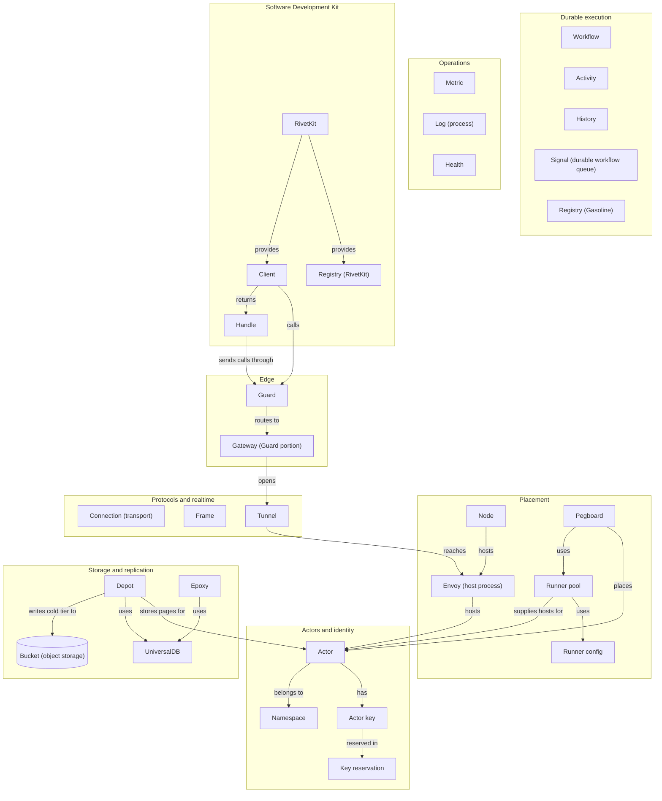

# 19 Glossary

This glossary defines each term that this exploration uses, and it gives the source location that establishes the term. It is a lookup table, not a tutorial. The first sentence of each entry is a short definition in Simplified Technical English (STE), the ASD-STE100 standard from the AeroSpace and Defence Industries Association of Europe (ASD). The second sentence, when present, gives the limit or the common confusion. Every entry names a file and a line range. The path is relative to `/Users/darkvoid/GitSources/src.Rivet/rivet` at commit `4a58441c50d1ce20d8803cfb1ab7c3285a5141d6`, version 2.3.31. The source is the only authority. When the source does not use a word as a named type, the entry says so and cites the nearest source that supports the meaning.

## 1. How to read this glossary

Read the term-family diagram in Section 2 first to see the shape of the vocabulary. The diagram is a map, not a dictionary, and Section 4 defines every box. It shows the eight families that the vocabulary describes: Actors and identity, placement, storage and replication, protocols and realtime, durable execution, operations, edge, and Software Development Kit (SDK). Then read the lifecycle diagram in Section 3. It shows the words that describe one Actor from create to destroy. Then use Section 4 as a dictionary. The terms are in alphabetical order. A term with more than one meaning has a qualifier in parentheses, such as `Registry (Gasoline)`, `Registry (RivetKit)`, `Envoy (host process)`, and `Bucket (Depot)`.

An entry has three parts:

1. **Part of speech and family.** For example, `Noun, Actors and identity.` A verb is marked as a verb.
2. **Definition.** One or more short sentences. The first sentence states what the term is. Later sentences give the limit, the mechanism, or the common confusion.
3. **Source and links.** `Source` gives the file and line range that establishes the term. `See` gives the exploration documents where the term matters.

Three rules apply to every citation:

- A citation `path:line-line` means the first and last line are inclusive.
- A citation to `docs-internal/` is a citation to an explaining document, not to code. The code wins when the two disagree.
- A citation to `README.md` at the repository root is a citation to the project README, not to this exploration's `README.md`.

An abbreviation is spelled out at its first use in this file and again in Section 5. After the first use, the short form is used. Some product names look like abbreviations, such as SQLite. The glossary keeps the product spelling and marks the name as a product name in Section 5.

## 2. The term families

The vocabulary has eight families. An Actor is the central object. Actors and identity give the Actor its name and key. Placement decides where the Actor runs. Storage and replication hold the Actor state. Protocols and realtime carry the connections. Durable execution records workflow steps. Operations observe the system. Edge carries a request to the Actor through Guard and the gateway. The Software Development Kit (SDK) is the developer view.



The diagram has one simplification. An Actor is not stored inside Depot as one object. Depot stores the pages of the Actor's SQLite database. The Actor record is stored in UniversalDB (UDB). The diagram groups both stores under Storage and replication. A request reaches the Actor workflow. The workflow reads and writes the SQLite pages through Depot and the Actor record through UniversalDB (UDB).

The terms in the diagram are defined in Section 4. Every arrow points from the component that acts to the component that receives the action. The arrows are relations, not call edges. For example, `Pegboard --> Pool` means that Pegboard uses a runner pool. It does not mean that one function calls another. The edge from Depot to the object storage bucket is the cold tier. The hot commit path does not write it (`docs-internal/engine/depot.md:37`).

## 3. The lifecycle vocabulary

Seven words describe the life of one Actor: create, start, ready, sleep, wake, reschedule, and destroy. The source uses the transition names in `Transition` for the same states. The transition enum is the best single citation for the vocabulary. The next table maps each lifecycle word to its state or message.

| Lifecycle word | Source variant | What the word means |
|----------------|----------------|---------------------|
| create | `Allocating` | The Actor record exists, and the workflow waits for an allocation. |
| start | `Starting`, then `Running` | The Actor becomes connectable on a host. The start is complete at `Running`. |
| ready | `Ready` message | The Actor workflow sends this message after it sets the Actor connectable. |
| sleep | `SleepIntent`, then `Sleeping` | The Actor asks to unload, then stops. |
| wake | `Allocating` or `Starting` | A sleeping Actor allocates again. |
| reschedule | `GoingAway` | The Actor moves off its current host. |
| destroy | `Destroying` | The Actor and its storage are removed. |

The `Actor.start_ts` field records the first time the Actor became connectable. The `set_connectable` activity sets it when the field is `None` (`engine/packages/pegboard/src/workflows/actor2/runtime.rs:898-901`). It does not record the create time.

```rust
// engine/packages/pegboard/src/workflows/actor2/runtime.rs:39-76
pub(crate) enum Transition {
	Allocating {
		destroy_after_start: bool,
		/// Handles cleaning up the actor if it does not receive a certain state before the timeout (ex.
		/// created -> running event, stop intent -> stop event). If the timeout is reached, the actor is
		/// considered lost.
		lost_timeout_ts: i64,
	},
	Starting {
		destroy_after_start: bool,
		lost_timeout_ts: i64,
	},
	Running {
		envoy: EnvoyState,
	},
	SleepIntent {
		envoy: EnvoyState,
		lost_timeout_ts: i64,
		/// If a wake was received in between an actor's intent to sleep and actor stop.
		rewake_after_stop: bool,
	},
	StopIntent {
		envoy: EnvoyState,
		lost_timeout_ts: i64,
	},
	GoingAway {
		envoy: EnvoyState,
		lost_timeout_ts: i64,
	},
	Sleeping,
	Reallocating {
		since_ts: i64,
	},
	Destroying {
		envoy: EnvoyState,
		lost_timeout_ts: i64,
	},
}
```

The Actor workflow listens for a small set of Actor workflow signals. The `Main` enum is the complete signal vocabulary for one loop iteration: `Allocated`, `Events`, `Wake`, `Sleep`, `Reschedule`, `Lost`, `GoingAway`, and `Destroy`. `Ready` and `Stopped` are workflow messages, not members of `Main`. `GoingAway` in `Main` is the signal. `GoingAway` in `Transition` is the lifecycle state. This document writes `GoingAway (signal)` and `GoingAway (transition)` when the difference matters.

```rust
// engine/packages/pegboard/src/workflows/actor2/mod.rs:1384-1394
join_signal!(Main {
	Allocated,
	Events,
	Wake,
	Sleep,
	Reschedule,
	Lost,
	GoingAway,
	Destroy,
	// Comment to prevent invalid formatting
});
```

The next diagram shows the normal path and the recovery path. It uses the state names from `Transition`, the signal names from `Main`, and the event names from the envoy protocol. Every arrow is a transition that the workflow code supports. The arrows out of `Reallocating` show the retry loop.

A serverful pool uses hosts that already run, and the allocation activity picks an eligible envoy. A serverless pool starts a host on demand from a configured Uniform Resource Locator (URL). Section 4 defines `Serverful`, `Serverless`, `Allocation`, and `Envoy (host process)`.

```mermaid
stateDiagram-v2
    [*] --> Allocating: Actor record created
    Allocating --> Starting: Allocated signal
    Starting --> Running: Ready message
    Running --> SleepIntent: Sleep signal
    SleepIntent --> Sleeping: ActorStateStopped (StopCode::Ok, no rewake)
    SleepIntent --> Allocating: ActorStateStopped (rewake_after_stop, serverless allocation)
    SleepIntent --> Starting: ActorStateStopped (rewake_after_stop, serverful allocation)
    SleepIntent --> Destroying: Destroy signal
    Sleeping --> Allocating: Wake signal (serverless allocation)
    Sleeping --> Starting: Wake signal (serverful allocation)
    Running --> GoingAway: Reschedule signal or GoingAway signal
    GoingAway --> Allocating: handle_stopped (Reallocate, serverless allocation)
    GoingAway --> Starting: handle_stopped (Reallocate, serverful allocation)
    GoingAway --> Reallocating: handle_stopped (Reallocate, allocation returns no slot)
    Reallocating --> Allocating: reschedule_actor (serverless allocation)
    Reallocating --> Starting: reschedule_actor (serverful allocation)
    Reallocating --> Sleeping: retry duration exceeded
    Running --> Destroying: Destroy signal
    GoingAway --> Destroying: Destroy signal
    Destroying --> [*]: destroy
```

The table lists every arrow in the diagram. The event column names the signal, the message, the protocol event, or the lifecycle condition that triggers the arrow.

| From | Event | To | Meaning |
|------|-------|----|---------|
| `[*]` | Actor record created | `Allocating` | The Actor record exists and waits for an allocation. |
| `Allocating` | `Allocated` signal | `Starting` | An allocation returned a host. The Actor waits for its first state. |
| `Starting` | `Ready` message | `Running` | The Actor is connectable on the host. |
| `Running` | `Sleep` signal | `SleepIntent` | The Actor asks to unload. |
| `SleepIntent` | `ActorStateStopped` (`StopCode::Ok`, no rewake) | `Sleeping` | The host stopped the Actor as asked. |
| `SleepIntent` | `ActorStateStopped` (rewake, serverless allocation) | `Allocating` | A wake arrived during the stop. A serverless allocation succeeds. |
| `SleepIntent` | `ActorStateStopped` (rewake, serverful allocation) | `Starting` | A wake arrived during the stop. A serverful allocation succeeds. |
| `SleepIntent` | `Destroy` signal | `Destroying` | A destroy overrides the sleep (`engine/packages/pegboard/src/workflows/actor2/mod.rs:1098-1134`). |
| `Sleeping` | `Wake` signal (serverless allocation) | `Allocating` | Wake calls `reschedule_actor`. A serverless allocation succeeds. |
| `Sleeping` | `Wake` signal (serverful allocation) | `Starting` | Wake calls `reschedule_actor`. A serverful allocation succeeds. |
| `Running` | `Reschedule` signal or `GoingAway` signal | `GoingAway` | The Actor must move to another host. |
| `GoingAway` | `handle_stopped` (Reallocate, serverless allocation) | `Allocating` | The stop completed. A serverless allocation succeeds. |
| `GoingAway` | `handle_stopped` (Reallocate, serverful allocation) | `Starting` | The stop completed. A serverful allocation succeeds. |
| `GoingAway` | `handle_stopped` (Reallocate, allocation returns no slot) | `Reallocating` | No host is available. The Actor backs off. |
| `Reallocating` | `reschedule_actor` (serverless allocation) | `Allocating` | A retry allocation succeeds. |
| `Reallocating` | `reschedule_actor` (serverful allocation) | `Starting` | A retry allocation succeeds. |
| `Reallocating` | retry duration exceeded | `Sleeping` | The Actor stops retrying and sleeps (`engine/packages/pegboard/src/workflows/actor2/mod.rs:604-611`). |
| `Running` | `Destroy` signal | `Destroying` | The Actor and its storage are removed. |
| `GoingAway` | `Destroy` signal | `Destroying` | The Actor and its storage are removed. |
| `Destroying` | destroy | `[*]` | The Actor workflow ends. |

The diagram leaves out two cases. A `Lost` signal enters `handle_stopped`. For a lost `Running` Actor, `handle_stopped` chooses `Sleeping` unless the alarm is due; when the alarm is due, the Actor reallocates. The alarm is the scheduled wake time in `Timer (Actor)`. A `StopIntent` state exists in the enum, but this document does not trace every writer of that state. The reader who needs the full state machine must read `engine/packages/pegboard/src/workflows/actor2/mod.rs:469-1155`.

Six words and functions in the diagram need a short definition. `StopIntent` is the state after the Actor sends `ActorIntentStop`, a stop request in the runner protocol that is not a sleep. `GoingAway (transition)` is the state after a `GoingAway (signal)` or a `Reschedule` signal, while the old envoy still runs. `Lost` is the signal that reports a lost Actor host. `handle_stopped` is the runtime function that chooses the next state after a stop, and `reschedule_actor` is the runtime function that tries a new allocation (`engine/packages/pegboard/src/workflows/actor2/runtime.rs:483-538,558-748`). `Reallocate` is a `Decision` variant in `handle_stopped` that allocates the Actor again (`engine/packages/pegboard/src/workflows/actor2/runtime.rs:632-648`). `ActorStateStopped` is the envoy protocol event that reports a stop, and `StopCode` is its reason code. Section 4 defines both.

`Wake` calls `reschedule_actor` when the Actor is `Sleeping`. That function calls the `Allocate` activity, which returns an `Allocation` value (`Serverful` or `Serverless`). A serverless result sets `Allocating`. A serverful result sets `Starting` (`engine/packages/pegboard/src/workflows/actor2/runtime.rs:184-185,243-256,483-516`).

The word "ready" is overloaded in the source. In the Actor lifecycle, `Ready` is a message that the Actor workflow sends after it sets the Actor connectable. In the SDK, "readiness" means that the envoy client (the SDK-side connection to Guard) has sent its registration signal, `ToEnvoyInit`. The two events are not the same event. Section 4 has one entry for each.

## 4. Terms A to Z
### Action
**Noun, Protocols and realtime.** A function on an Actor definition that a client can call over the [Actor runtime socket protocol](#actor-runtime-socket-protocol). The RivetKit actor configuration puts the action handlers in the `actions` field. The definition flattens the handlers before the Actor starts. Flattening collects the nested action entries into one lookup table keyed by the full action name (`rivetkit-typescript/packages/rivetkit/src/actor/actions.ts:6-17`).
**Source:** `rivetkit-typescript/packages/rivetkit/src/actor/config.ts:1367`; `rivetkit-typescript/packages/rivetkit/src/actor/definition.ts:214-216`. **See:** [11 RivetKit TypeScript](11-rivetkit-typescript.md), [10 Realtime](10-realtime-and-hibernation.md).
### Activity
**Noun, Durable execution.** A durable step in a workflow that runs one native function and records the result in history. An activity has a name, a retry limit, and a timeout. Gasoline retries the activity according to those fields.
**Source:** `engine/packages/gasoline/src/activity.rs:10-19`; `docs-internal/engine/GASOLINE/OVERVIEW.md:26,39-41`. **See:** [05 Gasoline](05-gasoline-durable-execution.md).
### Actor
**Noun, Actors and identity.** The durable identity of one logical process. The `Actor` record holds the Actor identifier (Actor ID), the Actor name, the optional key, the namespace, the datacenter, the runner selector, the crash policy, and the lifecycle timestamps. The runner selector is the field that chooses the pool. The record exists before any process runs. An [Actor instance](#actor-instance) is the running copy. This is not a [control plane instance](#control-plane-instance).

```rust
// engine/packages/types/src/actors.rs:8-38
pub struct Actor {
	pub actor_id: Id,
	pub name: String,
	pub key: Option<String>,

	pub namespace_id: Id,
	pub datacenter: String,
	pub runner_name_selector: String,
	pub crash_policy: CrashPolicy,

	/// Denotes when the actor was first created.
	pub create_ts: i64,
	/// Denotes when the actor was first made connectable. Null if never.
	pub start_ts: Option<i64>,
	/// Denotes when the actor started waiting for an allocation.
	pub pending_allocation_ts: Option<i64>,
	/// Denotes when the actor was last connectable. Null if actor is not running.
	pub connectable_ts: Option<i64>,
	/// Denotes when the actor entered a sleeping state.
	pub sleep_ts: Option<i64>,
	/// Denotes when the actor will try to allocate again. If this is set, the actor will not attempt to
	/// allocate until the given timestamp.
	pub reschedule_ts: Option<i64>,
	/// Denotes when the actor was destroyed.
	pub destroy_ts: Option<i64>,

	/// Error details if the actor failed to start.
	#[serde(skip_serializing_if = "Option::is_none")]
	#[schema(value_type = Option<Object>, additional_properties = true)]
	pub error: Option<crate::actor::ActorError>,
}
```
**Source:** `engine/packages/types/src/actors.rs:8-38`. **See:** [03 Actors and lifecycle](03-actors-and-lifecycle.md), [04 Pegboard](04-pegboard-scheduling.md).
### Actor definition
**Noun, SDK.** The object that a developer creates with `actor()` to describe the state, actions, events, queues, and lifecycle hooks of an Actor. The `ActorDefinition` class holds the parsed configuration. The runtime uses the definition to build the Actor.
**Source:** `rivetkit-typescript/packages/rivetkit/src/actor/definition.ts:43-64,82-100,149-218`. **See:** [11 RivetKit TypeScript](11-rivetkit-typescript.md), [12 RivetKit Rust](12-rivetkit-rust-and-clients.md).
### Actor ID
**Noun, Actors and identity.** The unique identifier of one Actor. The source creates it with `Id::new_v1(dc_label)` and stores it in `Actor.actor_id`. The identifier includes the datacenter label.
**Source:** `engine/packages/types/src/actors.rs:9`; `engine/packages/api-peer/src/actors/get_or_create.rs:52`; `docs-internal/engine/ACTOR_KEY_RESERVATION.md:20-28`. **See:** [03 Actors and lifecycle](03-actors-and-lifecycle.md), [13 Auth and namespaces](13-auth-and-namespaces.md).
### Actor instance
**Noun, SDK.** One running copy of an Actor definition inside an SDK runtime. The Rust core keeps an `ActorInstanceState` of `Active` or `Stopping` and holds the Actor instance in an `ActorTaskHandle`, the running task handle. This is the running copy, not the durable Actor record. This is not a [control plane instance](#control-plane-instance).
**Source:** `rivetkit-rust/packages/rivetkit-core/src/registry/mod.rs:135-152`. **See:** [12 RivetKit Rust](12-rivetkit-rust-and-clients.md), [Actor](#actor), [Control plane instance](#control-plane-instance).
### Actor key
**Noun, Actors and identity.** The optional string that selects one Actor within a namespace and a name. The key is not the Actor ID. The key is the durable lookup value that a client uses. The source limits the key to 1024 bytes and rejects an empty key (`engine/packages/api-peer/src/actors/get_or_create.rs:7,16-25`). When the caller supplies no key, the engine writes no key reservation, and the Actor is reached by its Actor ID (`engine/packages/pegboard/src/workflows/actor2/mod.rs:182-226`).
**Source:** `engine/packages/types/src/actors.rs:11`; `engine/packages/api-peer/src/actors/get_or_create.rs:7,16-25`. **See:** [03 Actors and lifecycle](03-actors-and-lifecycle.md), [13 Auth and namespaces](13-auth-and-namespaces.md).
### Actor name
**Noun, Actors and identity.** The Actor type name, such as the name that a developer registers in RivetKit. The name selects the Actor definition, and the separate runner selector chooses the pool. The key selects the Actor. The source stores both fields in the `Actor` record.
**Source:** `engine/packages/types/src/actors.rs:10`; `engine/packages/api-peer/src/actors/get_or_create.rs:38-40`. **See:** [03 Actors and lifecycle](03-actors-and-lifecycle.md), [11 RivetKit TypeScript](11-rivetkit-typescript.md).
### Actor runtime socket protocol
**Noun, Protocols and realtime.** The experimental version 1 protocol between an SDK runtime (the process that runs the Actor definition) and its Actor host (the envoy that runs Actor tasks). The crate constant is `PROTOCOL_VERSION = 1` (`engine/sdks/rust/actor-runtime-socket-protocol/src/lib.rs:1-7`). The handshake starts with a `ClientHello`, and the server replies with `HelloOk` or `HelloRejectUnsupportedVersion` (`engine/sdks/rust/actor-runtime-socket-protocol/schemas/v1.bare:1-17`). A `Frame` carries a request or a response. A `GoAway` ends the connection with a `FrameTooLarge` or `MalformedFrame` reason (`engine/sdks/rust/actor-runtime-socket-protocol/schemas/v1.bare:153-165`).
**Source:** `engine/sdks/rust/actor-runtime-socket-protocol/src/lib.rs:1-7`; `engine/sdks/rust/actor-runtime-socket-protocol/schemas/v1.bare:1-17,73-82,153-165`. **See:** [04 Pegboard](04-pegboard-scheduling.md), [Frame](#frame), [Action](#action), [Lease (SQL)](#lease-sql).
### ActorStateStopped
**Noun, Protocols and realtime.** The host event that reports that an Actor stopped. It carries a `StopCode` and an optional message. The Actor workflow reads it from the host event stream and gives it to `handle_stopped` (`engine/packages/pegboard/src/workflows/actor2/mod.rs:821-839`).
**Source:** `engine/sdks/schemas/envoy-protocol/v3.bare:194-202`; `engine/packages/pegboard/src/workflows/actor2/mod.rs:821-839`. **See:** [03 Actors and lifecycle](03-actors-and-lifecycle.md), [StopCode](#stopcode).
### Allocation
**Noun, Placement.** The act of choosing a host for an Actor. The `Allocation` enum has `Serverless` with no host and `Serverful { envoy_key }` with one host. The `Allocate` activity returns an `Allocation` or no value (`engine/packages/pegboard/src/workflows/actor2/runtime.rs:171-181,184-299`).
**Source:** `engine/packages/pegboard/src/workflows/actor2/runtime.rs:171-181,184-299`. **See:** [04 Pegboard](04-pegboard-scheduling.md), [Serverful](#serverful), [Serverless](#serverless).
### BARE
**Noun, Protocols and realtime.** A compact binary encoding format for structured records. The runner protocol schemas are BARE files, and the generated code reads and writes them. The repository uses the short form only. The expansion used here is Binary Application Record Encoding.
**Source:** `engine/sdks/schemas/runner-protocol/v7.bare:1-10`; `docs-internal/engine/TERMINOLOGY.md:6`; `docs-internal/engine/bare-protocol-crates.md:1-3`. **See:** [04 Pegboard](04-pegboard-scheduling.md).
### Ballot
**Noun, Storage and replication.** A pair of a counter and a replica identifier that orders proposals in Epoxy. A larger counter wins. If the counters are equal, the larger replica identifier wins (`engine/packages/epoxy/src/replica/ballot.rs:32-38`). The ballot is not the proposed value. Paxos is a family of consensus protocols that agree on one value, and it has two rounds: Phase 1 (Prepare) and Phase 2 (Accept). A leader is the replica that proposes a value. A replica promises not to accept a lower ballot during Prepare. In Prepare, the leader asks the replicas to promise a ballot, and each replica reports any value that it already accepted (`engine/packages/epoxy/README.md:29-35`).

```rust
// engine/packages/epoxy/src/replica/ballot.rs:10-30
pub struct Ballot {
	pub counter: u64,
	pub replica_id: protocol::ReplicaId,
}

impl Ballot {
	pub const fn new(counter: u64, replica_id: protocol::ReplicaId) -> Self {
		Self {
			counter,
			replica_id,
		}
	}

	pub const fn zero(replica_id: protocol::ReplicaId) -> Self {
		Self::new(0, replica_id)
	}

	pub const fn is_zero(self) -> bool {
		self.counter == 0
	}
}
```
**Source:** `engine/packages/epoxy/src/replica/ballot.rs:9-38`. **See:** [08 Epoxy](08-epoxy-multi-region.md).
### Branch
**Noun, Storage and replication.** A version of a Depot database or bucket. A `DatabaseBranchRecord` has a branch identifier, a parent, a parent versionstamp, and a lifecycle generation. A versionstamp is a 16-byte database timestamp that orders writes. A lifecycle generation is a counter that marks one lifecycle of a branch. A branch holds its own head, commits, page index, delta, and shard rows (`docs-internal/engine/sqlite/storage-structure.md:12,25-27`).
**Source:** `engine/packages/depot/src/conveyer/types/branch.rs:16-39`; `docs-internal/engine/sqlite/storage-structure.md:12,25-27`. **See:** [06 Depot](06-actor-sqlite-and-depot.md).
### Broadcast
**Noun and verb, Protocols and realtime.** One event sent to every connection in an Actor. The SDK exposes `ctx.broadcast(name, ...args)` and keeps the live connections in `ctx.conns`. A broadcast does not create a durable event.
**Source:** `rivetkit-typescript/packages/rivetkit/src/actor/config.ts:420-439`. **See:** [10 Realtime](10-realtime-and-hibernation.md).
### Bucket (Depot)
**Noun, Storage and replication.** A logical group of Depot databases. Depot has two branch levels: a bucket branch and a database branch. `BucketId` identifies the bucket, and `BucketBranchId` identifies one immutable version of it. `DatabaseIdStr` is the database name string, and `DatabaseBranchId` identifies one immutable version of that database. The bucket pointer row `BUCKET_PTR/{bucket_id}/cur` stores the current `BucketBranchId`, and the database pointer row `DBPTR/{bucket_branch_id}/{database_name}/cur` stores the current `DatabaseBranchId` (`docs-internal/engine/sqlite/storage-structure.md:41-51`). The `BucketPointerId` and `DatabasePointerId` types exist. Each pointer row is keyed by the stable identifier (the bucket identifier or the database name string), so there is no separate pointer identifier in use. This is not an object storage bucket.
**Source:** `engine/packages/depot/src/conveyer/types/ids.rs:5-18`; `engine/packages/depot/src/conveyer/types/branch.rs:16-51`; `docs-internal/engine/sqlite/storage-structure.md:5-14,41-51`. **See:** [06 Depot](06-actor-sqlite-and-depot.md), [07 UniversalDB](07-universaldb-and-buckets.md), [Bucket (object storage)](#bucket-object-storage).
### Bucket (object storage)
**Noun, Storage and replication.** One container in an object storage service. The project uses one bucket for a cluster, on Amazon Simple Storage Service (S3), Google Cloud Storage (GCS), Azure Blob Storage, or an S3-compatible store. The bucket holds cold data and backups and is not on the durable write path. See [Object storage](#object-storage) for the service class.
**Source:** `README.md:68,218`; `docs-internal/engine/depot.md:9`. **See:** [07 UniversalDB](07-universaldb-and-buckets.md), [15 Deployment](15-deployment-and-self-hosting.md), [Object storage](#object-storage).
### Client
**Noun, SDK.** The SDK object that creates Actors, looks up Actors, and opens connections. The TypeScript client is `ClientRaw`, and the Rust client is `Client`. The TypeScript client takes an `ActorGatewayOptions` value; the Rust client holds a remote manager.
**Source:** `rivetkit-typescript/packages/rivetkit/src/client/client.ts:181-213,492-496`; `rivetkit-rust/packages/client/src/client.rs:121-126`. **See:** [11 RivetKit TypeScript](11-rivetkit-typescript.md), [12 RivetKit Rust](12-rivetkit-rust-and-clients.md).
### Cold data
**Noun, Storage and replication.** The part of Actor storage that Depot moved out of UniversalDB into object storage. A cold shard is an object, and only its metadata stays in UniversalDB (`engine/packages/depot/src/compaction/throttle.rs:40-41`).
**Source:** `README.md:68`; `docs-internal/engine/depot.md:37`; `engine/packages/depot/src/compaction/throttle.rs:40-41`. **See:** [06 Depot](06-actor-sqlite-and-depot.md), [Cold tier](#cold-tier).
### Cold-drain
**Noun, Storage and replication.** The compaction pass that publishes cold shard output to object storage. The pass advances `cold_watermark_txid`, the transaction identifier below which cold output is complete, and it uses `/META/cold_lease` (`engine/packages/depot/src/conveyer/keys.rs:41,75`). The publish writes the cold references, then advances the watermark in the final transaction (`engine/packages/depot/src/compaction/types.rs:1171-1176`).
**Source:** `engine/packages/depot/src/compaction/types.rs:1171-1176`; `engine/packages/depot/src/conveyer/keys.rs:41,75`. **See:** [06 Depot](06-actor-sqlite-and-depot.md), [Compaction](#compaction).
### Cold start
**Noun, Operations.** The first start of an Actor. It includes scheduling the Actor, creating its storage, and serving the first request. The README measures a 6.92 ms median cold start (`README.md:65,153`).
**Source:** `README.md:65,153`. **See:** [16 Tests and limits](16-tests-benchmarks-and-limits.md), [Start](#start).
### Cold tier
**Noun, Storage and replication.** The object storage part of Depot. Depot cold staging uploads shard objects and writes only light metadata to UniversalDB (`engine/packages/depot/src/compaction/throttle.rs:40-41`). The hot commit path does not write the cold tier (`docs-internal/engine/depot.md:37,53`).
**Source:** `engine/packages/depot/src/compaction/throttle.rs:40-41`; `docs-internal/engine/depot.md:37,53`. **See:** [06 Depot](06-actor-sqlite-and-depot.md), [Cold data](#cold-data).
### Commit
**Noun and verb, Storage and replication.** A durable write of one SQLite transaction to a Depot branch. The commit path writes `COMMITS`, `VTX`, `DELTA`, `PIDX`, and `META/head` rows in one UniversalDB transaction. A commit does not publish a shard (`docs-internal/engine/depot.md:41-53`).
**Source:** `docs-internal/engine/depot.md:41-53`; `engine/packages/depot/src/conveyer/keys.rs:35,56-59`. **See:** [06 Depot](06-actor-sqlite-and-depot.md), [Compaction](#compaction).
### Compaction
**Noun, Storage and replication.** The background process that turns committed deltas into a shard image and moves cold data to object storage. The workflow compaction path is the only authority that publishes or deletes compaction output. The path stages LTX shard blobs under `CMP/stage/{job_id}`, validates the job, copies the output to reader-visible `SHARD`, and advances `CMP/root` (`docs-internal/engine/depot.md:55-64`). That staged install is the step that makes the shard visible. A commit does not publish a shard.
**Source:** `docs-internal/engine/depot.md:24,53-64`; `engine/packages/depot/src/conveyer/keys.rs:37-52`. **See:** [06 Depot](06-actor-sqlite-and-depot.md).
### Conn (SDK)
**Noun, Protocols and realtime.** The per-connection context that an Actor sees for one client WebSocket. It has an `id`, `params`, `state`, `isHibernatable`, `send`, and `disconnect`. The Actor reads all live `Conn` values from `ctx.conns`.

```ts
// rivetkit-typescript/packages/rivetkit/src/actor/config.ts:367-384
export interface Conn<
	_TState = unknown,
	TConnParams = unknown,
	TConnState = unknown,
	_TVars = unknown,
	_TInput = unknown,
	_TDatabase extends AnyDatabaseProvider = AnyDatabaseProvider,
	_TEvents extends EventSchemaConfig = Record<never, never>,
	_TQueues extends QueueSchemaConfig = Record<never, never>,
> {
	id: string;
	params: TConnParams;
	state: TConnState;
	isHibernatable: boolean;
	send(name: string, ...args: any[]): void;
	disconnect(reason?: string): Promise<void>;
	[key: string]: any;
}
```
**Source:** `rivetkit-typescript/packages/rivetkit/src/actor/config.ts:367-384,420-432`. **See:** [10 Realtime](10-realtime-and-hibernation.md), [11 RivetKit TypeScript](11-rivetkit-typescript.md).
### Connection (transport)
**Noun, Protocols and realtime.** A WebSocket between a client and Guard, or between a host and the gateway inside Guard. The host-to-gateway path is the tunnel. The source distinguishes the client connection from the tunnel by the path and the protocol. A hibernating connection stays open at Guard while the Actor is asleep. On the legacy runner path, the runner WebSocket takes the tunnel role (`engine/packages/guard/src/routing/runner.rs:55-61`).
**Source:** `docs-internal/engine/HIBERNATING_WS.md:5-17`; `engine/packages/pegboard-envoy/src/lib.rs:21-31`; `engine/packages/guard/src/routing/envoy.rs:28-41`. **See:** [09 Guard](09-guard-routing.md), [10 Realtime](10-realtime-and-hibernation.md), [Tunnel](#tunnel).
### Connection ID
**Noun, Protocols and realtime.** The identifier of one client connection. The SDK exposes it as `Conn.id`; the TypeScript `ActorConnRaw` also has a deprecated `connectionId` getter that returns the same value. The identifier is not the Actor ID.
**Source:** `rivetkit-typescript/packages/rivetkit/src/actor/config.ts:377`; `rivetkit-typescript/packages/rivetkit/src/client/actor-conn.ts:1492-1499`. **See:** [10 Realtime](10-realtime-and-hibernation.md).
### Control plane
**Noun, Placement.** The set of services that schedule Actors, route requests, and store durable state. The services include Pegboard, Guard, Epoxy, Depot, and the workflow worker. The source document uses "engine" as the short name for the control plane (`docs-internal/engine/actor-rescheduling.md:7`).
**Source:** `docs-internal/engine/actor-rescheduling.md:7`; `README.md:66-69`. **See:** [02 Control plane](02-control-plane-architecture.md), [15 Deployment](15-deployment-and-self-hosting.md), [Engine](#engine).
### Control plane instance
**Noun, Placement.** One process of the control plane binary. Control plane instances are identical. They find each other through the bucket. The README benchmark uses three control plane instances, one per availability zone. A durable state write is acknowledged after two of the three control plane instances store it (`README.md:155`).
**Source:** `README.md:69,139,155,218`. **See:** [02 Control plane](02-control-plane-architecture.md), [15 Deployment](15-deployment-and-self-hosting.md), [Engine](#engine).
### Crash policy
**Noun, Actors and identity.** The rule that the engine applies when an Actor crashes: `Restart`, `Sleep`, or `Destroy`. The default is `Destroy`.
**Source:** `engine/packages/types/src/actors.rs:42-47`. **See:** [03 Actors and lifecycle](03-actors-and-lifecycle.md).
### Create
**Verb, Actors and identity.** To make a new Actor record for a namespace, a name, and a key tuple. The key is optional. The get-or-create path first looks up the key. If no Actor record exists for the namespace, name, and key tuple, it creates an Actor ID and an Actor record. When the caller supplies no key, the engine writes the record without a key reservation. Create does not make the Actor connectable.
**Source:** `engine/packages/api-types/src/actors/create.rs:18`; `engine/packages/api-peer/src/actors/get_or_create.rs:34-60`; `engine/packages/pegboard/src/workflows/actor2/mod.rs:182-226`. **See:** [03 Actors and lifecycle](03-actors-and-lifecycle.md).
### Datacenter
**Noun, Placement.** A labeled region that holds control plane replicas and envoys. The `Datacenter` record has a numeric `label`, a `name`, and a `url`. The label appears in the Actor ID and in health responses.
**Source:** `engine/packages/types/src/datacenters.rs:6-10`; `engine/packages/api-public/src/health.rs:18-26`. **See:** [02 Control plane](02-control-plane-architecture.md), [08 Epoxy](08-epoxy-multi-region.md).
### DELTA
**Noun, Storage and replication.** A row family in Depot that holds recently committed page changes in the LTX format. A read checks the page index and the delta before it falls back to a shard. A delta is not the final shard image.
**Source:** `engine/packages/depot/src/conveyer/keys.rs:56`; `docs-internal/engine/depot.md:18,33-34,47-49`. **See:** [06 Depot](06-actor-sqlite-and-depot.md).
### Depot
**Noun, Storage and replication.** The storage layer that keeps each Actor SQLite database as pages in UniversalDB. It resolves a branch head, writes commit metadata and deltas, and lets a workflow compaction path publish shards. Depot is the subject of document 06.
**Source:** `docs-internal/engine/depot.md:7-24`; `engine/packages/depot/src/conveyer/keys.rs:30-58`. **See:** [06 Depot](06-actor-sqlite-and-depot.md), [07 UniversalDB](07-universaldb-and-buckets.md).
### Destroy
**Verb and noun, Actors and identity.** To remove an Actor and its storage. The Actor workflow sends `DestroyStarted`, updates the Actor lifecycle state and deletes the Actor database, clears the key-value (KV) data, and sends `DestroyComplete`. The SDK sends the intent with `ctx.destroy()`.
**Source:** `engine/packages/pegboard/src/workflows/actor2/mod.rs:1191-1206,1375-1382`; `rivetkit-typescript/packages/rivetkit/src/actor/config.ts:446`. **See:** [03 Actors and lifecycle](03-actors-and-lifecycle.md), [06 Depot](06-actor-sqlite-and-depot.md).
### Durable execution
**Noun, Durable execution.** The property that a process can resume after a crash without repeating a completed step. Gasoline records each workflow step in history, and replay returns the recorded result instead of running the code again (`docs-internal/engine/GASOLINE/OVERVIEW.md:3,14-16`). The record makes a workflow step a no-op on a second run.
**Source:** `docs-internal/engine/GASOLINE/OVERVIEW.md:3,14-20`; `docs-internal/engine/GASOLINE/WORKFLOW_HISTORY.md:3-16`. **See:** [05 Gasoline](05-gasoline-durable-execution.md), [Replay](#replay).
### Engine
**Noun, Placement.** The binary that runs the control plane services. The terminology document calls it the "Rivet Engine". It is one binary, and it is not a separate database or message bus (`README.md:69,218`). Control plane is the set of services that the binary runs.
**Source:** `docs-internal/engine/TERMINOLOGY.md:3`; `docs-internal/engine/actor-rescheduling.md:7`; `README.md:69,218`. **See:** [02 Control plane](02-control-plane-architecture.md), [Control plane](#control-plane).
### Engine-runner
**Noun, SDK.** The TypeScript package that implements the runner side of the protocol. It has a `RunnerConfig` with a `totalSlots`, a namespace, a runner name, and a protocol version. The newer envoy path uses the `pegboard-envoy` package and the envoy client instead.
**Source:** `rivetkit-typescript/packages/engine-runner/src/mod.ts:22-43`. **See:** [04 Pegboard](04-pegboard-scheduling.md), [11 RivetKit TypeScript](11-rivetkit-typescript.md).
### Envoy (host process)
**Noun, Placement.** The Actor-hosting process on the user side in the newer path. A Node runs it. It connects to the gateway inside Guard over a WebSocket tunnel and hosts Actor tasks in slots. The source document contrasts the envoy with the legacy runner (`docs-internal/engine/actor-rescheduling.md:3-7`).
**Source:** `docs-internal/engine/actor-rescheduling.md:7`; `engine/packages/pegboard-envoy/src/lib.rs:43-51,91`. **See:** [04 Pegboard](04-pegboard-scheduling.md), [09 Guard](09-guard-routing.md).
### Envoy (record)
**Noun, Placement.** The durable record of one connected envoy. The record has the envoy key, the namespace, the datacenter, the pool name, the version, the slot count, the ping times, the last round-trip time (RTT), and optional metadata.

```rust
// engine/packages/types/src/envoys.rs:8-21
pub struct Envoy {
	pub envoy_key: String,
	pub namespace_id: Id,
	pub datacenter: String,
	pub pool_name: String,
	pub version: u32,
	pub slots: u64,
	pub create_ts: i64,
	pub stop_ts: Option<i64>,
	pub last_ping_ts: i64,
	pub last_connected_ts: Option<i64>,
	pub last_rtt: u32,
	pub metadata: Option<serde_json::Map<String, serde_json::Value>>,
}
```
**Source:** `engine/packages/types/src/envoys.rs:8-21`. **See:** [04 Pegboard](04-pegboard-scheduling.md).
### EnvoyState
**Noun, Placement.** The Actor workflow's view of the envoy that currently hosts the Actor. It holds the envoy key, the last event index, the last acknowledged event index, and the last liveness check time. It is not the `Envoy` record.
**Source:** `engine/packages/pegboard/src/workflows/actor2/runtime.rs:110-127`. **See:** [04 Pegboard](04-pegboard-scheduling.md), [03 Actors and lifecycle](03-actors-and-lifecycle.md).
### EPaxos
**Noun, Storage and replication.** Egalitarian Paxos, a consensus protocol that orders commands across keys without a fixed leader. The Epoxy README names it as a reference, not as the current protocol. The current Epoxy code uses Fast Paxos (single-decree Paxos with a one-round-trip fast path) for each key. The codebase inherited the `PreAccept` name from EPaxos ancestry, but that phase was always standard Paxos Phase 2a (`engine/packages/epoxy/README.md:27`).
**Source:** `engine/packages/epoxy/README.md:3,27,42`; `docs-internal/engine/ACTOR_KEY_RESERVATION.md:3`. **See:** [08 Epoxy](08-epoxy-multi-region.md), [Fast Paxos](#fast-paxos), [18 Comparisons](18-comparisons.md).
### Epoxy
**Noun, Storage and replication.** The geo-distributed, strongly consistent key-value store. Epoxy runs Fast Paxos independently for each key and supports immutable keys by default. Fast Paxos commits a fresh key in one round trip by skipping Prepare and going straight to Accept (`engine/packages/epoxy/README.md:3,48-50`). Epoxy uses UniversalDB to store its keys, and it stores the Actor key reservation and the durable state records.
**Source:** `engine/packages/epoxy/README.md:3,17-23,37-42`; `engine/packages/epoxy/src/replica/ballot.rs:4`; `engine/packages/epoxy/src/types.rs:7-27`. **See:** [08 Epoxy](08-epoxy-multi-region.md), [Fast Paxos](#fast-paxos), [UniversalDB](#universaldb).
### Event (history)
**Noun, Durable execution.** One recorded step in a workflow history. Gasoline stores each event with a location. Replay reads the event and does not run the step again (`docs-internal/engine/GASOLINE/WORKFLOW_HISTORY.md:3-16`).
**Source:** `docs-internal/engine/GASOLINE/WORKFLOW_HISTORY.md:3-16`; `docs-internal/engine/GASOLINE/OVERVIEW.md:14-16`. **See:** [05 Gasoline](05-gasoline-durable-execution.md), [History](#history).
### Event (realtime)
**Noun, Protocols and realtime.** A named message that an Actor sends to its connections. The SDK declares events in the `events` field and sends them with `Conn.send` or `ctx.broadcast`. This event is not a workflow history event and not a durable signal.
**Source:** `rivetkit-typescript/packages/rivetkit/src/actor/config.ts:377,1377`; `rivetkit-typescript/packages/react/src/mod.ts:93-96`. **See:** [10 Realtime](10-realtime-and-hibernation.md), [11 RivetKit TypeScript](11-rivetkit-typescript.md), [Event (history)](#event-history).
### Executable
**Noun, Durable execution.** A retryable unit that a workflow can run. The `Executable` trait has an `execute` method and a `shift_cursor` method. An activity is one implementation of the trait.
**Source:** `engine/packages/gasoline/src/executable.rs:9-17`. **See:** [05 Gasoline](05-gasoline-durable-execution.md).
### Fast Paxos
**Noun, Storage and replication.** A Paxos variant that commits a fresh key in one round trip. The proposer (the leader for that key) skips Phase 1 (Prepare) and sends Phase 2 (Accept) directly (`engine/packages/epoxy/README.md:3,48-50`). A key with prior in-flight state falls back to two-phase Paxos with Prepare and Accept (`engine/packages/epoxy/README.md:3,50`). Epoxy runs Fast Paxos independently for each key (`engine/packages/epoxy/README.md:3,17-19`).
**Source:** `engine/packages/epoxy/README.md:3,17-19,29-35,48-50`. **See:** [08 Epoxy](08-epoxy-multi-region.md), [Epoxy](#epoxy), [Quorum](#quorum).
### Formal key
**Noun, Storage and replication.** A typed key that converts between a typed value and the raw bytes that UniversalDB stores. The `FormalKey` trait has `serialize` and `deserialize` methods (`engine/packages/universaldb/src/utils/formal_key.rs:5-11`). A `FormalChunkedKey` adds `chunk`, `combine`, and `split` for a value that spans several keys (`engine/packages/universaldb/src/utils/formal_key.rs:13-23`).
**Source:** `engine/packages/universaldb/src/utils/formal_key.rs:5-23`. **See:** [07 UniversalDB](07-universaldb-and-buckets.md), [UniversalDB](#universaldb).
### Frame
**Noun, Protocols and realtime.** One encoded message on the Actor runtime socket. The BARE schema defines `ClientFrame` as a `Request` and `ServerFrame` as a `Response` or a `GoAway`. The `HelloOk` response carries the largest accepted frame payload.

```bare
# engine/sdks/rust/actor-runtime-socket-protocol/schemas/v1.bare:80-82,162-165
type ClientFrame union {
	Request
}

type ServerFrame union {
	Response |
	GoAway
}
```
**Source:** `engine/sdks/rust/actor-runtime-socket-protocol/schemas/v1.bare:3-10,75-82,153-165`. **See:** [Actor runtime socket protocol](#actor-runtime-socket-protocol), [04 Pegboard](04-pegboard-scheduling.md).
### Gasoline
**Noun, Durable execution.** The durable execution engine in the control plane. It runs workflows as recorded activities and replays the history after a crash. The `gasoline` crate holds the `Workflow`, `Activity`, `Registry`, `Executable`, and `Worker` types.
**Source:** `engine/packages/gasoline/src/workflow.rs:10-19`; `engine/packages/gasoline/src/registry.rs:14-17`; `docs-internal/engine/GASOLINE/OVERVIEW.md:3-16`. **See:** [05 Gasoline](05-gasoline-durable-execution.md).
### Gateway (Guard portion)
**Noun, Edge.** The part of Guard that proxies Hypertext Transfer Protocol (HTTP) requests and WebSocket connections to Actors on runners or envoys. The terminology document defines the word this way. The gateway is a role inside Guard, not a separate binary.
**Source:** `docs-internal/engine/TERMINOLOGY.md:9`; `engine/packages/guard/src/routing/mod.rs:13-18`. **See:** [09 Guard](09-guard-routing.md).
### Gateway (service)
**Noun, Edge.** One implementation crate of the gateway role. The repository has `pegboard-gateway` for the legacy runner protocol, `pegboard-gateway2`, and `pegboard-gateway3` for the envoy protocol. All three implement `CustomServeTrait`, a Guard trait that serves a request directly, and run inside Guard.
**Source:** `engine/packages/pegboard-gateway/src/lib.rs:1-20`; `engine/packages/pegboard-gateway2/src/lib.rs:1-20`; `engine/packages/pegboard-gateway3/src/lib.rs:1-30`. **See:** [09 Guard](09-guard-routing.md), [04 Pegboard](04-pegboard-scheduling.md).
### Gateway ID
**Noun, Protocols and realtime.** A four-byte identifier for one gateway connection in the runner protocol. The BARE schema declares `type GatewayId data[4]`. The gateway uses the identifier to route a response back to the request that started it.
**Source:** `engine/sdks/schemas/runner-protocol/v7.bare:8`; `engine/packages/pegboard/src/pubsub_subjects.rs:87-92`. **See:** [09 Guard](09-guard-routing.md), [04 Pegboard](04-pegboard-scheduling.md).
### Get-or-create
**Verb and noun, Actors and identity.** To return the Actor for a namespace, name, and key, and create it only when no Actor record exists for that tuple. The operation checks the key first and returns `created: false` when it finds an Actor. If it creates an Actor, it returns `created: true`. This path requires a non-empty key (`engine/packages/api-types/src/actors/get_or_create.rs:18`). A caller that needs an unkeyed Actor uses the create path.
**Source:** `engine/packages/api-peer/src/actors/get_or_create.rs:10-51`; `engine/packages/api-types/src/actors/get_or_create.rs:18`. **See:** [03 Actors and lifecycle](03-actors-and-lifecycle.md), [11 RivetKit TypeScript](11-rivetkit-typescript.md).
### Guard
**Noun, Edge.** The public edge service that accepts HTTP and WebSocket traffic. It routes the traffic to the public Application Programming Interface (API), to the gateway, or to a custom serve handler. Guard also terminates Transport Layer Security (TLS) and holds the route cache.
**Source:** `engine/packages/guard/src/lib.rs:11-42`; `engine/packages/guard-core/src/route.rs:11-43`. **See:** [09 Guard](09-guard-routing.md).
### Handle
**Noun, SDK.** A client-side reference to one Actor. A handle can be stateless, with a query that names the Actor (its name and optional key) and that the client resolves, or resolved, with a concrete Actor ID. The TypeScript `ActorHandleRaw` sends action calls without keeping a connection.
**Source:** `rivetkit-typescript/packages/rivetkit/src/client/actor-handle.ts:77-95`; `rivetkit-rust/packages/client/src/handle.rs:33-44,352-360`. **See:** [11 RivetKit TypeScript](11-rivetkit-typescript.md), [12 RivetKit Rust](12-rivetkit-rust-and-clients.md).
### Head
**Noun, Storage and replication.** The current commit position of a Depot branch. The key `/META/head` holds it (`engine/packages/depot/src/conveyer/keys.rs:35`). The commit path updates it after it writes `COMMITS`, `VTX`, `DELTA`, and `PIDX` (`docs-internal/engine/depot.md:43-51`). Compaction does not move the head; it stages output, copies it to `SHARD`, and advances `CMP/root` (`docs-internal/engine/depot.md:59-64`).
**Source:** `engine/packages/depot/src/conveyer/keys.rs:35`; `docs-internal/engine/depot.md:16,31,43-64`. **See:** [06 Depot](06-actor-sqlite-and-depot.md), [Compaction](#compaction).
### Health
**Noun, Operations.** The status of a service. The public health endpoint returns the runtime name, the status, and the version. The fanout endpoint returns one `DatacenterHealth` for each datacenter.

```rust
// engine/packages/api-public/src/health.rs:12-40
#[derive(Debug, Serialize, Deserialize, ToSchema)]
#[schema(as = HealthFanoutResponse)]
pub struct FanoutResponse {
	pub datacenters: Vec<DatacenterHealth>,
}

#[derive(Debug, Serialize, Deserialize, ToSchema)]
pub struct DatacenterHealth {
	pub datacenter_label: u16,
	pub datacenter_name: String,
	pub status: HealthStatus,
	pub rtt_ms: Option<f64>,
	pub response: Option<HealthResponse>,
	pub error: Option<String>,
}

#[derive(Debug, Serialize, Deserialize, ToSchema)]
#[serde(rename_all = "snake_case")]
pub enum HealthStatus {
	Ok,
	Error,
}

#[derive(Debug, Serialize, Deserialize, ToSchema)]
pub struct HealthResponse {
	pub runtime: String,
	pub status: String,
	pub version: String,
}
```
**Source:** `engine/packages/api-public/src/health.rs:12-40`; `engine/packages/api-public/src/router.rs:137`. **See:** [14 Operations](14-observability-and-operations.md).
### Health check
**Noun, Operations.** A request that tests whether a runner or envoy can serve. The serverless health check sends a request to a configured address and returns `Success { version }` or `Failure { error }`. The WebSocket health route `/health/ws` is a separate debug route.
**Source:** `engine/packages/api-public/src/runner_configs/serverless_health_check.rs:25-44`; `engine/packages/api-public/src/router.rs:86-89`; `engine/packages/guard/src/routing/ws_health.rs:14-20`. **See:** [04 Pegboard](04-pegboard-scheduling.md), [14 Operations](14-observability-and-operations.md).
### Hibernation
**Noun, Protocols and realtime.** The state in which the edge keeps a client WebSocket while the Actor is asleep. The RivetKit option is `canHibernateWebSocket` (`rivetkit-typescript/packages/rivetkit/src/actor/config.ts:1274-1282`), and `Conn.isHibernatable` reports the per-connection result (`rivetkit-typescript/packages/rivetkit/src/actor/config.ts:380`). The legacy runner protocol field is `canHibernate` (`rivetkit-typescript/packages/engine-runner/src/mod.ts:149`). When the Actor sleeps, the host closes the WebSocket with `hibernate = true`, and Guard holds the connection state (`docs-internal/engine/HIBERNATING_WS.md:5-17`).
**Source:** `docs-internal/engine/HIBERNATING_WS.md:5-17`; `rivetkit-typescript/packages/rivetkit/src/actor/config.ts:380,1274-1282`; `rivetkit-typescript/packages/engine-runner/src/mod.ts:144-155`. **See:** [10 Realtime](10-realtime-and-hibernation.md), [09 Guard](09-guard-routing.md), [Connection (transport)](#connection-transport).
### History
**Noun, Durable execution.** The ordered record of workflow steps. Gasoline stores each step as an event with a location. Replay reads the history and does not run a recorded step again. The history location is a set of coordinates, not a single integer.
**Source:** `docs-internal/engine/GASOLINE/WORKFLOW_HISTORY.md:3-16`; `docs-internal/engine/GASOLINE/OVERVIEW.md:14-16`. **See:** [05 Gasoline](05-gasoline-durable-execution.md).
### Key reservation
**Noun, Actors and identity.** The durable record that maps a namespace, name, and key to a reservation identifier. Epoxy stores the record with a set-if-absent write (`CheckAndSet` with `expect_one_of: vec![None]`), so only one reservation exists for a key (`engine/packages/pegboard/src/workflows/actor2/keys.rs:211-248`). The create path then checks the `ActorByKeyKey` index for a live Actor. When a live Actor exists, the new workflow reports `DuplicateKey` and destroys the new record early (`engine/packages/pegboard/src/workflows/actor2/mod.rs:209-224`; `engine/packages/pegboard/src/workflows/actor2/keys.rs:264-321`). The reservation identifier includes the datacenter label, so the key resolves to a datacenter before it resolves to an Actor (`docs-internal/engine/ACTOR_KEY_RESERVATION.md:7-9,20-22`). A caller that supplies no key writes no reservation, and the Actor is reached by its Actor ID (`engine/packages/pegboard/src/workflows/actor2/mod.rs:182-226`).
**Source:** `engine/packages/pegboard/src/workflows/actor2/keys.rs:174-198,211-248,264-321`; `docs-internal/engine/ACTOR_KEY_RESERVATION.md:3-22`. **See:** [03 Actors and lifecycle](03-actors-and-lifecycle.md), [08 Epoxy](08-epoxy-multi-region.md), [Actor key](#actor-key).
### Key tuple
**Noun, Storage and replication.** An ordered list of values that UniversalDB packs into one key. `Transaction::pack` and `Transaction::unpack` convert between the tuple and the byte key. The tuple order is the key order, so a range scan follows the tuple fields.
**Source:** `engine/packages/universaldb/src/transaction.rs:285-304`; `engine/packages/universaldb/src/utils/subspace.rs:17-23`. **See:** [07 UniversalDB](07-universaldb-and-buckets.md).
### Lease (Depot)
**Noun, Storage and replication.** A key that gives one compaction or cold-drain worker the right to act on a branch. The keys `/META/compactor_lease` and `/META/cold_lease` hold the leases. A lease prevents two workers from publishing the same output.
**Source:** `engine/packages/depot/src/conveyer/keys.rs:40-41`; `docs-internal/engine/depot.md:57-64`. **See:** [06 Depot](06-actor-sqlite-and-depot.md).
### Lease (Gasoline)
**Noun, Durable execution.** The time window in which a worker owns a workflow. A worker that does not ping for 30 seconds is considered lost, and another worker can take the workflow. The threshold is `WORKER_LOST_THRESHOLD_MS`.
**Source:** `engine/packages/gasoline/src/worker.rs:32-33,35-50`. **See:** [05 Gasoline](05-gasoline-durable-execution.md).
### Lease (SQL)
**Noun, Protocols and realtime.** The `leaseKey` field on a Structured Query Language (SQL) request in the Actor runtime socket protocol. It selects a transaction that was started on the same Actor runtime socket connection. It is not a time-based ownership lease.
**Source:** `engine/sdks/rust/actor-runtime-socket-protocol/schemas/v1.bare:75-77`. **See:** [07 UniversalDB](07-universaldb-and-buckets.md).
### Leased worker
**Noun, Durable execution.** A Gasoline worker that owns a workflow for a time window. The worker pings the database every 10 seconds (`engine/packages/gasoline/src/worker.rs:23-24`). A worker that does not ping for 30 seconds is considered lost, and another worker can take the workflow (`engine/packages/gasoline/src/worker.rs:32-33`).
**Source:** `engine/packages/gasoline/src/worker.rs:23-24,32-33,35-50`. **See:** [05 Gasoline](05-gasoline-durable-execution.md), [Lease (Gasoline)](#lease-gasoline).
### Log (Depot page log)
**Noun, Storage and replication.** The ordered chain of LTX delta chunks that a Depot branch records for a page. The commit path writes the chunks under `DELTA`, and compaction folds them into a shard (`docs-internal/engine/depot.md:18,33-34,47-49`). LTX is the file format of this log (`engine/packages/depot/README.md:52,83`).
**Source:** `docs-internal/engine/depot.md:18,33-34,47-49`; `engine/packages/depot/README.md:52,83`. **See:** [06 Depot](06-actor-sqlite-and-depot.md), [LTX](#ltx), [Log (process)](#log-process).
### Log (process)
**Noun, Operations.** A time-ordered record of events from a process. The `rivet-logs` crate has a `Logs` type that writes to a file, rotates the file, and applies a retention duration.
**Source:** `engine/packages/logs/src/unix.rs:7-13`; `engine/packages/logs/src/lib.rs:1-8`. **See:** [14 Operations](14-observability-and-operations.md), [Log (Depot page log)](#log-depot-page-log).
### LTX
**Noun, Storage and replication.** The file format for a Depot page log. The source calls it "LTX V3" and relates it to Litestream and LiteFS. The repository does not expand the letters, so this glossary does not invent an expansion.
**Source:** `engine/packages/depot/README.md:52,83`; `engine/packages/depot/CLAUDE.md:3,169`; `docs-internal/engine/depot.md:47`. **See:** [06 Depot](06-actor-sqlite-and-depot.md).
### Metric
**Noun, Operations.** A numeric measurement that a process records over time. The engine uses the Prometheus client library and a custom Prometheus registry with the prefix `rivet`. The `Registry (RivetKit)` also exposes a Prometheus metrics route.

```rust
// engine/packages/metrics/src/registry.rs:1-7
use prometheus::*;

lazy_static::lazy_static! {
	pub static ref REGISTRY: Registry = Registry::new_custom(
		Some("rivet".to_string()),
		Some(labels! { })).unwrap();
}
```
**Source:** `engine/packages/metrics/src/registry.rs:1-7`; `engine/packages/metrics/src/lib.rs:1-10`. **See:** [14 Operations](14-observability-and-operations.md).
### NAPI
**Noun, SDK.** Node-API, the native addon interface between Node.js and Rust. The `@rivetkit/rivetkit-napi` package provides the envoy client and SQLite access. It is a native addon, not a WebAssembly module.

```jsonc
// rivetkit-typescript/packages/rivetkit-napi/package.json:1-5
{
	"name": "@rivetkit/rivetkit-napi",
	"version": "2.3.31",
	"description": "Native N-API addon for RivetKit providing envoy client and SQLite access",
	"license": "Apache-2.0",
```
**Source:** `rivetkit-typescript/packages/rivetkit-napi/package.json:1-5,17-30`; `docs-internal/engine/napi-bridge.md:1-10`. **See:** [11 RivetKit TypeScript](11-rivetkit-typescript.md).
### Namespace
**Noun, Actors and identity.** The isolation boundary for Actors, keys, tokens, and runner configurations. The `Namespace` record has an identifier, a name, a display name, and a creation timestamp. A namespace name is unique for lookup, but the identifier is the durable value.
**Source:** `engine/packages/types/src/namespaces.rs:5-10`. **See:** [13 Auth and namespaces](13-auth-and-namespaces.md).
### Namespace ID
**Noun, Actors and identity.** The unique identifier of a namespace. The Actor record stores it in `namespace_id`. The API resolves a namespace name to this identifier before it creates or finds an Actor.
**Source:** `engine/packages/types/src/namespaces.rs:6`; `engine/packages/types/src/actors.rs:13`; `engine/packages/api-peer/src/actors/get_or_create.rs:27-32`. **See:** [13 Auth and namespaces](13-auth-and-namespaces.md).
### Node
**Noun, Placement.** A machine in a cluster that runs host processes. The project README says an Actor lives inside a node process that the operator already runs (`README.md:64`). Here a node process is a Node.js host process, not the machine called a Node. Adding capacity means adding machines (`README.md:66`). A Node is not a control plane instance. The `NodeId` type wraps a universally unique identifier (UUID).
**Source:** `README.md:64,66,218`; `engine/packages/pools/src/node_id.rs:6-18`. **See:** [15 Deployment](15-deployment-and-self-hosting.md), [04 Pegboard](04-pegboard-scheduling.md), [Envoy (host process)](#envoy-host-process).
### Object storage
**Noun, Storage and replication.** The external store for cold data, backups, and restore points. S3, GCS, Azure Blob Storage, and S3-compatible stores are object storage. Depot staging uploads shard objects to object storage and writes only metadata to UniversalDB.
**Source:** `README.md:68,218`; `engine/packages/depot/src/compaction/throttle.rs:40-41,74-75`. **See:** [07 UniversalDB](07-universaldb-and-buckets.md), [15 Deployment](15-deployment-and-self-hosting.md), [Bucket (object storage)](#bucket-object-storage).
### OpenTelemetry
**Noun, Operations.** The open standard for traces, metrics, and logs. The engine initializes an OpenTelemetry (OTel) tracer provider when `RIVET_OTEL_ENABLED=1`. The exporter uses the OpenTelemetry Protocol (OTLP) over Google Remote Procedure Call (gRPC).

```rust
// engine/packages/metrics-server/src/providers.rs:112-124
pub fn init_otel_providers() -> Option<OtelProviderGuard> {
	let enable_otel = std::env::var("RIVET_OTEL_ENABLED").map_or(false, |x| x == "1");

	if enable_otel {
		opentelemetry::global::set_text_map_propagator(TraceContextPropagator::new());

		let tracer_provider = init_tracer_provider();

		Some(OtelProviderGuard { tracer_provider })
	} else {
		None
	}
}
```
**Source:** `engine/packages/metrics-server/src/providers.rs:1-10,81-124`. **See:** [14 Operations](14-observability-and-operations.md).
### Outbound
**Noun, Placement.** The policy that controls HTTP requests from the engine to user-configured endpoints, such as serverless runner addresses. The policy denies non-globally-routable destinations by default, except loopback. It is a trust boundary.
**Source:** `engine/packages/outbound-guard/src/lib.rs:1-14`; `engine/packages/config/src/config/outbound.rs:1-35`. **See:** [04 Pegboard](04-pegboard-scheduling.md), [13 Auth and namespaces](13-auth-and-namespaces.md).
### Page
**Noun, Storage and replication.** One 4096-byte unit of a SQLite database file. `PAGE_SIZE` is 4096 (`engine/packages/depot/src/conveyer/keys.rs:30`). Depot stores pages in UniversalDB and fetches a page through the page index, the delta, and then the newest shard (`docs-internal/engine/depot.md:26-35`).
**Source:** `engine/packages/depot/src/conveyer/keys.rs:30`; `docs-internal/engine/depot.md:26-35`. **See:** [06 Depot](06-actor-sqlite-and-depot.md), [PIDX](#pidx).
### Pegboard
**Noun, Placement.** The scheduling subsystem that holds the Actor workflow, the runner workflows, and the runner pool workflows. The Actor workflow is `actor2::Workflow`; it owns the lifecycle state. Pegboard allocates an Actor to an envoy on the newer path, or to a legacy runner, and sends the start command over the runner protocol. The name is the crate name, not a type.
**Source:** `engine/packages/pegboard/src/lib.rs:12-30`; `docs-internal/engine/TERMINOLOGY.md:7-8`. **See:** [04 Pegboard](04-pegboard-scheduling.md), [03 Actors and lifecycle](03-actors-and-lifecycle.md).
### PIDX
**Noun, Storage and replication.** The Page Index (PIDX) for a Depot branch. It records which recent commit owns a page, so a read can find a page without scanning all shards. The persistent `PIDX` rows in UniversalDB are the source of truth. The in-process PIDX cache is a performance cache only (`docs-internal/engine/depot.md:18,39`).
**Source:** `engine/packages/depot/src/conveyer/keys.rs:57-58`; `docs-internal/engine/depot.md:18,33-34,39`. **See:** [06 Depot](06-actor-sqlite-and-depot.md).
### PITR
**Noun, Storage and replication.** Point-in-Time Recovery, the ability to read a branch at an earlier timestamp. Depot selects `PITR_INTERVAL` rows during hot compaction from commit wall-clock timestamps and the effective bucket and database PITR policy (`docs-internal/engine/depot.md:66-70`). Hot compaction is the compaction job that stages and installs hot output (`docs-internal/engine/depot.md:61`). A soft pin is a reference that reclaim must clear before it can delete the row. The rows are soft pins until reclaim clears them (`docs-internal/engine/depot.md:66-68`).
**Source:** `docs-internal/engine/depot.md:66-70`; `engine/packages/depot/src/conveyer/keys.rs:61,64,67`. **See:** [06 Depot](06-actor-sqlite-and-depot.md), [Restore point](#restore-point).
### Presence
**Noun, Protocols and realtime.** The set of live client connections for one Actor. The source does not declare a `Presence` type. The SDK exposes `ctx.conns` for the live connections, and the envoy source says its `actor_dbs` map is not authoritative Actor presence tracking.
**Source:** `rivetkit-typescript/packages/rivetkit/src/actor/config.ts:420-439`; `engine/packages/pegboard-envoy/src/conn.rs:46-48`. **See:** [10 Realtime](10-realtime-and-hibernation.md).
### Profile
**Noun and verb, Operations.** A sampled record of where a process spends Central Processing Unit (CPU) time. The engine uses Pyroscope for profiling. The profiling service supports Linux and macOS on x86-64 and ARM64 (aarch64), and it is disabled on other targets.
**Source:** `engine/packages/profiling/src/lib.rs:1-30`; `engine/packages/profiling/src/pyroscope.rs:1-3,12-28`. **See:** [14 Operations](14-observability-and-operations.md).
### Prometheus
**Noun, Operations.** The metrics system whose client library the engine uses. The engine re-exports `prometheus` from `rivet-metrics`. The `Registry (RivetKit)` exposes a `prometheusMetrics` route.
**Source:** `engine/packages/metrics/src/lib.rs:9`; `rivetkit-typescript/packages/rivetkit/src/registry/index.ts:128-131,583`. **See:** [14 Operations](14-observability-and-operations.md).
### Protocol version
**Noun, Protocols and realtime.** The number that selects the wire schema for the runner protocol. The engine defines two protocol families, Mark 1 and Mark 2. Mark 1 has version 3 and Mark 2 has version 7. The generated schema modules are `v3` and `v7` (`engine/packages/runner-protocol/src/lib.rs:8-9`). The TypeScript engine-runner sends version 7. A number greater than 3 selects the Mark 2 path.

```rust
// engine/packages/runner-protocol/src/lib.rs:11-16
pub const PROTOCOL_MK1_VERSION: u16 = 3;
pub const PROTOCOL_MK2_VERSION: u16 = 7;

pub fn is_mk2(protocol_version: u16) -> bool {
	protocol_version > PROTOCOL_MK1_VERSION
}
```
**Source:** `engine/packages/runner-protocol/src/lib.rs:11-16`; `rivetkit-typescript/packages/engine-runner/src/mod.ts:22`. **See:** [04 Pegboard](04-pegboard-scheduling.md).
### Proxy
**Noun and verb, Edge.** The part of Guard that opens an upstream request and copies bytes in both directions. `ProxyService` holds the shared `ProxyState`, the client address, and the disconnect token. The proxy uses a route cache with a time to live.
**Source:** `engine/packages/guard-core/src/proxy_service.rs:71-89,352-368`. **See:** [09 Guard](09-guard-routing.md).
### Quota
**Noun, Storage and replication.** The maximum storage that one SQLite database may use. The default is 10 gibibytes (GiB). A commit whose projected use exceeds the quota is refused with `depot.quota_exceeded`; the commit is not partly applied.
**Source:** `engine/packages/config/src/config/sqlite.rs:20-30`; `engine/packages/depot/src/conveyer/keys.rs:39,79`. **See:** [06 Depot](06-actor-sqlite-and-depot.md), [16 Tests and limits](16-tests-benchmarks-and-limits.md).
### Quorum
**Noun, Storage and replication.** The number of replicas that must accept a value or a read. Epoxy has Fast, Slow, All, and Any quorum types. Here `n` is the number of active replicas, and integer division rounds down. A Slow quorum is `(n / 2) + 1` for `n > 0`, and 0 for `n = 0`. A Fast quorum is `n - ((slow - 1) / 2)`, where `slow` is the Slow quorum value, and it is 1 when `n = 1`. An All quorum is `n`. An Any quorum is 1 when `n > 0`, and 0 when `n = 0` (`engine/packages/epoxy/src/utils.rs:86-111`).

```rust
// engine/packages/epoxy/src/utils.rs:8-13
pub enum QuorumType {
	Fast,
	Slow,
	All,
	Any,
}
```
**Source:** `engine/packages/epoxy/src/utils.rs:8-13,86-119`; `README.md:155`. **See:** [08 Epoxy](08-epoxy-multi-region.md).
### React hook
**Noun, SDK.** The `useActor` function in the React package. It subscribes a component to one Actor and returns the Actor state and an event listener. It uses the same [Actor instance](#actor-instance) for the same options.

```ts
// rivetkit-typescript/packages/react/src/mod.ts:70-76
function useActor<
	ActorName extends keyof ExtractActorsFromRegistry<Registry> & string,
>(
	opts: ActorOptions<Registry, ActorName>,
): UseActorState<Registry, ActorName> {
	// getOrCreateActor syncs opts to store on every call
	const { mount, state } = getOrCreateActor<ActorName>(opts);
```
**Source:** `rivetkit-typescript/packages/react/src/mod.ts:57-76`. **See:** [11 RivetKit TypeScript](11-rivetkit-typescript.md).
### Ready
**Noun, Actors and identity.** The message that the Actor workflow sends after the Actor becomes connectable. The message carries the envoy key. Guard waits for this message before it forwards the first request. The earlier `Allocated` signal moves the Actor from `Allocating` to `Starting`. `Ready` is not SDK readiness.
**Source:** `engine/packages/pegboard/src/workflows/actor2/mod.rs:643-700,800-817`. **See:** [03 Actors and lifecycle](03-actors-and-lifecycle.md), [09 Guard](09-guard-routing.md).
### Readiness
**Noun, SDK.** The condition in which an envoy has registered with the engine. The `Registry (RivetKit)` method `startAndWait` waits for the `Registry (RivetKit)` readiness promise, not for an HTTP health listener (`rivetkit-typescript/packages/rivetkit/src/registry/index.ts:873-881`). The native registry code says readiness is the envoy client's `ToEnvoyInit` signal (`rivetkit-typescript/packages/rivetkit-napi/src/registry.rs:238-243`).

```ts
// rivetkit-typescript/packages/rivetkit/src/registry/index.ts:873-881
/**
 * Starts the serverful registry if needed and waits until its envoy has
 * registered with the Engine. Repeated and concurrent calls share one
 * startup lifecycle and readiness promise.
 *
 * Unlike {@link start}, this reports startup failures and does not resolve
 * merely because an HTTP health endpoint is listening.
 */
public startAndWait(): Promise<void> {
```
**Source:** `rivetkit-typescript/packages/rivetkit/src/registry/index.ts:873-881,926-943`; `rivetkit-typescript/packages/rivetkit-napi/src/registry.rs:238-243`. **See:** [11 RivetKit TypeScript](11-rivetkit-typescript.md), [14 Operations](14-observability-and-operations.md).
### Registry (Gasoline)
**Noun, Durable execution.** The lookup table from a workflow name to its run handler. The `Registry` holds a map of `RegistryWorkflow` values. The workflow worker merges the package registries into one `Registry (Gasoline)`.

```rust
// engine/packages/gasoline/src/registry.rs:14-17
/// Contains a lookup map for workflow run handlers by workflow name.
pub struct Registry {
	pub(crate) workflows: HashMap<String, Arc<RegistryWorkflow>>,
}
```
**Source:** `engine/packages/gasoline/src/registry.rs:14-17,36-60,112-119`; `engine/packages/workflow-worker/src/lib.rs:14-23`. **See:** [05 Gasoline](05-gasoline-durable-execution.md).
### Registry (metrics)
**Noun, Operations.** The Prometheus registry that holds the metric collectors. The engine creates one Prometheus registry with the prefix `rivet`. This registry is not `Registry (Gasoline)` and not `Registry (RivetKit)`.
**Source:** `engine/packages/metrics/src/registry.rs:1-7`. **See:** [14 Operations](14-observability-and-operations.md).
### Registry (RivetKit)
**Noun, SDK.** The object that holds Actor definitions and starts the runtime. The `Registry` class parses the configuration and exposes routes for health, metadata, and Prometheus metrics. It starts an envoy for the serverful mode.
**Source:** `rivetkit-typescript/packages/rivetkit/src/registry/index.ts:128-165,873-906`. **See:** [11 RivetKit TypeScript](11-rivetkit-typescript.md).
### Replica
**Noun, Storage and replication.** One member of an Epoxy cluster. A `ReplicaConfig` has a replica identifier, a status of `Joining`, `Learning`, or `Active`, and the API peer and Guard addresses. Only active replicas count for a quorum.
**Source:** `engine/packages/epoxy/src/types.rs:7-27`; `engine/packages/epoxy/src/utils.rs:26-34`. **See:** [08 Epoxy](08-epoxy-multi-region.md).
### Replay
**Noun and verb, Durable execution.** The process that rebuilds a workflow from its history after a wake or a crash. Gasoline reads each recorded step and returns the recorded result instead of running the code. Replay does not write the step again.
**Source:** `docs-internal/engine/GASOLINE/OVERVIEW.md:14-16`; `engine/packages/gasoline/src/ctx/workflow.rs:820-827`. **See:** [05 Gasoline](05-gasoline-durable-execution.md).
### Reschedule
**Verb and noun, Actors and identity.** To move an Actor off its current envoy and allocate it again. The `Reschedule` signal moves a running Actor to `GoingAway` and sends a stop command. The allocation then chooses a new envoy. The Actor record has a `reschedule_ts` for retry backoff.
**Source:** `engine/packages/pegboard/src/workflows/actor2/mod.rs:975-998,1384-1394`; `engine/packages/pegboard/src/workflows/actor2/runtime.rs:483-538`; `engine/packages/types/src/actors.rs:28-30`. **See:** [03 Actors and lifecycle](03-actors-and-lifecycle.md), [04 Pegboard](04-pegboard-scheduling.md).
### Restore point
**Noun, Storage and replication.** A user token that retains one exact point of database history. `SnapshotSelector` is the request that names the point. `DB_PIN` is the row family that holds a pin, and a pin floor is the lowest pin that reclaim must keep. Creating a restore point resolves a `SnapshotSelector` to the branch, transaction identifier, versionstamp, and wall-clock metadata. It then writes a `RestorePointRecord` and a `DB_PIN` of kind `RestorePoint` (`docs-internal/engine/depot.md:15,70`). Deleting the token removes the hard pin and recomputes the branch pin floors (`docs-internal/engine/depot.md:70`).
**Source:** `docs-internal/engine/depot.md:66-72`; `engine/packages/depot/src/conveyer/keys.rs:17,72,81`. **See:** [06 Depot](06-actor-sqlite-and-depot.md), [PITR](#pitr).
### RivetKit
**Noun, SDK.** The Software Development Kit (SDK) that a developer uses to define and run Actors. It has TypeScript and Rust implementations. The TypeScript package provides the actor definition, the `Registry (RivetKit)`, the client, the server, and the React hooks.
**Source:** `rivetkit-typescript/packages/framework-base/src/mod.ts:159-162`; `rivetkit-typescript/packages/rivetkit/src/actor/definition.ts:149-218`. **See:** [11 RivetKit TypeScript](11-rivetkit-typescript.md), [12 RivetKit Rust](12-rivetkit-rust-and-clients.md).
### Route
**Noun and verb, Edge.** The decision that sends a request to a target. A `RouteTarget` has a host, a port, and a path. A `RouteConfig` holds a list of targets. A `RoutingFn` returns a route or a custom serve handler.

```rust
// engine/packages/guard-core/src/route.rs:11-29
#[derive(Clone, Debug)]
pub struct RouteTarget {
	pub host: String,
	pub port: u16,
	pub path: String,
}

#[derive(Clone, Debug)]
pub struct RouteConfig {
	pub targets: Vec<RouteTarget>,
}

#[derive(Clone)]
pub enum RoutingOutput {
	/// Return the data to route to.
	Route(RouteConfig),
	/// Return a custom serve handler.
	CustomServe(Arc<dyn CustomServeTrait>),
}
```
**Source:** `engine/packages/guard-core/src/route.rs:11-43`. **See:** [09 Guard](09-guard-routing.md).
### Row family
**Noun, Storage and replication.** A group of Depot keys that holds one kind of record. The families include `DBPTR`, `BUCKET_PTR`, `BUCKET_CATALOG`, `BRANCHES`, `COMMITS`, `VTX`, `PIDX`, `DELTA`, `SHARD`, and `CMP` (`docs-internal/engine/depot.md:11-22`). `VTX` holds the versionstamp-to-transaction-identifier lookup (`docs-internal/engine/depot.md:17`). The commit path writes the `COMMITS`, `VTX`, `DELTA`, and `PIDX` families in one transaction (`docs-internal/engine/depot.md:43-51`).
**Source:** `docs-internal/engine/depot.md:11-22,43-51`; `engine/packages/depot/src/conveyer/keys.rs:35-60`. **See:** [06 Depot](06-actor-sqlite-and-depot.md), [Commit](#commit).
### Runner (engine workflow)
**Noun, Placement.** The engine-side workflow that manages the lifecycle of a legacy runner. The terminology document calls it "Runner WF". The workflow is separate from the client-side runner process.
**Source:** `docs-internal/engine/TERMINOLOGY.md:7`; `engine/packages/pegboard/src/lib.rs:20-25`. **See:** [04 Pegboard](04-pegboard-scheduling.md).
### Runner (legacy peer)
**Noun, Placement.** The client-side process that connects to the engine and hosts Actors in the legacy path. The terminology document defines it as the client-side runner code. The newer path calls the host process an envoy.
**Source:** `docs-internal/engine/TERMINOLOGY.md:5`; `rivetkit-typescript/packages/engine-runner/src/mod.ts:34-43`. **See:** [04 Pegboard](04-pegboard-scheduling.md).
### Runner config
**Noun, Placement.** The per-pool configuration record. It has a kind of `Normal` or `Serverless`, a metadata value, an eviction delay, an eviction period, and an eviction rate. The serverless kind also has an address, headers, a request lifespan, and a concurrency limit. `Actor.runner_name_selector` names the pool that uses this config.

```rust
// engine/packages/types/src/runner_configs.rs:70-115
pub enum RunnerConfigKind {
	Normal {
		#[serde(default = "default_drain_on_version_upgrade")]
		drain_on_version_upgrade: bool,
		/// Seconds.
		#[serde(default = "default_actor_eviction_delay")]
		actor_eviction_delay: u32,
		/// Seconds.
		#[serde(default = "default_actor_eviction_period")]
		actor_eviction_period: u32,
		/// Actors per second.
		#[serde(default = "default_actor_eviction_rate")]
		actor_eviction_rate: f32,
	},
	Serverless {
		url: String,
		headers: HashMap<String, String>,
		/// Seconds.
		request_lifespan: u32,
		max_concurrent_actors: u64,
		/// Seconds.
		drain_grace_period: u32,
		/// Deprecated.
		slots_per_runner: u32,
		/// Deprecated.
		min_runners: u32,
		/// Deprecated.
		max_runners: u32,
		/// Deprecated.
		runners_margin: u32,
		/// Milliseconds between metadata polling. If not set, uses the global default.
		#[serde(default, skip_serializing_if = "Option::is_none")]
		metadata_poll_interval: Option<u64>,
		#[serde(default = "default_drain_on_version_upgrade")]
		drain_on_version_upgrade: bool,
		/// Seconds.
		#[serde(default = "default_actor_eviction_delay")]
		actor_eviction_delay: u32,
		/// Seconds.
		#[serde(default = "default_actor_eviction_period")]
		actor_eviction_period: u32,
		/// Actors per second.
		#[serde(default = "default_actor_eviction_rate")]
		actor_eviction_rate: f32,
	},
}
```
**Source:** `engine/packages/types/src/runner_configs.rs:7-12,68-131`. **See:** [04 Pegboard](04-pegboard-scheduling.md).
### Runner pool
**Noun, Placement.** A named set of host processes that share a runner configuration. The host process is an envoy in the newer path and a runner in the legacy path. The engine keeps a pool workflow for each namespace and runner name. A serverless pool starts and drains runners to meet a desired count.
**Source:** `engine/packages/pegboard/src/workflows/runner_pool.rs:10-40`; `docs-internal/engine/actor-rescheduling.md:11`. **See:** [04 Pegboard](04-pegboard-scheduling.md).
### Runner protocol
**Noun, Protocols and realtime.** The protocol between the engine and a host process. The host process is an envoy in the newer path and a runner in the legacy path. The terminology document defines the protocol as the Rivet-to-runner communication protocol, encoded with BARE. The protocol has two marks: Mark 1 version 3 and Mark 2 version 7.
**Source:** `docs-internal/engine/TERMINOLOGY.md:6`; `engine/packages/runner-protocol/src/lib.rs:7-16`. **See:** [04 Pegboard](04-pegboard-scheduling.md).
### Serverful
**Noun, Placement.** An allocation mode in which the allocation names one host. The `Allocation::Serverful { envoy_key }` variant carries the key of an envoy that already runs (`engine/packages/pegboard/src/workflows/actor2/runtime.rs:171-181,243-256`). The pool config kind is `RunnerConfigKind::Normal` (`engine/packages/types/src/runner_configs.rs:68-83`).
**Source:** `engine/packages/pegboard/src/workflows/actor2/runtime.rs:171-181,243-256`; `engine/packages/types/src/runner_configs.rs:68-83`. **See:** [04 Pegboard](04-pegboard-scheduling.md), [Allocation](#allocation), [Serverless](#serverless).
### Serverless
**Noun, Placement.** An allocation mode in which the allocation names no host. The engine returns `Allocation::Serverless` when the pool kind is serverless, and it counts the Actor against `max_concurrent_actors` (`engine/packages/pegboard/src/workflows/actor2/runtime.rs:197-207,243-245,291-295`). The pool starts a host on demand for a serverless Actor (`docs-internal/engine/HIBERNATING_WS.md:7`). The pool config kind is `RunnerConfigKind::Serverless`, and it carries the URL, headers, request lifespan, and concurrency limit (`engine/packages/types/src/runner_configs.rs:84-114`).
**Source:** `engine/packages/pegboard/src/workflows/actor2/runtime.rs:197-207,243-245,291-295`; `engine/packages/types/src/runner_configs.rs:84-114`; `docs-internal/engine/HIBERNATING_WS.md:7`. **See:** [04 Pegboard](04-pegboard-scheduling.md), [Allocation](#allocation), [Serverful](#serverful).
### SHARD
**Noun, Storage and replication.** A row family in Depot that holds a reader-visible image of a group of pages. A shard is published by workflow compaction, not by a commit. A read falls back to the newest shard when the page index and delta do not cover a page.
**Source:** `engine/packages/depot/src/conveyer/keys.rs:53-55`; `docs-internal/engine/depot.md:19,33-34,61-64`. **See:** [06 Depot](06-actor-sqlite-and-depot.md).
### Signal (Actor workflow loop)
**Noun, Actors and identity.** One member of the `Main` enum that the Actor workflow waits for in one loop iteration. The members are `Allocated`, `Events`, `Wake`, `Sleep`, `Reschedule`, `Lost`, `GoingAway`, and `Destroy` (`engine/packages/pegboard/src/workflows/actor2/mod.rs:1384-1394`). A `Wake` signal calls `reschedule_actor` when the Actor is `Sleeping` (`engine/packages/pegboard/src/workflows/actor2/mod.rs:899-931`).
**Source:** `engine/packages/pegboard/src/workflows/actor2/mod.rs:899-931,1384-1394`. **See:** [03 Actors and lifecycle](03-actors-and-lifecycle.md), [Signal (durable workflow queue)](#signal-durable-workflow-queue).
### Signal (durable workflow queue)
**Noun, Durable execution.** A durable packet of data that a workflow can wait for. Gasoline stores the signal in the workflow queue and the workflow consumes it with a listen step. A signal can have a timeout and a ready batch size.
**Source:** `engine/packages/gasoline/src/signal.rs:1-3`; `docs-internal/engine/GASOLINE/OVERVIEW.md:24,55-66`. **See:** [05 Gasoline](05-gasoline-durable-execution.md), [Signal (Actor workflow loop)](#signal-actor-workflow-loop).
### Slot
**Noun, Placement.** One unit of Actor capacity on a host process. The host process is an envoy in the newer path and a runner in the legacy path. The `Envoy` record has a `slots` count of type `u64`. The legacy serverless config has a deprecated `slots_per_runner` field, and the TypeScript engine-runner uses `totalSlots`.
**Source:** `engine/packages/types/src/envoys.rs:14`; `engine/packages/types/src/runner_configs.rs:92-94`; `rivetkit-typescript/packages/engine-runner/src/mod.ts:42`. **See:** [04 Pegboard](04-pegboard-scheduling.md).
### Sleep
**Verb and noun, Actors and identity.** To unload an idle Actor while its state stays durable. The SDK sends `ctx.sleep()`, and the Actor workflow moves a running Actor to `SleepIntent` and sends a stop command. The envoy replies with `ActorStateStopped` and a `StopCode`; `StopCode::Ok` means that the Actor stopped as asked, and the workflow then moves to `Sleeping`.
**Source:** `engine/packages/pegboard/src/workflows/actor2/mod.rs:933-963`; `engine/packages/pegboard/src/workflows/actor2/runtime.rs:558-580`; `rivetkit-typescript/packages/rivetkit/src/actor/config.ts:445`; `docs-internal/engine/sleep-sequence.md:7-8`. **See:** [03 Actors and lifecycle](03-actors-and-lifecycle.md), [10 Realtime](10-realtime-and-hibernation.md).
### Start
**Verb and noun, Actors and identity.** To make an Actor connectable on an allocated envoy. The `Actor.start_ts` field records the first time the Actor became connectable. A start is not a create: the record can exist before the first start.
**Source:** `engine/packages/types/src/actors.rs:20-21`; `engine/packages/pegboard/src/workflows/actor2/mod.rs:800-817`. **See:** [03 Actors and lifecycle](03-actors-and-lifecycle.md).
### State (Actor data)
**Noun, Actors and identity.** The durable data that an Actor keeps between requests. The SDK exposes it as `ctx.state` and writes it back with `saveState`. The state is not the lifecycle state.
**Source:** `rivetkit-typescript/packages/rivetkit/src/actor/config.ts:399-401`; `rivetkit-typescript/packages/rivetkit/src/actor/config.ts:440`. **See:** [03 Actors and lifecycle](03-actors-and-lifecycle.md), [11 RivetKit TypeScript](11-rivetkit-typescript.md).
### State (Actor lifecycle)
**Noun, Actors and identity.** The current position of an Actor in its lifecycle. The `LifecycleState` has a generation, a `Transition`, an alarm timestamp, and retry backoff state. This is not the user data that the Actor stores.
**Source:** `engine/packages/pegboard/src/workflows/actor2/runtime.rs:15-35`. **See:** [03 Actors and lifecycle](03-actors-and-lifecycle.md).
### State (connection)
**Noun, Protocols and realtime.** The per-connection data that an Actor keeps for one WebSocket. The `Conn` interface has a `state` field. A connection state is not durable after the connection closes.
**Source:** `rivetkit-typescript/packages/rivetkit/src/actor/config.ts:367-384`. **See:** [10 Realtime](10-realtime-and-hibernation.md).
### State (workflow)
**Noun, Durable execution.** The durable value that a Gasoline workflow reads and writes. The `StateGuard` wraps a mutex guard over a raw JavaScript Object Notation (JSON) value and marks the value dirty on a write. Gasoline persists the state with the history.
**Source:** `engine/packages/gasoline/src/workflow.rs:25-65`. **See:** [05 Gasoline](05-gasoline-durable-execution.md).
### StopCode
**Noun, Protocols and realtime.** The reason code in an `ActorStateStopped` event. The schema has `OK` and `ERROR` (`engine/sdks/schemas/envoy-protocol/v3.bare:158-162,194-197`). The Actor workflow reads `StopCode::Ok` as a normal stop, and a sleep with no rewake moves to `Sleeping` (`engine/packages/pegboard/src/workflows/actor2/runtime.rs:558-580`).
**Source:** `engine/sdks/schemas/envoy-protocol/v3.bare:158-162,194-197`; `engine/packages/pegboard/src/workflows/actor2/runtime.rs:558-580`. **See:** [03 Actors and lifecycle](03-actors-and-lifecycle.md), [ActorStateStopped](#actorstatestopped).
### Subspace
**Noun, Storage and replication.** A key prefix that scopes a UniversalDB transaction to one part of the key space. The `Subspace` wrapper records metrics and packs a tuple into the prefix. Depot and Epoxy use subspaces to avoid key collisions.
**Source:** `engine/packages/universaldb/src/utils/subspace.rs:11-23`; `engine/packages/universaldb/src/transaction.rs:113-122,291-293`. **See:** [07 UniversalDB](07-universaldb-and-buckets.md).
### Takeover
**Noun, Storage and replication.** The process in which one node takes control of a database branch after another node stops. At this commit the reconcile scan is a no-op (`engine/packages/depot/src/takeover.rs:76-84`). The scan looks for database-scoped v1 state to take over. Depot writes branch-scoped storage, so each branch stores its keys under its own branch prefix. The module compiles only when `debug_assertions` is on (`engine/packages/depot/src/takeover.rs:1`), and only a debug build calls `reconcile_nonblocking` from `Db::new_inner` (`engine/packages/depot/src/conveyer/db.rs:229-230`). A production build therefore runs no takeover reconcile scan. When a debug build runs the nonblocking path, a failure logs `sqlite takeover reconciliation failed` (`engine/packages/depot/src/takeover.rs:47-52`).
**Source:** `engine/packages/depot/src/takeover.rs:1,35-52,76-84`; `engine/packages/depot/src/conveyer/db.rs:229-230`. **See:** [06 Depot](06-actor-sqlite-and-depot.md).
### Throttle
**Noun and verb, Storage and replication.** A cluster-wide byte-rate limit on background work. A transaction opts in with `charge_throttle`, and the limiter charges the bytes that the transaction reads and writes (`engine/packages/universaldb/src/throttle.rs:1-8`). Charges accumulate in windowed counters in the database, so every worker sees the same budget (`engine/packages/universaldb/src/throttle.rs:49-54`).
**Source:** `engine/packages/universaldb/src/throttle.rs:1-8,49-54`; `engine/packages/pools/src/db/udb.rs:70-75`. **See:** [07 UniversalDB](07-universaldb-and-buckets.md), [Compaction](#compaction).
### Timer (Actor)
**Noun, Actors and identity.** A scheduled wake time for an Actor. The lifecycle state holds `alarm_ts`, and the SDK has an `ActorSchedule` with `after`, `at`, and `cancel`. When the alarm expires, the workflow generates a `Wake` signal.
**Source:** `engine/packages/pegboard/src/workflows/actor2/runtime.rs:15-21`; `engine/packages/pegboard/src/workflows/actor2/mod.rs:586-598`; `rivetkit-typescript/packages/rivetkit/src/actor/config.ts:112-123`. **See:** [03 Actors and lifecycle](03-actors-and-lifecycle.md).
### Timer (workflow)
**Noun, Durable execution.** A durable wait inside a workflow. The workflow-context call `ctx.sleep` records a sleep step (this is not the SDK `ctx.sleep()` that unloads an Actor), and `ctx.listen_with_timeout` waits for a signal with a deadline. The timer is part of history, so replay does not wait again.
**Source:** `engine/packages/gasoline/src/ctx/workflow.rs:820-827,888-892`. **See:** [05 Gasoline](05-gasoline-durable-execution.md).
### TLS
**Noun, Edge.** Transport Layer Security, the protocol that encrypts HTTP and WebSocket traffic. Guard resolves a certificate for the requested server name and builds a TLS server configuration. If no certificate resolver exists, Guard does not enable Hypertext Transfer Protocol Secure (HTTPS).
**Source:** `engine/packages/guard-core/src/cert_resolver.rs:25-60`; `engine/packages/guard/src/lib.rs:31-37`. **See:** [09 Guard](09-guard-routing.md), [15 Deployment](15-deployment-and-self-hosting.md).
### Trace
**Noun, Operations.** A record of one request across services, made of spans. The OTel provider exports spans over OTLP gRPC, and the sampler ratio comes from `RIVET_OTEL_SAMPLER_RATIO`. The default ratio is 0.001.
**Source:** `engine/packages/metrics-server/src/providers.rs:86-108`. **See:** [14 Operations](14-observability-and-operations.md).
### Transaction
**Noun, Storage and replication.** A UniversalDB unit of work that reads and writes keys under one subspace. The `Transaction` holds a driver, a subspace, a name, counters, and optional throttle state. A transaction can charge a read and a write budget.

```rust
// engine/packages/universaldb/src/transaction.rs:73-80
pub struct Transaction {
	pub(crate) driver: Arc<dyn TransactionDriver>,
	subspace: Subspace,
	name: &'static str,
	counters: Arc<TxnCounters>,
	/// Throttle bookkeeping, attached by the [`crate::Database`] this transaction came from.
	throttle: Option<Arc<ThrottleTxn>>,
}
```
**Source:** `engine/packages/universaldb/src/transaction.rs:72-122`. **See:** [07 UniversalDB](07-universaldb-and-buckets.md).
### Trust root
**Noun, Edge.** A certificate authority (CA) that a TLS client trusts. The repository requires rustls clients to use both the native root store and the roots bundled by the `webpki-roots` crate. The union lets operator-installed corporate CAs work and keeps a fallback for images with no native certificates.
**Source:** `docs-internal/engine/tls-trust-roots.md:5-23`. **See:** [09 Guard](09-guard-routing.md), [15 Deployment](15-deployment-and-self-hosting.md).
### Tunnel
**Noun, Protocols and realtime.** The WebSocket path between an envoy and the gateway inside Guard. The envoy connects to Guard at the path `/envoys/connect` (`engine/packages/guard/src/routing/envoy.rs:28-47`). Guard hands the connection to `PegboardEnvoyWs` (`engine/packages/guard/src/routing/envoy.rs:60-61`). The envoy package has `tunnel_message_task`, `tunnel_to_ws_task`, and `ws_to_tunnel_task` modules (`engine/packages/pegboard-envoy/src/lib.rs:28-31`). The gateway sends a request over the tunnel and receives the response on the same path.
**Source:** `engine/packages/guard/src/routing/envoy.rs:28-47,60-61`; `engine/packages/pegboard-envoy/src/lib.rs:28-31`; `engine/packages/pegboard-gateway3/src/tunnel_to_ws_task.rs:1-10`. **See:** [09 Guard](09-guard-routing.md), [Connection (transport)](#connection-transport).
### UniversalDB
**Noun, Storage and replication.** The key-value abstraction that Depot, Epoxy, and the workflow engine use. It provides a `Database`, a `Transaction`, a `Subspace`, and `FormalKey`. A `FormalKey` maps a typed value to a byte key. The `UdbPool` selects the driver from the configuration: PostgreSQL for a database URL, or RocksDB for a file-system path (`engine/packages/pools/src/db/udb.rs:19-61`). The short form is UDB.
**Source:** `engine/packages/universaldb/src/database.rs:40-54`; `engine/packages/universaldb/src/transaction.rs:72-80`; `engine/packages/universaldb/src/utils/formal_key.rs:5-11`; `engine/packages/pools/src/db/udb.rs:19-61`. **See:** [07 UniversalDB](07-universaldb-and-buckets.md), [06 Depot](06-actor-sqlite-and-depot.md).
### VBARE
**Noun, Protocols and realtime.** The versioned wrapper around a BARE schema. A generated type implements `OwnedVersionedData`, which wraps the latest schema and converts older versions. The protocol crate uses the `vbare_compiler` to generate the Rust and TypeScript code.
**Source:** `engine/packages/runner-protocol/src/versioned.rs:1-59`; `engine/packages/runner-protocol/build.rs:21-23`; `docs-internal/engine/bare-protocol-crates.md:1-21`. **See:** [04 Pegboard](04-pegboard-scheduling.md).
### Wake
**Verb and noun, Actors and identity.** To start a sleeping Actor again. The `Wake` signal calls `reschedule_actor` when the Actor is `Sleeping`. If the Actor is in `SleepIntent`, the workflow sets `rewake_after_stop` and waits for the stop to finish. `reschedule_actor` sets `Allocating` for a serverless allocation and `Starting` for a serverful allocation (`engine/packages/pegboard/src/workflows/actor2/runtime.rs:483-516`).
**Source:** `engine/packages/pegboard/src/workflows/actor2/mod.rs:899-931`; `engine/packages/pegboard/src/workflows/actor2/runtime.rs:54-59,483-516`. **See:** [03 Actors and lifecycle](03-actors-and-lifecycle.md), [10 Realtime](10-realtime-and-hibernation.md), [Serverless](#serverless), [Serverful](#serverful).
### WASM
**Noun, SDK.** WebAssembly, the portable binary format that the RivetKit runtime can target. The `rivetkit-wasm` crate builds a C dynamic library (`cdylib`) and a Rust library (`rlib`), and the SDK has a `Registry (RivetKit)` code path for the WebAssembly runtime. The WebAssembly runtime cannot host an envoy.
**Source:** `rivetkit-typescript/packages/rivetkit-wasm/Cargo.toml:10-25`; `rivetkit-typescript/packages/rivetkit/src/registry/wasm-runtime.ts:280-284`; `rivetkit-typescript/packages/rivetkit/src/registry/index.ts:899-904`. **See:** [11 RivetKit TypeScript](11-rivetkit-typescript.md), [12 RivetKit Rust](12-rivetkit-rust-and-clients.md).
### Workflow
**Noun, Durable execution.** A durable function that runs a sequence of steps and can sleep between them. The `Workflow` trait has an input type, an output type, a name, a prune variant, and a `run` method. A workflow is not an Actor, although the Gasoline overview says the two are similar.

```rust
// engine/packages/gasoline/src/workflow.rs:10-19
#[async_trait]
pub trait Workflow {
	type Input: WorkflowInput;
	type Output: Serialize + DeserializeOwned + Debug + Send;

	const NAME: &'static str;
	const PRUNE_VARIANT: PruneVariant;

	async fn run(ctx: &mut WorkflowCtx, input: &Self::Input) -> Result<Self::Output>;
}
```
**Source:** `engine/packages/gasoline/src/workflow.rs:10-19`; `docs-internal/engine/GASOLINE/OVERVIEW.md:3-16`. **See:** [05 Gasoline](05-gasoline-durable-execution.md), [18 Comparisons](18-comparisons.md).
### Workflow worker
**Noun, Durable execution.** The service that polls the database for workflows and runs the ones in its `Registry (Gasoline)`. The service builds one `Registry (Gasoline)` from the Pegboard, namespace, Epoxy, Gasoline runtime, auth, datacenter, and Depot registries. Its `Worker` holds the `Registry (Gasoline)`, the database, the configuration, and the running workflows.
**Source:** `engine/packages/workflow-worker/src/lib.rs:4-23`; `engine/packages/gasoline/src/worker.rs:35-50`. **See:** [05 Gasoline](05-gasoline-durable-execution.md), [02 Control plane](02-control-plane-architecture.md).

## 5. Abbreviations

This table spells out each abbreviation that this document uses. The expansion is the expansion that the source or the standard name supports. When the source does not expand a name, the note says so.

| Abbreviation | Expansion | Note |
|--------------|-----------|------|
| API | Application Programming Interface | The public and peer APIs are HTTP services. |
| ASD | AeroSpace and Defence Industries Association of Europe | The body that publishes STE. |
| ASD-STE100 | ASD Simplified Technical English, issue 100 | The standard that this document follows. |
| BARE | Binary Application Record Encoding | The source uses the short form; this is the standard expansion. |
| BYOC | Bring Your Own Cloud | The deployment model in document 15. |
| CLI | Command Line Interface | The `rivet-engine` binary has subcommands. |
| CPU | Central Processing Unit | Used for profiling. |
| EPaxos | Egalitarian Paxos | A referenced protocol, not the current Epoxy protocol. |
| GCS | Google Cloud Storage | One supported object storage service. |
| gRPC | Google Remote Procedure Call | The transport for the OTLP exporter. |
| HTTP | Hypertext Transfer Protocol | The request protocol at Guard. |
| HTTPS | Hypertext Transfer Protocol Secure | HTTP over TLS. |
| ID | Identifier | The source uses `Id` as the type name. |
| JSON | JavaScript Object Notation | The data format of a workflow state value. |
| JWT | JSON Web Token | The authentication token format. |
| KV | Key-Value | The Actor KV store is deprecated in the SDK. |
| LTX | LTX | The source does not expand this format name. |
| NAPI | Node-API | The native addon interface. |
| OTel | OpenTelemetry | The observability standard. |
| OTLP | OpenTelemetry Protocol | The wire protocol for the OTel exporter. |
| PIDX | Page Index | The Depot page-owner index. |
| PITR | Point-in-Time Recovery | The Depot restore coverage. |
| RTT | Round-Trip Time | Used for Epoxy and envoy latency. |
| S3 | Simple Storage Service | The Amazon object storage service, and the compatible interface. |
| SDK | Software Development Kit | RivetKit is the SDK. |
| SQL | Structured Query Language | The language of the Actor database. |
| SQLite | (product name) | An embedded SQL database; the name is not an abbreviation. |
| STE | Simplified Technical English | The controlled language of this document. |
| TLS | Transport Layer Security | The encryption protocol at Guard. |
| UDB | UniversalDB | The short form used in the source. |
| URL | Uniform Resource Locator | The source uses the short form. |
| UUID | Universally Unique Identifier | The `NodeId` wraps a UUID. |
| VBARE | Versioned BARE | The versioned wrapper around a BARE schema. |
| WASM | WebAssembly | The portable binary target. |

## 6. Index by document

The documents 00 to 18 are planned at this commit. Only `README.md` and this glossary exist in this directory. The table maps the planned subject of each document from `README.md` and `spec.md` to the terms that the document introduces or relies on. The document numbers and titles are the planned titles, not published text. When the documents are written, this index remains correct if the planned scope does not change.

| Document | Planned subject | Terms introduced or relied on |
|----------|-----------------|-------------------------------|
| 00 Overview | The problem, the Actor, and the guarantees | Actor, Actor key, Control plane, Bucket (object storage), Durable execution, Guard, Depot, Epoxy |
| 01 Repository map | Every crate, package, and sibling repository | Pegboard, Depot, UniversalDB, Epoxy, Guard, RivetKit, Engine-runner, Workflow worker |
| 02 Control plane architecture | The binary, services, pools, configuration, and bootstrap | Control plane, Control plane instance, Node, Namespace, Workflow worker, Registry (Gasoline), Health |
| 03 Actors and lifecycle | Identity, create, start, ready, sleep, wake, destroy | Actor, Actor ID, Actor key, Actor name, Key reservation, Get-or-create, Create, Start, Ready, Sleep, Wake, Destroy, Reschedule, Hibernation |
| 04 Pegboard scheduling | Runner pools, allocation, envoy, and protocol | Pegboard, Runner (legacy peer), Runner pool, Runner config, Envoy (host process), Envoy (record), Slot, Datacenter, Outbound, Runner protocol, Protocol version, BARE, VBARE |
| 05 Gasoline durable execution | Workflows, activities, replay, history, and versioning | Workflow, Activity, History, Replay, Signal (durable workflow queue), Timer (workflow), Registry (Gasoline), Executable, Workflow worker, Leased worker |
| 06 Actor SQLite and Depot | Per-Actor SQLite, the virtual file system, Log (Depot page log), and Compaction | Depot, SQLite, Page, Head, PIDX, SHARD, DELTA, LTX, Log (Depot page log), Row family, Compaction, Takeover, Quota, Lease (Depot), PITR, Restore point |
| 07 UniversalDB and buckets | The key space, transactions, drivers, and the bucket driver | UniversalDB, Transaction, Subspace, Key tuple, Bucket (Depot), Object storage, Formal key, Throttle |
| 08 Epoxy multi-region | Fast Paxos, replicas, ballots, and multi-region commit | Epoxy, Fast Paxos, Replica, Ballot, Quorum, Datacenter, Key reservation |
| 09 Guard routing | HTTP and WebSocket routing, TLS, and the reverse proxy | Guard, Gateway (Guard portion), Gateway (service), Route, Proxy, TLS, Trust root, Tunnel, Health check, Connection (transport) |
| 10 Realtime and hibernation | Connection (transport), Event (realtime), Broadcast, Hibernation, and restore | Connection (transport), Conn (SDK), Connection ID, Broadcast, Event (realtime), Presence, Hibernation, Wake, Sleep |
| 11 RivetKit TypeScript | Actor definition, Registry (RivetKit), Client, server, and React hooks | RivetKit, Actor definition, Action, Event (realtime), Registry (RivetKit), Client, Handle, React hook, NAPI, WASM, Readiness |
| 12 RivetKit Rust and clients | The Rust runtime, the Rust client, and the other SDKs | RivetKit, Actor instance, Client, Handle, WASM, NAPI, Actor definition |
| 13 Auth and namespaces | Tokens, JWT, namespaces, policy, and Actor keys | Namespace, Namespace ID, Actor key, Actor ID, JWT, Trust root |
| 14 Observability and operations | Telemetry, metrics, Log (process), profiling, and the CLI | OpenTelemetry, OTel, Metric, Trace, Log (process), Profile, Prometheus, Health, Readiness |
| 15 Deployment and self-hosting | Control plane instances, nodes, bucket, cloud, and BYOC | Control plane instance, Node, Bucket (object storage), Object storage, TLS, Trust root, Outbound |
| 16 Tests, benchmarks, and limits | The test harness, snapshots, measurements, and risks | Quota, Takeover, Key reservation, Slot, Cold start, Wake |
| 17 The product family | Agents, workflows, agentOS, Dynamic Apps, OpenOrange, and the migrator | Actor, Workflow, Activity, Actor key, Registry (RivetKit), Client |
| 18 Comparisons | Durable Objects, Kubernetes, Resonate, and the durable stream model | Actor, Workflow, Durable execution, Replay, History, Lease (Gasoline), Quorum, Bucket (Depot) |

The product names in the row for document 17 are not control plane terms. The project README names agentOS and Dynamic Apps (`README.md:128-129`). The exploration spec lists `open-orange` and `durable-object-migrator` as sibling repositories (`spec.md:203`). This glossary does not define these names, because document 17 owns them.

## 7. Aha: naming layers and overloaded words

**Aha:** The source keeps two vocabularies on purpose. The legacy path says "runner" for the peer and for the engine workflow. The newer path says "envoy" for the host process. The two words are not synonyms in the source, and they are not free variants in this exploration. They mark a migration boundary. The field `Actor.runner_name_selector` still says "runner" even for an Actor that an envoy hosts. The name is part of the stored record and the public API. The protocol version constant still has Mark 1 and Mark 2, because both wire formats exist at this commit. A reader who treats "runner" and "envoy" as one word will misread the scheduling code.

The first naming layer is the peer. The terminology document defines "Runner" as the client-side runner code and "Runner Protocol" as the Rivet-to-runner protocol. The TypeScript package is still named `engine-runner`, and its class is `Runner`. The newer host process is `pegboard-envoy`; its package and its tunnel modules use "envoy" in the name. The second layer is the engine workflow. The engine has a `runner::Workflow` and a `runner2::Workflow`, and the terminology document calls the runner workflow "Runner WF". The newer Actor workflow is `actor2`. The third layer is the configuration record. `RunnerConfig` describes a pool, and `RunnerConfigKind::Serverless` still has the deprecated `slots_per_runner`, `min_runners`, and `max_runners` fields. None of these names changes when the host process is an envoy.

**Source:** `docs-internal/engine/TERMINOLOGY.md:3-9`; `rivetkit-typescript/packages/engine-runner/src/mod.ts:22-43`; `engine/packages/pegboard/src/lib.rs:14-30`; `engine/packages/types/src/runner_configs.rs:68-114`.

"Gateway" is overloaded in a different way. In the terminology document, a Gateway is "a portion of Guard responsible for proxying requests and websockets to actors running on runners". That is a role. In the repository, `pegboard-gateway`, `pegboard-gateway2`, and `pegboard-gateway3` are three implementation crates. The third crate imports `rivet_envoy_protocol` and implements `CustomServeTrait`; it is the newer envoy gateway. That is a version. In the schema, `GatewayId` is a four-byte identifier for one gateway connection. That is a wire value. In the SDK, `ActorGatewayOptions` is a client option. That is a client configuration. A sentence that says "the gateway sends the request" can mean the role, the crate, or the connection, and the reader must use the context to pick one.

**Source:** `docs-internal/engine/TERMINOLOGY.md:9`; `engine/packages/pegboard-gateway3/src/lib.rs:1-24`; `engine/sdks/schemas/envoy-protocol/v3.bare:6`.

The obvious alternative is a global rename. The project could rename every `runner` field to `envoy`, every `RunnerConfig` to `EnvoyConfig`, and every `runner_name_selector` to `envoy_name_selector`. That rename would touch the BARE schemas, the stored records, the public API, the SDKs, and the tests. It would also break every client that sends the old field names. The source instead keeps the old names and adds a second vocabulary. The cost is this glossary and a careful reader. The benefit is that both paths can run at the same commit without a flag day.

The same pattern appears in "registry" and "state". Gasoline has `Registry (Gasoline)`; RivetKit has `Registry (RivetKit)`; the metrics package has a Prometheus `REGISTRY`. The Actor workflow has a `LifecycleState`; the SDK has `ctx.state`; a connection has `Conn.state`; a workflow has a `StateGuard`. Each word is correct inside its subsystem. A qualifier is necessary when a sentence crosses a subsystem boundary. This glossary uses qualifiers for that reason, and it does not treat them as different spellings of one idea.

## 8. Glossary box for this document

| Local term | Meaning in this document |
|------------|--------------------------|
| Citation rule | The `path:line-line` form that names the source that establishes a term. |
| Family | One of the eight vocabulary families in Section 2. |
| Naming layer | One level at which a word such as "runner" or "gateway" gets a meaning: peer, workflow, record, wire value, or client option. |
| Overloaded word | A word with two or more meanings in the source. The entry has a qualifier in parentheses. |
| Planned document | A document 00 to 18 that the README and the spec describe but that is not written at this commit. |

## What to read next

- [03 Actors and lifecycle](03-actors-and-lifecycle.md) for the Actor record, the lifecycle transitions, and the key reservation in context.
- [04 Pegboard](04-pegboard-scheduling.md) for the runner pool, the envoy, the slot, and the two protocol marks.
- [18 Comparisons](18-comparisons.md) for the vocabulary of Durable Objects, Kubernetes, Resonate, and the durable stream model.
