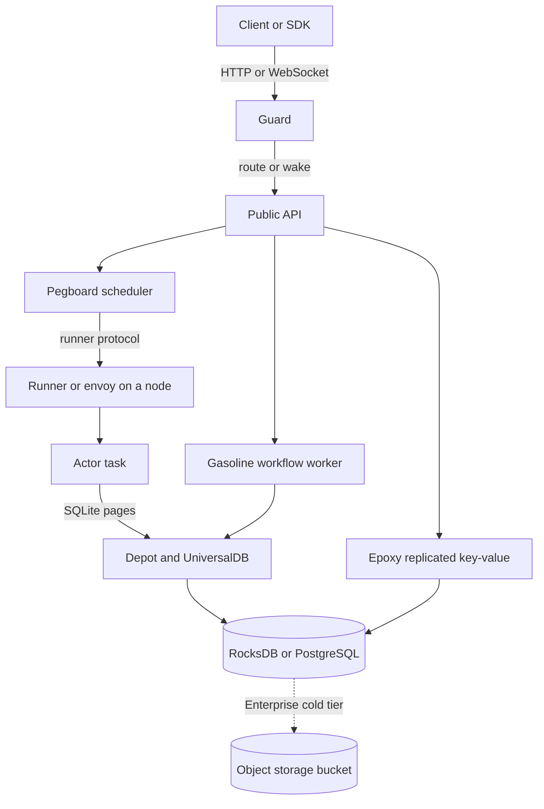
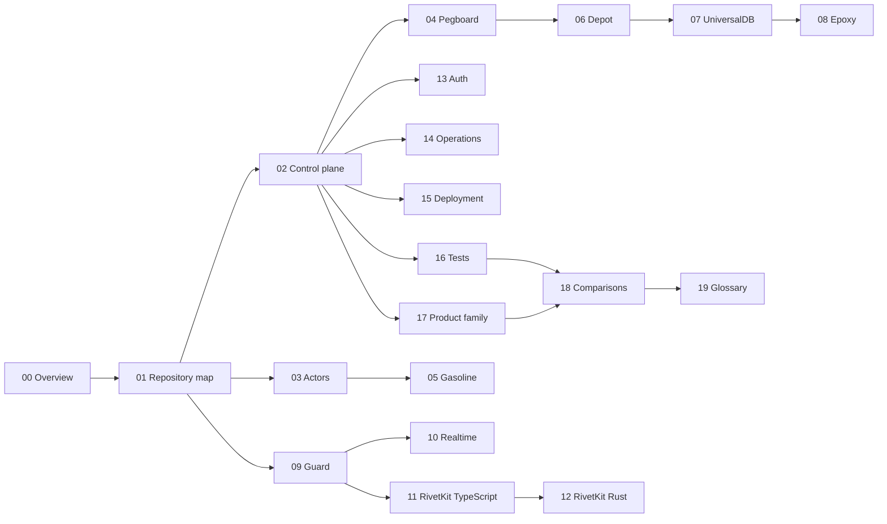

# Rivet: Actors as durable processes

Rivet is an orchestrator for stateful processes that it calls Actors. An Actor is
not a container and not a virtual machine. An Actor is a task inside a node
process that the operator already runs. It has a key, durable state, a
Structured Query Language (SQLite) database, a queue, realtime connections, and a
schedule. When the Actor is idle, it writes its state and unloads. When a request
arrives, the control plane starts the Actor again on any node that has capacity.

The control plane is one Rust binary. The product description says that it has
no separate database and no message bus, and that the only external durable
store is an object storage bucket. The open-source code in this commit does not
match that description in full. UniversalDB has two drivers: RocksDB on a local
disk, and PostgreSQL. The cold tier that moves SQLite pages to object storage is
Enterprise-only. Instances coordinate through UniversalDB and an optional NATS
pub/sub service. This exploration states the product claim and the open-source
configuration, and it marks which is which. The same binary runs on one laptop
or on a cluster of identical instances.

This exploration reads the source at commit
`4a58441c50d1ce20d8803cfb1ab7c3285a5141d6` of
`git@github.com:rivet-dev/rivet.git`, version 2.3.31. It covers the control
plane, the Actor lifecycle, the scheduling layer, the durable execution engine,
the storage layers, the gateway, the TypeScript and Rust SDKs, authentication,
operations, deployment, the tests, and the seven sibling repositories in the
snapshot.
It ends with a comparison against Cloudflare Durable Objects, Kubernetes, and
the durable promise systems that share this parent directory.

## The one-page thesis

Rivet is built on four separations.

**1. The Actor is separate from its location.** An Actor has a key and durable
state. It does not own a machine. Pegboard decides which runner hosts the Actor
now. If the runner dies, the Actor starts on another runner with the same state.
This is the virtual Actor pattern. The source calls the scheduling unit a runner,
and the newer path calls its host process an envoy.

**2. The request is separate from the process.** Guard receives an HTTP request
or a WebSocket connection and routes it to the runner that hosts the Actor. The
client never needs to know the address of the node. When the Actor is asleep,
Guard wakes it and waits for the ready signal before it forwards the request.

**3. The database is separate from the disk.** Each Actor has its own SQLite
database. A write goes to a log and to the durable store under UniversalDB. The
product description says that a write is acknowledged after a quorum of control
plane instances has it, and that a background process moves pages to the bucket.
In the open-source build, UniversalDB writes to RocksDB or PostgreSQL, and the
cold tier that writes to object storage is Enterprise-only. The bucket is not on
the write path in either build. This is the bottomless storage claim.

**4. The workflow is separate from one execution.** Gasoline runs a workflow as a
sequence of activities. Each activity result is recorded in a history. After a
crash, Gasoline replays the history and does not repeat a recorded activity.
This gives durable execution without a separate workflow server.

Each separation answers one failure. The first answers a dead node. The second
answers a moving Actor. The third answers a full disk. The fourth answers a
crash in the middle of a multi-step operation.

The diagram shows the two paths that meet at the Actor. The request path goes
through Guard and Pegboard. The durable path goes through Depot and UniversalDB to
the database driver. Epoxy is a second durable path for control-plane records
such as Actor key reservations and runner pools. The object storage bucket is a
dashed edge because the open-source build does not write it. A workflow uses the
same UniversalDB store that an Actor uses.

## What is in the snapshot

The snapshot at `/Users/darkvoid/GitSources/src.Rivet` holds the core repository
and seven sibling repositories. The core repository holds 88 Cargo workspace
members. Of these, 76 are engine packages. The engine holds 1,223 Rust files.
The TypeScript SDK holds 573 TypeScript and TSX files. The Rust SDK holds 171
Rust files.

| Part | What it holds | Document |
|------|---------------|----------|
| Control plane | The `rivet-engine` binary, its services, configuration, and bootstrap | [02](02-control-plane-architecture.md) |
| Actors | Identity, lifecycle, sleep, wake, rescheduling, and key reservation | [03](03-actors-and-lifecycle.md) |
| Pegboard | Runner pools, Actor allocation, envoy, and the runner protocol | [04](04-pegboard-scheduling.md) |
| Gasoline | Workflows, activities, replay, history, and versioning | [05](05-gasoline-durable-execution.md) |
| Depot | Per-Actor SQLite, the virtual file system, the log, and compaction | [06](06-actor-sqlite-and-depot.md) |
| UniversalDB | The key space, transactions, and the RocksDB and PostgreSQL drivers | [07](07-universaldb-and-buckets.md) |
| Epoxy | Per-key Fast Paxos, replicas, ballots, and multi-region commit | [08](08-epoxy-multi-region.md) |
| Guard | HTTP and WebSocket routing, TLS, and the reverse proxy | [09](09-guard-routing.md) |
| Realtime | Connections, events, broadcasts, hibernation, and restore | [10](10-realtime-and-hibernation.md) |
| RivetKit TypeScript | Actor definition, registry, client, server, and React hooks | [11](11-rivetkit-typescript.md) |
| RivetKit Rust | The Rust runtime, the Rust client, and the other SDKs | [12](12-rivetkit-rust-and-clients.md) |
| Security | Tokens, JSON Web Token (JWT), namespaces, policy, and Actor keys | [13](13-auth-and-namespaces.md) |
| Operations | Telemetry, metrics, logs, profiling, and the command line interface | [14](14-observability-and-operations.md) |
| Deployment | Self-host, Rivet Cloud, bring your own cloud, nodes, and storage | [15](15-deployment-and-self-hosting.md) |
| Tests | The test harness, snapshots, benchmarks, limits, and risks | [16](16-tests-benchmarks-and-limits.md) |
| Products | Agents, Workflows, agentOS, Dynamic Apps, OpenOrange, the migrator, and the website | [17](17-the-product-family.md) |
| Comparison | Durable Objects, Kubernetes, Resonate, and the durable stream model | [18](18-comparisons.md) |
| Terms | Every term, spelled out | [19](19-glossary.md) |

## Reading order

The diagram shows the dependency between the documents. An arrow means that the
later document uses a term or a mechanism that the earlier document explains.

A reader who is new to Rivet should read in this order:

1. [00 Overview](00-overview.md) for the problem, the vocabulary, and the
   guarantees.
2. [01 Repository map](01-repository-map.md) for the shape of the source.
3. [02 Control plane](02-control-plane-architecture.md) and
   [03 Actors](03-actors-and-lifecycle.md) for the two central ideas.
4. [04 Pegboard](04-pegboard-scheduling.md) and
   [06 Depot](06-actor-sqlite-and-depot.md) for the two hardest mechanisms.
5. [05 Gasoline](05-gasoline-durable-execution.md) for durable execution.
6. [09 Guard](09-guard-routing.md) and
   [10 Realtime](10-realtime-and-hibernation.md) for the network edge.
7. [11 RivetKit TypeScript](11-rivetkit-typescript.md) for the developer view.
8. The remaining documents in numeric order.

A reader who wants the storage comparison should read
[06 Depot](06-actor-sqlite-and-depot.md),
[07 UniversalDB](07-universaldb-and-buckets.md),
[08 Epoxy](08-epoxy-multi-region.md), and then
[18 Comparisons](18-comparisons.md).

## Key measurements

The project README gives these numbers. Document 16 checks them against the
benchmark method and the source.

| Measure | Value | Meaning |
|---------|-------|---------|
| Cold start | 6.92 ms at the 50th percentile, 8.11 ms at the 99th | A new keyed Actor receives a request and sends a full reply |
| Wake from sleep | 4.37 ms at the 50th percentile, 6.80 ms at the 99th | An Actor asleep for at least 10 seconds receives a request and replies |
| Memory for one Actor | 72.4 kilobytes (KB), as the project reports it | Increase in resident set size for one running Actor |
| Durable write (product claim) | 2 of 3 instances | A write is acknowledged after a quorum of control plane instances has it. The open-source configuration can run one instance. |
| External stores (product claim) | 1 bucket | The open-source build uses RocksDB or PostgreSQL, and the cold tier to object storage is Enterprise-only. |

## What this exploration is not

It is not a user guide. It does not teach a developer to write an Actor. It
explains how the implementation works and why it is built that way. The official
documentation is at `rivet.dev`.

It is not a security audit. Document 13 describes the authentication and
authorization design. It does not test it.

It does not run the code. Every claim comes from reading the source, the tests,
or the project documents. Document 16 states which measurements are reported by
the project and which are not reproduced here.

## Related explorations

This exploration sits beside four others in `src.durable-streams`:

- [Electric](../../src.electric/html/README.html) explains a durable stream as an
  ordered log with offsets.
- [Resonate](../../src.resonate/html/README.html) explains a durable promise as a
  named record with a lifecycle.
- [celld](../../src.celld/html/README.html) explains a self-hosted Workers
  platform with one SQLite database per cell.
- [TanStack DB](../../tanstackdb/html/README.html) explains the reactive client
  store that consumes synced data.

The comparison document asks the question that joins them: where does the
durable memory of a distributed program live, and which system pays which cost
to keep it there.

## Source note

All paths in this exploration are relative to
`/Users/darkvoid/GitSources/src.Rivet/rivet` unless the text names a sibling
repository. A citation has the form `path:line` or `path:line-line`. The commit
above is the only source of truth for the core repository.
