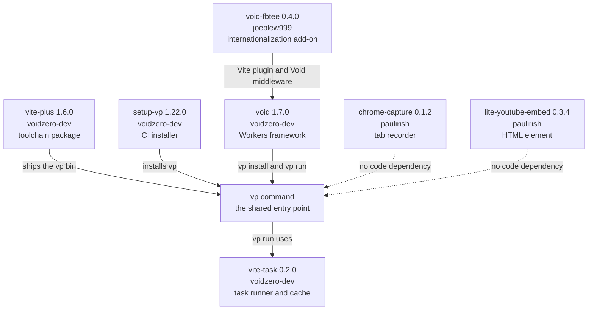
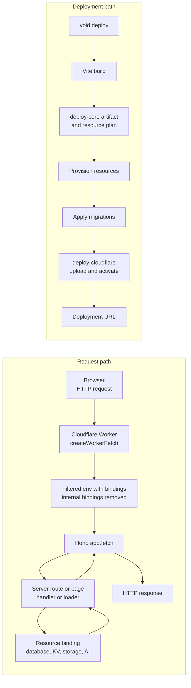

# VoidZero: One Toolchain, One Framework, One Working Collection

VoidZero is the organization that publishes one unified toolchain for web development (`spec.md:42-44`). This snapshot, the seven repositories in this directory, shows that toolchain beside the framework that uses it. The toolchain is Vite+ 1.6.0, and its command is `vp` (`vite-plus/README.md:10-11`, `vite-plus/packages/cli/package.json:2-3`). Vite is the front-end build tool that Vite+ builds on (`vite-plus/docs/guide/why.md:5`, `vite-plus/docs/guide/why.md:17`). In this document, "runtime" means the Node.js version that runs the tools. The first claim is that one dependency can own the Node.js version, package management, the development server, testing, building, and task caching. The second claim is that Void turns a file tree plus a Vite build into a deployed Cloudflare Workers application. Cloudflare Workers is the server platform that hosts that application (`void/docs/guide/index.md:8`). Void 1.7.0 makes the second claim (`void/README.md:3-9`, `void/docs/guide/index.md:28`, `void/packages/void/package.json:3`). "Provisioned resources" means the deploy creates the database, storage, and queue resources that the code imports (`void/README.md:8`). In this document, "the source" means the seven repositories at the exact commits in `spec.md:19-25`. This document states both claims, names the seven repositories, and shows how the pieces connect. It is the map, not the inventory. Document 01 owns the package inventory. Documents 02 to 17 own the deep dives, document 18 owns the comparisons, and document 19 is the glossary.

## The First Claim: One Dependency for the Whole Local Workflow

Vite+ describes itself as "The Unified Toolchain for the Web". It also describes itself as "runtime and package management, create, dev, check, test, build, pack, and monorepo task caching in a single dependency" (`vite-plus/README.md:10-11`). The claim is not that Vite+ invents every tool. The claim is that one dependency selects, configures, and runs the tools behind one command.

Vite+ combines seven tools (`vite-plus/README.md:15`). Each tool has a separate role.

| Bundled tool | Role | Evidence |
|--------------|------|----------|
| Vite | Development server and application build | `vite-plus/docs/guide/why.md:17` |
| Rolldown | Bundler for application builds | `vite-plus/docs/guide/why.md:17` |
| Vitest | Test runner | `vite-plus/docs/guide/why.md:18` |
| Oxlint | Linter | `vite-plus/docs/guide/why.md:19` |
| Oxfmt | Formatter | `vite-plus/docs/guide/why.md:19` |
| tsdown | Library builds and standalone executables | `vite-plus/docs/guide/why.md:20` |
| Vite Task | Task orchestration | `vite-plus/docs/guide/why.md:21` |

The guide names eight concerns: a Node.js version, a package manager, a development server, a linter, a formatter, a test runner, a bundler, and a task runner (`vite-plus/docs/guide/why.md:3`). The command table below is broader. It also lists type checking, project creation and migration, and library packing (`vite-plus/README.md:17-26`). `vp env` sets the Node.js version and the package manager for a project or for the machine (`vite-plus/README.md:17`, `setup-vp/README.md:355-361`).

| Concern | Command | Evidence |
|---------|---------|----------|
| Node.js and package manager management | `vp env` | `vite-plus/README.md:17` |
| Package management | `vp install` | `vite-plus/README.md:18` |
| Development server | `vp dev` | `vite-plus/README.md:19` |
| Format, lint, type check | `vp check` | `vite-plus/README.md:20` |
| Testing | `vp test` | `vite-plus/README.md:21` |
| Production build | `vp build` | `vite-plus/README.md:22` |
| Task running and caching | `vp run` | `vite-plus/README.md:23` |
| Library packing | `vp pack` | `vite-plus/README.md:24` |
| Project creation and migration | `vp create`, `vp migrate` | `vite-plus/README.md:26` |

```markdown
# vite-plus/README.md:15-26
Vite+ is the unified entry point for local web development. It combines [Vite](https://vite.dev/), [Vitest](https://vitest.dev/), [Oxlint](https://oxc.rs/docs/guide/usage/linter.html), [Oxfmt](https://oxc.rs/docs/guide/usage/formatter.html), [Rolldown](https://rolldown.rs/), [tsdown](https://tsdown.dev/), and [Vite Task](https://github.com/voidzero-dev/vite-task) into one zero-config toolchain that also manages runtime and package manager workflows:

- **`vp env`:** Manage Node.js and package managers globally and per project
- **`vp install`:** Install dependencies with automatic package manager detection
- **`vp dev`:** Run Vite's fast native ESM dev server with instant HMR
- **`vp check`:** Run formatting, linting, and type checks in one command
- **`vp test`:** Run tests through bundled Vitest
- **`vp build`:** Build applications for production with Vite + Rolldown
- **`vp run`:** Run `package.json` scripts and monorepo tasks with caching and dependency-aware scheduling
- **`vp pack`:** Build libraries for npm publishing or standalone app binaries
- **`vp toolchain`:** Show the versions of Vite+, Vite, Rolldown, Oxc, and other tools
- **`vp create` / `vp migrate`:** Scaffold new projects and migrate existing ones
```

Vite+ presents performance as a reason for the unification (`vite-plus/docs/guide/why.md:29`). Vite+ uses Rust for work that can be native. It connects Rust to JavaScript through the Native Application Programming Interface (NAPI), a bridge that lets JavaScript call compiled Rust code (`vite-plus/docs/guide/why.md:29-31`). The guide says that `vp check` runs format, lint, and type checks in one pass (`vite-plus/docs/guide/why.md:33`). Treat Vite+'s performance statement as its own claim, not as a measured result in this snapshot.

The task caching part is not a separate command for the normal user. Vite Task is a repository of its own, and its readme names the entry point: "powering `vp run` in Vite+" (`vite-task/README.md:3`). The `vp run` guide says the runner has caching, dependency ordering, and workspace-aware execution (`vite-plus/docs/guide/run.md:3`). A workspace is one repository that holds several packages. A run can select packages across that workspace (`vite-plus/docs/guide/run.md:3`, `void/package.json:5`).

## The Second Claim: A File Tree Becomes a Deployed Worker

Void is "a full-stack framework for Cloudflare Workers, powered by Vite" (`void/docs/guide/index.md:8`). The claim has three parts. Files define routes and pages. Imports declare resources. One deploy command builds, provisions, migrates, and publishes.

Files define routes. The file path under `routes/` gives the Uniform Resource Locator (URL) path, without the extension. A handler in `routes/api/users.ts` serves `/api/users`. A file named `index` maps to its directory path, so a component in `pages/users/index.tsx` renders `/users` (`void/docs/guide/index.md:14`, `void/docs/guide/pages-routing/overview.md:94`). A page can have a companion `.server.ts` file. Its loader reads data and returns typed properties to the component. Its actions handle forms and other mutations (`void/docs/guide/index.md:16`). Hono is the routing library that Void uses for routes and middleware (`void/docs/guide/server-routing.md:8`).

Imports declare resources. The build parses each source file and maps its module imports to resource needs (`void/packages/void/src/inference/walk.ts:61-80`, `void/packages/void/src/inference/walk.ts:96-98`). A `void/db` import sets the database need, and `void/kv`, `void/storage`, and `void/queues` set the key-value (KV), object storage, and queue needs (`void/packages/void/src/inference/walk.ts:66-80`). The analysis records those needs and the environment names they use, such as `env.DB`, `env.KV`, and `env.STORAGE` (`void/packages/void/src/application-analysis.ts:60-100`, `void/packages/void/src/application-analysis.ts:91-100`). A binding is a named entry on the Worker's environment object that connects the Worker to a resource (`void/packages/void/src/runtime/routing-worker.ts:8-9`). The guide says to import `db` from `void/db` to query the database (`void/docs/guide/index.md:22`). Void provides a local database in development and provisions one at deploy (`void/docs/guide/index.md:22`). Handlers infer response types, and typed fetch, the typed client for server routes, checks each caller against those types (`void/docs/guide/index.md:18`, `void/docs/guide/index.md:24`). Page loaders and actions carry the same types to components and forms (`void/docs/guide/index.md:24`).

One command covers deployment. `void deploy` builds the app, provisions resources, applies database migrations, and publishes it (`void/docs/guide/index.md:28`). The deployment guide repeats that order (`void/docs/guide/deployment.md:8`). The Void readme separates the work into three products: a Software Development Kit (SDK), a command-line interface (CLI), and a team platform (`void/README.md:5-9`). The SDK offers typed access to databases, storage, and Artificial Intelligence (AI) services (`void/README.md:7`). The SDK is the framework package that provides these imports (`void/README.md:7`, `void/packages/void/package.json:2-3`).

```markdown
# void/README.md:5-9
Void brings together three open-source tools for you and your coding agents:

- **Void SDK:** Build your server and client together with file-based API routes, server-rendered pages, and typed APIs for databases, storage, and AI. Carry types from database queries to the UI.
- **Void CLI:** Build your app, provision the Cloudflare resources it uses, apply migrations, and deploy with one command. Manage resources, inspect logs, and roll back through the same CLI.
- **Void Platform:** Install a shared deployment environment in your Cloudflare account for your team or customers, with access controls, resource limits, usage reporting, and [connected applications](./docs/guide/platform/administration/connected-apps.md) that request user-approved deployments.
```

The team platform is a shared deployment environment in the customer's Cloudflare account (`void/platform/README.md:3-5`). It adds access controls, resource limits, and usage reporting (`void/README.md:9`). Vite+ is the default toolchain for a new Void project (`void/README.md:23`). Void can also add its features to an existing Vite project (`void/README.md:29`). Void and Vite+ are separate packages with separate version numbers (`void/packages/void/package.json:3`, `vite-plus/packages/cli/package.json:3`).

## The Seven Repositories and Their Owners

The snapshot is a directory of seven independent Git repositories. Each row below names the directory, the remote owner, the pinned commit, the package version, and the role. A pin is a Git commit hash, which names one exact revision. The table shows the usual 12-character short form. `spec.md` in this directory holds the full 40-character hashes (`spec.md:19-25`).

| Directory | Owner | Pin | Version | Role |
|-----------|-------|-----|---------|------|
| `void` | `voidzero-dev` | `f254d1ec477b` | 1.7.0 (`void/packages/void/package.json:3`) | Full-stack framework, deployment CLI, and team platform for Cloudflare Workers. |
| `vite-plus` | `voidzero-dev` | `794a96acd52e` | 1.6.0 (`vite-plus/packages/cli/package.json:3`) | Unified toolchain that provides the `vp` command. |
| `vite-task` | `voidzero-dev` | `95d8da2fc1f0` | 0.2.0 (`vite-task/packages/vite-task-client/package.json:3`) | Dependency-aware task runner and cache behind `vp run`. |
| `setup-vp` | `voidzero-dev` | `ee6805d1c428` | 1.22.0 (`setup-vp/package.json:3`) | Installer for `vp` on GitHub Actions, GitLab Continuous Integration and Continuous Delivery (CI/CD), and Azure Pipelines. |
| `void-fbtee` | `joeblew999` | `6784d295baf4` | 0.4.0 (`void-fbtee/packages/void-fbtee/package.json:3`) | Internationalization add-on for Void applications. |
| `chrome-capture` | `paulirish` | `87c3096cb8d0` | 0.1.2 (`chrome-capture/package.json:3`) | Chrome tab recorder that writes an AV1 video codec `.mp4` file. |
| `lite-youtube-embed` | `paulirish` | `674a402883c6` | 0.3.4 (`lite-youtube-embed/package.json:3`) | Fast YouTube stand-in as a custom HyperText Markup Language (HTML) element. |

The remote URL for each row is at line 9 of that repository's `.git/config`. For example, `void/.git/config:9` names the `voidzero-dev/void` remote. The pinned commits are recorded in `spec.md:19-25`.

Only four of the seven repositories belong to the `voidzero-dev` organization. `void-fbtee` belongs to `joeblew999`. `chrome-capture` and `lite-youtube-embed` belong to `paulirish`. The two `paulirish` tools have no code dependency on Vite+, Void, or each other. Neither manifest declares such a dependency (`chrome-capture/package.json:1-67`, `lite-youtube-embed/package.json:1-29`). The directory is a working collection of related tools, not one product repository.

The exploration spec (`spec.md:17-25`) records the MIT license for all seven repositories. The source disagrees for the two browser tools. Their package manifests and license files state the Apache License 2.0 (`chrome-capture/package.json:52`, `lite-youtube-embed/package.json:5`, `chrome-capture/LICENSE:1-3`, `lite-youtube-embed/LICENSE:1-6`). This document therefore makes no license claim about those two repositories.

## How the Pieces Interlock

The ecosystem has one shared command, `vp`, and one framework that uses it, Void. The other five repositories have these roles. `vite-task` supplies a part of `vp`, `setup-vp` installs `vp` in CI, and `void-fbtee` extends Void. `chrome-capture` and `lite-youtube-embed` connect to none of them. In the diagram, a solid arrow points from a component to what it uses, installs, extends, or supplies. A dashed arrow marks the absence of a code dependency. A `bin` is an executable file.



### Void Uses `vp` in Its Own Repository

Void does not only support Vite+ for its users. The Void repository uses `vp` to build itself. The contributing section tells a developer to run `vp install` and then `vp run build:all` (`void/README.md:48-53`).

```sh
# void/README.md:49-52
git clone https://github.com/voidzero-dev/void.git
cd void
vp install
vp run build:all
```

A package script is an entry under `scripts` in `package.json`. A Vite Task task is an entry under `run.tasks` in `vite.config.ts` (`vite-plus/docs/guide/run.md:3`, `void/vite.config.ts:75-81`). The root `build` script calls `vp run` (`void/package.json:5`). The `build:all` name is a Vite Task task in `void/vite.config.ts`, not a package script. The snippet below sits under `run.tasks` (`void/vite.config.ts:75-81`). The `build:all` task chains three `vp run` builds. Two of its commands select packages by a Vite filter pattern, such as `./platform/packages/**` and `./playground/**` (`void/vite.config.ts:78-81`). This is the clearest proof that Vite Task is inside the toolchain: the framework's own build runs through a Vite Task task.

```jsonc
// void/package.json:5
    "build": "vp run --filter './packages/**' --parallel build",
```

```typescript
// void/vite.config.ts:78-81
      'build:all': {
        command:
          "vp run build && vp run --filter './platform/packages/**' build && vp run --filter './playground/**' --parallel build",
      },
```

### Vite Task Runs Inside `vp run`

Vite Task is a separate repository, but it is not a separate command for the normal user. The readme states that it powers `vp run` (`vite-task/README.md:3`). The Vite+ run guide states that `vp run` runs package scripts and tasks with caching and dependency ordering (`vite-plus/docs/guide/run.md:3`).

```markdown
# vite-task/README.md:3
Monorepo task runner with intelligent caching and dependency-aware scheduling, powering [`vp run`](https://github.com/voidzero-dev/vite-plus) in [Vite+](https://viteplus.dev).
```

The cache is the unusual part. The `input` field under a task's `cache` controls which files enter the cache key (`vite-task/docs/inputs.md:3`). A cache key is the value that identifies a stored result. A change to the command, the environment, or a tracked file invalidates it (`vite-task/docs/inputs.md:3`, `vite-task/docs/inputs.md:149-162`). When a task does not declare `input`, Vite Task tracks the files that the command reads during execution with `fspy` (file system spy) (`vite-task/docs/inputs.md:7`). The task runner starts the child under a spy (`vite-task/crates/fspy/src/lib.rs:60-61`, `vite-task/crates/fspy/src/unix/mod.rs:86-90`). On Unix, the spy writes a preload library to disk and starts the child with it (`vite-task/crates/fspy/src/unix/mod.rs:53-64`, `vite-task/crates/fspy/src/unix/mod.rs:86-90`). The spy sends the captured path accesses to the parent over an inter-process channel (`vite-task/crates/fspy/src/unix/mod.rs:15`, `vite-task/crates/fspy/src/lib.rs:21-42`). That list is the access record. It includes the paths that the process read and wrote (`vite-task/crates/fspy_shared/src/ipc/mod.rs:45-56`).

```markdown
# vite-task/docs/inputs.md:7
When `input` is omitted, vite-task automatically tracks files that the command reads during execution using fspy (file system spy):
```

**Aha:** When a task declares no `input`, Vite Task does not ask the task which files it uses. It observes the real file access of the child process. The observed reads add the file part of the cache key. A change to the command or the environment also invalidates the result (`vite-task/docs/inputs.md:149-162`). The default cache input is evidence from the run, not a declared guess. That is why a task with no cache configuration can still receive a cache key from the observed inputs. Document 08 explains the observation mechanism.

### setup-vp Installs `vp` in CI

`setup-vp` is the bridge from a repository to a CI runner. It is a GitHub Action, a GitLab CI/CD remote template, and an Azure Pipelines step template (`setup-vp/README.md:3`). A remote template is a file that GitLab loads by URL with `include:remote` (`setup-vp/README.md:546-563`). A step template is a file that an Azure pipeline adds with `template:` (`setup-vp/README.md:750-756`). The action can also cache dependencies and run `vp install` after setup (`setup-vp/action.yml:16-19`, `setup-vp/action.yml:40-43`).

```markdown
# setup-vp/README.md:3
GitHub Action, GitLab CI/CD remote template, and Azure Pipelines step template to set up [Vite+](https://viteplus.dev) (`vp`).
```

When `cache: true` is set, the action caches project dependencies by lock file. The cache key uses the operating system, architecture, package manager, and lock file hash (`setup-vp/README.md:503-513`). The action runs on Node.js 24 and executes the compiled `dist/index.mjs` (`setup-vp/action.yml:78-81`). The installer downloads the official Vite+ install script and retries failed sources (`setup-vp/src/install-viteplus.ts:53-80`). It then adds the `vp` binary directory to `PATH` with the GitHub `addPath` function (`setup-vp/src/install-viteplus.ts:138-151`).

The connection is visible in the add-on repository. The `void-fbtee` CI file says that `setup-vp` installs `vp`, the Node.js version from `.node-version`, and the package manager (`void-fbtee/.github/workflows/ci.yml:1-4`). The same workflow uses `voidzero-dev/setup-vp` at version 1.22.0 (`void-fbtee/.github/workflows/ci.yml:33`).

### void-fbtee Is a Void Add-On

`void-fbtee` is an internationalization (i18n) add-on for Void. It translates strings with `fbtee`, a string-translation library. It formats dates and times with Temporal, a JavaScript date and time Application Programming Interface (API). It formats numbers and lists with `Intl`, the browser's internationalization API (`void-fbtee/README.md:5-7`). The package follows the same extension shape as Void's own `@void/md` and `@void/react` add-ons. The shape is a Vite plugin plus the middleware and React parts that run in the app (`void-fbtee/packages/void-fbtee/README.md:10-16`).

```markdown
# void-fbtee/packages/void-fbtee/README.md:10-16
A Void add-on, built the way Void's own `@void/md` and `@void/react` are: a Vite plugin
(`import { voidFbtee } from "void-fbtee/plugin"`) plus the parts a Void app uses at run time
(`void-fbtee/middleware`, `void-fbtee/react`). The Vite plugin works only in a Void app: it swaps
modules in Void's server environment (Cloudflare's own Temporal, fbtee's per-request build, Void's
own Hono), and the rest goes where Void looks for it (`middleware/99.i18n.ts`, `void.config.ts`),
which `void-fbtee init` sets up and `void-fbtee check` checks. React only, as fbtee is. It works
with Vite+ and with plain Vite, and with npm and pnpm.
```

In that quote, "swaps modules" means the Vite plugin replaces modules in Void's server environment. "Per-request build" means fbtee builds for each request. `npm` and `pnpm` are package managers (`void-fbtee/packages/void-fbtee/README.md:10-16`). The add-on depends on Void's extension points: the Vite plugin and the files that `void-fbtee init` writes (`void-fbtee/packages/void-fbtee/README.md:10-16`). The add-on is a separate package with its own version (`void-fbtee/packages/void-fbtee/package.json:2-3`). The add-on lives in a different owner's repository. The source does not say why the add-on has a different owner.

## The Command Split in Vite+

The `vp` name refers to more than one artifact. The project-local command is a Node.js script. The global command is a Rust binary. The heavy commands are a Rust library that the Node.js process loads through a NAPI native addon.

A project-local installation is the `vite-plus` package in the project's `node_modules`. A global installation is the `vp` command installed on the machine. For development commands such as `vp dev`, `vp build`, `vp test`, and `vp run`, the global CLI delegates to the local package when the project has one (`vite-plus/docs/guide/global-cli.md:476-491`). Package-manager commands such as `vp install` use the global CLI (`vite-plus/docs/guide/global-cli.md:487-491`). The heavy commands include dev, build, test, lint, install, run, and pack. They run in the Rust core, which calls JavaScript resolver functions to find some tool binaries (`vite-plus/packages/cli/src/bin.ts:1-11`, `vite-plus/packages/cli/src/bin.ts:168-191`).

### The Installed Command Is a Node.js Script

The `vite-plus` package declares three bins: `vp`, `vpr`, and `vpx` (`vite-plus/packages/cli/package.json:16-20`). The `vp` entry is `./bin/vp`. That file is a Node.js script with a `#!/usr/bin/env node` line. It enables the Node.js compile cache, which stores compiled code, and then imports `../dist/bin.js` (`vite-plus/packages/cli/bin/vp:1-7`). `vpr` is a shorthand for `vp run` (`vite-plus/packages/cli/bin/vpr:1-10`, `vite-plus/docs/guide/run.md:6`). `vpx` runs a script file or a package binary (`vite-plus/packages/cli/bin/vpx:7-9`). The global binary also accepts the `vpr` and `vpx` names (`vite-plus/crates/vp_global_cli/src/main.rs:343-348`).

```javascript
// vite-plus/packages/cli/bin/vp:1-7
#!/usr/bin/env node

import module from 'node:module';
if (module.enableCompileCache) {
  module.enableCompileCache();
}
await import('../dist/bin.js');
```

The import target is the built file, not the TypeScript source (`vite-plus/packages/cli/bin/vp:7`). Separately, the package `exports` field maps the `./bin` subpath to `./dist/bin.js` for package imports (`vite-plus/packages/cli/package.json:62-64`). The two entries reach the same build. That build is the bundled form of `packages/cli/src/bin.ts` (`vite-plus/packages/cli/tsdown.config.ts:69`). tsdown, the library bundler from the tool list, produces that build (`vite-plus/docs/guide/why.md:20`). The source file is the readable entry point, and the installed script loads its build.

### The Entry Point Sends Global Commands to TypeScript and the Rest to Rust

The header comment of `src/bin.ts` states the rule. The file is the unified entry for the local CLI through `bin/vp` and for the global CLI through the Rust `vp` binary. The global commands `create`, `migrate`, `sync-versions`, `config`, `hooks`, `staged`, and `--version` are handled by TypeScript modules bundled with tsdown. All other commands go to the Rust core through the NAPI native addon. The Rust core uses JavaScript resolver functions to find tool binaries (`vite-plus/packages/cli/src/bin.ts:1-11`).

```typescript
// vite-plus/packages/cli/src/bin.ts:1-11
/**
 * Unified entry point for both the local CLI (via bin/vp) and the global CLI (via Rust vp binary).
 *
 * Global commands (create, migrate, sync-versions, config, hooks, staged, --version) are handled by tsdown-bundled modules.
 * All other commands are delegated to the Rust core through NAPI bindings, which
 * uses JavaScript tool resolver functions to locate tool binaries.
 *
 * When called from the global CLI, the Rust binary resolves the project's local
 * vite-plus installation using oxc_resolver and runs its dist/bin.js directly.
 * If no local installation is found, this global dist/bin.js is used as fallback.
 */
```

The dispatch code matches the comment. The TypeScript branches import `create`, `migration`, `sync-versions`, `config`, `hooks`, `version`, and `staged`. The final `else` branch delegates to the Rust core (`vite-plus/packages/cli/src/bin.ts:138-154`). That branch calls `run` from the NAPI addon package and passes resolver functions for lint, pack, format, Vite, test, and documentation tool binaries (`vite-plus/packages/cli/src/bin.ts:168-191`). The entry imports `run` from `../binding/index.js` (`vite-plus/packages/cli/src/bin.ts:16`). The addon is the `vite-plus-cli` crate, a Rust package, in `packages/cli/binding` (`vite-plus/packages/cli/binding/Cargo.toml:1-2`, `vite-plus/packages/cli/binding/Cargo.toml:21-22`).

```typescript
// vite-plus/packages/cli/src/bin.ts:138-154
} else if (command === 'create') {
  await import('./create/bin.js');
} else if (command === 'migrate') {
  await import('./migration/bin.js');
} else if (command === 'sync-versions') {
  await import('./sync-versions/bin.js');
} else if (command === 'config') {
  await import('./config/bin.js');
} else if (command === 'hooks') {
  await import('./hooks/bin.js');
} else if (command === '--version' || command === '-V') {
  await import('./version.js');
} else if (command === 'staged') {
  await import('./staged/bin.js');
} else {
  // All other commands — delegate to Rust core via NAPI binding
  try {
```

```typescript
// vite-plus/packages/cli/src/bin.ts:168-191
    const exitCode = await run({
      nodeExecPath: process.execPath,
      lint,
      pack,
      fmt,
      vite,
      test,
      doc,
      toolchainManifestPath: path.join(cliDistDir, 'toolchain.json'),
      vitePlusPackagePath,
      // Only task/config-metadata commands need this resolver. Importing it
      // eagerly also loads Vitest and Vite in the parent of `vp dev`, before
      // the separate Vite process even starts.
      resolveUniversalViteConfig: async (err, cwd) => {
        const { resolveUniversalViteConfig } = await import('./resolve-vite-config.js');
        const config = await resolveUniversalViteConfig(err, cwd);
        // Rust spawns tasks only after this promise settles.
        restoreBlockingStdin();
        return config;
      },
      nodeVersion: process.version,
      explicitChdir,
      args: rustCliArgs,
    });
```

The source does not say why the resolver functions stay in JavaScript. The Rust core calls them, and the header records that division (`vite-plus/packages/cli/src/bin.ts:1-11`).

### The Global Command Is a Separate Rust Binary

The global command is not the Node.js script. It is a standalone Rust binary in `crates/vp_global_cli`. The crate main file says it can run without a pre-installed Node.js. It uses the managed Node.js version from `vp_js_runtime` for package-manager commands and JavaScript execution (`vite-plus/crates/vp_global_cli/src/main.rs:1-5`). The crate declares its binary name as `vp` (`vite-plus/crates/vp_global_cli/Cargo.toml:10-12`).

```rust
// vite-plus/crates/vp_global_cli/src/main.rs:1-5
//! Vite+ Global CLI
//!
//! A standalone Rust binary for the vite+ global CLI that can run without
//! pre-installed Node.js. Uses managed Node.js from `vp_js_runtime` for
//! package manager commands and JS script execution.
```

```toml
# vite-plus/crates/vp_global_cli/Cargo.toml:10-12
[[bin]]
name = "vp"
path = "src/main.rs"
```

The global binary resolves the project's local `vite-plus` package with the `oxc_resolver` library (`vite-plus/crates/vp_global_cli/src/js_executor.rs:423-432`). If it finds the package, it runs that package's `dist/bin.js`. If it does not find the package, it runs the `dist/bin.js` of the global installation (`vite-plus/crates/vp_global_cli/src/js_executor.rs:256-260`). The CLI scripts are typically in `packages/cli/dist` (`vite-plus/crates/vp_global_cli/src/js_executor.rs:155-165`). The global binary selects the Node.js version from four sources (`vite-plus/crates/vp_global_cli/src/js_executor.rs:220-241`). A session override is a version chosen for the current session. The project's version sources are files that name a version. The user default is the configured fallback. The last source is the latest Long Term Support (LTS) release (`vite-plus/crates/vp_global_cli/src/js_executor.rs:220-241`). It downloads and caches the selected version (`vite-plus/crates/vp_global_cli/src/js_executor.rs:220-241`). It passes the command arguments to the JavaScript entry (`vite-plus/crates/vp_global_cli/src/js_executor.rs:386-387`). The global CLI guide gives the same delegation rule for `vp dev`, `vp build`, `vp test`, and `vp run` (`vite-plus/docs/guide/global-cli.md:480-491`).

**Aha:** `vp` is neither a pure Node.js tool nor a pure Rust tool. The global command is Rust and the project command is Node.js. The Rust binary starts a Node.js process with `Command::new` (`vite-plus/crates/vp_global_cli/src/js_executor.rs:139-143`). It passes the command arguments to that process (`vite-plus/crates/vp_global_cli/src/js_executor.rs:386-387`). That process then loads the Rust core through NAPI (`vite-plus/packages/cli/src/bin.ts:168-191`). The shared name hides two languages and two processes. Document 02 traces the full dispatch path.

## What Void Adds Above Plain Vite

Plain Vite serves a front end and builds it for production (`vite-plus/docs/guide/why.md:17`). Void adds server routes, pages, typed resource access, migrations, provisioning, deployment, and a team platform. Each addition has a home in the repository.

| Addition | What it adds | Main evidence |
|----------|--------------|---------------|
| Server routes | A file in `routes/` becomes an endpoint, with Hono for routing. | `void/docs/guide/server-routing.md:8-12` |
| Pages | A file in `pages/` becomes a page, with loaders and actions. | `void/docs/guide/index.md:14-16` |
| Typed resources | Imports for database, KV, storage, and queues carry types. | `void/docs/guide/index.md:22-24` |
| Migrations | Pending Structured Query Language (SQL) migrations are applied at deploy. | `void/docs/guide/deployment.md:29-37` |
| Provisioning | Cloudflare resources are provisioned at deploy. | `void/README.md:8`, `void/README.md:29` |
| Deployment | One command builds, provisions, migrates, and publishes. | `void/docs/guide/index.md:28` |
| Team platform | A shared management layer in the customer's Cloudflare account. | `void/README.md:9`, `void/platform/README.md:3-5` |

A control plane is the management layer that installs and operates the platform (`void/platform/README.md:3-11`).

The routing model is file based. A dynamic segment such as `[id]` becomes a route parameter. A directory in parentheses such as `(admin)` is a route group, and it does not change the URL. A `.dev` or `.prod` suffix limits a route to one environment (`void/docs/guide/server-routing.md:16`, `void/docs/guide/server-routing.md:32-45`). The guide shows the mapping in a compact tree (`void/docs/guide/server-routing.md:22-28`). The framework compiles the routes and generates a Worker fetch handler. The compiler writes a `__createWorkerFetch` call into the Worker entry (`void/packages/void/src/router/compile.ts:1346-1352`).

```typescript
// void/packages/void/src/router/compile.ts:1346-1352
  const fetchHandler = `__createWorkerFetch({
    app, assets: serveWithAssets, withRawEnv: __withRawEnv, withRuntimeEnv,
    staticNotFound: __voidRenderStaticNotFound,
    filterBindings: __filterInternalBindings,
    internalRoute: __voidHandleInternalRoute,
    collectPrerenderPaths: __voidCollectPrerenderPaths${alwaysUseHttps ? ', alwaysUseHttps: true' : ''}${versionMetadataBinding ? ', versionMetadataBinding: ' + JSON.stringify(versionMetadataBinding) : ''}${envSchemaModule ? ', validateEnv: _validateEnvOnce' : ''}${remotePath ? ', remoteEnv: (env) => ' + createRemoteEnvCall : ''}${hasEmail ? ', emailReceipt: __handleEmailReceipt' : ''}${isr ? ', isr: { deploymentId: __VOID_ISR_DEPLOYMENT_ID, handle: (request, env, ctx, render) => handleIsr(request, env, ctx, { revalidate: __VOID_ISR_REVALIDATE, pages: __VOID_ISR_PAGES, pathRevalidate: __VOID_ISR_PATH_REVALIDATE, deploymentId: __VOID_ISR_DEPLOYMENT_ID, queryAllowlist: ' + JSON.stringify(isr.queryAllowlist) + ' }, render) }' : ''}
  })`;
```

The resource model is import based. The guide says that `void` provides a local database in development and provisions one at deploy (`void/docs/guide/index.md:22`). The deploy guide describes the migration check. Deploy applies pending SQL migrations from `db/migrations/`. If the schema changed without a migration, deploy stops and asks for `void db generate` (`void/docs/guide/deployment.md:29-37`).

The deploy model has two targets. The CLI chooses Cloudflare or Void as the deploy target. The choice is the `--platform` option, then the platform saved in the project configuration, then the `void` default (`void/packages/void/src/cli/deploy.ts:49-55`, `void/packages/void/src/cli/deploy.ts:181-213`). The `void` default applies when the project has no saved choice (`void/packages/void/src/cli/deploy.ts:53-54`). The `cloudflare` target deploys to the customer's own Cloudflare account, and no Void project is involved (`void/packages/void/src/cli/deploy.ts:136-138`). The `void` target deploys through a Void Platform installed in a Cloudflare account, and the platform manages the project (`void/packages/void/src/cli/deploy.ts:150-184`, `void/platform/README.md:3-5`). A managed project is a project deployed through such a platform (`void/packages/void/src/cli/deploy.ts:150-158`). The shared deployment package holds the contracts, manifests, and resource plans (`void/packages/deploy-core/README.md:3`). For reading this document, a contract is a shared agreement between the deploy code and a deployment target. A manifest describes the deployment, and a resource plan lists the resources to provision. The source lists these artifact types but does not define each one in that sentence (`void/packages/deploy-core/README.md:3`). The Cloudflare package provides the Worker configuration, upload, activation, and verification steps (`void/packages/deploy-cloudflare/README.md:3`). Activation makes the uploaded version serve traffic (`void-fbtee/README.md:45-51`).

## Two Paths: A Request and a Deployment

The next diagram shows two paths. One path runs at request time, and one path runs at deploy time. A browser sends a HyperText Transfer Protocol (HTTP) request. The request path goes from the browser to a resource binding. The deployment path goes from the CLI to a published Worker and its URL.

A binding is a named entry on the Worker's environment object that connects the Worker to a resource (`void/packages/void/src/runtime/routing-worker.ts:8-9`, `void/packages/void/src/runtime/routing-worker.ts:149-165`). Void also types an optional `ASSETS` binding for the asset handler (`void/packages/void/src/runtime/routing-worker.ts:8-9`). The generated Worker hides internal bindings whose names start with `__VOID_` or `__PROJECT_` (`void/packages/void/src/runtime/env-raw.ts:12`, `void/packages/void/src/runtime/routing-worker.ts:149-165`).



The generated entry calls `createWorkerFetch` with the application, the asset handler, the environment helpers, and the filters (`void/packages/void/src/router/compile.ts:1346-1352`). The options type lists those fields (`void/packages/void/src/runtime/routing-worker.ts:167-210`). The request path starts at `createWorkerFetch`. It validates the environment against the schema in `env.ts`, filters internal bindings, and calls the application's `fetch` function with the user-visible environment (`void/packages/void/src/router/compile.ts:1324-1328`, `void/packages/void/src/runtime/routing-worker.ts:243-245`, `void/packages/void/src/runtime/routing-worker.ts:291-293`).

```typescript
// void/packages/void/src/runtime/routing-worker.ts:291-293
        const userEnv = options.filterBindings(env);
        const render = async (req: Request): Promise<Response> =>
          options.assets(req, env, await options.app.fetch(req, userEnv, ctx));
```

`userEnv` is a proxy over `env`. A read of a hidden name returns `undefined` (`void/packages/void/src/runtime/routing-worker.ts:149-165`). `ctx` is the Hono execution context (`void/packages/void/src/runtime/routing-worker.ts:2`). The application receives `userEnv` as its `env`, so a resource client reads `env.DB` from the filtered environment (`void/packages/void/src/runtime/routing-worker.ts:291-293`, `void/packages/void/src/application-analysis.ts:95-100`). The environment type accepts any string key and an optional assets binding, so each resource binding is one more key (`void/packages/void/src/runtime/routing-worker.ts:8-9`). Void uses Hono for routing and middleware (`void/docs/guide/server-routing.md:8`). Void documents each resource import separately: database, KV, object storage, and queues (`void/docs/guide/index.md:22`).

The deployment path starts at the CLI. `void deploy` dispatches to `runDeploy` (`void/packages/void/src/cli/deploy.ts:58`), and `runDeploy` selects a deploy target (`void/packages/void/src/cli/deploy.ts:181-213`). The guides state the observable order: build, provision, apply migrations, publish (`void/docs/guide/deployment.md:8`, `void/docs/guide/index.md:28`). The deploy-core package supplies the manifest and resource plan that the deploy uses (`void/packages/deploy-core/README.md:3`). The source modules separate the concerns into `deploy-core` for contracts and plans, and `deploy-cloudflare` for the Cloudflare operations (`void/packages/deploy-core/README.md:3`, `void/packages/deploy-cloudflare/README.md:3`).

## Where the Snapshot Is a Collection, Not One Product

A mono-repository is one repository that holds several packages. It has one owner, one issue tracker, and one release process. This snapshot does not have that shape. It has four `voidzero-dev` repositories and three repositories from two other owners. No root manifest links all seven. The directory is a working collection.

The two browser tools are independent utilities by a different author. `chrome-capture` records a Chrome tab at 60 to 120 frames per second to an AV1 `.mp4` file. It records tab audio and needs no `ffmpeg` video tool (`chrome-capture/readme.md:3`). It uses the Chrome DevTools Protocol (CDP) command `Page.startScreenRecording` (`chrome-capture/src/index.ts:7-13`).

```markdown
# chrome-capture/readme.md:3
Record a Chrome tab at 60-120fps (up to 2160p) straight to a AV1 `.mp4`. Tab audio too. No ffmpeg.
```

`lite-youtube-embed` is a custom HTML element that renders a lightweight stand-in for the standard YouTube embed. A custom element is an HTML element that the page's own code defines and registers (`lite-youtube-embed/src/lite-yt-embed.js:13`, `lite-youtube-embed/src/lite-yt-embed.js:241`). It renders like the real embed but claims to be about 224 times faster (`lite-youtube-embed/README.md:5-6`). The standard embed is the comparison (`lite-youtube-embed/README.md:12`).

```markdown
# lite-youtube-embed/README.md:5-6
Provide videos with a supercharged focus on visual performance.
This custom element renders just like the real thing but approximately 224× faster.
```

These two tools are in the directory. The source does not say why the person who assembled the directory collected them with the VoidZero projects. This document does not claim a technical relationship where the source shows none.

## Limits of This Document

This document is a map. It does not list every package, crate, file, command, flag, or configuration key. Document 01 owns that inventory. It does not explain any mechanism to the depth of documents 02 to 17. It names the command split, the request path, and the deployment path only far enough to check each claim against the named lines. Some facts remain open. The source does not say why `void-fbtee` lives under `joeblew999` while it presents itself as a Void add-on. The source does not say why the snapshot directory includes the two `paulirish` browser tools. The snapshot has no root manifest that defines membership. The license entries in the exploration spec also disagree with the two browser-tool license files, as noted above. This document leaves those questions open rather than invent a reason.

## Reading Order

The documents build from the map to the toolchain, then to the task runner, then to the CI installer, then to the framework, then to the add-ons and comparisons. Documents 02 to 17 are the deep dives. Document 18 is the comparison, and document 19 is the glossary.

| Document | Topic |
|----------|-------|
| [README.md](README.md) | Index, thesis, and reading order for the exploration. |
| [00-overview.md](00-overview.md) | This document: the two claims and the ecosystem map. |
| [01-repository-map.md](01-repository-map.md) | Every repository, workspace, package, crate, and pin. |
| [02-vite-plus-toolchain.md](02-vite-plus-toolchain.md) | The `vp` command, command dispatch, the NAPI addon, and crates. |
| [03-vite-plus-package-management.md](03-vite-plus-package-management.md) | Package management, installs, lockfile, and supply chain. |
| [04-vite-plus-js-runtime.md](04-vite-plus-js-runtime.md) | Node.js versions, environment management, and shims. |
| [05-vite-plus-dev-test-build.md](05-vite-plus-dev-test-build.md) | Development, check, test, build, pack, format, and lint. |
| [06-vite-task-scheduler.md](06-vite-task-scheduler.md) | Task graph, selection, workspace model, and concurrency. |
| [07-vite-task-caching.md](07-vite-task-caching.md) | Cache keys, artifacts, local cache, and remote cache. |
| [08-fspy-file-system-proxy.md](08-fspy-file-system-proxy.md) | How the runner traces file access on each platform. |
| [09-vite-task-client-and-ipc.md](09-vite-task-client-and-ipc.md) | Client, Native API, inter-process communication, terminal, and shell. |
| [10-setup-vp-ci.md](10-setup-vp-ci.md) | GitHub Actions, GitLab, and Azure setup and caching. |
| [11-void-framework-routing.md](11-void-framework-routing.md) | File-based routes and pages, loaders, and actions. |
| [12-void-render-adapters.md](12-void-render-adapters.md) | React, Vue, Solid, Svelte, Markdown, server rendering, and islands. |
| [13-void-resources-and-bindings.md](13-void-resources-and-bindings.md) | Database, KV, storage, queues, state, sockets, authentication, and AI. |
| [14-void-cli-and-deployment.md](14-void-cli-and-deployment.md) | CLI, deployment packages, and migrations. |
| [15-void-platform.md](15-void-platform.md) | The self-hosted team platform and its packages. |
| [16-void-fbtee.md](16-void-fbtee.md) | The internationalization add-on. |
| [17-browser-tools.md](17-browser-tools.md) | `chrome-capture` and `lite-youtube-embed`. |
| [18-comparisons.md](18-comparisons.md) | pnpm, Nx, Turborepo, Bazel, and Next.js on Workers. |
| [19-glossary.md](19-glossary.md) | Every term in the exploration, spelled out. |
