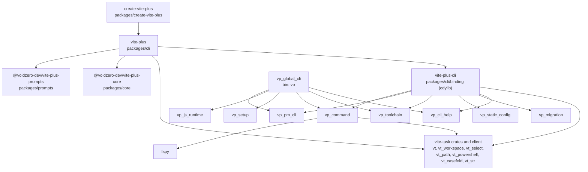
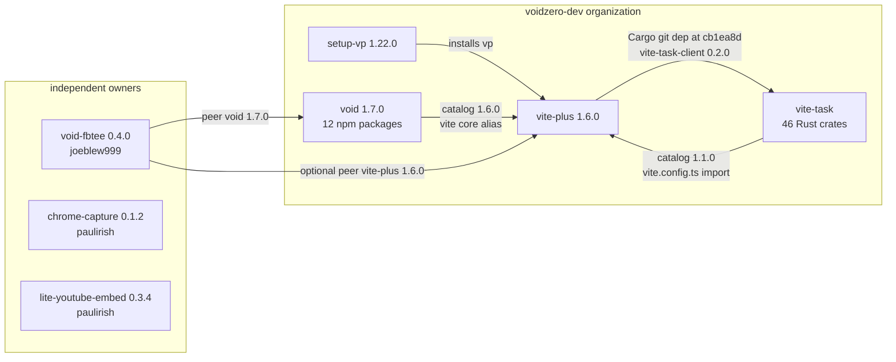

# 01 Repository map

This document is the inventory of the snapshot at `/Users/darkvoid/GitSources/src.voidzero`. The snapshot holds seven independent Git repositories at seven pinned commits. It is not one monorepo. Four repositories belong to the `voidzero-dev` organization. Three repositories belong to other owners. This map pins every repository and counts every workspace project. It names each package and crate, draws the directory trees, and gives a routing table from a reader goal to the files that answer it. Documents 02 to 17 own the behaviour. Document 00 states the thesis. Documents 18 and 19 hold the comparisons and the glossary. This document owns the territory.

This file uses several short forms. API means Application Programming Interface. CD means Continuous Delivery. CI means Continuous Integration. CLI means Command-Line Interface. HTML means HyperText Markup Language. HTTP means HyperText Transfer Protocol. IPC means Inter-Process Communication. JSON means JavaScript Object Notation. NAPI means Native API. NPM means Node Package Manager. PGP means Pretty Good Privacy. PTY means Pseudo-Terminal. SDK means Software Development Kit. URL means Uniform Resource Locator. WASM means WebAssembly. The short form `vp` is the command name in Vite+. The short form `vt` is the internal crate prefix in Vite Task.

All paths in this document are relative to `/Users/darkvoid/GitSources/src.voidzero`. A citation has the form `path:line` or `path:line-line`. A short citation that starts with a colon continues the file named just before it. The exploration spec is `../spec.md`. The source code is the authority. Where the spec file and the code disagree, this document follows the code and states the difference.

## 1. The seven pinned repositories

The table below is the pin table. It gives the repository directory, the Git remote, the owner, the head commit, the commit date, the package version, the license, the disk size, and the file count.

| Directory | Remote | Owner | Commit | Date | Version | License | `du -sh` | Source size | Files |
|-----------|--------|-------|--------|------|---------|---------|----------|-------------|-------|
| `void` | `git@github.com:voidzero-dev/void.git` | voidzero-dev | `f254d1ec477b6b2af2c02fa427bd9d196316ee07` | 2026-11-11 | `void` 1.7.0 | MIT, Cloudflare, Inc. | 80 MiB | 32.2 MiB | 2,960 |
| `vite-plus` | `git@github.com:voidzero-dev/vite-plus.git` | voidzero-dev | `794a96acd52e12216b3fe4eb02026637962cd315` | 2026-11-11 | `vite-plus` 1.6.0 | MIT, VoidZero Inc. | 79 MiB | 18.9 MiB | 5,409 |
| `vite-task` | `git@github.com:voidzero-dev/vite-task.git` | voidzero-dev | `95d8da2fc1f06cfe8d176b30b608ed540efab066` | 2026-11-10 | `@voidzero-dev/vite-task-client` 0.2.0 | MIT, VoidZero Inc. | 20 MiB | 4.4 MiB | 1,667 |
| `setup-vp` | `git@github.com:voidzero-dev/setup-vp.git` | voidzero-dev | `ee6805d1c428a397d5c7d3fa4111f8a7e5af2136` | 2026-11-09 | `setup-vp` 1.22.0 (private) | MIT, VoidZero Inc. | 7.3 MiB | 2.4 MiB | 158 |
| `void-fbtee` | `git@github.com:joeblew999/void-fbtee.git` | joeblew999 | `6784d295baf4af878f33a73d76ec725f2f27e3a9` | 2026-11-12 | `void-fbtee` 0.4.0 | MIT, Gerard Webb | 2.3 MiB | 0.8 MiB | 182 |
| `chrome-capture` | `git@github.com:paulirish/chrome-capture.git` | paulirish | `87c3096cb8d0186cb6cb68d8b5ed00af87934bd4` | 2026-11-10 | `chrome-capture` 0.1.2 | Apache-2.0 | 652 KiB | 250 KiB | 31 |
| `lite-youtube-embed` | `git@github.com:paulirish/lite-youtube-embed.git` | paulirish | `674a402883c668066f940f08e757a11528299ef8` | 2025-11-10 | `lite-youtube-embed` 0.3.4 | Apache-2.0 | 384 KiB | 40 KiB | 21 |

The version column gives the main published package in each repository. In `void` it is `void`, in `vite-plus` it is `vite-plus`, and in `vite-task` it is `@voidzero-dev/vite-task-client`. In `setup-vp` it is the private root package. The `void-fbtee`, `chrome-capture`, and `lite-youtube-embed` repositories each publish one package. The `lite-youtube-embed` commit date is 2025-11-10, one year before the other six commits. The snapshot pins the commit above and states no reason for the older date.

### 1.1 How the numbers were counted

The commit and date columns come from `git -C <directory> log -1 --format='%H %ad' --date=short`. The remote comes from `git -C <directory> remote -v`. The version column comes from the `package.json` file of the package named in the version cell. The license column comes from the repository `LICENSE` file and the `license` field of the root package manifest.

The `du -sh` column counts the whole directory, including `.git`. The source size column counts regular files only. It excludes every path under `.git/` and every path under `node_modules/`. The command is `find DIR -type f -not -path '*/.git/*' -not -path '*/node_modules/*'` with the byte size summed by `stat -f '%z'`. One mebibyte is 1,048,576 bytes.

The file count column uses the same `find` expression and `wc -l`. The count holds regular files only. Symbolic links are not regular files. The count also excludes tracked files under `node_modules/`. The index count comes from `git -C DIR ls-files | wc -l`. Three repositories need a reconciliation. `void` has 2,960 counted files, 2 symbolic links, and 2,962 Git index entries. `vite-plus` has 5,409 counted files, one tracked fixture file under `node_modules/`, and 5,410 index entries. `vite-task` has 1,667 counted files, 18 symbolic links, 16 tracked fixture files under `node_modules/`, one Git submodule entry, and 1,702 index entries. The submodule is `crates/fspy_detours_sys/detours`, which points at `microsoft/Detours` (`vite-task/.gitmodules:1-3`). The snapshot holds the empty submodule directory only, because the submodule contents are not checked out. The other four repositories have equal file and index counts. The working tree has no installed dependency tree at a repository root. It has test fixture `node_modules` directories: one in `vite-plus` and seven in `vite-task`. The fixture count comes from `find DIR -type d -name node_modules -not -path '*/.git/*'`. It has none in the other five repositories.

**Aha:** The snapshot mixes four organization repositories with three independently owned ones. Ownership, not topic, separates the set. The `voidzero-dev` group is a dependency cluster with one tool-level cycle. `setup-vp` installs Vite+. Vite+ embeds Vite Task. Vite Task builds itself with Vite+. Void uses Vite+. The `joeblew999` repository is an add-on to Void. The two `paulirish` repositories are standalone browser tools with no manifest link to VoidZero. Any claim that the directory is a product monorepo is false.

### 1.2 One correction to the spec license column

The spec table lists MIT for all seven repositories. The source shows Apache-2.0 for two repositories. `chrome-capture/package.json:52` sets `"license": "Apache-2.0"`. `lite-youtube-embed/package.json:5` sets `"license": "Apache-2.0"`. The `LICENSE` file in `chrome-capture` is the Apache License, Version 2.0. The `LICENSE` file in `lite-youtube-embed` is also the Apache License, Version 2.0. The `void-fbtee` copyright holder is Gerard Webb, not VoidZero (`void-fbtee/LICENSE:3`). The `void` copyright holder is Cloudflare, Inc., although the remote belongs to `voidzero-dev` (`void/LICENSE:1-3`). This document records that fact and does not state its history. Document 16 must state the `void-fbtee` holder, because the spec table gives no owner. Document 17 must use the Apache facts, because the spec table says MIT.

## 2. Workspace configuration

Every repository that has a workspace names it in one or two files. Rust repositories use `Cargo.toml` with a `[workspace]` table. Most JavaScript repositories use `pnpm-workspace.yaml`. The two browser tools are single packages with no workspace. Some root `package.json` files also have a `workspaces` field. None of the seven root manifests has that field. The sections below give the exact source.

### 2.1 `void` workspace

`void` is a pnpm workspace only. It has no Rust code. The `void` manifest sets `"private": true` and has no `workspaces` field (`void/package.json:1-3`). The workspace file lists six entries, including one explicit fixture directory.

```yaml
# void/pnpm-workspace.yaml:1-8
packages:
  - docs
  - packages/*
  - platform
  - platform/packages/*
  - playground/*
  # Dependencies for the Kit 2 compatibility test; app source comes from the Kit 3 playground.
  - test/fixtures/sveltekit-v2
```

The globs resolve to 47 workspace projects. The count is 1 under `docs`, 12 under `packages`, 1 for `platform`, 6 under `platform/packages`, 26 under `playground`, and 1 for `test/fixtures/sveltekit-v2`. The source comment uses "Kit" as short for SvelteKit. The fixture path `test/fixtures/sveltekit-v2` confirms that meaning. The `catalog` block fixes shared versions. It pins `vite` to `npm:@voidzero-dev/vite-plus-core@1.6.0` and `vite-plus` to `1.6.0` (`void/pnpm-workspace.yaml:33-34`). The same file declares package build permissions and overrides (`void/pnpm-workspace.yaml:12-23`, `void/pnpm-workspace.yaml:131-147`).

### 2.2 Vite+ workspace

Vite+ has both a pnpm workspace and a Cargo workspace. The pnpm workspace has five entries. Four of them name directories that are absent from the snapshot. The four entries are both `rolldown` entries and both `vite` entries.

```yaml
# vite-plus/pnpm-workspace.yaml:1-6
packages:
  - packages/*
  - rolldown
  - rolldown/packages/rolldown
  - vite
  - vite/packages/vite
```

`packages/*` resolves to five directories. The `rolldown` and `vite` entries do not resolve. Those names are in the repository `.gitignore` (`vite-plus/.gitignore:8-10`). The snapshot holds no such directories. The workspace file also sets a large dependency catalog, `minimumReleaseAge: 1440` in minutes, overrides that map `vite` to the workspace core package, and patched dependencies (`vite-plus/pnpm-workspace.yaml:7-190`).

The Cargo workspace has three member entries.

```toml
# vite-plus/Cargo.toml:1-10
[workspace]
resolver = "3"
members = ["bench", "crates/*", "packages/cli/binding"]
# vp_trampoline is a standalone package.
# It needs a separate release profile and a crate-local build-std config.
# Cargo ignores `panic` in per-package profile overrides.
# See crates/vp_trampoline/Cargo.toml.
# oxc-node is vendored upstream source (see packages/tools/src/patch-oxc-node.ts);
# excluding it keeps it out of workspace lints, like the nested rolldown workspace.
exclude = ["crates/vp_trampoline", "oxc-node"]
```

The members are the `bench` crate, 14 of the 15 directories under `crates/`, and the Native API binding crate at `vite-plus/packages/cli/binding`. The excluded `vp_trampoline` is still a crate directory under `crates/`, but it is not a workspace member. The `exclude` list also names `oxc-node`, which is absent from the snapshot. The workspace package metadata sets Rust edition 2024 and minimum Rust 1.92.0 (`vite-plus/Cargo.toml:21-27`).

The Native API binding is a Rust crate with a Node.js addon output.

```toml
# vite-plus/packages/cli/binding/Cargo.toml:1-8
[package]
name = "vite-plus-cli"
version = "1.6.0"
authors.workspace = true
edition.workspace = true
license.workspace = true
publish = false
rust-version.workspace = true
```

The crate declares `crate-type = ["cdylib"]` and imports `napi` and `napi-derive` (`vite-plus/packages/cli/binding/Cargo.toml:21-22`, `vite-plus/packages/cli/binding/Cargo.toml:58-59`). A `cdylib` is a dynamic library with a C-compatible interface. This crate is the bridge from the TypeScript front end to the Rust core.

### 2.3 Vite Task workspace

Vite Task has a pnpm workspace with three projects and a Cargo workspace with 46 crates. The three projects are the root package `vite-task-monorepo`, `packages/tools`, and `packages/vite-task-client` (`vite-task/package.json:2-3`).

```yaml
# vite-task/pnpm-workspace.yaml:1-4
packages:
  - .
  - packages/tools
  - packages/vite-task-client
```

The first entry is the repository root itself. The root manifest supplies the `prepare` script `vp config` and the build script for the client types (`vite-task/package.json:6-9`). The catalog pins `vite` to `npm:@voidzero-dev/vite-plus-core@1.1.0` and `vite-plus` to `1.1.0` (`vite-task/pnpm-workspace.yaml:50-51`). Therefore Vite Task builds itself with an older Vite+ than the 1.6.0 snapshot.

```toml
# vite-task/Cargo.toml:1-3
[workspace]
resolver = "3"
members = ["crates/*"]
```

All 46 crate directories are members. The workspace sets `publish = false` for all members (`vite-task/Cargo.toml:9`). Two binaries come from one crate.

```toml
# vite-task/crates/vt_bin/Cargo.toml:10-16
[[bin]]
name = "vt"
path = "src/main.rs"

[[bin]]
name = "vtt"
path = "src/vtt/main.rs"
```

The `justfile` is the command surface for the `just` command runner. It defines `just fmt`, `just check`, `just test`, `just lint`, and `just doc` (`vite-task/justfile:26-58`). The `just test` command runs `cargo test` (`vite-task/justfile:38-39`).

### 2.4 `setup-vp` workspace

`setup-vp` has a `pnpm-workspace.yaml` with no `packages` key. The workspace is the single root project. The file declares a minimum release age exclusion list, a catalog, an override, and a peer rule.

```yaml
# setup-vp/pnpm-workspace.yaml:6-15
catalog:
  vite: npm:@voidzero-dev/vite-plus-core@1.3.0
  vite-plus: 1.3.0
overrides:
  vite@*: "catalog:"
peerDependencyRules:
  allowAny:
    - vite
  allowedVersions:
    vite: "*"
```

The root manifest is `setup-vp` version 1.22.0 and `"private": true` (`setup-vp/package.json:1-5`). It has no `workspaces` field. The repository has no Rust code and no Cargo workspace.

### 2.5 `void-fbtee` workspace

`void-fbtee` is a two-project pnpm workspace.

```yaml
# void-fbtee/pnpm-workspace.yaml:1-3
packages:
  - packages/*
  - apps/*
```

`packages/*` resolves to `packages/void-fbtee`. `apps/*` resolves to `apps/example`. The catalog pins six keys: five runtime packages and the test runner `vitest` 5.1.0. The five packages connect this repository to the two larger repositories: `vite` as the Vite+ core, `vite-plus` 1.6.0, `void` 1.7.0, `@void/md` 1.7.0, and `@void/react` 1.7.0 (`void-fbtee/pnpm-workspace.yaml:19-25`).

### 2.6 Browser tool repositories

Neither browser tool has a workspace file. `chrome-capture` is one package with a `pnpm-lock.yaml` and no `pnpm-workspace.yaml`. `lite-youtube-embed` is one package with a `package-lock.json` and no workspace file. Both are single-package repositories.

### 2.7 Workspace counts at a glance

| Repository | Workspace system | Projects or members | Source |
|-----------|------------------|---------------------|--------|
| `void` | pnpm | 47 | `void/pnpm-workspace.yaml:1-8` |
| `vite-plus` | pnpm | 5 projects; 4 declared entries unresolved | `vite-plus/pnpm-workspace.yaml:1-6` |
| `vite-plus` | Cargo | 16 (`bench`, 14 crates, 1 binding) | `vite-plus/Cargo.toml:3` |
| `vite-task` | pnpm | 3 | `vite-task/pnpm-workspace.yaml:1-4` |
| `vite-task` | Cargo | 46 | `vite-task/Cargo.toml:3` |
| `setup-vp` | pnpm | 1 (root only) | `setup-vp/pnpm-workspace.yaml:1-15` |
| `void-fbtee` | pnpm | 2 | `void-fbtee/pnpm-workspace.yaml:1-3` |
| `chrome-capture` | none | 1 | `chrome-capture/package.json` |
| `lite-youtube-embed` | none | 1 | `lite-youtube-embed/package.json` |

## 3. Annotated directory trees

Each tree stops at depth 2 or 3. The annotation on each line is one sentence or one phrase. An entry is one file or one directory in a directory listing. A count in a tree annotation comes from the directory listing of that directory. The trees omit `.git` and `node_modules`.

### 3.1 `void`

```text
void/
├── docs/                       VitePress static site generator; guide, reference, integrations
│   ├── guide/                  35 entries: routing, pages, database, deployment, platform
│   ├── reference/              api, cli, config, resource-inference, structure
│   ├── integrations/           framework and Cloudflare integration guides
│   └── .vitepress/             documentation theme and build configuration
├── packages/                   12 published npm packages
│   ├── void/                   the core framework package and the `void` CLI
│   ├── react/                  React pages, server rendering, forms, navigation
│   ├── vue/                    Vue pages, server rendering, forms, navigation
│   ├── svelte/                 Svelte pages, server rendering, forms, navigation
│   ├── solid/                  SolidJS pages, server rendering, forms, navigation
│   ├── md/                     Markdown pages with layouts and client-hydrated islands
│   ├── edge/                   routing, headers, and static asset helpers
│   ├── isr/                    incremental revalidation and cache helpers
│   ├── deploy-core/            deployment contracts, manifests, resource plans
│   ├── deploy-cloudflare/      Cloudflare deployment primitives
│   ├── platform/               `@void/platform`: runtime and installation contracts
│   └── create-void/            project scaffolding command
├── platform/                   the self-hosted team platform application
│   ├── packages/               6 private packages: api, dashboard, dispatch, email-gateway, proxy, tail
│   ├── meta/                   architecture, operations, lessons, design documents
│   └── deployments/            deployment descriptor for void-cloud.json
├── playground/                 26 local test applications
│   ├── react-pages/            React Pages mode
│   ├── vue-pages/              Vue Pages mode
│   ├── svelte-pages/           Svelte Pages mode
│   ├── solid-pages/            SolidJS Pages mode
│   ├── kitchen-sink/           broad feature coverage application
│   └── …                       21 more; the full list is the `void/playground/` directory
├── scripts/                    repository scripts; `void-dev-link.mjs`
├── test/                       integration, browser, and affected-test helpers
│   ├── fixtures/               sveltekit-v2 compatibility fixture
│   ├── terminal-demos/         terminal demonstration fixtures
│   └── …                       page contracts, sharding, integration helpers
├── AGENTS.md                   contributor and coding-agent guide
├── TESTING.md                  verification and test-selection guide
├── package.json                private root; scripts call `vp`
├── pnpm-workspace.yaml         workspace globs and dependency catalog
├── vite.config.ts              repository Vite configuration
└── void.config.ts              Void configuration for the repository
```

Two different things use the name platform. `void/packages/platform` is the npm package `@void/platform`. The top-level `void/platform` directory is the team platform application and its six private packages.

`void/packages/void/src` holds 71 entries. The `void/packages/void/src/cli` directory alone has 203 entries. The `void/packages/void/src/runtime` directory has 79 entries for typed API modules such as `kv.ts`, `durable.ts`, `live.ts`, `email.ts`, and `ai.ts`.

### 3.2 `vite-plus`

```text
vite-plus/
├── crates/                     15 crate directories; 14 members plus the excluded trampoline
│   ├── vp_global_cli/          global `vp` binary; commands, help, js_executor
│   ├── vp_command/             command execution, external tools, shell shims
│   ├── vp_pm_cli/              package manager detection, download, dispatch
│   ├── vp_js_runtime/          Node.js download, PGP verification, caching
│   ├── vp_setup/               shared install logic for upgrade and installer
│   ├── vp_toolchain/           toolchain manifest and version graph
│   ├── …                       9 more: vp_cli_help, vp_cli_snapshots, vp_error,
│   │                           vp_installer, vp_migration, vp_pm_cli_macros,
│   │                           vp_shared, vp_static_config, vp_trampoline
├── packages/                   5 JavaScript packages
│   ├── cli/                    npm `vite-plus`; `vp`, `vpr`, `vpx`; Native API binding
│   ├── core/                   npm `@voidzero-dev/vite-plus-core`; bundled Vite and tsdown
│   ├── create-vite-plus/       project scaffolder
│   ├── prompts/                shared prompt library
│   └── tools/                  private repository scripts
├── docs/                       VitePress static site generator
│   ├── guide/                  32 entries, including run, env, cache, monorepo, migrate
│   ├── guide/package-management/  41 entries, one per package-manager command
│   ├── config/                 10 entries for `vite.config.ts` configuration
│   └── .vitepress/             documentation build configuration
├── rfcs/                       48 design proposal documents
├── bench/                      Cargo `vite-plus-benches`; monorepo generator and benchmark
├── ecosystem-ci/               tests against real ecosystem projects
├── docker/                     container build assets
├── .cargo/config.toml          workspace environment and linker flags
├── HomebrewFormula/vp.rb       Homebrew formula for the `vp` binary
├── justfile                    development command surface
├── Cargo.toml                  Rust workspace and dependency catalog
├── pnpm-workspace.yaml         pnpm workspace and dependency catalog
└── vite.config.ts              repository Vite configuration
```

The `rfcs/` directory is the largest single collection of design proposals. It holds 48 Markdown files. Examples include `global-cli-rust-binary.md`, `install-command.md`, `js-runtime.md`, `env-command.md`, and `directory-layout.md`. A reader who needs the design reason behind a command should search this directory before reading the code.

### 3.3 `vite-task`

```text
vite-task/
├── crates/                     46 Rust crates in two families
│   ├── fspy/                   file-system proxy facade; spawn and trace a command
│   ├── fspy_preload_unix/      preload library that intercepts file calls
│   ├── fspy_preload_windows/   Windows injection library
│   ├── fspy_seccomp_unotify/   Linux seccomp user-notification supervisor
│   ├── fspy_shm/               shared-memory transport
│   ├── vt/                     task runner core; session, cache, execute, reporter
│   ├── vt_plan/                plan construction and execution graph
│   ├── vt_graph/               task graph and user task configuration
│   ├── vt_workspace/           package graph, filters, package manager detection
│   ├── vt_bin/                 binaries `vt` and `vtt`
│   └── …                       36 more
├── docs/                       task behaviour guides
│   ├── inputs.md               declared and traced task inputs
│   ├── concurrency.md          parallel execution limits
│   ├── cancellation.md         stop behaviour
│   ├── stdio.md                output modes
│   └── rfcs/                   dry-run and task-graph JSON designs
├── packages/                   2 JavaScript packages
│   ├── vite-task-client/       npm `@voidzero-dev/vite-task-client`
│   └── tools/                  private tooling, include the remote-cache server
├── playground/                 3-package manual test workspace with its own `pnpm-workspace.yaml`
│   ├── vite-task.json          empty `{}` root task configuration
│   ├── packages/app/           depends on `@playground/lib`
│   ├── packages/lib/           depends on `@playground/utils`
│   └── packages/utils/         no dependencies
├── .cargo/config.toml          warnings-as-errors and musl linker wrappers
├── justfile                    development command surface
├── deny.toml                   dependency license and source policy
└── vite.config.ts              imports `defineConfig` from `vite-plus`
```

The whole repository is Rust-first. It holds 293 Rust files, 32 TypeScript files, and 21 JavaScript files. The counts come from `find vite-task -type f -name '*.rs'`, and the same command with `*.ts` and `*.js`. The TypeScript files are almost all in the client package and the playground. The `vite-task/playground` directory is a second, nested pnpm workspace (`vite-task/playground/pnpm-workspace.yaml:1-2`). The root workspace does not include it.

### 3.4 `setup-vp`

```text
setup-vp/
├── src/                        115 TypeScript files; GitHub Actions entry and shared logic
│   ├── index.ts                GitHub Actions main and post entry
│   ├── inputs.ts               input parsing
│   ├── types.ts                input and output types
│   ├── install-viteplus.ts     Vite+ download and installation
│   ├── cache-restore.ts        project dependency cache restore
│   ├── cache-save.ts           project dependency cache save
│   ├── toolchain-cache.ts      Vite+, Node.js, and package-manager cache
│   ├── ci/                     shared adapters for GitHub Actions, GitLab, and Azure
│   ├── gitlab/                 GitLab-specific entry, templates, tests
│   └── azure/                  Azure-specific entry, templates, tests
├── gitlab/                     GitLab component templates and bootstrap scripts
│   ├── setup-vp.yml            Linux component definition
│   ├── setup-vp-windows.yml    Windows component definition
│   └── bootstrap.sh, .ps1      shell bootstrap scripts
├── azure/                      Azure Pipelines template and bootstrap scripts
│   ├── setup-vp.yml            template parameters and steps
│   └── bootstrap.sh, .ps1      shell bootstrap scripts
├── dist/                       committed build output
│   ├── index.mjs               GitHub Actions bundle
│   ├── gitlab/index.mjs        GitLab standalone bundle
│   └── azure/index.mjs         Azure standalone bundle
├── rfcs/                       GitLab and Azure integration designs
├── test/                       cache, reuse, and path verification scripts
├── action.yml                  GitHub Actions metadata; runs `node24`
└── package.json                version 1.22.0, private
```

The GitHub Actions entry is declared in the action file.

```yaml
# setup-vp/action.yml:78-80
runs:
  using: node24
  main: dist/index.mjs
```

The `dist/` tree holds three bundles. The GitLab and Azure bundles are standalone, because each system downloads one file (`setup-vp/AGENTS.md:16`).

### 3.5 `void-fbtee`

```text
void-fbtee/
├── packages/void-fbtee/        the published `void-fbtee` package, version 0.4.0
│   ├── src/                    18 source files: plugin, middleware, react, cli, catalogs
│   ├── test/                   package tests
│   └── skills/                 agent skill shipped with the package
├── apps/example/               a complete Void application that uses the package
│   ├── routes/                 server routes
│   ├── pages/                  pages
│   ├── i18n/                   message catalogs
│   ├── db/                     database schema
│   └── void.config.ts          Void configuration
├── e2e/                        end-to-end browser and deployment tests
├── plans/                      four design plan documents
├── pnpm-workspace.yaml         two-project workspace
└── README.md                   user guide for install, usage, and upgrade
```

### 3.6 `chrome-capture`

```text
chrome-capture/
├── src/
│   ├── index.ts                Chrome DevTools Protocol recorder and Chrome launcher
│   ├── playwright.ts           Playwright adapter
│   └── cli.ts                  command-line entry
├── test/
│   ├── recorder.test.ts        recorder unit test
│   └── integration.test.ts     browser integration test
├── examples/                   Puppeteer, Playwright, and raw protocol examples
├── benchmarks/                 frame-rate, variable-frame-rate, and codec benchmarks
├── tsdown.config.ts            library build configuration
└── package.json                version 0.1.2, Apache-2.0
```

### 3.7 `lite-youtube-embed`

```text
lite-youtube-embed/
├── src/
│   ├── lite-yt-embed.js        custom element `lite-youtube`
│   └── lite-yt-embed.css       facade styles
├── variants/                   8 usage examples: solo, yt (typical embed), pe (progressive enhancement), title, params, js-api (player interface), multiple-embeds, custom-poster-image
├── testpage/                   two poster-image test pages
├── index.html                  demo page
├── readme.md                   usage and performance comparison
└── package.json                version 0.3.4, Apache-2.0
```

The custom element is defined at the end of the source file: `customElements.define('lite-youtube', LiteYTEmbed)` (`lite-youtube-embed/src/lite-yt-embed.js:241`).

## 4. Workspace members

### 4.1 Vite+ Rust crates (15 in `crates/`)

The `Cargo.toml` `description` field is absent on 13 of the 15 crates. Only `vp_cli_snapshots` and `vp_trampoline` set it (`vite-plus/crates/vp_cli_snapshots/Cargo.toml:9`, `vite-plus/crates/vp_trampoline/Cargo.toml:29`). The role column therefore comes from the crate documentation comment at the top of `src/lib.rs`, the module names, and the crate dependencies. A dagger (†) marks a role that is an inference rather than a manifest description.

| Crate | Directory | Role | Evidence |
|-------|-----------|------|----------|
| `vp_cli_help` | `vite-plus/crates/vp_cli_help` | Shared help text and diagnostics for every Vite+ command-line interface. | `vite-plus/crates/vp_cli_help/src/lib.rs:7` |
| `vp_cli_snapshots` | `vite-plus/crates/vp_cli_snapshots` | Pseudo-Terminal snapshot test suite for the CLI. The manifest says "dev-only, never packaged". | `vite-plus/crates/vp_cli_snapshots/Cargo.toml:9`; `vite-plus/justfile:96-98` |
| `vp_command` | `vite-plus/crates/vp_command` | Runs external commands and tools. It also holds the Windows PowerShell shim.† | `vite-plus/crates/vp_command/src/lib.rs:16-20`, `vite-plus/crates/vp_command/src/external_tool.rs`, `vite-plus/crates/vp_command/src/ps1_shim.rs` |
| `vp_error` | `vite-plus/crates/vp_error` | One error enum shared by the CLI crates.† | `vite-plus/crates/vp_error/src/lib.rs:9-10` |
| `vp_global_cli` | `vite-plus/crates/vp_global_cli` | The standalone global `vp` binary. It can run without a pre-installed Node.js. | `vite-plus/crates/vp_global_cli/src/main.rs:1-5`, `vite-plus/crates/vp_global_cli/Cargo.toml:10-12` |
| `vp_installer` | `vite-plus/crates/vp_installer` | Standalone Windows installer binary `vp-setup.exe`. | `vite-plus/crates/vp_installer/src/main.rs:1-6` |
| `vp_js_runtime` | `vite-plus/crates/vp_js_runtime` | Downloads, verifies, and caches Node.js runtimes. It verifies the PGP signature of the checksum file. | `vite-plus/crates/vp_js_runtime/src/lib.rs:1-8` |
| `vp_migration` | `vite-plus/crates/vp_migration` | Source rewrite engine for `vp migrate`. It holds import, script, and package rewrites.† | `vite-plus/crates/vp_migration/src/lib.rs:9-20`, `vite-plus/crates/vp_migration/src/import_rewriter.rs` |
| `vp_pm_cli` | `vite-plus/crates/vp_pm_cli` | Package-manager detection, download, command surface, and dispatch. | `vite-plus/crates/vp_pm_cli/src/lib.rs:1-6` |
| `vp_pm_cli_macros` | `vite-plus/crates/vp_pm_cli_macros` | Procedural macros for the package-manager command surface.† | `vite-plus/crates/vp_pm_cli_macros/src/lib.rs:20` |
| `vp_setup` | `vite-plus/crates/vp_setup` | Shared installation logic for `vp upgrade` and `vp-setup.exe`. | `vite-plus/crates/vp_setup/src/lib.rs:1-8` |
| `vp_shared` | `vite-plus/crates/vp_shared` | Directory resolution, environment variables, headers, HTTP helpers, and output. | `vite-plus/crates/vp_shared/src/lib.rs:1`, `vite-plus/crates/vp_shared/src/dirs.rs`, `vite-plus/crates/vp_shared/src/http.rs` |
| `vp_static_config` | `vite-plus/crates/vp_static_config` | Reads `vite.config.*` without running JavaScript. It extracts pure JSON literals. | `vite-plus/crates/vp_static_config/src/lib.rs:1-5` |
| `vp_toolchain` | `vite-plus/crates/vp_toolchain` | Toolchain manifest, versions, and the tool relationship graph. | `vite-plus/crates/vp_toolchain/src/lib.rs:9-15` |
| `vp_trampoline` | `vite-plus/crates/vp_trampoline` | Minimal Windows shim binary. It starts the active `vp.exe`. It is outside the workspace. | `vite-plus/crates/vp_trampoline/src/main.rs:1-10`, `vite-plus/crates/vp_trampoline/Cargo.toml:1` |

Two more workspace members live outside `crates/`:

| Member | Directory | Role |
|--------|-----------|------|
| `vite-plus-benches` | `vite-plus/bench` | The Criterion benchmark harness with `workspace_load` and a monorepo generator (`vite-plus/bench/Cargo.toml:20-22`). |
| `vite-plus-cli` | `vite-plus/packages/cli/binding` | The Native API addon. It exports `run()` and the tool resolvers to the TypeScript front end (`vite-plus/packages/cli/binding/src/lib.rs`, `vite-plus/packages/cli/binding/index.cjs`). |

### 4.2 Vite+ JavaScript packages (5)

| Directory | NPM name | Version | Role | Evidence |
|-----------|----------|---------|------|----------|
| `packages/cli` | `vite-plus` | 1.6.0 | Main package. It ships the `vp`, `vpr`, and `vpx` commands and the documentation copy. | `vite-plus/packages/cli/package.json:2-3`, `vite-plus/packages/cli/package.json:16-20` |
| `packages/core` | `@voidzero-dev/vite-plus-core` | 1.6.0 | Bundled Vite, tsdown, and Rolldown entry points. It is the target of the `vite` alias. | `vite-plus/packages/core/package.json:2-4`, `vite-plus/packages/core/package.json:37-60` |
| `packages/create-vite-plus` | `create-vite-plus` | 1.6.0 | Project scaffolding command. It depends on the `vite-plus` package. | `vite-plus/packages/create-vite-plus/package.json:2-3`, `vite-plus/packages/create-vite-plus/package.json:25-27` |
| `packages/prompts` | `@voidzero-dev/vite-plus-prompts` | 1.6.0 | Interactive prompt library shared by commands. | `vite-plus/packages/prompts/package.json:2-3`, `vite-plus/packages/cli/package.json:380` |
| `packages/tools` | `@voidzero-dev/vite-plus-tools` | 0.0.0, private | Repository scripts: local registry, trampoline build, release tooling. | `vite-plus/packages/tools/package.json:2-8` |

The `vite-plus` package declares three binaries: `vp`, `vpr`, and `vpx` (`vite-plus/packages/cli/package.json:16-20`). The `vpr` shim is the same bundle as `vp`, and the TypeScript entry rewrites the argument list to `run` when the program name is `vpr` (`vite-plus/packages/cli/src/bin.ts:111-118`). The `vpx` shim runs a script file with the package loader, or a package binary from `node_modules/.bin` (`vite-plus/packages/cli/bin/vpx:7-9`).

`tsdown` is a library bundler. Rolldown is a bundler. The `core` package re-exports their entry points: `./pack` for tsdown, and `./rolldown` and `./rolldown/config` for Rolldown (`vite-plus/packages/core/package.json:37-60`).

### 4.3 Vite Task `fspy` family (17 crates)

The `fspy` family traces real file access. It is the reason the cache key describes observed inputs rather than declared inputs (`vite-task/docs/inputs.md`, `vite-task/crates/fspy/src/lib.rs:13-15`).

| Crate | Role | Evidence |
|-------|------|----------|
| `fspy` | Facade. It builds the command, starts the trace, and returns the recorded accesses. | `vite-task/crates/fspy/src/lib.rs:13-15`, `vite-task/crates/fspy/src/command.rs:19-25` |
| `fspy_shared` | Shared IPC message types and Windows support. | `vite-task/crates/fspy_shared/src/lib.rs:1-4` |
| `fspy_shared_unix` | Unix spawn, exec, payload, and executable-format helpers. | `vite-task/crates/fspy_shared_unix/src/lib.rs:3-12` |
| `fspy_shm` | Shared-memory mapping with Unix and Windows implementations. | `vite-task/crates/fspy_shm/src/lib.rs:4-13` |
| `fspy_preload_unix` | Preloaded library that intercepts file calls on Unix. It is a `cdylib`. | `vite-task/crates/fspy_preload_unix/src/lib.rs:1-11`, `vite-task/crates/fspy_preload_unix/Cargo.toml` `crate-type` |
| `fspy_preload_windows` | Injected library for Windows. It is a `cdylib`. | `vite-task/crates/fspy_preload_windows/src/lib.rs:1-4` |
| `fspy_seccomp_unotify` | Linux seccomp user-notification supervisor and target. | `vite-task/crates/fspy_seccomp_unotify/src/lib.rs:3-10` |
| `fspy_client_unix` | Reusable Unix client that reports file accesses to the supervisor. | `vite-task/crates/fspy_client_unix/src/lib.rs:1-4` |
| `fspy_nostd` | No-std primitives for signal handlers, post-fork code, and runtime startup. | `vite-task/crates/fspy_nostd/src/lib.rs:1-6` |
| `fspy_nostd_alloc` | Allocator that never touches the C library allocator. | `vite-task/crates/fspy_nostd_alloc/src/lib.rs:1-7` |
| `fspy_detours_sys` | Generated foreign-function bindings to Microsoft Detours, a Windows function-interception library. | `vite-task/crates/fspy_detours_sys/src/lib.rs:1-12` |
| `fspy_benchmark` | Benchmark harness for the trace path. | `vite-task/crates/fspy_benchmark/src/main.rs:1-8` |
| `fspy_benchmark_launcher` | Launcher for the benchmark targets. | `vite-task/crates/fspy_benchmark_launcher/src/main.rs:1-8` |
| `fspy_benchmark_target` | Benchmark target process. | `vite-task/crates/fspy_benchmark_target/src/main.rs:1-7` |
| `fspy_benchmark_static_target` | Statically linked benchmark target. | `vite-task/crates/fspy_benchmark_static_target/src/main.rs:1-5` |
| `fspy_e2e` | End-to-end test binary. | `vite-task/crates/fspy_e2e/src/main.rs:1-8` |
| `fspy_test_bin` | Small binary used by tests. | `vite-task/crates/fspy_test_bin/src/main.rs:1-8` |

### 4.4 Vite Task `vt` family (29 crates)

A citation with no line number names the crate entry file only. The file shows the crate surface, not one specific behaviour.

| Crate | Role | Evidence |
|-------|------|----------|
| `vt` | Task runner core. It holds `Session`, the cache, execution, reporters, and the native API client. | `vite-task/crates/vt/src/lib.rs:1-10`, `vite-task/crates/vt/src/session/mod.rs:1-5` |
| `vt_bin` | The `vt` and `vtt` binaries. It starts a multi-thread Tokio runtime and runs `Session::init`. | `vite-task/crates/vt_bin/src/main.rs:7`, `vite-task/crates/vt_bin/src/main.rs:15`, `vite-task/crates/vt_bin/Cargo.toml:10-16` |
| `vt_plan` | Plan construction, environment handling, execution graph, and remote-cache plan step. | `vite-task/crates/vt_plan/src/lib.rs:1-11` |
| `vt_graph` | Task graph, user configuration, glob resolution, and lazy graph. | `vite-task/crates/vt_graph/src/lib.rs:1-7` |
| `vt_graph_ser` | Serializes a task graph by stable node key. | `vite-task/crates/vt_graph_ser/src/lib.rs:7-8` |
| `vt_workspace` | Package graph, package filters, and package-manager detection. | `vite-task/crates/vt_workspace/src/lib.rs:1-5` |
| `vt_materialized_artifact` | Writes an embedded file to disk on demand, once per hash. | `vite-task/crates/vt_materialized_artifact/src/lib.rs:1-13` |
| `vt_materialized_artifact_macros` | The `artifact!` macro that embeds a file at compile time. | `vite-task/crates/vt_materialized_artifact_macros/src/lib.rs:1-8` |
| `vt_remote_cache` | Client for the remote cache server. Keys and values are opaque bytes. | `vite-task/crates/vt_remote_cache/src/lib.rs:1-2` |
| `vt_ipc_shared` | IPC request and response frames shared by the runner and tools. | `vite-task/crates/vt_ipc_shared/src/lib.rs:5`, `vite-task/crates/vt_ipc_shared/src/lib.rs:30` |
| `vt_ipc_str` | String type that crosses the IPC boundary without allocation. | `vite-task/crates/vt_ipc_str/src/lib.rs:44-48` |
| `vt_socket_ipc` | Unix socket and Windows transport for IPC. | `vite-task/crates/vt_socket_ipc/src/lib.rs:1-10` |
| `vt_client` | Client used inside a task to ask the runner for environment data and report facts. | `vite-task/crates/vt_client/src/lib.rs:10-14` |
| `vt_client_napi` | Node.js addon that exports a `load()` factory for the runner client. | `vite-task/crates/vt_client_napi/src/lib.rs:1-15` |
| `vt_server` | Runner-side IPC server. It accepts connections and answers requests. | `vite-task/crates/vt_server/src/lib.rs:13-14` |
| `vt_pty_terminal` | Pseudo-terminal wrapper and terminal geometry. | `vite-task/crates/vt_pty_terminal/src/lib.rs:1-4` |
| `vt_pty_terminal_test` | Test support for the pseudo-terminal. | `vite-task/crates/vt_pty_terminal_test/src/lib.rs` |
| `vt_pty_terminal_test_client` | Shared test client for pseudo-terminal cases. | `vite-task/crates/vt_pty_terminal_test_client/src/lib.rs` |
| `vt_shell` | Parses simple commands and `&&` chains without a shell. | `vite-task/crates/vt_shell/src/lib.rs:1-4` |
| `vt_powershell` | Routes `.cmd` files through PowerShell on Windows. | `vite-task/crates/vt_powershell/src/lib.rs:1-14` |
| `vt_select` | Interactive task selector with fuzzy matching. | `vite-task/crates/vt_select/src/lib.rs:1-7` |
| `vt_tui` | Terminal user interface: app, components, configuration, and logging. | `vite-task/crates/vt_tui/src/lib.rs:1-9` |
| `vt_glob` | Environment-name globs and path globs with gitignore semantics. | `vite-task/crates/vt_glob/src/lib.rs:1-11` |
| `vt_casefold` | Strings that compare by a case rule and keep their spelling. | `vite-task/crates/vt_casefold/src/lib.rs:1-7` |
| `vt_path` | Absolute and relative path types used across the crates. | `vite-task/crates/vt_path/src/lib.rs:12-15` |
| `vt_str` | Small string type used across the crates. | `vite-task/crates/vt_str/src/lib.rs:12-13` |
| `vt_snapshot_test` | Snapshot test helper. | `vite-task/crates/vt_snapshot_test/src/lib.rs` |
| `vt_subprocess_test` | Subprocess test helper. | `vite-task/crates/vt_subprocess_test/src/lib.rs` |
| `vt_preload_test_lib` | Preload library for tests. It is a `cdylib`. | `vite-task/crates/vt_preload_test_lib/src/lib.rs` |

The repository guide gives the stages in this order: `vt_bin`, then `vt_graph`, then `vt_plan`, then `vt` (`vite-task/AGENTS.md:5`). `vt_workspace` supplies the package graph, and the `fspy` crates trace file access (`vite-task/AGENTS.md:5`).

### 4.5 Vite Task JavaScript packages (2)

| Directory | NPM name | Version | Role | Evidence |
|-----------|----------|---------|------|----------|
| `packages/vite-task-client` | `@voidzero-dev/vite-task-client` | 0.2.0 | Gives the runner precise cache information from inside a tool. It loads the native addon lazily. | `vite-task/packages/vite-task-client/package.json:2-4`, `vite-task/crates/vt_client_napi/src/lib.rs:1-8` |
| `packages/tools` | `vite-task-tools` (private) | no version field | Repository tooling. It provides the `remote-cache-server` binary. | `vite-task/packages/tools/package.json:2-6` |

The root `vite-task-monorepo` project is the third pnpm workspace project. The table lists the two packages. A version cell of "no version field" means that the manifest has no `version` key.

### 4.6 `void` packages (12)

Each name and version in this table comes from the `package.json` file in the same directory.

| Directory | NPM name | Version | Role |
|-----------|----------|---------|------|
| `packages/void` | `void` | 1.7.0 | Full-stack framework and deployment CLI for Cloudflare Workers, built on Vite. |
| `packages/react` | `@void/react` | 1.7.0 | React pages, server rendering, forms, and navigation. |
| `packages/vue` | `@void/vue` | 1.7.0 | Vue pages, server rendering, forms, and navigation. |
| `packages/svelte` | `@void/svelte` | 1.7.0 | Svelte pages, server rendering, forms, and navigation. |
| `packages/solid` | `@void/solid` | 1.7.0 | SolidJS pages, server rendering, forms, and navigation. |
| `packages/md` | `@void/md` | 1.7.0 | Markdown pages with layouts and interactive islands. |
| `packages/edge` | `@void/edge` | 1.7.0 | Routing, headers, and static asset helpers for Void runtimes. |
| `packages/isr` | `@void/isr` | 1.7.0 | Incremental revalidation and cache helpers for Void runtimes. |
| `packages/deploy-core` | `@void/deploy-core` | 1.7.0 | Shared deployment contracts, manifests, and resource plans. |
| `packages/deploy-cloudflare` | `@void/deploy-cloudflare` | 1.7.0 | Cloudflare deployment primitives for runtimes and adapters. |
| `packages/platform` | `@void/platform` | 1.7.0 | Packaged runtime and installation contracts for self-hosted platforms. |
| `packages/create-void` | `create-void` | 1.7.0 | Creates a new Void application. It installs the `create-void` binary. |

The `void` package exports 57 subpaths (`void/packages/void/package.json:50`). They include `./db`, `./durable`, `./kv`, `./queues`, `./storage`, `./ai`, `./email`, `./sandbox`, `./pages`, `./pages-islands-plugin`, `./env`, and `./deploy`. The binary is `void` at `dist/cli/cli.mjs` (`void/packages/void/package.json:15-16`).

The `void/platform` tree adds six private packages and one private root package. The root is `@voidcloud/platform` and it sets `"private": true` (`void/platform/package.json:3`). The children are `@voidcloud/api`, `@voidcloud/dashboard`, `@voidcloud/dispatch`, `@voidcloud/email-gateway`, `@voidcloud/proxy`, and `@voidcloud/tail`. All six set `"private": true` and live under the `platform/packages/*` workspace glob (`void/pnpm-workspace.yaml:5`).

| Platform package | Role | Evidence |
|------------------|------|----------|
| `@voidcloud/api` | Control-plane Application Programming Interface and administrator user interface for a Void platform. | `void/platform/packages/api/README.md:3` |
| `@voidcloud/dashboard` | Optional authentication frontend, built as a React Pages application. | `void/platform/packages/dashboard/README.md:3` |
| `@voidcloud/dispatch` | Edge router for deployed Void applications. It routes requests and manages caching and request rules. | `void/platform/packages/dispatch/README.md:3` |
| `@voidcloud/email-gateway` | Dedicated inbound email Worker for the platform. | `void/platform/packages/email-gateway/README.md:3` |
| `@voidcloud/proxy` | Shared proxy Worker for platform capabilities: AI metering, cache revalidation, and remote data access. | `void/platform/packages/proxy/README.md:3` |
| `@voidcloud/tail` | Tail consumer for deployed user Workers. | `void/platform/packages/tail/README.md:3` |

### 4.7 `void-fbtee` members (2)

Each name and version in this table comes from the `package.json` file in the same directory.

| Directory | Name | Version | Role |
|-----------|------|---------|------|
| `packages/void-fbtee` | `void-fbtee` | 0.4.0 | Internationalization add-on for Void apps. It provides the Vite plugin, Void middleware, React helpers, and a CLI. |
| `apps/example` | `example` (private) | no version field | Complete Void application used as the reference integration and end-to-end test target. |

The package description names its scope. It says: "i18n for Void apps, as a Void add-on: fbtee strings, Temporal dates and Intl formatting, with a Vite plugin, Void middleware and React helpers" (`void-fbtee/packages/void-fbtee/package.json:4`). The package exports eight subpaths: `./client`, `./head`, `./lint`, `./locales`, `./middleware`, `./plugin`, `./react`, and `./package.json` (`void-fbtee/packages/void-fbtee/package.json:33-42`).

### 4.8 `setup-vp` entries

`setup-vp` has no workspace members. Its entries are build targets, not packages.

| Entry | Role | Evidence |
|-------|------|----------|
| `action.yml` | GitHub Actions metadata. It declares 15 input fields and 7 outputs. It runs `dist/index.mjs` on Node.js 24. | `setup-vp/action.yml:8-82` |
| `src/` | 115 TypeScript files, counted with `find setup-vp/src -name '*.ts'`. It holds the GitHub Actions entry and the shared CI logic. | `setup-vp/src/index.ts:1-16` |
| `src/ci/` | Shared cache, installer, lockfile, authentication, and environment-current adapters. | `setup-vp/AGENTS.md:10`, `setup-vp/src/ci/` |
| `src/gitlab/` | GitLab-specific entry, templates, and tests. | `setup-vp/AGENTS.md:9`, `setup-vp/src/gitlab/index.ts` |
| `src/azure/` | Azure-specific entry, templates, and tests. | `setup-vp/AGENTS.md:9`, `setup-vp/src/azure/index.ts` |
| `gitlab/` | GitLab component YAML and bootstrap scripts. | `setup-vp/gitlab/setup-vp.yml:1-40` |
| `azure/` | Azure template YAML and bootstrap scripts. | `setup-vp/azure/setup-vp.yml:1-40` |
| `dist/` | Three committed bundles: `index.mjs`, `gitlab/index.mjs`, and `azure/index.mjs`. | `setup-vp/AGENTS.md:16`, `setup-vp/dist/` |
| `rfcs/` | Two design documents for the GitLab and Azure integrations: `gitlab-integration.md` and `azure-pipelines-integration.md`. | `setup-vp/rfcs/` |

## 5. Where the code lives

This table routes a reader goal to the smallest set of files that answers it. Each row names its repositories in the paths. The deep-dive document in the last column gives the full explanation.

| To understand | Read | Document |
|---------------|------|----------|
| Command dispatch from the shell | `vite-plus/packages/cli/bin/vp:1-7`, `vite-plus/packages/cli/src/bin.ts:132-153`, `vite-plus/crates/vp_global_cli/src/main.rs`, `vite-plus/crates/vp_global_cli/src/commands/mod.rs:1-17` | [02](02-vite-plus-toolchain.md) |
| The local Native API path | `vite-plus/packages/cli/binding/src/lib.rs`, `vite-plus/packages/cli/binding/src/cli/mod.rs:1-43`, `vite-plus/packages/cli/binding/index.cjs` | [02](02-vite-plus-toolchain.md) |
| Package installation | `vite-plus/crates/vp_pm_cli/src/package_manager.rs`, `vite-plus/crates/vp_pm_cli/src/dispatch.rs`, `vite-plus/crates/vp_setup/src/install.rs`, `vite-plus/docs/guide/package-management/install.md` | [03](03-vite-plus-package-management.md) |
| Node.js runtime management | `vite-plus/crates/vp_js_runtime/src/download.rs`, `vite-plus/crates/vp_js_runtime/src/pgp_verify.rs`, `vite-plus/crates/vp_js_runtime/src/provider.rs`, `vite-plus/docs/guide/env.md` | [04](04-vite-plus-js-runtime.md) |
| The development server | `vite-plus/docs/guide/dev.md:1-7`, `vite-plus/packages/cli/src/resolve-vite.ts`, `vite-plus/packages/core/package.json:37-60` | [05](05-vite-plus-dev-test-build.md) |
| Testing | `vite-plus/packages/cli/src/resolve-test.ts`, `vite-plus/packages/cli/src/__tests__/`, `vite-plus/docs/guide/test.md`, `vite-plus/crates/vp_cli_snapshots/` | [05](05-vite-plus-dev-test-build.md) |
| The task graph | `vite-task/crates/vt_graph/src/lib.rs`, `vite-task/crates/vt_graph/src/lazy_graph.rs`, `vite-task/crates/vt_graph/src/config/user.rs` | [06](06-vite-task-scheduler.md) |
| Task selection and concurrency | `vite-task/crates/vt_plan/src/execution_graph.rs`, `vite-task/crates/vt_plan/src/plan.rs`, `vite-task/docs/concurrency.md` | [06](06-vite-task-scheduler.md) |
| The cache | `vite-task/crates/vt/src/session/cache/`, `vite-task/crates/vt_materialized_artifact/src/lib.rs`, `vite-task/crates/vt_remote_cache/src/lib.rs`, `vite-plus/docs/guide/cache.md` | [07](07-vite-task-caching.md) |
| The file-system proxy | `vite-task/crates/fspy/src/`, `vite-task/crates/fspy_preload_unix/src/interceptions/`, `vite-task/crates/fspy_seccomp_unotify/src/supervisor/`, `vite-task/docs/inputs.md` | [08](08-fspy-file-system-proxy.md) |
| Inter-process communication | `vite-task/crates/vt_ipc_shared/src/lib.rs`, `vite-task/crates/vt_ipc_str/src/lib.rs`, `vite-task/crates/vt_socket_ipc/src/lib.rs`, `vite-task/crates/vt_client/src/lib.rs`, `vite-task/crates/vt_server/src/lib.rs` | [09](09-vite-task-client-and-ipc.md) |
| Pseudo-terminal and terminal interface | `vite-task/crates/vt_pty_terminal/src/terminal.rs`, `vite-task/crates/vt_tui/src/app.rs`, `vite-task/docs/stdio.md` | [09](09-vite-task-client-and-ipc.md) |
| Continuous Integration setup | `setup-vp/action.yml`, `setup-vp/src/index.ts`, `setup-vp/src/gitlab/index.ts`, `setup-vp/src/azure/index.ts`, `setup-vp/gitlab/`, `setup-vp/azure/` | [10](10-setup-vp-ci.md) |
| Void routing | `void/packages/void/src/router/scan.ts`, `void/packages/void/src/router/compile.ts`, `void/packages/void/src/application-routing.ts:1-34`, `void/docs/guide/server-routing.md` | [11](11-void-framework-routing.md) |
| Void rendering | `void/packages/void/src/ssr/entry.ts`, `void/packages/void/src/pages/`, `void/packages/react/src/plugin-pages.ts`, `void/packages/{vue,solid,svelte}/src/plugin-pages.ts`, `void/packages/md/src/plugin.ts` | [12](12-void-render-adapters.md) |
| Void resources and bindings | `void/packages/void/src/runtime/` (for example `kv.ts`, `durable.ts`, `queues.ts`, `ai.ts`), `void/packages/void/src/{durable,queues,migrations,auth,inference}/`, `void/docs/guide/database.md` | [13](13-void-resources-and-bindings.md) |
| Void CLI and deployment | `void/packages/void/src/cli/`, `void/packages/void/src/deploy.ts`, `void/packages/deploy-core/src/`, `void/packages/deploy-cloudflare/src/`, `void/docs/guide/deployment.md` | [14](14-void-cli-and-deployment.md) |
| The self-hosted platform | `void/platform/packages/{api,dashboard,dispatch,email-gateway,proxy,tail}/`, `void/platform/meta/architecture.md`, `void/packages/platform/src/` | [15](15-void-platform.md) |
| Internationalization | `void-fbtee/packages/void-fbtee/src/{plugin,middleware,catalogs,translate}.ts`, `void-fbtee/packages/void-fbtee/src/react.tsx`, `void-fbtee/apps/example/i18n/` | [16](16-void-fbtee.md) |
| The two browser tools | `chrome-capture/src/index.ts`, `chrome-capture/src/cli.ts`, `lite-youtube-embed/src/lite-yt-embed.js` | [17](17-browser-tools.md) |
| The repository Node.js version pins | `void/.node-version`, `vite-plus/.node-version`, `vite-task/.node-version`, `setup-vp/.node-version`, `void-fbtee/.node-version` | [04](04-vite-plus-js-runtime.md) |
| The repository Rust toolchain pins | `vite-plus/rust-toolchain.toml`, `vite-task/rust-toolchain.toml` | [02](02-vite-plus-toolchain.md) |
| Repository command surface | `vite-plus/justfile`, `vite-task/justfile`, `void/package.json:4-29`, `vite-task/package.json:6-9`, `setup-vp/package.json:6-14` | [02](02-vite-plus-toolchain.md) |

The `.node-version` files hold `24.22.1` for `void`, `24.22.2` for `vite-plus`, `22.19.0` for `vite-task`, `lts/*` for `setup-vp`, and `24.22.2` for `void-fbtee` (`void/.node-version:1`, `vite-plus/.node-version:1`, `vite-task/.node-version:1`, `setup-vp/.node-version:1`, `void-fbtee/.node-version:1`). The Rust toolchain in `vite-plus` and `vite-task` is `nightly-2026-08-02`, because both need the Cargo `Z-bindeps` feature (`vite-plus/rust-toolchain.toml:1-8`, `vite-task/rust-toolchain.toml:1-5`). The `vite-plus/docs/guide/cache.md` file in the cache row is the user-facing description of the cache that Vite Task implements. The `vite-task` rows point at the `95d8da2f` snapshot, not at the `cb1ea8d` revision that Vite+ compiles (section 6.2).

## 6. Cross-repository dependency facts

This section states only facts that a manifest, a configuration file, or a document proves. It does not infer a dependency from a directory name.

### 6.1 Void uses `vp`

The Void README contributing section gives the commands.

```sh
# void/README.md:49-52
git clone https://github.com/voidzero-dev/void.git
cd void
vp install
vp run build:all
```

The same section also names `TESTING.md`, the platform development guide, and
`platform/meta/operations.md` (`void/README.md:55`).

The root scripts use `vp` for every task (`void/package.json:4-29`). The Void workspace pins `vite-plus` 1.6.0 and the Vite+ core as the `vite` alias (`void/pnpm-workspace.yaml:33-34`). The root manifest also declares `vite-plus` as a development dependency (`void/package.json:38`). Therefore Void consumes the published Vite+ packages.

### 6.2 Vite+ uses Vite Task for `vp run`

The Vite Task README states the relation in its first sentence after the title.

```text
# vite-task/README.md:1-3
# Vite Task

Monorepo task runner with intelligent caching and dependency-aware scheduling, powering [`vp run`](https://github.com/voidzero-dev/vite-plus) in [Vite+](https://viteplus.dev).
```

The Vite+ run guide makes the same statement in its first line. It says `vp run` runs scripts and tasks with caching, dependency ordering, and workspace awareness (`vite-plus/docs/guide/run.md:1-3`). The guide names Vite Task in several sections, including the caching and the `--json` task graph sections (`vite-plus/docs/guide/run.md:93`, `vite-plus/docs/guide/run.md:373-376`).

The Cargo manifests prove the code dependency. Vite+ declares `fspy` and a subset of the `vt` family as Git dependencies at revision `cb1ea8d214b26a0f3ca2b2ef3b6bc471b18ffacb`.

```toml
# vite-plus/Cargo.toml:312-321
vt = { git = "https://github.com/voidzero-dev/vite-task.git", rev = "cb1ea8d214b26a0f3ca2b2ef3b6bc471b18ffacb" }
vt_casefold = { git = "https://github.com/voidzero-dev/vite-task.git", rev = "cb1ea8d214b26a0f3ca2b2ef3b6bc471b18ffacb" }
vt_path = { git = "https://github.com/voidzero-dev/vite-task.git", rev = "cb1ea8d214b26a0f3ca2b2ef3b6bc471b18ffacb" }
vt_powershell = { git = "https://github.com/voidzero-dev/vite-task.git", rev = "cb1ea8d214b26a0f3ca2b2ef3b6bc471b18ffacb" }
vt_pty_terminal_test = { git = "https://github.com/voidzero-dev/vite-task.git", rev = "cb1ea8d214b26a0f3ca2b2ef3b6bc471b18ffacb" }
vt_pty_terminal_test_client = { git = "https://github.com/voidzero-dev/vite-task.git", rev = "cb1ea8d214b26a0f3ca2b2ef3b6bc471b18ffacb" }
vt_select = { git = "https://github.com/voidzero-dev/vite-task.git", rev = "cb1ea8d214b26a0f3ca2b2ef3b6bc471b18ffacb" }
vt_snapshot_test = { git = "https://github.com/voidzero-dev/vite-task.git", rev = "cb1ea8d214b26a0f3ca2b2ef3b6bc471b18ffacb" }
vt_str = { git = "https://github.com/voidzero-dev/vite-task.git", rev = "cb1ea8d214b26a0f3ca2b2ef3b6bc471b18ffacb" }
vt_workspace = { git = "https://github.com/voidzero-dev/vite-task.git", rev = "cb1ea8d214b26a0f3ca2b2ef3b6bc471b18ffacb" }
```

The `fspy` dependency uses the same repository and the same revision (`vite-plus/Cargo.toml:197`). The `vp_command` crate depends on `fspy` directly (`vite-plus/crates/vp_command/Cargo.toml:12`). The Native API binding depends on `vt`, `vt_workspace`, `vt_select`, `vt_path`, `vt_casefold`, and `vt_str` (`vite-plus/packages/cli/binding/Cargo.toml:35-43`). The package manifest adds the JavaScript client at version 0.2.0.

```json
// vite-plus/packages/cli/package.json:381
    "@voidzero-dev/vite-task-client": "0.2.0",
```

The repository guide states the rule for maintainers. Vite Task crates are Git dependencies, and there is no local `crates/vt` (`vite-plus/AGENTS.md:24`). The commented patch block in `vite-plus/Cargo.toml:422-440` shows the local-development override for a checkout at `../vite-task`.

**Aha:** Vite+ pins Vite Task at `cb1ea8d214b26a0f3ca2b2ef3b6bc471b18ffacb`, not at the `95d8da2f` head of the `vite-task` snapshot. Therefore the Vite Task code that Vite+ compiles is not the code in this snapshot. A reader who wants the exact behaviour of `vp run` must open the pinned revision, or account for the gap. The `vite-task` snapshot is a different revision of the same project.

### 6.3 Vite Task uses Vite+ as its own toolchain

Vite Task consumes Vite+ in five places. The root manifest declares `vite-plus` as a development dependency (`vite-task/package.json:15`). The catalog sets `vite-plus: 1.1.0` and aliases `vite` to the Vite+ core (`vite-task/pnpm-workspace.yaml:50-51`). The `prepare` script runs `vp config` (`vite-task/package.json:7`). The formatter command runs `pnpm exec vp fmt` (`vite-task/justfile:30`). The repository Vite configuration imports `defineConfig` from `vite-plus` (`vite-task/vite.config.ts:1`).

The repository Vite configuration also imports from Vite+.

```typescript
// vite-task/vite.config.ts:1-4
import { defineConfig } from 'vite-plus';

export default defineConfig({
  staged: {
```

The file is present at `vite-task/vite.config.ts`. It configures staged checks, lint plugins, and formatting ignore patterns (`vite-task/vite.config.ts:3-23`). This is a direct circular relation at the tool level. Vite Task builds itself with Vite+, and Vite+ embeds Vite Task.

### 6.4 Void and Vite+ consume the same core

The Void catalog aliases `vite` to `npm:@voidzero-dev/vite-plus-core@1.6.0` (`void/pnpm-workspace.yaml:33`). It also pins `@voidzero-dev/vite-plus-prompts` 1.5.0 (`void/pnpm-workspace.yaml:29`). The prompts version is one minor version behind the Vite+ 1.6.0 package set. The source does not state why. This document records the difference and does not invent a reason.

### 6.5 `void-fbtee` consumes Void and Vite+

The catalog gives the exact versions.

```yaml
# void-fbtee/pnpm-workspace.yaml:19-25
catalog:
  vite: npm:@voidzero-dev/vite-plus-core@1.6.0
  vite-plus: 1.6.0
  void: 1.7.0
  "@void/md": 1.7.0
  "@void/react": 1.7.0
  vitest: 5.1.0
```

`fbtee` is the string library from nkzw-tech. `temporal-polyfill` supplies the Temporal date and time API. The repository README names both (`void-fbtee/README.md:5-7`). The add-on package declares `void`, `vite-plus`, `@void/react`, `fbtee`, `react`, `temporal-polyfill`, and `vite` as peer dependencies (`void-fbtee/packages/void-fbtee/package.json:77-85`). The `vite-plus` peer is optional (`void-fbtee/packages/void-fbtee/package.json:86-90`). The example application uses `vp build`, `vp dev`, and `vp preview` in its scripts (`void-fbtee/apps/example/package.json:5-15`).

### 6.6 `setup-vp` installs `vp`

The action description is "Install Vite+ (vp) and optionally cache project dependencies" (`setup-vp/action.yml:2`). The repository guide states the same purpose for GitHub Actions, GitLab CI/CD, and Azure Pipelines (`setup-vp/AGENTS.md:3`). The action runs the committed GitHub bundle (`setup-vp/action.yml:80`). The GitLab and Azure templates call their own bundles (`setup-vp/AGENTS.md:16`). The setup repository pins `vite-plus` 1.3.0 for its own build (`setup-vp/pnpm-workspace.yaml:8`). That pin is not the version the action installs. The action resolves the target version from an input, a version file, the project manifest, the lockfile, or the latest release, in that order (`setup-vp/action.yml:9-15`).

### 6.7 The browser tools have no manifest link

`chrome-capture/package.json` names no `void`, `vite`, or `vite-plus` dependency. Its dependencies are development-only: `@types/node`, `devtools-protocol`, `oxlint`, `playwright-core`, `puppeteer-core`, `tsdown`, and `typescript` (`chrome-capture/package.json:58-66`). `lite-youtube-embed/package.json` has no dependencies at all (`lite-youtube-embed/package.json:1-29`). No manifest links the two repositories to the other five.

### 6.8 Summary of proven relations

| From | To | Kind | Evidence |
|------|----|------|----------|
| `setup-vp` | `vite-plus` | Installs the `vp` binary | `setup-vp/action.yml:2`, `setup-vp/AGENTS.md:3` |
| `vite-plus` | `vite-task` | Cargo Git dependency at `cb1ea8d` | `vite-plus/Cargo.toml:197`, `vite-plus/Cargo.toml:312-321` |
| `vite-plus` | `vite-task` | NPM dependency `@voidzero-dev/vite-task-client` 0.2.0 | `vite-plus/packages/cli/package.json:381` |
| `vite-task` | `vite-plus` | Development dependency and configuration import | `vite-task/package.json:15`, `vite-task/vite.config.ts:1` |
| `void` | `vite-plus` | Catalog pins 1.6.0 and core alias | `void/pnpm-workspace.yaml:33-34` |
| `void` | `vite-plus` | Prompts 1.5.0 | `void/pnpm-workspace.yaml:29` |
| `void-fbtee` | `void` | Catalog and peer dependency 1.7.0 | `void-fbtee/pnpm-workspace.yaml:22`, `void-fbtee/packages/void-fbtee/package.json:78-84` |
| `void-fbtee` | `vite-plus` | Catalog and optional peer 1.6.0 | `void-fbtee/pnpm-workspace.yaml:21`, `void-fbtee/packages/void-fbtee/package.json:83`, `void-fbtee/packages/void-fbtee/package.json:86-90` |
| `chrome-capture` | none | No VoidZero dependency | `chrome-capture/package.json:58-66` |
| `lite-youtube-embed` | none | No dependencies | `lite-youtube-embed/package.json:1-29` |

## 7. Diagrams

### 7.1 Package-level dependencies inside Vite+

The diagram shows the JavaScript packages, the Native API addon, and the Rust crates that each one imports. Each edge comes from a manifest, a crate dependency table, or a file that a package ships.



The edges have these sources. `create-vite-plus` depends on `vite-plus` (`vite-plus/packages/create-vite-plus/package.json:25-27`). `packages/cli` depends on prompts and the task client (`vite-plus/packages/cli/package.json:380-381`). It reaches core through the `vite` dependency (`vite-plus/packages/cli/package.json:368`). It reaches the binding through the shipped `binding/index.cjs` file (`vite-plus/packages/cli/package.json:25-29`). The binding crate depends on `vp_command`, `vp_pm_cli`, `vp_toolchain`, `vp_static_config`, `vp_migration`, `vp_cli_help`, and the `vt` crates (`vite-plus/packages/cli/binding/Cargo.toml:30-43`). The global CLI depends on `vp_pm_cli`, `vp_js_runtime`, `vp_setup`, `vp_command`, `vp_toolchain`, and `vp_cli_help` (`vite-plus/crates/vp_global_cli/Cargo.toml:40-50`). `vp_command` depends on `fspy`, on `vt_path`, and on `vt_powershell` (`vite-plus/crates/vp_command/Cargo.toml:12`, `vite-plus/crates/vp_command/Cargo.toml:17-18`). The diagram shows the crates that appear in these edges. It is not a complete list of the 15 Rust crates.

### 7.2 Repository-level relationships

The diagram shows the seven repositories and the proven edges. A solid edge is a proven relation: a manifest dependency, a crate dependency table, or an installer that names Vite+.



The two browser tools have no edge, because no manifest links them to the group.

The two directions between `vite-plus` and `vite-task` are true at the same time. Vite+ embeds the task runner. Vite Task uses `vp` to build and format itself. This is a cycle between tools, not between code modules.

## 8. Limits

The snapshot is a set of checkouts, not a product release. The version of Vite Task that Vite+ compiles is the pinned Git revision `cb1ea8d`, not the `95d8da2f` head in this directory. The `rolldown` and `vite` workspace entries in `vite-plus/pnpm-workspace.yaml` do not resolve, because those directories are ignored and absent. The `oxc-node` directory named in `vite-plus/Cargo.toml:10` is also absent. Therefore this map cannot describe the internal structure of Rolldown, Vite, or `oxc-node` from this snapshot. The two browser tools are Apache-2.0, not MIT as the spec table says (section 1.2). The `setup-vp` action installs a version that it chooses at run time, so the 1.3.0 pin in its own workspace does not state which Vite+ version a user receives. No source in the snapshot states why Void pins prompts 1.5.0 while it pins the rest of Vite+ at 1.6.0. This map does not name each of the 26 `void` playground applications. It also does not describe the toolchains of the two browser tools, which have no workspace file.

## 9. Other documents

- [00 Overview](00-overview.md) states the thesis and the reading order.
- [02 Vite+ toolchain](02-vite-plus-toolchain.md) traces one command from the shell to the Rust core.
- [03 Package management](03-vite-plus-package-management.md) explains installs, lockfiles, and the supply chain.
- [04 JavaScript runtime](04-vite-plus-js-runtime.md) explains Node.js resolution and verification.
- [05 Dev, check, test, build](05-vite-plus-dev-test-build.md) explains the development and build commands.
- [06 Vite Task scheduler](06-vite-task-scheduler.md) explains the task graph and selection.
- [07 Caching](07-vite-task-caching.md) explains cache keys, artifacts, and the remote cache.
- [08 fspy](08-fspy-file-system-proxy.md) explains the file-system proxy on each platform.
- [09 Vite Task client and IPC](09-vite-task-client-and-ipc.md) explains the client, sockets, and pseudo-terminal.
- [10 setup-vp](10-setup-vp-ci.md) explains the three Continuous Integration integrations.
- [11 Void routing](11-void-framework-routing.md) explains file-based routes, loaders, and actions.
- [12 Void render adapters](12-void-render-adapters.md) explains React, Vue, Solid, Svelte, Markdown, SSR, and SSG.
- [13 Void resources](13-void-resources-and-bindings.md) explains databases, storage, queues, and bindings.
- [14 Void CLI and deployment](14-void-cli-and-deployment.md) explains deploy, migrations, and rollback.
- [15 Void platform](15-void-platform.md) explains the self-hosted team platform.
- [16 void-fbtee](16-void-fbtee.md) explains the internationalization add-on.
- [17 Browser tools](17-browser-tools.md) explains `chrome-capture` and `lite-youtube-embed`.
- [18 Comparisons](18-comparisons.md) compares Vite+ with pnpm, Nx, and Turborepo.
- [19 Glossary](19-glossary.md) spells out every term.
