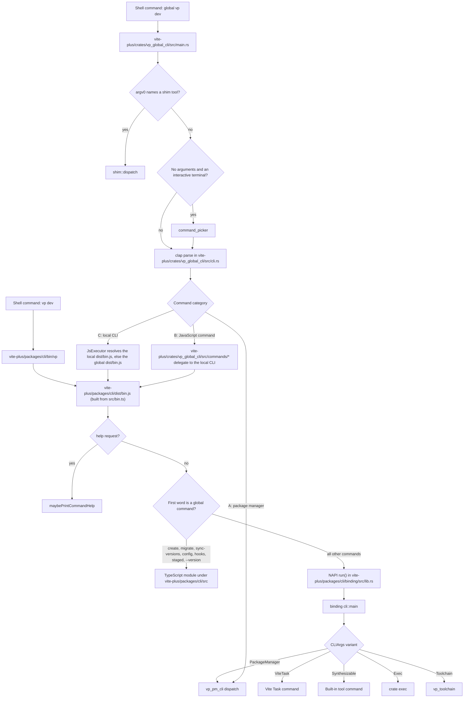
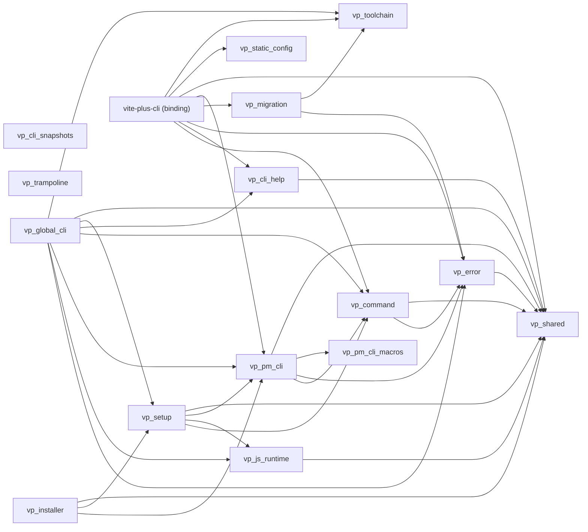

# 02 Vite+ Toolchain: One `vp` Command, Two Runtimes, Fifteen Crates

The public `vp` command is not one program. A local invocation runs four parts in order: a Node.js launcher, a TypeScript entry point, a Node-API (NAPI) binding, and a Rust command core. A global invocation starts a fifth part, a separate Rust global binary, and that binary starts the local parts for project work. The global binary is the global command-line interface (CLI). The TypeScript entry point serves a small set of global commands and the command-help path itself. It sends every other command to Rust. For a project command, the Rust global binary resolves the project's local installation and starts the local `dist/bin.js`. That local file then sends the same command back into Rust. This document follows one command through that chain. It then states the role of each of the fifteen Rust crates and each TypeScript package. It closes with the documented command surface, the Windows trampoline, and the limits of the source.

All paths in this document are relative to the snapshot root `/Users/darkvoid/GitSources/src.voidzero`. The Vite+ repository directory is `vite-plus/`. A source-tree path below starts with `vite-plus/`, so the path names the repository first. A bare file name such as `package.json` refers to the file in the directory under discussion. The source is commit `794a96acd52e12216b3fe4eb02026637962cd315`, version 1.6.0. The license is the Massachusetts Institute of Technology (MIT) license, copyright VoidZero Inc.

Each code block starts with a path label, such as `# vite-plus/packages/cli/bin/vp:1-7`. The label gives the file and the line range. The label is not part of the source text.

The thesis is that Vite+ has two front doors and one command vocabulary. The first door is the local package: `vite-plus/packages/cli/bin/vp` loads TypeScript, and TypeScript calls Rust through NAPI. The second door is the global binary: `vite-plus/crates/vp_global_cli` parses the command in Rust and delegates the project work to the local package. Both doors use the same command names. The source comment at the top of the TypeScript entry states the split. The user documentation states the two installation modes, a project-local dependency and a global installation, but it does not state the implementation split.

## 1. The two-part entry

### 1.1 The Node.js launcher

The installed `vp` file is a Node.js script. It is seven lines. It enables the Node.js compile cache. The cache keeps compiled module bytecode on disk, so a later process can skip part of the compile step. The source does not state the cache location or the measured saving. The script then loads the bundled entry.

```javascript
# vite-plus/packages/cli/bin/vp:1-7
#!/usr/bin/env node

import module from 'node:module';
if (module.enableCompileCache) {
  module.enableCompileCache();
}
await import('../dist/bin.js');
```

Below the path label, the first source line is a shebang, a `#!` line that names the interpreter for the operating system. The third source line imports the built-in `node:module` module. The fourth line tests for `enableCompileCache`. The call is optional, so the test skips it when the Node.js version does not provide it. The fifth line enables the cache. The seventh line imports `../dist/bin.js` with a dynamic import. A dynamic import returns a promise, and the top-level `await` waits for it.

The `vpr` launcher, the shorthand that starts `vp run`, has the same cache setup (`vite-plus/packages/cli/bin/vpr:3-6`). It also imports `../dist/bin.js`, and a comment says that the `run` rewrite lives in `bin.ts` (`vite-plus/packages/cli/bin/vpr:7-9`). The `vpx` launcher, which runs a package binary, imports `../dist/vpx-bin.js` instead (`vite-plus/packages/cli/bin/vpx:1-9`). So the package has three command names and two JavaScript entry files.

### 1.2 The TypeScript entry

The unified entry is `vite-plus/packages/cli/src/bin.ts`. The file has 228 lines. Its header comment states the rule that governs the whole design.

```typescript
// vite-plus/packages/cli/src/bin.ts:1-11
/**
 * Unified entry point for both the local CLI (via bin/vp) and the global CLI (via Rust vp binary).
 *
 * Global commands (create, migrate, sync-versions, config, hooks, staged, --version) are handled by tsdown-bundled modules.
 * All other commands are delegated to the Rust core through NAPI bindings, which
 * uses JavaScript tool resolver functions to locate tool binaries.
 *
 * When called from the global CLI, the Rust binary resolves the project's local
 * vite-plus installation using oxc_resolver and runs its dist/bin.js directly.
 * If no local installation is found, this global dist/bin.js is used as fallback.
 */
```

The header comment is eleven lines in this snapshot. Line 1 opens the comment. Lines 2 to 9 describe the two entries and the command split. Line 10 holds the final sentence about the fallback. Line 11 holds the closing delimiter. This document quotes the full comment and names the true range.

The comment gives three facts. First, seven global commands are TypeScript modules: `create`, `migrate`, `sync-versions`, `config`, `hooks`, `staged`, and `--version`. `tsdown` is the library bundler that builds these modules. Second, all other commands go to the Rust core through NAPI bindings. Third, the Rust core uses JavaScript resolver functions to find tool binaries. The comment also states the global path. The Rust binary finds the local `vite-plus` package with `oxc_resolver`, a Node.js-style package resolver from the oxc project (a Rust toolchain for JavaScript). It falls back to the global `dist/bin.js` when no local package exists. The comment describes the TypeScript entry. The global binary handles some of the same names itself, and the command table in section 6 records those cases.

The entry configures the process before it reads the command. It imports `ensureBlockingStdio` and `run` from the binding at `vite-plus/packages/cli/src/bin.ts:16`. It calls `setUserAgent()` at `vite-plus/packages/cli/src/bin.ts:28`. That call sets the `VP_USER_AGENT` environment variable to `vp/<package version>`, so child tools can identify the Vite+ process (`vite-plus/packages/cli/src/utils/user-agent.ts:1-8`). It materializes `process.stdout` and `process.stderr`, and then restores blocking input/output at `vite-plus/packages/cli/src/bin.ts:32-34`.

```typescript
// vite-plus/packages/cli/src/bin.ts:28-34
setUserAgent();

// Node.js sets O_NONBLOCK when pipe-backed stdio is first accessed. Materialize
// the output streams before restoring the blocking semantics expected by Rust.
void process.stdout;
void process.stderr;
ensureBlockingStdio();
```

The comment explains the order. Node.js sets the `O_NONBLOCK` flag when a pipe-backed standard stream is first accessed. `O_NONBLOCK` is the open flag that makes read and write calls return without waiting. The `void process.stdout` and `void process.stderr` statements force that access. Then `ensureBlockingStdio()` restores blocking behavior. The source comment states that a blocking read on that descriptor fails with `EAGAIN`, the "try again" error (`vite-plus/packages/cli/src/bin.ts:40-48`). The descriptor is non-blocking, so a read cannot wait. The Rust core expects blocking streams. The binding exports the same function at `vite-plus/packages/cli/binding/src/lib.rs:69-73`. The NAPI module also calls `vp_shared::ensure_blocking_stdio()` during module initialization (`vite-plus/packages/cli/binding/src/lib.rs:53`).

**Aha:** The split between TypeScript and Rust is stated in a source comment at the top of the entry file. It is not stated in the user guide. A reader who starts from the documentation sees one command name. A reader who starts from the source sees two implementations of that name.

## 2. The dispatch path from the shell to a handler

The path has two variants. The first variant starts at a local `vp` script. The second variant starts at the global Rust binary. The global binary parses with clap, the Rust Command Line Argument Parser. Before the parse, the `main` function reads `argv[0]`, the first argument, which is the name that the operating system used to start the program, and tests for shim mode (`vite-plus/crates/vp_global_cli/src/main.rs:450-453`). The following decision tree shows both variants.



The diagram places the help test before the global-command tests, in the order that the code uses (`vite-plus/packages/cli/src/bin.ts:136-138`).

### 2.1 Step one: the local launcher

The shell resolves `vp` through the search path environment variable (PATH). The resolution target is a bin entry, a symbolic link, or a Windows shim. For an installed package, the target is `vite-plus/packages/cli/bin/vp`. For a project dependency, the package manager links `node_modules/.bin/vp` to that file (`vite-plus/docs/guide/local-cli.md:126`).

The launcher enables the compile cache and imports the bundled TypeScript entry. The build step turns `vite-plus/packages/cli/src/bin.ts` into `vite-plus/packages/cli/dist/bin.js`. The package manifest publishes `dist` and the three bin files (`vite-plus/packages/cli/package.json:16-20`, `vite-plus/packages/cli/package.json:21-33`).

### 2.2 Step two: argument normalization in TypeScript

The entry does not parse the command with a general parser. It reads the first argument after a short set of rewrites. It handles `-C` before the command. `-C <dir>` changes the working directory, like `cd`. The Rust global binary sets the `VP_EXPLICIT_CHDIR` environment variable to `1` when it starts the local entry with `-C` (`vite-plus/crates/vp_global_cli/src/js_executor.rs:391-395`). The TypeScript entry reads the variable, deletes it, and passes the fact to Rust (`vite-plus/packages/cli/src/bin.ts:70-74`). `vite-plus/packages/cli/src/bin.ts:69-109` reads the arguments and consumes `-C`. The `vpr` rewrite comes next.

```typescript
// vite-plus/packages/cli/src/bin.ts:111-124
// `vpr` is shorthand for `vp run`: the bin/vpr shim imports this file
// unchanged (argv0 tells them apart, like the Rust shim dispatch), and the
// rewrite happens here, after -C consumption, so `vpr -C <dir> <task>`
// orders itself correctly by construction.
if (path.basename(process.argv[1] ?? '') === 'vpr') {
  args = ['run', ...args];
  process.argv = process.argv.slice(0, 2).concat(args);
}

// The list the Rust CLI parses: after the -C and vpr rewrites above (both
// are consumed/settled here), before the help transform below (the Rust CLI
// applies `help [command]` itself and needs the untransformed list to tell
// `vp help fmt` apart from `vp fmt --help`).
const rustCliArgs = args;
```

The check uses the base name of `process.argv[1]`. The value is `vpr` when the `vpr` launcher starts the file. The two rewrites have a fixed order. The `-C` consumption runs first. The `vpr` rewrite runs second. In the block, `args` is the list that the `-C` step produced. The help transform runs third. `rustCliArgs` captures the list between the second and third steps. The Rust parser needs the untransformed list so that it can distinguish `vp help fmt` from `vp fmt --help`. The transformed list feeds `maybePrintCommandHelp`, and `rustCliArgs` reaches the Rust parser through `run()`.

The help transform changes `vp help <command>` into `vp <command> --help` (`vite-plus/packages/cli/src/bin.ts:126-130`). Then the entry reads the command word.

### 2.3 Step three: the TypeScript branch or the Rust call

The dispatch is a chain of string comparisons. It is explicit and it fits in one screen.

```typescript
// vite-plus/packages/cli/src/bin.ts:132-152
const command = args[0];
const cliDistDir = path.dirname(fileURLToPath(import.meta.url));
const vitePlusPackagePath = path.dirname(cliDistDir);

if (maybePrintCommandHelp(args)) {
  // Help is rendered by the local CLI so it matches the installed toolchain.
} else if (command === 'create') {
  await import('./create/bin.js');
} else if (command === 'migrate') {
  await import('./migration/bin.js');
} else if (command === 'sync-versions') {
  await import('./sync-versions/bin.js');
} else if (command === 'config') {
  await import('./config/bin.js');
} else if (command === 'hooks') {
  await import('./hooks/bin.js');
} else if (command === '--version' || command === '-V') {
  await import('./version.js');
} else if (command === 'staged') {
  await import('./staged/bin.js');
} else {
```

`maybePrintCommandHelp` runs before every branch. It handles only `vp <command> -h` and `vp <command> --help`, for a command in its help table. It prints the help text itself and returns `true` (`vite-plus/packages/cli/src/help.ts:1128-1145`). The empty branch then lets the process end with success. The comment in the branch explains the choice: the local command-line interface renders help, so the help matches the installed toolchain. This is a design reason that the user documentation does not give.

The quoted range ends at the start of the final `else` branch. The next block shows the `run()` call inside that branch. The lines between the two blocks are omitted.

The seven imports are dynamic. Each import loads a TypeScript module only when its command runs. The modules are `create/bin.ts`, `migration/bin.ts`, `sync-versions/bin.ts`, `config/bin.ts`, `hooks/bin.ts`, `version.ts`, and `staged/bin.ts`. Each module is a separate command implementation. The `version.ts` module prints the tool versions in the fixed order that `TOOL_DISPLAY_ORDER` lists (`vite-plus/packages/cli/src/version.ts:12-20`, `vite-plus/packages/cli/src/version.ts:84-121`).

Every other command reaches the `else` branch. That branch calls the NAPI function `run()`. The call passes the resolver callbacks, the context values, and the raw argument list. The paragraph after the block names each one.

```typescript
// vite-plus/packages/cli/src/bin.ts:168-191
    const exitCode = await run({
      nodeExecPath: process.execPath,
      lint,
      pack,
      fmt,
      vite,
      test,
      doc,
      toolchainManifestPath: path.join(cliDistDir, 'toolchain.json'),
      vitePlusPackagePath,
      // Only task/config-metadata commands need this resolver. Importing it
      // eagerly also loads Vitest and Vite in the parent of `vp dev`, before
      // the separate Vite process even starts.
      resolveUniversalViteConfig: async (err, cwd) => {
        const { resolveUniversalViteConfig } = await import('./resolve-vite-config.js');
        const config = await resolveUniversalViteConfig(err, cwd);
        // Rust spawns tasks only after this promise settles.
        restoreBlockingStdin();
        return config;
      },
      nodeVersion: process.version,
      explicitChdir,
      args: rustCliArgs,
    });
```

The call passes six tool resolver functions (`lint`, `pack`, `fmt`, `vite`, `test`, and `doc`) and one configuration resolver, `resolveUniversalViteConfig`. The first six come from `resolve-lint.ts`, `resolve-pack.ts`, `resolve-fmt.ts`, `resolve-vite.ts`, `resolve-test.ts`, and `resolve-doc.ts`. The imports are at `vite-plus/packages/cli/src/bin.ts:19-24`. The call also passes the Node.js executable path, the toolchain manifest path, the package path, the Node.js version, the explicit-change-directory flag, and the raw Rust argument list.

Vite is the development server and build tool. Vitest is the test runner. The lazy import of `resolve-vite-config.js` has a stated reason. An eager import would load Vitest and Vite in the parent process of `vp dev`. The Rust side calls the resolver only for task and configuration-metadata commands. The comment at `vite-plus/packages/cli/src/bin.ts:178-180` gives that reason. The resolver restores blocking standard input before it returns, because Rust starts tasks after the promise settles (`vite-plus/packages/cli/src/bin.ts:184-186`).

After `run()` returns, the entry applies the init-config post-step. If the exit code is zero, it calls `applyToolInitConfigToViteConfig`. That step handles only the initialization forms, such as `vp lint --init` and `vp fmt --init`. It merges the generated tool configuration into `vite.config.ts`, removes the standalone generated file, and logs `Added` or `Skipped initialization`. An existing key is not replaced (`vite-plus/packages/cli/src/init-config.ts:190-240`). Then it calls `process.exit(finalExitCode)`. The `catch` block prints the error and exits with code 1 (`vite-plus/packages/cli/src/bin.ts:224-227`).

### 2.4 Step four: the NAPI binding

The JavaScript side imports `run` and `ensureBlockingStdio` from `../binding/index.js`. The binding directory has Rust source and generated JavaScript glue. The Rust source is real, not generated. The files `index.cjs` and `index.d.cts` are generated by NAPI-RS, a framework that generates the Node.js addon glue from Rust. The small `index.js` re-exports `./index.cjs` (`vite-plus/packages/cli/binding/index.js:1`). The declaration file declares `run(options: CliOptions): Promise<number>` at `vite-plus/packages/cli/binding/index.d.cts:4093`. It also declares `ensureBlockingStdio` at line 3781, `getVpDirs` at line 3799, `runCommand` at line 4129, `vitePlusHeader` at line 4241, and `shouldPrintVitePlusHeader` at line 4171.

The Rust module initialization runs before any exported function. It restores blocking input/output, fixes the Windows search path, sets the user agent, and installs a panic hook. The block uses `PATHEXT`, the Windows variable that lists executable file extensions.

```rust
// vite-plus/packages/cli/binding/src/lib.rs:49-67
/// Module initialization - sets up tracing and panic hook
#[napi_derive::module_init]
#[allow(clippy::disallowed_macros)]
pub fn init() {
    vp_shared::ensure_blocking_stdio();
    vp_shared::ensure_windows_pathext();
    vp_shared::set_user_agent_version(env!("CARGO_PKG_VERSION"));
    crate::cli::init_tracing();

    // Install a Vite+ panic hook so panics are correctly attributed to Vite+.
    let default_hook = std::panic::take_hook();
    std::panic::set_hook(Box::new(move |info| {
        eprintln!("Vite+ panicked. This is a bug in Vite+, not your code.");
        default_hook(info);
        eprintln!(
            "\nPlease report this issue at: https://github.com/voidzero-dev/vite-plus/issues/new?template=bug_report.yml"
        );
    }));
}
```

The initialization uses `vp_shared`. The `ensure_windows_pathext` call makes Windows resolve `.cmd` and `.bat` files. The user-agent call uses the package version from Cargo. The panic hook prints a Vite+ message before the default hook runs. Then it prints the issue Uniform Resource Locator (URL).

A `ThreadsafeFunction` is a Node-API handle that a Rust thread can use to call a JavaScript function. `Send` and `Sync` are Rust marker traits: a `Send` value can move to another thread, and a `Sync` value can be shared between threads. Tokio is the Rust asynchronous runtime that the next block uses. A `LocalSet` lets non-`Send` futures run on one thread. The non-`Send` code comes from `vt`, the Vite Task crate from the vite-task repository. The `run` function is asynchronous from the JavaScript point of view. It moves the non-`Send` work to a dedicated thread. It then waits on a one-shot channel. This structure lets the NAPI context continue to process JavaScript callbacks while Rust waits.

```rust
// vite-plus/packages/cli/binding/src/lib.rs:190-270
/// Main entry point for the CLI, called from JavaScript.
///
/// This is an async function that spawns a new thread for the non-Send async code
/// from vt, while allowing the NAPI async context to continue running
/// and process JavaScript callbacks (via ThreadsafeFunction).
#[napi]
pub async fn run(options: CliOptions) -> Result<i32> {
    // Use provided cwd or current directory
    let mut cwd = current_dir()?;
    if let Some(options_cwd) = options.cwd {
        cwd.push(options_cwd);
    }

    // Extract ThreadsafeFunctions (which are Send+Sync) to move to the worker thread
    let lint_tsf = options.lint;
    let fmt_tsf = options.fmt;
    let vite_tsf = options.vite;
    let test_tsf = options.test;
    let pack_tsf = options.pack;
    let doc_tsf = options.doc;
    let resolve_universal_vite_config_tsf = options.resolve_universal_vite_config;
    let args = options.args;
    let node_version = options.node_version;
    let explicit_chdir = options.explicit_chdir.unwrap_or(false);
    let toolchain_manifest_path = options.toolchain_manifest_path;
    let vite_plus_package_path = options.vite_plus_package_path;
    let node_exec_path = Arc::from(OsStr::new(&options.node_exec_path));

    // Create a channel to receive the result from the worker thread
    let (tx, rx) = tokio::sync::oneshot::channel();

    // Spawn a new thread for the non-Send async code
    // ThreadsafeFunction is designed to work across threads, so the resolver
    // callbacks will still be able to call back to JavaScript
    std::thread::spawn(move || {
        // Create the resolvers inside the thread (BoxedResolverFn is not Send)
        let cli_options = ViteTaskCliOptions {
            node_exec_path,
            lint: create_resolver(lint_tsf, "Failed to resolve lint command"),
            fmt: create_resolver(fmt_tsf, "Failed to resolve fmt command"),
            vite: create_resolver(vite_tsf, "Failed to resolve vite command"),
            test: create_resolver(test_tsf, "Failed to resolve test command"),
            pack: create_resolver(pack_tsf, "Failed to resolve pack command"),
            doc: create_resolver(doc_tsf, "Failed to resolve doc command"),
            toolchain_manifest_path,
            vite_plus_package_path,
            resolve_universal_vite_config: create_vite_config_resolver(
                resolve_universal_vite_config_tsf,
            ),
            node_version,
        };

        // Create a new single-threaded runtime for non-Send futures
        let rt = tokio::runtime::Builder::new_current_thread()
            .enable_all()
            .build()
            .expect("Failed to create runtime");

        // Run the CLI in a LocalSet to allow non-Send futures
        let local = tokio::task::LocalSet::new();
        let result = local.block_on(&rt, async {
            crate::cli::main(cwd, Some(cli_options), args, explicit_chdir).await
        });

        // Send the result back to the NAPI async context
        let _ = tx.send(result);
    });

    // Wait for the result from the worker thread
    let result = rx.await.map_err(|_| napi::Error::from_reason("Worker thread panicked"))?;

    tracing::debug!("Result: {result:?}");

    match result {
        Ok(exit_status) => Ok(exit_status.0.into()),
        Err(e) => {
            tracing::error!("Rust error: {:?}", e);
            Err(napi::Error::from_reason(format_error_message(&e)))
        }
    }
}
```

Three details matter. First, `ThreadsafeFunction` values are `Send` and `Sync`, so they can move to the worker thread. The resolver closures are not `Send`, so they are built inside the thread (`vite-plus/packages/cli/binding/src/lib.rs:225-237`). Second, the runtime is a current-thread Tokio runtime. The `LocalSet` permits non-`Send` futures. Third, the exit status is an inner value, and `.0` extracts the integer. A Rust error becomes a JavaScript error with a formatted message.

The `create_resolver` function wraps each `ThreadsafeFunction` into a boxed resolver (`vite-plus/packages/cli/binding/src/lib.rs:127-150`). When Rust needs a tool binary, it calls the JavaScript function. The JavaScript function resolves the binary and returns the result. This is the callback path that the header comment names "JavaScript tool resolver functions".

### 2.5 Step five: the binding command core

The binding has its own command parser. It is not the global parser. The local parser accepts five groups.

```rust
// vite-plus/packages/cli/binding/src/cli/mod.rs:374-413
pub async fn main(
    cwd: AbsolutePathBuf,
    options: Option<CliOptions>,
    args: Option<Vec<String>>,
    explicit_chdir: bool,
) -> Result<ExitStatus, Error> {
    let raw_args: Vec<String> = args.unwrap_or_else(|| env::args().skip(1).collect());
    // The global CLI resolves aliases to their canonical names before
    // delegating, so prefer the original spelling it forwards. A direct local
    // invocation can use its first, still-unnormalized argument.
    let raw_subcommand =
        env::var(env_vars::VP_RAW_SUBCOMMAND).ok().or_else(|| raw_args.first().cloned());
    let args_vec = normalize_help_args(raw_args);
    if should_print_help(&args_vec) {
        print_help();
        return Ok(ExitStatus::SUCCESS);
    }

    let args_with_program = std::iter::once("vp".to_string()).chain(args_vec.iter().cloned());
    let cli_args = match CLIArgs::try_parse_from(args_with_program) {
        Ok(args) => args,
        Err(err) => return handle_cli_parse_error(err),
    };

    match cli_args {
        CLIArgs::Synthesizable(subcmd) => {
            // Only the built-ins can be mistaken for a script. `run`/`cache`
            // below are the script path itself; `install` and friends
            // legitimately trigger a project's `install` lifecycle scripts
            // through the package manager, so redirecting those to `vpr` would
            // be wrong; and `exec` names a binary rather than a task.
            script_note::print(raw_subcommand.as_deref(), &cwd);
            execute_direct_subcommand(subcmd, &cwd, options, explicit_chdir).await
        }
        CLIArgs::ViteTask(command) => execute_vite_task_command(command, cwd, options).await,
        CLIArgs::PackageManager(pm) => execute_pm_command(pm, &cwd, options.as_ref()).await,
        CLIArgs::Exec(exec_args) => crate::exec::execute(exec_args, &cwd).await,
        CLIArgs::Toolchain(args) => execute_toolchain_command(args, options.as_ref()),
    }
}
```

The comment in the `Synthesizable` arm refers to the `ViteTask` arm, which is four lines below it in the same block.

The five `CLIArgs` variants are `ViteTask`, `Synthesizable`, `PackageManager`, `Exec`, and `Toolchain` (`vite-plus/packages/cli/binding/src/cli/types.rs:131-149`). `ViteTask` covers `run` and `cache`. `Synthesizable` means that the binding builds a built-in tool command from the arguments and the resolver output; it covers commands such as `lint`, `build`, and `test`. `PackageManager` flattens `vp_pm_cli::PackageManagerCommand`. `Exec` runs a binary from `node_modules/.bin`. `Toolchain` prints the active tool versions and accepts `--json` and `--global`.

The block also shows the Rust help path. `normalize_help_args` rewrites the argument list, and `should_print_help` decides whether to print. `print_help` renders the help. `script_note::print` warns when a name is also a project script. `handle_cli_parse_error` renders a parse error.

The `raw_subcommand` value comes from the global CLI through `VP_RAW_SUBCOMMAND`. The global CLI resolves aliases before it delegates. The local parser prefers the original spelling, because the canonical name alone cannot recover it. The comment at `vite-plus/packages/cli/binding/src/cli/mod.rs:381-383` states that rule.

The package-manager branch refuses global operations. The source comment gives the reason: the local CLI has no managed package store. A package command that targets the Vite+-managed global store would mutate the project, drop `--node`, or ignore `--dry-run` instead (`vite-plus/packages/cli/binding/src/cli/mod.rs:422-426`). The branch tests `command.is_managed_global()`, and it returns an error that names the global CLI when the `--global` flag is present (`vite-plus/packages/cli/binding/src/cli/mod.rs:427-431`).

## 3. The Rust global command-line interface

The global binary is `vite-plus/crates/vp_global_cli`. Its module comment states its reason to exist: it runs without pre-installed Node.js and uses a Node.js runtime that Vite+ downloads and pins for package-manager commands and JavaScript execution (`vite-plus/crates/vp_global_cli/src/main.rs:1-5`). This document calls that pinned runtime a managed runtime.

### 3.1 The modules

| Module | Role | Evidence |
|--------|------|----------|
| `main.rs` | Collects the arguments, peeks at the shim name, sets the user agent, and starts `run()`, which detects shim mode, consumes `-C`, runs the picker, and parses. | `vite-plus/crates/vp_global_cli/src/main.rs:332-358` |
| `cli.rs` | Defines the Command Line Argument Parser (clap) `Args` and `Commands` types, parses, and dispatches by category. | `vite-plus/crates/vp_global_cli/src/cli.rs:51-62`, `vite-plus/crates/vp_global_cli/src/cli.rs:66-274` |
| `command_picker.rs` | Shows an interactive list of commands when `vp` runs with no arguments. | `vite-plus/crates/vp_global_cli/src/command_picker.rs:129-142` |
| `help.rs` | Builds grouped help pages and unified help text. | `vite-plus/crates/vp_global_cli/src/help.rs:252-330` |
| `shim/` | Detects the tool name from `argv[0]` or `VP_SHIM_TOOL` and dispatches to that tool. | `vite-plus/crates/vp_global_cli/src/shim/mod.rs:1-13` |
| `self_setup.rs` | Runs the first-start setup and its helper commands. | `vite-plus/crates/vp_global_cli/src/self_setup.rs:21-60` |
| `homebrew.rs` | Detects a Homebrew installation and the current executable owner. Homebrew is a package manager for macOS and Linux. | `vite-plus/crates/vp_global_cli/src/homebrew.rs:7-37` |
| `install_dirs.rs` | Marks owned directories with `.vp-owned`, so `vp implode` can remove only directories that Vite+ created. | `vite-plus/crates/vp_global_cli/src/install_dirs.rs:1-100` |
| `upgrade_check.rs` | Runs and displays the background update check. | `vite-plus/crates/vp_global_cli/src/upgrade_check.rs:181-330` |
| `js_executor.rs` | Finds the local `vite-plus`, prepares a runtime, and starts the local or global `dist/bin.js`. | `vite-plus/crates/vp_global_cli/src/js_executor.rs:260-300`, `vite-plus/crates/vp_global_cli/src/js_executor.rs:423-452` |

### 3.2 The entry and shim detection

The global `main` has two jobs before it starts the asynchronous runtime. First, it inspects `argv[0]` without clearing the shim environment. Second, it sets the user-agent marker for the Vite+ entry points.

```rust
// vite-plus/crates/vp_global_cli/src/main.rs:332-358
fn main() -> ExitCode {
    let args: Vec<String> = std::env::args().collect();

    // Inspect shim mode without clearing its environment markers: Homebrew
    // setup still needs them before the normal shim dispatch.
    let argv0 = args.first().map(|s| s.as_str()).unwrap_or("vp");
    let shim_tool = shim::peek_shim_tool(argv0);

    // Identify Vite+ to child tools independently of `npm_config_user_agent`,
    // which package managers replace with their own value.
    //
    // `vpr` and `vpx` are Vite+ entry points too. Ordinary tool shims (such as
    // `npm`/`npx`/`node`) only inherit an existing marker from their parent.
    //
    // SAFETY: `set_var` must run while the process is still single-threaded.
    // This runs before the async runtime (and its worker threads) are created.
    if matches!(shim_tool.as_deref(), None | Some("vpr" | "vpx")) {
        unsafe {
            std::env::set_var(
                vp_shared::env_vars::VP_USER_AGENT,
                concat!("vp/", env!("CARGO_PKG_VERSION")),
            );
        }
    }

    tokio::runtime::Runtime::new().expect("failed to build tokio runtime").block_on(run())
}
```

The `peek_shim_tool` call does not clear the environment. The comment says that Homebrew setup still needs the markers. The `set_var` call is unsafe because a second thread could read the environment during the write. The code makes the call before the runtime starts, so the runtime's worker threads do not exist yet. The safety comment states the single-thread rule. The marker is `vp/<version>`. The code sets it for `vpr`, `vpx`, and a direct `vp` call. It does not set it for an ordinary tool shim. A tool shim that a Vite+ process starts inherits the marker from that process. A shim that the shell starts directly is not a Vite+ entry point, so the code does not set the marker.

The `run` function handles shell completion, shim mode, `-C`, the picker, and the parser. It reads the `VP_COMPLETE` environment variable for completion (`vite-plus/crates/vp_global_cli/src/main.rs:436-447`). The shim check comes before the working-directory work.

```rust
// vite-plus/crates/vp_global_cli/src/main.rs:453-459
    if let Some(tool) = shim::detect_shim_tool(argv0) {
        // Shim mode - dispatch to the appropriate tool. stdout belongs to the
        // wrapped tool; route vp's own output to stderr.
        output::route_user_output_to_stderr();
        let exit_code = shim::dispatch(&tool, &args[1..], vp_shared::ToolPathEnv::from_env()).await;
        return ExitCode::from(exit_code as u8);
    }
```

Shim mode sends Vite+ output to standard error. Standard output belongs to the wrapped tool. This rule protects the output of `node`, `npm`, and every other shimmed tool.

The `-C` consumption comes next. It runs before the picker and before any command logic. It sets the process working directory, so every later `vt_path::current_dir()` call sees the target directory (`vite-plus/crates/vp_global_cli/src/main.rs:475-486`). `vt_path` is the path type crate from Vite Task. The `explicit_chdir` flag preserves the fact that the user supplied the flag. The local CLI receives that fact through the `VP_EXPLICIT_CHDIR` environment variable, which the executor sets when it starts the local entry (`vite-plus/crates/vp_global_cli/src/js_executor.rs:391-395`).

### 3.3 The command picker

The picker runs only when two conditions hold. The argument list includes the program name, so its length is one only when the user typed `vp` with no other argument (`vite-plus/crates/vp_global_cli/src/main.rs:488-489`). The terminal must be interactive (`vite-plus/crates/vp_global_cli/src/command_picker.rs:132-134`).

```rust
// vite-plus/crates/vp_global_cli/src/command_picker.rs:129-142
pub fn pick_top_level_command_if_interactive(
    cwd: &AbsolutePath,
) -> io::Result<TopLevelCommandPick> {
    if !vp_shared::is_interactive_terminal() {
        return Ok(TopLevelCommandPick::Skipped);
    }

    let command_order = default_command_order(has_vite_plus_dependency(cwd));

    Ok(match run_picker(&command_order)? {
        Some(selection) => TopLevelCommandPick::Selected(selection),
        None => TopLevelCommandPick::Cancelled,
    })
}
```

The order is not fixed. `default_command_order` takes `has_vite_plus_dependency(cwd)` and puts `run` first when the project declares a `vite-plus` dependency (`vite-plus/crates/vp_global_cli/src/command_picker.rs:488-508`). The helper reads the project `package.json` (`vite-plus/crates/vp_global_cli/src/commands/mod.rs:80-83`). Without that dependency, the fixed list order applies, and it starts with `create`, `migrate`, `dev`, and `check` (`vite-plus/crates/vp_global_cli/src/command_picker.rs:45-69`). The source states the ordering rule but gives no reason for it.

The picker maps its result to three states. `Selected` pushes the command name, and possibly `--help`, onto the argument list. The normal parse then runs on that list. `Cancelled` exits with success. `Skipped` continues to the parser. A picker error is logged at debug level and is not fatal (`vite-plus/crates/vp_global_cli/src/main.rs:488-504`).

### 3.4 The three command categories

The `Commands` enum labels three categories for project work. The same enum also holds the machine-level commands `env`, `upgrade`, and `implode` after those categories (`vite-plus/crates/vp_global_cli/src/cli.rs:227-273`). The comments are part of the design.

```rust
// vite-plus/crates/vp_global_cli/src/cli.rs:66-84
pub enum Commands {
    // =========================================================================
    // Category A: Package Manager Commands
    // (clap-flattened from `vp_pm_cli::PackageManagerCommand` so the
    // global CLI and the local CLI binding share an identical surface.)
    // =========================================================================
    #[command(flatten)]
    PackageManager(PackageManagerCommand),

    // =========================================================================
    // Category B: JS Script Commands
    // These commands are implemented in JavaScript and executed via managed Node.js
    // =========================================================================
    /// Create a new project from a template (delegates to JS)
    #[command(disable_help_flag = true)]
    Create {
        #[arg(trailing_var_arg = true, allow_hyphen_values = true)]
        args: Vec<String>,
    },
```

Category A defines no separate argument enum. The global enum flattens `vp_pm_cli::PackageManagerCommand`. The local binding flattens the same type. The comment states the reason: both surfaces share an identical package-manager surface. Both front doors flatten the same parsed type, so the two surfaces cannot drift apart (`vite-plus/crates/vp_pm_cli/src/cli.rs:1-6`). The quoted range stops after the first Category B arm; Category C follows in the same enum.

Category B contains commands whose main implementation is JavaScript. The global Rust code does not reimplement them. It delegates. Category C contains the project commands: `dev`, `build`, `preview`, `check`, `lint`, `fmt`, `test`, `pack`, `run`, `cache`, and `exec`. This list belongs to the global parser. The local parser groups `run` and `cache` as `ViteTask` instead (`vite-plus/packages/cli/binding/src/cli/types.rs:131-134`).

```rust
// vite-plus/crates/vp_global_cli/src/cli.rs:1148-1180
    match command {
        // Category A: Package Manager Commands
        // Print the runtime header for `vp install` (when not silent).
        // Then intercept any `--global` paths that need vite-plus-managed
        // global install, falling through to `vp_pm_cli::dispatch` for
        // every project-scoped PM operation.
        Commands::PackageManager(pm_command) => {
            if let Some(silent) = pm_command.install_silent() {
                print_runtime_header(render_options.show_header && !silent);
            }
            run_package_manager_command(cwd, pm_command).await
        }

        // Category B: JS Script Commands
        Commands::Create { args } => commands::create::execute(cwd, &args, raw_subcommand).await,

        Commands::Migrate { args } => commands::migrate::execute(cwd, &args).await,

        Commands::SyncVersions { args } => {
            commands::sync_versions::execute(cwd, &args, raw_subcommand).await
        }

        Commands::Config { args } => commands::config::execute(cwd, &args, raw_subcommand).await,

        Commands::Hooks { args } => commands::hooks::execute(cwd, &args, raw_subcommand).await,

        Commands::Staged { args } => commands::staged::execute(cwd, &args, raw_subcommand).await,

        // Category C: Local CLI Delegation (forwarded to the local vite-plus CLI)
        Commands::Dev { args } => {
            maybe_print_runtime_header("dev", &args, render_options.show_header);
            commands::delegate::execute_app(cwd, "dev", &args, raw_subcommand, explicit_chdir).await
        }
```

Category A runs in the global process. It prints the runtime header for `vp install` and then calls `run_package_manager_command`. `render_options` carries the header setting. `print_runtime_header` and `maybe_print_runtime_header` print the Vite+ banner. The comment says that `--global` paths are intercepted and that project-scoped operations fall through to `vp_pm_cli::dispatch`.

Category B calls `commands::create`, `commands::migrate`, `commands::sync_versions`, `commands::config`, `commands::hooks`, or `commands::staged`. Each of these modules is thin. The `create` module, for example, calls `commands::delegate::execute`, which builds a `JsExecutor` and calls `delegate_to_local_cli` (`vite-plus/crates/vp_global_cli/src/commands/create.rs:9-15`, `vite-plus/crates/vp_global_cli/src/commands/delegate.rs:13-36`). The `raw_subcommand` value is passed because the local CLI cannot recover the original spelling after the global parser resolves an alias.

Category C delegates through `execute_app`, which carries the explicit `-C` flag. `dev`, `build`, `preview`, and `pack` call it (`vite-plus/crates/vp_global_cli/src/cli.rs:1177-1186`, `vite-plus/crates/vp_global_cli/src/cli.rs:1216-1220`, `vite-plus/crates/vp_global_cli/src/cli.rs:1232-1236`). `execute` is a thin wrapper that passes `false`; `test`, `lint`, `fmt`, `check`, `run`, `exec`, and `cache` call it (`vite-plus/crates/vp_global_cli/src/commands/delegate.rs:13-20`; `vite-plus/crates/vp_global_cli/src/cli.rs:1188-1214`, `vite-plus/crates/vp_global_cli/src/cli.rs:1222-1241`). `execute_global` skips local resolution and runs the global `dist/bin.js`. The parser uses it only for `lint --init` and for `fmt --init` and `fmt --migrate` (`vite-plus/crates/vp_global_cli/src/cli.rs:579-588`; `vite-plus/crates/vp_global_cli/src/commands/delegate.rs:53-63`).

### 3.5 How the global binary finds the local project

The search uses `oxc_resolver`. The code resolves `vite-plus/package.json` from the project directory. The result is the package root. The code then checks for `dist/bin.js` under that root.

```rust
// vite-plus/crates/vp_global_cli/src/js_executor.rs:423-452
    /// Resolve the local vite-plus package root from the project directory.
    pub(crate) fn resolve_local_vite_plus_package_dir(
        project_path: &AbsolutePath,
    ) -> Option<AbsolutePathBuf> {
        use oxc_resolver::{ResolveOptions, Resolver};

        let resolver = Resolver::new(ResolveOptions {
            condition_names: vec!["import".into(), "node".into()],
            ..ResolveOptions::default()
        });

        // Resolve vite-plus/package.json from the project directory to find the package root
        let resolved = resolver.resolve(project_path, "vite-plus/package.json").ok()?;
        let pkg_dir = resolved.path().parent()?;
        AbsolutePathBuf::new(pkg_dir.to_path_buf())
    }

    /// Resolve the local vite-plus package's `dist/bin.js` from the project directory.
    pub(crate) fn resolve_local_vite_plus(project_path: &AbsolutePath) -> Option<AbsolutePathBuf> {
        let pkg_dir = Self::resolve_local_vite_plus_package_dir(project_path)?;
        let bin_js = pkg_dir.join("dist").join("bin.js");

        if bin_js.as_path().exists() {
            tracing::debug!("Found local vite-plus at {:?}", bin_js);
            Some(bin_js)
        } else {
            tracing::debug!("Local vite-plus found but dist/bin.js missing at {:?}", bin_js);
            None
        }
    }
```

The resolver conditions are `import` and `node`. These conditions select the package export that a Node.js import would use. The package exports `./package.json`, so the subpath resolves (`vite-plus/packages/cli/package.json:89`). The search starts at the project directory and follows the normal package resolution rules, including parent `node_modules` directories. A monorepo can therefore share one installation at the workspace root (`vite-plus/docs/guide/global-cli.md:487`).

The fallback is the global `dist/bin.js`. `delegate_to_global_cli` computes the entry point from the global installation. `get_scripts_dir` returns the explicit scripts directory, the `VP_GLOBAL_CLI_JS_SCRIPTS_DIR` environment variable, the Homebrew package path, or the auto-detected `<version>/node_modules/vite-plus/dist` directory (`vite-plus/crates/vp_global_cli/src/js_executor.rs:89-117`). The entry is `bin.js` inside that directory (`vite-plus/crates/vp_global_cli/src/js_executor.rs:324-341`). A scripts directory is the directory that holds the bundled JavaScript entry files.

The `delegate_to_local_cli` function calls `ensure_project_runtime` first. The resolution order is the session overrides from `vp env use`, then project sources, then the user default from `config.json`, then the latest Long Term Support (LTS) release (`vite-plus/crates/vp_global_cli/src/js_executor.rs:189-247`). The project sources are `.node-version`, `devEngines.runtime`, `engines.node`, and `.nvmrc`. In system-first mode, a system Node.js on the search path wins (`vite-plus/crates/vp_global_cli/src/js_executor.rs:521-531`). `devEngines.runtime` is the project field that names the Node.js runtime version. The function returns the runtime binary path and bin prefix. The bin prefix is the package-manager binary directory that must come first on the search path. Then `run_js_entry` starts the local entry with that runtime (`vite-plus/crates/vp_global_cli/src/js_executor.rs:398-407`).

The global binary can also compare versions. `delegate_migrate` runs `migrate` from the global CLI when the local `vite-plus` is older than the global one (`vite-plus/crates/vp_global_cli/src/js_executor.rs:291-322`, `vite-plus/crates/vp_global_cli/src/js_executor.rs:491-499`). The source comment gives the reason: a stale local CLI predates the upgrade logic, so it would run and leave the project unmigrated. The newer global CLI performs the upgrade and re-pins `vite-plus`. To re-pin means to set the project dependency to the new version. The next invocation then resolves the upgraded local CLI.

## 4. The Rust crates

The snapshot has fifteen Rust crate directories under `vite-plus/crates`. The workspace manifest includes `bench`, `crates/*`, and `vite-plus/packages/cli/binding`, and it excludes `vite-plus/crates/vp_trampoline` (`vite-plus/Cargo.toml:3`, `vite-plus/Cargo.toml:10`). Fourteen of the fifteen crate directories are workspace members, and the binding package and the bench package `vite-plus-benches` are members too. The bench package holds no product code. All its dependencies are development dependencies, so the graph, which omits those, does not include it (`vite-plus/bench/Cargo.toml:10-18`). The excluded directory is `vp_trampoline`, the fifteenth crate. It builds as a separate package because it is a minimal Windows executable.

### 4.1 The dependency graph

The following graph has only edges that the `Cargo.toml` dependency sections prove. It omits external crates, development dependencies, and build dependencies. The graph has sixteen nodes: the fifteen crates and the binding package.



The graph has a clear center. `vp_shared` has no internal dependency, and many crates depend on it. `vp_command` adds process execution and file-access observation. `vp_pm_cli` adds package management. `vp_setup` combines command execution, the JavaScript runtime, and package management for installation. `vp_global_cli` and the binding both depend on eight internal crates. `vp_global_cli` owns the global command surface, and the binding owns the local command core.

`vp_cli_snapshots` and `vp_trampoline` have no internal edges, so they appear as isolated nodes. The snapshot crate uses `vt_pty_terminal_test` and `vt_snapshot_test` as development dependencies, and `vt_pty_terminal_test_client` as a normal dependency (`vite-plus/crates/vp_cli_snapshots/Cargo.toml:20`, `vite-plus/crates/vp_cli_snapshots/Cargo.toml:35-36`). The trampoline uses no workspace crate.

### 4.2 The role of each crate

| Crate | Role | Evidence |
|-------|------|----------|
| `vp_command` | Starts external commands, resolves a binary on the search path, and collects the file access that fspy reports. fspy is the file-system proxy of Vite Task, defined in the vite-task repository. | `vite-plus/crates/vp_command/src/lib.rs:25-29`, `vite-plus/crates/vp_command/src/lib.rs:46-57` |
| `vp_error` | Defines one error enum for the shared crates, with conversions from input/output, JavaScript Object Notation (JSON), and workspace errors. | `vite-plus/crates/vp_error/src/lib.rs:9-40` |
| `vp_shared` | Provides the common layer: directories, environment variables, the HyperText Transfer Protocol (HTTP) client, the `package.json` model, terminal detection, JSON edits, and the Vite+ header. | `vite-plus/crates/vp_shared/src/lib.rs:12`, `vite-plus/crates/vp_shared/src/lib.rs:26-51` |
| `vp_static_config` | Reads top-level literal fields from a Vite configuration file with the oxc parser, without starting Node.js. | `vite-plus/crates/vp_static_config/src/lib.rs:1-5` |
| `vp_cli_help` | Builds and prints help pages for both Rust front doors from clap metadata. | `vite-plus/crates/vp_cli_help/src/lib.rs:7-47` |
| `vp_cli_snapshots` | Holds the pseudo-terminal command-line snapshot tests, and the package is never shipped. A pseudo-terminal is a software terminal that a test can control. | `vite-plus/crates/vp_cli_snapshots/Cargo.toml:9` |
| `vp_global_cli` | Is the standalone global `vp` binary, with the parser, picker, shims, self-setup, upgrade check, and local delegation. | `vite-plus/crates/vp_global_cli/src/main.rs:1-5` |
| `vp_installer` | Is the standalone Windows installer `vp-setup.exe`, which downloads the binary and starts its own setup. | `vite-plus/crates/vp_installer/src/main.rs:1-12` |
| `vp_js_runtime` | Downloads, verifies, and caches Node.js runtimes. | `vite-plus/crates/vp_js_runtime/src/lib.rs:1-7` |
| `vp_migration` | Rewrites an existing project to Vite+ with syntax-tree passes for imports, scripts, ESLint, Prettier, and configuration. A syntax-tree pass parses source text and rewrites the tree. | `vite-plus/crates/vp_migration/src/lib.rs:22-34` |
| `vp_pm_cli` | Detects and downloads the package manager, owns the shared clap surface, and dispatches each package-manager command. | `vite-plus/crates/vp_pm_cli/src/lib.rs:1-6` |
| `vp_pm_cli_macros` | Generates the package-manager argument types with the `#[pm_args]` procedural macro. A procedural macro is Rust code that runs during compilation and generates code. | `vite-plus/crates/vp_pm_cli_macros/src/lib.rs:21-38` |
| `vp_setup` | Shares the install, integrity, lockfile, platform, and registry logic between `vp upgrade` and `vp-setup.exe`. | `vite-plus/crates/vp_setup/src/lib.rs:1-8` |
| `vp_toolchain` | Parses and validates the toolchain manifest of nodes and edges. | `vite-plus/crates/vp_toolchain/src/lib.rs:9-15` |
| `vp_trampoline` | Is the small Windows executable that Vite+ copies and renames for each shim, and it then starts `vp.exe`. | `vite-plus/crates/vp_trampoline/src/main.rs:1-23` |

The table lists the fifteen crate directories. The binding package is the sixteenth node in the graph, and it is a Node-API addon package, not a crate directory.

Four of these roles need a closer look.

`vp_command` is not a generic process wrapper. Its `FspyCommandResult` holds an exit status and a map from each workspace-relative path to an `AccessMode` bit set. An `AccessMode` has `READ`, `WRITE`, and `READ_DIR` bits (`vite-plus/crates/vp_command/src/lib.rs:30-41`). The file-access observation comes from fspy. `FspyCommandResult` is at `vite-plus/crates/vp_command/src/lib.rs:44-51`. This is the bridge between process execution and the Vite Task cache. The cache document (`06-vite-task-scheduler.md`) covers the use of that data.

`vp_static_config` exists to avoid a Node.js start for one class of reads. It parses the configuration with the oxc parser and extracts values that are pure JavaScript Object Notation (JSON) literals. The oxc parser is a Rust parser for JavaScript and TypeScript. Values with calls, variables, or template expressions become `NonStatic` (`vite-plus/crates/vp_static_config/src/lib.rs:1-35`). The local binding uses this for `defaultPackage`, `pack` defaults, and the `run` configuration (`vite-plus/packages/cli/binding/src/cli/app_target.rs:85`, `vite-plus/packages/cli/binding/src/cli/app_target.rs:216-233`; `vite-plus/packages/cli/binding/src/cli/handler.rs:168`). `defaultPackage` is the configuration field that names the default target directory for bare `vp dev`, `vp build`, `vp preview`, and `vp pack` commands. The documentation states that Vite+ reads the value without executing the configuration (`vite-plus/docs/config/index.md:38-48`).

`vp_pm_cli_macros` is a procedural macro crate. The `#[pm_args]` attribute accepts only a struct or an enum, and it generates the argument handling from the fields (`vite-plus/crates/vp_pm_cli_macros/src/lib.rs:21-39`). The generated code derives the clap surface from the same field definitions that the dispatcher uses, so the two cannot drift apart.

`vp_toolchain` models the toolchain as a directed graph. A `Manifest` has a schema version, a node list, and an edge list. A `Node` has an identifier, a name, an optional version, an optional revision, a build time, a kind, a delivery list, and aliases (`vite-plus/crates/vp_toolchain/src/lib.rs:9-36`). A delivery value has one of three variants: `Dependency`, `Bundled`, and `Compiled` (`vite-plus/crates/vp_toolchain/src/lib.rs:42-48`). The `vp toolchain` command loads `toolchain.json` and builds its report from the manifest (`vite-plus/crates/vp_global_cli/src/commands/toolchain.rs:24-34`). The `--json` flag renders the report as JSON (`vite-plus/crates/vp_global_cli/src/commands/toolchain.rs:51`).

### 4.3 The crates that hold the command surface

The source divides command ownership by crate, not by user-facing command family.

| User-facing family | Crate or package | Evidence |
|--------------------|------------------|----------|
| Package management | `vp_pm_cli` | `vite-plus/crates/vp_pm_cli/src/lib.rs:1-6` |
| Process execution and tool resolution | `vp_command` | `vite-plus/crates/vp_command/src/lib.rs:46-57` |
| Development, test, build, pack | Vite+ core and Vite Task through `vite-plus/packages/core` and `vt` | `vite-plus/packages/core/package.json:20-21`; `vite-plus/packages/cli/binding/src/cli/mod.rs:30-40` |
| Check analysis | Rust in the local binding | `vite-plus/packages/cli/binding/src/cli/mod.rs:98-123` |
| Runtime download | `vp_js_runtime` | `vite-plus/crates/vp_js_runtime/src/lib.rs:1-7` |
| Installation and upgrade | `vp_setup`, `vp_installer` | `vite-plus/crates/vp_setup/src/lib.rs:1-8`; `vite-plus/crates/vp_installer/src/main.rs:1-12` |
| Migration | `vp_migration` | `vite-plus/crates/vp_migration/src/lib.rs:22-34` |
| Help | `vp_cli_help`, `vite-plus/packages/cli/src/help.ts` | `vite-plus/crates/vp_cli_help/src/lib.rs:7-9`; `vite-plus/packages/cli/src/help.ts:1128-1145` |
| Toolchain graph | `vp_toolchain` | `vite-plus/crates/vp_toolchain/src/lib.rs:9-15` |
| Global self-management | `vp_global_cli` | `vite-plus/crates/vp_global_cli/src/main.rs:1-5` |

The `vt` crate is not one of the fifteen Vite+ crates. It comes from the Vite Task repository. The binding imports `vt::{ExitStatus, Session, SessionConfig}` (`vite-plus/packages/cli/binding/src/cli/mod.rs:30`). The task documents (`06-vite-task-scheduler.md` to `09-vite-task-client-and-ipc.md`) cover that repository.

## 5. The TypeScript packages

The snapshot has five directories under `vite-plus/packages`. Four publish a package. The fifth is private.

| Package | Name | What it exports or starts | Evidence |
|---------|------|---------------------------|----------|
| `vite-plus/packages/cli` | `vite-plus` | Three bin entries (`vp`, `vpr`, `vpx`), the unified entry, the TypeScript global commands, and the binding. | `vite-plus/packages/cli/package.json:2-3`, `vite-plus/packages/cli/package.json:16-20` |
| `vite-plus/packages/core` | `@voidzero-dev/vite-plus-core` | The core build; the main entry is `./dist/vite/node/index.js`. | `vite-plus/packages/core/package.json:2`, `vite-plus/packages/core/package.json:20-21` |
| `vite-plus/packages/create-vite-plus` | `create-vite-plus` | The `create-vite-plus` bin, which injects `create` and then imports `vite-plus/bin`. | `vite-plus/packages/create-vite-plus/package.json:2`, `vite-plus/packages/create-vite-plus/package.json:19-21`; `vite-plus/packages/create-vite-plus/bin/create-vite-plus:1-11` |
| `vite-plus/packages/prompts` | `@voidzero-dev/vite-plus-prompts` | A prompt library; the package exports `./dist/index.mjs`. | `vite-plus/packages/prompts/package.json:2`, `vite-plus/packages/prompts/package.json:22-25` |
| `vite-plus/packages/tools` | `@voidzero-dev/vite-plus-tools` | Private build and install scripts, including the trampoline build and the global CLI install. | `vite-plus/packages/tools/package.json:2-5`; `vite-plus/packages/tools/src/build-trampoline.ts:1-30` |

`vite-plus/packages/cli` is the center of the local path. Its `bin` map names `vp`, `vpr`, and `vpx`. Its `files` list includes `bin`, `dist`, `binding/*.node`, `binding/index.cjs`, `binding/index.d.cts`, and `binding/index.js` (`vite-plus/packages/cli/package.json:21-33`). The package publishes the generated glue and the native addon. The Rust source is not in the published file list.

`vite-plus/packages/core` supplies the Vite Node.js entry points. The package name contains `vite-plus-core`, and the main entry is `./dist/vite/node/index.js`. The Rust binding does not link this package. The JavaScript tool resolver finds it, and the Rust front end starts it as a tool process. The binding's `Cargo.toml` also enables the `rolldown` feature (`vite-plus/packages/cli/binding/Cargo.toml:10-12`, `vite-plus/packages/cli/binding/Cargo.toml:44`). `rolldown` is the bundler that Vite+ uses for builds (`vite-plus/docs/guide/build.md:7`). The vendored `rolldown` and `vite` directories are not present in this snapshot. The limits section records that gap.

`create-vite-plus` is a small bin. It injects `'create'` at argument index 2 and then calls `await import('vite-plus/bin')` (`vite-plus/packages/create-vite-plus/bin/create-vite-plus:1-11`). Index 2 is the first user argument, because index 0 is the Node.js executable and index 1 is the script. So a `create-vite-plus` run reaches the same TypeScript entry as `vp create`. The `create` module then runs the scaffolding.

`vite-plus/packages/prompts` is a shared prompt library. The `create` command uses it for interactive questions (`vite-plus/packages/cli/src/create/prompts.ts:4`, `vite-plus/packages/cli/src/create/prompts.ts:20-35`). The package manifest exports one module and one type declaration (`vite-plus/packages/prompts/package.json:22-25`).

`vite-plus/packages/tools` is not published. Its `private` field is `true` (`vite-plus/packages/tools/package.json:4`). It holds repository scripts. Two scripts matter to this document. `build-trampoline.ts` builds the Windows trampoline with Cargo into `CARGO_TARGET_DIR`, the directory where Cargo writes build output (`vite-plus/packages/tools/src/build-trampoline.ts:1-34`). `install-global-cli.ts` packs the `vite-plus` package, locates the built Rust binary, requires `vp-shim.exe` on Windows (`vite-plus/packages/tools/src/install-global-cli.ts:124-133`), and runs the platform install script with `VP_LOCAL_TGZ` and `VP_LOCAL_BINARY` in the environment (`vite-plus/packages/tools/src/install-global-cli.ts:160-190`).

A count of four TypeScript packages refers to the published set. The tree has five directories, and one is private. The four public packages are `vite-plus`, `@voidzero-dev/vite-plus-core`, `create-vite-plus`, and `@voidzero-dev/vite-plus-prompts`. The fifth directory is a private tool package, not a published package. This document uses that distinction.

## 6. The documented command surface

The user guide puts the commands in one section, `Core Commands`, with five subsections (`vite-plus/docs/guide/index.md:95-135`). The five subsections are Set Up a Project, Project Toolchain, Global CLI, Workflow, and Reference. The first three subsections name commands. The last two name guides and a troubleshooting page. The table below follows the command names in the first three subsections.

| Command | Document | Owning side | Code evidence |
|---------|----------|-------------|---------------|
| `vp create` | `vite-plus/docs/guide/index.md:101` | TypeScript first; the global binary delegates | `vite-plus/packages/cli/src/bin.ts:138-139`; `vite-plus/crates/vp_global_cli/src/cli.rs:1162` |
| `vp migrate` | `vite-plus/docs/guide/index.md:102` | TypeScript first; the global binary delegates, and it can escalate on an older local package | `vite-plus/packages/cli/src/bin.ts:140-141`; `vite-plus/crates/vp_global_cli/src/cli.rs:1164` |
| `vp sync-versions` | Not listed in `vite-plus/docs/guide/index.md` in this snapshot | TypeScript first; the global binary delegates | `vite-plus/packages/cli/src/bin.ts:142-143`; `vite-plus/crates/vp_global_cli/src/cli.rs:1166-1168` |
| `vp config` | `vite-plus/docs/guide/index.md:119` | TypeScript first; the global binary delegates | `vite-plus/packages/cli/src/bin.ts:144-145`; `vite-plus/crates/vp_global_cli/src/cli.rs:1170` |
| `vp hooks` | `vite-plus/docs/guide/index.md:120` | TypeScript first; the global binary delegates | `vite-plus/packages/cli/src/bin.ts:146-147`; `vite-plus/crates/vp_global_cli/src/cli.rs:1172` |
| `vp staged` | `vite-plus/docs/guide/index.md:120` | TypeScript first; the global binary delegates | `vite-plus/packages/cli/src/bin.ts:150-151`; `vite-plus/crates/vp_global_cli/src/cli.rs:1174` |
| `vp --version`, `vp -V` | `vite-plus/docs/guide/vpx.md:17` | Local path: TypeScript module. Global path: a Rust report with no JavaScript delegation. | `vite-plus/packages/cli/src/bin.ts:148-149`; `vite-plus/packages/cli/src/version.ts:84-121`; `vite-plus/crates/vp_global_cli/src/cli.rs:1130-1132`; `vite-plus/crates/vp_global_cli/src/commands/version.rs:175-226` |
| `vp install`, `add`, `remove`, `update`, `dedupe`, `outdated`, `list`, `why`, `info`, `link`, `unlink`, `rebuild`, `dlx`, `pm` | `vite-plus/docs/guide/index.md:103-105`, `vite-plus/docs/guide/index.md:118` | Rust: `vp_pm_cli` in both front doors | `vite-plus/crates/vp_pm_cli/src/cli.rs:1-6`; `vite-plus/crates/vp_global_cli/src/cli.rs:1149-1159`; `vite-plus/packages/cli/binding/src/cli/mod.rs:417-430` |
| `vp dev`, `build`, `preview`, `check`, `lint`, `fmt`, `test`, `pack` | `vite-plus/docs/guide/index.md:109-114` | Rust front end; `check` runs in Rust, and the other commands use a JavaScript resolver and tool process | `vite-plus/packages/cli/binding/src/cli/mod.rs:98-148`, `vite-plus/packages/cli/binding/src/cli/mod.rs:398-407`; `vite-plus/packages/cli/src/bin.ts:168-191`; `vite-plus/crates/vp_global_cli/src/cli.rs:1177-1220` |
| `vp run`, `vp cache clean` | `vite-plus/docs/guide/index.md:116-117` | Rust: the local binding uses `CLIArgs::ViteTask`; the global binary delegates the command as Category C | `vite-plus/packages/cli/binding/src/cli/mod.rs:237-240`, `vite-plus/packages/cli/binding/src/cli/mod.rs:408`; `vite-plus/crates/vp_global_cli/src/cli.rs:1222-1241` |
| `vp exec` | `vite-plus/docs/guide/index.md:118` | Rust: runs a binary from `node_modules/.bin` | `vite-plus/packages/cli/binding/src/exec/args.rs:6`; `vite-plus/packages/cli/binding/src/cli/mod.rs:410`; `vite-plus/crates/vp_global_cli/src/cli.rs:1227-1230` |
| `vp toolchain` | `vite-plus/docs/guide/index.md:115` | Rust: `vp_toolchain`; the local binding has a `Toolchain` variant | `vite-plus/packages/cli/binding/src/cli/types.rs:114-125`, `vite-plus/packages/cli/binding/src/cli/types.rs:131-148` |
| `vp node` | `vite-plus/docs/guide/index.md:125` | Global Rust binary: rewritten to `vp env exec node` | `vite-plus/crates/vp_global_cli/src/main.rs:92`, `vite-plus/crates/vp_global_cli/src/main.rs:142-149` |
| `vp env`, `vp upgrade`, `vp implode` | `vite-plus/docs/guide/index.md:125-127` | Global Rust binary only | `vite-plus/crates/vp_global_cli/src/cli.rs:227-274`; `vite-plus/docs/guide/local-cli.md:154` |
| `vpx` | `vite-plus/docs/guide/vpx.md:1-15` | Local bin and global shim | `vite-plus/packages/cli/bin/vpx:1-9`; `vite-plus/crates/vp_global_cli/src/shim/mod.rs:23-26` |
| `vpr` | Not listed; shorthand for `vp run` (`vite-plus/docs/guide/index.md:138`) | Local bin and global shim | `vite-plus/packages/cli/bin/vpr:1-10`; `vite-plus/crates/vp_global_cli/src/shim/mod.rs:23-26` |

The table shows a repeated pattern. A command name can have a TypeScript implementation on the local path and a Rust delegate on the global path. The user sees one name. The source has two entry points.

The header comment lists `--version` among the TypeScript global commands because the comment describes `bin.ts`. When the global binary handles the flag, it prints its own report and does not start `bin.ts` (`vite-plus/crates/vp_global_cli/src/cli.rs:1130-1132`; `vite-plus/crates/vp_global_cli/src/commands/version.rs:175-226`). The global binary also rewrites `vp node …` to `vp env exec node …` before it parses the arguments (`vite-plus/crates/vp_global_cli/src/main.rs:142-149`). The unit test at `vite-plus/crates/vp_global_cli/src/main.rs:652-655` covers that rewrite.

Four command names in the table need a definition. `dlx` downloads a package binary and runs it. `pm` forwards a raw command to the detected package manager (`vite-plus/docs/guide/index.md:118`, `vite-plus/docs/guide/index.md:105`). `implode` removes the global installation, and `upgrade` updates it (`vite-plus/docs/guide/index.md:126-127`). The tool names are Vite (development server and build tool), Vitest (test runner), Oxlint (linter), Oxfmt (formatter), and tsdown (library bundler) (`vite-plus/docs/guide/index.md:5`).

The package-manager row is the clearest example of a shared surface. The clap type lives in `vp_pm_cli`, and both front doors flatten it. The global `cli.rs` adds the `--global` interception and the runtime header. The local binding refuses `--global` because it has no managed store. The two behaviors are deliberate and different.

The development row shows the split. Rust parses the command and manages the process. For `check`, Rust also runs the analysis (`vite-plus/packages/cli/binding/src/cli/mod.rs:98-123`). For the other commands, JavaScript supplies the tool resolver and the tool itself. The resolver functions are in `vite-plus/packages/cli/src/resolve-vite.ts`, `vite-plus/packages/cli/src/resolve-test.ts`, `vite-plus/packages/cli/src/resolve-lint.ts`, `vite-plus/packages/cli/src/resolve-fmt.ts`, `vite-plus/packages/cli/src/resolve-pack.ts`, and `vite-plus/packages/cli/src/resolve-doc.ts`. The binding receives them as `ThreadsafeFunction` values. Vite, Vitest, Oxlint, Oxfmt, tsdown, and VitePress run as child processes. `resolve-doc.ts` names VitePress as the documentation tool. It resolves the bundled binary at `vitepress/node/cli.js` (`vite-plus/packages/cli/src/resolve-doc.ts:1-40`). The local parser hides the `doc` subcommand from help (`vite-plus/packages/cli/binding/src/cli/types.rs:78-83`).

## 7. The Windows trampoline and the shims

Unix and Windows solve the shim problem differently. The source states both methods in the shim module comment.

```rust
// vite-plus/crates/vp_global_cli/src/shim/mod.rs:1-13
//! Shim module for intercepting Node.js, package-manager, and package binary commands.
//!
//! This module provides the functionality for the vp binary to act as a shim
//! when invoked as a managed tool or any globally installed package binary.
//!
//! Detection methods:
//! - Unix: Symlinks to vp binary preserve argv[0], allowing tool detection
//! - Windows: Trampoline `.exe` files set `VP_SHIM_TOOL` env var and spawn vp.exe
//! - Legacy: `.cmd` wrappers call `vp env exec <tool>` directly (deprecated)

mod cache;
pub(crate) mod dispatch;
pub(crate) mod exec;
```

On Unix, a symbolic link named `node` points to `vp`. The kernel passes the link name as `argv[0]`. `extract_tool_name` takes the file stem, so it drops the directory and any extension, and the dispatcher sees the tool name (`vite-plus/crates/vp_global_cli/src/shim/mod.rs:36-42`). On Windows, Vite+ does not use a symbolic link. It copies a small executable and renames it to `node.exe`, `npm.exe`, or another shim name. That executable is the trampoline. The source states the two methods but not the reason for the choice.

The trampoline is deliberately small. It omits the C Run-Time (CRT) startup code, and it uses raw Win32 calls. The module comment states the reasons: the standalone build recompiles `std` for size and uses immediate-abort panics. The non-Windows build exists for portable tests, not for shipping.

```rust
// vite-plus/crates/vp_trampoline/src/main.rs:1-23
//! Minimal Windows trampoline for Vite+ shims.
//!
//! Vite+ copies and renames this binary for each shim tool.
//! Examples include `node.exe` and `npm.exe`.
//! The trampoline reads the tool name from its file name.
//! It reads the install roots from the adjacent `<name>.shim` sidecar.
//! It sets the dispatch environment for that tool.
//! It starts the active `vp.exe`.
//!
//! The trampoline ignores Ctrl+C because the child process handles it. This
//! prevents the termination prompt that `.cmd` wrappers produce.
//!
//! On Windows, `#![no_main]` and raw Win32 calls omit the CRT startup.
//! They also omit the `std::process::Command` implementation.
//! The standalone build recompiles `std` for size.
//! It uses immediate-abort panics.
//! Failure messages include the operation, path, and Windows error code.
//! See `rfcs/trampoline-exe-for-shims.md`.
//!
//! The non-Windows implementation exists for portable tests.
//! Vite+ does not ship this binary for Unix shims because they are symlinks.
//!
//! See: <https://github.com/voidzero-dev/vite-plus/issues/835>
```

The trampoline reads its own file name. It reads the adjacent `<name>.shim` sidecar file. A sidecar is a small data file next to the executable. The file holds either one data directory (a single root) or a data directory, a bin directory, and a cache directory (a split root) (`vite-plus/crates/vp_trampoline/src/main.rs:93-107`). Then the trampoline starts the active `vp.exe`, and it sets `VP_SHIM_TOOL` when the shim name is not `vp`. The `resolve_vp_exe` function joins the data root, `current`, `bin`, and `vp.exe`, and it checks that the file exists (`vite-plus/crates/vp_trampoline/src/main.rs:87-91`). It uses the sidecar data value for both the single-root and the split-root layout. It does not use the sidecar bin value. The C runtime (CRT) is the startup code that the C library supplies before a program's entry function. `#![no_main]` removes the standard Rust entry point, so the executable starts with the custom Win32 entry. The source comment says that the Windows build omits the CRT startup and the `std::process::Command` implementation.

The runtime environment is explicit. The trampoline sets `VP_HOME` for a single root. For a split root, it removes `VP_HOME` and sets `VP_DATA_DIR`, `VP_BIN_DIR`, and `VP_CACHE_DIR` (`vite-plus/crates/vp_trampoline/src/main.rs:127-137`). It sets `VP_SHIM_TOOL` at `vite-plus/crates/vp_trampoline/src/main.rs:139-140`, unless the shim is `vp` itself. The detector reads `VP_SHIM_TOOL` first, because the trampoline starts `vp.exe` and `argv[0]` is then `vp`. On Unix, the detector falls back to `argv[0]` (`vite-plus/crates/vp_global_cli/src/shim/mod.rs:140-175`).

The build and install code connects the pieces. `vite-plus/packages/tools/src/build-trampoline.ts` runs Cargo for `vite-plus/crates/vp_trampoline` and writes to `CARGO_TARGET_DIR`. The global install script requires the result on Windows.

```typescript
// vite-plus/packages/tools/src/install-global-cli.ts:124-133
    // On Windows, the trampoline shim binary is required for creating shims.
    // Validate it exists beside the chosen vp.exe to avoid mismatched artifacts.
    if (isWindows) {
      const shimPath = path.join(path.dirname(binaryPath), 'vp-shim.exe');
      if (!existsSync(shimPath)) {
        console.error(`Error: vp-shim.exe does not exist at ${shimPath}`);
        console.error('Build it with: node packages/tools/src/build-trampoline.ts --release');
        process.exit(1);
      }
    }
```

The install fails when the trampoline is absent. The comment gives the reason: a missing trampoline would create mismatched artifacts. The `create_windows_shim` function writes the sidecar and copies the trampoline for each tool (`vite-plus/crates/vp_global_cli/src/commands/env/setup.rs:605-621`). The `refresh_package_shims` function refreshes the shims for package binaries. It runs during environment setup, after the install directories change (`vite-plus/crates/vp_global_cli/src/commands/env/setup.rs:189`, `vite-plus/crates/vp_global_cli/src/commands/env/setup.rs:628-689`).

The default shim set is `node`, `npm`, `npx`, `pnpm`, `pnpx`, `pn`, `pnx`, `yarn`, `yarnpkg`, `bun`, `bunx`, `vpx`, and `vpr` (`vite-plus/crates/vp_global_cli/src/shim/mod.rs:23-26`). `vpx` and `vpr` are not tool shims in the ordinary sense. The dispatcher treats them as Vite+ entry points (`vite-plus/crates/vp_global_cli/src/shim/dispatch.rs:860-885`). `vpr` forwards to `run`. `vpx` downloads or finds a package binary, in this order: local `node_modules/.bin`, global Vite+ packages, system `PATH`, and a remote download (`vite-plus/crates/vp_global_cli/src/commands/vpx.rs:1-10`).

## 8. What the design shows

The design has one command vocabulary and two execution models. The local model is JavaScript-first. The JavaScript entry is already on disk in the project. The global model is Rust-first. It can start without Node.js and can download a runtime. It then delegates project work to the local package, so the project keeps its installed toolchain version (`vite-plus/docs/guide/local-cli.md:158`).

**Aha:** A global `vp dev` crosses the language boundary twice and meets three command readers. The Rust global binary parses the command, resolves the local package, and starts its `dist/bin.js`. The TypeScript entry reads the first word, not with a general parser, and calls back into Rust through the NAPI `run()` function. The binding parses the same command again with clap. The user types one command. Three readers see it. The comment at the top of `bin.ts` names the two entries and the fallback. It does not say that the binding parses the command a third time. The user guide describes only the two installation modes.

The second design choice is the shared clap surface. `vp_pm_cli::PackageManagerCommand` is one type, and both front doors flatten it. The global front door adds the managed global store. The local front door refuses operations that need that store. This is a deliberate capability split, not an accidental difference. The package-management document (`03-vite-plus-package-management.md`) covers the dispatch and the install workflow.

The third design choice is the static configuration read. A few values must be available before Node.js starts. `vp_static_config` reads those values with the oxc parser. The alternative, executing the configuration, would need a Node.js runtime for each read. The development document (`05-vite-plus-dev-test-build.md`) covers the configuration model.

## 9. Limits

The source does not state why a particular command lives on the TypeScript side. The header comment lists the seven global commands and says that all others go to Rust. It gives no reason for each choice. On the local path, the version command is TypeScript, while the toolchain command is Rust. Both print metadata. The source does not explain the difference. A reader can observe the split, but cannot derive the rule from a written rationale.

The source does not state why the local entry keeps a short help path in TypeScript. The comment at `vite-plus/packages/cli/src/bin.ts:137` says that local rendering matches the installed toolchain. The Rust renderer in `vp_cli_help` serves both Rust front doors, so the source has two help paths. It does not explain why the short `vp <command> -h` form lives in TypeScript.

The snapshot is incomplete in one area. `vite-plus/pnpm-workspace.yaml:2-6` lists `rolldown`, `rolldown/packages/rolldown`, `vite`, and `vite/packages/vite`. The root `Cargo.toml` excludes `oxc-node`. Those directories are not present in this snapshot. The binding `Cargo.toml` enables the `oxc-node` and `rolldown` features. This document therefore cannot verify the internal structure of those dependencies. It cites only the manifests and the code that is present.

The binding JavaScript files are generated. `index.cjs` and `index.d.cts` come from NAPI-RS. The Rust source in `vite-plus/packages/cli/binding/src` is the source of truth for the exported functions. The generated declaration file is useful for the function names and types, but it is not hand-written. The build script makes the connection. `buildNapiBinding` calls the NAPI-RS build command with `jsBinding: 'index.cjs'` and `dts: 'index.d.cts'` in the binding directory (`vite-plus/packages/cli/build.ts:143-165`). The `package.json` script runs that file as `oxnode -C dev ./build.ts` (`vite-plus/packages/cli/package.json:348-350`). `oxnode` is the binary of the `@oxc-node/cli` package (`vite-plus/package.json:30`). In that script, `-C dev` is an `oxnode` argument, not the Vite+ `-C` flag. The NAPI configuration is at `vite-plus/packages/cli/package.json:416`.

The documentation and the code do not list the same command sets. The local CLI guide says that the local package cannot manage `env`, `upgrade`, or `implode` (`vite-plus/docs/guide/local-cli.md:154`). The local binding parser has no variants for those commands. The global parser has them. This is consistent. The `sync-versions` command appears in the TypeScript branch and in the global enum, but it has no row in the core command list in `vite-plus/docs/guide/index.md`. The source of truth is the parser and the branches, not the guide list.

The source does not give a performance measurement for the compile-cache call in `vite-plus/packages/cli/bin/vp:4-6`. It states the call and the guard, but not the measured effect.

The related documents cover the rest of the toolchain. `03-vite-plus-package-management.md` covers `vp_pm_cli`, installs, the lockfile, and the supply chain. `04-vite-plus-js-runtime.md` covers `vp_js_runtime`, Node.js versions, the environment, and the shims. `05-vite-plus-dev-test-build.md` covers `vite-plus/packages/core`, `vp_static_config`, and the development, check, test, build, pack, format, and lint commands. `06-vite-task-scheduler.md` to `09-vite-task-client-and-ipc.md` cover Vite Task, the scheduler, the cache, the file-system proxy, and the client.
