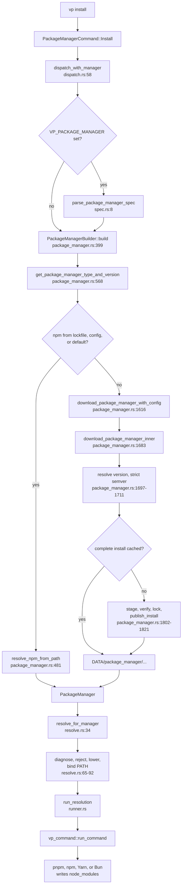
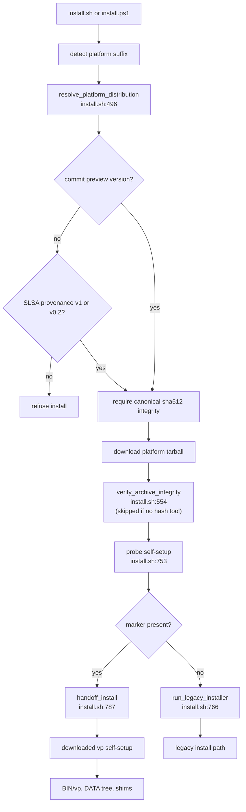
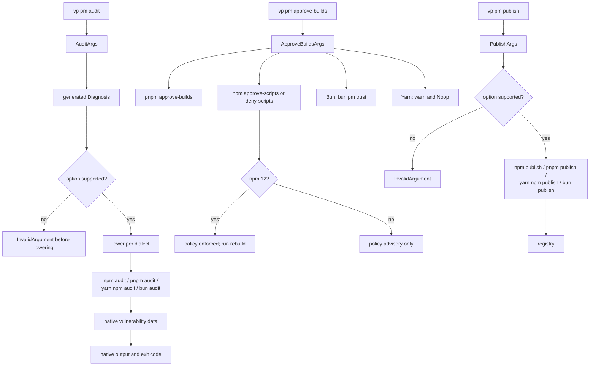

# 03 Vite+ Package Management: Detection, Install, Lockfile, and Supply Chain

Vite+ does not install project dependencies itself. It detects the package manager for the workspace. It downloads and caches the selected manager binary. It translates each command and each supported option into the native dialect. It then starts the native manager, and that manager writes the project dependency tree. The only dependency installation that Vite+ performs itself is the global installation of its own command-line interface (CLI), and that installation uses a pnpm lockfile. This document follows both paths. It names the code for each documented command. It then examines the supply-chain tools, the lockfiles, and the registry configuration.

All paths in this document are relative to the snapshot root `/Users/darkvoid/GitSources/src.voidzero`. The Vite+ repository directory is `vite-plus/`. A path below starts with `vite-plus/`, so the path names the repository first. The source is commit `794a96acd52e12216b3fe4eb02026637962cd315`, version 1.6.0. The license is the Massachusetts Institute of Technology (MIT) license, copyright VoidZero Inc.

Each code block starts with a path label, such as `// vite-plus/crates/vp_pm_cli/src/dispatch.rs:58-91`. The label gives the file and the line range. The label is not part of the source text.

The thesis is that Vite+ is a translator, not a resolver. The crate `vp_pm_cli` has no dependency solver and no package cache for project dependencies. It owns detection, the managed manager binaries, the shared command surface, the argument translation, and process execution. The project lockfile stays with the native manager. Vite+'s own lockfile protects one thing only: the download of the `vite-plus` package into the global installation. This split explains the supply-chain features. The audit and license commands report the native manager's data. They do not add a Vite+ database. The approval command writes the native manager's policy. It does not run the scripts.

## 1. The crate and the command surface

The crate supports pnpm, npm (NPM, the Node.js package manager), Yarn, and Bun. The crate README states the five duties of `vp_pm_cli`. It also states what the crate does not own.

```text
# vite-plus/crates/vp_pm_cli/README.md:3-12
Owns Vite+'s package-manager lifecycle:

- detects the project package manager and requested version;
- downloads and caches managed package-manager binaries;
- exposes the shared clap command surface used by global and local CLIs;
- resolves typed arguments for pnpm, npm, Yarn, or Bun;
- executes the resolved command and its pre-run actions.

Managed Node.js runtimes and Vite+'s managed global-package store remain in the
global CLI.
```

Two command-line programs share this command surface. The global CLI is the Rust binary `vp_global_cli`. A user installs it once. The local CLI is the `vite-plus` package inside a project. The local CLI calls this crate through Native Application Programming Interface (NAPI) bindings (`vite-plus/crates/vp_pm_cli/src/cli.rs:1-6`). The global CLI also owns the managed Node.js runtimes and the managed global-package store (`vite-plus/crates/vp_pm_cli/README.md:11-12`). Document 02 (`02-vite-plus-toolchain.md`) covers the path from the shell to each program.

The module list in `vite-plus/crates/vp_pm_cli/src/lib.rs:10-20` shows the same split. The modules are `cli`, `config`, `dispatch`, `env_forbidden`, `error`, `lifecycle_env`, `package_manager`, `request`, `resolution`, `shim`, and `spec`. The `request` module holds the Hypertext Transfer Protocol (HTTP) client and the package archive download (a tarball, a `tar` archive). The `resolution` directory holds one command module for each command family. The `env_forbidden` module blocks managed tools when `VP_ENV_FORBIDDEN` is set (`vite-plus/crates/vp_pm_cli/src/env_forbidden.rs:17-26`). The `lifecycle_env` module builds the environment for lifecycle scripts (`vite-plus/crates/vp_pm_cli/src/lifecycle_env.rs:28-60`). The `shim` module writes the launcher files (`vite-plus/crates/vp_pm_cli/src/shim.rs:13-22`). The `spec` module parses the `VP_PACKAGE_MANAGER` override (`vite-plus/crates/vp_pm_cli/src/spec.rs:21-30`).

`PackageManagerCommand` is the shared command surface. It has twelve variants. `PmCommand` adds twenty-eight forwarded commands below `vp pm`. `ManagedGlobalCommand` is a borrowed projection for the global store. It borrows slices from the parsed arguments instead of copying them. It has five variants: install, remove, update, outdated, and list (`vite-plus/crates/vp_pm_cli/src/cli.rs:176-208`). When `install --global` is set, `managed_global_command` returns this projection (`vite-plus/crates/vp_pm_cli/src/cli.rs:245-260`). The global CLI dispatcher then works on the managed global store. The native manager is not started. A global operation therefore leaves the `vp_pm_cli` path before it reaches a native manager.

```rust
// vite-plus/crates/vp_pm_cli/src/cli.rs:28-71
pub enum PackageManagerCommand {
    /// Install all dependencies, or add packages if package names are provided
    #[command(visible_alias = "i")]
    Install(InstallArgs),

    /// Add packages to dependencies
    Add(AddArgs),

    /// Remove packages from dependencies
    #[command(visible_alias = "rm", visible_alias = "un", visible_alias = "uninstall")]
    Remove(RemoveArgs),

    /// Update packages to their latest versions
    #[command(visible_alias = "up")]
    Update(UpdateArgs),

    /// Deduplicate dependencies
    Dedupe(DedupeArgs),

    /// Check for outdated packages
    Outdated(OutdatedArgs),

    /// Show why a package is installed
    #[command(visible_alias = "explain")]
    Why(WhyArgs),

    /// View package information from the registry
    #[command(visible_alias = "view", visible_alias = "show")]
    Info(ViewArgs),

    /// Link packages for local development
    #[command(visible_alias = "ln")]
    Link(LinkArgs),

    /// Unlink packages
    Unlink(UnlinkArgs),

    /// Download and execute a package without installing it globally
    Dlx(DlxArgs),

    /// Forward a command to the package manager
    #[command(subcommand)]
    Pm(PmCommand),
}
```

The forwarded commands include `ci`, `approve-builds`, `prune`, `patch`, `patch-commit`, `pack`, `list`, and `licenses`. They also include `view`, `version`, `pkg`, `publish`, `stage`, `owner`, `team`, `cache`, `config`, `login`, `logout`, `whoami`, `token`, `audit`, `dist-tag`, `deprecate`, `search`, `rebuild`, `fund`, and `ping`. The first of these, `ci`, means continuous integration (CI). The full enum is at `vite-plus/crates/vp_pm_cli/src/cli.rs:75-173`.

```rust
// vite-plus/crates/vp_pm_cli/src/cli.rs:75-116
pub enum PmCommand {
    /// Clean install dependencies for CI environments
    Ci(CiArgs),

    /// Approve dependency lifecycle scripts (install/postinstall) to run
    #[command(name = "approve-builds")]
    ApproveBuilds(ApproveBuildsArgs),

    /// Remove unnecessary packages
    Prune(PruneArgs),

    /// Prepare a package for local patching
    Patch(PatchArgs),

    /// Commit a prepared package patch
    #[command(name = "patch-commit")]
    PatchCommit(PatchCommitArgs),

    /// Create a tarball of the package
    Pack(PackArgs),

    /// List installed packages
    #[command(visible_alias = "ls")]
    List(ListArgs),

    /// Inspect licenses of installed dependencies
    #[command(subcommand)]
    Licenses(LicensesCommand),

    /// View package information from the registry
    #[command(visible_alias = "info", visible_alias = "show")]
    View(ViewArgs),

    /// Forward the native package version command
    Version(VersionArgs),

    /// Manage package.json fields
    #[command(subcommand)]
    Pkg(PkgCommand),

    /// Publish package to registry
    Publish(PublishArgs),
```

The `resolution` directory has thirty-eight command modules and one `mod.rs`. Each module holds the typed arguments and one `Resolve` implementation for each dialect. The list is at `vite-plus/crates/vp_pm_cli/src/resolution/commands/mod.rs:1-38`. Document 02 (`02-vite-plus-toolchain.md`) owns the path from the shell to this crate. This document starts at the crate boundary.

## 2. Install flow: from `vp install` to the two stores

### 2.1 Detection

`dispatch_with_manager` chooses the manager source. The default source is `ManagerSource::Detect`. In that source the builder supplies pnpm as its default (`vite-plus/crates/vp_pm_cli/src/dispatch.rs:69-72`).

The dispatch has three sources. `Detect` reads the project. `Environment` uses a resolution that the caller already computed. `Resolved` uses a manager that the caller already built (`vite-plus/crates/vp_pm_cli/src/dispatch.rs:22-26`, `vite-plus/crates/vp_pm_cli/src/dispatch.rs:42-56`).

```rust
// vite-plus/crates/vp_pm_cli/src/dispatch.rs:58-91
async fn dispatch_with_manager(
    cwd: &AbsolutePath,
    command: PackageManagerCommand,
    source: ManagerSource<'_>,
) -> Result<DispatchResult, Error> {
    let render_diagnostics = command.should_render_diagnostics();
    let manager = match source {
        ManagerSource::Detect => {
            if let Some((kind, version, hash)) = package_manager_override()? {
                build_selected_package_manager(cwd, kind, &version, hash.as_deref()).await?
            } else {
                PackageManager::builder(cwd)
                    .package_manager_type(PackageManagerType::Pnpm)
                    .build()
                    .await?
            }
        }
        ManagerSource::Environment(package_manager) => {
            build_selected_package_manager(
                cwd,
                package_manager.package_manager_type,
                &package_manager.version,
                package_manager.hash.as_deref(),
            )
            .await?
        }
        ManagerSource::Resolved(manager) => manager,
    };
    let package_manager = manager.client;
    let why_hint_packages = command.why_hint_packages(package_manager).map(<[String]>::to_vec);
    let resolution = command.resolve_for_manager(&manager)?;
    let status = run_resolution(cwd, resolution, render_diagnostics).await?;
    Ok(DispatchResult { status, why_hint_packages })
}
```

`package_manager_override` reads the `VP_PACKAGE_MANAGER` environment variable. The parser accepts `name@version` and `name@version+hash`. The hash is the Corepack integrity value. The parser rejects an empty name, an empty version, and an unknown manager (`vite-plus/crates/vp_pm_cli/src/spec.rs:6-30`).

Without an override, `PackageManagerBuilder::build` calls `get_package_manager_type_and_version` (`vite-plus/crates/vp_pm_cli/src/package_manager.rs:399-417`). The function checks these signals in this order (`vite-plus/crates/vp_pm_cli/src/package_manager.rs:568-664`):

| Order | Signal | Result |
|---|---|---|
| 1 | `packageManager` field in `package.json` | Named manager, exact version, optional hash |
| 2 | `devEngines.packageManager` field | Named manager, version requirement |
| 3 | `pnpm-workspace.yaml` or `pnpm-lock.yaml` | pnpm |
| 4 | `yarn.lock` or `.yarnrc.yml` | Yarn |
| 5 | `package-lock.json` | npm |
| 6 | `bun.lock` or `bun.lockb` | Bun |
| 7 | `.pnpmfile.cjs`, `pnpmfile.cjs`, `bunfig.toml`, or `yarn.config.cjs` | pnpm, pnpm, Bun, or Yarn |
| 8 | The caller's default | That default |
| 9 | No signal | `UnrecognizedPackageManager` |

The table describes `get_package_manager_type_and_version`. Row 8 applies only when the caller passes a default. Row 9 applies only when the caller passes no default. The builder in the dispatch path always passes pnpm, so row 9 does not occur there (`vite-plus/crates/vp_pm_cli/src/package_manager.rs:657-663`).

The version string has three possible forms. An exact version comes from `packageManager`. A range comes from `devEngines.packageManager`. The literal string `default` comes from a lockfile or from the fallback. The version is not resolved during detection. It is resolved at download time.

At download time, `default` becomes the latest distribution tag for pnpm, Yarn, and Bun. For npm it becomes the version of the npm on `PATH` (`vite-plus/crates/vp_pm_cli/src/package_manager.rs:1378-1390`). A range is resolved against the registry version list, which the code reads from the abbreviated package metadata (`vite-plus/crates/vp_pm_cli/src/package_manager.rs:1392-1394`, `vite-plus/crates/vp_pm_cli/src/package_manager.rs:1413-1426`).

`VP_PACKAGE_MANAGER` can carry a Corepack integrity value. Corepack is the Node.js tool that installs the package-manager version named in the `packageManager` field. The value has the form `name@version+hash`, for example `pnpm@10.6.1+sha512.<hex>` (`vite-plus/crates/vp_pm_cli/src/spec.rs:7-18`). The hash is the integrity suffix from the `packageManager` field. It protects the package archive against a different archive for the same version.

There is one exception. A project that selects npm from a lockfile or from the default does not download npm. The builder uses the npm that is already on `PATH` (`vite-plus/crates/vp_pm_cli/src/package_manager.rs:412-420`). `resolve_npm_from_path` reads the nearest `package.json` above the npm executable, within four parent directories, and requires the package name `npm` (`vite-plus/crates/vp_pm_cli/src/package_manager.rs:481-507`). If the manifest is not npm's, Vite+ runs `npm --version`. The comment gives the reason: only npm does not switch versions by itself, so its manifest and its reported version agree (`vite-plus/crates/vp_pm_cli/src/package_manager.rs:442-457`). The source does not state why the search limit is four directories. The npm-on-`PATH` path does not call the managed download, so `VP_ENV_FORBIDDEN` does not reject it.

### 2.2 Version resolution and the managed binary

`download_package_manager_with_config` is the single gate for a managed download (`vite-plus/crates/vp_pm_cli/src/package_manager.rs:1616-1630`). It calls `ensure_managed_package_manager_allowed` first. That function enforces `VP_ENV_FORBIDDEN`. When the variable is set, it returns `DisabledByEnvForbidden` and the command fails (`vite-plus/crates/vp_pm_cli/src/env_forbidden.rs:17-26`). It does not fall back to a system manager. It then calls `download_package_manager_inner`.

The inner function resolves the version, and then it parses the result with a strict semantic-version parser. The comment states the security reason. The version becomes part of a filesystem path, and `AbsolutePath::join` does not normalize `..` components (`vite-plus/crates/vp_pm_cli/src/package_manager.rs:1697-1711`).

The download has four cases. Bun always uses a platform binary package. pnpm 12 and later use the native `@pnpm/exe.*` platform package. Yarn 2 and later use `@yarnpkg/cli-dist` and extract only `bin/yarn.js` (`vite-plus/crates/vp_pm_cli/src/package_manager.rs:1713-1718`, `vite-plus/crates/vp_pm_cli/src/package_manager.rs:309-313`). All other cases download the main package tarball (`vite-plus/crates/vp_pm_cli/src/package_manager.rs:1720-1733`).

```rust
// vite-plus/crates/vp_pm_cli/src/package_manager.rs:1735-1793
    let tgz_url = tarball_url
        .map(Str::from)
        .unwrap_or_else(|| npm_config.package_tgz_url(&package_name, &version));
    // A pinned install is key-addressed so a different pin resolves to a
    // different, immutable directory; an unpinned install stays on the version
    // directory. The generic path serves managers whose pin covers the executed
    // files, so it has no platform origin.
    // <DATA>/package_manager/pnpm/10.0.0/[{key}/]pnpm/bin/(pnpm|pnpm.cmd|pnpm.ps1)
    let cache_key = install_cache_key(expected_hash, None);
    let version_dir = package_manager_version_dir(package_manager_type, &version);
    let install_dir =
        package_manager_install_dir(package_manager_type, &version, cache_key.as_deref());

    // A complete install holds the content for this pin (or the current unpinned
    // install); reuse it.
    if is_package_manager_install_complete(&install_dir, &bin_name)? {
        return Ok((install_dir, package_name, version));
    }

    // Stage the download in a temp directory beside the version directory, not
    // inside it. A reader that scans the version directory for key subdirectories
    // then never sees the half-written staging copy. Only create the manager
    // directory now, so a failed install leaves no empty version directory; the
    // version directory is created when the staged copy is published.
    // <DATA>/package_manager/pnpm/{tmp_name}
    let manager_dir = version_dir.parent().expect("a version directory has a parent");
    tokio::fs::create_dir_all(manager_dir).await?;
    // Keep the TempDir guard alive so a failure path cleans up the temp dir.
    let tmp_dir = tempfile::tempdir_in(manager_dir)?;
    let target_dir_tmp = tmp_dir.path().to_path_buf();

    let download_message = format!("Downloading {package_manager_type} v{version}...");
    // A Yarn 2+ `packageManager` hash covers only the CLI. The rest of the archive
    // is not authenticated by that hash, so vp never writes it to disk.
    let archive_file = is_modern_yarn.then(|| PathBuf::from(format!("package/{YARN_CLI_ENTRY}")));
    download_and_extract_tgz_with_hash_and_config(
        &tgz_url,
        &target_dir_tmp,
        archive_file.as_deref(),
        expected_hash,
        Some(&download_message),
        npm_config,
    )
    .await
    .map_err(|err| {
        // status 404 means the version is not found, convert to PackageManagerVersionNotFound error
        if let Error::Reqwest(e) = &err
            && let Some(status) = e.status()
            && status == reqwest::StatusCode::NOT_FOUND
        {
            Error::PackageManagerVersionNotFound {
                name: package_manager_type.to_string().into(),
                version: version.clone(),
                url: tgz_url.into(),
            }
        } else {
            name_hashed_artifact(err, package_manager_type, &version)
        }
    })?;
```

The download and extraction helper is in `vite-plus/crates/vp_pm_cli/src/request.rs:501-548`. It retries the whole download, verify, and extract pipeline. The builder sets `.with_max_times(3)` (`vite-plus/crates/vp_pm_cli/src/request.rs:541-545`), and the source does not state whether this number counts retries or total attempts. A 404 and a permanent configuration error fail fast.

### 2.3 Cache keys and the verified namespace

A pinned install gets a cache key. The key is the first thirty-two hexadecimal characters of a Secure Hash Algorithm 256 (SHA-256) digest. A platform-binary manager adds the registry origin to the key, because the pin covers the main tarball and not the executed platform binary. The origin is also hashed, so a credential in the Uniform Resource Locator (URL) does not enter a path. The source does not state why the key uses thirty-two characters.

```rust
// vite-plus/crates/vp_pm_cli/src/package_manager.rs:147-170
fn short_fingerprint(input: &str) -> Str {
    Str::from(&hex::encode(Sha256::digest(input.as_bytes()))[..32])
}

/// The cache-key directory segment that binds a *verified* install to what it was
/// verified against, so a different pin or origin resolves to a different,
/// immutable directory instead of sharing one.
///
/// - No pin: `None`. An unpinned install has no integrity reference, so it stays
///   on the shared version directory with no key segment.
/// - Pinned tarball manager: keyed by the pin, which covers the executed files.
/// - Platform-binary manager (bun, pnpm >= 12): keyed by pin and origin, because
///   the pin covers the main tarball, not the executed platform binary.
#[must_use]
pub fn install_cache_key(
    expected_hash: Option<&str>,
    platform_origin: Option<&str>,
) -> Option<Str> {
    match (expected_hash, platform_origin) {
        (None, _) => None,
        (Some(pin), None) => Some(short_fingerprint(pin)),
        (Some(pin), Some(origin)) => Some(short_fingerprint(&format!("{pin}\n{origin}"))),
    }
}
```

An unpinned install lives at `<DATA>/package_manager/{name}/{version}/{name}`. A pinned install lives at `<DATA>/package_manager/{name}/.verified-v1/{version}/{key}/{name}` (`vite-plus/crates/vp_pm_cli/src/package_manager.rs:215-260`, `vite-plus/crates/vp_pm_cli/src/package_manager.rs:836-852`). The constant `VERIFIED_NAMESPACE` is `.verified-v1` (`vite-plus/crates/vp_pm_cli/src/package_manager.rs:214`). The data root is the `data` category root from `VpDirs`. Its comment names managed package managers as one of its contents (`vite-plus/crates/vp_shared/src/dirs.rs:82-84`). The code comment at line 1742 writes the key segment in brackets. It does not show the verified namespace. The function `package_manager_install_dir` adds that namespace when a key exists (`vite-plus/crates/vp_pm_cli/src/package_manager.rs:836-852`).

An unpinned install has no integrity reference. The source states this directly (`vite-plus/crates/vp_pm_cli/src/package_manager.rs:155-157`). The download helper verifies a hash only when the caller supplies one (`vite-plus/crates/vp_pm_cli/src/request.rs:593-599`). An unpinned download therefore has no archive check after the transport. The source does not state another protection for that path.

The publication step is the only writer to the final install directory. It holds a file lock named `{version}.lock`. It reuses a complete install. It removes a partial install. It renames the staged directory into place. The shims are written in the staged copy before the rename (the code block below).

```rust
// vite-plus/crates/vp_pm_cli/src/package_manager.rs:1802-1821
    // Finish shims before publishing the directory to lock-free cache readers.
    tracing::debug!("Create shim files for {}", bin_name);
    let tmp_bin_dir = AbsolutePath::new(&target_dir_tmp).unwrap().join(&bin_name).join("bin");
    create_shim_files(package_manager_type, &tmp_bin_dir).await?;

    // Use a file-based lock to ensure atomicity of remove + rename operations
    // This prevents DirectoryNotEmpty error when multiple processes/threads
    // try to install the same package manager version concurrently.
    // The lock is automatically skipped on NFS filesystems where locking is unreliable.
    let lock_path = manager_dir.join(format!("{version}.lock"));
    tracing::debug!("Acquire lock file: {:?}", lock_path);
    let lock_file = open_lock_file(lock_path.as_path())?;
    // Acquire exclusive lock (blocks until available)
    lock_file.lock()?;
    tracing::debug!("Lock acquired: {:?}", lock_path);

    // Publish the staged install, or reuse the directory if another process won
    // the race and filled it first.
    publish_install(install_dir, &target_dir_tmp, &bin_name, package_name, version).await
}
```

`publish_install` is at `vite-plus/crates/vp_pm_cli/src/package_manager.rs:288-311`. It returns the directory, package name, and version. The caller then binds that directory into the command environment. The lock is skipped on a Network File System (NFS) mount, as the quote states. The source does not state how the code detects NFS. It also does not state what keeps the remove-and-rename sequence safe when the lock is absent. The source comment presents the skip as a fixed property of the lock helper.

### 2.4 Translation and execution

`resolve_for_manager` has a fixed order. It diagnoses the typed arguments. It rejects every unsupported option with an `InvalidArgument` result. It lowers the arguments for the selected dialect. It adds the managed binary directory to the child `PATH`. It returns the command plan and the diagnostics (`vite-plus/crates/vp_pm_cli/src/resolution/resolve.rs:38-98`). It changes the environment of the child command, not of the parent process. Resolution never starts a process (`vite-plus/crates/vp_pm_cli/src/resolution/mod.rs:1-28`).

The lower step rewrites the child `PATH`. It then adds one manager-specific variable in three cases. pnpm gets `PNPM_CONFIG_UPDATE_NOTIFIER=false`. Yarn 0 and 1 get `YARN_DISABLE_SELF_UPDATE_CHECK=true`. Yarn 4 and later get `YARN_ENABLE_TIPS=false`. Yarn 2 and 3 get no extra variable (`vite-plus/crates/vp_pm_cli/src/resolution/resolve.rs:66-94`). `run_resolution` then executes any pre-run action and calls `vp_command::run_command(&program, args, &env, cwd)` (`vite-plus/crates/vp_pm_cli/src/resolution/runner.rs:13-35`). A pre-run action creates a directory that the command needs (`vite-plus/crates/vp_pm_cli/src/resolution/runner.rs:37-50`). The `DispatchResult.status` is the native process exit status, and `why_hint_packages` carries the package names for the toolchain hint after `vp why` (`vite-plus/crates/vp_pm_cli/src/dispatch.rs:16-20`, `vite-plus/crates/vp_pm_cli/src/cli.rs:333-348`).

`InstallArgs::resolve_for_manager` is the only command that chooses between two argument types. An install with package names is not an install. It becomes an add request. The code rejects install-only options in add mode and add-only options in install mode before the conversion.

```rust
// vite-plus/crates/vp_pm_cli/src/resolution/commands/install.rs:152-195
    pub(crate) fn resolve_for_manager(self, manager: &PackageManager) -> Result<Resolution, Error> {
        let adding_packages = !self.packages.is_empty();
        // Diagnose the selected mode before conversion discards fields, and before
        // manager-specific support rules can produce misleading or duplicate errors.
        let (mode, unsupported): (&str, &[(&str, bool)]) = if adding_packages {
            (
                "with package names",
                &[
                    ("--fix-lockfile", self.fix_lockfile),
                    ("--resolution-only", self.resolution_only),
                ],
            )
        } else {
            (
                "without package names",
                &[
                    ("--save-exact", self.save_exact),
                    ("--save-peer", self.save_peer),
                    ("--save-optional", self.save_optional),
                    ("--save-catalog", self.save_catalog),
                ],
            )
        };
        let mut diagnostics = Diagnostics::default();
        for &(option, supplied) in unsupported {
            if supplied {
                diagnostics.warn(
                    DiagnosticKind::UnsupportedOption,
                    vt_str::format!("install {mode} does not support {option}."),
                );
            }
        }
        if let Some(message) = diagnostics.unsupported_options_error() {
            return Ok(Resolution {
                outcome: CommandResolution::InvalidArgument(message),
                diagnostics: Diagnostics::default(),
            });
        }
        if adding_packages {
            resolve_for_manager(manager, self.into_add_args())
        } else {
            resolve_for_manager(manager, self)
        }
    }
```

The npm lowering shows the translation model. A frozen install without package names becomes `npm ci`. A normal install becomes `npm install`. npm 7 and later use `--omit=dev` and `--include=dev`. npm 6 uses `--production` and `--production=false`.

```rust
// vite-plus/crates/vp_pm_cli/src/resolution/commands/install.rs:239-258
impl Resolve<InstallArgs> for Npm {
    fn resolve(&self, args: &InstallArgs, _diag: &mut Diagnostics) -> CommandResolution {
        let use_ci = args.frozen_lockfile && !args.no_frozen_lockfile;
        let mut cmd = CommandBuilder::new("npm");
        cmd.arg(if use_ci { "ci" } else { "install" });
        if self.supports_v7_commands() {
            cmd.arg_if("--omit=dev", args.prod)
                .arg_if("--include=dev", args.dev)
                .arg_if("--omit=optional", args.no_optional);
        } else {
            cmd.arg_if("--production", args.prod)
                .arg_if("--production=false", args.dev)
                .arg_if("--no-optional", args.no_optional);
        }
        cmd.arg_if("--package-lock-only", args.lockfile_only && !use_ci)
            .arg_if("--prefer-offline", args.prefer_offline)
            .arg_if("--offline", args.offline)
            .arg_if("--force", args.force && !use_ci)
            .arg_if("--ignore-scripts", args.ignore_scripts)
            .arg_if("--no-package-lock", args.no_lockfile && !use_ci);
```

The project dependency tree is the output of the native manager, not of Vite+. Three stores are distinct. `<DATA>` is the `data` category root of `VpDirs` (`vite-plus/crates/vp_shared/src/dirs.rs:79-84`).

| Store | Owner | Location | Content |
|---|---|---|---|
| Managed manager store | `vp_pm_cli` | `<DATA>/package_manager` | Managed pnpm, Yarn, and Bun binaries; npm comes from `PATH` in the lockfile case |
| Project dependency tree | Native manager | `node_modules` | Project dependencies and lifecycle output |
| Global package store | `vp_global_cli` | `<DATA>/packages` | Globally installed tools (`vite-plus/docs/guide/package-management/global-packages.md:14-16`) |



## 3. The installer: bootstrap scripts and `vp-setup`

Vite+ installs its own CLI in two stages. A bootstrap script or a small installer acquires the platform binary package. The downloaded binary then performs self-setup. The bootstrap does not write the final installation. The comment in `install.sh` states this rule: acquisition stays separate from permanent installation, and the bootstrap owns cleanup (`vite-plus/packages/cli/install.sh:715-716`).

The shell script `vite-plus/packages/cli/install.sh` and the PowerShell script `vite-plus/packages/cli/install.ps1` implement the same protocol. The Rust binary `vp-setup` implements the same protocol. Its module comment describes a standalone Windows installer that complements `install.ps1` (`vite-plus/crates/vp_installer/src/main.rs:1-8`). The Cargo manifest builds the `vp-setup` binary with no target condition, and only the `winreg` dependency and the `windows_path` module are Windows-specific (`vite-plus/crates/vp_installer/Cargo.toml:10-27`, `vite-plus/crates/vp_installer/src/main.rs:24-25`). The crate is not published (`vite-plus/crates/vp_installer/Cargo.toml:7`). The release workflow builds and uploads `vp-setup.exe` only for targets that contain `windows` (`.github/workflows/reusable-release-build.yml:206-213`). The release job copies each `vp-setup.exe` into the release assets (`.github/workflows/release.yml:146-160`). So the release publishes the binary for Windows only, although the crate builds on every platform.

### 3.1 Provenance and integrity

Both scripts resolve the platform package metadata from the registry. For a release version, the metadata must carry Supply-chain Levels for Software Artifacts (SLSA) provenance of predicate type v1 or v0.2. Provenance is signed metadata that the registry attaches to the package under `dist.attestations.provenance`. The predicate type names the metadata schema. A commit preview version `0.0.0-commit.<sha>` is exempt. The comment gives the reason: a commit preview build does not carry npm provenance, regardless of registry (`vite-plus/packages/cli/install.sh:523`). The metadata must also carry a canonical SHA-512 `dist.integrity` value.

```bash
# vite-plus/packages/cli/install.sh:522-539
  # Commit preview builds do not carry npm provenance, regardless of registry.
  if [[ ! "$package_version" =~ ^0\.0\.0-commit\.[0-9a-fA-F]{40}$ ]]; then
    case "$predicate_type" in
      https://slsa.dev/provenance/v1|https://slsa.dev/provenance/v0.2) ;;
      *)
        error "Refusing to install ${package_name}@${package_version}: the package does not contain supported npm provenance metadata. Vite+ only installs release binaries published with npm provenance."
        ;;
    esac
  fi

  if [ -z "$PLATFORM_TARBALL_URL" ]; then
    error "CLI package metadata for ${package_name}@${package_version} does not include dist.tarball\n  URL: $metadata_url"
  fi
  # A SHA-512 digest is 64 bytes, encoded as 86 base64 characters and two padding
  # characters. Require canonical padding bits as well as the supported algorithm.
  if [[ ! "$PLATFORM_INTEGRITY" =~ ^sha512-[A-Za-z0-9+/]{85}[AQgw]==$ ]]; then
    error "CLI package metadata for ${package_name}@${package_version} does not include a valid SHA-512 dist.integrity\n  URL: $metadata_url"
  fi
```

The PowerShell script applies the same two checks. It reads `dist.attestations.provenance.predicateType` and it matches the canonical SHA-512 form.

```powershell
# vite-plus/packages/cli/install.ps1:250-279
function Get-VerifiedPlatformDistribution {
    param(
        [object]$Metadata,
        [string]$PackageName,
        [string]$Version
    )

    # Check nested provenance metadata; registry signatures and package-defined
    # top-level fields do not satisfy the release check.
    $predicateType = Get-MetadataProperty $Metadata @('dist', 'attestations', 'provenance', 'predicateType')
    # Commit preview builds do not carry npm provenance, regardless of registry.
    $isCommitPreview = $Version -cmatch '\A0\.0\.0-commit\.[0-9a-fA-F]{40}\z'
    if (-not $isCommitPreview -and $SupportedProvenancePredicateTypes -notcontains $predicateType) {
        Write-Error-Exit "Refusing to install ${PackageName}@${Version}: the package does not contain supported npm provenance metadata. Vite+ only installs release binaries published with npm provenance."
    }

    $tarballUrl = Get-MetadataProperty $Metadata @('dist', 'tarball')
    if (-not $tarballUrl) {
        Write-Error-Exit "CLI package metadata for ${PackageName}@${Version} does not include dist.tarball"
    }
    $integrity = Get-MetadataProperty $Metadata @('dist', 'integrity')
    # Require a canonical base64 encoding of a 64-byte SHA-512 digest.
    if ($integrity -isnot [string] -or $integrity -cnotmatch '\Asha512-[A-Za-z0-9+/]{85}[AQgw]==\z') {
        Write-Error-Exit "CLI package metadata for ${PackageName}@${Version} does not include a valid SHA-512 dist.integrity"
    }
    return [pscustomobject]@{
        TarballUrl = [string]$tarballUrl
        Integrity = $integrity
    }
}
```

The archive check is separate. The shell script uses `sha512sum`, then `shasum -a 512`, then `openssl dgst -sha512`. If no tool exists, it warns and skips the check (`vite-plus/packages/cli/install.sh:554-581`). The PowerShell script uses `Get-FileHash -Algorithm SHA512` (`vite-plus/packages/cli/install.ps1:281-293`). The computed digest is compared with the decoded `dist.integrity` value (`vite-plus/packages/cli/install.sh:572-581`). A mismatch stops the install. The check runs before extraction (`vite-plus/packages/cli/install.sh:605-606`). The skip is a real limit. Provenance binds the metadata to the publisher, but the archive bytes are not checked on a machine with none of the three hash tools.

The metadata parser is a small `awk` program (`vite-plus/packages/cli/install.sh:275-495`). The comment at `vite-plus/packages/cli/install.sh:269-274` states that invalid JSON fails closed. The parser also rejects duplicate keys (`vite-plus/packages/cli/install.sh:429`). The parser reads `dist.tarball`, the provenance predicate type, a registry error field, and `dist.integrity`.

### 3.2 Handoff and self-setup

After extraction, the bootstrap probes the binary. The probe sets `VP_SELF_SETUP_SUPPORT_CHECK=1` and runs `--help`. A binary that supports the protocol prints a fixed marker, `vite-plus-self-setup-v1`. The `printf '.'` adds a second marker only when `--help` exits with status 0. The comparison therefore checks the text and the exit status (`vite-plus/packages/cli/install.sh:753-758`). The script then hands control to the binary. A binary without the marker goes to the legacy installer.

```bash
# vite-plus/packages/cli/install.sh:753-764
supports_self_setup() {
  local response
  # Old binaries must exit with help rather than opening an interactive picker.
  response=$(VP_SELF_SETUP_SUPPORT_CHECK=1 "$1" --help 2>/dev/null && printf '.') || return 1
  [ "$response" = $'vite-plus-self-setup-v1\n.' ]
}

supports_env_forbidden() {
  local response
  response=$(VP_SELF_SETUP_SUPPORT_CHECK=env-forbidden "$1" --help 2>/dev/null && printf '.') || return 1
  [ "$response" = $'vite-plus-self-setup-v1\nvite-plus-self-setup-env-forbidden\n.' ]
}
```

The environment variable `VP_ENV_FORBIDDEN=1` has a stronger requirement. The binary must support the environment-forbidden probe. A binary that ignores the variable would still download managed tools. The script refuses that binary (`vite-plus/packages/cli/install.sh:739-750`). The second probe passes `env-forbidden` instead of `1`. A binary with support prints a second marker line (`vite-plus/crates/vp_setup/src/support.rs:4-21`). The Rust checks the same condition before it starts self-setup (`vite-plus/crates/vp_installer/src/main.rs:156-161`).

The Rust installer follows the same sequence with explicit steps. It resolves the version string, it checks that the release supports the split layout, it resolves the platform package, it downloads, it verifies, it extracts, and it probes. The split layout is a version directory with `bin/vp`, `bin/vp-shim.exe`, and `bin/vp-install-lock.yaml` (`vite-plus/crates/vp_setup/src/install.rs:35-43`). The installer also generates a wrapper `package.json` (`vite-plus/crates/vp_setup/src/install.rs:148-177`). `supports_split_layout` accepts a commit preview version and any version 0.3.0 or later (`vite-plus/crates/vp_setup/src/lib.rs:54-62`). Then the installer runs the binary with `VP_SELF_SETUP_REPLACE_EXISTING` and the manager choices.

```rust
// vite-plus/crates/vp_installer/src/main.rs:125-178
async fn do_install(opts: &cli::Options, dirs: &VpDirs) -> Result<(), Box<dyn std::error::Error>> {
    // 1. Resolve and verify the download before touching the installation.
    let platform_suffix = platform::detect_platform_suffix()?;
    let version_or_tag = opts.version.as_deref().unwrap_or(&opts.tag);
    if !opts.quiet {
        print_info(&format!("resolving version '{version_or_tag}'..."));
    }
    let target_version =
        registry::resolve_version_string(version_or_tag, opts.registry.as_deref()).await?;
    if !vp_setup::supports_split_layout(&target_version) {
        return Err(format!(
            "vp-setup does not support vite-plus {target_version}. Install vite-plus 0.3.0 or later."
        ).into());
    }
    let resolved = registry::resolve_platform_package(
        &target_version,
        &platform_suffix,
        opts.registry.as_deref(),
    )
    .await?;
    let data =
        download_with_progress(&HttpClient::new(), &resolved.platform_tarball_url, opts.quiet)
            .await?;
    integrity::verify_integrity(&data, &resolved.platform_integrity)?;
    let temporary = tempfile::tempdir()?;
    let directory = AbsolutePathBuf::new(temporary.path().to_path_buf())
        .ok_or("Installer temporary directory must be absolute")?;
    install::extract_platform_package(&data, &directory).await?;
    let binary = directory.join("bin").join(VP_BINARY_NAME);

    // 2. Match the script bootstrap protocol. Old binaries see --help instead of opening a picker.
    // VP_ENV_FORBIDDEN must not reach a binary that would ignore it and download.
    let env_forbidden = vp_shared::EnvConfig::get().env_forbidden;
    let support = support::probe_self_setup(&binary, env_forbidden).await?;
    if env_forbidden && support != SelfSetupSupport::EnvForbidden {
        return Err(support::env_forbidden_unsupported_message(&target_version).into());
    }
    if support == SelfSetupSupport::Legacy {
        return legacy::install(opts, dirs, &target_version, &data).await;
    }

    // 3. The menu supplies setup choices; interactive runs may still need release-age consent.
    let mut command = tokio::process::Command::new(binary.as_path());
    command
        .env_remove(vp_shared::env_vars::VP_SELF_SETUP_SUPPORT_CHECK)
        .env(vp_shared::env_vars::VP_SELF_SETUP_REPLACE_EXISTING, if opts.yes { "1" } else { "0" })
        .envs(manager_envs(opts.node_manager))
        .env(
            vp_shared::env_vars::VP_SELF_SETUP_NO_MODIFY_PATH,
            if opts.no_modify_path { "1" } else { "0" },
        )
        .stdin(std::process::Stdio::null())
        .stdout(std::process::Stdio::piped())
        .stderr(std::process::Stdio::piped());
```

The excerpt stops before the process start. The code then runs the binary and checks its status (`vite-plus/crates/vp_installer/src/main.rs:182-214`). The downloaded binary performs self-setup in the version directory. It writes a wrapper `package.json` with one dependency, `vite-plus` (`vite-plus/crates/vp_setup/src/install.rs:148-177`). It downloads a pinned pnpm 10.34.9 with a fixed SHA-512 pin (`vite-plus/crates/vp_setup/src/install.rs:123-137`, `vite-plus/crates/vp_setup/src/install.rs:508-517`). It runs `pnpm install` in that directory (`vite-plus/crates/vp_setup/src/install.rs:392-444`). The global installation is `<DATA>/<version>/`, and a `current` link points to the active version (`vite-plus/crates/vp_setup/src/install.rs:661-702`). The platform binary and the `vite-plus` package are therefore two different artifacts. The first artifact is the launcher in `bin/`. The second artifact is the dependency tree in `node_modules/`.

The installer CLI options mirror the script environment. `--version` also reads `VP_VERSION`. `--registry` also reads `NPM_CONFIG_REGISTRY`. `CI` implies `--yes`. The full merge is at `vite-plus/crates/vp_installer/src/cli.rs:81-99`.

| Variable | Read by | Effect |
|---|---|---|
| `VP_VERSION` | `install.sh`, `install.ps1`, `vp-setup` | Select the version |
| `VP_HOME` | `vp_shared::EnvConfig`, scripts | Single-root installation path; `BIN`, `DATA`, and `CACHE` derive from it |
| `VP_BIN_DIR`, `VP_DATA_DIR`, `VP_CACHE_DIR` | `vp_shared::EnvConfig`, scripts | Split root paths |
| `NPM_CONFIG_REGISTRY` | scripts, `vp-setup`, `vp_pm_cli` | Registry URL |
| `VP_NODE_MANAGER` | scripts, `vp-setup` | Node.js management choice |
| `VP_ENV_FORBIDDEN` | scripts, `vp_pm_cli` | Disable all managed tools |
| `VP_LOCAL_TGZ` | `install.sh` | Path to a local `vite-plus.tgz` for development |
| `VP_PR_VERSION` | `install.sh` | Pull request (PR) number or commit SHA to install from the registry bridge |



The diagram shows the shell and PowerShell path. The Rust `vp-setup` binary follows the same steps with the functions in `vite-plus/crates/vp_installer/src/main.rs:125-214`.

## 4. The toolchain resolver: what `vp_toolchain` is not

The crate name suggests that `vp_toolchain` resolves versions, reads a registry, and checks a lock or an integrity value. The source does not support that reading. `vite-plus/crates/vp_toolchain/src/lib.rs` is a reader and validator of one JavaScript Object Notation (JSON) manifest. It has no network client, no download, no cryptographic digest, and no version selection. The name "toolchain" refers to the dependency tree of the shipped toolchain, not to a version resolver. That tree is the set of packages, tools, and engines that one Vite+ release contains.

The crate defines `Manifest`, `Node`, `Edge`, `Report`, and `ToolchainError`. A `Manifest` has a schema version, a node list, and an edge list. A `Node` has an identifier, a name, an optional version, revision, and build time, a kind, a delivery list, and aliases. An `Edge` has a source, a target, and a relationship (`vite-plus/crates/vp_toolchain/src/lib.rs:9-65`). `load_manifest` reads a file, parses JSON, and validates. Validation requires schema version 1. It requires a non-empty node identifier and name. It rejects a node with both a version and a build time, and it rejects a node with no version, no revision, and no build time. It requires a Coordinated Universal Time (UTC) build time of the form `YYYY-MM-DDTHH:MM:SSZ`. It rejects duplicate identifiers and duplicate filter labels. It checks that every edge names a known node (`vite-plus/crates/vp_toolchain/src/lib.rs:131-245`). The source does not state why a version and a build time are mutually exclusive.

```rust
// vite-plus/crates/vp_toolchain/src/lib.rs:131-143
pub fn load_manifest(path: &AbsolutePath) -> Result<Manifest, ToolchainError> {
    let content = fs::read_to_string(path)
        .map_err(|source| ToolchainError::Read { path: path.into(), source })?;
    let manifest = serde_json::from_str(&content)
        .map_err(|source| ToolchainError::Parse { path: path.into(), source })?;
    validate_manifest(&manifest)?;
    Ok(manifest)
}

pub fn validate_manifest(manifest: &Manifest) -> Result<(), ToolchainError> {
    if manifest.schema_version != 1 {
        return Err(ToolchainError::UnsupportedSchema(manifest.schema_version));
    }
```

A filter label is a node identifier, a name, or an alias (`vite-plus/crates/vp_toolchain/src/lib.rs:235-241`). `filter_manifest` keeps the selected nodes, all ancestors, and the nodes that the selection uses or compiles. An ancestor is a node with an edge that points to the selection. A used or compiled node is the target of an edge from the selection with relationship `uses` or `compiles` (`vite-plus/crates/vp_toolchain/src/lib.rs:288-324`). `build_report` combines the filter and the manifest, and `render` or `render_json` writes the result (`vite-plus/crates/vp_toolchain/src/lib.rs:247-260`, `vite-plus/crates/vp_toolchain/src/lib.rs:421-450`).

The manifest is generated at release time from `vite-plus/packages/cli/toolchain.config.json`. Each node names a `versionSource` with one of six types (`vite-plus/packages/cli/toolchain.config.json:1-235`). `cli-package` takes the `vite-plus` package version. `core-package` takes the `@voidzero-dev/vite-plus-core` version. `core-bundled` takes a version from the core package's `bundledVersions` map. `npm-dependency` reads the version from `node_modules/<package>/package.json`. `cargo` takes a version or a source revision from Cargo metadata. `vendored` takes a revision from `packages/tools/.upstream-versions.json` and a version from a package manifest (`vite-plus/packages/cli/build.ts:789-832`). The build script reads the configuration and writes `dist/toolchain.json` (`vite-plus/packages/cli/build.ts:854-875`).

The consumers are the `vp toolchain` command and the `vp version` command. The global CLI loads `toolchain.json` from the installed package's scripts directory. It builds a report and renders it (`vite-plus/crates/vp_global_cli/src/commands/toolchain.rs:22-51`). The build writes `dist/toolchain.json`, and the package copies it to that scripts directory. The version command uses `node_by_id` to read a tool version from the same file (`vite-plus/crates/vp_global_cli/src/commands/version.rs:85-119`). The migration crate reads the manifest for a pack configuration (`vite-plus/crates/vp_migration/src/pack_config.rs:94-99`).

**Aha:** `vp_toolchain` is a bill of materials, not a resolver. The crate name suggests registry access and an integrity check. The crate reads one local JSON file and validates its structure. The manifest has no digest field, and the crate has no request module and no cryptographic digest dependency. The manifest only records which components a release contains and how they relate.

## 5. The documented commands

The guide `vite-plus/docs/guide/package-management/index.md:3` states the contract in one sentence. Vite+ detects the manager, downloads the selected version when needed, and translates commands and supported options. The core commands run under `vp`. The forwarded commands run under `vp pm`. The rule is name ownership. A name that Vite+ already uses at the top level moves under `vp pm`. The guide gives `pack` as the example: `vp pm pack` creates a package archive, while `vp pack` builds a library (`vite-plus/docs/guide/package-management/index.md:20`). Native arguments after `--` pass through without translation (`vite-plus/docs/guide/package-management/index.md:22-28`). They are still inspected for conflicts. `--all` with a positional name after `--` is an error (`vite-plus/crates/vp_pm_cli/src/resolution/commands/approve_builds.rs:188-196`).

The Document column names files under `vite-plus/docs/guide/package-management/`.

| Command | One-line behaviour | Document | Implementing code |
|---|---|---|---|
| `vp install` | Installs project dependencies; package names switch to add behaviour. | `install.md:1-9` | `resolution/commands/install.rs:152-195` |
| `vp add` | Adds packages and updates the manifest and lockfile. | `add.md:1-9` | `resolution/commands/add.rs:10` |
| `vp pm pkg` | Reads, writes, deletes, and fixes `package.json` fields. | `pkg.md:1-10` | `resolution/commands/pkg.rs:10` |
| `vp pm prune` | Removes installed packages that the manifest no longer needs. | `prune.md:1-7` | `resolution/commands/prune.rs:9` |
| `vp pm publish` | Publishes a package, with optional tag, access, and provenance. | `publish.md:1-10` | `resolution/commands/publish.rs:71-140` |
| `vp pm stage` | Uploads, lists, views, downloads, approves, or rejects a staged version. | `stage.md:1-14` | `resolution/commands/stage.rs:14-269` |
| `vp pm audit` | Audits dependencies for known vulnerabilities with the native tool. | `audit.md:1-9` | `resolution/commands/audit.rs:33-115` |
| `vp pm licenses` | Lists the licenses that the native manager reports for installed packages. | `licenses.md:1-16` | `resolution/commands/licenses.rs:9-80` |
| `vp pm approve-builds` | Approves or denies dependency lifecycle scripts in the native policy. | `approve-builds.md:1-9` | `resolution/commands/approve_builds.rs:13-170` |
| `vp rebuild` | Rebuilds installed packages, for example after a Node.js change. | `rebuild.md:1-9` | `resolution/commands/rebuild.rs:9` |
| `vp outdated` | Checks which dependencies have newer versions. | `outdated.md:1-9` | `resolution/commands/outdated.rs:50` |
| `vp pm dist-tag` | Lists, adds, and removes distribution tags. | `dist-tag.md:1-9` | `resolution/commands/dist_tag.rs:9` |
| `vp pm login` | Authenticates with a registry, with optional scope. | `login.md:1-9` | `resolution/commands/login.rs:9` |
| `vp pm whoami` | Shows the account that the registry authenticated. | `whoami.md:1-9` | `resolution/commands/whoami.rs:9` |
| `vp pm search` | Searches the registry for packages. | `search.md:1-9` | `resolution/commands/search.rs:9` |
| `vp unlink` | Removes native package-manager links made for local development. | `unlink.md:1-9` | `resolution/commands/unlink.rs:9` |
| `vp list` | Lists installed dependencies, with depth and format options. | `list.md:1-9` | `resolution/commands/list.rs:9` |
| `vp info` | Reads package metadata from the registry. | `info.md:1-9` | `resolution/commands/view.rs:9` |
| `vp pm ping` | Checks connectivity to a registry. | `ping.md:1-9` | `resolution/commands/ping.rs:9` |

Each document also has a compatibility table for npm, pnpm, Yarn Classic, Yarn Modern, and Bun. Yarn Classic means Yarn 0 and 1. Yarn Modern means Yarn 2 and later, which the source also calls Yarn Berry. Those tables are the authority for the option matrix. The code has the matching version gates in `vite-plus/crates/vp_pm_cli/src/resolution/dialect.rs:51-182`. The top-level `vp rebuild` and `vp list` commands require the global CLI (`vite-plus/docs/guide/package-management/rebuild.md:3`, `vite-plus/docs/guide/package-management/list.md:3`). The crate still supplies their command surface and lowering. The global CLI calls the crate for the top-level command. The local CLI accepts `vp pm list` and `vp pm ls` (`vite-plus/docs/guide/package-management/list.md:3`). `vp info` and `vp pm view` share one implementation. The aliases are `vp view`, `vp show`, `vp pm view`, `vp pm info`, and `vp pm show` (`vite-plus/docs/guide/package-management/info.md:3`).

The version gates come from a procedural macro. `clap` is the Rust library that parses command-line arguments. A procedural macro is a Rust macro that generates code at compile time. A field is marked with `not_supported(...)` inside its `clap` attribute (`vite-plus/crates/vp_pm_cli/src/resolution/commands/approve_builds.rs:18-21`). The macro removes the attribute and generates a `Diagnosis` implementation. At run time, the implementation checks whether the argument is active and whether a support rule matches the dialect.

```rust
// vite-plus/crates/vp_pm_cli_macros/src/lib.rs:419-429
        quote! {
            #(#cfg_attrs)*
            {
                let rules = [#(#clauses),*];
                if crate::resolution::ArgActivation::is_active(&#target)
                    && let Some(rule) = crate::resolution::PmSupportRule::first_matching(&rules, dialect)
                {
                    diag.unsupported_option(#display_name, rule);
                }
            }
        }
```

A rule matches only when the manager name is equal and every version condition is true. An unknown version does not satisfy any version condition, so a rule with a version condition does not match (`vite-plus/crates/vp_pm_cli/src/resolution/support.rs:103-127`). The npm dialect is the exception. Its helpers treat an unknown version as current (`vite-plus/crates/vp_pm_cli/src/resolution/dialect.rs:60-92`).

```rust
// vite-plus/crates/vp_pm_cli/src/resolution/support.rs:103-127
    pub(crate) fn first_matching<'a, Dialect: PackageManagerDialect>(
        rules: &'a [Self],
        dialect: &Dialect,
    ) -> Option<&'a Self> {
        rules.iter().find(|rule| rule.matches(dialect))
    }

    pub(crate) fn manager_name(&self) -> &'static str {
        self.name
    }

    pub(crate) fn version_rules(&self) -> &[VersionRule] {
        &self.versions
    }

    fn matches<Dialect: PackageManagerDialect>(&self, dialect: &Dialect) -> bool {
        if self.name != Dialect::COMMAND_NAME {
            return false;
        }
        self.versions.iter().all(|version| {
            dialect
                .version()
                .is_some_and(|current| version.operator.matches(current, &version.normalized))
        })
    }
```

The macro also normalizes each version literal to three parts. It accepts only named fields. It rejects tuple enum variants and tells the author to use inline named fields (`vite-plus/crates/vp_pm_cli_macros/src/lib.rs:138-142`). It also rejects unknown managers and unsupported field shapes (`vite-plus/crates/vp_pm_cli_macros/src/lib.rs:346-354`, `vite-plus/crates/vp_pm_cli_macros/src/lib.rs:519-530`). This design keeps the option policy next to the option. It also makes an unsupported option a hard error before any command is built.

## 6. Supply chain: approval, audit, and licenses

### 6.1 `approve-builds`

The command does not run a script. It writes the native manager's trust policy. Each manager has a different policy model. `Noop` means the command prints a warning and returns success without starting a native process (`vite-plus/crates/vp_pm_cli/src/resolution/command.rs:1-8`, `vite-plus/crates/vp_pm_cli/src/resolution/runner.rs:22-25`). A package name with a `!` prefix means a denial (`vite-plus/crates/vp_pm_cli/src/resolution/commands/approve_builds.rs:14`).

| Manager | Behaviour | Code |
|---|---|---|
| pnpm before 10.1 | Warn and `Noop` | `approve_builds.rs:37-53` |
| pnpm 10.1 and later | `pnpm approve-builds`; `!pkg` denial needs pnpm 11 | `approve_builds.rs:40-53` |
| npm before 11.16 | Warn and `Noop` | `approve_builds.rs:106-113` |
| npm 11.16 and later | `npm approve-scripts` or `npm deny-scripts` | `approve_builds.rs:126-152` |
| npm: approve and deny in one call | `InvalidArgument` | `approve_builds.rs:120-124` |
| Bun | `bun pm trust`; denial entries are warned and skipped | `approve_builds.rs:75-99` |
| Yarn Modern | Warn and `Noop`; the message names `enableScripts` and `dependenciesMeta` | `approve_builds.rs:177-181` |
| Yarn Classic | Warn and `Noop`; the message names `ignore-scripts` | `approve_builds.rs:179-181` |

The two npm notes are the clearest statement of the policy difference. npm 11.16 and later write the policy, but the policy is advisory until npm 12. npm 12 enforces the policy, but an approval does not run scripts that an earlier install skipped. The user must run `vp pm rebuild` after the approval.

```rust
// vite-plus/crates/vp_pm_cli/src/resolution/commands/approve_builds.rs:7-9
const NPM_ADVISORY_NOTE: &str = "npm's allowScripts policy is advisory in npm 11.x: install scripts still run; npm only warns about unreviewed packages at install time. npm 12 enforces the policy.";

const NPM_ENFORCED_NOTE: &str = "npm records the approval in the `allowScripts` field of package.json but does not run scripts a previous install skipped. Run `vp pm rebuild <package>` to execute them.";
```

```rust
// vite-plus/crates/vp_pm_cli/src/resolution/commands/approve_builds.rs:153-166
        if writes_policy {
            // npm 12 enforces allowScripts (skipped scripts stay skipped until a
            // rebuild); 11.16 - 11.x only warn. An unknown version is treated as
            // current, matching the version-gate default above.
            if self.supports_v12_commands() {
                // An approval takes effect on the next rebuild; a denial keeps
                // the enforced default and needs no follow-up.
                if !has_denies {
                    diag.note(DiagnosticKind::BehaviorChange, NPM_ENFORCED_NOTE);
                }
            } else {
                diag.note(DiagnosticKind::BehaviorChange, NPM_ADVISORY_NOTE);
            }
        }
```

Bun uses a different model. Its `trustedDependencies` field is an allowlist, not a denylist. The code partitions the arguments on `!`, warns for every deny entry, and passes only the approve entries to `bun pm trust` (`vite-plus/crates/vp_pm_cli/src/resolution/commands/approve_builds.rs:63-99`). A user who asks for a deny gets a warning and no denial.

`--all` has its own gate. The macro marks it unsupported for Yarn, for npm before 11.16.0, and for pnpm before 10.32.0 (`vite-plus/crates/vp_pm_cli/src/resolution/commands/approve_builds.rs:18-21`). Bun accepts `--all`. A conflict between `--all` and a positional name is an error, including a name passed after `--` (`vite-plus/crates/vp_pm_cli/src/resolution/commands/approve_builds.rs:188-196`).

The Yarn message names two settings. In Yarn Modern, `enableScripts: false` in `.yarnrc.yml` disables build scripts. `dependenciesMeta["<package>"].built: true` in the root `package.json` allows one package (`vite-plus/crates/vp_pm_cli/src/resolution/commands/approve_builds.rs:177-181`). In Yarn Classic, the message names `ignore-scripts=true` in `.npmrc` (`vite-plus/crates/vp_pm_cli/src/resolution/commands/approve_builds.rs:179-180`).

### 6.2 `audit`

Vite+ has no vulnerability database. The audit command lowers to the native audit command. The data and the failure threshold belong to that command.

```rust
// vite-plus/crates/vp_pm_cli/src/resolution/commands/audit.rs:33-49
impl Resolve<AuditArgs> for Npm {
    fn resolve(&self, args: &AuditArgs, _diag: &mut Diagnostics) -> CommandResolution {
        let mut cmd = CommandBuilder::new("npm");
        cmd.arg("audit");
        if args.fix {
            cmd.arg("fix");
        }
        cmd.option("--audit-level", args.level.as_ref())
            .arg_if(
                if self.supports_v7_commands() { "--omit=dev" } else { "--production" },
                args.production,
            )
            .arg_if("--json", args.json)
            .extend(args.pass_through_args.iter());
        cmd.into()
    }
}
```

The dialects differ. pnpm uses `pnpm audit`, with `--fix`, `--audit-level`, and `--prod`. Yarn Modern uses `yarn npm audit`, with `--severity` and `--environment production`. Yarn Classic uses `yarn audit`, with `--level` and `--groups dependencies`. Bun uses `bun audit`, with `fix`, `--audit-level`, and `--production` (`vite-plus/crates/vp_pm_cli/src/resolution/commands/audit.rs:51-114`). Yarn Modern before 2.4.0 is a warning and a `Noop`.

The documented statement matches the code: vulnerability output and failure thresholds keep the native manager's semantics (`vite-plus/docs/guide/package-management/audit.md:13-18`). The `--production` flag for Bun requires Bun 1.2.21 or later (`vite-plus/crates/vp_pm_cli/src/resolution/commands/audit.rs:23-24`).

### 6.3 `licenses`

`licenses` has one subcommand, `list`, with the alias `ls` (`vite-plus/crates/vp_pm_cli/src/resolution/commands/licenses.rs:9-19`). pnpm 7.17 and later runs `pnpm licenses list`. Yarn Classic runs `yarn licenses list`. Bun 1.4 and later runs `bun pm licenses`. npm and Yarn Modern warn and return success without an operation. Vite+ does not normalize the output into a shared schema (`vite-plus/docs/guide/package-management/licenses.md:12`, `vite-plus/docs/guide/package-management/licenses.md:14-26`).

`publish` follows the same translation pattern. Vite+ lowers one typed command to the native publish command, and the registry performs the release. pnpm gets `--filter`, `--no-git-checks`, and `--provenance`. npm gets `--workspaces` and `--provenance`. Yarn Modern inserts `npm` before `publish`. Bun gets `bun publish` (`vite-plus/crates/vp_pm_cli/src/resolution/commands/publish.rs:71-140`). npm needs a known version for `--dry-run` and `--provenance`, so an unknown npm version rejects that pair (`vite-plus/crates/vp_pm_cli/src/resolution/commands/publish.rs:107-116`).



## 7. Lockfiles: one opaque, one owned

### 7.1 The project lockfile is opaque

`vp_pm_cli` does not read or write the project lockfile format. It detects the project manager by file name, as the detection table in section 2.1 shows. Some of those signals are lockfiles, and some are configuration files. It forwards lockfile options to the native manager. `--frozen-lockfile` becomes `npm ci` in an npm project, `--immutable` in a Yarn Berry project, and `--frozen-lockfile` in a pnpm, Yarn Classic, or Bun project. `--lockfile-only` and `--no-lockfile` are forwarded the same way (`vite-plus/crates/vp_pm_cli/src/resolution/commands/install.rs:130-143`, `vite-plus/crates/vp_pm_cli/src/resolution/commands/install.rs:241-243`, `vite-plus/crates/vp_pm_cli/src/resolution/commands/install.rs:269-371`).

There is no parser for `pnpm-lock.yaml`, `package-lock.json`, `yarn.lock`, or `bun.lock` in `vp_pm_cli`. A search for those names in the crate finds only detection paths and test fixtures. The native manager owns the schema, the resolution, and the write. This is the reason the command can support four managers with one argument model. The argument model translates to each manager's own flags. The lockfile stays native.

### 7.2 Vite+ owns one lockfile: `vp-install-lock.yaml`

The global installation of `vite-plus` uses a pnpm lockfile named `vp-install-lock.yaml`. The constant and the pnpm version are in `vite-plus/packages/cli/generate-install-lockfile.ts:16-19`. The version is 10.34.9. The comment says to keep the value in sync with `vite-plus/crates/vp_setup/src/install.rs`.

The release build generates the lockfile in a temporary directory. It writes a manifest `vp-global` with one dependency, `vite-plus`. It runs pnpm with `--lockfile-only` and `--ignore-scripts`. The settings keep peer resolution stable: `auto-install-peers=true`, `exclude-links-from-lockfile=false`, `dedupe-peers=false`, `inject-workspace-packages=false`, and `peers-suffix-max-length=1000` (`vite-plus/packages/cli/generate-install-lockfile.ts:163-182`). The result is a normal pnpm lockfile, and the validator requires `lockfileVersion` 9.0.

```typescript
// vite-plus/packages/cli/generate-install-lockfile.ts:71-93
export function validateInstallLockfile(content: string, version: string): void {
  const lock = parse(content) as {
    lockfileVersion?: string;
    importers?: Record<
      string,
      { dependencies?: Record<string, { specifier: string; version: string }> }
    >;
    packages?: Record<string, { resolution?: PackageResolution }>;
  } | null;
  const cli = lock?.importers?.['.']?.dependencies?.['vite-plus'];
  const integrity = lock?.packages?.[`vite-plus@${version}`]?.resolution?.integrity;
  if (
    String(lock?.lockfileVersion) !== '9.0' ||
    cli?.specifier !== version ||
    (cli.version !== version && !cli.version?.startsWith(`${version}(`)) ||
    !integrity ||
    !Object.entries(lock?.packages ?? {}).every(([key, entry]) =>
      hasValidTarball(key, entry.resolution, version),
    )
  ) {
    throw new Error(`Invalid global installation lockfile for vite-plus@${version}`);
  }
}
```

The check on `cli.version` accepts a value that starts with the release version and an open parenthesis. pnpm adds the resolved peer set in parentheses to a package version. The check accepts that suffix (`vite-plus/packages/cli/generate-install-lockfile.ts:83-85`).

`hasValidTarball` accepts a package entry with no tarball. For a release version, a present tarball URL fails the check. For a commit preview, a dependency from npm must have an integrity value and a URL under `https://registry.npmjs.org/`. A Vite+ package must use the preview registry path and a forty-character hexadecimal `.tgz` name (`vite-plus/packages/cli/generate-install-lockfile.ts:49-69`).

The lockfile travels inside the release archive at `bin/vp-install-lock.yaml`. The same file sits beside the binary as a companion. `vp_setup` stores a receipt at `node_modules/.vp-install-complete`. The receipt is the SHA-256 digest of the companion lockfile, or the literal bytes `unlocked` when the install lockfile is disabled (`vite-plus/crates/vp_setup/src/lockfile.rs:13-16`, `vite-plus/crates/vp_setup/src/lockfile.rs:55-67`). The install writes the receipt after a successful install (`vite-plus/crates/vp_setup/src/install.rs:471`).

```rust
// vite-plus/crates/vp_setup/src/lockfile.rs:76-99
pub async fn is_complete(source: &AbsolutePath, version_dir: &AbsolutePath) -> Result<bool, Error> {
    let Some(receipt) = read_optional(&version_dir.join(INSTALL_RECEIPT)).await? else {
        return Ok(false);
    };
    if EnvConfig::get().setup_skip_install_lockfile {
        return Ok(receipt == UNLOCKED_INSTALL_RECEIPT);
    }
    let Some(content) = read_optional(&version_dir.join("bin").join(INSTALL_LOCKFILE)).await?
    else {
        return Ok(false);
    };
    let sibling = source
        .parent()
        .ok_or_else(|| Error::Setup("Binary has no parent".into()))?
        .join(INSTALL_LOCKFILE);
    if let Some(published) = read_optional(&sibling).await?
        && published != content
    {
        return Ok(false);
    }
    Ok(matches_install_receipt(&content, &receipt)
        && read_optional(&version_dir.join("pnpm-lock.yaml")).await?.as_deref()
            == Some(content.as_slice()))
}
```

The completion check compares three things. The receipt must match the companion lockfile. The working `pnpm-lock.yaml` must equal the companion. The sibling lockfile, when present, must also equal the companion. The `source` argument is the path of the running binary, and the sibling is the lockfile beside that binary (`vite-plus/crates/vp_setup/src/lockfile.rs:76-99`). `restore` copies the companion to `pnpm-lock.yaml` and invalidates the receipt first, so a failed restore leaves a retry (`vite-plus/crates/vp_setup/src/lockfile.rs:101-112`). When the install lockfile is disabled, `is_complete` returns true on the `unlocked` receipt alone (`vite-plus/crates/vp_setup/src/lockfile.rs:80-82`). The source does not check `node_modules` in that mode.

The global installation is `<DATA>/<version>/`. It contains `bin/vp`, `bin/vp-install-lock.yaml`, a wrapper `package.json`, and `node_modules` (`vite-plus/crates/vp_setup/src/install.rs:35-43`, `vite-plus/crates/vp_setup/src/install.rs:148-177`). A `current` symbolic link points to the active version on Unix, and a junction does the same on Windows (`vite-plus/crates/vp_setup/src/install.rs:661-702`).

**Aha:** the global installation is a pnpm project in a hidden directory. Vite+ does not have a custom dependency resolver for itself. The release build publishes a pnpm lockfile, the installer copies it to the working name `pnpm-lock.yaml`, and pnpm performs a frozen install. The SHA-256 receipt protects the lockfile, not the package files. The lockfile itself carries `resolution.integrity` values, and the validator requires one for `vite-plus` (`vite-plus/packages/cli/generate-install-lockfile.ts:80-87`). pnpm applies those values when it downloads a package. A different sibling lockfile invalidates the completion, so a partial release cannot be reused. This explains why the lockfile is called `vp-install-lock.yaml` but contains `lockfileVersion: '9.0'` and pnpm package keys.

## 8. Registry configuration and authentication

The registry configuration has four layers. The merge order is low to high:

1. The global npm configuration file. The path comes from `globalconfig` in the environment, the project `.npmrc`, or the user `.npmrc`.
2. The user configuration file. The path comes from `userconfig` in the environment or the project `.npmrc`, with the fallback `~/.npmrc`.
3. The project `.npmrc` at the workspace root.
4. Every `npm_config_*` environment variable.

The code reads the project file first, so that file can select the other two files (`vite-plus/crates/vp_pm_cli/src/config.rs:48-56`). The merge then applies global, user, project, and environment values in that order (`vite-plus/crates/vp_pm_cli/src/config.rs:58-86`). The source comment states the order and the reason. The project root locates the file, and the caller's current directory resolves a relative path (`vite-plus/crates/vp_pm_cli/src/config.rs:31-38`). The environment layer is last, and it is the highest precedence.

```rust
// vite-plus/crates/vp_pm_cli/src/config.rs:73-86
        // npm_config_* is the highest-precedence npm config source available to vp.
        for (key, value) in npm_config_env() {
            let raw_key = &key["npm_config_".len()..];
            if value.is_empty() {
                continue;
            }
            // npm preserves registry-scoped ("nerf-darted") keys verbatim.
            let key = if raw_key.starts_with("//") {
                normalize_key(&expand_value(raw_key))
            } else {
                raw_key.cow_replace('_', "-").cow_to_ascii_lowercase().into_owned()
            };
            values.insert(key, expand_value(&value));
        }
```

The environment reader accepts lowercase and uppercase spellings. `npm_config_registry` and `NPM_CONFIG_REGISTRY` both work, and the lowercase form wins when both are set (`vite-plus/crates/vp_pm_cli/src/config.rs:221-236`). The scan matches the `npm_config_` prefix without case sensitivity (`vite-plus/crates/vp_pm_cli/src/config.rs:242-250`). The constant names are in `vite-plus/crates/vp_shared/src/env_vars.rs:73-76`. `EnvConfig` reads the same pair for its `npm_registry` field, with the default `https://registry.npmjs.org` (`vite-plus/crates/vp_shared/src/env_config.rs:266-272`).

The registry selector checks the scoped key first. For a package `@scope/name`, it reads `@scope:registry`. If that key is absent or empty, it reads `registry`. If both are absent, it uses `https://registry.npmjs.org` (`vite-plus/crates/vp_pm_cli/src/config.rs:104-114`). The tarball path is `{registry}/{name}/-/{basename}-{version}.tgz` (`vite-plus/crates/vp_pm_cli/src/config.rs:116-122`).

Values support npm-style expansion. A value of the form `${VAR}` inserts the environment variable. A value of the form `${VAR?}` inserts nothing when the variable is absent. An odd number of backslashes escapes the expression (`vite-plus/crates/vp_pm_cli/src/config.rs:285-322`).

### 8.1 Authentication

Authentication keys use npm's registry-scoped form. npm calls a key with a `//host/path:` prefix a registry-scoped or "nerf-darted" key (`vite-plus/crates/vp_pm_cli/src/config.rs:79-84`). The parser lowercases the authority and the setting name. The path part keeps its case (`vite-plus/crates/vp_pm_cli/src/config.rs:252-265`). The code walks every path prefix of the request URL. At each prefix it checks the token key, the encoded key, and the user name with the password key. It then shortens the prefix (`vite-plus/crates/vp_pm_cli/src/config.rs:177-219`). The comment states that the walk copies `npm-registry-fetch`. It does not remove empty segments or add a trailing slash, because either change would broaden the credential scope.

```rust
// vite-plus/crates/vp_pm_cli/src/config.rs:183-218
        // Walk the original pathname like npm-registry-fetch. Removing empty
        // segments or adding a trailing slash would broaden the credential scope.
        let mut prefix =
            vt_str::format!("//{}{}", authority.cow_to_ascii_lowercase(), url.path()).to_string();
        while prefix.len() > 2 {
            if let Some(token) = self.values.get(vt_str::format!("{prefix}:_authtoken").as_str())
                && !token.is_empty()
            {
                return Some(NpmAuth::Token(token));
            }
            if let Some(auth) = self.values.get(vt_str::format!("{prefix}:_auth").as_str())
                && !auth.is_empty()
            {
                return Some(NpmAuth::Encoded(auth));
            }
            let username = self.values.get(vt_str::format!("{prefix}:username").as_str());
            let password = self.values.get(vt_str::format!("{prefix}:_password").as_str());
            if let (Some(username), Some(password)) = (username, password)
                && !username.is_empty()
                && !password.is_empty()
                && let Ok(decoded) = base64_simd::STANDARD
                    .decode_to_vec(password)
                    .or_else(|_| base64_simd::STANDARD_NO_PAD.decode_to_vec(password))
            {
                return Some(NpmAuth::UsernamePassword { username, password: decoded });
            }
            // Remove either the final slash or the final non-slash segment.
            // This checks both directory and non-directory keys without changing
            // the request's path or collapsing repeated slashes.
            if prefix.ends_with('/') {
                prefix.pop();
            } else if let Some(slash) = prefix.rfind('/') {
                prefix.truncate(slash + 1);
            }
        }
        None
```

`apply_auth` turns the result into a request header. A token becomes a bearer token. An encoded value becomes a `Basic` header. A user name and decoded password become basic authentication (`vite-plus/crates/vp_pm_cli/src/config.rs:132-144`). The JavaScript side can request the same header value through `npm_authorization_for_url` (`vite-plus/crates/vp_pm_cli/src/config.rs:388-392`).

| Configuration input | Variable or key | Kind |
|---|---|---|
| User config file | `npm_config_userconfig`, `userconfig` in `.npmrc` | File selector |
| Global config file | `npm_config_globalconfig`, `globalconfig` in `.npmrc` | File selector |
| Default registry | `npm_config_registry`, `NPM_CONFIG_REGISTRY`, `registry` | Registry value |
| Scoped registry | `@scope:registry` | Registry value |
| Bearer token | `//host/path/:_authtoken` | Credential |
| Encoded basic value | `//host/path/:_auth` | Credential |
| Basic user and password | `//host/path/:username`, `//host/path/:_password` | Credential |
| Manager override | `VP_PACKAGE_MANAGER` | Detection input |
| Forced manager versions | `VP_NPM_VERSION`, `VP_PNPM_VERSION`, `VP_YARN_VERSION`, `VP_BUN_VERSION` | Detection input |

The forced manager versions are read into `EnvConfig` (`vite-plus/crates/vp_shared/src/env_config.rs:283-286`). The `vp env` command names the variable for each manager (`vite-plus/crates/vp_global_cli/src/commands/env/package_manager.rs:53-56`).

The transport security is not stated in `vp_pm_cli`. The source provides a Transport Layer Security (TLS) module in `vp_shared` (`vite-plus/crates/vp_shared/src/tls.rs`). No code path in the cited `vp_pm_cli` files reads a certificate policy. The HTTP client is `vp_pm_cli::HttpClient` (`vite-plus/crates/vp_pm_cli/src/request.rs`). The source does not document a custom certificate store or a minimum TLS version in that file. This document therefore cannot state whether the client changes the platform default certificate verification.

## 9. `vp install` in the Void repository

The Void repository is the `void/` directory of the snapshot. It uses `vp` in its own contributing instructions. The section has one code block and one sentence. A path that starts with `void/` begins with the repository name, as the path rule in the introduction states.

```bash
# void/README.md:49-52
git clone https://github.com/voidzero-dev/void.git
cd void
vp install
vp run build:all
```

Use `vp run dev:docs` to preview the docs. See `void/TESTING.md` for verification, the Platform Development guide for platform changes, and `void/platform/meta/operations.md` for repository deployments (`void/README.md:55`).

The block shows four steps: clone, change directory, install dependencies, and run the full build. The source does not state the package manager that the lockfile selects, the lockfile name, or the CI configuration. It does not state whether `vp install` runs the local CLI or the global CLI. This document therefore states only what the block shows. Document 00 (`00-overview.md`) discusses the same block as evidence that Void uses Vite+ in its own repository.

## 10. What the design shows

Vite+ spends its supply-chain effort in two places. The first place is the download of the tool itself. The installer checks SLSA provenance, and it checks the canonical SHA-512 digest when a hash tool exists. The managed manager download checks a Corepack hash when the project declares one. An unpinned download has no such hash, so it has no archive check. The second place is the native manager policy. The approval, audit, and license commands report or change the native manager's data. Vite+ does not add a second source of truth.

The design also keeps a clean boundary. `vp_pm_cli` has no dependency solver, no project package cache, and no lockfile parser. This is why the crate is small relative to a package manager, and why its command surface can cover four managers. The cost is that Vite+ cannot enforce a policy that the native manager does not support. The approval table shows the cost. Bun has no denylist, Yarn has no approval command, and old pnpm has no approval command. Vite+ prints a warning and returns success in those cases.

## 11. Limits

The source does not state why the global package store lives in the global CLI and not in `vp_pm_cli`. The README states the split, and the code confirms it (`vite-plus/crates/vp_pm_cli/README.md:11-12`). The source gives no design rationale. It also does not state how the global store isolates package lifecycles from project lifecycles. The user guide says only that the store is `packages/` under the data directory (`vite-plus/docs/guide/package-management/global-packages.md:14-16`).

The source does not state where the audit data comes from for each manager. The code delegates the whole operation. A reader can name the native command and the flags, but not the advisory database, the network endpoint, or the cache policy. The same limit applies to `licenses`. Vite+ does not normalize the output, so the schema is the manager's schema.

The source does not state how the `stage` command protects a maintainer approval with two-factor authentication. The documentation describes the workflow (`vite-plus/docs/guide/package-management/stage.md:1-6`). The code lowers the subcommands to the native `stage` command and checks only the option gates (`vite-plus/crates/vp_pm_cli/src/resolution/commands/stage.rs:14-269`). The authentication exchange is in the native command.

The source does not state the exact npm version that enforces `allowScripts`. The note says npm 12. The version gate uses `>= 12.0.0` (`vite-plus/crates/vp_pm_cli/src/resolution/dialect.rs:88-92`). The code and the note agree, but the source does not cite an npm release note for the behaviour.

The installer has one limit. The shell integrity check skips verification when no hash tool exists (`vite-plus/packages/cli/install.sh:554-570`). The release workflow publishes `vp-setup` for Windows targets only (`.github/workflows/reusable-release-build.yml:206-213`). The source does not state why the crate builds on every platform while the release publishes the binary for Windows only.

Four mechanisms have no stated explanation. The source does not state how the code detects an NFS mount, or what keeps publication safe without the lock. The source does not state why the npm manifest search stops at four parent directories. The source does not state why the cache key uses thirty-two hexadecimal characters. The source does not state whether the HTTP client changes the platform certificate policy.

Two paths have weaker protection than the main path. An unpinned package-manager download has no archive hash. A global install with the lockfile disabled accepts the `unlocked` receipt without a check of `node_modules`.

The `vp_toolchain` crate does not perform the version resolution, registry access, or integrity check that the crate name suggests. This document states the correction in section 4. The related documents cover the rest of the toolchain. Document 02 (`02-vite-plus-toolchain.md`) covers command dispatch and the crate graph. Document 04 (`04-vite-plus-js-runtime.md`) covers Node.js versions, the environment, and the shims. Document 05 (`05-vite-plus-dev-test-build.md`) covers the development, check, test, build, and pack commands. Documents 06 to 09 (`06-vite-task-scheduler.md`, `07-vite-task-caching.md`, `08-fspy-file-system-proxy.md`, `09-vite-task-client-and-ipc.md`) cover Vite Task.
